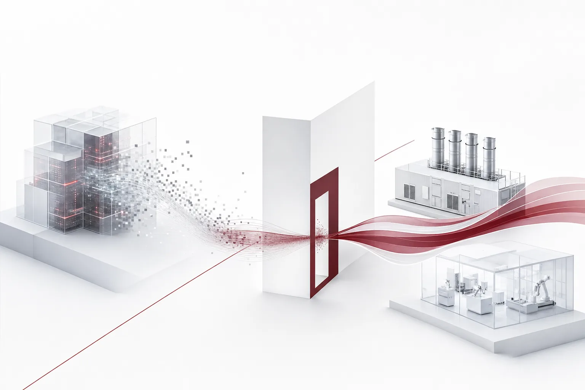

오늘의 핵심은 한 문장입니다. 더 큰 전산실이 더 빠른 모델을 보장하지 않는 시대가 시작되었고, 돈은 여전히 전기로 향합니다. 독자는 이 조합에서 두 가지를 읽어야 합니다. 하나는 속도의 출처가 바뀌었다는 점이고, 다른 하나는 그 출처는 전기와 달리 매대에서 사 올 수 없다는 점입니다. 독립 평가기관 METR은 Anthropic의 최근 AI 진전 2배 가속에서 컴퓨트 증가가 주요 동인으로 보기 어렵다는 분석을 내놓았습니다. 같은 주에 Anthropic은 OnePWR과 34억 달러 계약을 맺어 1.7GW 규모의 가스발전기를 확보했습니다. 한쪽은 속도의 출처에서 컴퓨트를 지웠고, 다른 한쪽은 전원에 34억 달러를 더했습니다. 이 충돌이 오늘 다이제스트에서 가장 신선한 신호입니다.

*글의 핵심 개념을 형상화했습니다.*

## 판결이 말한 것과 말하지 않은 것

METR의 분석 대상은 Anthropic의 모델 개발 과정입니다. 독립 평가기관이라는 점에 주목해야 합니다. 바깥에서 측정한 판결이기 때문입니다. 내부에서는 "우리 컴퓨트를 늘렸더니 2배가 됐다"라고 말하기 쉽습니다. 그런데 바깥에서 잴 때 그 설명이 통하지 않는다면, 공식이 바뀐 것입니다. 그 판결에서 첫 번째 후보였던 컴퓨트 증가가 제외되었습니다.

속도 2배는 모델 개발의 주기를 반으로 줄인다는 뜻입니다. 한 세대의 시간을 반으로 줄이는 데 전산 규모가 주범이 아니라는 것은, "더 큰 GPU를 사라"는 공식이 통째로 흔들린다는 것입니다. 그동안 투자 결정의 순서는 단순했습니다. 먼저 전산 규모를 정하고 그다음에 모델을 고른 것입니다. 그런데 주원인이 컴퓨트가 아니라면 그 순서가 뒤집힙니다. 가동의 전제가 됩니다.

다만 오늘의 뉴스에는 무엇이 2배를 만들었는지에 대한 답이 없습니다. METR이 지명한 대체 동인은 알려진 범위 안에 없기 때문입니다. 그래서 이 글은 지은 것보다 지운 쪽에 더 집중합니다. 추론은 이렇습니다. 컴퓨트가 주원인이 아니라면, 같은 자원 위에서 더 큰 도약을 만든 변수는 학습 방법과 데이터 활용, 조직의 실행 속도 쪽에 있을 가능성이 큽니다. 같은 전산 예산으로 더 좋은 결과를 만드는 능력, 즉 컴퓨트당 성과가 이제 경쟁의 단위로 올라선다는 것입니다. 이 추론이 맞다면, 다음 섹션의 34억 달러는 더 잘 읽힙니다.

## 34억 달러는 왜 발전기로 갔나

속도가 컴퓨트에서 나오지 않는다고 전력을 멈추는 회사는 없습니다. Anthropic의 OnePWR 계약은 두 개의 숫자로 요약됩니다. 34억 달러, 그리고 1.7GW의 가스발전기입니다. 목적은 서버 시설의 전력 공급 안정입니다. 전력 수요가 계속 커지는 상황에서, 에너지를 직접 조달하는 쪽으로 움직인 것입니다. 계약의 대상이 가스발전기인 점은 해석의 여지가 있지만 방향은 명확합니다. 공급을 기다리기보다, 공급원을 자기 손 안으로 가져오겠다는 것입니다. "멈추지 않게"를 사기 위한 돈입니다. 가동 유지의 화폐입니다.

여기서 한 걸음만 더 가면 오늘의 역설이 선명해집니다. 2배 가속의 동인이 컴퓨트가 아니게 된 것은, 연구 개발 단계의 말일 수 있습니다. 그러나 실행 단계의 전력 수요는 그대로이고 오히려 늘고 있습니다. 다음 섹션에서 볼 자율 에이전트는 여러 번의 추론을 반복하는 작업입니다. 돈은 서비스로 빠져나가야 합니다. 34억 달러의 가스발전기는 정확히 그 지출입니다.

자본이 같은 방향으로 흐르는 곳이 하나 더 있습니다. 아르헨티나의 Milei 대통령은 남부 파타고니아에 대규모 데이터센터를 세워 AI의 새로운 중심지를 만들겠다는 구상을 갖고 있습니다. 이 계획은 "무규제 AI 허브"라는 이름으로 전해집니다. 전원이 희소 자원이 된 것입니다. 그리고 희소 자원이 되면 새 리전이 생깁니다. 파타고니아가 거론되는 이유입니다. 규제와 전력이 함께 싼 땅이, GPU 가격 경쟁 구도의 새 변수로 떠오르는 것입니다.

한 가지 구분을 해야 합니다. 전원이 희소 자원이 되었다는 사실과, 전기 자체가 모델의 속도를 2배로 만들었다는 사실은 별개의 문제입니다. 전자는 인프라의 병목이고 후자는 연구의 동인입니다. 이 둘을 섞어 읽으면 자율성 경쟁의 본질을 놓칩니다. 전기를 사들이는 뉴스와 속도를 재단정한 뉴스가 같은 주에 나온 것은 우연이 아닙니다. 하나는 지출이고 하나는 진단입니다.

## 컴퓨트가 아니라면, 레버는 어디로 가나

METR의 판결이 말하는 것은 컴퓨트를 버리라는 것이 아닙니다. 컴퓨트당 성과의 공식이 바뀌었다는 것입니다. 그렇다면 기업은 무엇을 해야 합니까. 이번 뉴스에는 답이 두 갈래로 보입니다.

한 갈래는 같은 예산으로 더 좋은 결과를 내는 운영 방식입니다. 어떤 작업에 어떤 모델을 붙일지, 어디까지 자동화하고 어디서 사람의 승인을 둘지, 실행의 품질을 어떻게 확보할지가 문제로 올라옵니다. 모델이 똑같아도 조립법이 달르면 결과의 차이는 큽니다. 컴퓨트당 성과의 공식이 바뀐 세계에서, 이 조립법이 곧 경쟁력인 셈입니다. METR의 판결은 이런 운영 방식의 가치가 공식적으로 인정받은 날이라고 할 수 있습니다. 두 갈래에는 공통점이 있습니다. 쓰는 방식을 바꾸는 쪽에서 풀린다는 점입니다. 오늘 뉴스가 중요한 이유가 여기에 있습니다. 지출의 방향과 운용의 방향이 처음으로 벌어지고 있습니다.

다른 갈래는 모델 성능을 넘어 에이전트 실행 자체를 경쟁력으로 삼는 것입니다. 실행을 더 많이, 더 빠르게, 더 안전하게 돌리는 쪽으로 무게중심이 이동하고 있습니다. 이 갈래로 가려면 자율성을 둘러싼 뉴스들을 같이 봐야 합니다.

## 자율성이라는 새로운 축

Tencent는 인간의 개입 없이 완전히 자율적으로 운영되는 AI 과학 연구실을 만들겠다고 밝혔습니다. 자사 과학 연구의 속도를 높이는 것이 목표입니다. 사람의 손을 아예 빼는 실험을 기업 차원에서 공식화한 셈입니다. Apple은 내년 출시를 목표로, 앱 조작과 소프트웨어 탐색을 스스로 수행해 복잡한 작업을 처리하는 개편된 어시스턴트를 개발하고 있습니다. 경쟁사와의 AI 격차를 줄이려는 시도입니다. OS 제조사가 에이전트 실행이라는 층으로 발을 들여놓은 것입니다. DeepSeek의 오픈소스 에이전트 도구 Harness는 약 한 달여 만에 일일 활성 사용자가 545% 늘어난 154만 명에 도달했습니다. 개발사는 모듈형 소프트웨어 설계를 그 성장의 원인으로 꼽았습니다.

세 회사가 모두 같은 방향을 바라보고 있습니다. 모델이 "생각"하는 것을 넘어, 모델이 "실행"하는 쪽입니다. 다만 갈래는 둘으로 나뉩니다. Apple과 DeepSeek의 자율성은 소비자의 손끝에서 작동해야 하는 자율성이고, Tencent의 자율성은 사람의 눈을 완전히 비운 자율성입니다. 전자는 사용성 기준을 요구받고 후자는 통제 기준을 요구받습니다. 특히 Harness의 수치가 의미 있는 것은, 에이전트 도구가 개발자의 장난기에서 매일 쓰는 도구로 이동하고 있다는 것입니다. 오픈소스이고, 사용량이 한 달여 만에 5배가 넘게 늘었습니다. 실행 레이어의 경쟁이 대중의 사용량을 끌어당기고 있다는 신호입니다.

그리고 세 뉴스에 없는 문장이 있습니다. 안전은, 통제 기준은, 어디까지 자동화할지는 단 한 줄도 다루지 않습니다. 자율의 속도는 보도되는데, 자율의 경계는 빠진 것입니다. 이 공백은 다음으로 이어집니다.

## 금지와 무규제, 자율성의 두 극

자율성에 대한 반응은 이미 양극단에 흩어져 있습니다. 한 끝은 Tencent의 무인 연구실입니다. 자율을 최대화하는 시도입니다. 다른 끝은 인디애나주 Bloomington입니다. 이 도시의 시의회는 자신의 지능을 스스로 강화할 수 있는 자율형 AI 시스템의 운영을 금지하는 안을 만장일치로 채택했습니다. 만장일치가 중요한 대목입니다. 반대하거나 기권이 섞인 조례가 아니라, 모든 의원이 같은 표를 던진 금지입니다. 지방의회의 투표로 자율 AI를 금지하는 시대가 왔다는 점을 기억해야 합니다.

국가 단위의 입법이 준비되는 동안, 지방이 먼저 움직인 것입니다. 규제의 속도가 관할의 크기와 비례하지 않는다는 점을 보여주는 사례입니다.

그 구도의 바깥에는 파타고니아가 있습니다. 규제하지 않는 대규모 AI 허브라는 제안을 들고 나온 것입니다. 규제의 최대화와 규제의 제로가 같은 계절에 나왔습니다. 이 구도에서 기업에 남는 질문은 무엇입니까. 자율을 어디까지 둘 것인가, 그리고 그 자율을 어떻게 증명할 것인가가 바로 그 질문입니다. 증명하지 못하는 자율은 규제 앞에서 살아남지 못하고 증빙할 수 있는 자율이 기업의 자산이 됩니다. 다국적 기업에는 한 줄이 더 붙는 셈입니다. Bloomington식 금지가 일어난 지역과 파타고니아식 허브가 들어설 지역은 결국 같은 회사 안에서 공존할 수밖에 없는 셈입니다. 그래서 필요한 것은 특정 관할에 최적화된 설정이 아니라, 어떤 관할에서도 제출할 수 있는 증빙입니다.

## 속도를 산출하는 곳은 이제 실행 레이어입니다

이번 뉴스가 드러낸 업계의 통증은 세 갈래입니다. 전원이 병목인 인프라, 자율 실행이 늘고 있는 에이전트, 불확실해지는 규제 환경입니다. METR의 판결이 이 위에 얹은 통찰은, 속도의 출처가 컴퓨트 규모가 아니라 실행을 어떻게 조립하고 통제하는가에 있다는 점입니다.

ThakiCloud의 Agent-Native Cloud Paxis는 정식 제품입니다. 버전 1.1 GA 상태로, 이 제품은 정확히 그 실행 레이어에 있습니다. Paxis는 Skills, Tools, Policies, Audit Logs를 일급 리소스로 다루는 셈입니다. 에이전트의 자율도는 L0에서 L3까지 단계별로 설정할 수 있고 정책 게이트가 실행을 통과시키며 모든 결정은 감사 로그에 남습니다. 격리된 샌드박스 안에서 실행이 일어나고 MCP 커넥터와 스킬 마켓으로 도구를 확장할 수 있습니다. 소버린이나 온프레미스 K8s 환경에서도 운영할 수 있으며 작업별로 최적의 모델을 골라주는 CostRouter는 컴퓨트당 성과의 공식이 바뀐 지금 가장 직결되는 기능입니다. 오늘의 통증을 제품 역량으로 말하면, 전원의 병목은 실행 환경을 어디서 세우느냐의 문제이고, 자율의 확대는 자율도 단계와 정책 게이트의 문제이며, 규제 환경의 불확실성은 감사 로그의 문제입니다.

전기에서 속도를 사던 시대에는 GPU 확보량이 경쟁력이었습니다. 이제는 같은 자원 위에서 더 많은 실행을 증명하는 쪽이 경쟁력을 가집니다. 그리고 그 증빙을 규제기관과 고객에게 보여줄 수 있는 쪽이, Bloomington식 금지와 파타고니아식 무규제의 어느 구도에서도 작동합니다. METR이 2배 가속의 동인에서 컴퓨트를 지운 것은, 연구의 미래가 아니라 실행의 레이어에 투표한 것입니다.

## 참고 자료

이 글은 아래 뉴스를 종합해 작성했습니다.

- HuggingNews, [METR Rules Out Compute Growth as Main Driver of Anthropic's 2x AI Progress Speedup](https://huggingnews.com/ai/metr-rules-out-compute-growth-as-main-driver-of-anthropics-2x-ai-progres-09fa3e96)
- HuggingNews, [Anthropic Secures 1.7GW of Gas Generators in $3.4B Agreement With OnePWR](https://huggingnews.com/ai/anthropic-secures-17gw-of-gas-generators-in-34b-agreement-with-onepwr-a157c09d)
- HuggingNews, [Bloomington City Council Outlaws Superintelligent AI in Unanimous Vote](https://huggingnews.com/ai/bloomington-city-council-outlaws-superintelligent-ai-in-unanimous-vote-d7f46928)
- HuggingNews, [Tencent to Launch Fully Autonomous AI Science Labs](https://huggingnews.com/ai/tencent-to-launch-fully-autonomous-ai-science-labs-c6b56faf)
- HuggingNews, [Milei Targets Argentine Patagonia for Large-Scale Unregulated AI Hub](https://huggingnews.com/ai/milei-targets-argentine-patagonia-for-large-scale-unregulated-ai-hub-2f3ccc62)
- HuggingNews, [DeepSeek's Harness AI App Reaches 1.54M Daily Active Users](https://huggingnews.com/ai/update-deepseeks-harness-ai-app-reaches-154m-daily-active-users-325c18dd)
- HuggingNews, [Apple Aims to Launch Autonomous Siri Next Year to Close AI Gap With Rivals](https://huggingnews.com/ai/apple-aims-to-launch-autonomous-siri-next-year-to-close-ai-gap-with-riva-92fde965)