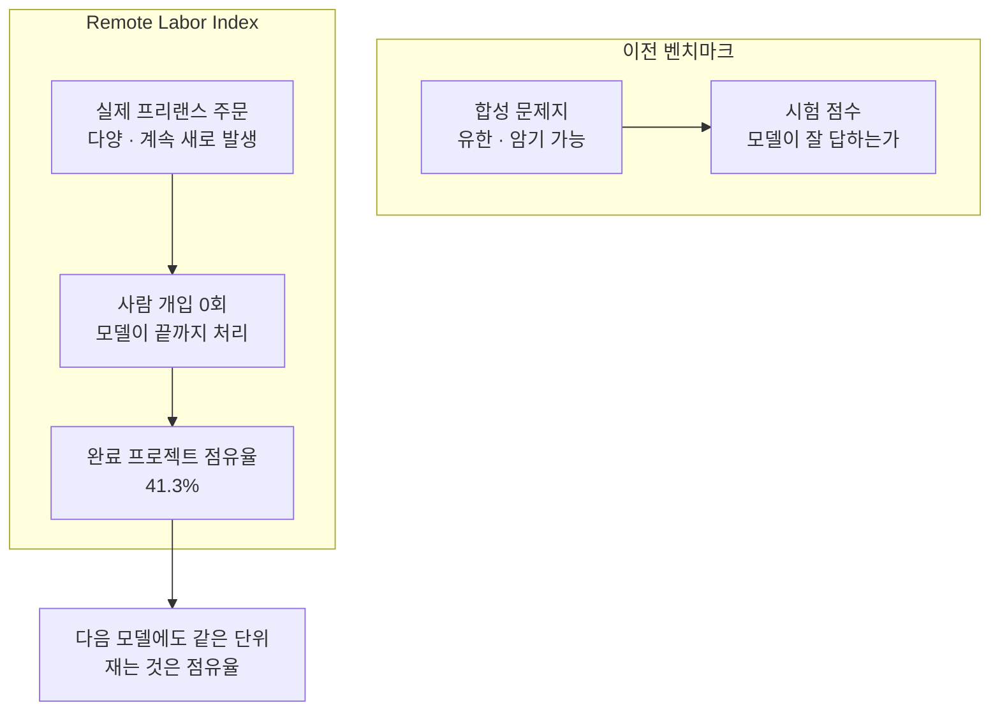
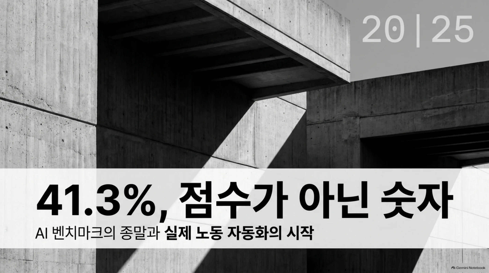
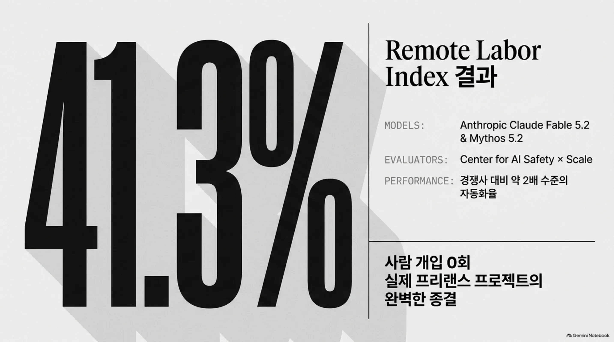
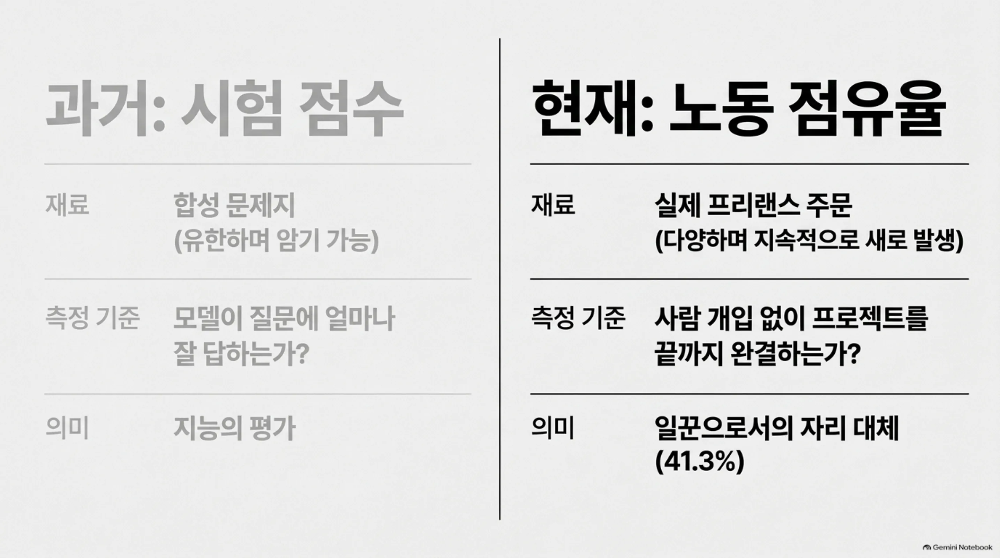
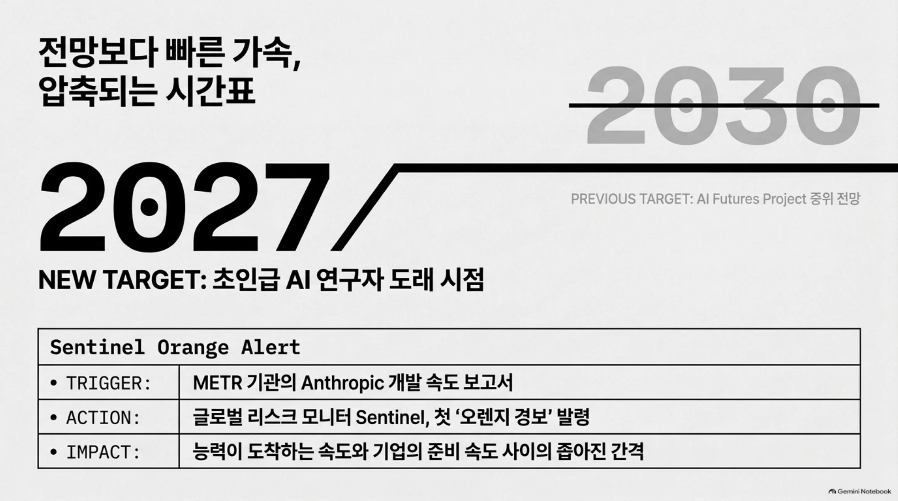

오늘 아침 뉴스에는 벤치마크 점수로 보기 어려운 숫자가 하나 있다. AI 모델이 사람의 손길을 전혀 받지 않고 끝낸 실제 프리랜스 작업의 점유율, 41.3%는 시험 결과가 아니라 노동 시장의 조각이다. 오늘 HuggingNews 다이제스트의 중심 스토리는 Anthropic의 Claude Fable 5.2와 Mythos 5.2입니다. 두 모델은 Center for AI Safety와 Scale이 함께 운영하는 Remote Labor Index에서 실제 프리랜스 프로젝트의 41.3%를 완전 자동화했습니다. 보도의 헤드라인에 따르면 자동화율은 경쟁사 대비 거의 두 배 수준인 셈입니다. 이 벤치마크를 구성하는 것은 실제 일인가. 점수라는 형식도, 문제라는 재료도, 결과를 읽는 방식도 동시에 바뀌었습니다. 재는 대상을 일 자체로 바꾼 순간, 숫자가 알려주는 것은 모델이 일의 얼마를 맡게 되는가입니다. 이 한 가지 변화는 다른 스토리에서도 다른 모양으로 또 보입니다. 전망보다 빠른 가속, 첫 리스크 경보, 상품처럼 퍼지는 모델 풀, 그리고 무역 정책에 얽힌 하드웨어 층. 모델의 재능과 모델을 도는 장소는 같은 아침에 같은 속도로 경쟁을 시작했습니다. 오늘 이 스토리들을 하나씩 읽어 보겠습니다.

## 일을 재는 벤치마크

Remote Labor Index는 그간 본 벤치마크와 다른 잣대로 잽니다. 단위는 의뢰를 받아 결과물을 전달하기까지의 프로젝트 전체를 끝까지 자동화한 점유율입니다. 이 점유율이 담는 것은 실제 프리랜스 작업, 사람이 받고 처리한 진짜 주문입니다. 실제 주문이라는 점이 이 벤치마크의 차이입니다. 합성 문제지는 유한해서 암기할 수 있지만 프리랜스 시장의 주문은 다양하고 새로 생겨나 벤치마크를 조작하기 어렵습니다. 완전이라는 말도 무겁습니다. 사람이 중간에 한 번도 개입하지 않고 모델 혼자 프로젝트를 끝까지 도왔다는 뜻입니다. 부분적 도움에서 멈추는 평가라면 사람이 끝까지 따라가지만 여기서는 모델이 마지막 구간까지 채웁니다. 한 가지 더 짚을 것은, 이번 평가에 나선 것이 두 모델이라는 점입니다. Claude Fable 5.2와 Mythos 5.2는 같은 벤더의 모델이지만 별개의 라인이고 두 모델이 함께 이 점유율을 기록했다는 것은 제품군 전체가 일의 점유율로 움직이기 시작했다는 말입니다. 거의 두 배라는 경쟁사 비교도 이 잣대 위에서 성립합니다. 즉, 회사 사이의 능력 격차는 몇 점의 차이로만 잴 단계가 지난 것입니다. 프리랜스 작업의 10건 중 4건 넘는 것을 모델이 통째로 맡을 수 있는 범위까지 온 것입니다. 41.3%가 보여 주는 바로 그 자리입니다. 같은 지수는 다음 모델에도 그대로 적용됩니다. 새 모델이 나올 때마다 재어지는 것은 점유율입니다. 이 숫자는 모델이 잘 답하는 것과 일 전체가 끝나는 것, 둘은 다른 의미로 읽힙니다. 후자의 경우 모델은 일을 하는 사람의 자리를 채우기 시작합니다. 그래서 이 숫자는 점수로 부르기 어렵습니다. 평가의 대상이 작업이 됐기 때문에 모델은 일꾼으로 평가받고 있습니다.

*재는 단위가 바뀐 자리입니다. 합성 문제지의 시험 점수가 아니라, 실제 프리랜스 작업을 사람 개입 없이 끝까지 완결한 점유율을 잽니다.*

## 전망보다 빠른 속도

가속의 이야기는 같은 뉴스 사이클에서 나왔습니다. 독립 평가기관 METR은 Anthropic의 AI 모델 개발이 빠르게 진행되고 있다고 보고했습니다. 외부에서 개발 속도를 재는 기관의 보고가 업계의 리스크 경보 체계까지 움직이게 됐다는 것은 이전까지 보기 어려웠던 연결입니다. 이 보고를 근거로 글로벌 리스크 모니터 Sentinel은 첫 오렌지 경보를 발령했습니다. 업계의 리스크를 훑어보는 모니터가 한 회사의 모델 개발 속도를 두고 경보를 올렸다는 사실 자체는, 속도가 이제 업계가 함께 지켜보는 지표가 됐다는 말입니다. 같은 시간대 AI Futures Project는 초인급 AI 연구자가 나타나는 시점에 대한 중위 전망을 약 2030년에서 2027년으로 당겼습니다. 그 프로젝트는 실제 개발 속도가 자체 기존 전망보다 앞서고 있다고 판단했습니다. METR의 한 보고서가 경보 발령과 전망 수정을 같은 주에 만들었습니다. 경보가 겨냥하는 것은 능력이 도착하는 속도와, 그것을 받는 쪽의 준비 속도 사이의 간격입니다. 초인급 연구자 전망이 2027년으로 당겨진다는 것은, 기업이 에이전트 도입을 계획할 때 쓰던 시간표가 그만큼 앞당겨진다는 계산입니다. 조금 더 지켜보자는 판단을 내려둔 기업들은 그 창이 줄어든 것입니다. 세 사건은 같은 방향을 가리킵니다. 속도가 일정을 압축하고 있습니다. 기업에서 2030년 지평으로 그리던 계획은 이제 2027년 지평으로 다시 그리게 됩니다. 능력의 질문이 어디까지 가느냐에서 얼마나 빨리 도착하느냐로 옮겨가면, 준비의 질문도 같이 옮겨가야 합니다.

## 모델이 풀이 되는 시간

능력이 오르는 동안, 모델의 유통 방식은 상품 쪽으로 이동합니다. Google은 11월 10일 프런티어 모델 Gemini 4 Carbon을 공개했습니다. 그전에는 약 두 주간 제한적 접근으로 운영됐습니다. Google Cloud Platform과 Agent Studio에서 공개 접근이 제공됩니다. 에이전트 플랫폼이 모델과 함께 손에 쥐어지는 순간입니다. 그동안에는 API를 부르는 것으로 모델을 썼지만 이제 모델이 일하는 장치가 같은 패키지로 따라옵니다. 하이퍼스케일러의 에이전트 스튜디오는 이제 프런티어 모델의 기본 도착지입니다. 프런티어 모델의 공개가 에이전트 플랫폼과 동시에 이뤄지는 한, 기업은 모델을 고르는 일과 실행 환경을 고르는 일을 같은 자리에서 동시에 하게 됩니다. 약물 발견 분야에서는 Geodesic의 NovaAtom-Lite가 벤치마크에서 AlphaFold 3보다 좋은 성능을 냈습니다. 단백질, 핵산 같은 분자가 어떻게 결합하는지 파악하도록 설계된 모델입니다. 가장 좋은 모델은 한 개가 아니며 도메인마다 표준 모델의 자리가 특화 모델에게 바뀝니다. 일이 펼쳐지는 도메인이 넓을수록 모델 풀은 커집니다.

한 단계 아래 접근 계층도 상품이 됩니다. Stripe는 OpenRouter의 AI 토큰 라우팅과 비용 관리 도구를 비즈니스 생태계에 통합했습니다. 결제 프로세서인 이 회사는 특화 라우팅 도구를 생태계에 추가했고 기업을 대신해 AI 토큰 라우팅과 비용을 다루는 기능을 내장하게 됐습니다. 토큰 라우팅은 이제 결제 프로세서의 운영 대시보드에 들어가는 항목이 됐습니다. 모델 접근이라는 계층은 비 AI 기업의 시스템에 기능으로 들어옵니다. 한 층 더 아래, 하드웨어도 변수가 됩니다. Microsoft는 중국산 신규 광 트랜시버 수입 제한이 미국 AI 데이터센터 건립을 지연시킨다고 경고하며 White House에 계획 포기를 촉구했습니다. AI를 지탱하는 인프라가 무역 정책과 얽히면서 클러스터가 언제 얼마나 공급될지가 운영 계획의 전제가 됩니다. 모델은 풀이 되고 접근은 상품이 되며 하드웨어는 정치적 변수가 됩니다. 경쟁은 조용히 모델 아래로 이동하고 있습니다.

## 그러면 기업은 무엇을 사나

재는 단위가 일이 되면, 기업이 묻는 것도 바뀝니다. 예전의 질문은 모델이 얼마나 똑똑한가였습니다. 지금은 에이전트를 어디에서 일하게 하고 그 일을 어떻게 증명하는가입니다. Anthropic의 움직임이 이 방향을 보여줍니다. Claude 어시스턴트의 초점을 기업 부문으로 이동시키고 법률 등 전문 직군 종사자를 위한 특정 기능을 설계하고 있습니다. 민감한 정보를 다루는 직군에서는 능력은 전제이고 데이터가 어디로 가는가와 에이전트의 행동을 누가 확인할 수 있는가가 문제입니다. 법률 직군을 겨냥한 어시스턴트가 만지는 문서는 회사의 가장 민감한 자료에 가깝습니다. 일이 많이 끝날수록 이 질문은 더 무거워집니다. 전문 직군으로 향하는 기업 공세가 시작되는 시점은, 완전 자동화라는 말이 벤치마크 보도에 실리기 시작한 바로 그 시점입니다. Google DeepMind의 최근 프로젝트도 이 흐름을 잇습니다. AlphaProof Code 프레임워크를 이용해 Signal 메시징 프로토콜의 프로덕션 기계 코드 보안 특성을 형식적으로 증명했습니다. 약 한 달간 진행한 프로젝트입니다. 실제로 돌아가는 프로덕션 코드에 형식적인 보증을 세운 작업입니다. 형식 검증이 실험의 영역을 넘어 운영의 영역으로 들어오고 있다는 신호이기도 합니다. 실제 일의 41.3%를 끝까지 혼자 처리하는 모델이 있다면, 기업은 일을 처리하는 에이전트에게 같은 수준의 증명을 요구하게 됩니다. 잘했느냐는 벤치마크의 질문이고 권한 안에서 했으며 그것을 증명할 수 있느냐는 기업의 질문입니다. 후자의 질문에 답하지 못하면, 전자의 점수는 의미가 흐려집니다. 기업의 구매 기준은 이제 실행 보증 쪽으로 옮겨갑니다.

## 플랫폼이라는 렌즈

오늘의 뉴스가 남기는 질문이 가장 많이 모이는 곳은, 에이전트 일의 기반이 어디인가입니다. Paxis는 ThakiCloud가 이 질문에 답하기 위해 만든 Agent-Native Cloud입니다. 이미 출하된 정식 제품(v1.1 GA)으로 일급 리소스는 Skills, Tools, Policies, Audit Logs입니다. 에이전트의 자율도 L0~L3를 거버넌스로 관리하고 각 행동 앞에 정책 게이트를 두며 그 이력을 감사 로그로 남깁니다. 실행은 격리 샌드박스에서 일어나고 도구와 기능은 MCP 커넥터와 스킬 마켓으로 이어집니다. 소버린, 온프렘 K8s(ai-platform) 환경이면 회사 내부 네트워크 안에서도 돌리고 작업별 모델 선택(CostRouter)으로 어떤 작업엔 어떤 모델을 쓰는지 정합니다.

오늘의 뉴스는 이 기반 위에서 자연스럽게 읽힙니다. 41.3%의 업무 자동화는 안전 실행의 질문을 듭니다. 에이전트는 격리 샌드박스 안에서 일하고 각 행동은 정책 게이트를 지나야 합니다. 실제 주문을 통째로 맡긴 뒤에 필요한 안전장치가 바로 이 구조입니다. Sentinel의 첫 오렌지 경보와 2027년 전망은 자율도의 질문을 듭니다. 에이전트가 스스로 처리할 수 있는 수준을 L0~L3로 나누어 거버넌스하는 것은, 능력이 빠르게 도착할수록 더 정밀해져야 하는 일입니다. Gemini 4 Carbon의 공개와 NovaAtom-Lite의 등장은 모델 풀 관리의 질문을 듭니다. 단일 모델에 건지기보다는 작업마다 모델을 고르는 CostRouter가 필요한 이유를, 오늘의 뉴스가 대신 보여 줍니다. 법률 같은 민감 도메인으로 향한 기업 공세는 데이터 소재의 질문을 듭니다. 그 질문에 답하는 것은 회사 네트워크 안에 두는 온프렘 K8s 환경입니다. 네 질문이 공유하는 것은 통제된 실행 계층입니다.

## 준비해야 할 질문

다음 벤치마크 보고에서는 일 점유율의 숫자와 시험 점수의 숫자가 나란히 실릴 것입니다. 전망보다 빠른 능력과 뒤따르는 경보, 풀이 된 모델과 상품화된 접근, 이 모든 것은 기업에 한 가지 질문의 형태로 내려옵니다. 일의 기반을 어디에 두느냐. 2027년 전망과 같은 주 안에 터진 오렌지 경보는 준비 기간이 짧다는 신호입니다. 기업의 다음 결정은 에이전트를 어디에서 일하게 하고 어떻게 증명할지로 내려질 것입니다. 그 결정을 미루는 동안, 일의 점유율은 조용히 커질 것입니다.

## 참고 자료

이 글은 아래 뉴스를 종합해 작성했습니다.

- HuggingNews, [Anthropic's Claude Fable 5.2 Automates 41.3% of Freelance Projects on Remote Labor Index, Nearly Doubling Rivals](https://huggingnews.com/ai/anthropics-claude-fable-52-automates-413percent-of-freelance-projects-on-d98f16dc)
- HuggingNews, [Google Launches Gemini 4 Carbon Publicly on Google Cloud and Agent Studio](https://huggingnews.com/ai/google-launches-gemini-4-carbon-publicly-on-google-cloud-and-agent-studi-8cd567bc)
- HuggingNews, [Global Risk Monitor Sentinel Issues First Orange Alert Over METR Report on Anthropic AI Speedup](https://huggingnews.com/ai/global-risk-monitor-sentinel-issues-first-orange-alert-over-metr-report-083a1f18)
- HuggingNews, [AI Futures Project Pulls Superhuman AI Researcher Forecast to 2027 From 2030 After METR Report](https://huggingnews.com/ai/update-ai-futures-project-pulls-superhuman-ai-researcher-forecast-to-202-5a83245c)
- HuggingNews, [Anthropic Targets Corporate Knowledge Workers With Expanded Claude AI Productivity Suite](https://huggingnews.com/ai/anthropic-targets-corporate-knowledge-workers-with-expanded-claude-ai-pr-510c68ca)
- HuggingNews, [Google DeepMind's AI Formally Verifies Signal's Production Machine Code](https://huggingnews.com/ai/google-deepminds-ai-formally-verifies-signals-production-machine-code-a7312e09)
- HuggingNews, [Stripe Integrates OpenRouter to Manage AI Token Routing and Costs for Businesses](https://huggingnews.com/ai/stripe-integrates-openrouter-to-manage-ai-token-routing-and-costs-for-bu-b8a5e45a)
- HuggingNews, [Microsoft Warns Proposed Ban on Chinese Optical Transceivers Would Delay US AI Data Centers](https://huggingnews.com/ai/microsoft-warns-proposed-ban-on-chinese-optical-transceivers-would-delay-55a3553c)
- HuggingNews, [Geodesic's NovaAtom-Lite Outperforms AlphaFold 3 on Drug Discovery Benchmark](https://huggingnews.com/ai/geodesics-novaatom-lite-outperforms-alphafold-3-on-drug-discovery-benchm-b5c2982c)
