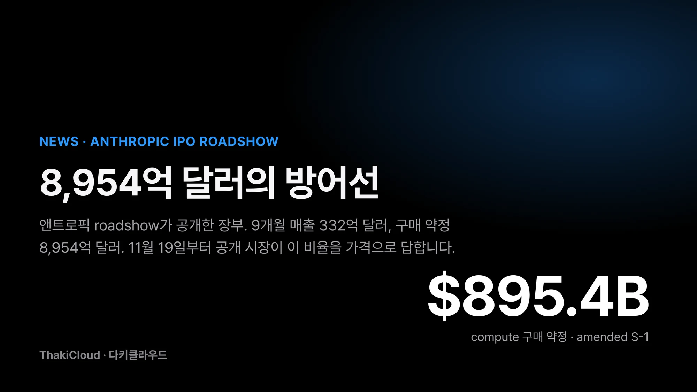
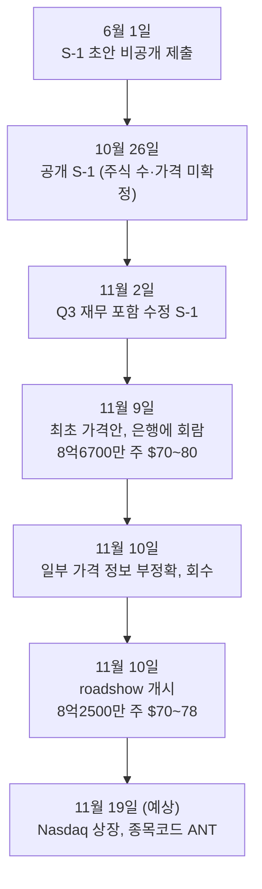
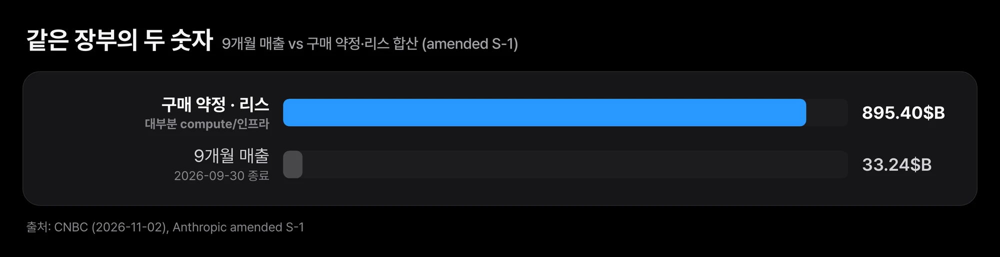
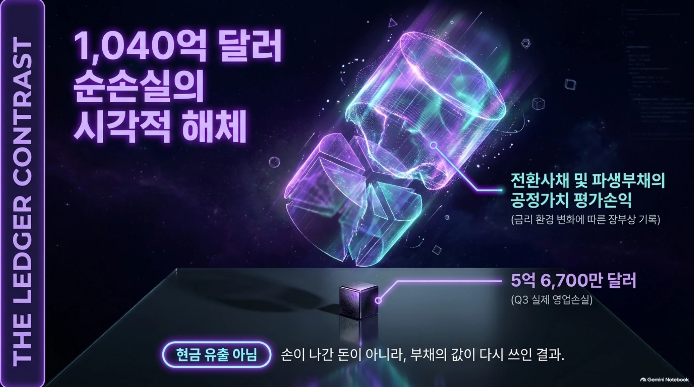
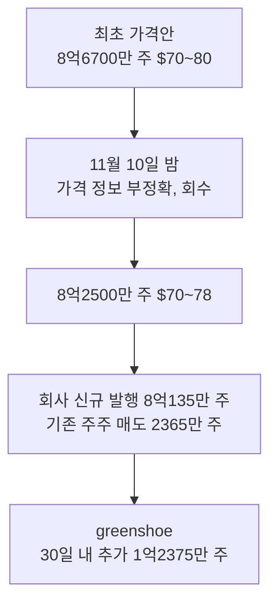
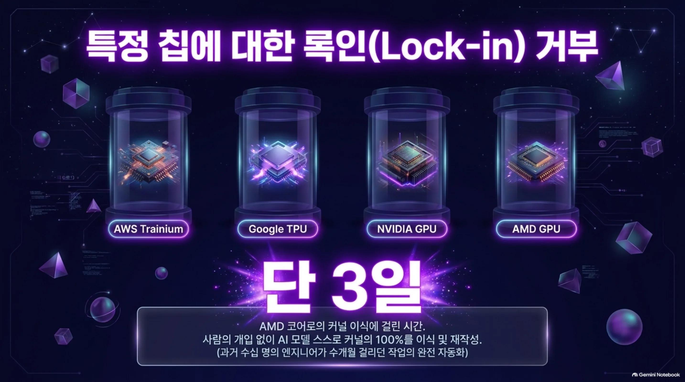
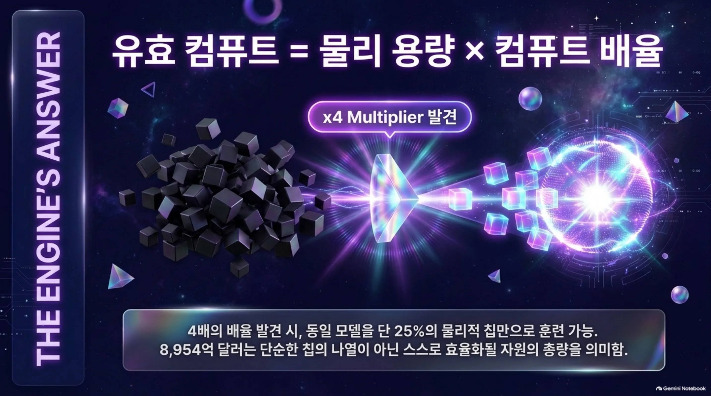
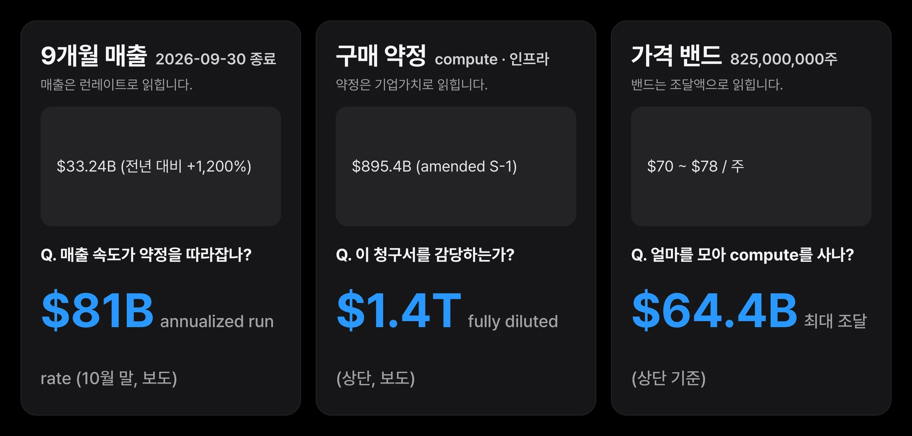
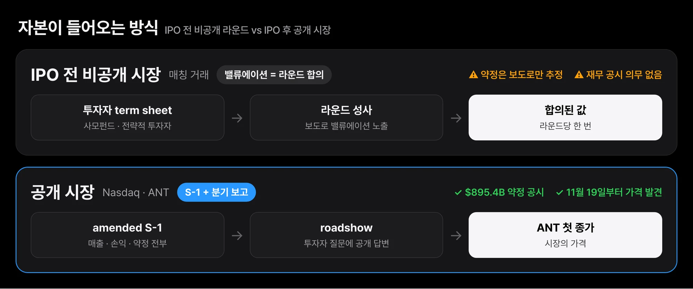
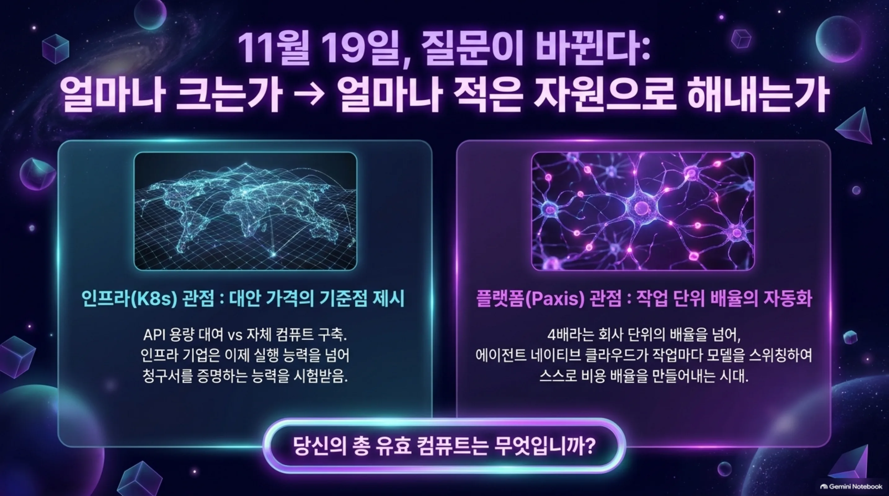

AI 서비스 예산을 맡고 있거나, AI 기업의 자본 움직임을 보는 사람이라면, 11월 10일부터 진행 중인 roadshow를 놓칠 수 없습니다. Anthropic이 Nasdaq 상장을 위한 roadshow를 시작했습니다. 첫날엔 최초 가격안이 철회됐고, roadshow 영상에선 회사 스스로가 8,954억 달러짜리 compute 구매 약정을 어떻게 돌리겠다고 설명합니다. 이번 roadshow는 AI 산업의 가장 큰 compute 장부를 처음 공개한 사건입니다. 공개 시장은 11월 19일부터 그 장부에 점수를 매깁니다.

어제는 이 IPO가 만든 교차 투자 식탁을 봤습니다. 오늘의 주제는 roadshow 그 자체입니다. 질문은 하나입니다. 매출 332억 달러에 구매 약정 8,954억 달러인 장부를, 공개 시장이 받아들이는가. 이 글은 그 장부와, 철회와, 회사의 답변을 그 순서대로 정리합니다. 이번 roadshow에는 세 가지가 함께 일어났습니다. 첫 가격안의 회수와 재개, 회사가 스스로 compute를 설명한 영상의 공개, 그리고 11월 19일이라는 상장일 확정. 이 세 사건의 주제는 하나입니다. 청구서에 어떻게 답할 것인가.

*S-1이 공개한 장부의 핵심. 매출과 약정의 차이를 한 장에 담았습니다.*

## 쉽게 말하면

할부 딱지로 비유해 보겠습니다. 현금을 못 내는 회사가 내일 쓸 물건에 할부 계약을 맺으면, 계약서에는 지금까지 버는 금액과 앞으로 낼 할부금이 전부 적힙니다. Anthropic이 낸 S-1은 그 계약서입니다. 9개월간 받은 매출 332억 달러, 지은 부채, 그리고 앞으로 낼 할부금 8,954억 달러가 한 장면에 적혀 있습니다. roadshow가 시작되면 이 계약은 회사와 소수 투자자 사이의 사적 대화에서 나옵니다. 누구나 장부를 읽고, 11월 19일부터는 각 장에 가격도 붙습니다. 할부 계약에도 한 가지 추가 옵션이 있습니다. 30일 안에 쓰면 할부를 한 번 더 늘릴 수 있는 옵션. greenshoe 옵션이 1억 2375만 주입니다. 이 옵션 역시 공개된 뒤에야 보이는 값입니다.

## 한 달에 세 번 바뀐 장부의 모양

먼저 절차입니다. 6월 1일, S-1 초안이 비공개로 제출됐습니다. 10월 26일, 공개 S-1이 제출됐는데 그날만 해도 주식 수와 가격 밴드는 정해지지 않았습니다. 11월 2일에는 Q3 재무가 담긴 수정 S-1이 추가됐습니다. 11월 9~10일엔 최초 가격안 회수와 roadshow 개시가 이어졌습니다. 한 달 사이 장부의 모양이 세 번 바뀝니다.

*절차의 핵심. 가격안은 수차례의 정정 위에 다시 열린 발표입니다.*

날짜를 보면 roadshow는 정정의 연속입니다. 최초 가격안은 "일부 가격 정보가 부정확하다"는 이유로 하루 만에 거둶들여졌습니다. 철회 자체가 뉴스가 된 이유는, 가격 밴드가 이제 시장의 질문을 받는 자리에 놓였다는 점입니다.

한 가지만 주목해 보겠습니다. 공식 발표문의 날짜는 11월 10일, 회수와 같은 날입니다. 가격안 회수와 roadshow 개시가 같은 날 안에 일어났다는 뜻입니다. 회사는 멈춰 서서 기다리지 않았습니다. 틀린 안을 걷어내고, 바로잡은 패키지로 같은 날 다시 열었습니다. 그 속도 자체가 이번 사연의 일부입니다.

## 매출의 27배, 8,954억 달러의 구매 약정

장부에서 가장 큰 숫자는 구매 약정입니다. 수정 S-1에 따르면 구매 약정과 리스 계약의 합산 규모는 약 8,954억 달러에 옵니다. CNBC 보도가 인용한 S-1 문구대로, 이 금액의 대부분은 compute와 인프라와 관련이 있습니다. 같은 9개월의 매출은 332억 달러 수준입니다. 약정이 매출의 약 27배가 되는 지점입니다.

*같은 장부의 두 숫자. 매출은 아직 한 자릿수억 달러 단위를 벗어난 지 오래됐고, 약정은 네 자리억 달러입니다.*

compute·인프라 비용만 봐도 같은 방향입니다. 9개월 사이 144억 달러 불었고, 전년 대비 증가율은 329퍼센트입니다. 이 청구서는 이미 매 분기 나가는 값입니다. CNBC는 Anthropic이 상당한 용량을 Amazon과 Google과 SpaceX에서 가져오며, 일부는 neocloud에 의존한다고 전했습니다. neocloud는 AI 학습·추론 GPU compute에 특화된 클라우드 공급업체를 가리키는 말로, 세 대클라우드 밖의 새 공급자입니다. 청구서를 내는 쪽에 전략적 투자자들이 함께 앉아 있습니다. compute의 공급자와 회사의 주주가 같은 식탁에 놓인 구조입니다.

분기 성장률도 함께 봐야 합니다. CNBC는 분기 성장률을 132퍼센트, 144퍼센트, 47퍼센트로 나열하며 성장 둔화를 짚었습니다. Q3 매출은 약 170억 달러로, 전년 동기 대비 증가율은 약 1,127퍼센트입니다. 여전히 두 자릿수 성장이지만, 곡선의 모양은 바뀌었습니다.

## 1,040억 달러의 손실, 대부분은 장부가 아닌 값

손실 숫자는 약정보다 큽니다. 9월 30일로 끝나는 9개월의 순손실은 1,040억 달러에 이릅니다. 2025년 동일 기간의 손실은 251억 달러였습니다. Q3 하나만 떼어내면 순손실이 232억 9천만 달러로 잡힙니다. 그러나 이 손실의 대부분은 이번 분기에 나간 현금으로 읽기 어렵습니다. CNBC 보도에 따르면 손실의 대부분은 전환사채와 파생부채의 공정가치 변동에서 옵니다.

할부 딱지 비유로 돌아갑니다. 계약서 자체가 갱신될 때마다 금리 환경이 바뀌면, 계약의 장부가 평가손익으로 잡힙니다. 핵심은 부채의 값이 다시 쓰인다는 것입니다. 현금 이탈과는 다른 장부입니다. Anthropic이 발행한 전환사채는 그 자리에 있습니다. 구체적으로는 이렇게 읽힙니다. 전환사채는 주식으로 전환될 수 있는 채권입니다. 회사의 가치가 오르면 채권의 전환 가치가 함께 오르고, 그만큼 더 줄 일이 큰 부채의 장부가 커집니다. 그 증가분이 지금 이 분기의 손실로 잡힙니다. 시장이 회사를 좋게 볼수록, 손실은 장부에 더 크게 적힐 수 있는 구조입니다. 현금의 흐름과는 별개의 장부입니다. 영업 손익은 또 별도의 장부에 있습니다.

*순손실의 대부분을 만든 공정가치 평가손과, 실제 영업 손익을 나란히.*

어제 [식탁 글](/ko/news/jensen-huang-risk-ai-supply-chain-table/)에서 전한 Q3 영업손실 5억 6700만 달러와 비교하면, 1,040억 달러 순손실은 다른 방식으로 읽어야 할 숫자입니다.

## 하루 만에 철회한 첫 가격안

roadshow에서 가장 뉴스가 된 순간은 철회입니다. Reuters와 FXStreet 보도에 따르면, 은행에 먼저 회람된 최초 가격안은 약 8억 6700만 주, 주당 70~80달러, 최대 693억 달러 조달이었습니다. 11월 10일 밤, 그 버전은 거둬들여졌습니다. 사유는 일부 가격 정보가 부정확하다는 것이었습니다.

재개된 roadshow는 더 작은 패키지로 열렸습니다. 8억 2500만 주, 주당 70~78달러. 이 가운데 8억 135만 주는 회사 신규 발행이고, 2365만 주는 기존 주주가 파는 물량입니다. 기존 주주 매각분의 대금은 회사가 받지 않습니다. 밴드 상단 기준, 회사가 가져가는 금액은 약 625억 달러이고, 전체 발행 규모는 최대 약 644억 달러입니다. 30일 안에 최대 1억 2375만 주를 추가 살 수 있는 greenshoe 옵션도 붙습니다.

*철회와 재개. 같은 roadshow에서 하루 사이에 바뀐 패키지.*

## 회사가 스스로 쓴 90쪽의 리스크

S-1에는 회사 스스로가 쓴 리스크 팩터가 있습니다. CNBC 보도에 따르면, 수정 S-1의 리스크 팩터는 90여 페이지입니다. 시장은 아직 질문하지 않았는데, 회사가 먼저 자기 취약점을 나열하는 장입니다. 공개된 보도 수치로 보면, 세 방향이 읽힙니다.

첫째는 compute 공급입니다. CNBC는 Anthropic이 상당한 용량을 Amazon, Google, SpaceX에서 가져오고, 일부는 neocloud에 의존한다고 전했습니다. 공급자가 곧 전략적 투자자입니다. 공급 조건이 바뀌면, 8,954억 달러 약정의 일정도 함께 바뀝니다.

둘째는 약정의 구조입니다. 구매 약정과 리스는 앞으로 계속 나가는 금액입니다. 매출 성장 곡선이 약정 곡선의 경사를 계속 따라갈 수 있는가. 그 물음을 공개 시장은 매 분기 다시 겁니다.

셋째는 부채의 재평가입니다. 1,040억 달러 손실의 대부분을 만든 전환사채와 파생부채의 공정가치 변동은, 회사의 가치와 손실 수치가 반대 방향으로 움직일 수 있음을 뜻합니다. 리스크가 크고 작은 문제가 아닙니다. 이제 그것은 공개적으로 답해야 하는 장이 되었습니다. 비공개 시장에서는 리스크 팩터가 회사와 투자자 사이의 문이었습니다. 공개 시장에서는 90쪽의 한 줄이 애널리스트 노트와 분기 비교의 대상이 됩니다.

그 90쪽을 읽을 때 한 가지를 기억해 두면 좋습니다. 일부 리스크는 회사가 잘될수록 더 커지는 구조입니다. 전환사채의 공정가치 평가손이 바로 그 유형입니다. 이 리스크 목록에서 손실 숫자만 떼어 읽으면, 장부가 거꾸로 읽힙니다.

## roadshow 영상이 말한 총 유효 컴퓨트

Anthropic의 roadshow 영상에는 "Approach to compute"라는 섹션이 있습니다. 영상의 자막을 추출한 Simon Willison은, 이 섹션에 이전까지 공개되지 않은 정보가 들어 있다고 짚었습니다. 영상에서 공동창업자 Tom Brown은 회사가 compute를 어떻게 돌리느냐를 직접 말합니다.

첫 번째 포인트는 칩입니다. Claude를 현재 네 개의 주요 칩 계열 전체에서 훈련하고 서빙합니다. AWS Trainium, Google TPU, NVIDIA GPU, AMD GPU. Brown은 AMD로의 이식이 "3일"이었다고 말합니다. 사람의 개입은 사실상 없었고, 모델이 커널의 거의 100퍼센트를 이식하거나 새로 썼다는 설명입니다. 과거 새 칩 플랫폼 온보딩은 수십 명의 엔지니어가 여러 개월을 쓰는 일이었습니다.

*roadshow 영상의 첫 번째 포인트. 네 계열 칩 위에서, 3일의 AMD 이식.*

두 번째 포인트는 총 유효 컴퓨트(total effective compute)입니다. 회사의 정의는 물리 용량과, 실제 운영에서 발견하는 compute 배율의 곱입니다. Brown이 준 예시는 4배 배율입니다. 4배 배율이 성립하면, 같은 모델을 25단위의 compute로 훈련할 수 있다는 계산입니다. 8,954억 달러 약정에 대한 회사의 답은 "같은 일을 더 적은 물리 compute로 하게 만든다"로 읽힙니다.

*두 번째 포인트. 물리 용량에 배율을 곱하는 총 유효 컴퓨트의 계산.*

영상의 마지막 줄이 가장 새것입니다. 회사가 recursive self-improvement에 가까워질수록, Claude 스스로 compute 배율을 전부 발견할 수 있다고 말합니다. 배율은 쌓이고, 배율 발견 자체도 자동화된다는 서술입니다.

## 11월 19일, 공개 시장이 점수를 매긴다

상장일은 11월 19일이 유력합니다. Nasdaq에서 ANT라는 종목코드로 거래가 시작될 예정입니다. 보도 기준, 완전히 희석된 기업가치는 최대 약 1조 4천억 달러이고, 10월 말 기준 annualized 매출 런레이트는 약 810억 달러입니다. IPO와 별개로 최대 260억 달러 규모의 사전 배정(private placement)이 함께 진행됩니다. Reuters는 Google이 무의결권 N주 100억 달러 옵션을 확보했다고 전했습니다.

*공시로 넣은 값과, 시장에서 읽혀지는 값. 조달액은 공식 발표 기준, 기업가치와 런레이트는 보도 기준입니다.*

11월 19일에 바뀌는 것은 질문의 모양입니다. 비공개 시장에서 밸류에이션은 라운드마다 합의된 값이었습니다. 약정은 보도로만 추정할 수 있는 숫자였습니다. 공개 시장부터는 8,954억 달러 약정과 332억 달러 매출과 1,040억 달러 손실이 매 분기 다시 검증됩니다. S-1의 리스크 팩터 90여 페이지는 그 재검증의 서문입니다.

이후 절차도 공개 시장의 모양입니다. 남은 며칠간 roadshow가 이어지고, 회사가 투자자를 만나며 가격 밴드가 좁아집니다. 최종 가격이 정해지고, 배정이 이루어지고, 11월 19일에 첫 거래가 잡힙니다. 그 시점까지 이 글의 숫자는 모두 '제안된' 상태의 값입니다. 첫 종가부터는 회사의 값이 됩니다.

*자본이 들어오는 방식이 바뀌는 자리. 합의의 값에서 가격 발견의 값으로.*

## 청구서를 읽는 쪽과 보내는 쪽

다키클라우드는 두 제품을 운용합니다. 모델 서빙을 위한 K8s 기반 AI/ML 인프라, 즉 Kubernetes 기반 ai-platform과, 그 위에 에이전트를 돌리는 Agent-Native Cloud인 Paxis입니다. 이 장부는 둘 다에 닿습니다.

Kubernetes(ai-platform) 관점에서는, 이번 roadshow가 소버린·온프렘 고객에게 주는 것은 '대안 가격'의 공개입니다. 공개 시장이 매출 332억 달러에 약정 8,954억 달러의 비율을 받아들인다면, API 용량을 쓰는 비용과 자기가 compute를 돌리는 비용은 이 기준치 앞에서 비교됩니다. 인프라 회사는 이제 청구서를 보여주는 쪽이 됩니다. 실행이 어디에 앉느냐에 답하지 못하는 회사는, 청구서가 어떻게 생겼느냐에도 답하지 못합니다. 자기 데이터센터에서 compute를 돌리는 고객에게는 기준치가 내부 추정에서 빠져나오는 뜻입니다. 같은 일을 하는 데 드는 비용을, 공개 시장이 가격 매는 값 앞에서 비교할 수 있게 됩니다. 그 비교가 소버린 논의에 새로 들어오는 변수입니다.

Paxis 관점에서는, 영상에서 말한 총 유효 컴퓨트가 에이전트 플랫폼이 이미 실무에서 다루는 개념입니다. 배율은 같은 일을 더 적은 compute로 완주시키는 과정에서 생기는 값입니다. Paxis의 CostRouter는 작업마다 모델을 고릅니다. 27B급 작업은 작은 모델로, 정밀한 판단은 큰 모델로. 이는 에이전트 네이티브 플랫폼이 스스로 발견하는 배율입니다. 영상의 4배는 회사 단위 숫자이고, 플랫폼의 일은 그 숫자를 작업 단위에서 만드는 것입니다.

이번 roadshow는 그 배율 개념에 첫 공개 기준치를 만들었습니다. 회사가 회사 수준에서 4배를 말한다면, 플랫폼은 작업 수준에서 묻습니다. 우리 작업의 몇 퍼센트가 더 싼 compute로 완주할 수 있었는가. 라우팅된 작업의 성공률은 그대로였는가. Paxis에서는 모든 행동이 정책 게이트와 감사 로그를 통과하므로, "얼마나 적게 했느냐"는 물음이 작업 단위로 측정되고 비교됩니다. roadshow가 공개한 장부는 에이전트 플랫폼의 기준치입니다.

*11월 19일 이후, 두 관점에 동시에 묻히게 되는 질문.*

어제의 식탁은 자본이 함께 앉은 이야기였습니다. 오늘의 장부는 청구서가 펼쳐진 이야기입니다. 11월 19일 개장 종가가 기록되는 순간, 공개 시장이 AI 산업에 묻는 질문은 "얼마나 크는가"에서 "얼마나 적게 하는가"로 바뀝니다.

## 끝으로

roadshow가 공개한 장부는 세 개의 숫자로 요약됩니다. 9개월 매출 332억 달러, 구매 약정 8,954억 달러, 대부분 부채의 공정가치 평가인 순손실 1,040억 달러. 회사의 답은 총 유효 컴퓨트이고, 공개 시장은 11월 19일 ANT의 가격으로 채점을 시작합니다.

AI 예산을 맡고 있는 사람이라면 오늘부터 할 일이 하나 있습니다. 자기 서비스의 compute 청구서를 꺼내, 내 총 유효 컴퓨트는 무엇인가를 묻는 것입니다. 영상의 4배는 회사 수준의 답변입니다. 플랫폼 수준과 작업 수준에서의 배율은, 이 roadshow의 장부가 업계에 남긴 질문입니다.

11월 19일의 첫 종가 다음에 볼 것은 하나 더 있습니다. 상장 후 첫 분기 보고서입니다. 8,954억 달러의 약정과, 332억 달러의 매출과, 회사가 말하는 배율이 보고서 안에서 같은 프레임에 놓입니다. 시장은 그때 처음으로 그 일치 여부에 가격을 매깁니다. roadshow는 그 비교의 서문일 뿐입니다. 첫 종가는 첫 채점입니다.

## 참고 자료

- [Anthropic launches roadshow for proposed initial public offering](https://www.anthropic.com/news/roadshow-launch) (2026-11-10)
- [Anthropic files S-1 with the SEC](https://www.anthropic.com/news/s1-sec) (2026-10-26)
- [CNBC, Anthropic reports $17 billion in Q3 revenue, purchase commitments of $895.4 billion in revised S-1](https://www.cnbc.com/2026/11/02/anthropic-ant-s-1-quarter-financials.html) (2026-11-02)
- [Reuters, Anthropic aims to raise up to $69.3 billion in blockbuster IPO](https://www.reuters.com/business/anthropic-aims-raise-up-693-billion-blockbuster-ipo-2026-11-10/) (2026-11-10)
- [FXStreet, Anthropic launches IPO roadshow after withdrawing its first pricing plan](https://www.fxstreet.com/news/anthropic-launches-ipo-roadshow-after-withdrawing-its-first-pricing-plan-202611111000) (2026-11-11)
- [Simon Willison, Anthropic's IPO roadshow video](https://simonwillison.net/2026/Nov/11/anthropic-ipo-roadshow/) (2026-11-11)
- 전편: [AI 산업, 하나의 리스크 식탁: 젠슨 황 리스크와 한국의 좌석](/ko/news/jensen-huang-risk-ai-supply-chain-table/) (2026-11-11)
