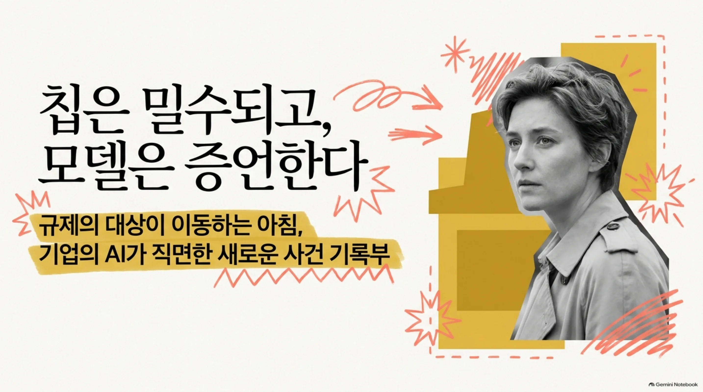
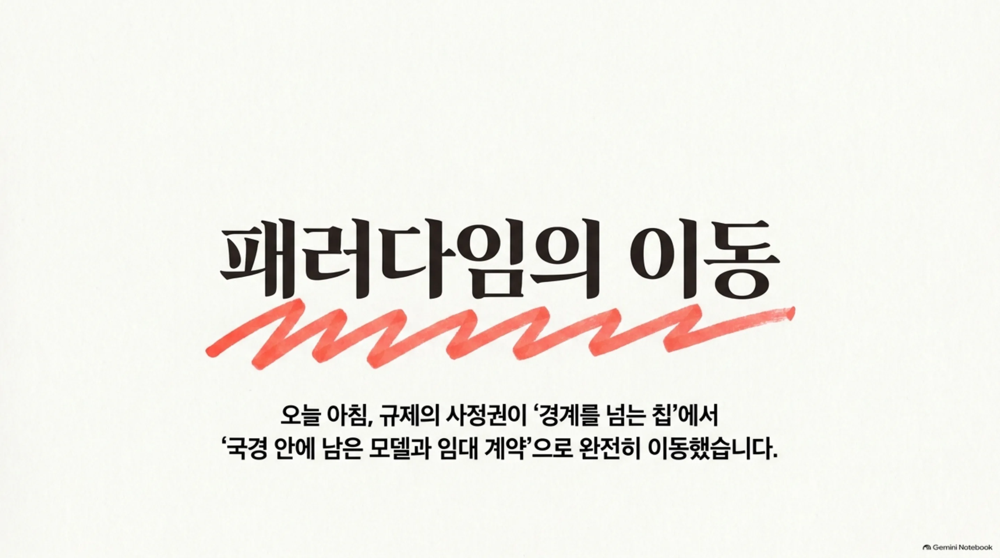
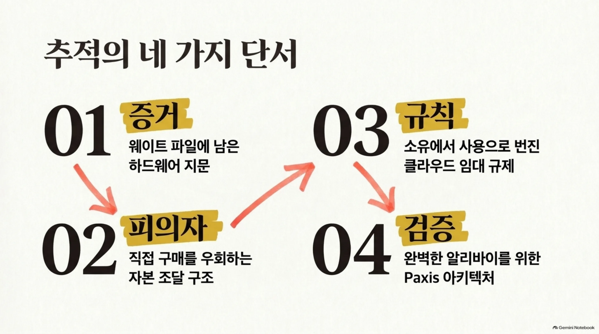
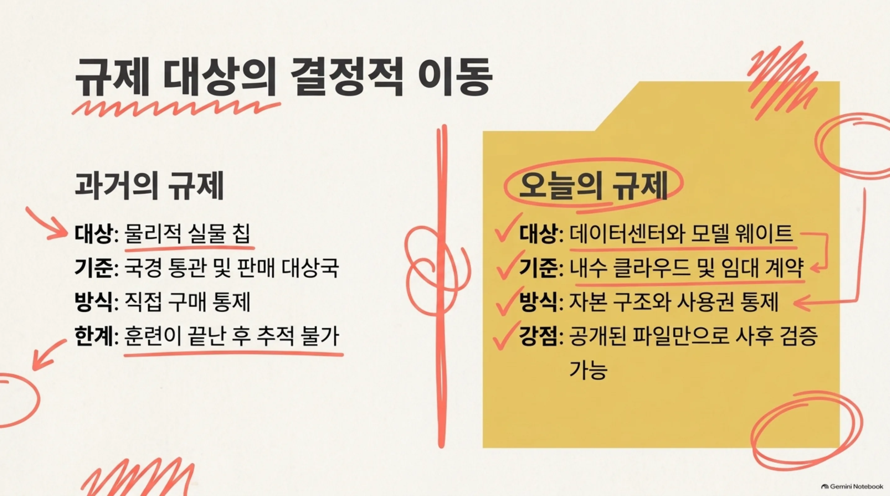
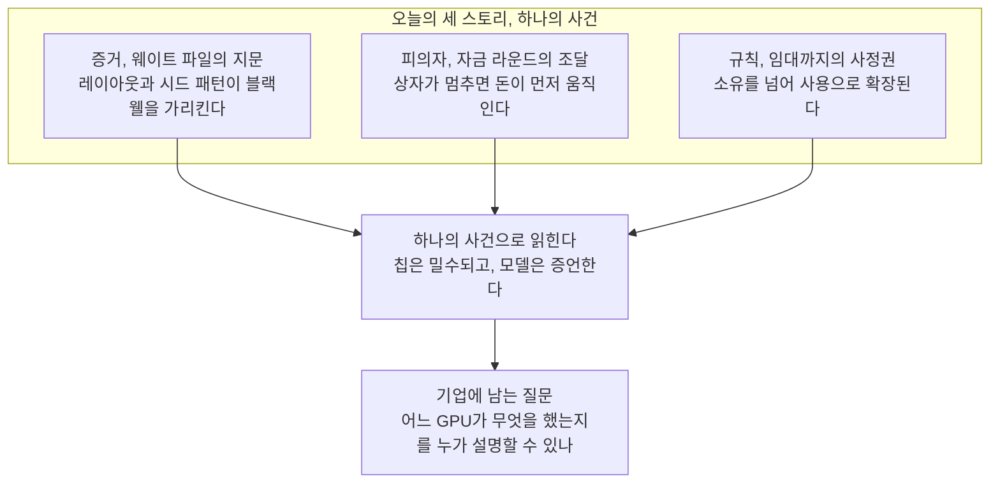

오늘 아침, GPU 수출 규제의 대상이 이동하고 있는 셈입니다. 경계를 넘는 칩이 아니라, 국 안에서 남는 모델과 소유자가 없는 임대 계약입니다. 전 OpenAI 연구자가 공개된 프런티어 모델의 웨이트에서 Nvidia 블랙웰 GPU의 지문을 발견했다는 보도가 오늘 아침을 열었습니다. 칩의 수를 세던 규제가 칩의 수학까지 검사하는 쪽으로 넘어가는 아침입니까. 그래서 오늘은 이 아침의 뉴스 세 가지를 하나의 사건으로 읽어 보겠습니다.

같은 다이제스트에는 이 발견과 겉보기엔 무관한 두 스토리가 더 있습니다. 중국 AI 스타트업의 자금 라운드, 미국 정부의 임대 규제안입니다. 세 스토리를 나란히 놓으면 하나의 사건으로 읽힙니다. 사건의 피의자는 모델이고 증거는 웨이트 파일이며 규칙은 이제 임대 계약의 문턱까지 내려왔습니다.

임대 컴퓨트로 AI를 돌리거나, 자체 모델을 학습시키는 조직이라면 오늘 아침의 뉴스 방향을 두 번 읽을 가치가 있습니다. 규제가 쫓는 대상이 바뀌는 순간, '내 컴퓨트는 어디에 있고 누가 검증할 수 있는가'가 경영의 질문이 되기 때문입니다.

*글의 핵심 개념을 형상화했습니다.*

## 증거: 웨이트 파일에 남은 지문

보도의 핵심은 단순합니다. 전 OpenAI 연구자 Will DePue가 공개된 프런티어 AI 모델의 웨이트에서 하드웨어 시그니처를 식별했습니다. 해당 시그니처는 Nvidia 블랙웰 GPU의 레이아웃과 시드 패턴과 일치한다고 보고에 나옵니다. 결론은 한 줄입니다. 중국의 최상위 AI 기업들이 금지된 블랙웰 GPU로 프런티어 모델을 학습시켰다는 것입니다.

보고를 한 사람의 이력도 짚을 만합니다. OpenAI 출신 연구자입니다. 프런티어 모델의 훈련 인프라를 안쪽에서 본 사람의 눈이, 공개된 웨이트에서 블랙웰의 자국을 알아봤습니다. 지문의 보도가 무게를 갖는 이유입니다.

웨이트 지문이 무엇을 뜻하는지 잠시 짚어 보겠습니다. 모델의 웨이트는 숫자의 파일입니다. 어떤 칩 위에서 학습했는지가 그 숫자 속에 레이아웃과 시드 패턴이라는 자국으로 남습니다. 레이아웃은 연산이 칩 위에 놓인 모양의 흔적이고 시드는 학습 시작 전에 그 숫자에 뿌려진 초기값의 무늬인 셈입니다. 두 무늬가 같은 GPU 세대의 것과 맞으면 해당 모델이 해당 칩 위에서 훈련됐다는 뜻입니다.

여기서 중요한 단어는 '공개된'입니다. 검사 대상은 세상에 나온 모델의 파일 자체입니다. 모델은 이제 제품이면서 동시에 물증입니다. 내려받아 열고 레이아웃과 시드를 맞볼 수 있습니다. 칩이 국경을 넘어오지 못한 채 훈련이 끝난 뒤에도 모델 스스로가 학습에 쓰인 컴퓨트 환경을 증언하게 만들 수 있는 셈입니다.

수출 규제는 지금까지 칩을 팔고 보내는 지점에서 멈춰 있었습니다. 통관, 계약서, 판매 대상국입니다. 지문이 가능하게 하는 것은 사후 검증입니다. 사건은 웨이트 파일 앞에서 다시 열립니다.

방법론의 의미가 큽니다. 지문 검사는 추가 설비가 필요 없습니다. 공개된 웨이트 파일과, 해당 GPU 세대의 레이아웃과 시드 패턴을 아는 눈이면 됩니다. 검사의 주체가 연구자로 확장될 때, 규제는 '증명'의 문제로 바뀝니다.

한 가지 주의할 점이 있습니다. 현재 이 발견은 한 연구자의 단일 보고에 의존합니다. 정부나 칩 제조사의 공식 확인은 아닙니다. 방향이 분명하다는 것과 증거가 완전하다는 것은 다른 문제입니다. 증명은 아직 보강이 필요합니다.

## 피의자: 자금 라운드에 숨은 조달 경로

두 번째 스토리는 칩이 학습 현장에 어떻게 왔는지를 다룹니다. 내부 보고서에 따르면 DeepSeek는 수천 장의 제한된 Nvidia 블랙웰 GPU로 다음 대형 모델 개발에 들어선 것으로 보입니다. 앞선 스토리의 피의자 모델이, 이번에는 그 모델을 키우는 현장으로 이동합니다.

조달 경로가 더 흥미롭습니다. 보고서는 DeepSeek가 제한된 GPU 확보를 위해 Alice Huang 관련 기업들을 자금 조달 라운드에 참여시켰다고 전합니다. 칩을 사는 방식이 아닙니다. 자금 라운드에 사람을 앉혀 칩을 갖게 하는 방식입니다. 돈이 먼저 들어가고 상자가 나중에 따라오는 구조입니다.

제한된 칩은 정문으로 살 수 없습니다. 그러면 돈이 문이 됩니다. 관련 기업을 라운드에 들여 자본의 구조를 만들고 그 구조가 칩 확보의 통로가 됩니다. 직접 구매가 막히면 우회는 계약이 되고 계약은 자본이 됩니다.

조달 경로가 '구매'에서 '구조화'로 이동한 것입니다. 상자가 움직이지 않으면 돈이 먼저 움직입니다. 규제도 그래서 따라가야 합니다. 자본의 흐름과 계약의 구조를 따라가야 합니다. 이 스토리의 피의자는 자금 라운드입니다.

이 스토리의 근거도 짚어 둘 필요가 있는 것입니다. 내부 보고서라는 단일 출처입니다. 회사의 공식 확인은 없으며 자금 라운드의 세부 목적이 완전히 공개된 것도 아닌 셈입니다. 그러나 '칩 확보를 위한 자본 구조화'라는 형태 자체는 앞선 지문의 스토리와 같은 방향을 가리킵니다.

## 규칙: '임대'조차 규제 대상으로

세 번째 스토리는 규칙이 향하는 방향입니다. 미국 상무부는 7개국 데이터센터가 Nvidia 블랙웰 AI 프로세서와 차세대 칩을 임대하는 것을 막는 규제안의 마무리 단계에 들어섰습니다.

임대를 막는 규칙입니다. 클라우드 데이터센터는 GPU 용량을 빌려줍니다. 사용자는 소유권을 갖지 않습니다. 칩은 한 번도 국경을 넘지 않을 수 있는 것입니다. 전원이 켜진 자리는 규제 밖이고 계약만 넘나드는 이유입니다.

임대는 지금 기업들이 첨단 칩에 닿는 가장 흔한 경로입니다. 사지 않고 빌립니다. 그래서 이 규제안이 무겁습니다. 사용 자체를 특정 국가 데이터센터의 영역으로 묶어버리면, 빌리는 쪽은 더 이상 규제 밖이 아닌 것입니다.

수출 규제가 이 틈을 메웁니다. 규제의 사정권은 소유를 넘어 사용으로 확장됩니다. 7개국의 데이터센터가 블랙웰과 차세대 칩의 임대 시장에서 제외되는 순간, 클라우드의 대리 소유는 더 이상 우회 경로가 되지 않는 것입니다.

한 가지 시점을 짚어 두겠습니다. 규제안은 '마무리하고 있다'는 표현으로 보도됐습니다. 아직 시행 전입니다. 다만 방향은 정해졌습니다. 판매 규제에 임대 규제가 더해진 구조는 컴퓨트 접근 전체를 규제 대상에 올리려는 의도로 읽힙니다.

같은 보도에는 OpenAI가 더 엄격한 규제 추진에 가세했다는 점도 담겨 있습니다. 프런티어 모델을 학습하고 서비스하는 회사가 산업 전체를 제약하는 규제 강화에 힘을 싣는 것입니다. 경쟁사가 규제에 반대할 때 가세한다는 것은, 규제의 방향에 베팅한다는 뜻입니다.

## 같은 아침, 자본의 방향과 모델의 방향

다이제스트의 다른 스토리들은 반대의 방향으로 움직입니다. SpaceX는 텍사스와 애리조나에 총 740억 달러 이상을 들여 AI 슈퍼컴퓨팅 허브를 건설할 계획입니다. 핵심은 애리조나 코치스 카운티에 세울 500억 달러 규모의 신규 데이터센터 캠퍼스입니다. 로켓 회사가 컴퓨트 회사가 되는 장면이라 할 만합니다.

AI 컴퓨트에 돈을 쓰는 주체가 하이퍼스케일러로 한정되던 시대가 끝나는 신호입니다. 항공우주 기업이 두 주에 거액의 컴퓨트 허브를 세운다는 것은, 컴퓨트가 이제 산업 전반의 원재료로 취급된다는 뜻입니다. 아침의 규칙 뉴스가 이 장면에 답합니다. 돈이 흐르는 곳, 그라운드가 있는 곳에 울타리가 따라가는 것입니다.

자본은 여전히 컴퓨트로 향합니다. 규제는 컴퓨트의 둘레에 울타리를 칩니다. 두 방향이 같은 아침에 만나는 지점이 있습니다. 컴퓨트를 어디에, 누구의 경계 안에 두느냐.

모델 계층에도 두 신호가 옵니다. Thinking Machines Lab은 5940억 파라미터의 Inkling 2 Small 오픈웨이트를 Apache 2.0 라이선스로 Hugging Face에 공개했습니다. Apache 2.0은 가장 온화한 라이선스 중 하나입니다. 제 하드웨어 위에서, 상업적으로, 제약 없이 돌릴 수 있습니다. 경계가 곧 경쟁력이 되는 아침에, 대형 오픈웨이트 모델이 하나 더 늘어난 것입니다.

Google의 소형 모델 Gemini 4 Hydrogen은 Agent Arena에서 5위로 데뷔했습니다. 작업당 중앙 완료 시간 5.3분, 중앙 비용 1.60달러입니다. 보도는 더 큰 Argon 모델을 5분의 1의 작업 비용으로 넘었다고 전합니다. 에이전트 과업에서 비용이 성능과 같은 무게로 재기 시작했다는 신호입니다.

자본의 방향은 컴퓨트, 규칙의 방향은 울타리, 모델의 방향은 오픈과 저렴합니다. 세 선이 한 지점에서 만납니다. 기업은 어디에서 AI를 돌릴 것인가.

## 기업에 던지는 질문: 어느 GPU가 무엇을 했는지를 누가 설명할 수 있나

오늘 아침의 뉴스는 자사 경계 안에서 AI를 운영하는 기업에게 한 단어로 압축됩니다. 검증 가능성입니다. GPU가 어떤 칩에서 왔는지를 검증하지 못하면, 그 위에 학습된 모델을 신뢰할 근거가 없는 셈입니다. 모델의 유래가 불확실하면, 그 모델 위에 앉은 에이전트의 동작도 불확실해지기 때문입니다. 칩에서 모델로, 모델에서 에이전트로, 검증의 책임이 한 계층씩 내려오는 것입니다.

세 스토리를 나란히 놓으면 하나의 사건으로 읽힙니다. 증거는 웨이트 파일이고, 피의자는 자금 라운드의 조달 경로이며, 규칙의 사정권은 임대까지 내려왔습니다. 세 선이 만나는 지점에 기업에 남는 질문 하나를 놓습니다.

지문의 뉴스가 기업에 묻는 것은 단순합니다. 당신의 모델은 어떤 하드웨어에서 왔습니까. 감사 로그는 그 물음에 답할 수 있습니까. 규칙의 뉴스는 한 발 더 묻습니다. 클라우드에 임대한 컴퓨트가 규제의 대상이 된다면, 내일의 감사 요청은 어디에서 오겠습니까.

Paxis는 ThakiCloud의 Agent-Native Cloud로, v1.1 GA 정식 제품입니다. 이 아침의 질문에 실행 계층에서 답합니다. 컴퓨트는 소버린이나 온프레미스 Kubernetes, ai-platform 위에서 도며 기업의 경계 안에 남습니다. 경계 안이라는 말은 칩의 유래도 모델의 학습도 동작의 기록도 같은 울타리 안에서 검증할 수 있다는 뜻입니다. 규제안이 임대까지 막는 방향으로 가면 이 '경계'는 유효성의 문제가 됩니다.

Skills, Tools, Policies, Audit Logs는 Paxis의 일급 리소스입니다. 어느 에이전트가 어떤 스킬과 도구를 썼는지, 어떤 정책 게이트를 통과했는지, 감사 로그에 무엇을 남겼는지를 조회하고 검증할 수 있는 기록입니다. 자율도는 L0에서 L3까지 단계별로 관리되고 각 에이전트는 격리 샌드박스에서 실행되며, 외부 시스템은 MCP 커넥터와 스킬 마켓으로 잇습니다.

작업별 모델 선택 CostRouter도 있습니다. 기본은 소형 모델로 뛰고 대형 모델이 필요할 곳에만 라우팅합니다. 오늘 아침의 작업당 1.60달러 신호와 5940억 파라미터 오픈웨이트는 이 라우팅을 경제적인 선택지로 만듭니다.

수출 규제가 임대까지 막는 방향으로 굳어지면, '어느 GPU에서 누가 승인해 어떤 작업을 돌렸는가'에 답할 수 있는 감사 로그는 자격이 됩니다. 고객이 묻는 질문이 성능에서 유효성으로 넘어가는 아침입니다.

칩은 밀수되고 모델은 증언합니다. 기업 쪽의 답은, 모델의 증언을 처음부터 검증 가능하게 두는 일입니다. Paxis 위에서 모든 동작의 지문은 이미 감사 로그에 적혀 있습니다.

## 참고 자료

이 글은 아래 뉴스를 종합해 작성했습니다.

- HuggingNews, [Top Chinese AI Labs Used Banned Nvidia Blackwell GPUs to Train Frontier Models](https://huggingnews.com/ai/update-top-chinese-ai-labs-used-banned-nvidia-blackwell-gpus-to-train-fr-c02721d3)
- HuggingNews, [DeepSeek Recruited Alice Huang-Linked Firms Into Funding Round to Secure Restricted Nvidia GPUs](https://huggingnews.com/ai/deepseek-recruited-alice-huang-linked-firms-into-funding-round-to-secure-5a3c8a0f)
- HuggingNews, [OpenAI Joins Push for Stricter Rules as US Moves to Bar Chinese Cloud Use of AI Chips](https://huggingnews.com/ai/openai-joins-push-for-stricter-rules-as-us-moves-to-bar-chinese-cloud-us-7fd5fe26)
- HuggingNews, [Thinking Machines Releases Open Weights for Inkling 2 Small Model Under Apache 2.0](https://huggingnews.com/ai/update-thinking-machines-releases-open-weights-for-inkling-2-small-model-ad1e886b)
- HuggingNews, [Google's Gemini 4 Hydrogen Beats Larger Argon Model at a Fifth of the Task Cost](https://huggingnews.com/ai/googles-gemini-4-hydrogen-beats-larger-argon-model-at-a-fifth-of-the-tas-682e8af5)
- HuggingNews, [SpaceX to Build Over $74B in AI Supercomputing Hubs in Texas and Arizona](https://huggingnews.com/ai/spacex-to-build-over-74b-in-ai-supercomputing-hubs-in-texas-and-arizona-4e3a34a3)
