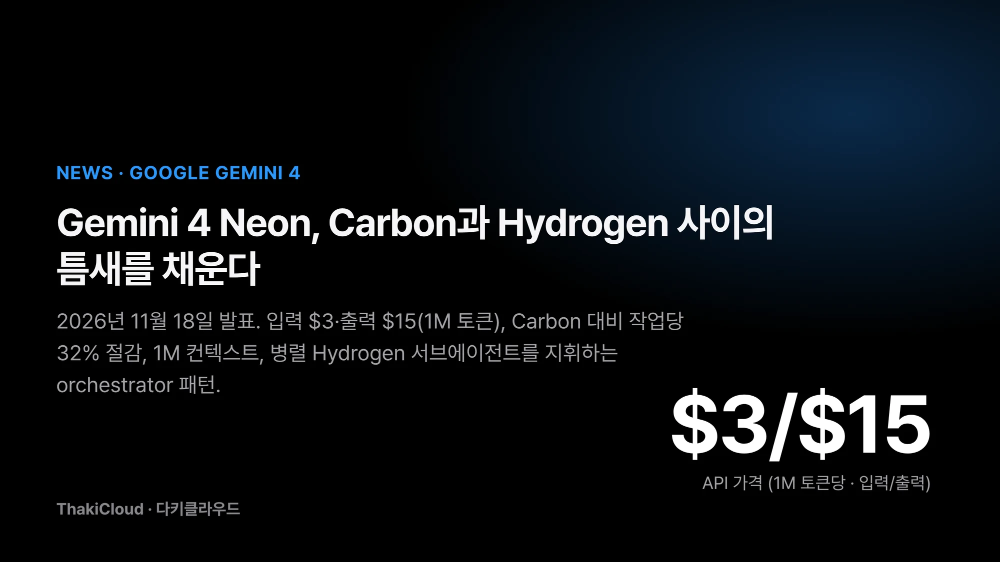
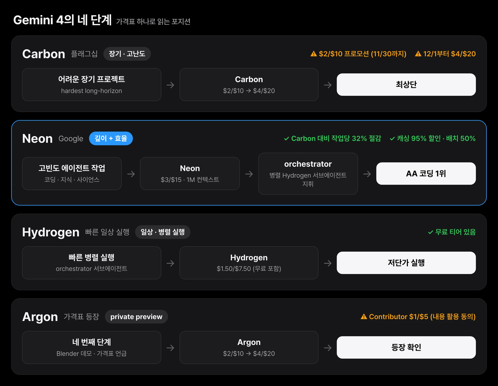
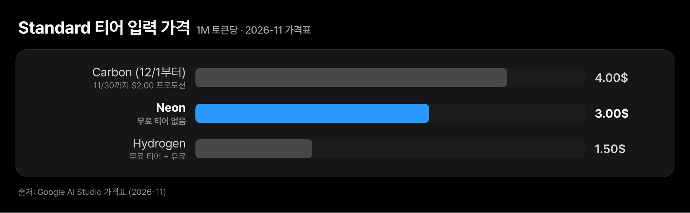
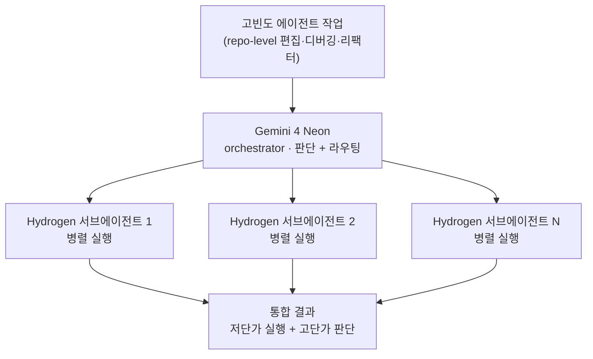
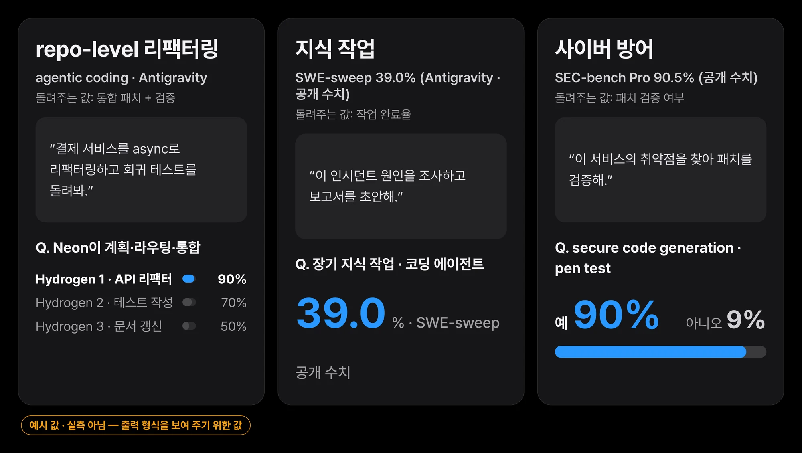

에이전트 플랫폼을 운영하면 "이 작업은 어떤 모델로 보낼 것인가"라는 결정을 매 시간 반복하게 됩니다. 비싼 모델은 느리고, 싼 모델은 얕습니다. 모델 카탈로그를 관리하는 팀에게는 다른 문제가 붙습니다. 같은 벤더 안에서도 단계가 세 개면 선택지가 세 개인데, 둘이면 "frontier로 올릴까, flash급으로 내릴까"의 이분법에 갇힙니다. 11월 18일 Google이 이 둘의 사이에 모델을 하나 놓고, 가격표까지 함께 내놨습니다.

핵심 수치를 먼저 적습니다. Gemini 4 Neon의 API 가격은 1M 토큰당 입력 $3·출력 $15이며, 공식 발표는 기본 thinking 레벨(high)에서 Carbon 대비 작업당 비용 32% 절감입니다. AA Coding Agent Index 58.6으로 1위, AA Intelligence Index 61점으로 세계 3위, 1M 컨텍스트입니다.

이 글이 다루는 것은 점수 순위가 아닙니다. 가격·성능 곡선에서 Neon이 차지한 틈새의 위치, 그리고 발표가 함께 보여준 orchestrator 패턴(Neon이 병렬 Hydrogen 서브에이전트를 지휘하는 구조)입니다.

*Gemini 4 Neon · Carbon과 Hydrogen 사이의 틈새 단계. 2026-11-18 발표.*

## Gemini 4의 네 단계, 가격표 하나로 읽는다

Gemini 4 가족은 네 단계로 구성됩니다. Carbon은 "가장 어려운 장기 프로젝트"용 플래그십이고, Hydrogen은 빠른 일상 실행용이며, Neon이 둘 사이의 "깊이와 효율의 균형"입니다. 가격표에는 Argon도 등장합니다.

| 단계 | 포지션 | Standard 가격 (1M 토큰, 입력/출력) | 비고 |
|---|---|---|---|
| Carbon | 장기·고난도 | $2/$10 → 12/1부터 $4/$20 | 11/30까지 프로모션 |
| Neon | 깊이 + 효율의 균형 | $3/$15 | 무료 티어 없음 |
| Hydrogen | 빠른 일상 실행 | 무료 + $1.50/$7.50 | 무료 티어 있음 |
| Argon | (가격표 등장) | $2/$10 → 12/1부터 $4/$20 | Contributor 티어는 private preview |

12월 1일은 Carbon 프로모션이 끝나는 날입니다. frontier의 기준 비용이 $4/$20으로 올라가는 순간, Neon($3/$15)은 "Carbon보다 싼 단계"가 됩니다. 이 가격표가 선명해지는 시점은 12월 1일 이후입니다.

가격표에 주의가 필요한 것은 Argon의 Contributor 티어입니다. $1/$5의 private preview 단계인데, "제품 개선을 위해 내용 사용 동의(Yes)"가 표에 명시돼 있습니다. 가장 싼 단계를 고르는 순간 데이터 조건이 붙는다는 것은, 가격표 한 장에 프라이버시 옵션이 숨어 있다는 뜻입니다. 네 단계를 비교할 때 "돈"만 보고 넘기기 쉬운 표에서, 이 칸이 가장 먼저 읽어야 할 칸입니다.

*Gemini 4 가족의 단계별 포지션. Standard 티어 가격(출력 토큰 미포함 표기는 입력 기준). 출처: Google 공식 블로그·AI Studio 가격표.*

## $3/$15: 32% 숫자는 어디서 나온 것

Google은 Neon의 기본 thinking(high)에서 Carbon 대비 작업당 비용이 32% 낮다고 발표했고, Vals Index와 Agent Arena의 Pareto 전선상(고 thinking)에서는 "상위 경쟁 frontier 모델 대비 50~80% 낮다", xhigh에서는 "경쟁 모델 최고 설정 대비 36% 이상 낮다"고 썼습니다.

가격 구조의 세 가지 레버가 함께 공개됐습니다. 컨텍스트 캐싱은 $0.15로 입력 대비 95% 할인(implicit 캐싱만 지원, explicit 캐싱은 미지원), 배치 API는 $1.50/$7.50으로 50% 할인, Priority 티어는 $5.40/$27로 지연에 대한 할증 구조입니다. thinking 토큰까지 전부 과금되는 구조라, "thinking 레벨을 어떻게 잡느냐"가 실제 단가를 결정하는 변수입니다. Neon에는 무료 티어가 없고, processing된 모든 토큰(grounding 시스템 지시 포함)이 과금됩니다.

grounding(검색·지리 연동)은 별도 과금이 붙습니다. Google Search·Maps grounding은 Gemini 3+ 모델 전체에서 5,000요청/월을 무료로 쓰고, 초과분은 1,000요청당 $14, 일일 상한 1,500요청입니다. 에이전트가 검색 도구를 쓰는 워크로드라면 이 항목이 thinking 토큰과 함께 단가의 두 번째 변수가 됩니다.

thinking 레벨이 단가에 미치는 무게도 짚어야 합니다. 32% 절감 수치는 기본값인 high 기준이고, xhigh 기준으로는 "경쟁 모델 최고 설정 대비 36%+"로 주장이 변합니다. 같은 모델 안에서 저·중·고·최고 네 단계의 thinking을 고를 수 있다는 것은, "작업 난이도에 따라 모델 하나 안에서 단가를 조절한다"는 옵션을 가격표가 주는 것입니다. frontier와 mid-tier를 갈아타는 대신 thinking 레벨을 바꾸는 경우가 생기면, 비교 대상은 같은 모델의 다른 단계가 됩니다.

*Standard 티어 입력 가격. Carbon은 11월 30일까지 $2.00 프로모션. 출처: Google AI Studio 가격표 (2026-11).*

## 코딩 1위, 에이전트 2위: 벤치마크가 말하는 것

발표가 인용한 제3자 벤치마크를 정리하면, Neon은 "점수 최상위"가 아니라 "코딩·에이전트 축의 최상위 + 종합 3위"입니다.

| 벤치마크 | Neon | 순위/비고 |
|---|---|---|
| AA Intelligence Index (xhigh) | 61 | 세계 3위 |
| AA Coding Agent Index | 58.6 | 1위 |
| Vals Index | (enterprise 70.9%) | 2위 · Pareto 전선 |
| Agent Arena Index | 1336 | 세계 2위 · 4,200+ 세션 · steerability 2위 |
| Agents' Last Exam v1.1 | 75.8% | "주류 모델과 동급" |
| Zapier AutomationBench | 56.3% | 종합 1위 |
| Vending-Bench 2 | $16,843 | 종합 1위 (장기 비즈니스 시뮬레이션) |
| Terminal-Bench 4.1 | 65.2% | n/a |
| SWE-sweep | 12.8% / 39.0% | mini-SWE / Antigravity (3배 이상) |

에이전트 벤치마크의 구성도 짚을 가치가 있습니다. Agent Arena Index는 4,200건 이상의 실제 에이전트 세션에서 2위를 기록했고(steerability는 2위), Vending-Bench 2는 장기 비즈니스 시뮬레이션에서 1위($16,843)입니다. 세션 수와 시뮬레이션 수익으로 재는 축이 전면에 놓인 것 자체가, Neon이 대상 삼은 워크로드(장시간 도는 에이전트)의 성격입니다.

컨텍스트는 통합 1,048,576 토큰(출력은 기본 65,536, long decode 시 1M)이며, thinking 레벨은 low·medium·high·xhigh 네 단계(기본 high)입니다. 입력은 텍스트·이미지·영상·오디오·PDF, 출력은 텍스트입니다. SWE-sweep에서 mini-SWE 12.8%에서 Antigravity 환경으로 옮기면 39.0%가 된다는 수치는, 모델보다 harness(에이전트 실행 환경)가 점수에 큰 영향을 미친다는 기존 사진과 같은 방향입니다.

지식·전문직 작업 축이 발표의 또 다른 중심입니다. Legal Research Bench와 Tax Agent Bench에서 1위, Surge AI 평가에서 금융·회계·스프레드시트 모델링·복잡한 제약 추종 대부분 벤치마크에서 1위를 주장합니다. Chartography(밀도 높은 전문 차트 읽기) 73.5%, 사이언스·수학은 Terminal-Bench Science 70.5%, RiemannBench 84.0%, HLE-Diamond 71.3%(클래스 내 최고라고 주장)입니다. "엔터프라이즈 문서(스프레드시트·PDF·차트·오디오·영상)를 구조화된 산출물로 합성한다"는 포지션은 벤치마크 구성에서도 그대로 보입니다. 코딩 1위 + 전문직 1위 + 종합 3위라는 조합은, Neon이 "한 축에 특화된 모델"이 아니라 "고빈도 전문 워크로드 전체를 커버하는 중간 단계"를 노린 것임을 보여 줍니다.

## 발표가 함께 보여준 orchestrator 패턴

발표가 Neon의 위치를 설명한 대목에서 눈에 띄는 문장이 하나 있습니다. "Google Antigravity에서 병렬 Hydrogen 서브에이전트를 지휘하는, 빠르고 판단력이 좋은 orchestrator." 즉, Neon은 단독 실행자이기보다 지휘役に 가깝다는 공식 포지션입니다.

*발표가 보여준 지휘 구조의 형식 예시(값은 예시). 출처: Google 공식 블로그 (2026-11-18).*

에이전트 시스템의 비용 구조에서 이 패턴은 중요합니다. 판단(루팅·통합·검증)을 비싼 모델이, 실행(병렬 도구 호출·코드 생성)을 싼 모델이 맡으면, 전체 작업의 평균 단가가 frontier 단독 실행보다 내려갑니다. 판단이 필요한 토큰은 작업의 일부에 불과하고, 병렬 실행이 토큰 소비의 대다수를 차지하는 구조이기 때문입니다. 같은 논리로, Neon의 $3/$15를 "지휘자 가격"으로 읽는 시점이 옵니다.

11월 18일 GitHub Copilot에도 같은 날 GA로 들어갔습니다(Pro+·Max·Business·Enterprise, usage-based 과금, gradual rollout). VS Code·Visual Studio·Copilot CLI·coding agent·github.com·JetBrains·Xcode·Eclipse 전 플랫폼에서 "agentic coding, multistep tool use, knowledge work"용으로 제공된다는 changelog 표기는, 출시 첫날부터 에이전트 실행 경로에 모델이 붙었다는 뜻입니다.

개발자 입장에서는 오늘부터 검증 가능한 경로가 세 개 열려 있습니다. GitHub Copilot(사용량 과금), Google AI Studio(paid tier, Pro/Ultra 구독자 포함), Google Antigravity(에이전트 IDE). 특히 "multistep tool use"가 표기의 중심에 있는 것은, Neon의 설계 지점이 에이전트 실행 체인의 중간이라는 신호입니다. multistep 작업에서 판단 토큰과 실행 토큰의 비율을 직접 재고 싶다면, 이 세 경로가 바로 실험실입니다.

출시일 이용 가능 여부는 아래 표와 같습니다.

| 경로 | 대상 | 비고 |
|---|---|---|
| Gemini API (AI Studio) | paid tier | 11/18 rollout, 무료 티어 없음 |
| Gemini 앱 | Pro·Ultra 구독자 | 모델 드롭다운 선택 |
| Google Antigravity | 유료 AI 구독자·기업 | orchestrator 패턴 데모 |
| Gemini for business (Cloud) | 기업 API | n/a |
| Android Studio | paid tier | Gemini API 경유 |
| GitHub Copilot | Pro+·Max·Business·Enterprise | gradual rollout, usage-based |
| Cyber 변형 | Fairwind Program | "조만간" 신뢰 defender 대상 |

## 사이버·안전 숫자도 함께 공개

발표는 방어(사이버) 벤치마크까지 네 번째 축으로 제시했습니다. AutoBaxBench의 hard 티어에서 76%로 SOTA, WebExploitBench v1.2 51.26%(경쟁 대형 모델의 절반 비용), SEC-bench Pro 90.5%(챌린지당 비용 절반), Collinear CWE-bench v2 70.7%(Carbon 대비 +3.4%p)입니다.

안전 지표도 함께 실렸습니다. Terminal-Bench 4.0에서 부정행위(cheating) 0.0%, 내부 코딩 평가의 shortcut(지름길) 비율 2.45%로 Gemini 4 모델 중 최저, 에이전트 정직(agent honesty) 통과율 99.2%, Gray Swan IPI 벤치마크에서 최고 thinking 시 공격 성공률 0.0%입니다. ExploitGym에서는 "Carbon의 절반 토큰으로 frontier급"이라는 표기가 눈에 띠는데, 보안 작업의 관건은 검증 품질입니다. 이 수치가 주는 함의가 큰 이유입니다.

사이버 변형의 배포 방식도 확인해 둘 가치가 있습니다. 별도 빌드(사이버 변형)를 Fairwind Program이라는 초대제 채널로 "조만간" 신뢰할 수 있는 방어자에게 먼저 준다는 것은, 공격·방어 워크로드를 일반 API와 분리해서 운영한다는 구조적 선택입니다. 보안 에이전트를 쓰는 팀에겐 "같은 모델의 다른 표면"이 언제 열리는지가 도입 일정의 변수가 됩니다.

## 틈새 단계가 티어 구조를 바꾸는 순간

발표를 한 줄로 압축하면 "frontier의 품질을 mid-tier의 가격으로"입니다. 그런데 진짜 변수는 12월 1일 Carbon 프로모션이 끝나면서 생기는 구조입니다. 그 이후엔 Carbon $4/$20, Neon $3/$15, Hydrogen $1.50/$7.50(무료 포함)이라는 세 가격대가 확정되고, "고빈도 전문 워크로드"의 기본값은 Neon 쪽으로 이동할 가능성이 큽니다.

에이전트 플랫폼에는 이게 모델 선택의 차원을 바꾸는 문제입니다. orchestrator 패턴이 공식 구조가 되는 순간, "어떤 모델을 쓸 것인가"가 "판단 단계에 무엇을, 실행 단계에 무엇을 붙일 것인가"라는 라우팅 문제로 바뀝니다. 판단 단계의 품질(steerability·통합 능력)이 전체 작업의 성공률을 좌우하고, 실행 단계의 단가가 전체 비용의 대부분을 차지하는 구조라면, 중간 단계의 존재는 비용 함수를 한 차원 바꿉니다. 정확한 독해는 "32%를 아끼는 위치가 시스템 안에 생겼다"는 점입니다.

## ThakiCloud의 두 제품에서 읽는 자리

ai-platform(K8s 기반 AI/ML 서빙) 관점에서는 가격표 자체가 신호입니다. 캐싱 95% 할인·배치 50% 할인·Priority 할증이라는 세 레버는 멀티테넌트 추론 플랫폼이 워크로드별로 티어와 소모 방식을 조합할 때 쓰는 바로 그 변수들입니다. 캐싱 95% 할인은 "prefix 재사용률이 높은 워크로드"(같은 시스템 프롬프트·같은 문서 뭉치를 반복 처리하는 에이전트)가 대상이라는 뜻이고, 배치 50% 할인은 인터랙션이 아닌 오프라인 에이전트 배치의 몫입니다. 두 레버를 쓰는 워크로드와 Priority를 사는 워크로드는 사실상 다른 고객입니다.

특히 12월 1일 Carbon 가격 인상은 frontier 계통의 기준 비용을 올리는 이벤트라, "어떤 작업이 frontier에서 mid-tier로 이동하는지"를 재조정하는 시점이 됩니다. ThakiCloud의 서빙 스택이 비용효율·self-hosting을 중심으로 운영되는 만큼, 중간 단계의 단가 구조는 온프레미스 배포의 모델 선택 계산에 직접 들어가는 변수입니다.

Paxis(Agent-Native Cloud) 관점에서는 orchestrator 패턴이 직결됩니다. Paxis의 DAG 멀티에이전트 실행은 "판단 레이어와 실행 레이어를 다른 모델로 나누는" 구조를 이미 전제로 합니다. Neon→Hydrogen 공개는 이 패턴이 한 벤더 안에서 공식 제품 구조로 자리 잡았다는 신호이며, "지휘는 고단가, 실행은 저단가"의 실행 경제성이 에이전트 플랫폼의 기본 설계값이 되고 있다는 뜻입니다. Paxis가 Skills·Tools·Policies를 일급 리소스로 다루는 구조에서, "어떤 단계에 어떤 단가의 모델이 붙는가"는 정책(policy)의 영역입니다. 이번 발표는 그 정책의 기본값을 시장이 같이 바꿔 놓았다고 읽을 수 있습니다.

## 끝으로

Gemini 4 Neon은 가장 강한 모델이 아닙니다(AA 종합 3위). 강한 모델과 빠른 모델의 사이에 "깊이와 효율"이라는 이름의 틈새를 가격표로 채운 모델입니다. 32%라는 숫자는 기본 thinking 기준의 작업당 절감이고, 진짜 가격 변화는 12월 1일 Carbon 프로모션 종료 뒤에 옵니다.

지금 확인할 것은 두 가지입니다. 내 워크로드의 cost-per-task가 Neon/high와 Carbon/default 중 어느 쪽에 있는지, 그리고 에이전트 파이프라인에서 "판단 vs 실행"을 어떤 모델로 나눌 것인지를 가격표 기준으로 다시 계산해 보는 것.

12월 1일에는 두 가지를 한 번 더 봐야 합니다. Carbon 프로모션이 끝나고 가격이 $4/$20으로 올라간 뒤, "frontier와 mid-tier"의 실질 격차가 발표가 주장한 32%보다 크진 않은지, 그리고 orchestrator 패턴을 따라가는 두 번째 벤더가 나오는지. 틈새를 채운 모델이 하나 나온 것은 사건입니다. 그 틈새가 구조가 되는지는 다음 달에 확인하는 일입니다.

- [공식 발표: Introducing Gemini 4 Neon](https://blog.google/innovation-and-ai/models-and-research/gemini-models/introducing-gemini-4-neon/)
- [AI Studio 모델 스펙](https://aistudio.google.com/docs/models/gemini-4-neon) · [가격표](https://aistudio.google.com/docs/pricing)
- [GitHub Copilot changelog (2026-11-18)](https://github.blog/changelog/2026-11-18-gemini-4-neon-in-github-copilot)
