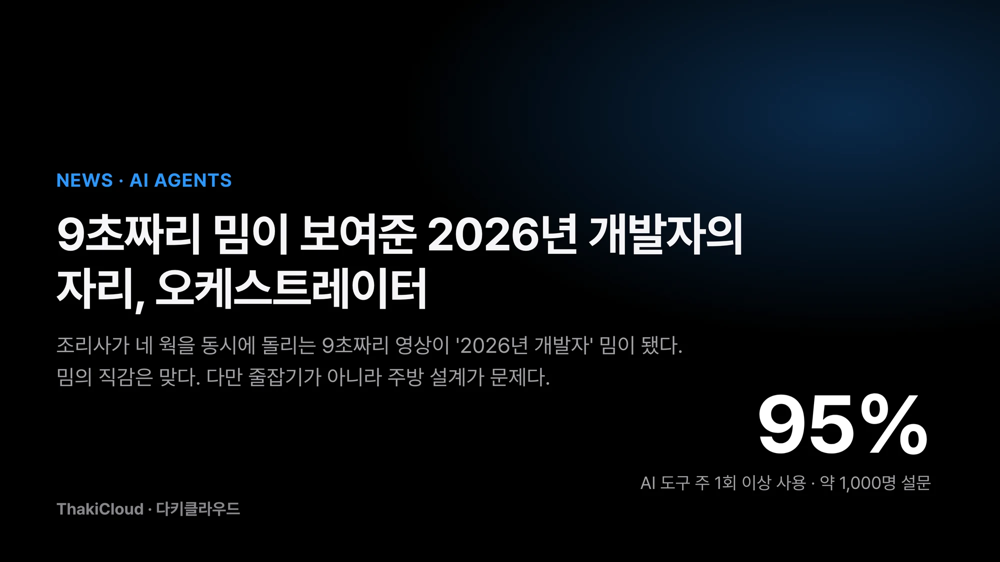
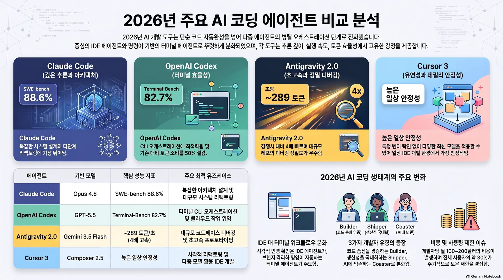
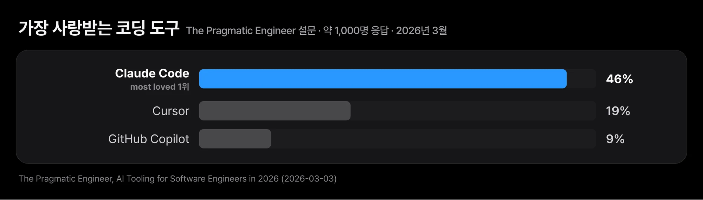
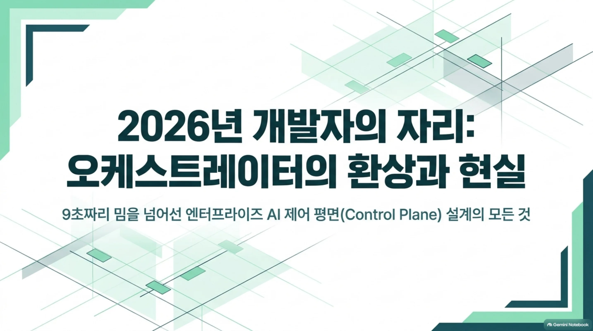
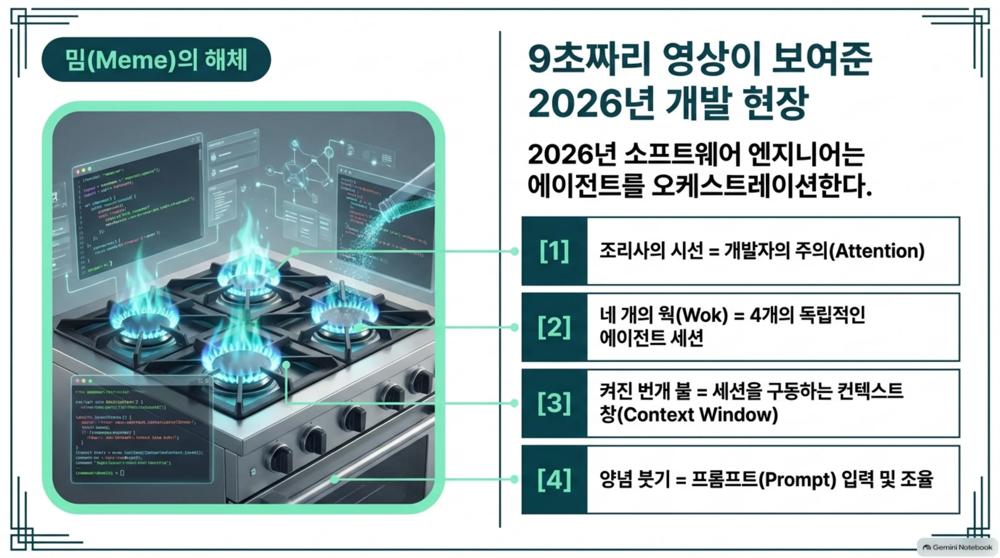
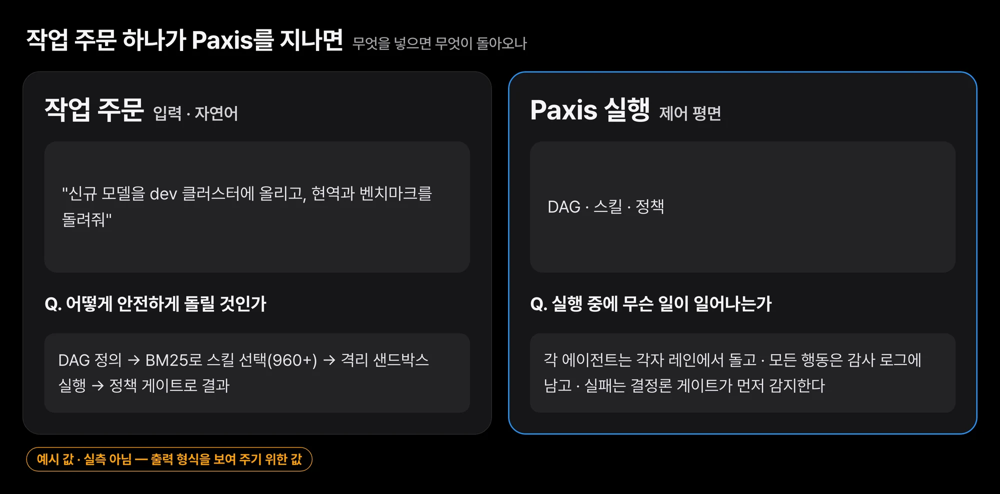
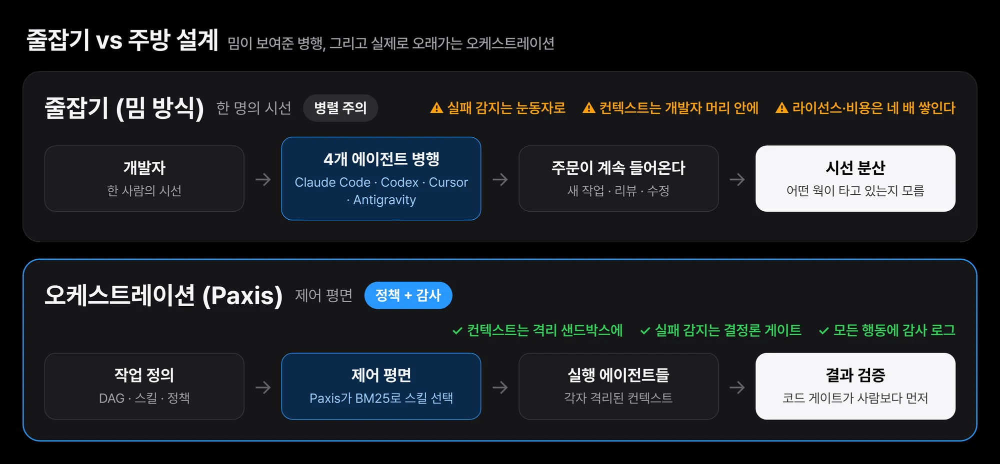
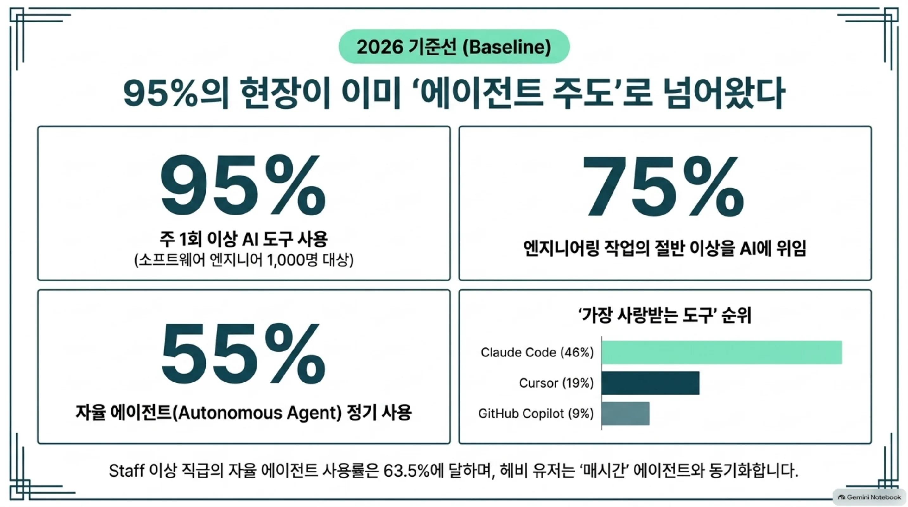
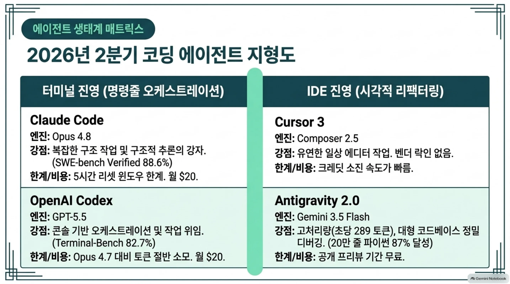
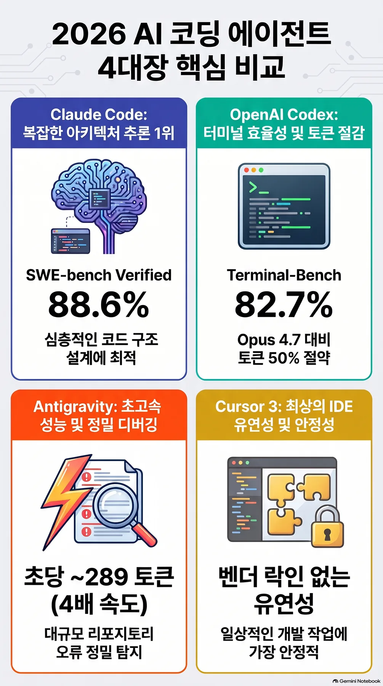

9초짜리 영상. 중식당 주방. 산업용 가스 스토브 행렬 앞, 조리사가 네 개 번개를 동시에 켜고 있다. 각 웍마다 녹두콩이 들어 있고 조리사는 손끝으로 하나씩 들며 동시에 여러 병에서 양념을 붓는다. 영상은 거기서 끝이다.

2026년 11월, 이 영상에 한 줄이 붙어서 돌았다. "2026년 소프트웨어 엔지니어는 Claude, Codex, Cursor, Antigravity와 다른 에이전트를 오케스트레이션한다." 웍 하나는 에이전트 세션이다. 조리사는 개발자다. 새 주문이 들어오면 번개가 하나 더 켜진다. 영상은 고작 9초이지만 보여준 자리는 장난이 아니다. 밈은 원 트윗을 넘어 여러 매체에서 2026년 개발 문화의 상징으로 다시 소개될 만큼 돌았다.

AI 코딩 에이전트를 두 개 이상 병행하는 개발자, 혹은 팀에 에이전트를 어떻게 쓸지 결정해야 하는 엔지니어링 리더라면 이 글을 한 질문과 함께 읽기를 권합니다. 그 자리에 실제로 앉을 수 있느냐. 밈의 직감은 반쯤 맞습니다. 가리킨 '오케스트레이터'는 정말 2026년 개발자의 자리입니다. 다만 밈은 드는 순간만 보고 주방은 보지 못합니다. 오케스트레이터의 자리는 실패 감지를 시선에서 빼고 뒤에 제어 평면을 두어야 비로소 앉을 수 있는 자리입니다.

이 글은 밈의 반쪽을 검증된 출처 두 갈래로 받칩니다. The Pragmatic Engineer의 약 1,000명 설문과, 2026년 코딩 에이전트 비교 기사입니다. 그리고 밈이 보지 못한 반쪽, 컨텍스트와 실패 감지와 비용과 제어 패널을 펼쳐 봅니다.

*9초 밈이 짚는 2026년 에이전트 코딩 현장*

## 쉽게 말하면

먼저 밈의 비유를 고정합니다. 웍은 에이전트 세션이고, 번개는 그 세션을 구동하는 컨텍스트 창입니다. 들어가는 녹두콩은 작업이며 양념은 프롬프트입니다. 조리사의 시선은, 개발자의 주의라고 보면 됩니다. 새 작업이 들어올 때마다 번개가 하나 더 켜집니다. 밈은 조리사의 손끝까지만 보여줍니다. 네 웍을 동시에 드는 것은, 시선을 네 갈래로 나누는 것과 같습니다.

그러나 진짜 주방은 시선만으로 돌아가지 않습니다. 스토브 행렬 앞의 스테인리스 제어 패널은, 눈이 가더라도 손이 닿는 자리입니다. 노브와 밸브와 타이머가 나란히 붙어 있고 그 옆의 점검 로그는 누가 몇 시에 어떤 냄비에 무엇을 넣었는지 적어 둡니다. 조리사의 시선이 웍을 벗어난 순간, 주방을 지키는 것은 이 둘입니다. 다음 섹션에서 다룰 것은 정확히 이 반쪽, 밈에 안 보이는 제어 평면입니다.

<!-- nlm-visual -->

*NotebookLM이 소스를 종합해 생성한 인포그래픽입니다.*

## 95%의 현장이 이미 옮겨왔다

올해 3월, The Pragmatic Engineer가 발표한 AI 도구 설문이 기준선입니다. 소프트웨어 엔지니어 약 1,000명이 응답했습니다. 95%는 주 1회 이상 AI 도구를 씁니다. 75%는 엔지니어링 작업의 절반 이상에 AI를 쓰고 55%는 자율 에이전트를 정기적으로 씁니다.

자율 에이전트라는 말의 무게를 한 번만 확인해 둡니다. 여기서는 사람 대신 도구가 파일 편집, 명령 실행, 결과 검토까지 스스로 해내는 에이전트를 뜻합니다. 사람이 리뷰어 자리에 앉는 구성입니다. 2025년까지만 해도 실험실에서 쓰는 도구였지만 2026년 3월에는 엔지니어 2명 중 1명이 정기 사용이라서입니다.

에이전트 사용률은 직급이 높을수록 올라갑니다. Staff 이상이 63.5%, 일반 엔지니어 49.7%, 엔지니어링 매니저 46.1%입니다. 설문이 사용자층을 셋으로 나누면, AI를 80% 이상 쓰는 헤비 유저와 30~80% 쓰는 모더레이트 유저, 30% 미만 쓰는 라이트 유저입니다. 헤비 유저는 AI를 시간 단위로 함께합니다. 하루 단위의 사용이 아니라, 매시간의 사용입니다. 밈의 조리사는 바로 이 사람입니다.

밈의 '네 웍 동시'는 마이너 케이스가 아닙니다. 현장의 3분의 2가 하는 일에 대한 이야기입니다.

밈과 가장 직접 대응하는 숫자는 Claude Code의 궤적입니다. 2025년 5월 출시 후 8개월 만에 최다 사용 도구 1위가 됐습니다. '가장 사랑한다' 조사에서는 46%로 1위, Cursor 19%, GitHub Copilot 9%보다 두 배 이상 앞섭니다. 응답자의 57%가 Claude Code 또는 Claude 모델 가문을 씁니다.

*Claude Code가 '가장 사랑한다' 46%로 1위입니다. Cursor 19%, GitHub Copilot 9%와 두 배 이상 차이입니다.*

## 2026년의 장, IDE 에이전트와 터미널 에이전트

올해 7월 공개된 코딩 에이전트 비교 기사(Q2 2026 시장 분할)는 장을 둘로 나눕니다. IDE 에이전트와 터미널 에이전트로. IDE 진영에는 Cursor와 Antigravity가, 터미널 진영에는 Claude Code와 OpenAI Codex, Gemini CLI가 있습니다. 밈 캡션의 네 개가 바로 이 진영, 둘씩입니다.

다만 실제 장에는 밈이 세지 못한 도구가 하나 더 있습니다. 터미널 진영의 Gemini CLI입니다. 밈조차 현장보다 한 박자 늦습니다.

둘로 나뉘는 이유도 기사가 짚습니다. IDE 에이전트는 화면에서 diff를 보며 시각적 리팩터링을 잘하고 터미널 에이전트는 스크립트와 파이프라인을 오가며 명령줄 오케스트레이션을 잘합니다. 같은 작업을 어떤 자리에서 보느냐에 따라 도구가 달라지는 일입니다. 밈의 조리사가 번개 행렬, 즉 터미널 앞에 서 있는 것과, 에디터 화면, 즉 IDE에서 웍을 바라보는 것은 같은 주방의 다른 자립니다.

비교 기사의 결론은 멀티툴 구성으로 정리됩니다. 구조적 추론에는 Claude Code, 터미널 자동화에는 OpenAI Codex, 빠른 반복에는 Antigravity를 쓰라고 권합니다. 기사 인용의 엔진은 Claude Code가 Opus 4.8, Codex가 GPT-5.5, Cursor 3가 Composer 2.5, Antigravity 2.0이 Gemini 3.5 Flash입니다. 월 정액은 Claude Code와 Codex가 $20이고, Cursor는 크레딧 소모형이며, Antigravity는 공개 프리뷰 기간 무료입니다.

| 도구 | 진영 | 강점 (기사 인용) | 진입 장벽 |
|---|---|---|---|
| Claude Code | 터미널 | 복잡한 구조 작업, 구조적 추론 | 5시간 리셋 윈도우 (2026-05-06 상한 2배 증액에도) |
| OpenAI Codex | 터미널 | 콘솔 기반 오케스트레이션, 작업 위임 | Opus 4.7 대비 토큰 절반 인용 |
| Cursor 3 | IDE | 유연한 일상 에디터 작업, 벤더 락인 없음 | 크레딧 소진이 빠름 |
| Antigravity 2.0 | IDE | 고처리량, 대형 코드베이스 정밀 디버깅 | 공개 프리뷰 기간 무료 |

멀티툴 구성이 권고로 굳어진 것에는 중요한 함의가 있습니다. 각 에이전트의 엔진이 다르고, 같은 작업의 토큰 경제학이 다르기 때문입니다. 기사에서 Codex는 터미널 작업에 Opus 4.7의 절반 토큰을 쓴다고 인용하고, Antigravity는 초당 약 289 토큰의 처리 속도를 보인다고 씁니다. 현장의 '줄잡기 실력'은 결국 번개마다 다른 가스비를 보고 어떤 번개를 켤지 고르는 일입니다. 핵심은 청구서입니다. 번개마다 가스비가 다르기 때문에, 같은 주방에도 어떤 번개를 켤지 골라야 합니다.

벤치마크 수치도 기사 인용 그대로 적어 둡니다. SWE-bench Verified 88.6%는 Claude Code, Terminal-Bench 82.7%는 Codex입니다. 20만 줄이 넘는 파이썬 코드베이스 디버깅에서는 Antigravity 87%, Cursor 71%, Claude Code 79%로 인용됩니다. 출처가 각기 다른 수치를 나란히 둔 것이니, 같은 계통의 점수라고 읽지는 마시기 바랍니다.

## 웍을 드는 것과 주방을 설계하는 것은 다른 문제

밈은 드는 순간에서 끝납니다. 그러나 주방에서 드는 일은 가장 짧은 구간입니다. 중요한 질문은 따로 있습니다. 조리사의 시선이 웍을 벗어난 순간, 무엇이 주방을 지키느냐.

첫 번째는 컨텍스트입니다. 조리사의 시선은 개발자의 주의입니다. 에이전트 네 개를 병행하면 볼 세션이 네 배가 됩니다. 기사가 든 5시간 리셋 윈도우가 이 문제의 구체적 예입니다. 긴 세션은 도중에 잘립니다. 세션이 잘리지 않아도, 번개마다 양념이 다릅니다. 밈에서 조리사가 여러 병을 동시에 붓는 이유가 여기에 있습니다. 각 에이전트 세션은 자기만의 프롬프트, 자기만의 파일, 자기만의 판단 기준을 따로 둡니다. 번개가 많아질수록 같은 양념의 중복이 생기고, 중복이 늘수록 맛은 어긋납니다. 번개 가스가 5시간 주기로 끊기는 조건에서 네 웍을 드는 주방은, 혼자 둘 수 있는 웍을 알려주는 시스템이 없으면 무너집니다.

두 번째는 실패 감지입니다. 밈의 주방에는 타이머도 로그도 점검도 없습니다. 실패를 감지하는 것은 오직 조리사의 시선에 달렸습니다. 에이전트 네 개를 병행하고 눈으로 리뷰하는 팀과 같은 형상입니다. 에이전트가 늘수록 병목이 되는 것은 에이전트가 아니라 시선입니다. 시선이 네 갈래로 나누어지는 순간, 감지는 표본추표가 됩니다. 표면에 무사해 보이는 접시가 속까지 익었다는 보장은 어디에도 없습니다.

세 번째는 비용입니다. 설문을 정리한 외부 요약(Sourcelabs)은, 회사가 이 도구들에 엔지니어당 월 $100~$200을 쓴다고 보도합니다. 웍 네 개는 번개 네 개, 가스비 네 번입니다. 밈을 그대로 돌리면 비용은 네 배가 됩니다.

네 번째는 책임입니다. 밈의 주방에서 조리사가 유일한 소유자입니다. 웍 하나가 상하면 다치는 사람은 조리사입니다. 에이전트 네 개를 병행하고 사람의 시선이 유일한 소유자인 팀도 같은 형상입니다. 에이전트가 늘수록 실패당 책임은 묽어지고 '아무도 몰랐다'의 대가는 올라갑니다. 하나의 웍이 타면 주방 전체가 타는 것처럼, 하나의 세션이 벗어나면 배포 전체가 흔들립니다.

## Paxis는 바로 그 제어 패널

이제 밈에 없는 프레임을 보여드립니다. 바로 제어 패널입니다. 다키클라우드의 Paxis는 이 제어 패널을 제품으로 만든 Agent-Native Cloud입니다.

Paxis는 스킬, 도구, 정책, 감사 로그를 일급 리소스로 다룹니다. 작업 주문이 들어오면 바로 불을 지피지 않습니다. 작업은 먼저 DAG(이 방향 비순환 그래프)로 정의되고 960개 이상의 스킬을 BM25가 골라 격리 샌드박스에 넘겨집니다. 실행은 정책 게이트를 지나고 모든 행동이 감사 로그에 남습니다. 멀티 에이전트 작업에서는 DAG가 각 에이전트를 각자 레인에서 돌리고 결과는 게이트에서 합쳐집니다.

*Paxis는 작업 주문을 받으면 바로 불을 지피지 않습니다. DAG로 정의하고 스킬을 골라 샌드박스에서 실행하고 로그를 남깁니다.*

이 구성을 주방 언어로 다시 쓰면, 제어 패널이 제품의 일급 리소스가 된 것입니다. 스킬은 레시피 사서이고 샌드박스는 각 웍의 격리 구역이며 정책 게이트는 밸브이고 감사 로그는 점검 기록부입니다. Paxis의 지식 엔진(HKE 위키)은 실행 중인 스킬이 팀의 문서를 그 자리에서 참조하게 하고 MCP 커넥터는 외부 시스템 인증(OAuth)을 끊김 없이 다시 이어 줍니다. 스킬은 실행을 거듭할수록 자가진화되어 품질이 올라갑니다. 밈의 주방에는 이 셋이 전부 없습니다. Paxis의 가치가 기업 환경에서 가장 선명해지는 지점이 바로 여기입니다. 고객이 '에이전트가 내 데이터로 무엇을, 어떻게 실행했나'를 묻는 순간, 답이 흔적으로 남아야 합니다. 답이 될 수 있는 것은 감사 로그뿐입니다. 규제 산업에서는 이 로그가 준수 산출물이 됩니다. 밈의 주방에서 제어 패널이 사치라면, 기업 주방에서는 필수품입니다.

밈에서 조리사는 Paxis 위의 엔지니어에 해당하고, 네 웍은 격리된 실행 에이전트입니다. 차이는 제어 패널과 로그가 조리사의 몸 밖에 있다는 것입니다. 실패 감지는 사람보다 먼저 도는 결정론 게이트이고 컨텍스트는 조리사의 머리가 아니라 샌드박스에 있습니다.

그 뒤에는 더 깊은 이유가 있습니다. 오케스트레이터의 자리는 실행이 비싸면 열리지 않습니다. 에이전트 작업은 컨텍스트와 토큰과 컴퓨트를 단위 작업당 지출하기 때문입니다. 오케스트레이터의 자리는 실행이 비싸면 열리지 않습니다. 에이전트 작업은 컨텍스트와 토큰과 컴퓨트를 단위 작업당 지출하는 형식이기 때문입니다. 다키클라우드의 Metis, K8s 기반 AI/ML SaaS 인프라가 이 실행 비용을 낮춥니다. GPU 큐, 서빙, 멀티테넌트 격리는 주방의 가스 배관과 스토브 행렬입니다. 밈의 네 웍이 감당 가능해지는 것은, 실행이 싸기 때문입니다. 실행 비용이 낮아야 에이전트 경제학이 열립니다.

*밈의 조리사는 네 웍을 눈과 손으로 동시에 돌립니다. 실행을 늘리는 것은 쉽습니다. 실패 감지를 사람의 시선에서 빼내 주방 전체를 설계하는 것, 그게 오케스트레이션입니다.*

## 줄잡기 전에 알아둘 네 가지

밈만으로 글을 닫기 전에, 서늘한 네 가지를 늘어놓습니다.

첫째, 밈은 병렬을 과장합니다. 설문의 3분의 1은 여전히 라이트 유저에 머무릅니다. 단일 코드베이스의 깊은 작업에는, 에이전트 한 개와 사람 한 명의 조합이 아직 주류입니다. 헤비 유저조차 AI를 쓰는 시간의 80%를 넘기는 데 그치고 나머지는 사람 손으로 갑니다. 깊은 작업일수록 에이전트 하나를 깊이 굴리는 쪽이 이깁니다. 네 웍은 정답이 아닙니다.

둘째, 멀티툴 구성은 라이선스를 두 배, 컨텍스트를 중복으로 만듭니다. 비교 기사의 권고는 작업별 장점에 따른 분업 구성이지, 하루 종일 네 개를 동시에 켜 두는 구성이 아닙니다. 같은 작업을 에이전트 네 개에 돌리는 것은, 빌을 네 번 내는 일이고 네 번의 결과를 사람이 한 번 더 맞추는 일입니다.

셋째, 에이전트는 새로운 공격 표면입니다. 자율 에이전트에 맡기는 것이 늘수록 권한 경계와 감사가 더 중요해집니다. 에이전트가 파일도 고치고 명령도 실행한다면, '무엇까지 스스로 처리할지, 초과하면 누구에게 물지, 모든 거래에 어떤 흔적을 남길지'가 설계 문항으로 바뀝니다. 로그 없는 제어 패널은 화재 퇴로 없는 주방입니다.

넷째, 오케스트레이션은 직함이 아니라 설계입니다. 검증 책임은 사람 몫으로 남습니다. 게이트가 먼저 돌수록 사람은 게이트가 놓치는 것만 보다 결국 게이트 자체를 고치는 쪽으로 이동합니다. 오케스트레이터는 웍을 더 많이 드는 사람이 아닙니다. 드리지도 않아도 실패가 감지되도록 주방을 설계하는 사람입니다.

## 끝으로

밈의 반쪽은 맞습니다. 2026년 개발자의 자리는 오케스트레이터이며, 95% 주간 사용과 55% 에이전트 채택은 예측이 아니라 올해의 기준선입니다. 밈이 안 보인 반쪽도 명확합니다. 줄잡기는 오케스트레이션이 아닙니다. 실패 감지를 시선에서 빼는 제어 평면, 컨텍스트를 격리하는 샌드박스, 감사할 수 있는 로그가 바로 오케스트레이션입니다. 이 셋이 갖춰지면 자리가 열립니다.

결국 줄잡기에서 오케스트레이션으로 넘어가는 것은, 주의를 도구로 바꾸는 일입니다. 시선을 타이머로, 기억을 로그로, 판단을 게이트로 바꾸는 일. 밈이 보여준 주방에서 실제로 일어나고 있는 일입니다. 오늘 바로 해볼 수 있는 작은 실험 하나를 제안합니다. 격리된 워크트리 두 개에서 같은 작업을 에이전트 두 개에 나누어 주고 하나는 다른 것의 diff를 리뷰하게 하세요. 시선을 게이트로 바꾸는 가장 작은 실험입니다. 그것이 순조로우면, 주방 설계는 이미 시작입니다.

<!-- nlm-visual -->
*NotebookLM이 소스를 종합해 생성한 인포그래픽입니다.*

## 출처

- [Jaydeep Karale 트윗 (원밈, 2026-11-23)](https://x.com/_jaydeepkarale/status/2124717898203849052)
- [The Pragmatic Engineer, AI Tooling for Software Engineers in 2026 (2026-03-03)](https://newsletter.pragmaticengineer.com/p/ai-tooling-2026)
- [Grzegorz Kamiński, Cursor vs OpenAI Codex vs Claude Code vs Antigravity: 2026 (2026-07-16)](https://grzegorzkaminski.eu/en/blog/cursor-vs-codex-vs-claude-code-vs-antigravity-2026)
- [Sourcelabs, Pragmatic Engineer 설문 요약 (2026-04-20)](https://sourcelabs.nl/blog/pragmatic-engineer-survey-how-ai-tools-reshape-engineering-roles)
