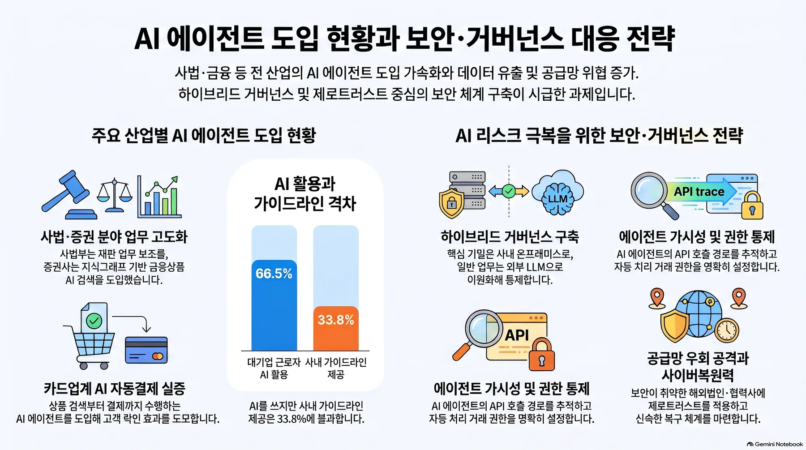
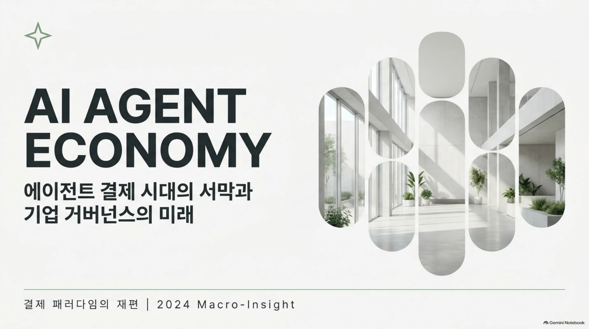
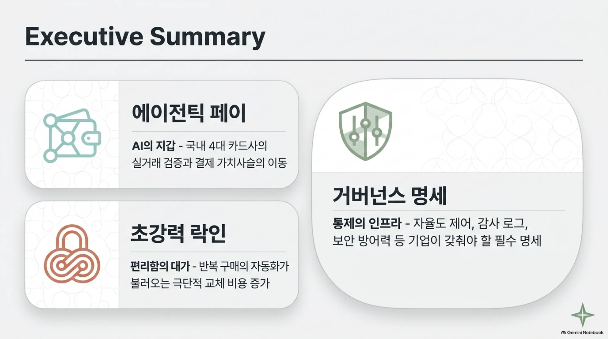
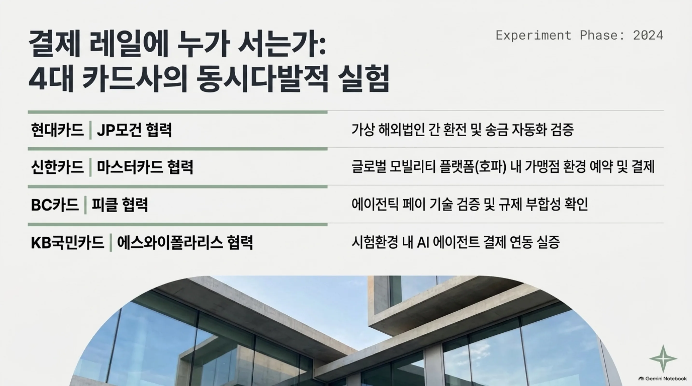
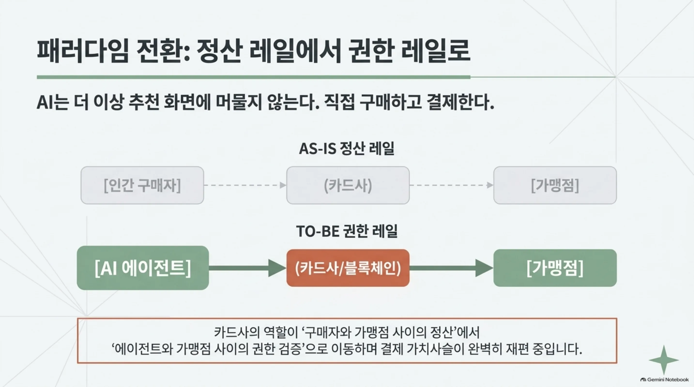
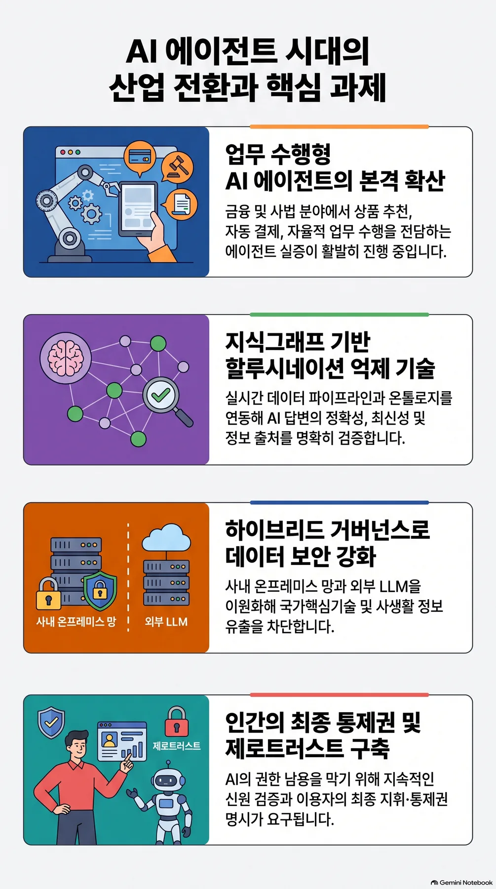

현대카드의 시험 환경에서 AI 에이전트가 가상 해외법인의 환전 송금을 처리하고 있습니다. 권한 안에 있으면 스스로 움직입니다. 권한을 넘으면 담당자가 승인 또는 거부를 눌러야 합니다. 아주 작은 실험입니다. 하지만 이 실험이 답하려는 질문은 보통이 아닙니다. 앞으로 AI가 대신 살 때 돈은 누가 내는 일, 잘못되면 누가 책임지는 일이 되기 때문입니다. 그리고 이는 추상이 아니라 지금 국내 카드 업계에서 실제로 검증 중인 일입니다.

오늘 아침 뉴스를 관통하는 축은 소버린 AI와 보안이었습니다. 공급망 안정화 논의, 기밀 유출 딜레마, 공급망을 노린 AI 해커. 그 축의 한가운데, 돈이 실제로 흐르기 시작한 곳이 하나 있습니다. 바로 에이전트 결제입니다. 오늘 축의 기사들이 결국 다 같은 지점을 묻고 있습니다. AI는 어디서 돌리고 누가 통제할 것인가가 바로 그 지점입니다.

오늘 아침 다이제스트에는 4대 카드사의 이야기가 나옵니다. BC카드, KB국민카드, 신한카드, 현대카드. 파트너는 제각각이지만 네 회사가 하는 실험은 같습니다. 공통분모는 하나입니다. 에이전트가 실제로 돈을 만질 수 있는지를 보는 일.

이번 한 달, 국내 4대 카드사가 같은 실험에 동시에 들어갔습니다. BC카드는 17일 AI 스타트업 피클과 에이전틱 페이 기술 검증 및 사업화 MOU를 체결하고, 관련 법규와 규제에 맞춰 서비스를 구현할 수 있는지 확인하고 있습니다. KB국민카드는 에스와이폴라리스와 시험환경에서 AI 에이전트 결제 연동을 검증 중입니다. 신한카드는 마스터카드의 글로벌 모빌리티 플랫폼 호파에서 에이전트가 가맹점 환경에서 예약과 결제를 하는 일을 실제로 시험했습니다. 지난 3월 마스터카드와 국내 카드사 최초의 AI 에이전트 페이 실거래를 마친 데 이은 두 번째 시험입니다. 현대카드는 JP모건의 키넥시스와 가상 해외법인 간 환전과 송금을 검증하고 있습니다.

## 결제 레일에 누가 서느냐

네 실험의 공통점은 분명합니다. 에이전트가 추천 화면에서 멈추지 않고 실제로 돈을 옮긴다는 것. 업계는 이를 에이전틱 커머스라 부릅니다. 에이전트가 구매와 결제까지 직접 수행하는 시장입니다. 마스터카드는 이미 2026년 AI 결제 프로토콜(에이전트 페이 계열)을 공개했고 각국 카드 네트워크와 은행은 에이전트발 거래의 표준과 권한 구조를 놓고 선점 경쟁에 들어갔습니다. 경쟁은 프로토콜이라는 기술 표준과, 에이전트가 어느 범위까지 스스로 거래할 수 있는지를 정하는 권한 구조라는 두 전線で 동시에 벌어집니다.

질문은 더 이상 에이전트가 살 수 있느냐가 아닙니다. 에이전트와 가맹점 사이의 결제 레일에 누가 서느냐가 전부입니다. 카드사는 결제 편의와 반복구매 락인이라는 수익 모델을 노립니다. AI 스타트업과 블록체인 인프라사는 에이전트 실행과 신원 확인 기술이라는 자리를 노립니다. 에이전트가 거래 주체가 되는 순간, 결제 산업의 가치사슬 자체가 재편되고 있습니다. 카드사의 역할은 구매자와 가맹점 사이의 정산 레일에서, 에이전트와 가맹점 사이의 레일로 이동하는 셈입니다.

<!-- nlm-visual -->

*NotebookLM이 소스를 종합해 생성한 인포그래픽입니다.*

## 유인물은 락인

카드사들이 왜 이렇게 잰 걸음인지, 답은 락인 효과라는 말 안에 있습니다. 언제 무엇을 얼마나 자주 사는지를 아는 AI가 직접 결제까지 할 수 있게 되면, 정기구매 품목을 스스로 결제하게 되는 순간 교체 비용이 확 올라갑니다. 반복하는 구매자가 가장 끈질긴 고객인 이상, 그 고객의 지갑으로 들어가는 입구가 전장입니다. AI가 추천 단계에서 그치지 않고 구매와 결제까지 수행하는 에이전틱 커머스가 확장될수록, 카드사는 이 입구를 놓칠 수 없습니다.

그래서 이 검증은 결제와 동시에 보안 체계 검증으로 진행되고 있습니다. 카드업계는 상용화 전 과제로 거래 권한 범위 확인과 보안 체계 검증을 꼽습니다. 카드를 받는 에이전트는 권한 안에서만 결제할 수 있다는 것과, 모든 거래에 흔적을 남긴다는 것을 보여줘야 합니다. 콘텐츠 생성에서 실수는 다시 하면 그만이지만 결제에서 실수는 곧바로 금전 손실입니다. 감사 흔적이 있는지가 AI 사고와 보통의 일을 가르는 선입니다. 고객 편에서도 변화는 실체적입니다. 카드 정보를 입력하고 체크아웃 화면을 넘어가던 동선 대신, 에이전트가 구매부터 결제까지 한 흐름으로 처리하게 됩니다. 편리함의 크기가 곧 통제해야 할 권한의 크기입니다.

## 기업을 준비시키는 것은 결제보다 크다

결제는 첫 전면에 불과합니다. 에이전트가 돈을 다루는 순간, 다음으로 넘어올 것은 구독, 출장, 구매 주문, 보험입니다. 모든 기업이 에이전트에게 얼마를 맡길지, 맡긴 뒤 어떻게 다스릴지를 물어야 하는 시기에 들어갑니다. 카드사 시험이 상용화되기도 전에, 기업은 자기 에이전트 운영 거버넌스를 먼저 갖춰야 합니다.

도입 속도보다 관리가 느리다는 격차가 수치로 확인됩니다. 대한상공회의소 조사에서 대기업 근로자의 생성형 AI 활용률은 66.5%, 중소기업은 52.7%입니다. 반면 사내 가이드라인을 갖춘 기업은 대기업 33.8%, 중소기업 24.3%에 그칩니다. 도입 로드맵조차 없는 중소기업은 70.4%입니다. 사람은 이미 쓰고 있고 규칙집은 지금 쓰이고 있습니다.

대기업은 하이브리드 방식을 운영 표준으로 굳혀가고 있습니다. 핵심 기밀 업무는 사내 구축형 온프레미스 전용 AI로, 일반 업무는 입력 데이터가 재학습에 쓰이지 않는 외부 LLM으로 나눕니다. SK AX는 VDI 기반 폐쇄형 AI 플레이그라운드와 고객사 프로젝트용 AI 랜딩존의 이중 구조를 운영하고, 현대오토에버는 데이터를 일반, 대외비, 기밀, 국가핵심기술로 자동 분류하는 4단계 보안 체계를 갖췄습니다. 거버넌스 인프라가 이미 대기업 안에서 지어지고 있다는 뜻입니다. 삼성전자의 DS 임직원이 외부 AI에 소스코드를 입력한 사고 이후, 기업의 관리 체계는 활용 속도에 뒤처졌다는 지적이 나온 바 있습니다. 반면 전담 인력이 부족한 중소기업은 저렴한 가드레일과 에이전트 가시성 플랫폼에 의존도를 높일 수밖에 없습니다. 카드사가 시험 중인 권한과 감사 인프라는 곧 모든 기업의 에이전트 도입에서 필수 항목이 됩니다.

## 명세는 시험 환경에서 쓰인다

그 규칙집은 프로덕션 검증에서 써지고 있습니다. 미래에셋증권이 AWS와 함께 상품 지식 AI검색을 운영하는 방식이 그렇습니다. 금융상품과 공시 문서 약 1만3000건을 지식그래프에 연결하고 검색과 답변 작성을 멀티 AI 에이전트가 분담합니다. 보유하지 않은 정보는 미보유로 명확히 안내하고 프롬프트 공격과 유해 콘텐츠는 가드레일로 사전 검사합니다. 모델을 교체할 경우에도 금융보안원 절차로 품질을 재검증합니다. 3월 혁신금융서비스 지정, 7월 금융보안원 생성형 AI 보안평가 적합 판정, 8월 임직원 운영 시작, 내년 상반기 고객 서비스 공개. 금융권이 에이전트를 프로덕션으로 밀어올리는 규제 로드맵을 그대로 밟은 케이스입니다. 10월20일까지 임직원 450명 이상이 복합 질의 2000건 이상을 활용했고 답변 품질은 3월 사전 검증 대비 약 84% 향상됐습니다. 주세민 대표의 표현처럼 모델보다 데이터가 먼저인 셈입니다. 규제 산업의 프로덕션 레시피가 모델 검증, 데이터 검증, 에이전트 검증을 밟는 순서로 고착되는 중입니다.

같은 문장은 사법부에서도 나오고 있습니다. 법원은 2026년 2월 사법부 자체 AI 플랫폼 구축과 생성형 AI 기반 재판지원 AI 시스템 시범 운영을 발표했고 이후 화두는 도입에서 신뢰 확보로 옮겨갔습니다. 로앤컴퍼니 법률AI연구소장 안기순은 기본권을 다루는 사법 AI에서는 정확도가 최우선이며 AI 답변의 최종 검증은 이용자가 하도록 인간의 지휘권과 통제권을 운영 절차의 기본 원리로 명시해야 한다고 조언했습니다. 법조계 AI는 3~5년 내 질문-답변 보조에서 실행계획을 세우고 하위도구를 지휘하는 자율형 AI 에이전트로 고도화될 전망입니다. 금융이 쓰고, 법원이 쓰고, 카드사가 쓰고 있는 것이 결국 하나의 명세라는 뜻입니다.

카드사 시험에도 같은 패턴이 등장하고 있습니다. 직원이 직접 구축하는 AI 에이전트는 사내 시스템과 외부 API를 수시로 오가며 새로운 보안 사각지대가 되고, MCP와 외부 도구 호출 경로의 데이터 흐름 가시성과 스킬 사전 승인 검증이 핵심 과제로 떠올랐습니다(유상윤 에임인텔리전스 대표). 공격 쪽도 움직입니다. 구글 위협 인텔리전스 그룹 GTIG와 맨디언트는 11월17일 AI 위협 추적 보고서에서 자율 다중 에이전트 공격 프레임워크가 AI 위협 활동의 임계점을 넘었다고 밝혔습니다. 자동화된 취약점 익스플로잇 파이프라인과 LLMJacking 같은 새 수익화 수법의 등장도 함께 지적됐습니다. 공격 경로도 본사 경계에서 공급망으로 이동했습니다. 해외법인 VPN 계정이 탈취돼 본사 내부망까지 침투하는 구조입니다. 국가인공지능전략위원회는 국가 사이버복원력 TF를 출범시켜, 침해 후에도 핵심 기능을 유지하고 빠르게 복구하는 쪽으로 정책 방향을 넓혔습니다. 공격자 측에도 자기 권한 안에서 움직이는 에이전트가 있다는 점이, 과거 해킹과 지금을 가르는 이유입니다.

방어하는 에이전트를 지키는 인프라와 공격하는 에이전트를 추적하는 인프라는 결국 같은 것입니다. 오늘의 카드사 시험이 가르쳐 주는 대목입니다.

## 결론: 결제 표준 전쟁은 서막

카드사의 이번 달 검증을 기업용 에이전트 플랫폼이라는 렌즈로 보면, 결론은 간단합니다. 4개사가 시험 환경에서 쓰고 있는 것은 에이전트 운영에 필요한 명세. 권한 범위 정의, 초과 시 인간의 승인 또는 거부, 전 과정 감사, 신원 확인, 폐쇄된 시험 환경. 이것은 결제 명세가 아니라 에이전트 거버넌스 명세입니다.

ThakiCloud의 Paxis는 Agent-Native Cloud 정식 제품(v1.1 GA)으로, 이 명세를 이미 일급 리소스로 안고 있습니다. Skills, Tools, Policies, Audit Logs는 모두 이 플랫폼에서 독립적으로 관리되는 자원입니다. 자율도는 L0에서 L3까지 네 단계로 거버넌스되며 에이전트가 자기 단계보다 높은 작업에 접근하면 정책 게이트가 걸리고 감사 로그가 남습니다. 실행은 격리 샌드박스에서 일어나고 외부 시스템은 MCP 커넥터로 연결되며 검증된 스킬은 스킬 마켓을 통해 조직 안에서 공유됩니다. 작업마다 비용과 성능을 맞춰 모델을 선택하는 CostRouter도 붙습니다. 배포는 소버린 또는 온프렘 K8s, ai-platform 위에서 가능합니다.

현대카드 시험 절차의 그 문장, 권한 내 자동 처리, 권한 초과 시 담당자 승인 또는 거부는 이 명세의 줄입니다. 카드사가 결제라는 첫 번째 업무에서 에이전트 거버넌스 표준의 초안을 쓰고 있습니다. 같은 표준을 먼저 완성한 기업에 무슨 일이 일어날지는 자명합니다. 카드사 시험 환경은 프리뷰입니다. 에이전트 워크플로가 구독과 출장, 구매 주문으로 뻗어갈 때, 거버넌스가 이미 갖춰진 기업은 그대로 속도를 냅니다. 마스터카드와 카드사가 벌이는 결제 레일 표준 전쟁은 서막에 불과합니다. 진짜 본편은 기업 에이전트 거버넌스 표준 전쟁입니다. 어떤 에이전트가 어떤 권한으로 어떤 스킬을 실행했고 그 결과로 무엇이 움직였는지를 답해내는 쪽이 돈이 움직이는 에이전트 경제의 표준을 정합니다.

<!-- nlm-visual -->

*NotebookLM이 소스를 종합해 생성한 인포그래픽입니다.*

## 참고 자료

이 글은 아래 뉴스를 종합해 작성했습니다.

- IT비즈뉴스, [AWS와 손잡은 미래에셋증권, '상품 지식 AI검색' 서비스 운영 개시](https://www.itbiznews.com/news/articleView.html?idxno=232306)
- 청년일보, [AI 자동 결제로 '락인 효과'…카드업계, AI 에이전트 검증 '잰걸음'](https://www.youthdaily.co.kr/news/article.html?no=230148)
- 이데일리, ["'신뢰 생명' 사법부 AI…실시간 정보 확보·자동검증 강화 기술 관건"](https://www.edaily.co.kr/News/Read?newsId=01193926645648672&mediaCodeNo=257&utm_source=naver&utm_medium=referral&utm_campaign=news_syndication&utm_content=original_article)
- 이코노미스트, [AI 쓰자니 기밀 유출 걱정, 막자니 경쟁력 걱정…산업계 '딜레마'](https://economist.co.kr/article/view/ecn202611160054)
- 이코노미스트, [본사만 잠그면 끝?…해외법인·협력사 노리는 AI 해커](https://economist.co.kr/article/view/ecn202611180003)
