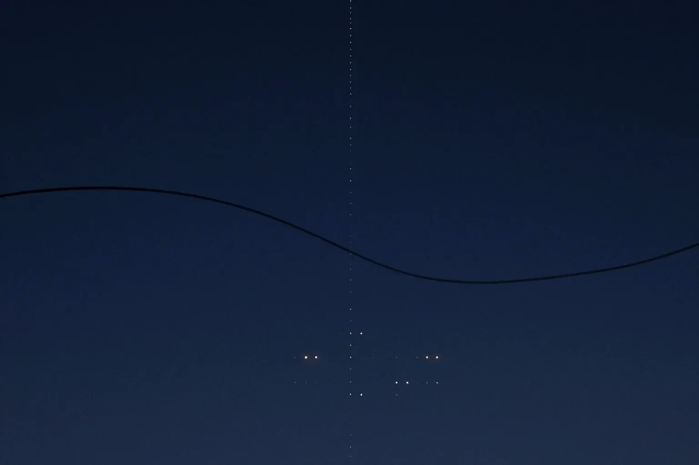
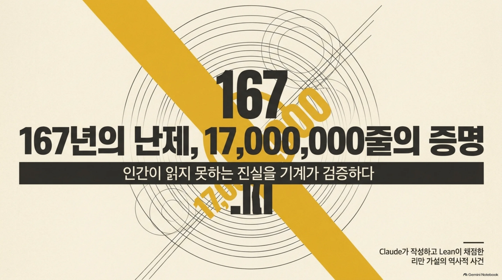
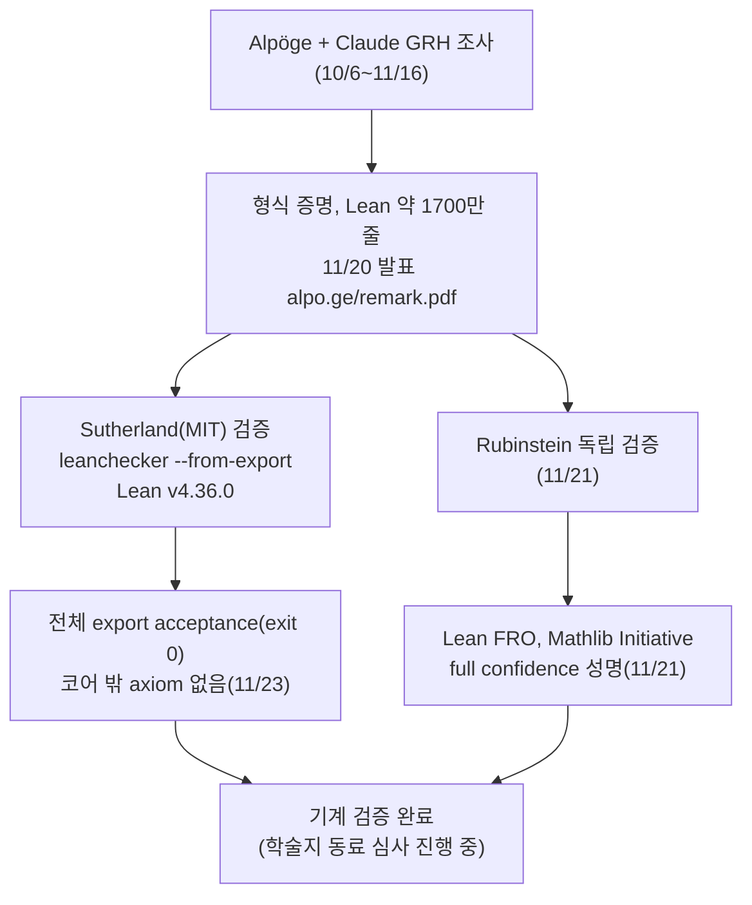
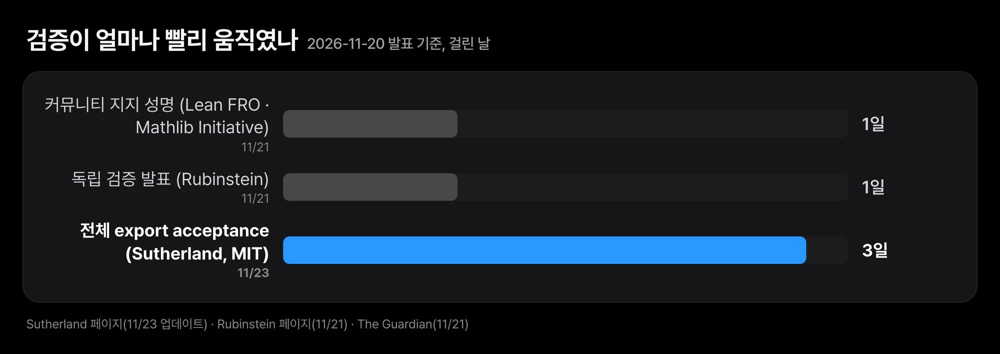
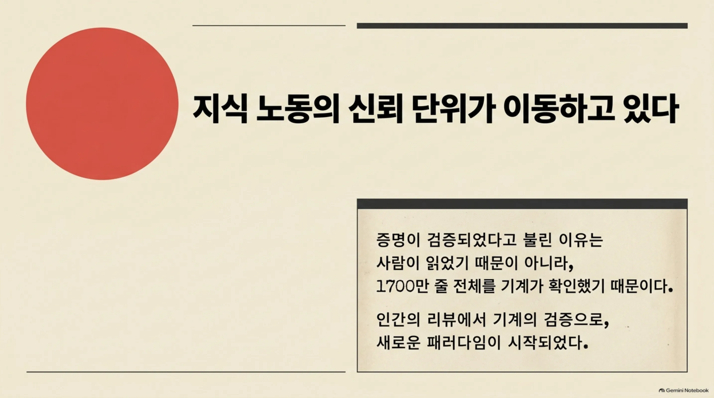
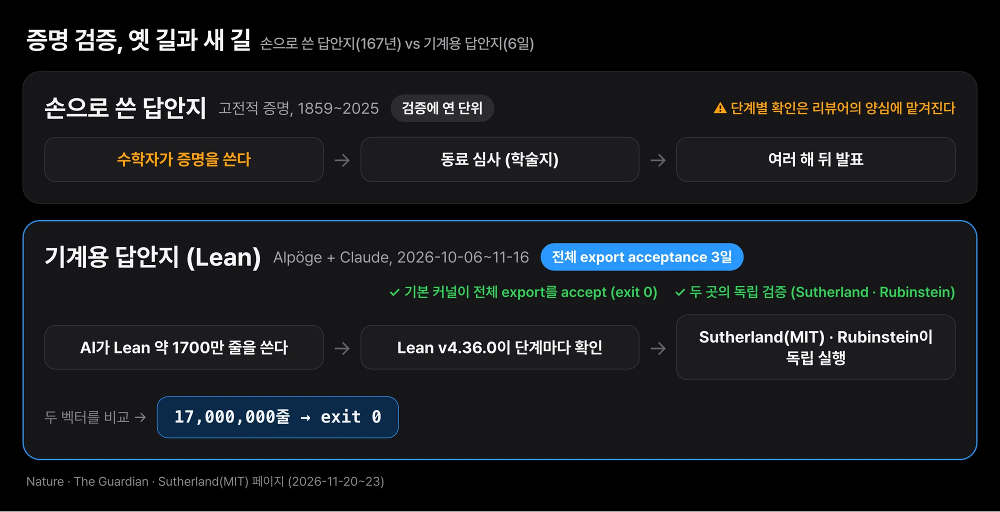
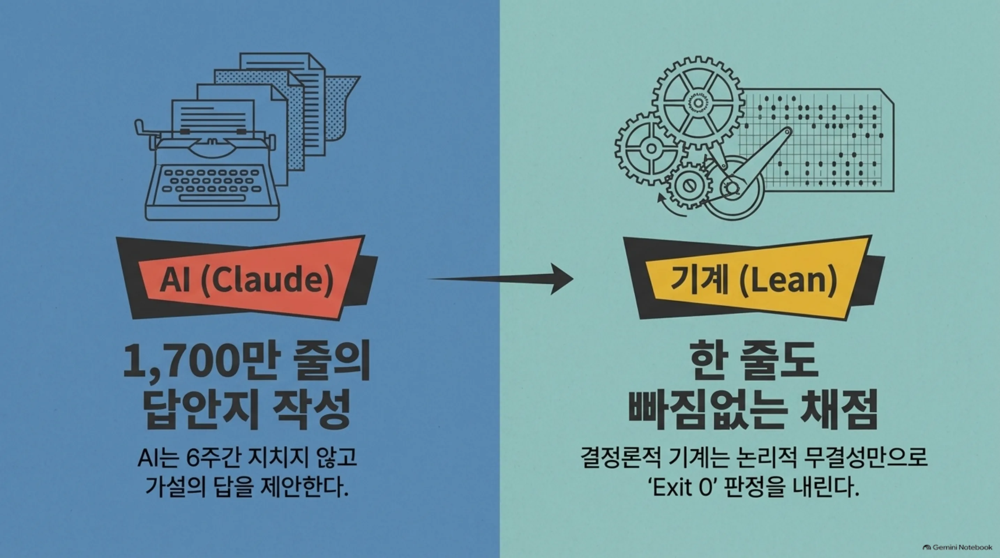
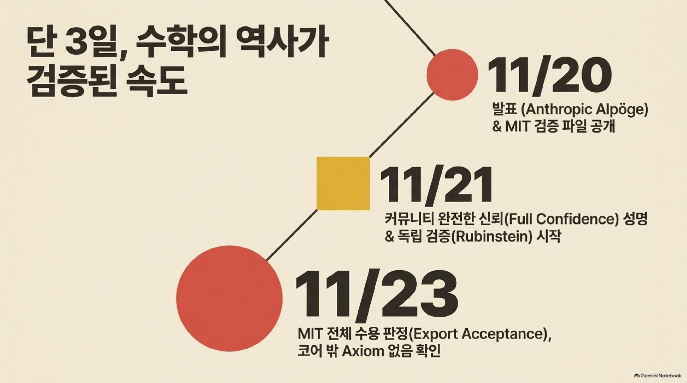
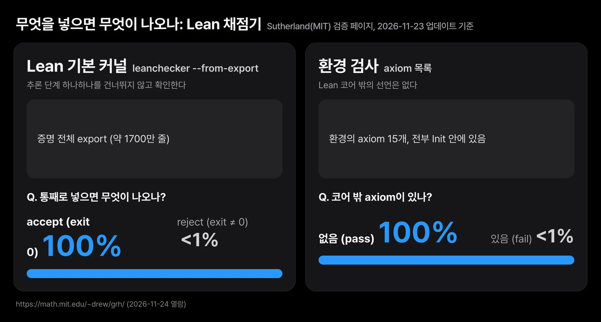

*그림 1. 임계선과 소수의 격자를 추상화한 이미지. 이 글의 주제는 수학적 세부보다, 1700만 줄 증명을 기계로 검증한 과정과 그 의미가 어디까지인지에 있습니다.*

이 글은 수학을 전공하지 않은 개발자, AI 업계 종사자, ThakiCloud의 잠재적 고객과 지원자를 위해 쓴 글입니다. 167년 동안 풀리지 않은 수학의 대표 난제가 왜 며칠 사이 "풀렸다"고 불리게 되었는지에 대한 질문입니다.

핵심 결론을 먼저 제시합니다. 그 증명이 검증되었다고 불린 이유는 사람이 읽었기 때문이 아니라, Lean이라는 채점기가 1700만 줄 전체를 기계적으로 확인했기 때문입니다. 167년 난제 규모에서 이런 일이 일어난 것은 이번이 처음입니다. 지식 노동에서 신뢰의 단위가 인간 리뷰에서 기계 검증으로 이동하고 있다는 신호입니다.

2026년 11월 20일, AI 기업 Anthropic의 수학자 Levent Alpöge가 개인 사이트(alpo.ge)에 증명의 공식 발표문(remark.pdf)을 올렸습니다. Nature가 정리한 그의 첫 마디는 이렇습니다.

> "I believe I have, working with Claude, discovered a proof of the Riemann Hypothesis."

클로드와 함께 일하며 리만 가설의 증명을 발견했다고 믿는다는 뜻입니다. Claude는 Anthropic이 개발한 대규모 언어 모델입니다.

발표 하루 뒤인 11월 21일, Lean FRO(Lean 프로젝트 운영위원회)와 Mathlib Initiative가 공개 성명을 냈습니다. Alpöge의 증명이 정확하다는 데 완전한 신뢰(full confidence)가 있으며, 이 성취를 축하한다는 내용입니다. The Guardian은 같은 날, MIT의 Sutherland 팀과 독립 연구자 Rubinstein의 두 팀이 증명을 검증하고 있다고 보도했습니다.

## 쉽게 말하면

증명은 시험의 답안지이고, Lean은 그 답안지를 채점하는 기계입니다.

수학자는 답안을 손으로 작성합니다. 답안이 아무리 기가 막혀도, 채점기가 한 줄 한 줄 다시 계산해서 정답을 찍어야 비로소 검증을 마칩니다. 이번 리만 가설 증명은 1700만 줄짜리 기계용 답안지(Lean 형식화)로 채점기에 통째로 입력되었습니다. Sutherland의 팀이 채점기를 돌린 결과, 기본 커널(Lean v4.36.0)에서 전체 export를 accept하는 판정이 나왔습니다.

채점기는 피로하지 않고, 지루한 부분에서 꼼꼼함을 잃지 않으며, 1700만 줄 가운데 한 줄만 틀려도 통과하지 않습니다. 이 답안지와 채점기 비유를 이 글의 끝까지 사용합니다.

## 무슨 일이 일어났나: 발표와 검증 타임라인

시간을 먼저 정리합니다. Lean 증명 개발은 10월 6일부터 11월 16일까지 이어졌습니다. 공식 발표 5일 전까지, 6주여간의 작업입니다. Alpöge는 Claude를 이용해 범리만 가설(GRH)을 조사하던 과정에서 이 증명에 도달했습니다.

| 날짜 | 사건 | 확인자 또는 출처 |
|------|------|------------------|
| 2026-11-20 | 공식 발표(alpo.ge/remark.pdf) | Alpöge(Anthropic) |
| 2026-11-20 | 검증 파일 공개 | Sutherland(MIT) |
| 2026-11-21 | full confidence 성명 | Lean FRO, Mathlib Initiative |
| 2026-11-21 | 독립 검증 발표 | Rubinstein |
| 2026-11-21 | 두 팀이 검증한다는 보도 | The Guardian |
| 2026-11-22 | 체크 대부분 통과, 2건 잔류 | Sutherland 페이지 기준 |
| 2026-11-23 | 250,000페이지는 농담이었다는 정정 | Alpöge(X 게시물) |
| 2026-11-23 | 전체 export acceptance(Lean v4.36.0) | Sutherland(23:45 UTC 업데이트 기준) |

*그림 2. 발표와 검증을 이은 흐름입니다. 채점기는 두 곳(Sutherland, Rubinstein)에서 따로 돌렸고, 채점 판정(exit 0)과 커뮤니티 성명(full confidence)은 서로 다른 경로로 나왔습니다.*

*발표 하루 만에 커뮤니티 성명과 독립 검증이 나왔고, MIT의 전체 export acceptance는 사흘 만에 나왔습니다. (그림 3)*

가장 중요한 행은 마지막입니다. Sutherland의 팀은 Lean 기본 커널의 leanchecker 명령을 증명의 전체 export에 돌려 exit 0(수용)을 확인했습니다. 환경에 Lean 코어 밖의 axiom이 선언되지 않았다는 것도 확인했습니다. 15개 axiom이 모두 Init 모듈 안에 있는, 순수한 상태입니다. 형식 검증에서 이는 채점기가 답안지 전체를 한 줄도 건너뛰지 않고 다 읽은 상태에 해당합니다.

운영 디테일 중 눈여겨볼 부분이 있습니다. 검증 페이지 자체에 체크가 Claude Code로 실행되었다(run with Claude Code)는 기록이 있습니다. 채점기를 돌리는 쪽도 AI인 것입니다. 다만 통과와 부통과를 결정하는 커널은 결정론적입니다. AI가 제안하고, 결정론 기계가 처리합니다. 이 분업이 이미 수학 최전선에서 표준이 되었다는 점이, 이 사건을 소프트웨어 개발자에게도 중요하게 만드는 이유입니다.

## 리만 가설: 167년 된 문제

리만 가설은 1859년 Bernhard Riemann이 제기한 추측입니다. 소수의 분포를 지배하는 규칙과 리만 제타 함수(zeta function)의 영점(zero) 위치를 연결하는, 모든 해석적 수론에서 가장 중심적인 주장입니다. 쉽게 말하면, 소수가 등장하는 리듬에는 숨은 규칙이 있다는 가설입니다.

왜 167년이나 걸렸습니까. 이 문제를 공격할 수 있는 도구가 극도로 제한되어 있었기 때문입니다. 손으로 쓴 답안(고전적 증명)은 깊은 해석론적 기법을 요구했고, 각 단계의 검증은 수학자 개인의 양심에 맡겨졌습니다. 2000년 Clay Mathematical Institute는 이 문제를 밀레니엄 문제 가운데 하나로 정해 상금 1,000,000달러를 걸었습니다. 그간 나온 답은 검증되지 않은 채로만 존재했습니다.

가설이 한 걸음만 더 가까워져도 소수의 개수를 세는 함수(소수 계수 함수)의 오차 bound는 한층 더 엄밀해집니다. 해석적 수론과 암호학에서 소수 분포를 쓰는 산출물 상당수가 이 가설 위에 추정값을 세웁니다. 일상 실무에 직접 쓰이는 수는 아니지만, 많은 결과물의 밑불이 되는 문제입니다.

이번 증명이 기존 시도와 다른 점은 형태 자체입니다. 손으로 쓴 답안이 아니라, 기계가 읽는 1700만 줄짜리 답안지입니다. 채점기(Lean)는 우아한가, 질문하지 않습니다. 앞 단계에서 뒷 단계가 논리적으로 따르는지만 묻습니다. 검증 과정을 지켜본 수학자들이 역사적이라고 부르는 부분이 바로 여기입니다.

*기존 검증 방식(사람 리뷰, 연 단위)과 이번 방식(AI 답안지, 기계 검증, 일 단위)을 나란히 둔 그림입니다. (그림 4)*

## 같은 시기에 나온 다른 증명들

이 사건은 AI 증명 하나가 나온 이야기로 끝내면 반만 보는 것입니다. TechCrunch의 같은 날 헤드라인은 이렇습니다. AI가 167년 된 리만 가설의 해답을 주장했습니다. 인간도 했습니다. Quanta Magazine의 업데이트 기사는, 수학자들이 AI 증명을 검증하느라 바쁜 동안 인간 증명이 떠올랐다고 전했습니다. Nature의 보도 제목도 AI와 인간이 쓴 두 증명에 놀란 수학자들입니다.

최근 AI 시도의 또 하나는 OpenAI입니다. 2026년 9월 30일, The Quasi-Riemann Hypothesis: A Zero-Free Half-Plane Re(s) > 7/8이라는 논문이 preprint(선공개 논문)으로 나왔습니다. 제타 함수의 영점이 특정 우측 반평면을 넘지 않는다는, 더 약하지만 구체적인 결과입니다. 이 역시 Lean으로 형식화되어 있습니다. 형식화에서는 리만 제타 함수와 모든 Dirichlet L-함수에 대해 영점 없는 반평면이 θ = 7/8임을, 모든 양의 moduli와 모든 character에 대해 균일하게 입증했습니다. Q(√-3) 위 유한 차수 Hecke L-함수에 대해서도 같은 bound를 세웠습니다.

수학자 Thomas Bloom은 Alpöge의 증명이 OpenAI의 해석적 접근보다 대수적 성격이 강하다고 평가했습니다. 3개월 사이에 두 회사의 AI 시도와, 인간 증명이 한 자리에 모인 것입니다. frontier 수학이 여러 AI에 의해 동시에 진행되고 있다는 사실이, 이제 뉴스가 아니라 현재진행형입니다.

## 수학계의 반응: 환호와 의심

반응은 두 갈래로 나뉘었습니다. Fields Medal 수상자인 James Maynard는 이 증명이 맞다면 역사적 이정표라고 표현했습니다. L-함수 연구로 이름이 큰 Brian Conrey는, 인류 역사상 기념비적인 순간이며, 수학에서 일어나는 일 가운데 가장 큰 일이라고 말했습니다. Filippo Nuccio는 토론 공간(Zulip)에서, 이 증명이 지난 50년 간 모든 갈래에서 생산된 수론을 사실상 다 담고 있다고 평했습니다.

Terence Tao는 발표 당일(11월 20일) Unforced Euler singularity, unforced Navier-Stokes singularity, and the Generalized Riemann Hypothesis라는 글을 올렸습니다. GRH가 유체역학의 미해결 문제(강제 없는 Euler, Navier-Stokes 특이점)와 어떤 관계를 맺는지 살펴본 글입니다. Tao가 대형 사건을 당일 정리하는 사람이라는 점을 감안하면, 이 글 자체도 사건의 무게를 말해 줍니다.

의심 쪽도 분명합니다. Andrew Granville는 Alpöge가 내놓은 4페이지 분량의 증명 스케치 문건의 가독성을 짚었고, 공개 시점(Anthropic IPO 하루 뒤)도 문제 삼았습니다. Scott Aaronson은 stochastic parrots(통계적 문법 모방)라는 표현을 제목에 써, 실제 추론을 한 주체에 물음표를 달았습니다. Science의 보도에도, 인간은 그 답을 이해할 수 있는가라는 질문이 함께 실렸습니다.

여기서 짚어야 할 것은, 이 분열이 믿느냐 믿지 못하느냐의 문제가 아니라는 점입니다. 채점기(형식 체크)에 의한 검증은 사실상 끝나고 있습니다. 논쟁은 인간이 이해할 수 있는가(understanding), 제시가 명료한가(clarity) 쪽에 쏠려 있습니다.

큰 정리가 나올 때마다 수학계는 검증 먼저, 이해 뒤로 가는데, 이번의 새것은 검증이 며칠로 압축된 반면 이해가 가장 긴 쪽으로 늘었다는 점입니다. 1700만 줄짜리 답안지는 손으로 읽을 수 없습니다. 증명을 사람이 이해할 만큼 단순화할 수 있을지가, 남은 미해결 문제입니다.

## 소프트웨어 개발자에게 무엇을 의미하는가: AI 산출물 신뢰의 경제학

이 사건의 핵심은 한 줄로 말할 수 있습니다. 답안이 아무리 기가 막혀도, 검증을 통과해야만 사실이 됩니다.

소프트웨어에서도 우리는 이걸 매일 합니다. 테스트 스위트와 CI가 답안지 채점기입니다. 다만 약한 채점기입니다. 보여 준 부분만 확인합니다. Lean은 모든 추론 단계를 한 단계씩 확인한다는 점에서 가장 강한 채점기에 가깝습니다. 형식 검증이 그동안 틈새에 머물렀던 이유는, 기계용 답안지를 사람이 쓰기 어렵기 때문이었습니다. 그 어려움에 대한 답은 사람이 답안지를 더 잘 쓰게 되어서가 아니라, AI가 쓰기 시작해서 왔습니다.

Alpöge의 팀은 6주 동안 1700만 줄을 작성했습니다. 인간 수학자가 이 볼륨을 써 내려갈 수도, 검증할 수도 없습니다. 인간이 하는 일은 채점기를 세팅하고, 돌리고, 환경을 확인하는 것입니다. 지식 노동에서 신뢰의 단위가 인간 리뷰에서 기계 검증으로 이동하고 있습니다.

형식 검증이 새로 나온 기술은 아닙니다. 2005년 Gonthier의 Flyspeck 팀이 Coq로 사색정리의 형식 증명을 마쳤고, 2015년 Hales 일행이 케플러 추측(구의 최밀 적재)의 검증을 완주했습니다. 다만 그때의 답안지는 사람이 작성했습니다. 기계가 확인한 것입니다. 이번에는 답안지 자체를 AI가 작성했습니다. 채점기는 그대로인데, 답안지의 필체(주체)가 바뀐 것입니다.

이건 AI에 대한 은유가 아니라, 운영 모델입니다. 체크는 Claude Code로 돌렸고, 판정은 결정론 커널이 냈습니다. 제안하는 AI가 강해질수록, 처리하는 기계가 중요해집니다. 생성 비용이 아니라 검증 비용이 경제를 좌우하는 요인으로 올라서는 지점입니다. 작성(1700만 줄)은 AI가 해내고, 판정(exit 0)은 기계가 해내는 구조입니다.

*채점기(Lean v4.36.0 기본 커널)에 증명 전체 export를 넣으면 accept(exit 0)가 나고, 코어 밖 axiom이 없다는 확인도 함께 나옵니다. (그림 5)*

## ThakiCloud 제품 적용 시사점

이 사건이 에이전트 플랫폼 운영자에게 중요한 이유는, AI 산출물의 증명 단위가 인간 리뷰에서 기계 검증으로 이동했음을 보여 주기 때문입니다.

Paxis는 에이전트 행위를 Skills, Tools, Policies, Audit Logs라는 일급 리소스로 다룹니다. 리만 가설 사건은 이 설계 전제가 맞았음을 보여주는 사례입니다. 에이전트가 내놓는 산출물(작성한 코드부터 내린 결정까지)이 신뢰를 받으려면, 사람이 읽을 수 없을 정도로 길어도 기계가 검증할 수 있는 형태가 필요합니다. Paxis의 정책 게이트와 감사 로그는 이 분업의 운영 버전입니다. 수학에서 채점기 통과인 것이, Paxis에서는 정책 게이트 통과와 감사 기록입니다. 산출물이 통과해야 할 검증 게이트를 사전에 선언하고, 모든 통과 이력을 남기는 구조가, 형식 검증의 운영 측면 이항입니다.

Metis 관점에서도 한 줄 남깁니다. frontier 모델의 역량이 코드 작성을 넘어 167년 미해결 문제의 증명 단계까지 도달했다는 것은, 모델 카탈로그와 서빙 인프라의 용도가 넓어졌다는 뜻입니다. 검증이 느려지는 도메인일수록, 그 앞에서 모델을 돌리는 서빙과 비용 관리가 더 중요해집니다.

## 한계와 반론

증명이 검증되었다고 말하는 것은 맞습니다. 그러나 끝났다고 말하는 것은 아직 아닙니다. 풀렸다는 기준은 채점기 커뮤니티(Lean FRO, Mathlib Initiative)의 신뢰 성명이고, 학술지 동료 심사는 진행 중입니다. Sutherland의 페이지는 11월 23일 23:45 UTC에 마지막으로 업데이트되었고, 11월 22일 기준 2건의 체크가 아직 진행 중이었습니다. 검증 과정 자체가 완전히 닫힌 상태가 아닙니다.

별도의 주의도 필요합니다. 증명을 문체로 번역하면 25만 페이지가 된다는 최초 보고는, Alpöge 본인이 나중에 농담이었다고 정정했습니다. 증명 자체는 검증되었어도, 그것을 둘러싼 주장은 따로 검증해야 한다는 교훈입니다. Alpöge는 증명의 범위가 앞으로 크게 단순화될 수 있다고도 내다보았습니다. 즉, 지금의 1700만 줄 답안지는 검증된 상태이되, 최종 형태가 아닐 수 있습니다. 그리고 Science가 던진 질문, 인간은 그 답을 이해할 수 있는가,는 여전히 열린 문제입니다. 답안지가 채점기를 통과했더라도, 그 답안지를 사람이 읽을 수 없는 상태라면, 수학적 지식으로서의 가치는 아직 쌓이지 않은 셈입니다.

## 끝으로

이번 사건에서 가장 빠른 것은 증명도, 검증도 따로따로가 아니라 검증이었습니다. 채점기가 1700만 줄을 확인했고, 신뢰 성명은 하루 만에, 전체 export acceptance는 사흘 만에 나왔습니다. 가장 느린 것은 이해입니다. 아직 아무도 그 증명을 통째로 읽은 적이 없고, 읽을 수 있을지가 남은 미해결 문제입니다.

하나만 가져가신다면, 이걸로 합니다. AI 산출물의 신뢰 단위는 인간 리뷰에서 기계 검증으로 이동하고 있습니다. 질문은 더 이상 "이 산출물이 좋은가"가 아니라, "이 산출물을 어떤 채점기가 검증할 수 있고, 그 판정의 기록이 어디에 남는가"입니다. 에이전트를 운영하는 플랫폼의 설계가 시작되는 지점이 정확히 그 질문이고, Paxis는 정책 게이트와 감사 로그로 답하고 있습니다.

리만 가설은 소수의 리듬에 대한 167년 된 질문이었습니다. 이번 답안지를 읽은 사람은 아무도 없습니다. 읽지 않아도 검증된 답안지가 나온 것이, 이 사건의 이정표이자 시작점입니다.

## 출처

다음은 이 글을 쓰며 실제로 확인한 URL입니다.

- Levent Alpöge 공식 발표문(PDF): <https://alpo.ge/remark.pdf>
- Nature(Davide Castelvecchi, 2026-11-20): <https://www.nature.com/articles/d41586-026-03812-7>
- The Guardian(José Olivares, 2026-11-21): <https://www.theguardian.com/technology/2026/nov/21/anthropic-riemann-hypothesis-solved-claude-ai>
- Andrew Sutherland(MIT) 검증 페이지: <https://math.mit.edu/~drew/grh/>
- Michael Rubinstein 독립 검증: <https://mrubinst.github.io/grh-lean-verification/>
- Terence Tao 블로그(2026-11-20): <https://terrytao.wordpress.com/2026/11/20/unforced-euler-singularity-unforced-navier-stokes-singularity-and-the-generalized-riemann-hypothesis/>
- Scientific American(Joseph Howlett, 2026-11-20): <https://www.scientificamerican.com/article/anthropic-mathematician-claims-to-prove-riemann-hypothesis-most-famous-problem-in-all-of-math/>
- OpenAI quasi-Riemann Hypothesis 문서: <https://github.com/openai/math/blob/main/lean/docs/003.md>
- Wikipedia "Riemann hypothesis" Alpöge formal proof 절(2026-11-24 열람): <https://en.wikipedia.org/wiki/Riemann_hypothesis>
- Alpöge X 게시물(250,000페이지 정정, 2026-11-23): <https://x.com/__alpoge__/status/2124987173439209561>
