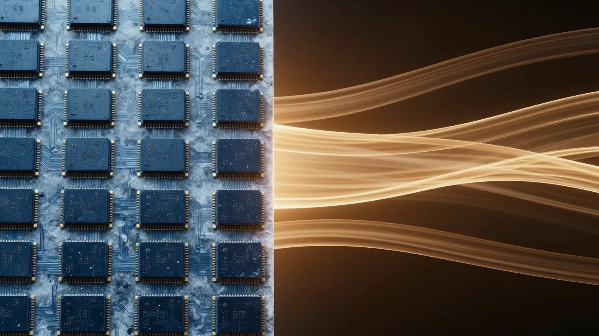
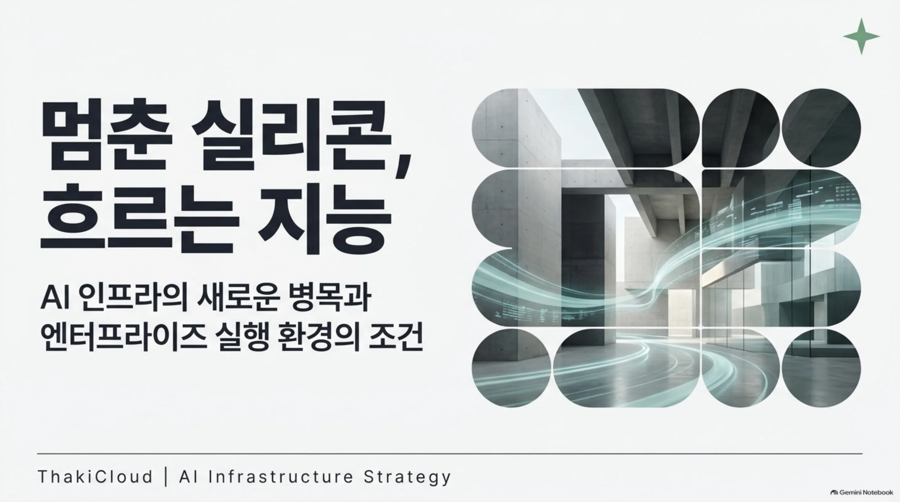
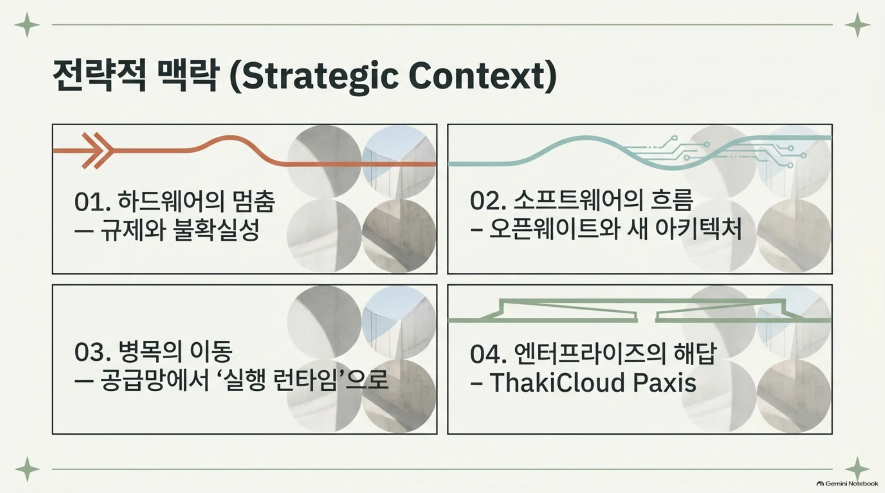
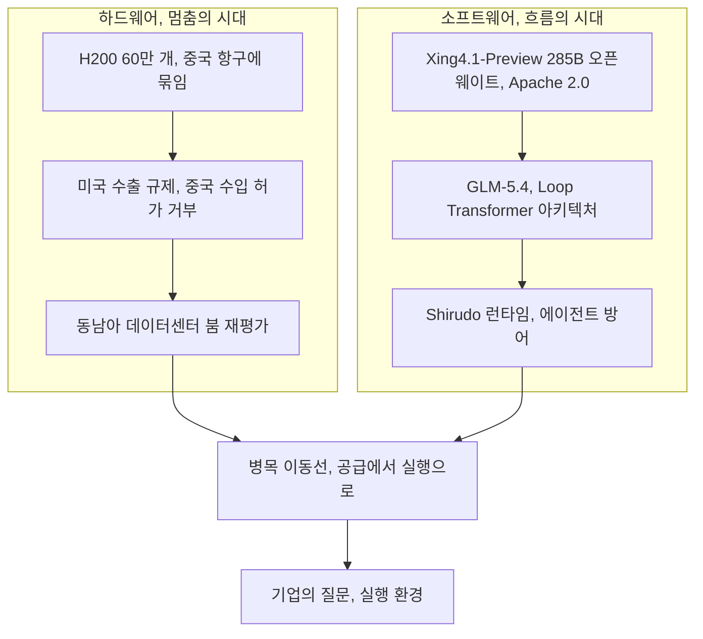
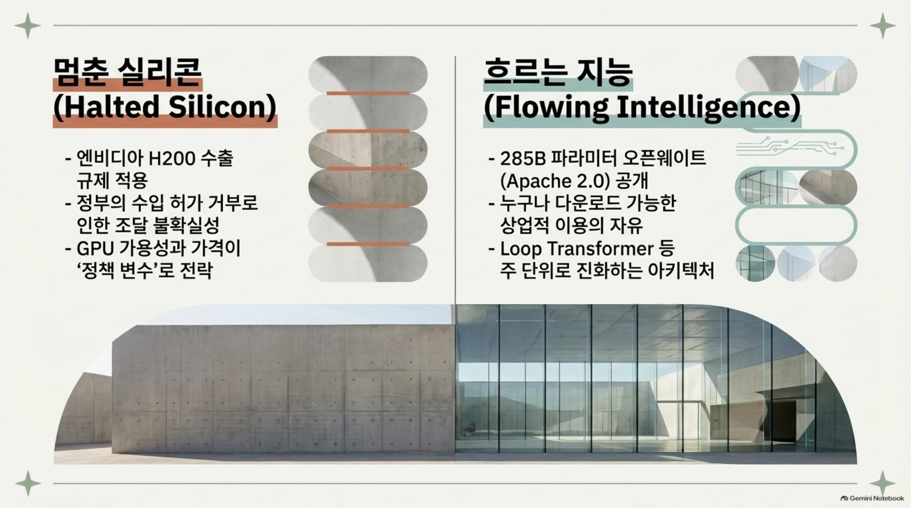
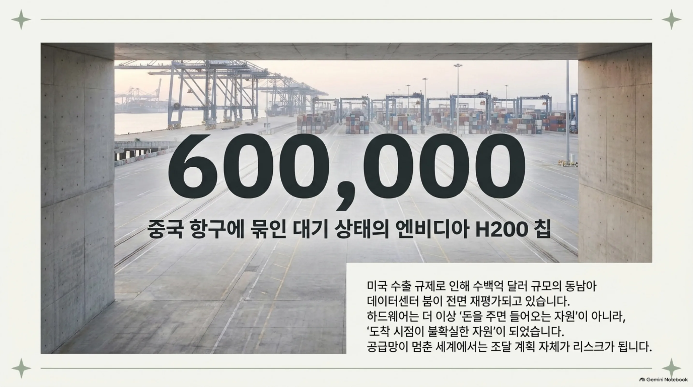

오늘 아침 다이제스트에는 정반대 방향의 움직임 두 개가 나란히 실려 있습니다. 지능은 인터넷을 타고 계속 흐르는 것이다. 지능을 싣는 칩은 규제에 걸려 항구에서 멈추기 시작했습니다. 세계에서 가장 비싼 칩이 항구에서 대기하는 동안, 2850억 파라미터짜리 오픈 모델은 같은 아침에 Hugging Face에 올라와 있었습니다. 같은 날의 뉴스가 서로의 반대편을 확인시켜 주는 날은 흔하지 않습니다. 오늘의 다이제스트는 그 드문 날에 속합니다. 이 대비는 이번 주 뉴스의 한 줄로 끝나는 종류가 아닙니다. 앞으로의 분기를 가르는 선 위에 놓여 있는 셈입니다.

팔머 럭키의 발언에 따르면, Nvidia H200 프로세서 약 60만 개가 중국 항구에 묶여 있습니다. 중국 정부가 수입 허가 처리를 거부하면서 생긴 일입니다. H200은 수출 규칙이 직접 관리 대상에 올린 고급 AI 칩입니다. 칩의 움직임은 처음부터 정부의 승인을 전제로 하는 것입니다. 반대로, 중국텔레콤 산하 Xingchen AGI Lab은 Xing4.1-Preview라는 모델의 BF16 웨이트를 Apache 2.0 라이선스로 Hugging Face에 공개했습니다. 285B 규모입니다. 내려받을 허가는 누구에게도 필요 없습니다. 하나는 통관에서 멈췄습니다. 하나는 이미 다운로드 대기열에 들어 있습니다.

*제목의 대비를 형상화했습니다. 왼쪽은 멈춘 실리콘, 오른쪽은 흐르는 지능.*

## 하드웨어는 멈춤의 시대

규제 쪽에서 읽어야 할 신호는 칩 한 모델의 이야기보다 큽니다. 미국은 첨단 AI 칩의 중국 접근을 차단하기 위한 새로운 수출 규제를 도입했습니다. 이 규제의 파장은 동남아시아까지 닿습니다. 수백억 달러 규모의 지역 데이터센터 붐이 직접적인 위협을 받으며, 붐과 연결된 지역 주가는 이미 하락세로 돌아섰습니다.

동남아 데이터센터 붐의 전제는 두 개였습니다. 칩은 계속 들어온다는 것, 그리고 그 흐름의 중간 정거장으로 쓸 만한 지역이라는 것입니다. 첫 번째 전제가 규제 하나로 흔들리는 순간, 붐의 사업 모델은 자본 문제로 바뀝니다. 주가 하락은 그 재평가가 이미 시장 안에서 끝났다는 뜻입니다. 자금의 눈높이에서 볼 때, 이 지역의 AI 인프라 투자는 수익성 계산서에 정책 변수를 새로 포함해 다시 씌어졌습니다.

항구에 묶인 60만 개는 같은 이야기를 가장 구체적인 형태로 보여주는 장면입니다. 수치 자체는 팔머 럭키의 발언이라는 단일 출처이므로 교차 검증이 필요합니다. 다만 현상 자체는 새롭지 않습니다. 칩의 이동 방향을 정부가 결정하고 대기 시간을 허가 대기열이 정하는 현실이 반복되고 있을 뿐입니다.

두 기사는 같은 수출 규제 체제의 양면입니다. 한쪽은 중국 항구의 칩을 멈추게 하고 한쪽은 '중립적 정거장'을 자처했던 지역의 투자를 재평가하게 만듭니다. 규제의 범위는 이름 붙인 대상보다 넓게 작동하고 있다는 뜻입니다.

칩이 항구에 묶인다는 말은, 그 칩을 전제로 세워진 약속까지 함께 묶인다는 뜻입니다. 조달 계획, 가동률 가정, 그리고 그 위에서 건넨 서비스 일정. 도착이 미뤄지면 이 사슬의 끝에서 고객이 기다립니다. 공급이 멈춘 세계에서는, 멈추지 않은 쪽의 준비가 곧 신뢰가 됩니다.

기업의 계산서는 여기서 바뀝니다. GPU 가용성과 가격이 정책 변수가 되는 순간, 용량 계획은 시장 논리만으로 짜일 수 없는 것입니다. 하드웨어는 더 이상 사면 들어오는 자원이 아니라, 도착 시점이 불확실한 자원이 됐습니다. 그리고 도착이 불확실해지면, 가진 하드웨어 위에서 무엇을 돌릴지가 더 중요한 질문으로 떠오릅니다. 가진 하드웨어의 가동률을 지키는 일, 그 위에 올라오는 소프트웨어의 흐름을 받는 일. 둘 다 같은 실행 환경의 역량으로 묶입니다.

## 소프트웨어는 흐름의 시대

소프트웨어 쪽의 다이제스트는 반대로 흐릅니다. 두 항목 모두 중국에서 왔지만, 가리키는 곳은 다릅니다. 하나는 양(量)의 이야기입니다. Xing4.1-Preview는 아직 성능 검증을 마친 모델이 아닙니다. Preview라는 말이 그대로 그 상태를 가리킵니다. 그런데도 오늘의 뉴스인 이유는 라이선스에 있습니다. Apache 2.0으로 풀린 285B 오픈웨이트는, 대형 모델이 더 이상 공급사의 창구에서만 나오는 물건이 아니라는 것을 보여줍니다. 이 라이선스는 웨이트의 상업적 이용에 대가를 묻지 않습니다. 내려받아, 고쳐 쓰고, 자기 집 서버에 올리더라도 추가 문서를 꺼낼 필요가 없는 조건입니다.

BF16이라는 포맷도 주목할 대목입니다. 압축을 거친 미리보기가 아닙니다. 모델의 원래 정밀도로 풀 웨이트가 풀린 것입니다. 자기 집 서버에서 돌리려는 쪽에는 라이선스만큼이나 중요한 조건입니다.

하나는 뼈대의 이야기입니다. Zhipu의 GLM-5.4는 중국 사용자 그룹에 발송된 공지 내용에 따라 Loop Transformer 아키텍처로 구축됐습니다. 그 아키텍처에서 나온 첫 결과물입니다. 하나는 용량이 커지는 방향입니다. 다른 하나는 지어지는 방식이 바뀌는 방향입니다. 다음 분기의 후보 모델은 더 큰 모델로만 늘지 않습니다. 뼈대를 다르게 세운 모델도 함께 들어옵니다. 그리고 두 모델의 검증 단계는 다릅니다. Xing4.1에는 Preview가 붙어 있고 GLM-5.4의 설명은 단일 출처의 공지까지입니다. 후보 풀에 먼저 들어오고 검증은 나중에 따라오는 구조입니다.

그래서 오늘의 대비는 이런 모양이 됩니다. 하드웨어 쪽은 항구에서 멈춰 서는 동안, 소프트웨어 쪽은 주 단위로 늘어나고 있습니다. 모델 지형이 하드웨어 지형보다 빠르게 바뀌는 시대가 시작됐습니다.

이 대비는 규제된 칩의 세상에서 의외로 실용적입니다. 오픈웨이트의 흐름은 하드웨어 제약의 상쇄항으로 작동합니다. 새로운 칩이 들어오지 않아도, 소프트웨어 쪽이 계속 흐르면 이미 가진 용량에서 더 많은 것을 뽑아낼 수 있습니다. 역량의 성장 방향이 '더 사는 것'에서 '흘러온 것을 더 돌리는 것'으로 옮겨가고 있습니다.

## 흐름에는 도착지가 있다

흐름이 모델 웨이트에 국한되는 것은 아닙니다. 같은 다이제스트의 다른 세 항목도 같은 도착지를 가리킵니다. OpenAI와 시스코는 Shirudo라는 오픈소스 리눅스 런타임을 공개했습니다. AI 에이전트가 시스템 다운타임 없이 익스플로이트로부터 시스템을 방어하도록 하는 것이 그 역할입니다.

두 점을 짚어야 합니다. 첫째, 에이전트가 방어 체계의 부품이 된 것입니다. 관리자를 도와주는 도구가 아니라 시스템이 돌아가는 그 자리에 직접 놓이는 존재입니다. 둘째, 다운타임 없이라는 표현입니다. 방어는 시스템이 돌아가는 동안 계속 작동해야 하는 것이 됐습니다. 멈추는 순간만 맡는 일로는 남지 않습니다. 모델 메이커와 네트워킹 기업 대표 두 회사가 같은 런타임을 오픈소스로 내놓은 것도, 이 도착지가 어디인지 보여주는 장면입니다.

정반대 끝에서는 제동이 나옵니다. 같은 OpenAI의 수석과학자 Jakub Pachocki는 프론티어 AI 연구소들이 모델 개발에 "공동 한도(common limits)"를 약속하라고 제안했습니다. 지능 향상이 안전 조치를 앞서는 것을 막자는 제안입니다. OpenAI는 2027년 이전에 안전 격차를 해소하는 것을 목표로 삼고 있습니다. Meta 쪽은 반대 방향의 목소리를 냅니다. 수석 AI 책임자 Alexandr Wang은 AI의 리만 가설 증명 기여를 근거로 들어, 초지능이 지금 도래하고 있다고 말했습니다.

같은 아침에 가속 페달의 주장, 브레이크의 제안, 그리고 핸들을 잡은 에이전트가 함께 실린 것입니다. 셋은 모순이 아닙니다. 셋 다 같은 사실을 전제합니다. 지능이 런타임 안으로 들어왔다는 사실입니다.

그 전제가 주는 함의는 명확합니다. 지능이 런타임 안에 들어오면, 다음 질문은 지능의 양이 아니라 실행의 안전이 됩니다. 어디에서, 누구의 권한으로, 어떤 기록을 남기며 돌릴 것인가. 공동 한도 제안과 에이전트 방어 런타임은 그 질문의 양면입니다. 지능을 런타임 안에서 검증 가능하게 만들겠다는 같은 방향을, 서로 다른 높이에서 말하고 있을 뿐입니다.

2027이라는 해는 이 방향의 시계를 보여줍니다. 공동 한도가 만약 산업의 공통 문장으로 굳어지면, 기업의 조달 문답서에는 '당신의 에이전트는 어떤 한도 안에서 실행되는가'라는 질문이 새로 생깁니다. 오늘 그 질문을 이미 답할 수 있는 실행 환경을 갖춘 쪽이, 내년에 그 문답서에 서명하는 쪽입니다. 오늘의 병목은 이미 실행의 안전이라는 질문에 붙어 있는 셈입니다.

*그림. 멈춤과 흐름을 나란히 두면 병목의 이동선이 보입니다. 칩이 항구에 묶이는 동안 모델과 런타임은 계속 흐르고, 그 흐름은 기업의 실행 환경으로 들어옵니다.*

## 기업의 질문은 실행 환경에 있다

그럼으로, 항구의 장면으로 돌아섭니다. 오늘의 움직임 두 가지를 동시에 맞는 기업에게는 공통점 하나만 남습니다. 허가를 기다릴 수 없는 것입니다. 칩은 올 때 옵니다. 다음 분기 후보 풀에서 어떤 아키텍처가 쓸모를 보일지는 지금으로선 알 수 없는 것입니다. 준비는 실행 환경 쪽에서 해야 합니다.

첫째, 흘러온 285B 오픈 모델을 어디에서 돌리느냐입니다. Apache 2.0이라는 조건이 주는 선택지는 하나입니다. 외부 공급의 창구 대신, 자기 집 서버에서 돌리는 것. 칩의 도착이 불확실해진 지금, 외부 GPU 공급에 기대지 않고 자체 K8s 위에 소버린, 온프레미스 배포가 가능한 실행 환경이 먼저 확보돼야 하는 것입니다.

둘째, 계속 바뀌는 모델 풀과 아키텍처를 어떻게 흡수하느냐입니다. Loop Transformer 같은 새로운 뼈대가 후보 풀에 들어오면, 모든 작업에 새로운 모델을 붙이는 것은 비합리적입니다. 소수의 작업부터 시험하고 작업별로 모델을 바꿔 쓰는 구조가 그 대응인 셈입니다. 어떤 과제는 기존 모델, 어떤 과제는 새 모델, 어떤 과제는 더 작은 모델. 이 비교가 실행 환경 안에서 계속돼야, 다음 분기의 지형을 따라갈 수 있다. 새 아키텍처가 유리한 과제가 보이면, 그 과제만 이동시키는 것이 대응인 셈이다. 모델 전체를 한꺼번에 바꾸지 않는다. 작업 하나씩 옮겨가는 것이다. 이동의 단위가 작을수록, 지형 변화에 뒤처질 리스크도 함께 줄어든다.

셋째, Shirudo처럼 시스템을 지키는 에이전트를 어디까지 믿고 맡기느냐는 것이다. 자율도가 명확히 정의되고 중요 동작 앞에서 정책 게이트가 실행을 멈추도록 해야 한다. 실행 후에는 감사 로그가 누구의 어떤 행위였는지 증명해야 한다. 에이전트가 방어 체계의 부품이 되는 세상에서, 그 부품의 권한과 기록은 보안의 문제가 아니라 운영의 전제인 것이다.

ThakiCloud의 Paxis는 에이전트 네이티브 클라우드의 정식 제품(v1.1 GA)으로, 이 세 질문에 답하는 구조를 갖는다. Skills, Tools, Policies, Audit Logs를 일급 리소스로 다루고 L0에서 L3까지의 자율도 거버넌스로 에이전트의 위임을 관리한다. 격리 샌드박스 실행, MCP 커넥터와 스킬 마켓, CostRouter의 작업별 모델 선택, 자체 K8s ai-platform 기반의 소버린 및 온프레미스 배포가 그 아래에 놓인다.

칩이 항구에서 기다리는 동안, 기업이 준비해야 하는 것은 더 많은 칩이 아니다. 지능이 자기 자리에서, 자기 규칙대로, 증명 가능하게 돌아가는 장소다.

## 참고 자료

이 글은 아래 뉴스를 종합해 작성했다.

- HuggingNews, [US AI Chip Curbs Threaten Southeast Asia Data Center Boom as Regional Shares Slide](https://huggingnews.com/ai/us-ai-chip-curbs-threaten-southeast-asia-data-center-boom-as-regional-sh-109a7f81)
- HuggingNews, [OpenAI Proposes Shared Intelligence Limits to Close Safety Gap Before 2027](https://huggingnews.com/ai/openai-proposes-shared-intelligence-limits-to-close-safety-gap-before-20-8af4d5d4)
- HuggingNews, [600,000 Nvidia H200 AI Chips Stranded at Docks as China Blocks Import Permits](https://huggingnews.com/ai/600000-nvidia-h200-ai-chips-stranded-at-docks-as-china-blocks-import-per-58dddad1)
- HuggingNews, [Zhipu's GLM-5.4 Is First Model Based on Loop Transformer Architecture](https://huggingnews.com/ai/zhipus-glm-54-is-first-model-based-on-loop-transformer-architecture-00a941b6)
- HuggingNews, [OpenAI and Cisco Launch Shirudo Linux Runtime for AI-Driven System Defense](https://huggingnews.com/ai/openai-and-cisco-launch-shirudo-linux-runtime-for-ai-driven-system-defen-c8731224)
- HuggingNews, [Meta AI Chief Says Superintelligence Is Arriving Following AI Proof of Riemann Hypothesis](https://huggingnews.com/ai/meta-ai-chief-says-superintelligence-is-arriving-following-ai-proof-of-r-915d949d)
- HuggingNews, [China Telecom Releases Weights for 285B Xing4.1-Preview AI Model](https://huggingnews.com/ai/china-telecom-releases-weights-for-285b-xing41-preview-ai-model-9b939d94)
