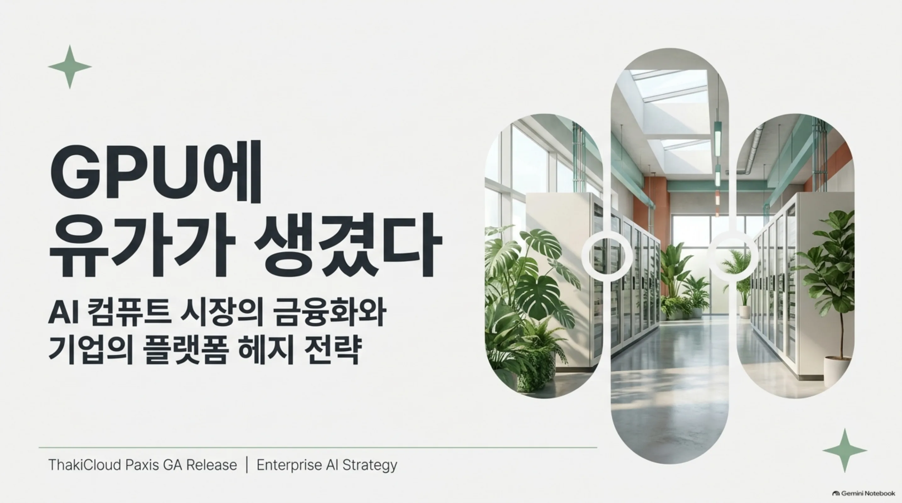
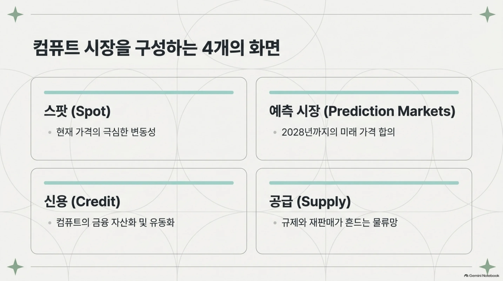
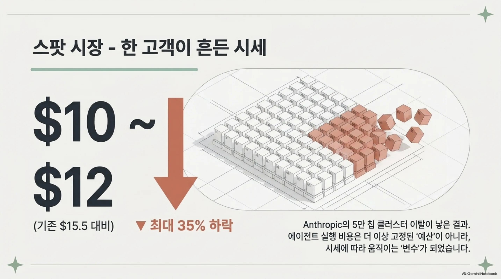
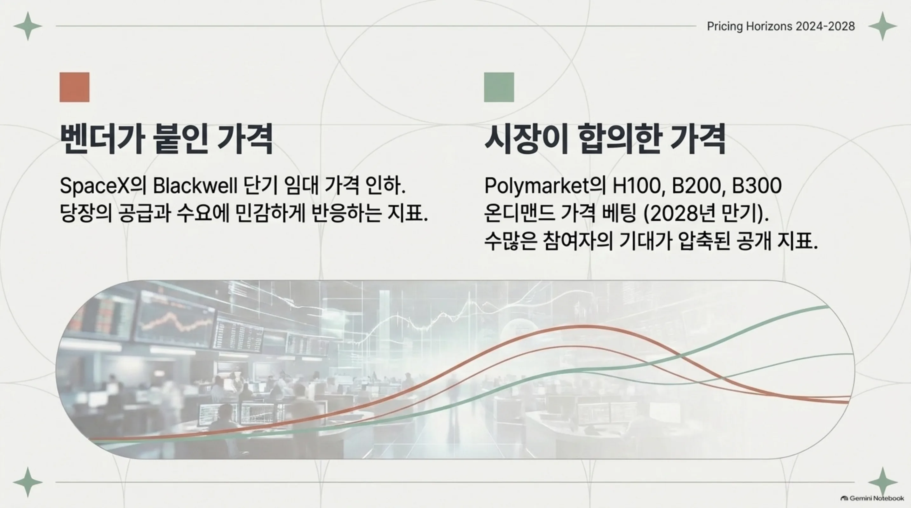
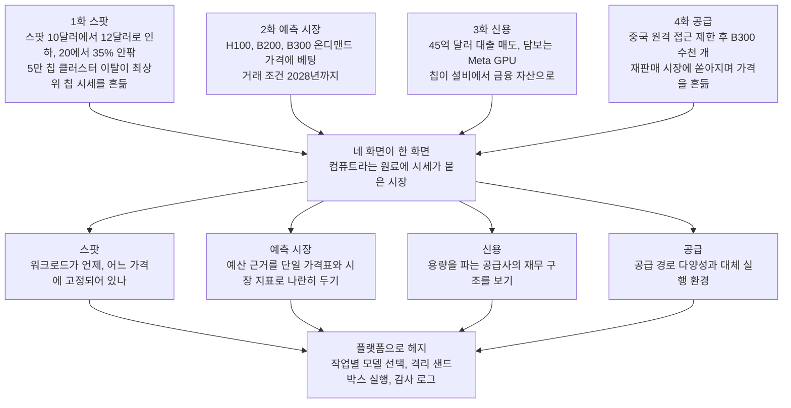

GPU 컴퓨트에 시세가 생겼습니다. 오늘 아침 뉴스에 나란히 놓인 숫자 넷, 10달러와 12달러, 45억 달러, 그리고 2028년이 바로 그것을 말하고 있습니다. 매수자와 매도자 사이에서 오르내리는 가격입니다. 산업의 원유가 거래소에 상장되는 날을 유가 시세로 확인하듯, AI 업계에도 같은 장이 열렸습니다. 더 큰 의미는 따로 있습니다. 에이전트가 상시적으로 일하는 시대에, 그 일의 원료가 시장이라는 것은 비용이 변수가 된다는 뜻입니다. 지능의 비용이 모델 요금에서 원자재의 시세 쪽으로 무게중심을 옮기기 시작했다는 뜻이기도 합니다.

*글의 핵심 개념을 형상화했습니다. 스팟, 예측 시장, 신용, 공급이라는 네 화면이 '컴퓨트의 시장'이라는 하나의 시세로 수렴하는 장면.*

## 스팟: 한 고객의 움직임이 가격을 만들다

SpaceX가 블랙웰 GPU 소규모 클러스터의 스팟 임대 가격을 GPU 1시간당 10달러에서 12달러로 낮췄습니다. 이전에는 15달러에서 15.5달러 선이었습니다. 인하 폭은 20%에서 35% 안팎입니다. SemiAnalysis를 인용한 보도에 따르면, 이 인하의 배경에는 Anthropic의 5만 칩 규모 클러스터 이탈이 있습니다. 한 대형 고객의 움직임만으로 최상위 칩의 현물 가격이 이만큼 흔들린 셈입니다.

그것도 소규모 클러스터, 즉 스팟으로 불린 분산 물량이 먼저 움직였습니다. 잔량이 시장에 풀리는 구간일수록 한 테넌트의 나가는 길이 곧 시세를 만드는 길이 되기 때문입니다. 고객이 떠나면 그 용량은 사라지지 않습니다. 더 싼 가격으로 새 고객을 찾을 때까지 시장에 머물면서 밑바닥 가격을 내려앉게 만드는 쪽으로 작용합니다. 최상위 칩의 스팟 가격은 그래서 한 번 보고 끝나는 숫자가 아닙니다. 고객의 입장과 출구에 따라 움직이는 숫자입니다. 인하 폭 자체보다, 고객 움직임에 이렇게 크게 반응했다는 사실이 중요합니다.

스팟이라는 말의 무게는 여기에 있습니다. 스팟은 날씨와 비슷합니다. 당장 쓰는 물량에 따라 아침과 저녁이 다르고 계약자는 늘 베팅의 한가운데에 서게 됩니다. 에이전트 워크로드는 하루 24시간, 일정한 속도로 컴퓨트를 소비합니다. 그 소비를 스팟 가격에 노출시키는 순간, 실행 비용은 더 이상 예산이 아니라 변수가 됩니다. 같은 에이전트, 같은 워크플로라도 시세가 흔들리면 한 달의 실행 비용이 달라지는 것입니다.

## 예측 시장: 2028년까지의 가격에 베팅하다

오늘 다이제스트에서 가장 신선한 신호는 Polymarket의 발표입니다. 이 플랫폼은 엔비디아 H100, B200, B300의 온디맨드 컴퓨트 가격을 매기는 공개 시장을 열었고 거래 조건은 2028년까지로 나왔습니다. 플랫폼이 컴퓨트의 예측 가격까지 제공한다는 점도 함께 알려졌습니다.

세 개의 칩 이름을 나란히 보는 것에도 의미가 있습니다. H100은 이미 세대 뒤로 밀리는 워크호스이고 B200과 B300은 현역 최상위 칩입니다. 옛 세대부터 현 세대까지 한 장에서 가격이 매겨지는 셈입니다. 시계는 더 깁니다. 수년 치 수요와 공급의 전망을 가격이라는 형태로 압축한다는 뜻입니다. 용량의 가격은 시장 전체가 볼 수 있는 공개 지표가 됩니다. 게다가 대상이 온디맨드 컴퓨트입니다. 가장 유동적인 층에 시세가 붙고 있다는 뜻이기도 합니다.

예측 시장이 하는 일은 간단합니다. 수많은 베팅자의 믿음을 하나의 가격으로 묶는 것입니다. 개별 공급사의 가격표는 그 회사만의 계산이고 예측 시장은 시장 전체의 기대입니다. 두 가지를 나란히 보게 되는 순간, "이 가격이 싼가 비싼가"의 판단 기준이 바뀝니다. 다만 주의도 필요합니다. 모두가 같은 방향을 기대할 때, 예상 밖의 공급 뉴스 하나가 시세를 더 크게 흔들 수 있습니다.

컴퓨트가 '벤더가 붙인 가격'을 넘어 '시장이 합의한 가격' 쪽으로 넘어오고 있다는 뜻이기도 합니다. 석유 시장의 Brent 시세와 선물 계약이 그렇듯, AI에도 자기의 기준 가격과 미래에 대한 베팅이 생긴 셈입니다. 기업 입장에서 의미가 큽니다. 내년도 예산을 세울 때 단일 공급사의 가격표를 기다릴 필요가 없고, 시장 전체의 가격 기대를 지표로 삼을 수 있게 됩니다. "올해보다 가격은 얼마나 내릴지"를 묻는 질문에, 이제 공급사의 안내문뿐 아니라 시장의 답도 함께 붙습니다. 기업에는 비교의 장치가 생기는 셈입니다. 시장이 예상하는 가격이 공급사의 가격표보다 낮다면, 그 가격표에 아직 협상의 여지가 남아 있다는 신호가 됩니다.

## 신용과 공급: 담보가 되고 다시 팔리는 칩

돈을 끌어다 쓰는 쪽도 변하고 있습니다. CoreWeave의 은행들은 45억 달러 규모 대출의 매도를 조직하고 있고, 조기면 다음 주부터 시작될 수 있습니다. 담보는 Meta에서 쓰이는 GPU입니다. 컴퓨트 용량이 대출의 담보로 인정받는 순간, 칩은 설비에서 금융 자산으로 넘어온 셈입니다.

자산이 되면 유동화되고 유동화되면 공급은 가격에 민감해집니다. 칩을 사서 용량을 파는 뉴클라우드 비즈니스에서 칩이 담보가 된다는 것은, 칩이 자산 대장 위의 숫자가 됐다는 뜻입니다. 그 대장이 두꺼워질수록 자금시장의 분위기가 공급사 하나하나의 운명과 직결됩니다. 자본을 끌어오는 대상이기도 해졌습니다. 컴퓨트 사업의 위험은 이렇게 해서 운영 위험에서 자금 위험으로까지 넓어집니다. 그리고 속도가 핵심입니다. 매도가 조만간 시작될 수 있다는 것 자체가, 자금이 하드웨어 조달보다 한 발 앞서 움직이기 시작했음을 보여줍니다.

공급이 실제로 움직이는 장면도 같은 날 뉴스에 있습니다. US가 중국의 원격 접근을 제한한 조처 이후, 이례적 물량의 엔비디아 GPU가 재판매 시장에 쏟아졌습니다. 그중 첨단 B300 칩은 수천 개 규모이며 판매업체들은 하드웨어의 원래 흐름을 다른 쪽으로 돌려 보내려 하고 있습니다. 칩 자체만 아니라 원격 접근이라는 채널까지 제한 대상으로 들어왔다는 점은, 공급 경로의 제약이 더 넓은 곳에서 일어나고 있다는 뜻입니다. 원래 목적지로 향던 칩이 재판매 시장에 수천 개씩 나오면, 거기에 다시 매수자가 붙고 그 가격은 원래 공급 계획의 가격을 흔듭니다. 규제 한 줄이 공급 라인을 휘게 하고 휘어진 공급이 가격을 흔듭니다. 이 순환이 반복되는 동안, 얼마에 어디서 얼마나 안정적으로 컴퓨트를 쓸 수 있을지는 기업에 열려 있는 질문으로 남습니다.

## 바닥을 내리는 효율, 하늘로 올라가는 수요

가격의 구조가 보이는 동안, 가격 자체를 움직이는 힘도 같은 뉴스에 나옵니다. Anthropic은 Claude Messages API를 Python에서 Rust로 옮긴 결과, 요청당 CPU 사용량이 약 70% 줄고 메모리는 80% 이상 줄었다고 밝혔습니다. 모델이나 알고리즘을 바꾼 게 아닙니다. 요청을 받아서 모델로 넘기는 서빙 레이어의 기초 공사를 바꾼 것입니다. 서빙 레이어의 CPU와 메모리는 사람이 쓰는 서비스라면 사소한 비용입니다. 하지만 상시적으로 요청이 들어오는 에이전트 서비스에서는 이 비용이 원가의 큰 부분이 됩니다. 공급자 측 비용이 이만큼 내려가면 시세도 따라 움직일 여지가 생깁니다. 가격의 바닥이 낮아지는 사건입니다.

수요는 반대로 계속 올라갑니다. Google Research의 Cogentic 에이전트는 Gemini 4 위에서 인간 개입 없이 수학 논문 6편을 써냈고, 이 논문들은 수십 년간 풀리지 않았던 문제를 다룹니다. 어려운 문제는 긴 추론을 요구합니다. 긴 추론은 컴퓨트를 태웁니다. OpenAI는 GPT-6 패밀리가 전용 바이오 모델 없이 일반 추론과 코드로 새 단백질의 구조와 시퀀스를 설계할 수 있음을 보여주는 프리프린트를 공개했습니다. Perplexity는 Search API와 Context API에 Time Machine을 출시해, 개발자가 최대 365일 전 특정 날짜 당시의 웹을 그대로 쿼리하고 읽을 수 있게 했습니다. 결국 가격의 바닥을 내리는 힘과 천장을 올리는 힘이 동시에 움직이는 국면입니다.

세 가지가 겹칩니다. 산출물의 단위가 한 토큰에서 논문으로, 범용 모델이 전문 도메인까지 들어가며 에이전트가 읽을 컨텍스트의 깊이가 현재에서 지난 1년까지 넓어집니다. 단백질 설계든 365일 전의 웹이든, 에이전트가 일할 수 있는 도메인은 넓어질수록 컴퓨트를 쓰는 표면도 넓어집니다. 상시적 구조로 바뀝니다. 상시적 수요를 갖는 산업의 원료에는 늘 시세표가 붙게 됩니다.

## 네 화면을 기업으로 옮기면

네 장면을 기업 운영으로 옮기면 체크리스트가 됩니다. 첫째, 스팟. 우리 에이전트 워크로드의 컴퓨트가 언제, 어느 가격에 고정되어 있는가. 스팟에 노출된 물량이 크면, 공급사 한 곳의 고객 변동이 곧 우리의 비용 변동입니다. 둘째, 예측 시장. 내년도 예산의 근거를 어디에 두는가. 단일 공급사의 안내문만으로는 합리적인 가격을 판별할 기준이 없습니다. 시장 전체의 가격 기대가 지표로 쓰이기 시작하는 지금, 두 근거를 나란히 두어야 합니다. 셋째, 신용. 용량을 파는 공급사 자체의 재무 구조를 볼 필요가 생겼습니다. 칩이 담보가 된 대출이 시장으로 팔려 나가는 세계에서는, 공급사의 자금줄이 곧 우리 서비스의 연속성입니다. 넷째, 공급. 공급 경로의 다양성과 대체 실행 환경이 운영의 기본 전제가 됩니다. 네 화면은 결국 한 화면입니다. 컴퓨트의 시장이라는 화면.

*그림. 하루 뉴스의 네 화면(스팟, 예측 시장, 신용, 공급)이 '컴퓨트의 시장'이라는 한 화면으로 모이고, 그 변동성을 기업이 체크리스트와 플랫폼 헤지로 다루는 구조.*

## 기업에게 남은 질문: 변동성을 다루는 플랫폼

오늘의 뉴스가 보여주는 그림을 한 줄로 정리하면, 컴퓨트에 스팟이 있고 예측 시장이 있고 담보 대출이 있다는 것입니다. 원유가 그러했던 것과 같은 구조입니다. 기업은 이 변동성 속에서 에이전트 워크로드를 어떻게 돌릴 것인가가 남는 질문입니다. 바로 이 지점에서 ThakiCloud의 에이전트 네이티브 클라우드, Paxis v1.1 GA를 떠올릴 수 있습니다.

이 제품은 Skills, Tools, Policies, Audit Logs를 일급 리소스로 다루며 자율도 L0~L3의 거버넌스와 정책 게이트, 감사 로그를 함께 실행합니다. 24시간 돌아가는 에이전트는 공급이 규제에 흔들리고 시세가 베팅 대상인 환경에서, 무엇을 어느 경로로 실행하고 누가 승인했는지를 기록으로 남길 수 있어야 합니다. 시세가 흔들릴 때 필요한 것은 예측 가능성입니다. CostRouter는 작업별로 모델을 골라, 같은 에이전트 워크로드라도 싼 실행 경로에 매칭되도록 비용을 관리합니다. GPU 조달 경로가 좁아지는 환경에서는 격리 샌드박스 실행과 소버린, 온프레미스 K8s(ai-platform) 배포가 안전판이 되고, MCP 커넥터와 스킬 마켓은 실행 역량을 공급사 하나에 묶어두지 않게 합니다.

유가 변동에 대비해 정유사가 선물로 헤지하듯, 기업은 플랫폼으로 헤지합니다. 오늘 뉴스의 본질은 AI가 싸워졌다는 것이 아닙니다. AI의 원유에 시장이 생겼다는 것입니다. 시장이 생긴 산업은 늘 가격, 그리고 가격을 다루는 방법을 갖춘 사람을 먼저 만듭니다.

## 참고 자료

이 글은 아래 뉴스를 종합해 작성했습니다.

- HuggingNews, [Nvidia Chip Sellers Seek Buyers for Thousands of B300 GPUs After US Curbs China Remote Access](https://huggingnews.com/ai/nvidia-chip-sellers-seek-buyers-for-thousands-of-b300-gpus-after-us-curb-b4b9a324)
- HuggingNews, [Google AI Agent Autonomously Writes 6 Math Papers Solving Decades-Old Problems](https://huggingnews.com/ai/google-ai-agent-autonomously-writes-6-math-papers-solving-decades-old-pr-7adfc7d9)
- HuggingNews, [Polymarket Launches Public Market for Nvidia GPU Compute Prices Through 2028](https://huggingnews.com/ai/polymarket-launches-public-market-for-nvidia-gpu-compute-prices-through-eae8bfe3)
- HuggingNews, [OpenAI GPT-6 Models Design Protein Shapes and Sequences Without Specialized Bio Models](https://huggingnews.com/ai/openai-gpt-6-models-design-protein-shapes-and-sequences-without-speciali-35e844cd)
- HuggingNews, [Anthropic Cuts API CPU Use 70% in Migration From Python to Rust](https://huggingnews.com/ai/anthropic-cuts-api-cpu-use-70percent-in-migration-from-python-to-rust-9150aacc)
- HuggingNews, [CoreWeave Banks Prepare $4.5B Loan Sale Secured by Meta GPUs](https://huggingnews.com/ai/coreweave-banks-to-sell-45b-loan-backed-by-meta-gpus-e33eb0d3)
- HuggingNews, [SpaceX Cuts Blackwell GPU Spot Prices as Anthropic Exits 50,000-Chip Cluster](https://huggingnews.com/ai/spacex-cuts-blackwell-gpu-spot-prices-as-anthropic-exits-50000-chip-clus-bffc316b)
- HuggingNews, [Perplexity Time Machine Lets Developers Search Web as It Was Up to 365 Days Ago](https://huggingnews.com/ai/perplexity-time-machine-lets-developers-search-web-as-it-was-up-to-365-d-5f850073)
