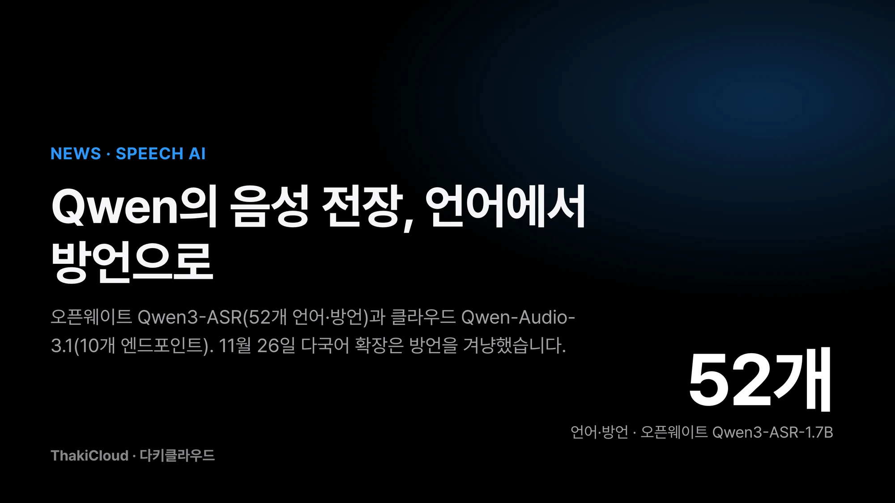
*Qwen의 음성 전략 두 층과 이번 주 발표. 52개 언어·방언은 오픈웨이트 Qwen3-ASR-1.7B 기준입니다.*

에이전트에 음성 채널을 붙이고 있는 개발자나 제품팀이라면, 이번 주 알리바바의 발표 한 줄이 왜 중요한지 알 것입니다. "Qwen-Audio-3.1의 새로운 다국어 능력이 도착했습니다. 특히 중국 방언을 위해서요." 겉으로는 언어 커버리지 업데이트로 읽힙니다. 한 발짝만 더 보면, 음성 모델이 AI 산업에서 차지하는 위치가 재배열되는 장면을 보게 됩니다. 이 글은 Qwen 음성 전략의 두 층, 오픈웨이트로 52개 언어와 방언을 담는 Qwen3-ASR과 클라우드 전용 10개 엔드포인트로 쌓인 Qwen-Audio-3.1 계열을 정리하고 새 전선이 '언어'가 아니라 '방언'으로 옮긴 이유를 봅니다.

## 쉽게 말하면, 국제회의 통역 부스

음성 모델을 국제회의의 동시통역 부스라고 치자. 모델이 지원하는 언어 수만큼 부스를 운영한다는 뜻입니다. Qwen3-ASR 계열은 30개 언어 부스에, 중국 내부의 22개 지역 부스를 더 붙여 운영합니다. 중국어는 같은 언어 안에도 동북·사천·민난·광둥식 발음이 따로 있고 이 지역 표현을 듣지 못하면 그 시장이 열리지 않습니다. 그래서 '몇 개 언어' 뒤에 '몇 개 방언'이 따라오는 것입니다.

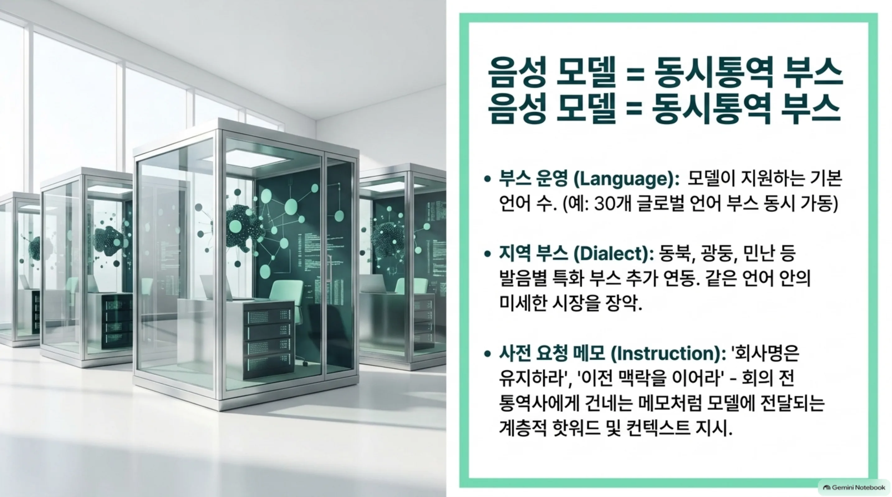
*부스 비유로 본 음성 모델. 몇 개 언어를 지원하는가, 어떤 지역 방언 부스까지 열려 있는가.*

통역 부스에는 또 한 가지가 있습니다. 회의 전에 통역사에게 건네는 요청 메모지. Qwen-Audio-3.1 계열의 기술리포트는 '계층적 핫워드 커스터마이즈'와 '역사 컨텍스트 조건화'라는 지시 제어를 받습니다. 회의 전에 "회사명과 제품명은 그대로 써라", "지난 회의 맥락을 이어받아라"라고 메모를 건네면, 부스가 그 메모를 반영한 정제된 기록을 돌려줍니다. 발표자가 누구였는지도 함께 기록합니다. 화자 구분 전사(speaker-diarized transcription)가 화자 라벨, 타임스탬프, 인식 텍스트를 한 덩어리로 돌려주는 이유입니다.

이 글에서는 이 부스 비유를 계속 씁니다. 오픈웨이트는 통역사를 회사 안에 들여온 격이고 클라우드 계열은 부스를 예약하는 격입니다. 이번 주 발표는 예약 부스 서비스에 언어 부스와 지역 부스를 더 넣은 소식입니다.

## 9월부터 10개 엔드포인트로 쌓아온 3.1 계열

Qwen-Audio-3.1 계열은 단일 모델이 아니라 서비스 엔드포인트 묶음입니다. QwenCloud 공식 changelog 기준으로 9월부터 11월 사이 9개 엔드포인트가 추가됐습니다. 가장 이른 것은 9월 20일 realtime-plus로, 8개 시스템 음성을 추가하고 262,144 토큰 컨텍스트를 갖습니다. 하루 뒤인 9월 21일에는 asr-flash 계열 네 개(파일·스트리밍·메시지·파일전사)가 한꺼번에 들어옵니다. asr-flash-message 변형은 한국어를 인도네시아어·일본어·타이어·필리핀어·베트남어·말레이어와 함께 최적화 언어로 명시합니다. 방언은 말한 대로 전사하거나 표준 만다린 텍스트로 바꿀지를 사용자가 선택합니다.

10월에는 TTS와 양방향 실시간이 이어집니다. tts-plus(10월 21일)는 스트리밍 합성과 자유 형식 지시 추종을, tts-next(10월 22일)는 화자 1인·다인 대화·팟캐스트 형식을 지원합니다. realtime-flash(10월 27일)는 텍스트와 오디오를 모두 받아들이고 다시 내뱉는 양방향(듀플렉스) 음성 대화 모델입니다. 가장 최근은 11월 23일 live로, 음성 모델이 사용자와 대화를 이어가게 하는 동안 배경 모델이 작업을 처리합니다.

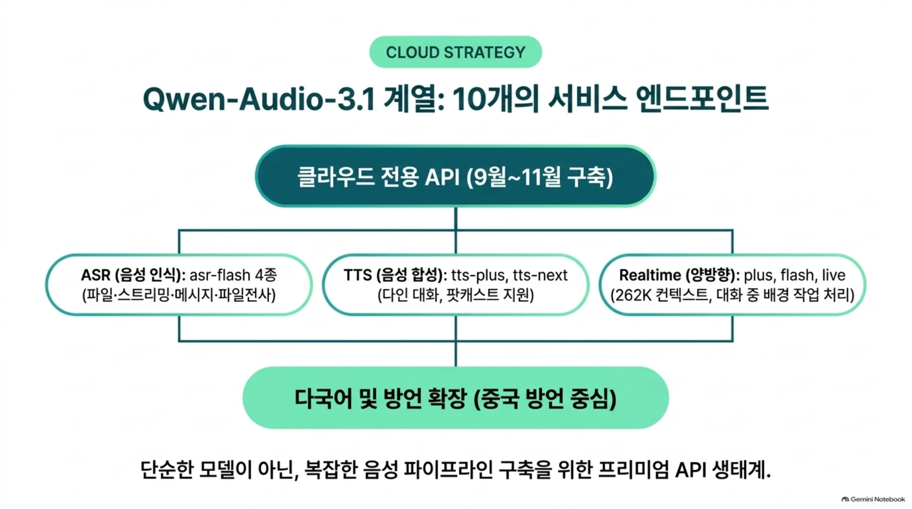
*3.1 계열의 엔드포인트 묶음. ASR은 asr-flash 4종, TTS는 tts-plus·tts-next, Realtime은 plus·flash·live입니다.*

11월 26일 발표는 이 전체 계열에 대한 다국어 확장입니다. 중국 방언에 강한 초점을 뒀다고 알리바바는 전했습니다. 2차 보도에는 구체적인 수치가 나옵니다. ASR이 59개 언어에 방언 8종, TTS가 65개 언어, 실시간이 53개 언어라는 수치 [추정]입니다. 수치의 1차 출처는 트윗에 첨부된 이미지였고 집필 시점에는 원본을 확인하지 못해 정확한 숫자는 공식 공개를 기다립니다. 다만 방향은 분명합니다. ASR뿐 아니라 TTS와 실시간까지 세 엔드포인트의 커버리지를 동시에 넓혔다는 것입니다.

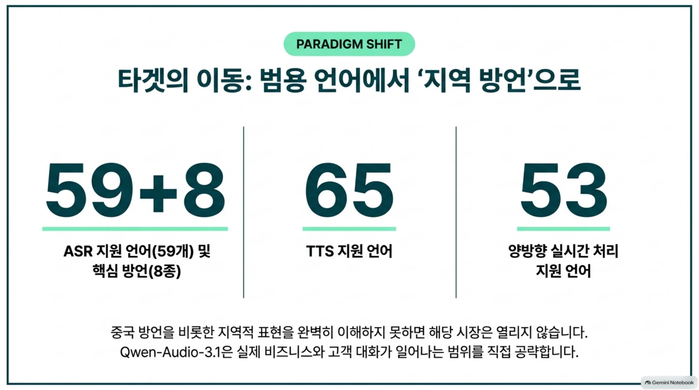
*11월 26일 확장의 타겟 이동. 슬라이드의 59+8·65·53 수치는 2차 보도 기준 [추정]이며, 1차 출처는 트윗 첨부 이미지라 공식 확인을 기다립니다.*

## 기술리포트가 추가한 것: 누가 말했는지까지 기록한다

10월 20일 arXiv에 공개된 기술리포트(Qwen-Audio-3.1-ASR Technical Report)가 이 계열이 3.0-ASR보다 무엇을 더하는지 설명합니다. 저자 명단 48명, 31페이지짜리 문서입니다. 핵심 능력이 셋입니다.

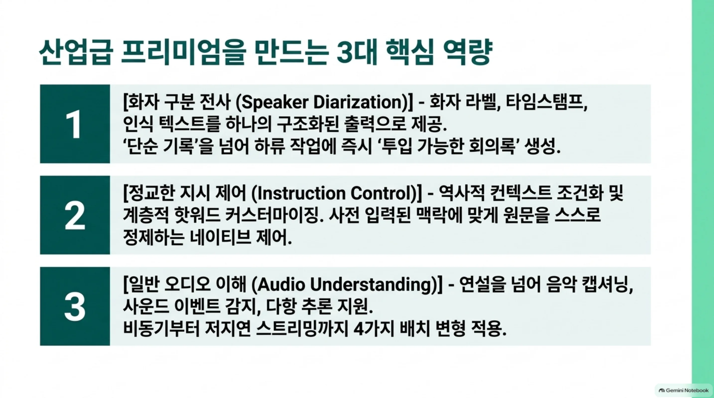
*기술리포트의 3대 핵심 역량. 화자 구분 전사는 '기록'을 '회의록'으로, 지시 제어는 요청 메모지, 일반 오디오 이해는 전사 너머의 범위입니다.*

첫째, 화자 구분 전사입니다. 화자 라벨, 타임스탬프, 인식 텍스트를 하나의 구조화 출력으로 돌려줍니다. changelog 표현을 빌리면 '산업급 다인 대화 역할 기반 전사'입니다. 이것이 회의 기록과 회의록을 구분합니다. 누가 무엇을 말했는지 아는 기록은 태스크 배정과 의사결정 같은 하류 작업에 바로 쓸 수 있습니다.

둘째, 지시 제어입니다. 역사 컨텍스트 조건화, 계층적 핫워드 커스터마이즈, 네이티브 전사 정제가 그 내용입니다. 지난 회의 맥락을 이어받고 핫워드를 계층으로 전달하며 전사 원문까지 정제된 형태로 다듬는 과정을 지시 하나로 제어한다는 뜻입니다. 통역 부스가 회의 전 요청 메모지를 받는 것과 같은 구조입니다.

셋째는 범위를 넓히는 일반 오디오 이해입니다. 전사 너머로 오디오·연설·음악 캡셔닝, 타임 그라운딩, 사운드 이벤트 감지, 오디오 QA와 다항 추론까지입니다. 배치 변형은 비동기 파일 전사, 저지연 스트리밍, 대화형 음성 입력, 비스트리밍 인식 네 가지입니다. 리포트는 30개 언어와 16개 중국 방언을 이 베이스라인으로 꼽습니다. 11월 26일 확장이 그 위에 올리는 층입니다.

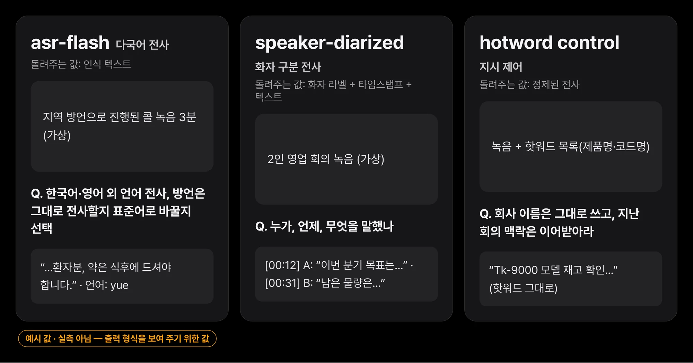
*Qwen-Audio-3.1-ASR이 돌려주는 것 세 가지. 방언 전사 선택, 화자 라벨 + 타임스탬프, 핫워드 지시까지(값은 형식 예시).*

## 오픈웨이트 쪽도 멈추지 않았다: 52개 언어와 22개 방언

클라우드 쪽이 쌓이는 동안, 오픈웨이트 쪽도 한 발을 뒀습니다. Qwen3-ASR 계열(2026년 1월)은 언어 식별과 음성 인식을 하나의 모델로 처리하는 올인원 모델 두 개(1.7B, 0.6B)와 비자구적 강제 정렬(forced alignment) 모델 0.6B의 묶음입니다. 라이선스는 Apache-2.0으로, 상업 이용이 가능합니다.

커버리지는 52개 언어와 방언입니다. 30개 언어 부스에 한국어, 일본어, 인도네시아어가 포함되고 중국 내부 22개 지역 부스(안후이·동북·푸젠 등 18개 성의 방언과 광동어 2개 억양, 위어, 민난)까지 열립니다. 언어 식별 정확도는 1.7B가 97.9%, 0.6B가 96.8%입니다. 오프라인과 스트리밍을 하나의 모델로 통합했고 대상 오디오는 평범한 연설을 넘어, 노래와 배경음악이 든 곡까지입니다.

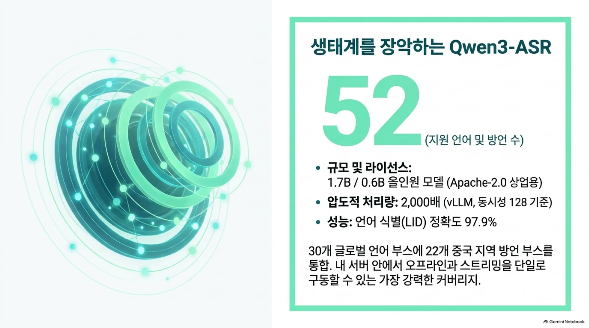
*오픈웨이트 Qwen3-ASR 한눈에 보기. 30개 글로벌 언어에 22개 중국 지역 방언, 내 서버 안에서 오프라인·스트리밍을 단일로 구동합니다.*

벤치마크 수치는 모델카드 보고값입니다. Librispeech clean 1.63, WenetSpeech net 4.97, 중국 방언 벤치 KeSpeech 5.10, 8개 언어 MLS 8.55, 13개 언어 CommonVoice 9.18, 30개 언어 Fleurs 12.60입니다. 강제 정렬 모델의 경계 오류(AAS) 평균은 42.9ms, vLLM 백엔드에서 0.6B는 동시성 128 기준으로 2000배 처리량에 이릅니다. 52개 언어를 다루는 다국어 ASR을 자기 서버에서 돌리는 일은, 이제 "가능하면 좋은" 단계가 아닙니다.

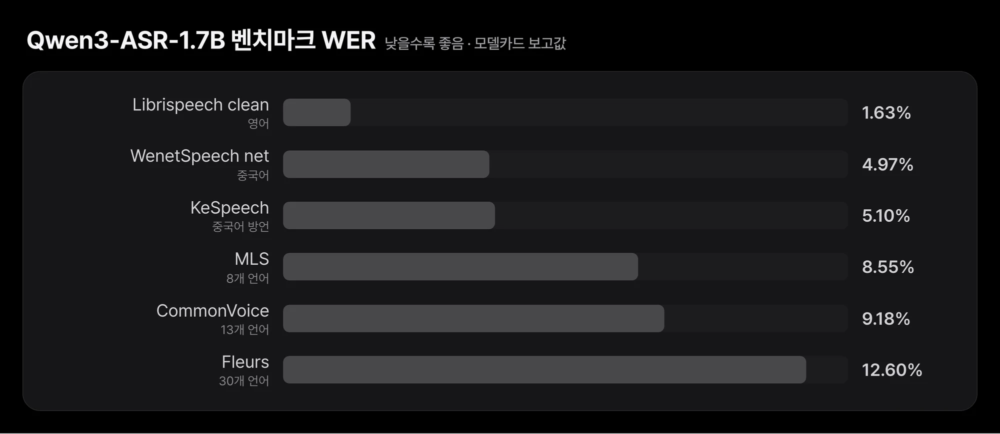
*Qwen3-ASR-1.7B 벤치마크 WER(모델카드 보고값, 재현 아님). 언어 수가 늘수록 WER가 오르는 모양이 보이는데, 이것이 다국어 ASR의 비용 구조입니다.*

우리 모델과 나란히 놓으면 그림이 또렷해집니다. Qwen3-ASR이 52개 언어를 넓게 깔면, 다키클라우드가 공개한 Thaki-ASR-KO-1.7B는 한국어라는 한 언어를 깊게 파고섭니다. 둘 다 Hugging Face에 Apache-2.0로 올라와 있습니다. 오픈웨이트 음성 시장은 이렇게 '넓은 커버리지'와 '한 언어 깊이'가 서로 다른 선택지가 되는 모양으로 자라고 있습니다.

## 왜 방언인가: 같은 언어 안의 시장

이번 주 발표가 언어보다 방언을 먼저 꺼낸 이유는, 중국 시장의 구조에 있습니다. 중국어는 단일 언어 시장으로는 세계에서 가장 크고 내부는 가장 넓습니다. Qwen3-ASR이 22개 지역 부스로 커버하는 목록은 사실상 지역 고객 리스트입니다. asr-flash changelog가 고전 시의 리듬과 가곡 표현까지 최적화 대상으로 든 것은, 전사 정확도 이슈가 아니라 문화 콘텐츠 이슈라는 뜻입니다. 지역 방언으로 된 방송, 드라마, 유산 아카이브를 전사할 수요가 있는 시장에는 범용 모델이 들어가기 어렵습니다.

기업 음성 워크플로의 관점에서는 방언이 '실제 고객 대화가 일어나는 범위'를 뜻합니다. 고객센터, 공장, 공공 서비스 콜. 말하는 사람은 표준어를만 쓰지 않습니다. 방언 커버리지가 곧 실제 고객 커버리지입니다. 여기에 핫워드 커스터마이즈와 화자 구분 전사가 겹치면, 전사 산출물이 '읽을 기록'을 넘어 '쓸 수 있는 기록'이 됩니다.

또 하나의 신호는 언어 목록 안에 있습니다. asr-flash-message 변형이 한국어를 최적화 언어로 명시하고 오픈웨이트 30개 언어에도 한국어가 들어 있습니다. 커버한 언어와 깊이 최적화한 언어는 다른 질문이지만, 두 층 모두에 한국어가 이름으로 등장했다는 사실은 한국 시장이 시야 안에 들어왔다는 신호입니다.

## 두 층을 나란히 놓으면

| | 오픈웨이트 (Qwen3-ASR) | 클라우드 (Qwen-Audio-3.1 계열) |
|---|---|---|
| 가중치 | ✅ Apache-2.0, 다운로드 가능 | ⚠️ API 전용, 미공개 |
| 규모 | 1.7B · 0.6B | 미공개 (flash·plus·next) |
| 커버리지 | 52개 언어·방언 (30+22) | 3.0 기준 30개 언어, 11/26 확장 [추정] |
| ASR 특징 | LID 97.9%, 스트리밍·오프라인 통합 | 화자 구분, 핫워드 지시, 방언→만다린 변환 |
| TTS | Qwen3-TTS (오픈소스) | tts-plus·next, 다인 대화, 팟캐스트 |
| 실시간 | 없음 | 양방향 262K 컨텍스트, live (대화+배경 작업) |
| 배치 | vLLM, 2000배 처리량@128 (0.6B) | QwenCloud · Alibaba Cloud API |

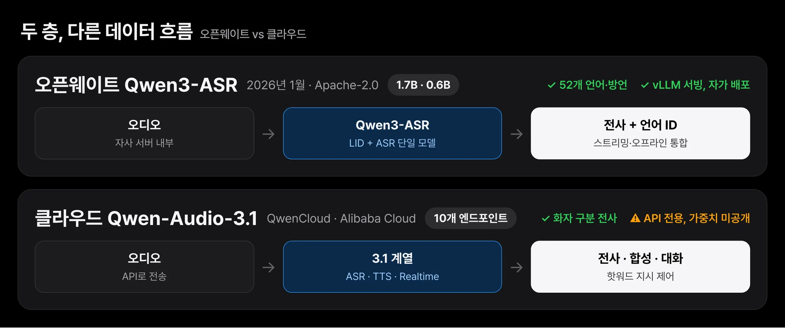
*두 층, 다른 데이터 흐름. 같은 Qwen 음성 기술이 오디오가 어디를 지나느냐로 나뉩니다.*

두 층은 경쟁 관계가 아닙니다. 오픈웨이트 쪽이 개발자 생태계의 바닥을 다지고 클라우드 쪽이 TTS와 양방향 실시간 같은 기능으로 수익을 만듭니다. 사용자에는 데이터 흐름 기준의 선택이 남습니다. 오디오가 자기 서버에서 벗어나면 안 되는 환경에는 오픈웨이트 쌍이 답입니다. 다인 대화, 팟캐스트, 작업을 돌리면서 말을 잇는 음성 채널이 필요하면 지금은 클라우드 계열을 택할 수밖에 없습니다.

## 다키클라우드의 목소리는 온프렘에서

다키클라우드는 음성 전선을 나란히 밟고 있습니다. Thaki-ASR-KO-1.7B는 자체 학습한 한국어 ASR으로, Hugging Face에 공개했습니다. Qwen3-ASR의 '52개 언어 커버'와 다른 접근입니다. 한국어라는 한 언어를 깊게 파고 회사가 운영하는 플랫폼에서 서빙되도록 설계했다는 차이가 있습니다. 음성 서빙 스택(VoxCPM2, Qwen3-TTS, Qwen-ASR, Whisper)은 Metis 플랫폼 위에서 돌아갑니다. 다국어 TTS 비교 실험(한국어·영어·중국어·일본어·아랍어)도 자연성, 감정, 전력 소모를 언어별로 측정하며 진행 중입니다.

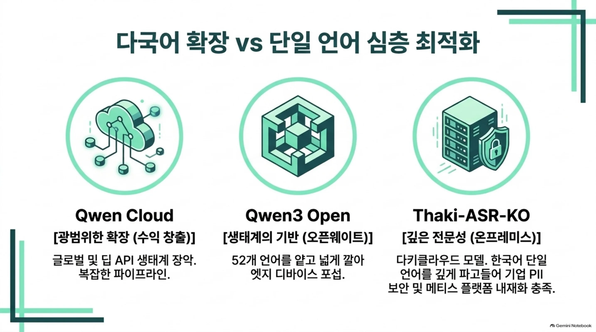
*같은 음성 기술, 다른 포지션. 글로벌 확장, 오픈웨이트 생태계, 한국어 심층 최적화까지 세 갈래입니다.*

Qwen의 두 층 구조는 이 작업에 좋은 프레임입니다. '오픈웨이트 커버'와 '클라우드 기능'의 갈림은, 음성 채널의 온프렘 대 클라우드 선택과 같은 자리입니다. 음성은 PII가 가장 밀도 높은 채널입니다. 고객센터와 공공 서비스, 의료 문의의 오디오는 건물을 나가지 않는 것이 전제인 경우가 많습니다. 이런 환경에서 '52개 언어 오픈웨이트가 존재한다'는 사실 자체가 결정 근거가 됩니다. 클라우드 계열의 화자 구분과 지시 제어 기능은, 오픈 형태로 나올 때를 추적할 가치가 있는 목록입니다. Paxis에서 음성은 에이전트의 일급 채널이고, 그 채널 뒤에 어떤 모델이 서느냐가 에이전트의 자율도를 결정합니다.

## 숫자 뒤에 남은 여백

세 가지 주의를 둡니다. 첫째, 11월 26일 확장의 정확한 언어 수는 2차 보도 기준 [추정]이고, 신규 기능의 벤치마크는 발표에 포함되지 않았습니다. 커버리지가 '얼마나' 넓어졌는지는 공식 공개를 기다려 판단해야 합니다. 둘째, 방언 목록은 중국 중심입니다. 22개 방언 커버리지는 중국 내시장 신호이며, 다른 국가의 지역 변형 커버리지로 바로 환산되지는 않습니다. 셋째, 클라우드 계열의 TTS와 양방향 실시간에는 아직 오픈웨이트 대안이 없습니다. API 의존성과 비용 계산을 함께 세워야 합니다. 반대로 오픈웨이트 ASR이 1.7B라는 엣지 스케일이고, 더 큰 오픈 ASR은 아직 확인되지 않았습니다.

## 끝으로

Qwen의 음성 전략은 두 층으로 굳었습니다. 오픈웨이트가 Apache-2.0으로 52개 언어와 방언을 담고, 클라우드가 10개 엔드포인트로 쌓입니다. 이번 주 다국어 확장은 전선을 '몇 개 언어'에서 '어떤 방언, 어떤 기능 깊이'로 옮겼습니다. 음성 채널을 세우는 팀의 체크리스트는 짧습니다. 오디오가 건물을 나가는지, 말하는 사람이 어떤 방언을 쓰는지, 기록에 누가 무엇을 말했는지까지 필요하게 되는지. 첫 답이 층을 정하고, 나머지 두 답이 그 층의 기능이 충분한지를 정합니다.

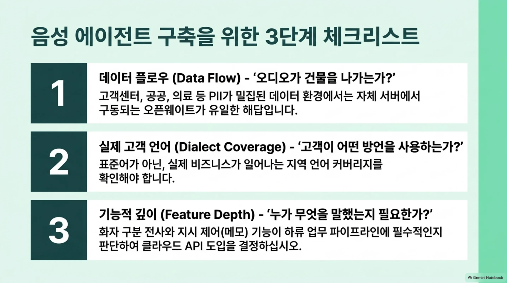
*체크리스트 세 단계. 1단계(데이터 플로우)가 층을 정하고, 2·3단계(방언 커버리지·기능 깊이)가 그 층의 기능이 충분한지 정합니다.*

## 참고 자료

- Alibaba_Qwen, [Qwen-Audio-3.1 다국어 능력 발표 트윗(2026-11-26)](https://x.com/Alibaba_Qwen/status/2125798914490249411)
- Qwen-Audio-3.1-ASR Technical Report, [arXiv:2610.28711](https://arxiv.org/abs/2610.28711)
- QwenCloud, [Model changelog](https://docs.qwencloud.com/changelog/models)
- Qwen, [Qwen3-ASR-1.7B 모델카드](https://huggingface.co/Qwen/Qwen3-ASR-1.7B)
- Qwen3-ASR Technical Report, [arXiv:2601.21337](https://arxiv.org/abs/2601.21337)
