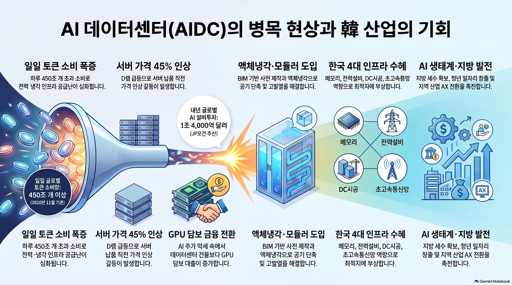
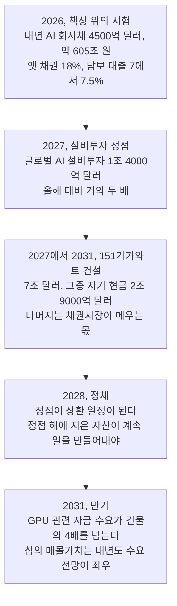
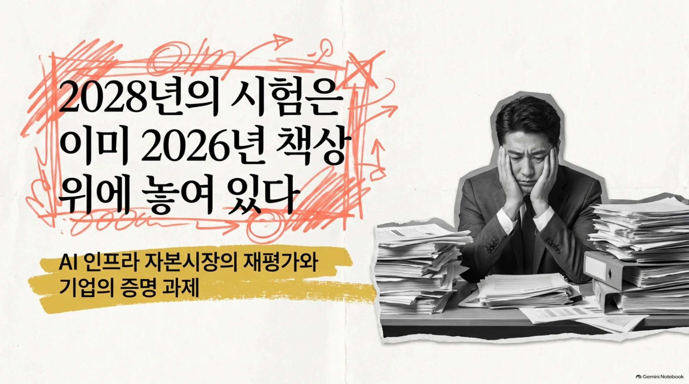
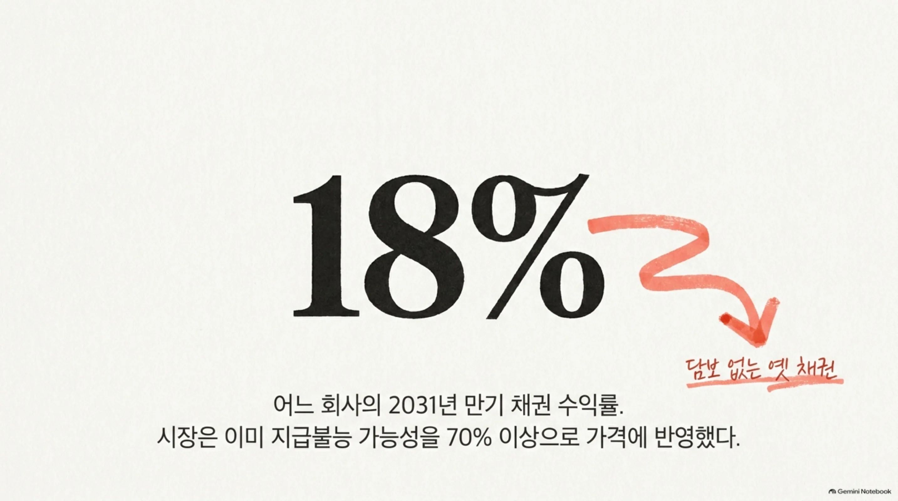
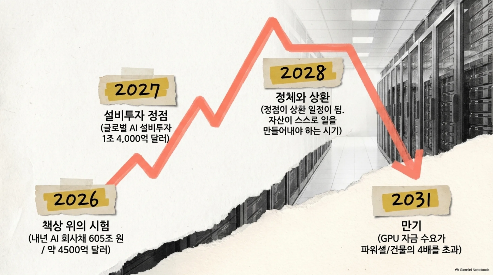
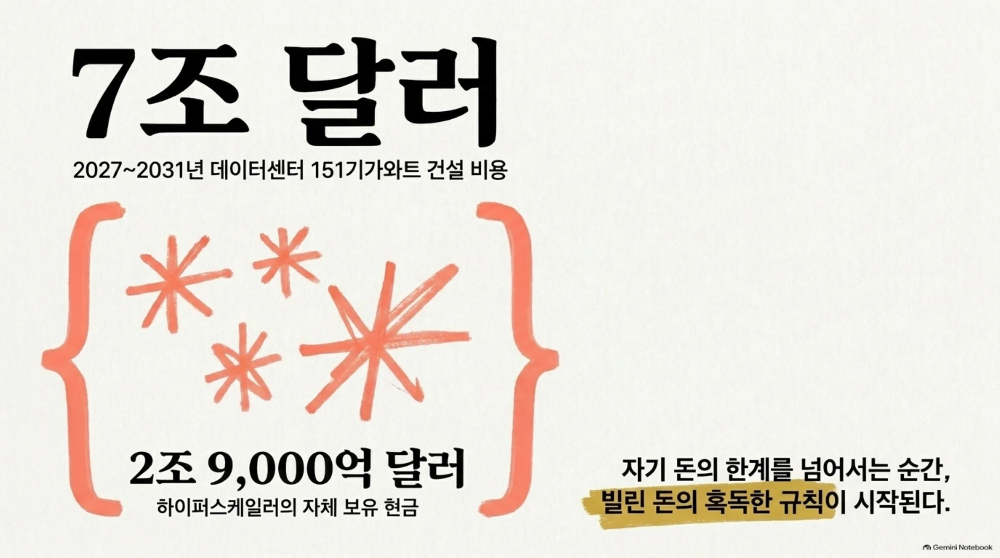
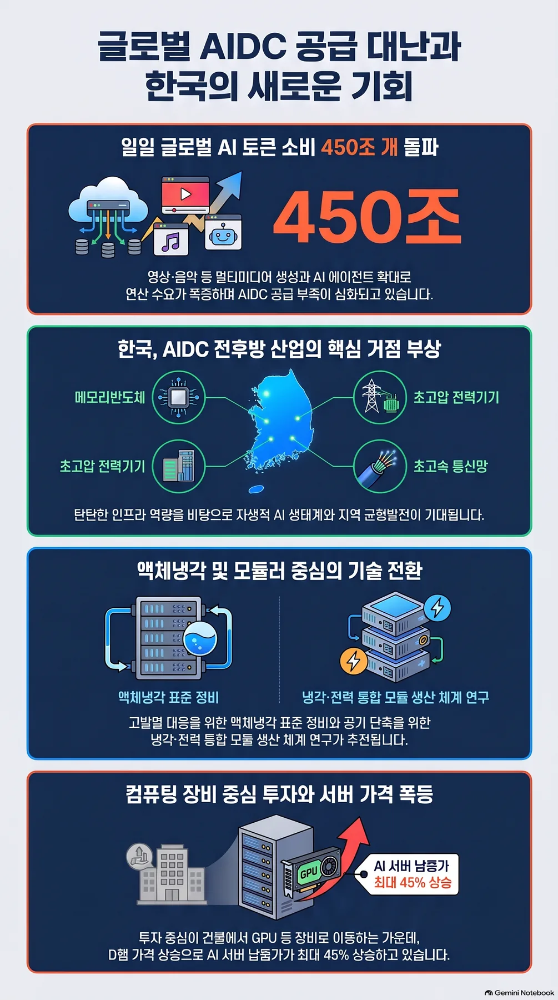

## 18% 수익률, 그리고 다음 주 6조 5천억 원 대출

어느 회사의 2031년 만기 채권이 18% 수익률로 거래된다면, 그 뜻은 뭘까. 채권시장이 그 회사의 지급불능 가능성을 70% 이상으로 가격에 넣었다는 뜻입니다. 이데일리가 26일 보도한 JP모건의 전망에 따르면, 내년 AI 기업들이 발행할 투자등급 회사채는 4500억 달러, 약 605조 원입니다. 그 위에 레버리지 금융 650억 달러와 자산유동화 250~350억 달러가 더 얹힙니다. AI 인프라가 이제 채권시장을 떠나서는 설계될 수 없는 산업이 된 지점입니다.

*글의 핵심 개념을 형상화했습니다. 2027년 정점에 오른 설비투자가 2028년 이후 긴 정체로 이어지고, 그 사이 빌린 돈은 상환 일정이 되는 구조.*

이 전망의 바로 앞에서 코어위브가 첫 시험대에 올랐습니다. 다음 주, 메타와의 GPU 공급 계약을 담보로 45억 달러, 약 6조 5천억 원 대출을 연 7~7.5% 금리로 조달할 예정입니다. 메타 계약이라는 담보 덕분에 새 돈은 투자등급을 예상받으며 들어옵니다. 그런데 같은 회사의 오래된 채권은 18%이고 5년물 CDS 프리미엄은 사상 최대입니다. 담보가 달린 새 돈의 가격과, 담보 없는 옛돈의 가격이 같은 회사 안에서 10%포인트 이상 벌어져 있습니다. CDS를 채무불이행 보험료라 보면, 사상 최대라는 말은 그 보험료조차 더는 싸게 팔리지 않는다는 뜻입니다. 두 가격 표지가 말하는 건 단 하나입니다. 새 돈은 여전히 들어오지만 옛돈은 재평가되고 있습니다.

<!-- nlm-visual -->

*NotebookLM이 소스를 종합해 생성한 인포그래픽입니다.*

## 정점은 2027년, 시험은 2028년

JP모건의 숫자를 정리하면 단순합니다. 글로벌 AI 설비투자가 2027년 1조 4000억 달러, 약 1883조 원으로 올해 대비 거의 두 배 불어난 뒤, 2028년부터 정체를 맞습니다. 2027년부터 2031년까지 151기가와트 규모 데이터센터 건설에 7조 달러가 들어가고, 그중 하이퍼스케일러의 자체 현금은 2조 9000억 달러. 나머지는 채권시장이 메워야 하는 몫입니다.

2조 9000억 달러라는 숫자도 짚어볼 가치가 있습니다. 하이퍼스케일러가 자기 현금을 투입하는 부분은 여전히 견고하지만 산업 전체는 그 금액을 훨씬 초과하는 돈을 빌려서 지으라는 뜻이니까요. 업계가 '자기 돈'의 한계를 넘어서는 순간, 빌린 돈의 규칙이 적용됩니다.

여기서 정체의 뜻은 오해하기 쉬운 지점입니다. 정지가 아닙니다. 투자가 한 수준에서 멈추는 것이기에, 그 사이에 빌린 돈의 원리상환과 이자는 정점 해에 건설된 자산이 계속 일을 만들어내는 것으로 증명해야 하는 구조가 됩니다. 2027년에 찍은 정점은 곧 2028년 이후의 상환 일정이 되는 셈입니다.

돈의 방향도 바뀌고 있습니다. 자금 조달의 초점이 데이터센터 건물에서 건물 안의 GPU로 이동 중이라는 점입니다. JP모건은 2031년 GPU 관련 자금 수요가 건물, 즉 파워셸의 4배를 넘을 것으로 본다고 합니다. 건물은 콘크리트라서 담보로서 인내합니다. 칩의 매몰가치는 내년도 수요 전망 하나가 좌우합니다. 채권시장이 긴장할 수밖에 없는 이유가 여기에 있습니다.

더 작은 신호도 눈에 띱니다. 미국의 새 반도체 규제로 중국 기업 연계 AI 대출이 멈추면서 아시아 시장의 불확실성이 커지고 있다고 같은 보도는 전했습니다. 들어오는 자금이 규모를 넘어 방향까지 까다로워지고 있다는 뜻입니다.

*그림. '2028년의 시험은 이미 2026년 책상 위에' 놓인 구조. 2027년 정점에서 2028년 정체, 2031년 만기로 이어지는 자금의 일정과, 그 사이 채권시장이 메워야 하는 몫.*

## 자본시장이 바꿔친 시험 질문

연합뉴스는 26일, AI 데이터센터 IPO의 중대주로 꼽히던 엔스케일마저 IPO 준비가 주춤하며 비상장 유지를 검토하고 있다고 보도했습니다. 부채를 바탕으로 데이터센터를 대규모로 지어온 네오클라우드 업체들의 자본시장 조달 환경이 빠르게 나빠지고 있다는 설명입니다. 3월 라운드, 146억 달러 대비 두 배를 넘기는 목표 기업가치를 유지하기가 어려워진 엔스케일이 IPO 보류까지 검토할 수 있는 국면입니다. IPO라는 자본시장의 시험장이 막히면, 기업들은 회사채와 대출이라는 채권시장의 시험장으로 밀려납니다. 중대어로 꼽히던 앤트로픽 IPO마저 24일, 공모가 아래로 거래되는 흐름이 관측됐고 AI 인프라 투자에 대한 투자심리 전반이 급랭했다는 진단이 나옵니다.

코어위브는 이 급랭을 상징합니다. 실적 개선에도 부채와 CDS를 앞세워 폭락을 반복하며 'AI 데이터센터 바로미터'라는 별명까지 얻었습니다. AI 데이터센터 IPO의 찬바람을 가장 먼저 느끼는 쪽은 부채 기반의 GPU 클러스터 확장을 계획했던 회사들입니다. 주식이 아닌 채권으로, 그리고 2028년 정체까지를 반영한 가격으로 자금을 받아야 하는 처지가 됐으니까요.

바뀐 것은 시험 문제입니다. 지난해까지의 문제는 얼마를 지었느냐였습니다. 올해의 문제는 그걸 누가 살 것이냐입니다. 엔스케일 CEO는 연산 수요가 아직 채워지지 않는다고 말했고 같은 시장에서 돈의 문은 닫히고 있습니다. 수요는 아직 있고 자금 조달은 느려지고 있다는 이 모순이 지금 자본시장의 정확한 형상이기 때문입니다. 채무는 GPU 개수를 모르며, 그것이 올리는 수익만 봅니다.

## 수요자 책상에는 이미 청구서가 도착했다

공급자 쪽이 채권시장의 점수를 받고 있다면, 수요자 쪽은 청구서에 조여들고 있습니다. 서울경제는 AI 서버 시장에서 계약이 끝나자마자 45% 가격 인상 통보가 나왔다는 보도를 냈습니다. AI 장비 수요가 공급을 크게 웃도는 가운데, 연산 확보가 급한 고객은 인상 요구를 거절할 수 없어 공급자의 협상력이 한층 강화되는 구조가 됐습니다. 3분기 D램 시장 매출은 전년 대비 369% 늘었고 내년 HBM 평균 판매가격은 121% 상승할 전망입니다. 세계적 트레이딩 업체들이 자체 데이터센터 건설을 서두르는 사이, 고객은 인상 통보를 받아내야 하는 쪽에 서 있습니다. 연산 능력을 사던 회사가 연산 능력을 짓기 시작했다는 뜻이기도 합니다. '남의 자산'으로 연산 능력을 다루던 시대의 끝을 예고하는 장면입니다.

여기서 한국 기업의 관전 포인트는 '계약 후'라는 두 글자입니다. 계약이 끝나고 나서 가격 변동 리스크가 표준화되면, 고정 예산으로 AI 인프라를 계획하던 조직은 비용 통제 실패 리스크를 안게 됩니다. GPU 서버와 클라우드 컴퓨팅 조달 비용이 급등하면, 이 증가는 최종 기업의 AI 서비스 가격으로 전가됩니다. 오늘 받은 45%는 내년에 받을 숫자의 참고값이 됩니다.

SK텔레콤 송영웅 AI정책연구원장의 기고는 다른 병목을 가리킵니다. 세계 일일 토큰 소비는 이미 450조 개를 넘었습니다. 그런데 AIDC 공급은 GPU가 아니라 전력 인가와 냉각 설비 같은 비GPU 요인에 발이 묶여 있습니다. 랙당 전력 밀도가 100킬로와트를 넘어 공랭식의 한계에 닿았고, 직접액체냉각이 표준으로 굳어지는 중입니다. 기계설비신문은 1GW 단 한 곳에도 99만 제곱미터 부지와 막대한 전력과 용수가 필요해 모듈러 시공으로 공기 단축이 시급하다고 전했습니다.

한국은 AIDC 전 밸류체인을 갖춘 나라 중 하나입니다. 메모리반도체, 데이터센터 시공, 초고압 전력설비, 초고속통신망까지. 머니투데이가 전한 제목의 키워드는 'AIDC 부족, 한국에 기회'였습니다. 공급의 빈자리를 한국의 건설이 채운다는 논쟁으로 확장되고 있습니다. 정부는 AI 데이터센터를 3대 메가프로젝트로 지정해 국민성장펀드 150조 원 투입을 결정했고, 이 뒤로 전력기기, ESS, 냉각, 플랜트 시공과 지방세수, 고용이 함께 돌아옵니다.

미국에서는 돈이 흔들리고 한국에서는 콘크리트가 굳고 있습니다. 자금 구조의 시험이 한쪽에서 진행되는 동안, 물리 건설은 다른 시간대에서 계속되고 있습니다.

## 그렇다면 기업은 무엇을 세어야 하는가

여기까지의 조각을 나란히 놓으면, 한 문장이 보입니다. 채권시장, 서버 청구서, AIDC 건설이라는 세 신호가 같은 방향을 가리킵니다. 연산의 단가가 오르고 연산을 사실상 무료로 쓸 수 있는 창은 닫히기 시작합니다. 2027년에는 연산 비용이 재평가되고 2028년에는 설비투자 정체가 이자 상환을 요구합니다. 이 구조에서 기업의 합리적 선택은 더 많은 GPU를 사는 것이 아닙니다. 이미 가진 연산에서, 얼마나 증명 가능한 일을 뽑아낼 수 있느냐가 문제입니다.

첫째는 비용입니다. 서버 재계약의 45% 인상 통보가 현실이 된 세상에서, 어떤 모델로 어떤 일을 할지가 구매 옵션이 아니라 예산 라인으로 올라옵니다. 예전에는 가장 큰 모델이 처리하던 일을, 처리할 수 있는 가장 작은 모델에게 넘기는 판단이 일상적이 되어야 합니다. 같은 일을 더 싼 연산으로 하는 능력이, 재계약 테이블에서 인상 통보를 받아낼 수 있는 여력을 만듭니다.

둘째는 증명입니다. 채권시장은 인프라 회사에 '누가 살 것이냐'고 묻고 기업 내부는 AI 팀에 '이 돈을 어떻게 썼느냐'고 묻습니다. 로그로 보이지 않는 대답은 대답이 아닙니다. 대신 예약, 결제, 서류를 처리하는 에이전트의 위임 경계, 어디서 멈췄는지가 추적 가능해야 합니다. 'AI로 업무를 했다'고 말하는 것과, '이 지점에서 AI가 추천했고 이 지점에서 사람이 확인했다'를 테이블 위에 놓고 말할 것의 차이는 거버넌스 전체의 격차입니다.

셋째는 옵션입니다. 바로미터 종목이 반복적으로 폭락하는 장에서, CIO의 질문은 'GPU가 비싸다'가 아니라 '이 실행을 내 인프라로 옮길 수 있는가'입니다. 소버린 클라우드, 온프레미스 데이터센터, 망분리 실행 환경. 이 옵션들의 논의가 기업의 의사결정 테이블 위로 한 칸씩 올라오고 있다. 글로벌 네오클라우드의 조달이 흔들릴수록, '내가 통제하는 실행 환경'의 가치는 상대적으로 올라간다.

## 시험은 일을 증명하는 것이다

이 그림에서 ThakiCloud의 좌표는 명확하다. Paxis는 ThakiCloud의 에이전트 네이티브 클라우드이며 v1.1 GA로 나온 정식 제품이다. 오늘 뉴스가 세운 세 가지 질문이 Paxis의 역량으로 번역된다. 작업별 모델 선택, CostRouter가 비용 라인이다. 어떤 일이 어떤 모델로 처리되었는지가 예산에 남는다. 정책 게이트와 감사 로그가 증명 라인이다. 에이전트가 한 일의 위임과 실행이 로그로 재현되는 실행 환경이 된다. 격리 샌드박스가 안전한 실행 라인이고 소버린, 온프레미스 K8s 배포 방식이 옵션 라인이다. Skills, Tools, Policies, Audit Logs가 일급 리소스로 취급되며, 자율도는 L0에서 L3까지 거버넌스에 따라 조절된다. MCP 커넥터와 스킬 마켓은 에이전트가 도구와 손을 잡는 방식이다.

다음 주는 이 시험의 첫 채점 시간이 된다. 코어위브의 45억 달러 대출이 담보와 금리로 어떤 가격표를 받느냐에 따라, 2027년 건설 계획의 신뢰도가 다시 정해진다. 시험 문제는 연산의 능력이 아니라 일의 회계를 묻는다. 어떤 일이, 어떤 모델로, 얼마의 값어치를 만들었는가. 이 답이 인프라의 금리와 기업의 예산을 함께 지탱하는 증거가 된다는 뜻입니다. 채권시장이 인프라를 평가하는 동안, 기업은 자기 일을 평가해야 하는 것이다. 정점 해에 건설된 연산이 정당성을 갖기 위해서라면, 일은 증명 가능한 단위로 세어질 때만 가능합니다.

## 참고 자료

이 글은 아래 뉴스를 종합해 작성했습니다.

- 이데일리, [JP모건 "내년 AI 회사채 605조원"…당장 시험대 오르는 코어위브 대출](https://www.edaily.co.kr/News/Read?newsId=01705606645649656&mediaCodeNo=257&utm_source=naver&utm_medium=referral&utm_campaign=news_syndication&utm_content=original_article)
- 머니투데이, ["AIDC 부족, 韓에 기회… 성장·균형발전 가져올것"](https://www.mt.co.kr/tech/2026/11/26/2026112519400481125)
- 서울경제, [계약 끝났는데 갑자기 돈 더 내라니…45% 인상 통보에 난리난 AI 서버 시...](https://www.sedaily.com/article/20119091?ref=naver)
- 기계설비신문, [AI데이터센터 냉각·모듈러 전환…기계설비 기준 정비 추진](https://www.kmecnews.co.kr/news/articleView.html?idxno=52965)
- 연합뉴스, [AI 데이터센터 IPO 주춤…엔스케일, "비상장 유지"도 검토](https://www.yna.co.kr/view/AKR20261126017700009?input=1195m)

<!-- nlm-visual -->

*NotebookLM이 소스를 종합해 생성한 인포그래픽입니다.*
