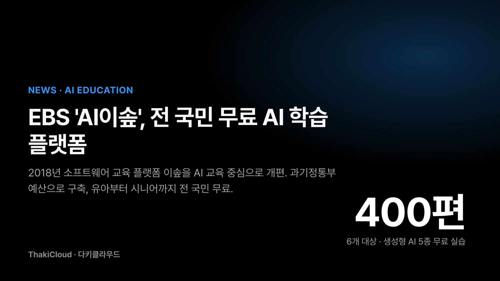
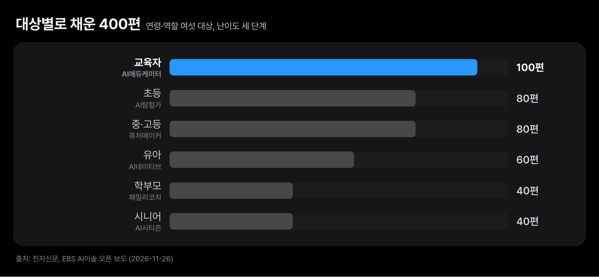
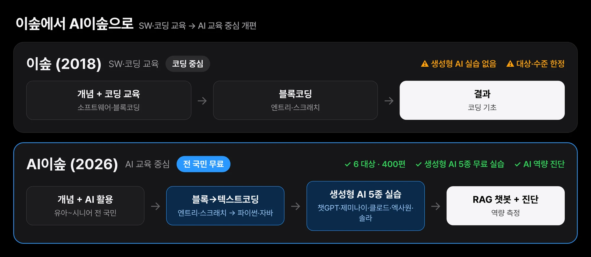
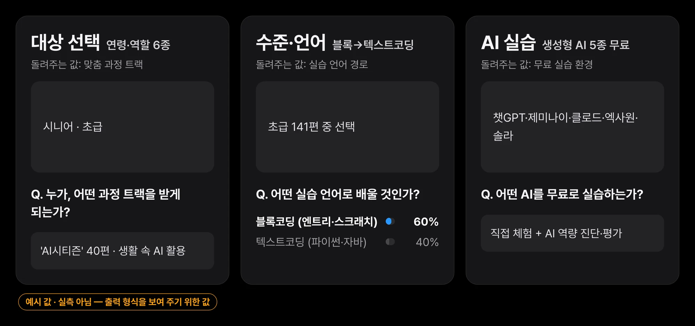

AI 정책이나 기관의 디지털 전환을 따라가는 독자라면, 이번 EBS의 오픈을 하나의 교육 서비스 뉴스로 넘기지 말아야 할 일입니다. EBS가 11월 26일, 소프트웨어 교육 플랫폼 '이솦'을 AI 교육 중심으로 개편한 'AI이솦'을 정식 오픈했습니다. 과기정통부 예산으로 구축해 전 국민이 무료로 이용하고, 챗GPT·제미나이·클로드·엑사원·솔라 다섯 종의 생성형 AI를 실습까지 하게 하며, 유아부터 시니어까지 여섯 대상을 400편의 과정으로 채운 플랫폼입니다. 핵심은 이 무료 입구가 수요를 만든다는 점입니다. 그리고 이 글은 그 수요가 결국 기관 내부의 인프라 질문으로 넘어오는 지점을 다키클라우드 관점에서 짚습니다.

*EBS AI이솦 플랫폼 개요: 여섯 대상, 400편, 생성형 AI 다섯 종 무료 실습.*

## 여섯 대상, 400편으로 채운 과정

AI이솦은 2018년부터 EBS가 운영해 온 소프트웨어·코딩 교육 플랫폼 이솦을 AI 교육 중심으로 고도화한 서비스입니다. 대상은 여섯 개로 나뉩니다. 유아는 'AI네이티브', 초등은 'AI탐험가', 중·고등은 '퓨처메이커', 학부모는 '패밀리코치', 교육자는 'AI에듀케이터', 시니어는 'AI시티즌'입니다. 콘텐츠는 총 400편이며, 대상별로 교육자 100편, 초등 80편, 중·고등 80편, 유아 60편, 학부모 40편, 시니어 40편으로 구성됩니다. 난이도는 초급 141편, 중급 142편, 고급 117편으로 세 단계가 거의 고르게 배분됩니다.

*대상별 콘텐츠 편수. 교육자가 100편으로 가장 많고, 초등·중고등 80편, 유아 60편, 학부모·시니어 40편입니다. 출처: 전자신문.*

교육자를 가장 두껍게 채운 점이 눈에 띱니다. 이 플랫폼이 이용자뿐 아니라 그 학습을 설계하고 지도하는 교사와 교육자까지 염두에 뒀다는 뜻입니다. 교사가 AI를 다루지 못하면, 아이의 AI 교육도 공란에 머물기 때문입니다. 국민 AI 역량 교육 사업이라는 이름이 붙은 만큼, 개인이 AI를 소비하는 데 그치지 않고 개인이 AI를 가르치고 조직에 전파하는 데까지 목적이 미칩니다.

## 공영방송이 국민 AI 교육의 공급자가 된 이유

이솦은 2018년부터 EBS가 운영해 온 소프트웨어·코딩 교육 플랫폼입니다. 공영방송이 코딩 교육으로 시작해 이번에는 AI 교육으로 확장한 셈입니다.

*개편 전후 구조 비교. 대상·실습·진단이 확장되고 생성형 AI 다섯 종이 무료 실습으로 들어옵니다.* 국민 AI 교육의 첫 공급자로 EBS가 나온 배경은 예산과 접근성에 있습니다. 과기정통부 예산으로 구축해 전 국민이 무료로 이용하게 한 만큼, 지역이나 소득과 무관하게 같은 품질의 AI 교육에 닿는 구조가 됩니다. 유료 교육 시장이 AI 과정을 빠르게 늘리는 사이, 공공이 무료 기준선을 만드는 일은 AI 교육 격차 논의에서 반복되는 주제입니다. AI이솦은 그 기준선 중 가장 넓은 대상을 겨냥합니다. 유아부터 시니어까지 여섯 대상을 모두 포함하기 때문입니다.

## 생성형 AI 다섯 종을 무료로 실습하게 하는 이유

AI이솦의 가장 눈에 띄는 부분은, 국내외 생성형 AI 다섯 종을 무료로 실습할 수 있다는 점입니다. 챗GPT, 제미나이, 클로드에 국내의 LG 엑사원과 업스테이지 솔라가 함께합니다. 학습이 개념 설명에 그치지 않고 실제 생성형 AI를 직접 다루며 생활 속 문제를 해결하는 구조입니다. 블록코딩(엔트리·스크래치)에서 텍스트코딩(파이썬·자바)으로, 그리고 RAG 기반 챗봇 구성까지 이어지는 실습 경로가 마련됩니다. 게임과 시뮬레이션 등 체험형 콘텐츠 9종도 함께 들어 있습니다. 초급에서 시작해 중급, 고급으로 올라갈수록 'AI를 쓰는 사람'에서 'AI를 만들고 연결하는 사람' 쪽으로 실습의 중심이 이동하는 구조입니다.

*AI이솦의 입력과 출력 예시. 대상과 수준을 고르면 맞춤 과정과 무료 AI 실습 환경이 나옵니다.*

무료 실습에 국내 모델 두 종을 포함시킨 점이 신호입니다. 해외 모델로 AI를 배우되 국내 모델로 실전을 익히게 해, 어떤 모델로 쓰이더라도 AI를 다룰 수 있는 태도를 길러주려는 의도입니다. 특정 모델에 묶이지 않는 리터러시가 목표라면, 다섯 종을 함께 실습시키는 구성은 그 목적에 맞습니다.

## 진단까지 하는 플랫폼

AI이솦은 학습자 자신의 AI 활용 역량을 점검하는 진단·평가·관리 기능을 함께 제공합니다. RAG 기반 챗봇은 학습자가 지식을 연결해 AI를 구성해 보는 실습입니다.

여기서 주목할 것은 진단이라는 기능입니다. 학습만 시키는 플랫폼과 학습자의 역량을 측정해 주는 플랫폼은 다릅니다. 측정이 가능하다는 것은, 그 역량이 나중에 기관의 인사, 훈련, 조직 체계에서 다시 읽힐 수 있다는 뜻이기도 합니다. 무료 입구에서 쌓인 AI 활용 기록이 기관 내부의 역량 지표로 이어질 수 있는 통로가 생기는 것입니다.

## 국민 AI 수요가 기관의 인프라 질문으로 넘어오는 지점

EBS가 여는 이 무료 입구는 수요 측면의 일입니다. 국민이 AI를 배우고 활용하게 만드는 일입니다. 그러나 이 수요가 기관 내부로 들어오면 공급 측면의 질문이 생깁니다. 교육 기관과 공공, 그리고 기업이 자기 데이터 위에서 AI를 실제로 돌리려면 공공 클라우드나 해외 API로만은 안 되는 경우가 있습니다. 학습 데이터와 학생 개인정보, 기관 문서는 특정 환경 안에 머물러야 하고, 그래서 AI 서빙을 자기 인프라에서 통제해야 하는 요구가 생깁니다.

다키클라우드의 Metis는 바로 이 공급 측면을 다루는 K8s 기반 AI 서빙 플랫폼입니다. 온프레미스와 소버린 환경에서 모델을 서빙하고, 비용과 멀티테넌트를 관리해 줍니다. 국민 AI 리터러시를 키우는 EBS의 입구와 그 수요를 기관 내부에서 실제로 실행하는 Metis의 서빙은 같은 축의 앞뒤입니다. 여기에 에이전트가 업무를 자동으로 처리하는 층까지 오면, Paxis는 그 실행의 경제성과 감사 기록을 일급 리소스로 다룹니다. 무료 학습이 만들어 내는 수요는 결국 누가, 어떤 환경에서, 얼마나 효율적으로 AI를 돌리는가라는 공급 문제로 돌아옵니다.

## 끝으로

EBS AI이솦은 전 국민을 대상으로 한 무료 AI 학습 입구입니다. 과기정통부 예산으로 구축했고, 여섯 대상을 400편의 과정으로 채웠으며, 생성형 AI 다섯 종을 무료로 실습하게 하고, 역량 진단까지 함께합니다. 12월 11일부터 13일까지는 DDP 아트홀에서 직접 체험할 수 있습니다. 이 무료 입구가 수요를 키우는 동안, 그 수요가 기관 내부에서 실제로 AI를 돌리는 공급 인프라를 요구하게 되는 지점이 이번 오픈이 남기는 진짜 질문입니다.

## 참고 자료

- 전자신문, [EBS, 전 국민 무료 AI 학습 플랫폼 'AI이솦' 오픈](https://www.etnews.com/20261126000525) (2026-11-26)
- EBS, AI이솦 정식 오픈 발표 (2026-11-26)
