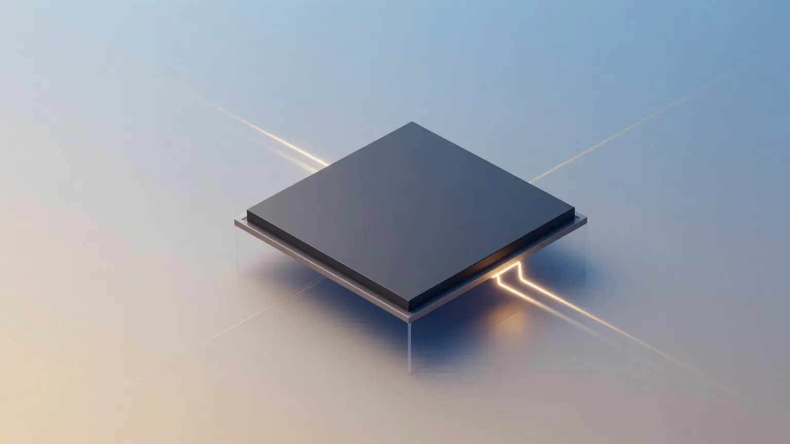
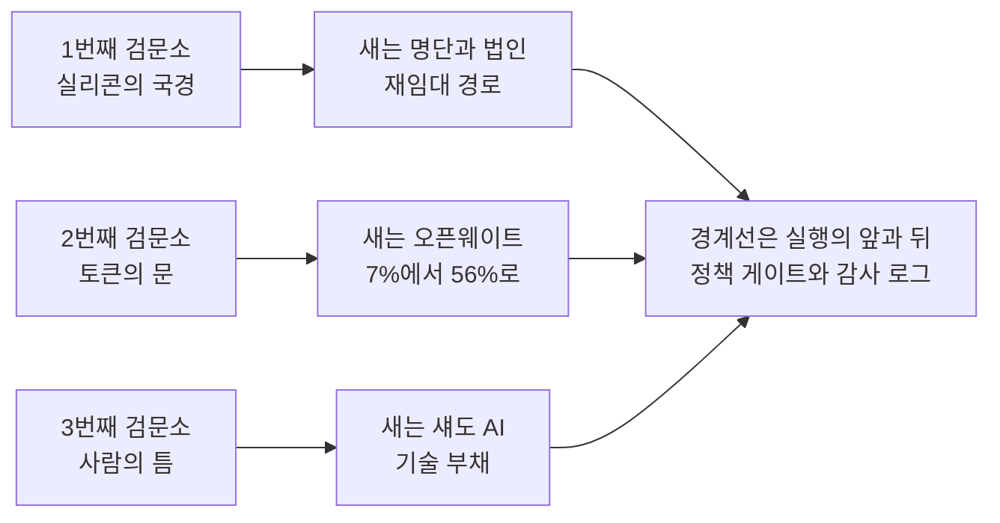

*경계선은 칩이라는 사물에 있고, 새는 실행이라는 행동에 있다는 오늘 세 편의 뉴스를 형상화한 이미지입니다.*

## 같은 파트너 명단 위에 있는 두 회사

미국 안보 연구기관 C4ADS와 CBS 뉴스가 공동으로 벌인 조사에서, 중국 소유 기업 최소 2곳이 엔비디아의 최첨단 AI 반도체를 대량 구매해 온 사실이 드러났습니다. 두 곳 모두 미국에 있습니다. '리클라우드AI'라 불리는 쪽은 캘리포니아에 자리하고 엔비디아의 '우선 협력사' 명단에 올라 고성능 칩을 우선적으로 사들여 왔습니다. '아이브레스'라 불리는 쪽은 전 인스퍼그룹 계열입니다. 2023년 미국 연방정부가 인스퍼를 블랙리스트에 올렸을 때 사명만 바꿨고, 조사 결과 오늘날까지 엔비디아 홈페이지에서 최고 등급인 '엘리트' 컴퓨팅 협력사로 등록을 유지하고 있었습니다. 리클라우드AI 모회사 CEO는 인민해방군 지휘학원에서 국방동원 학위를 받았다고 합니다. 이들 중 일부는 AI 반도체를 동남아시아 기업을 거쳐 중국에 재임대하거나 판매한 것으로도 추정됩니다. 결과는 이 모든 사실이 공개된 올해 11월, 미국 정부가 동남아시아 4개국의 서버 출하 중단과 원격접속 차단, 사전 수출허가 의무화라는 다층적 제재안을 내면서 확인됐습니다. 조사 결과를 한 줄로 요약하면, 통제의 대상이 된 것은 칩이 아니라 칩이 붙어 다니는 명단과 법인인 셈입니다. 우선 협력사, 엘리트 파트너, 재임대 계약. 이 세 단어가 만들어지는 순간 칩의 국적은 흐려집니다. 미국 정부가 제재를 단층이 아니라 다층으로 깔아 놓은 이유가 여기에 있습니다. 칩 하나를 잡으려면 그 칩이 지나온 모든 문장을 따라가야 하기 때문입니다. 조사가 준 경고는, 명단이 곧 문건이라는 점입니다. 문건은 다시 쓰일 수 있습니다. 담을 쌓고 있는 동안, 벽돌은 뒷문으로 나가고 있었습니다.

## 1번째 검문소, 실리콘의 국경

수출통제는 경계벽 중 가장 물리적인 형태인 셈입니다. 항구를 막을 수 있고 컨테이너를 검사할 수 있고 회사를 블랙리스트에 올릴 수 있습니다. 그런데 C4ADS 조사가 보여준 것은 통제 구조 자체에 구멍이 난다는 사실입니다. 협력사 명단, 법인명, 재임대 경로. 이 셋은 한 가지 규제안으로는 잡을 수 없습니다. 아시아경제가 짚은 방식의 차이도 같은 지점에 닿습니다. 중국은 반도체 산업 전체에 국가 주도 투자를 편성해 밀어붙이는 반면, 한국은 삼성전자와 SK하이닉스의 민간 설비투자가 산업의 주축이고 정부 지원은 세제와 대출 같은 간접수단에 집중되어 있습니다. 최근 신설된 국내생산세액공제는 한국판 IRA라는 평가를 받지만 진짜 질문은 현장 체감입니다. 팹 가동일정에 맞춰 전력이나 용수를 확보하지 못하면 생산능력 확장이 물리적으로 막힌다는 것이 기사가 지적하는 핵심입니다. 메모리 쪽도 정점론과 부족론이 교차하는 전장입니다. 데일리한국은 소프트뱅크의 SK하이닉스 인수 검토설을 보도했고 트렌드포스가 중국 빅테크의 주문 축소를 들어 내년 D램과 낸드 매출 전망을 낮춘 사이, 골드만삭스 같은 글로벌 투자은행은 정점 시나리오를 내세우고 있습니다. 중심에는 HBM이 있습니다. AI 연산의 한계를 가르는 이 메모리는, 정점 논쟁 한가운데서도 확보 대상의 최상단에 남아 있습니다. 한국은 수출통제 강화의 수혜자이면서 동시에 피해자입니다. 기준이 강해질수록 고성능 칩을 합법적으로 확보하려는 국내 사업자의 불확실성은 커집니다. 공급망 재편에서 SK하이닉스와 삼성전자의 메모리 사업, TSMC 파운드리 생태계에서 한국 기업이 어떤 위치를 차지할지가 핵심 변수로 꼽힙니다. 수출통제가 강해질수록 동남아 경유 AI 클라우드 인프라에 대한 투자 심리도 위축된다는 점은, 국내 데이터센터 사업자에게는 기회이자 경고입니다. 담이 높아질수록 담 안에서의 확보 전략이 경쟁력이 됩니다.

## 2번째 검문소, 토큰의 문

칩에는 국경이 생겼다면, 그 위에서 도는 모델에는 국경이 없습니다. 오히려 문이 열리고 있습니다. 포춘코리아가 "굳이 비싼 모델을 써야 하나"라고 묻고 데이터로 답했습니다. AI 에이전트가 확산되면서 토큰 사용량은 챗봇의 5배에 달하고, 비용 효율성이 핵심 경쟁 요인으로 떠올랐습니다. 버셀 데이터에 따르면 오픈웨이트 모델의 토큰 처리 비중은 8개월 만에 7%에서 56%로 급등했습니다. 산업 현장에서 모델 성능이 비슷한 수준으로 수렴하고 있다는 방증입니다. 같은 시간, 딥시크와 알리바바, 문샷AI, 지에이아이 같은 중국 기업들이 오픈웨이트 시장을 주도하고 있고, 미국은 지정학적 리스크를 이유로 중국산 AI 모델 사용 의무공개 제도를 검토하고 있습니다. 엔비디아와 싱킹머신스도 오픈웨이트 모델 공개로 대응에 나섰습니다. 칩의 담이 높아지는 동안, 모델의 문은 열리고 있습니다. 기업들은 특정 국가나 공급업체 의존에서 벗어나 업무 특성에 맞춰 모델을 섞는 멀티벤더 전략으로 이동하고 있습니다. 에이전트가 일을 대신 처리하는 순간, 한 요청당 넘어가는 토큰의 총량이 달라집니다. 성능이 비슷해진 구간에서는 가격이 곧 아키텍처가 되는데, 아키텍처를 정하는 기준이 국가와 공급사의 이름에서 이 업무를 처리하는 데 드는 토큰 비용으로 옮겨간 것입니다. 한국에는 이중의 함의가 있습니다. 데이터 주권과 비용 절감, 오픈웨이트 자체 호스팅의 동기가 두 배인 반면, 미국의 의무공개 압박이 강해질수록 글로벌 공급망에 중국산 AI를 얹는 데 규제 리스크가 생깁니다. 금융과 공공, 방산 분야에서는 데이터가 밖으로 나가지 않는 자체 인프라 위에서 오픈웨이트를 돌리는 것이 선택이 아닌 전제 조건이 되어가고 있습니다.

## 3번째 검문소, 사람의 틈

세 번째 새는 가장 보이지 않으므로 막기도 어렵습니다. 주체가 사람입니다. 디지털투데이가 전한 보도의 제목이 '사람에서 생성형 AI로'인 이유입니다. 기술 유출의 경로가 바뀐 것입니다. 예전에는 사람이 외부를 향해 움직였지만 이제는 사람이 화면에 문장을 치는 것만으로 정보가 움직입니다. 기업의 AI 도입은 예산을 쓰는 정식 심사를 통해서가 아니라, 소프트웨어 업데이트와 설정 변경, 직원 자율 채택을 통해 퍼져가고 있습니다. 이른바 섀도 AI입니다. 가트너는 기존 보안 솔루션으로는 섀도 AI를 막기 어렵다고 진단하고, 공급사가 AI 기능을 업데이트로 추가한 경우에도 새 AI 도입과 같은 수준의 관리 대상으로 올려야 한다고 권고했습니다. 'AI 사용 통제' 솔루션 시장이 수십억 달러 규모로 평가받는다는 점은 이 흐름의 크기입니다. CIO와 IT 리스크 담당자의 56%는 소프트웨어와 AI 공급망 위험이 현실화하면 그 영향이 '중대하거나 치명적'이라고 답했습니다. 반도체는 이미 해외 유출 표적이 가장 많은 업종이라 부담이 더 큽니다. 과거 18나노 D램의 CXMT행 인적 유출에 이어, 외부 생성형 AI라는 새 경로가 열린 셈입니다. 삼성전자의 임원급 기술 관리책임자 지정과 권한 쪼개기, TSMC의 업무 단위 레시피 접근 제한, ASML의 장비 킬스위치가 업계 표준으로 확산되고 있다는 설명입니다. 가장 취약한 쪽은 중소기업 협력사입니다. 적발 건수가 64건으로 대기업의 약 두 배입니다. 공격자 쪽 시선은 디지털투데이의 다른 기사가 짚습니다. NCSC는 개별 제로데이보다, 수년간 패치와 업그레이드를 미루며 쌓은 '기술 부채'가 AI 공격의 집중 표적이 되고 있다고 분석했습니다. 방어 산업은 크라우드스트라이크의 439억 달러 규모 지스케일러 인수를 계기로 규모의 경쟁 국면으로 들어갔습니다. 공격과 방어를 모두 AI로 전제하는 'AI 대 AI' 구도가 자리를 잡고 있다는 뜻입니다. 공격자는 취약점 발견과 익스플로잇 개발 속도를 AI로 끌어올리고, 방어 쪽으로는 AI 모델 개발사들이 보안 시장으로 대거 진출하고 있습니다. 쌓인 것, 방치한 것. 이 문이 먼저 열린다는 것이 기술 부채 경고의 요지인 셈입니다.

## 경계선이 잘못된 곳에 있다

세 가지 새를 나란히 놓으면 한 가지 패턴이 보이기 때문입니다. 규칙은 사물을 따라가고 새는 실행을 따라갑니다. 수출통제는 칩을, 의무공개 제도는 모델을, 섀도 AI 정책은 도구를 잡으러 간다는 뜻입니다. 그런데 실제로 데이터를 옮기고 판단을 내리는 것은 더 이상 사물이 아니라 실행입니다. 예전에는 서버실을 통제하면 정보를 통제할 수 있었습니다. 지금은 에이전트가 도구를 고르고 API를 호출하고 데이터를 자기 워크플로대로 옮깁니다. 같은 칩이 무엇을 돌리고 같은 모델이 무엇을 내보내며 같은 직원의 편의가 무엇을 새나가는지는 전부 '어떤 규칙 아래 실행되는가'에서 결정됩니다. 한국의 처지는 여기서 유달리 흥미롭습니다. 칩 담의 수혜자이면서 국방인공지능법 제정이라는 경계선 논의를 소버린 AI 기조로 벌이고 있는 동시에, 기업 내부의 행동 문은 아직 열려 있습니다. 칩의 담과 법의 담은 이미 자리에 있고 행동의 문만이 아직 설계도 단계입니다. 질문은 담을 더 쌓을 것이냐가 아니라, 경계선을 어디에 그을 것이냐입니다. 사물이 경계라면 벽이고 실행이 경계라면 로그입니다. 여기서 로그란 사후 기록이 아닙니다. 실행의 바로 앞에서 무엇을 허용하고 바로 뒤에 무엇을 남기느냐의 문제입니다. 경계선이 실행의 앞뒤에 있어야, 사물의 벽은 사물의 벽으로서 제 역할을 할 수 있습니다.

*세 검문소는 사물을 잡으러 가지만, 새는 실행을 따라갑니다. 경계선은 실행의 바로 앞과 뒤, 정책 게이트와 감사 로그에 있습니다.*

## 그래서 경계선은 어디에 긋는가

실행을 통제하는 경계선은 이미 제품 형태를 가지고 있습니다. Paxis는 ThakiCloud의 에이전트 네이티브 클라우드이며 v1.1 GA로 출시된 정식 제품입니다. 에이전트가 일하는 장을 만드는 Skills, Tools, Policies, Audit Logs 네 가지는 부수 기능이 아니라 일급 리소스입니다. 자율도는 L0에서 L3까지 거버넌스에 따라 조절되고 정책 게이트는 승인할 수 없는 것을 막습니다. 모든 실행은 감사 로그에 재현되고 격리된 샌드박스에서는 실패가 퍼지지 않습니다. MCP 커넥터와 스킬 마켓이 에이전트와 도구가 손을 잡는 방식을 정합니다. 자율도가 높을수록 이 네 리소스의 가치는 커집니다. L3에 가까운 에이전트일수록 정책 게이트가 없는 실행은 통제 없는 실행과 같은 말이 되기 때문입니다. 오늘의 세 경계는 이 역량에 정확히 겹쳐 들어갑니다. 실리콘의 국경은 소버린, 온프레미스 K8s 배포에 대응합니다. 데이터가 나가지 않는 폐쇄망에서도 에이전트가 그대로 일하고 섀도 AI에 대한 답은 막는 것이 아니라 승인된 사내 실행 환경으로 대체하는 것입니다. 토큰의 문은 CostRouter의 작업별 모델 선택에 대응합니다. 7%에서 56%로 벌어진 가격 경쟁을, 어떤 일을 어떤 모델로 돌리느냐의 운영 조건으로 번역하는 레이어입니다. 사람의 틈은 정책 게이트와 감사 로그에 대응합니다. 무엇을 했는지, 어떤 규칙 아래 했는지에 대한 답이 기록으로 남는 순간, 새는 틈이 아니라 로그가 됩니다. 담은 칩으로 만들고, 경계선은 로그로 긋습니다. 실행이 자율인 시대에 경계선을 그어야 할 곳은 사물의 경계가 아니라, 실행의 바로 앞과 뒤입니다. 오늘 세 편의 뉴스가 가리키는 지형은 정확히 거기입니다.

## 참고 자료

이 글은 아래 뉴스를 종합해 작성했습니다.

- 이투데이, [엔비디아, 중국 소유 실리콘밸리 기업에 칩 대량 판매](https://www.etoday.co.kr/news/view/2653687)
- 포춘코리아, ["굳이 비싼 모델 써야 하나" 기업들이 중국 AI로 눈 돌리는 이유](https://www.fortunekorea.co.kr/news/articleView.html?idxno=54889)
- 뉴스토마토, [네카오, 국방 AX 사업 확대…'피지컬 AI' 구축 속도](http://www.newstomato.com/ReadNews.aspx?no=1322006&inflow=N)
- 아시아경제, [中은 국가가 뛰는데…韓 반도체 지원책, 현장에선 체감할까](https://view.asiae.co.kr/article/2026112610514336816)
- 데일리한국, [손정의도 SK하이닉스 눈독...고점론에도 HBM 확보전](https://daily.hankooki.com/news/articleView.html?idxno=1429460)
- 디지털투데이, [[시큐리티핫이슈] 누적된 '기술 부채' AI 공격 표적...국가기관 해킹](https://www.digitaltoday.co.kr/news/articleView.html?idxno=718588)
- 디지털투데이, [사람에서 생성형 AI로...반도체 업계 '기술 유출 경로' 촉각](https://www.digitaltoday.co.kr/news/articleView.html?idxno=718428)

