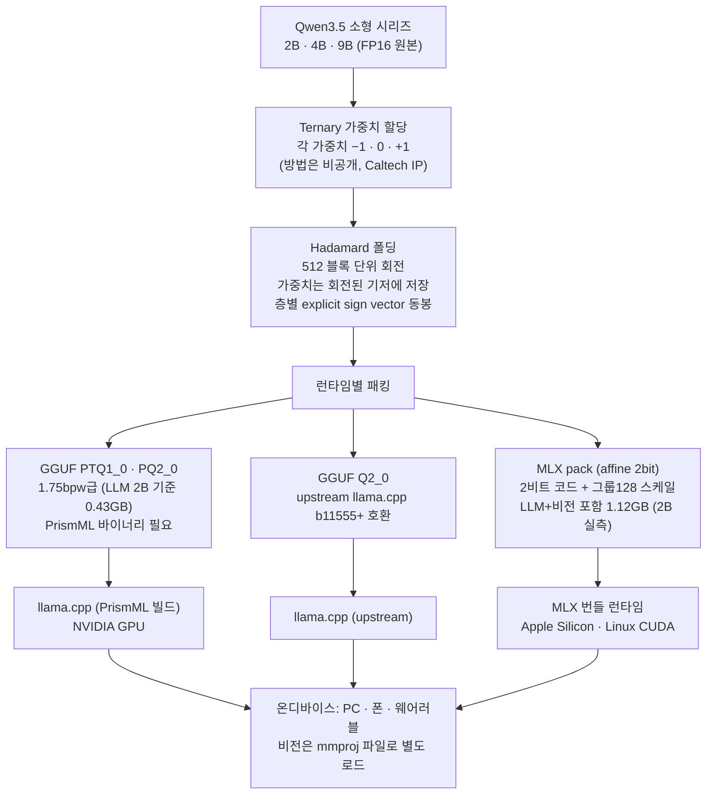

*글의 핵심 개념을 형상화했습니다.*

## 왜 읽어야 하나

온디바이스·엣지 환경에 저비트 모델을 내려야 하는 팀, 또는 멀티테넌트 서빙의 밀도를 올리기 위해 정밀도 라우팅을 검토하는 인프라·플랫폼 엔지니어라면 이 모델카드가 바로 판단 자료입니다. 결론을 먼저 씁니다. **PrismML이 2026년 10월 15일 발표한 Bonsai 2 소형 시리즈(2B·4B·9B)는 Qwen3.5 기반 ternary({−1,0,+1}) 저비트 모델로, 0.43~2GB 용량에서 에이전트·수학·코드·비전 전반에 원본의 90~95% 유지율을 보고합니다. ThakiCloud가 공개 가중치를 비트 레벨에서 검증한 결과 ternary 구조의 주장은 성립했고, 모델은 실제로 생성을 수행했습니다.** 다만 압축 방법은 여전히 비공개이고, 로딩에는 Hadamard 회전을 처리하는 공식 번들 런타임이 필수라는 점이 실측으로 확인됐습니다.

## 쉽게 말하면

영수증으로 비유해 봅시다. 식당 영수증의 각 행이 정확한 금액 대신 '플러스, 마이너스, 영' 표시만 있는 receipt를 상상해 보세요. 페이지(128개 행)마다 단위 가격 하나만 적어 두면, 총액은 원본 영수증과 거의 같은 금액으로 복원됩니다. Bonsai 2의 ternary 가중치는 바로 그 영수증입니다. 각 가중치가 −1·0·+1 세 값 중 하나이고, 128개마다 FP16 스케일 하나를 공유합니다. 덕분에 FP16이면 수 GB인 2B 모델이 0.43GB가 됩니다.


*Ternary 인코딩의 구조를 영수증으로 본 슬라이드입니다. 기준 FP16 영수증의 각 행을 {−1, 0, +1} 세 값으로 요약하고, 128개 가중치당 FP16 스케일 하나를 공유해 실효 약 1.71비트가 됩니다.*

핵심은 이 영수증이 마구 쓴 것이 아니라, 원본 총액과의 차이를 최소화하도록 표기를 배열한 점입니다. 그리고 그 배열 방법은 공개되지 않았습니다(비공개 Caltech IP). 이 영수증 이야기는 뒤의 한계와 정리에서 다시 꺼냅니다.

## 개요

PrismML은 7월부터 하나의 정책 아래 'Bonsai' 저비트 모델을 릴리스해 왔습니다. 1-bit·ternary Bonsai 27B·8B·4B·1.7B가 7월 14일에 나왔고, Bonsai 2 27B 플래그십이 9월 17일에 추가됐습니다. 이번 Bonsai 2 소형 시리즈(2B·4B·9B)는 Qwen3.5를 베이스로 한 10월 15일 발표분입니다. 라이선스는 Apache 2.0이며, Hugging Face의 prism-ml 조직에서 각 사이즈마다 GGUF(llama.cpp용)와 mlx-2bit(Apple Silicon용) 두 포맷을 제공합니다. 비전 프로젝트(mmproj)는 별도 파일(Q8_0, BF16)로 나뉘어 있고, 맥락 길이는 262K 토큰입니다(HF 카드 실측).

포지셔닝은 온디바이스 AI입니다. PC·스마트폰·웨어러블을 대상 클래스로 명시하고, RTX 4090·M5 Pro·M5 Max Pro·iPhone 18 Pro Max 실측 처리량을 함께 발표했습니다. Darkbloom에서는 9B를 클라우드에서 시험해 볼 수 있고 첫 100명에게 2억 5천만 토큰을 제공한다고 합니다.

7월에 ThakiCloud는 Bonsai 1 세대 가중치를 비트 레벨로 독립 검증하고, 1-bit 모델이 진짜 near-lossless로 작동함을 확인한 바 있습니다(출처 섹션의 이전 글). 이 글은 그 작업을 소형 시리즈로 이어받는 글이며, 이번에는 실측 생성까지 수행했습니다.

## 이 모델은 무엇인가

Ternary 인코딩은 각 가중치를 {−1, 0, +1} 세 값으로 표현하는 것입니다. 한 값이 log2(3) ≈ 1.585비트를 담고, 128개 가중치당 FP16 스케일 하나(0.125비트)가 붙으므로 실효 약 1.71비트입니다. FP16 대비 9배 이상 축소가 여기서 나옵니다. 발표된 용량은 2B가 0.43GB, 4B가 0.95GB, 9B가 2GB입니다.

구조는 Qwen3.5 소형 시리즈 그대로입니다. 재학습이 아닌 사후 압축이라는 점도 1세대와 같습니다. 공개된 2B MLX pack의 config를 직접 읽었더니 24개 레이어, hidden 2048, 어텐션은 Gated DeltaNet 선형 어텐션과 풀 어텐션이 섞인 하이브리드 구성이었습니다. 파라미터는 언어 모델 약 1.88B에 비전 타워를 더해 전체 약 2.24B로, HF 카드의 total 필드(1,881,825,088)와 이번 실측(1,880,096,768)이 일치합니다. 비전 타워는 양자화되지 않은 FP16으로 그대로 저장되어 있습니다(공식 로더의 문서 설명 기준).



여기서 한 가지 구조적 특성을 짚어 둡니다. 언어 가중치는 원래 좌표계에 저장되지 않습니다. 512 블록 단위의 Hadamard 변환으로 회전(fold)된 기저에 저장되고, 런타임은 활성(activation)을 대응 변환으로 회전시킨 뒤 2비트 양자화 matmul을 수행합니다. 각 층의 explicit 부호(sign) 벡터는 파일 안에 동봉되어 있고(hadamard.json과 모듈별 signs 텐서, 151개), 이 변환을 거치지 않으면 출력이 깨집니다. 공식 README가 '일반 affine Qwen 체크포인트로 로딩하지 말라'고 명시하는 이유가 바로 이 점입니다.


*가장 큰 마찰력을 정리한 슬라이드입니다. 가중치가 원래 좌표계에 저장돼 있지 않아, 일반 affine 로더는 모듈을 찾지 못하고(ModuleNotFoundError) 512 블록 Hadamard 변환을 아는 전용 런타임이 필요합니다.*

## 보고된 벤치마크 결과

PrismML은 Qwen3.5 원본(FP16)을 기준점으로 19개 벤치마크, 6개 스킬 세트에서 유지율을 발표했습니다. 그룹별 유지율입니다.

| 스킬 세트 | 2B | 4B | 9B |
|---|---|---|---|
| 에이전트·도구 | 95.5% | 90.0% | 92.4% |
| 수학 | 107.8% | 99.3% | 98.2% |
| 지시 따르기 | 121.5% | 106.0% | 100.0% |
| 코드 | 115.0% | 100.7% | 100.1% |
| 지식·추론 | 82.9% | 90.9% | 93.0% |
| 비전 | 89.0% | 91.3% | 92.5% |

세 군데를 읽어야 합니다. 첫째, 수학·코드·지시 따르기 유지율이 100%를 넘습니다. 세부 값으로 보면 2B의 GSM8K가 80.74로 원본 65.96을 넘고(122.4%), IFBench가 48.00 대 34.33(139.8%), HumanEval+가 50.00 대 45.12(110.8%)입니다. 이를 '양자화가 모델을 만들었다'고 읽으면 안 됩니다. 평가 조건(프롬프트, 디코딩 설정, 평가 노이즈)이나 소규모 샘플 분산의 신호로 보는 것이 정당한 해석입니다. 7월 글에서 1세대 수치를 읽을 때 한 유보와 같은 유보입니다.


*100%를 넘는 유지율의 함정을 짚은 슬라이드입니다. 수학·코드·지시 따르기가 기준선을 넘는 것은 성능 향상이 아니라 평가 노이즈와 샘플 분산의 신호이며, 손실이 큰 축(지식 깊이·멀티턴 에이전트)을 직시해야 한다는 요약.*

둘째, 손실이 가장 큰 축은 지식의 깊이(GPQA Diamond: 67.7%·81.8%·84.7%)와 멀티턴 에이전트(Tau2Bench: 4B 75.8%·9B 85.7%)입니다. 셋째, 이 수치는 전부 공급자 자체 측정이고 독립 재현은 아직 없습니다.

## ThakiCloud 독립 검증

대상 독자는 저비트 런타임 도입을 판단하는 인프라 엔지니어입니다. 네 가지를 실측했습니다.


*독립 검증 파이프라인의 전체 결과를 한 장에 담은 슬라이드입니다. 표준 로드 경로는 실패, 비트 레벨 구조 검증은 통과, 실제 생성은 성공(약 89 tok/s), 런타임 의존성은 주의 항목.*

**1) 표준 경로는 실패한다.** `prism-ml/Ternary-Bonsai-2-2B-mlx-2bit`를 표준 mlx-lm으로 로드하면 다음이 나옵니다.

```
ModuleNotFoundError: No module named 'mlx_lm.models.prism_hadamard_qwen35'
ValueError: Model type prism_hadamard_qwen35 not supported.
```

모델 클래스가 없다는 단순 오류가 아닙니다. 가중치가 회전된 기저에 저장돼 있어, 대응 변환을 아는 런타임이 없으면 파일 자체가 읽을 수 있는 것이 아닙니다.

**2) 비트 레벨 구조 검증.** 공개 파일의 packed 모듈 151개 전체(1.88B 가중치)를 독립적으로 언팩했습니다. 2비트 코드의 네 수준(0·1·2·3) 분포는 33.7% · 32.6% · 33.7% · 0.0%였습니다. 네 번째 수준(2×스케일)은 한 곳도 쓰이지 않았습니다. 즉 실제 가중치 값은 정확히 {−s, 0, +s}의 ternary이며, 'ternary'라는 발표 주장이 비트 레벨에서 성립함을 확인했습니다. 151개 모듈의 바이어스가 전부 스케일의 정확히 음수(−scale)이고, 모든 스케일이 유한한 값이라는 구조 검증도 함께 통과했습니다.


*구체적 검증 결과를 담은 슬라이드입니다. 2비트 코드 공간의 네 수준 중 네 번째(2×스케일)가 0.0%로, 실제로는 {−s, 0, +s} 세 상태만 사용하는 진정 ternary 모델임이 151개 모듈 전수에서 확인됐습니다.*

**3) 실제 생성.** 비전 pack의 공식 로더는 mlx-vlm 경로라, 텍스트 전용 경로로 번들 Packed 런타임(부호화된 Hadamard + MLX 2비트 양자화 matmul)과 mlx-lm의 Qwen3.5 텍스트 모델을 조합해 생성을 돌렸습니다. 버전은 공식 requirements.txt와 동일(mlx 0.32.0, mlx-lm 0.31.3)입니다. 결과:

- 영어는 일관된 응답을 냈고, 17 × 24 계산은 408로 정확했습니다.
- 속도: M4 Pro(48GB)에서 산술 답변 생성(출력 11토큰, 프롬프트 프리필 포함)에 벽시간 0.12초, 약 89 토큰/초였습니다. 이는 단순 Python 디코딩 루프이므로 하한값이고, 공식 보고(M5 Max Pro 기준 2B 310 tok/s)보다 보수적입니다.
- 한국어: 단 하나의 스모크 샘플에서 '2 더하기 2 (18) 입니다.'로 나왔습니다. 하나의 샘플은 벤치마크가 아니므로, 소형 모델의 한국어 출력이 아직 불안정하다는 관찰 신호로만 기록합니다.

**4) 런타임 매트릭스.** 공식 문서 기준입니다.

| 포맷 | 로드 경로 | 비고 |
|---|---|---|
| GGUF PQ2_0 · PTQ1_0 | PrismML 바이너리 | ternary(PTQ1_0)·2비트(PQ2_0), upstream 불가 |
| GGUF Q2_0 | upstream llama.cpp b11555+ | 표준 빌드 호환 변형 |
| MLX pack (mlx-2bit) | 번들 런타임 | Apple Silicon, Linux CUDA 공식 지원 |

함의는 명확합니다. 독립 검증(퍼플렉서티, 카테고리 벤치마크)을 하려면 그들의 빌드, 또는 이번처럼 번들 런타임의 로직을 재현하는 경로가 필요합니다. Bonsai 1세대처럼 unpacked(FP16 재물질화) 릴리스가 나온다면 풀 검증 파이프라인을 바로 재실행할 수 있습니다.

## ThakiCloud 제품 적용 시사점

**ai-platform 렌즈(인프라·서빙).** 0.43~2GB의 footprint는 멀티테넌트 서빙의 배치 단위를 바꿉니다. 2B급 LLM은 추론 엔드포인트 옆에 사이카드로 들어가는 수준이고, 9B는 중급 카드 하나에 비전까지 올릴 수 있습니다. 하드웨어 예산이 제한된 온프레미스·소버린 배포(공공·규제 산업의 self-hosting 요구)에서 '중급 카드로 9B급'이 성립하는 구간이 생기는 것입니다. 27B급 NVFP4의 고밀도 서빙(B200)과 소형 시리즈의 저비트가 한 풀에서 공존하면, 워크로드별 정밀도 라우팅의 스펙트럼이 넓어집니다. 에이전트·도구 호출 중심 워크로드는 유지율 손실이 큰 축이므로, 이 모델들은 그 하단(단순 추론·분류·요약)을 맡는 배치로 보는 것이 정합합니다.

**Paxis 렌즈(에이전트·엣지).** 폰에서 34~120 tok/s로 도는 2B·9B는 프라이버시 우선 로컬 에이전트의 경제학입니다. 프롬프트가 장치를 떠나지 않는 구성은 규제 대응과 오프라인 워크플로에 직접 쓰이고, 짧은 에이전트 루프(도구 호출, 상태 확인, 요약)는 이 속도에서도 실시간에 가깝습니다. Paxis는 이런 로컬 모델을 샌드박스 격리 실행 안에서 다루고 모든 행동을 정책 게이트와 감사 로그로 통과시키는 구조이므로, 온디바이스 저비트 모델과 결합할 때 통제가 흐트러지지 않습니다.


*0.43GB footprint의 두 가지 경제학을 보여주는 슬라이드입니다. 왼쪽은 멀티테넌트 고밀도 서빙(메인 모델 옆 사이카 배치), 오른쪽은 프라이버시 우선 로컬 엣지(실시간 오프라인 에이전트 루프).*

7월 글의 판단을 한 줄로 이어받습니다. 저비용 서빙(ai-platform)이 에이전트의 경제성(Paxis)을 만들어내는 관계가, 이번에는 0.43GB라는 숫자로 더 가까워졌습니다.

## 한계 및 반론

첫째, 벤치마크 수치는 전부 공급자 자체 측정입니다. 독립 재현은 이번의 구조 검증과 스모크 생성 수준에 그쳤고, 카테고리별 유지율(에이전트 90~95% 등)의 전수 검증은 그들의 런타임 빌드 또는 unpacked 릴리스를 기다려야 합니다.

둘째, 100%를 넘는 유지율은 개선의 증거가 아닙니다. 평가 조건과 샘플 분산의 신호로 읽어야 하고, 도입 판단에서 이 숫자를 근거로 쓰는 순간 '양자화하면 오히려 좋아진다'는 잘못된 학습을 만듭니다.

셋째, 런타임 의존이 실제 마찰입니다. 표준 로더는 파일을 못 읽고, 방법은 봉인되어 있으며, 번들 런타임조차 vision pack은 mlx-vlm이 필요합니다. '0.43GB 모델'이라는 발표 용량도 기준이 다릅니다. 이번 실측에서 MLX pack은 LLM 1.88B(2비트 저장)에 F16 비전 타워를 더해 1.12GB였습니다. 도입 검토 시 반드시 런타임·포맷 기준을 함께 적어야 합니다.

넷째, 손실이 큰 축이 명확합니다. 지식 깊이(GPQA 67.7%·81.8%·84.7%)와 멀티턴 에이전트(Tau2Bench 75.8%·85.7%) 유지율이 가장 낮아, 2B·4B의 실용 경계는 깊은 도구 체인이 아니라 단순 추론·분류·요약 쪽에 있습니다.

다섯째, 라이선스는 Apache 2.0이지만 베이스는 Qwen3.5 파생입니다. 상업 재배포 전 베이스 모델의 라이선스 상속 관계 확인이 필요합니다(7월 글의 동일 유보).

## 정리

영수증 실험이 소형 모델 클래스에 도착했습니다. 페이지당 단위 가격 하나, 행당 플러스·마이너스·영으로 쓴 영수증이 원본 총액의 90% 이상을 복원한다는 주장은, 발표 자료가 아니라 공개 파일 자체에서 확인됐습니다. 151개 모듈, 1.88B 가중치 전수에서 네 번째 수준이 한 곳도 없었고, 모델은 실제로 생성을 수행했습니다.

독자 takeaway로 세 가지를 남깁니다. 엣지·저사양 노드 배치를 검토한다면 2B(0.43GB)로 파일럿을 시작해 자기 워크로드에서 유지율을 재측정하세요. 멀티테넌트 밀도를 올리려 한다면 이 시리즈를 전체 교체재가 아니라 워크로드 단계별 정밀도 라우팅의 하단 옵션으로 넣으세요. 그리고 독립 검증은 unpacked 릴리스 또는 공식 런타임 빌드가 나올 때 전수로 반복하는 것이 순서입니다.


*정리 슬라이드입니다. '9배 작아도 실제로 돌아야 검증이 성립한다'는 결론과, 파일럿·런타임 기준 명시·전수 검증 유보의 세 단계 takeaway.*

한 줄 결론: **9배 작아도 실제로 돌아야 검증이 성립하고, 이번에는 돌아야 했습니다. 구조는 확인됐고, 품질은 아직 공급자 보고값입니다.**

## 출처

- PrismML 공식 발표: [Bonsai 2 Family](https://prismml.com/news/bonsai-2-family)
- PR Newswire (2026-10-15): [PrismML Expands Bonsai 2 Family with 2B, 4B, and 9B Models for On-Device AI](https://www.prnewswire.com/news-releases/prismml-expands-bonsai-2-family-with-2b-4b-and-9b-models-for-on-device-ai-302910593.html)
- 공식 다운로드 문서: [docs.prismml.com/download/models](https://docs.prismml.com/download/models)
- Hugging Face 모델: [prism-ml/Ternary-Bonsai-2-2B-mlx-2bit](https://huggingface.co/prism-ml/Ternary-Bonsai-2-2B-mlx-2bit) · [prism-ml/Ternary-Bonsai-2-2B-gguf](https://huggingface.co/prism-ml/Ternary-Bonsai-2-2B-gguf)
- Hugging Face 컬렉션: [Bonsai 2 Small](https://huggingface.co/collections/prism-ml/bonsai-2-small)
- 이전 글 (2026-07-16, Bonsai 27B 1-bit·ternary 해부 + 독립 재현): [tech-blog/ko/llmops/bonsai-27b-ternary-1bit-quantization](https://thakicloud.com/tech-blog/ko/llmops/bonsai-27b-ternary-1bit-quantization/)
- 관련 트윗 (2026-10-16): https://x.com/hjguyhan/status/2110945241838805183
