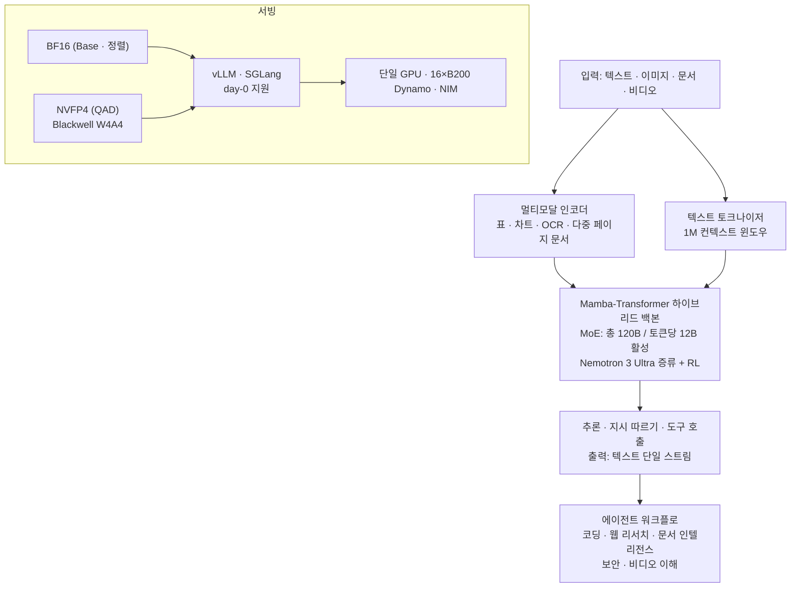

*글의 핵심 개념을 형상화했습니다.*

## 왜 읽어야 하나

에이전트 워크로드의 서빙·비용·SLO를 함께 보는 플랫폼 엔지니어, 그리고 Agent-Native Cloud에서 어떤 오픈 모델을 제어 평면 아래에 놓을지 고르는 팀이라면 이 모델카드가 판단 자료입니다. 결론부터 씁니다. **NVIDIA가 2026년 10월 15일 공개한 Nemotron 3.5 Super VL은 토큰당 12B만 활성화하는 120B MoE, Mamba-Transformer 하이브리드, 1M 컨텍스트, 텍스트·이미지·문서·비디오 이해와 도구 호출을 하나의 오픈 체크포인트에 담은 '특수화 에이전트용' 모델입니다.** NVFP4 양자화 버전과 vLLM·SGLang day-0 서빙 지원까지 함께 발표됐습니다. 다만 발표 수치의 상당 부분은 자기 보고와 파트너(벤더) 보고이므로, 이 글에서는 각 숫자의 출처와 비교 기준을 함께 적었습니다.

## 쉽게 말하면

대형 종합병원에 비유해 봅시다. 병원에는 내과·외과·안과·영상의학과 등 전문의 120명이 전부 고용돼 있습니다(120B 총 파라마미터). 그런데 환자 한 명이 오면 실제로 당직에 서는 전문의는 12명뿐입니다(토큰당 12B 활성). 비용은 당직한 12명만 들고, 지식은 120명 전원이 있는 병원의 것이라서, "작은 병원만 오면 아는 것도 줄어든다"는 고전이 성립하지 않습니다. Nemotron 3.5 Super VL의 MoE 구조가 이 병원입니다.


*120B/12B의 구조를 시각화한 슬라이드입니다. 총 파라마미터 120B의 거대 모델이 토큰당 12B 활성화 수준으로 디코딩 비용을 압축해, 작은 모델로 타협하지 않는 에이전트 서빙 경제학이 됩니다.*

여기에 두 가지를 얹었습니다. 병원 차트가 환자 일생의 기록(1M 토큰 컨텍스트)을 통째로 들고, 접수 데스크(멀티모달 인코더)가 문진표뿐 아니라 영상·필름·수술 기록까지 읽는다는 것. 이 비유는 서빙 경제학과 한계 섹션에서 다시 꺼냅니다.

## 개요

NVIDIA는 10월 15일 Nemotron 3.5 Super VL을 공개했습니다([개발자 블로그](https://developer.nvidia.com/blog/nvidia-nemotron-3-5-super-vl-powers-specialized-agents-with-multimodal-reasoning/), [NVIDIA 블로그](https://blogs.nvidia.com/blog/nemotron-3-5-super-vl/)). 같은 날 서빙 인프라 쪽에서 [vLLM](https://vllm.ai/blog/2026-10-15-nemotron-3-5-super-vl-vllm)과 [SGLang/LMSYS](https://lmsys.org/blog/2026-10-15-nvidia-nemotron-3-5-super-vl)가 day-0 지원 발표를 냈습니다. 위치는 "data center to desktop"입니다. 데이터센터의 특수화 에이전트 워크플로가 1차 타깃이고, 소형 Nemotron 라인(Nano Omni 등)과 함께 데스크톱급까지 파고드는 계열입니다.

Nemotron 3 Ultra에서 증류한 모델입니다. 발표 자료에 따르면 SkewReverse 손실의 증류와 다교사 온-policy 증류(MOPD), NeMo RL·NeMo Gym 기반 RL을 거쳐 후학습했습니다. 오픈 데이터도 함께 냈습니다. IIT Madras와 AI4Bharas와 함께한 인디크(India's languages) 토큰 약 2.8T(22개 언어), 비전-언어 데이터셋 40종, 에이전트 도구 사용·금융 추론·지시 따르기·장문 컨텍스트·형평성 데이터셋이 Hugging Face에 공개됐습니다.

라이선스는 OpenMDW 1.1입니다. Linux Foundation이 2026년 5월에 발표한 모델 특화 허용적(permissive) 라이선스로, NVIDIA는 Cosmos·Isaac·GR00T·Ising·Nemotron 계열 전반에 이를 적용하기로 했습니다([Linux Foundation 발표](https://www.linuxfoundation.org/press/linux-foundation-releases-openmdw-1-1-nvidia-adopts-openmdw-for-cosmos-isaac-gr00t-ising-and-nemotron-ai-model-families)). Apache-2.0이 아니라 새로운 라이선스라는 점은 도입 판단에서 한 줄 차지합니다(아래 한계 섹션).

## 이 모델은 무엇인가

아키텍처 핵심은 세 겹입니다.


*세 가지 핵심 아키텍처를 요약한 슬라이드입니다. 120B/A12B MoE(지식 풀 극대화, 추론 연산 최소화), Mamba-Transformer 백본(반복되는 에이전트 세션의 상태 보존과 비용 통제), 네이티브 멀티모달(VLM 파이프라인 분리 없이 문서·이미지·비디오 직접 수용).*

**첫째, 120B/A12B MoE.** 총 파라마미터 120B 중 토큰마다 12B만 활성화하는 mixture-of-experts 구조입니다. 디코딩 비용은 활성 12B에 가깝게 유지하면서, 지식은 120B 풀의 것입니다.

**둘째, Mamba-Transformer 하이브리드.** 어텐션 레이어와 Mamba 계열 상태공간 레이어를 섞은 하이브리드 백본입니다. 서빙 최적화 논의에서 Mamba 재귀 상태(recurrent state)가 별도로 다뤄진다는 점, 그리고 prefix 캐싱이 어텐션 상태와 Mamba 상태를 함께 보존한다고 발표한 것이 이 구조의 실마리입니다. 하이브리드 구조는 긴 컨텍스트의 반복 연산 비용과 관련이 깊고, 1M 컨텍스트 주장을 뒷받침하는 설계입니다.

**셋째, 멀티모달 인+텍스트 아웃.** 텍스트·이미지·문서(다중 페이지, 표, 차트, OCR)·비디오 이해를 단일 체크포인트에 담고, 출력은 텍스트입니다. 별도 VLM 파이프라인(캡션 모델 + 언어 모델)을 이어 붙이지 않아도 된다는 것이 발표의 포인트입니다. 최대 컨텍스트는 1M 토큰입니다(HF 저장소 기준, 아래 서빙 섹션의 100K 벤치와 구분해서 읽어야 합니다).

변형은 Base BF16, 후학습(정렬) BF16, 그리고 NVFP4입니다. NVFP4는 4비트 가중치 + 4비트 활성(Blackwell), 4비트 가중치 + 16비트 활성(기타) 구성으로, 양자화 인지 증류(QAD)를 거쳐 나왔습니다.



발표가 강조하는 용도입니다. "특수화된 상시 에이전트(specialized always-on agents)"입니다. 범용 챗봇이 아니라, 코딩·웹 리서치·문서 인텔리전스·사이버보안·비디오 이해 같은 영역의 멀티스텝 워크플로에서 돌 모델을 노린 것. 파트너 사례(아래)가 전부 도메인 특화 에이전트인 이유가 여기에 있습니다.

## 보고된 벤치마크 결과

NVIDIA 개발자 블로그의 보고값입니다. 비교 대상 모델을 함께 적었습니다.

| 벤치마크 | Nemotron 3.5 Super VL | 비교 대상 | 비고 |
|---|---|---|---|
| CharXiv (차트 이해) | 80.8 | Nemotron 3 Nano Omni 63.0 | Python 코드 해석을 허용하면 84.0 |
| Hermes Bench | 63.44 | Nemotron 3 Ultra 56.33 | 동세대 대형 모델 대비 |
| LangChain Evals | 87.05 | Nemotron 3 Ultra 84.30 | 도구 호출 중심 |
| OCRBench v2 | 상위 오픈 모델권 | (수치 미상세) | 문서 OCR |
| SWE-bench · Terminal-Bench | Nemotron 3 Super 상회 | (수치 미상세) | 코딩 에이전트 |
| 인디크 계열 (MILU 1.5 등 5종) | 비교군 내 최상위 | (수치 미상세) | 22개 언어 오픈 데이터와 연계 |

후학습이 만든 도메인별 향상도 함께 발표됐습니다. Base 대비 문서 인텔리전스 +15%, 보안 공격 방어 +41%, 금융 영수증 추출 +9%, 과학 실험 +30%, 의료 보험 청구 +44%입니다. 도메인별 편차가 큰데, 보안·의료 쪽이 크게 올랐습니다. '특수화 에이전트' 포지셔닝의 숫자적 그림이 여기 있습니다.

파트너 보고 수치(벤더 크레딧)는 따로 두었습니다.

| 파트너 | 사용처 | 보고 수치 |
|---|---|---|
| Scale AI | 벤더 신용 평가 에이전트 | 추론 비용 40배 감소, 지연 5배 감소 |
| Ramp | 영수증→JSON | 처리량 50% 증가, 지연 10배 감소 |
| AI21 | 위협 인텔리전스 | 정확도 41% 향상 |

읽는 기준을 세 가지만 짚습니다. CharXiv의 비교 대상(Nano Omni)은 이 모델보다 작은 다른 라인이고, Hermes·LangChain의 비교 대상(Ultra)은 같은 계열 대형 모델입니다.


*성능 데이터의 기준점을 분리한 슬라이드입니다. 상단은 NVIDIA 자체 측정(CharXiv 80.8, LangChain 87.05)이고, 하단은 파트너·벤더 자기 보고(Scale AI 40배, Ramp 10배)로 '참조용 지표'로 격하됩니다. 벤더 보고 수치는 자사 워크로드 내 재측정이 전제되어야 한다는 주의.*

즉 표 안의 비교 기준이 균일하지 않고, 40배·10배 숫자는 파트너(동시에 NVIDIA 고객)의 보고입니다. "동급 오픈 모델 대비 에이전트 작업 처리량 최대 5배"와 "대형 오픈 모델 대비 4배 빠른 작업 완성"(B200 기준)도 공급자 측 프레임의 수치입니다.

## 서빙과 배포

day-0 서빙 경로가 두 개입니다.

```bash
# vLLM
pip install vllm
vllm serve nvidia/NVIDIA-Nemotron-3.5-Super-VL-120B-A12B-NVFP4   # NVFP4 변형 (OpenAI 호환 API)
```

```bash
# SGLang
pip install sglang
python3 -m sglang.launch_server --model-path nvidia/NVIDIA-Nemotron-3.5-Super-VL-120B-A12B-NVFP4
# 또는 Docker: lmsysorg/sglang:latest
```

NIM(build.nvidia.com) 카탈로그에도 등재됩니다. 서빙 최적화 기술도 함께 발표됐습니다. LiLiCorr라는 오픈 스펙추러티브 디코딩(드래프트 토큰을 공동으로 검증)이 DGX Spark에서 최대 2.3배 빠른 토큰 생성을 보고했고, MTP(멀티토큰 예측)에 대한 별도 부스팅 학습이 있다고 밝혔습니다. prefix 캐싱은 어텐션 상태와 Mamba 상태를 함께 보존하는 방식으로, 긴 에이전트 세션의 반복 컨텍스트 비용을 잡습니다. 스케일 기준의 수치는 Dynamo 16×B200에서 1유저 50 tok/s 제약일 때 최대 8배 많은 사용자를 수용하고, 첫 토큰 지연은 85% 낮췄다고 발표했습니다.

메모리 산술을 한 번 해 둡니다. MoE의 총 120B는 활성화 여부와 관계없이 전부 메모리에 올라갑니다. BF16이면 가중치만 약 240GB이고, NVFP4(4비트 가중치)로 약 60GB로 내려와 블랙웰 단일 카드(180GB)에 들어가는 계산입니다([추정] 파라미터 기반 단순 환산이며, 실제는 활성과 KV 캐시까지 포함해 더 필요합니다). "단일 GPU" 서빙 이야기가 NVFP4 변형의 이야기임을 알아 두면 발표 프레임이 정확히 들어맞습니다.


*서빙 밀도의 파급을 정리한 슬라이드입니다. BF16 기준 가중치만 약 240GB라 다중 GPU가 필요한 반면, NVFP4(4비트 양자화 인지 증류)는 약 60GB로 블랙웰 단일 카드에 올라 단일 GPU 밀도 서빙을 실현한다는 계산.*

## ThakiCloud 제품 적용 시사점

**ai-platform 렌즈(인프라·서빙).** ThakiCloud의 ai-platform은 B200·H200·H100 플래트에서 오픈웨이트 모델을 서빙하고, NVFP4는 이 플래트의 1차 정밀도 옵션입니다.


*ThakiCloud 아키텍처 통합 맵입니다. 하드웨어(블랙웰 B200·H200 플래트) 위에 ai-platform 서빙(vLLM·SGLang, Kueue, 멀티테넌트)이 그 위에 Nemotron 3.5 Super VL(도구 호출·추론·멀티모달 제어 평면)이, 그 위에 Paxis(에이전트 워크플로·정책 게이트·감사 로그)가 오르는 4층 구조.*

Nemotron 3.5 Super VL이 들어맞는 지점은 세 개입니다. 첫 번째, NVFP4 day-0 변형이 블랙웰 밀도 서빙의 후보로 바로 올라옵니다. 총 120B를 4비트로 단일 카드에 올리고, 활성 12B의 디코딩 비용으로 돌리는 구조는 멀티테넌트 밀도와 단가 계산에 직결됩니다. 두 번째, Mamba 하이브리드 + prefix 캐싱은 긴 에이전트 세션(재사용 컨텍스트가 큰 워크로드)의 KV 비용 구조를 바꿉니다. Kueue로 스케줄링되는 GPU 풀에서 "컨텍스트가 긴 에이전트 테넌트"의 실수요를 흡수하는 옵션이 생기는 것입니다. 세 번째, 온프레미스·소버린 배포에서 "데이터센터급 에이전트 모델을 오픈 가중치로"라는 제안이 성립합니다.

**Paxis 렌즈(에이전트 플랫폼).** Paxis는 ThakiCloud의 Agent-Native Cloud로, 에이전트 워크플로의 제어 평면입니다. Nemotron 3.5 Super VL은 말 그대로 '특수화 상시 에이전트'를 위해 나온 모델이라, Paxis 관점의 결합점이 직접적입니다. 도구 호출(LangChain Evals 87.05)은 에이전트 루프의 기본 연산이고, 문서 인텔리전스(영수증·보험 청구·벤더 신용)는 비즈니스 워크플로 도메인이며, 1M 컨텍스트는 길게 달리는 에이전트 세션과 대규모 문서 집합을 하나의 작업으로 묶을 수 있게 합니다. Paxis는 Skill·Tool·Policy·Audit Log를 일급 리소스로 다루므로, 이 모델이 내는 도구 호출과 행동이 정책 게이트와 감사 로그를 그대로 통과하는 구조로 배치됩니다. "어떤 도메인 에이전트에 어느 모델을"을 정밀도·비용 라우팅으로 고르는 문제와, 이 모델이 그 라우팅 표의 한 칸이 되는 문제입니다.

## 한계 및 반론


*배포 전 검증 체크포인트(리스크 매트릭스)입니다. 파트너 벤더 보고 재측정, 동급·자사 모델 비교군 인지, 1M 윈도우와 100K 벤치의 구분, NVFP4 단일 GPU 전제, 멀티모달 입력·텍스트 출력의 구조적 한계까지 다섯 항목.*

첫째, 수치의 출처가 섞여 있습니다. CharXiv·Hermes·LangChain은 NVIDIA 자체 측정이고, 40배·10배·50%는 파트너(벤더 크레딧) 보고이며, "최대 5배·4배" 프레임도 공급자 측 비교입니다. 도입 판단에서 이 셋을 같은 무게로 쓰면 안 되고, 자기 워크로드에서 재측정이 전제입니다.

둘째, 비교 기준이 균일하지 않습니다. CharXiv는 더 작은 Nano Omni와, Hermes는 같은 계열 Ultra와 비교했고, SWE-bench·인디크 계열은 '상회·최상위'라는 서술에 수치가 붙어 있지 않습니다. "프런티어 대비"가 아니라 "Nemotron 계열 내·동급 오픈 모델 대비"로 읽어야 합니다.

셋째, 1M은 윈도우이고, 인용된 장문 벤치는 100K 컨텍스트 기준입니다. 윈도우가 1M이라고 1M에서 품질이 유지된다는 뜻은 아니므로, 긴 문서·세션 워크로드라면 100K 초과 구간을 별도 검증해야 합니다.

넷째, 메모리 산술은 '단일 GPU'의 전제를 확인해야 합니다. 총 120B MoE는 활성화 12B여도 전체 가중치를 메모리에 요구합니다. NVFP4가 블랙웰 기준의 이야기이고, BF16은 다중 카드(또는 저정밀도 변형) 전제가 됩니다.

다섯째, 라이선스가 Apache-2.0이 아니라 OpenMDW 1.1입니다. 허용적이라지만 새 라이선스이므로, 상업 재배포와 파생 모델(자체 후학습 포함) 배포 전 약관 확인이 필요합니다.

여섯째, 멀티모달이 '문서·비디오 이해'라는 것은 입력 모달리티의 범위이고, 출력이 텍스트 단일 스트림이라는 구조적 한계는 그대로입니다. 영상 생성·음성 출력 같은 출력을 기대하면 안 됩니다.

## 정리

종합병원 비유로 마무리합니다. 전문의 120명을 고용해 당직은 12명만 세우는 병원(MoE 120B/A12B), 일생의 차트를 통째로 들고 있는 기록실(1M 컨텍스트), 영상과 필름까지 읽는 접수 데스크(멀티모달 인)를 갖춘 '특수화 에이전트 전용 병원'이 오픈 가중치로 나왔다는 것입니다. NVFP4로 4비트 필름 판까지 제공해서, 블랙웰 단일 카드의 당직실(서빙)에도 들어옵니다.


*다음 단계를 정리한 슬라이드입니다. NVFP4 vLLM 파일럿(B200 샌드박스 단일 GPU 밀도 실측), 100K 초과 장문 스트레스 테스트(처리량·환각 검증), 검증 완료 후 라우팅 테이블 편입의 순서.*

독자 takeaway로 세 가지를 남깁니다. 에이전트 워크로드를 서빙한다면 NVFP4 변형을 vLLM으로 파일럿해, 자기 도구 호출 스위트와 문서 인텔리전스 케이스에서 5배·40배 프레임의 실체를 재측정하세요. Paxis 같은 제어 평면에서 모델을 고른다면, 이 모델을 '도메인 특화 상시 에이전트' 칸의 오픈 옵션으로 등록하고 100K 초과 장문 구간과 OpenMDW 1.1 약관을 먼저 검증하세요. 그리고 표 안의 숫자를 읽을 때는 비교 대상(Nano Omni인지 Ultra인지, 파트너 보고인지)을 항상 함께 확인하세요. 한 줄 결론: **당직 12명의 비용으로 전문의 120명의 병원이 서는 구조가 오픈됐고, 그 병원이 우리 서빙 풀의 한 카드로 들어올지는 재측정이 답합니다.**

## 출처

- NVIDIA 개발자 블로그 (2026-10-15): [Nemotron 3.5 Super VL powers specialized agents with multimodal reasoning](https://developer.nvidia.com/blog/nvidia-nemotron-3-5-super-vl-powers-specialized-agents-with-multimodal-reasoning/)
- NVIDIA 블로그: [Nemotron 3.5 Super VL](https://blogs.nvidia.com/blog/nemotron-3-5-super-vl/)
- Hugging Face 모델: [nvidia/NVIDIA-Nemotron-3.5-Super-VL-120B-A12B-Base-BF16](https://huggingface.co/nvidia/NVIDIA-Nemotron-3.5-Super-VL-120B-A12B-Base-BF16) · [nvidia/NVIDIA-Nemotron-3.5-Super-VL-120B-A12B-NVFP4](https://huggingface.co/nvidia/NVIDIA-Nemotron-3.5-Super-VL-120B-A12B-NVFP4)
- vLLM day-0: [Nemotron 3.5 Super VL support](https://vllm.ai/blog/2026-10-15-nemotron-3-5-super-vl-vllm)
- SGLang/LMSYS day-0: [NVIDIA Nemotron 3.5 Super VL](https://lmsys.org/blog/2026-10-15-nvidia-nemotron-3-5-super-vl)
- OpenMDW 1.1: [Linux Foundation 발표](https://www.linuxfoundation.org/press/linux-foundation-releases-openmdw-1-1-nvidia-adopts-openmdw-for-cosmos-isaac-gr00t-ising-and-nemotron-ai-model-families) · [라이선스 전문](https://openmdw.ai/license/1-1/)
- 관련 트윗 (2026-10-16): https://x.com/hjguyhan/status/2110945143658590478
