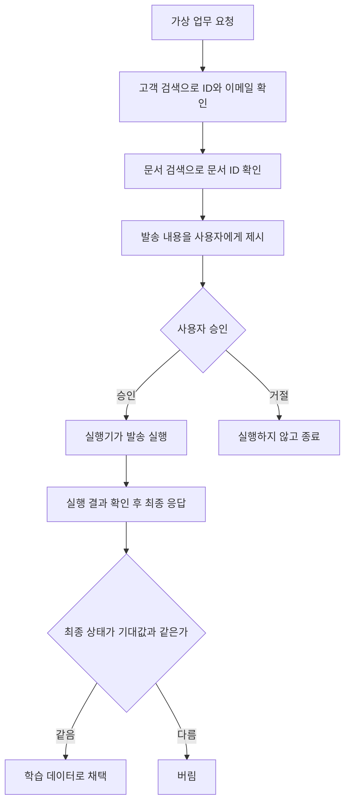

사내 업무 시스템에 대화형 비서를 붙이려는 개발자와 플랫폼 담당자께 드리는 글입니다. 결론부터 말씀드리면, 정답을 기계로 검증할 수 있는 업무 실행 기록만으로도 작은 모델에 쓸 만한 도구 사용 능력을 가르칠 수 있었습니다.

다키클라우드는 그 결과물을 연구용 미리보기 단계로 공개합니다. 한국어 기업 업무에서 도구를 고르고 값을 채우고 확인을 받고 결과를 전하는 일에 집중한 작은 모델입니다. 큰 모델을 대신하겠다는 모델이 아닙니다. 작은 모델에 맡겨도 되는 일이 어디까지인지 보여 주는 하나의 결과입니다.


*정해진 업무를 정확하게 처리하는 작은 모델을 형상화한 이미지입니다.*

## 쉽게 말하면

택배 송장을 떠올려 보시면 됩니다. 물건을 보내려면 받는 사람, 주소, 연락처 칸을 정확히 채워야 합니다. 칸 하나가 비어 있으면 아무 주소나 적지 않고 보내는 분께 다시 여쭙니다. 비싼 물건이면 접수하기 전에 내용을 한 번 더 확인받습니다. 접수한 뒤에는 배송 조회를 보고 나서야 "도착했습니다"라고 말씀드립니다.

도구 호출은 이 송장 쓰기와 같습니다. "김민수 고객에게 견적서를 보내줘"라는 요청 하나에도 송장 칸이 여럿 있습니다. 같은 이름의 고객이 둘인지, 어느 견적서인지, 보내도 되는지를 확인해야 합니다. 발송이 실패했는데 성공했다고 답하면 안 됩니다. 작은 실수 하나가 엉뚱한 고객에게 간 문서나, 끝나지 않은 업무의 완료 기록으로 남습니다.

KoToolAct-4B는 이 송장 쓰기만 정확하게 하도록 연습한 모델입니다. 긴 보고서를 쓰거나 여러 시스템의 자료를 종합하는 일은 맡지 않습니다. 정해진 양식을 빈칸 없이, 확인할 것은 확인하고 조회한 결과대로 채우는 일을 맡습니다.

## 어떤 모델인가

KoToolAct-4B는 Qwen3.5-4B를 기반으로 LoRA SFT를 한 모델입니다. 모델이 직접 도구 호출 형식을 내보내는 네이티브 방식이고 여러 턴에 걸친 대화를 다룹니다. 최대 입력은 8,192 토큰이며 생각 과정을 길게 쓰지 않는 Non-thinking 모드로 학습하고 평가했습니다. 라이선스는 Apache-2.0이며 공개 단계는 Research Preview입니다.

모델이 배운 일은 다섯 가지 습관으로 정리됩니다. 먼저 고객 검색, 일정 조회, 업무 생성, 문서 검색 가운데 맞는 도구를 고릅니다. 다음으로 고객 ID, 날짜, namespace, VM ID 같은 값을 정확히 채웁니다. 정보가 모자라면 값을 지어내지 않고 되묻습니다. 도구 설명에 승인이 필요하다고 적혀 있으면 실행 전에 사용자 확인을 받습니다. 마지막으로 도구가 돌려준 결과에 근거해서만 답합니다.

권한은 모델이 판단하지 않습니다. 이 사용자가 이 작업을 해도 되는지는 모델을 감싼 애플리케이션이 검증해야 합니다. 모델은 송장을 잘 쓰는 직원일 뿐이고 접수 창구의 규정은 시스템이 지킵니다.

## 왜 27B가 아니라 4B인가

27B급 모델은 여러 단계를 계획하거나, 복잡한 문서를 읽거나, 여러 시스템을 종합할 때 쓸모가 큽니다. 그러나 모든 업무가 그 정도 규모를 요구하지는 않습니다. "내일 일정 조회해 줘", "담당자 바꿔 줘", "파드 상태 알려 줘" 같은 정형 요청은 도구의 뜻을 이해하고 값을 정확히 채우는 것이 핵심입니다.

작은 모델에 기대하는 효과는 이렇습니다. 메모리를 적게 써서 소형 GPU나 로컬 장비에 올릴 수 있습니다. 외부 API 없이 폐쇄망에서 따로 돌릴 수 있습니다. 요청이 충분히 많다면 판단 한 번에 드는 비용도 줄어들 수 있습니다. 다만 이것은 기대이지 검증한 결과가 아닙니다.

반대 방향의 사정도 있습니다. 27B가 이미 상주하고 있다면 4B를 따로 운영하는 편이 오히려 손해일 수 있습니다. 이점은 트래픽, 동시성, 하드웨어에 따라 달라집니다. 그리고 저희는 KoToolAct-4B와 27B를 같은 조건에서 직접 비교하지 않았습니다. 이 글은 4B가 27B보다 낫다는 주장이 아니라, 정형 업무용 소형 모델이 가능한지를 확인한 기록입니다.

## 정답을 실행기로 확인한 데이터

학습 데이터는 27B 모델의 답변을 베낀 것이 아닙니다. 가상 기업 업무 환경과 결정론 도구 실행기를 만들고 정답이 맞는지 실행기로 확인되는 업무 수행 기록만 모았습니다. 송장으로 치면 실제로 접수해서 배송 조회까지 맞아떨어진 송장만 교본으로 쓴 셈입니다.

환경은 여섯 업무 영역으로 이뤄져 있습니다. CRM에서는 고객을 찾고 거래 상태를 바꿉니다. 메일은 검색하고 초안을 쓰고 발송합니다. 캘린더는 일정을 조회, 등록, 수정, 삭제합니다. 업무 관리에서는 할 일을 만들고 완료하고 담당자를 바꿉니다. 문서는 검색하고 상세를 보고 발송합니다. IT 운영에서는 파드를 조회하고 Deployment 규모를 바꾸고 VM을 재시작합니다. 도구는 모두 20종, 시나리오는 29종입니다.



정답 기록은 위와 같은 흐름으로 만들어집니다. 실행기가 가상 데이터베이스의 상태를 실제로 바꾸고 마지막 상태를 기대값과 대조합니다. 잘 풀리는 경우만 넣지도 않았습니다. 동명이인, 시간 누락, 날짜와 요일 불일치, 권한 없음, 메일 서버 실패를 넣었습니다. Kubernetes 타임아웃, 일정 충돌, 없는 리소스, 처리할 수 없는 요청도 함께 넣었습니다.

규모는 학습 에피소드 3,200건이고 이를 펼친 SFT 학습 턴이 8,209개입니다. 개발 평가 400건과 봉인 평가 400건을 따로 두었습니다. 이름, 회사, ID 대역, 말투 템플릿은 학습과 평가에서 서로 겹치지 않게 나눴습니다. 도구 이름 표기도 다르게 했습니다. 학습에서는 `search_customers`였던 도구가 평가에서는 다른 이름으로 나옵니다. 다만 데이터를 만든 생성기의 구조는 같습니다. 그래서 이 분리만으로 실제 환경에서도 통한다고 말할 수는 없습니다.

## 학습은 짧았습니다

학습은 LoRA SFT 한 번이 전부입니다. GRPO나 DPO 같은 강화학습도, 27B 모델의 증류도 쓰지 않았습니다. 어텐션과 Gated DeltaNet의 선형 투영, MLP에 어댑터를 붙였고 비전 인코더는 얼렸습니다. 2 epoch, 1,008 스텝을 B200 한 장에서 돌렸고 순수 학습 시간은 약 1.8시간이었습니다.

손실은 모델이 직접 써야 하는 응답 토큰에만 걸었습니다. 도구가 돌려준 결과는 읽어야 할 문맥이지 모델이 만들어 낼 정답이 아니기 때문입니다. 배송 조회 화면은 읽는 것이지 직원이 지어 쓰는 것이 아닙니다.

## 무엇이 달라졌나: 봉인 평가의 세 장면

아래 세 장면은 봉인 평가에서 실제로 나온 대화 기록입니다.

첫 장면(test-00129)은 수신자가 빠진 송장입니다. 사용자는 제목 "견적 회신 드립니다", 내용 "확인 부탁드립니다."로 메일 초안을 하나 만들어 달라고 했습니다. 받는 사람은 말하지 않았습니다. 원본 Qwen3.5-4B는 "이경호@platform.com"이라는 주소를 지어내 초안을 만들었습니다. KoToolAct-4B는 "받는 사람 이메일 주소를 알려 주시겠어요?"라고 되물었습니다. 답을 받은 뒤 kyungho.jang@greentec.kr로 초안을 만들었습니다. 필수 값이 없으면 지어내지 않고 받아 낸 뒤에 실행한 것입니다.

두 번째 장면(test-00031)은 확인이 필요한 접수입니다. 사용자는 "12월 8일 잡혀 있는 협력사 미팅 취소 부탁해요."라고 요청했습니다. 원본은 곧바로 삭제 도구를 불렀고 실행기가 승인이 필요하다며 막았습니다. KoToolAct-4B는 먼저 일정을 조회했습니다. 그리고 "2026-12-08 14:00~15:30 '협력사 미팅' 일정(EV-82480)을 삭제할까요? 참석자에게 취소 알림이 갑니다."라고 물었습니다. 승인을 받은 뒤에 삭제했습니다.

도구를 부를 줄 아는 것과 지금 불러도 되는지 아는 것은 다른 능력입니다. 이 장면은 그 차이를 보여 줍니다. 다만 "참석자에게 취소 알림이 갑니다"는 도구 결과에 없던 안내입니다. 모델 카드의 한계 절에도 근거 없는 안내로 적어 두었습니다. 그리고 승인을 실제로 강제하는 책임은 모델이 아니라 실행기에 있습니다.

세 번째 장면(test-00333)은 배송 조회가 한 번 실패한 경우입니다. 사용자가 dev 환경의 audit-log 파드 상태를 물었고 첫 조회는 타임아웃이 났습니다. 원본은 다시 시도하지 않고 나중에 다시 요청하라고 안내했습니다. KoToolAct-4B는 한 번 더 조회했습니다. audit-log-74d43-4587은 Pending 상태에 재시작 11회, audit-log-fc099-e9cc는 Running 상태에 재시작 9회라는 결과를 받았습니다. 그리고 다시 시도했다는 사실과 결과를 함께 설명했습니다. 이것은 읽기 전용 조회의 일시 오류 사례입니다. 발송, 삭제, 결제처럼 상태를 바꾸는 작업에는 별도의 재시도 규칙과 중복 실행 방지가 필요합니다.

## 성능

봉인 평가는 한국어 가상 업무 에피소드 400건입니다. 모든 조건을 같은 llama.cpp 런타임, 같은 Chat Template, 같은 평가 데이터, 같은 결정론 채점기로 쟀습니다. 표의 BF16은 LoRA를 병합한 모델 기준입니다.

| 지표 | 원본 Qwen3.5-4B (BF16) | KoToolAct-4B (BF16) | KoToolAct-4B (Q4_K_M) |
|---|---|---|---|
| 과제 성공 (%) | 48.50 | **91.00** | 89.25 |
| 첫 행동의 도구 선택 (%) | 70.75 | **100.00** | 100.00 |
| 인자 정확도 (%) | 80.39 | **97.51** | 97.24 |
| 되묻기 (%) | 23.08 | **100.00** | 100.00 |
| 실행 전 확인 (%) | 20.75 | **100.00** | 100.00 |
| 결과 충실성 (%) | 86.21 | **96.55** | 94.83 |
| 채점기가 감지한 거짓 성공 (건) | 4 | 0 | 0 |
| 스키마 위반 (건) | 7 | 0 | 0 |

BF16 기준 과제 성공률은 42.5%p 올랐습니다. 짝지은 부트스트랩으로 구한 95% 신뢰구간은 37.5%p에서 47.75%p입니다. Q4_K_M으로 줄인 모델은 BF16보다 1.75%p 낮았습니다. 표의 100%는 이 평가셋에 들어 있는 사례를 모두 처리했다는 뜻입니다. 실제 업무에서 틀리지 않는다는 뜻은 아닙니다.

이 표에는 잡히지 않은 오류가 있습니다. 권한이 없는 업무 변경 요청에서, 모델이 도구 결과에 없던 담당자 이름을 지어낸 사례가 400건 중 13건 나왔습니다. 채점기는 이 13건을 성공으로 셌습니다. 원인은 학습 정답이 모델이 볼 수 없는 가상 데이터베이스 내부 정보를 썼다는 데 있습니다. 송장 교본에 고객이 말해 주지 않은 주소가 적혀 있었던 셈입니다.

이 13건을 실패로 세면 과제 성공률은 BF16 87.75%, Q4_K_M 86.00%가 됩니다. 이 값은 사후에 낸 참고값이고 공식 점수는 소급해서 바꾸지 않았습니다. 그러나 분명히 말씀드립니다. 이 오류까지 반영하면 Q4_K_M은 저희가 사전에 정한 89% 기준을 충족하지 못합니다.

평가 데이터 자체의 결함도 있습니다. "고객 번호"를 물으면 모델은 고객 ID로 답했는데, 정답지는 전화번호만 정답으로 인정했습니다. 일정 제목을 사용자가 말한 것보다 짧게 만든 정답도 있었습니다. 이런 문항은 사후에 빼지 않고 그대로 두었습니다.

## 2.71GB 파일 하나로

배포용으로는 llama.cpp 표준 Q4_K_M 양자화를 썼습니다. 새 양자화 기법을 만드는 것이 목적이 아니었으므로 검증된 표준 방식을 택했습니다. GGUF 기준으로 병합 BF16 모델은 약 8.42GB이고 Q4_K_M 파일은 2.71GB(2,708,804,320바이트)입니다. 저장 용량이 약 67.8% 줄었습니다.

품질 손실은 작게 유지됐습니다. 퍼플렉서티는 8.21에서 8.40으로 조금 올랐고 평균 KL 발산은 약 0.03이었습니다. 과제 성공률 차이는 앞서 말씀드린 1.75%p입니다. 파일 크기가 곧 실행 메모리는 아닙니다. 실제로 돌릴 때는 KV 캐시와 버퍼가 더 필요합니다.

## 직접 실행해 보기

GGUF 파일을 받아 llama.cpp 서버로 띄우는 방법이 가장 간단합니다. Chat Template은 GGUF 안에 들어 있습니다.

```bash
pip install -U huggingface_hub
hf download ThakiCloud/KoToolAct-4B-GGUF KoToolAct-4B-Q4_K_M.gguf --local-dir .
llama-server -m KoToolAct-4B-Q4_K_M.gguf --jinja -c 8192 --port 8080
```

학습과 평가는 `enable_thinking=false`, temperature 0으로 했습니다. 호출할 때도 같은 설정을 권합니다.

```bash
curl http://localhost:8080/v1/chat/completions \
  -H "Content-Type: application/json" \
  -d '{
    "messages": [
      {"role": "system", "content": "한국어 업무 어시스턴트입니다. 오늘은 2026-10-19입니다. 제공된 도구만 사용하세요. 도구 결과에 없는 내용은 추측하지 마세요."},
      {"role": "user", "content": "2026년 10월 20일 일정 확인해 줘."}
    ],
    "tools": [{
      "type": "function",
      "function": {
        "name": "calendar_list_events",
        "description": "지정한 날짜의 일정을 조회합니다.",
        "parameters": {
          "type": "object",
          "properties": {"date": {"type": "string", "description": "YYYY-MM-DD"}},
          "required": ["date"]
        }
      }
    }],
    "tool_choice": "auto",
    "temperature": 0,
    "chat_template_kwargs": {"enable_thinking": false}
  }'
```

모델이 돌려주는 것은 도구 호출 요청이지 업무 실행이 아닙니다. 애플리케이션이 함수 이름과 인자를 검증하고 실제 도구를 실행한 뒤, 결과를 `role=tool` 메시지로 다시 넣어 주어야 합니다.

Transformers로 쓰실 때는 병합 BF16 대표 저장소를 받으시면 됩니다. 이 저장소의 가중치는 봉인 평가에 쓴 BF16 GGUF와 언어 모델 텐서 426개가 모두 바이트 단위로 같습니다. 전수 대조로 확인했습니다.

```python
import torch
from transformers import AutoModelForImageTextToText, AutoTokenizer

repo = "ThakiCloud/KoToolAct-4B"
tok = AutoTokenizer.from_pretrained(repo)
model = AutoModelForImageTextToText.from_pretrained(
    repo, dtype=torch.bfloat16, device_map="auto"
)

prompt = tok.apply_chat_template(
    messages, tools=tools, add_generation_prompt=True,
    enable_thinking=False, tokenize=False,
)
inputs = tok(prompt, return_tensors="pt").to(model.device)
out = model.generate(**inputs, max_new_tokens=512, do_sample=False)
```

vLLM에서는 `vllm serve ThakiCloud/KoToolAct-4B --enable-auto-tool-choice --tool-call-parser qwen3_coder`로 띄울 수 있습니다. 다만 저희 평가는 vLLM으로 하지 않았습니다. 옮기실 때는 몇 문항을 먼저 대조해 보시길 권합니다.

재현용 LoRA 어댑터도 따로 공개합니다. Qwen/Qwen3.5-4B의 revision `851bf6e806efd8d0a36b00ddf55e13ccb7b8cd0a`에 `PeftModel.from_pretrained(base, "ThakiCloud/KoToolAct-4B-LoRA")`로 얹으면 됩니다. LoRA를 얹은 경로는 병합 모델과 같은 조건으로 따로 평가하지 않았습니다.

## 어디에 쓰면 되나

첫째 자리는 기업용 업무 비서입니다. CRM, 캘린더, 문서, 업무 관리 API를 도구로 연결하고 권한과 승인은 애플리케이션이 관리하는 구성입니다. 송장은 모델이 쓰고 접수 규정은 시스템이 지키는 분업입니다.

둘째는 IT 운영 지원입니다. 파드 조회 같은 읽기 작업은 비교적 단순하게 붙일 수 있습니다. 규모 변경, 재시작, 삭제는 별도의 승인 정책을 거쳐야 합니다. 이 모델이 프로덕션 Kubernetes 운영 능력을 검증받은 것은 아닙니다.

셋째는 폐쇄망과 소형 장비입니다. GGUF 파일 하나로 외부 API 없이 돌릴 수 있습니다. 실제 성능과 메모리는 하드웨어와 컨텍스트 길이에 따라 달라집니다.

넷째는 큰 모델과의 역할 분담입니다. 앞단의 라우팅 계층이 정형 업무는 KoToolAct-4B에, 여러 단계가 얽힌 업무는 27B급 모델에 넘깁니다. 어느 쪽이든 그 뒤에서 권한, 승인, 실행 결과 검증을 거쳐 기업 시스템에 닿습니다. 다키클라우드가 만드는 업무 자동화 플랫폼 Paxis에서도 앞으로 이런 분담을 검토해 볼 수 있습니다. 모든 업무 단계를 정책 게이트와 감사 기록으로 통과시키는 구조라면, 정형 단계만큼은 작은 모델에 맡기는 선택지가 생깁니다. 다만 이 모델은 아직 어떤 제품에도 통합되지 않았습니다. 27B 대비 비용 절감도 검증하지 않았습니다. 핵심은 작은 모델에 맡길 일과 큰 모델이 필요한 일을 구분하는 데 있습니다.

## 운영 전에 챙길 것

실서비스에 붙이신다면 모델 바깥에서 지킬 규칙이 있습니다. 도구 스키마를 검증하고 권한과 테넌트를 격리하십시오. 승인은 모델과 독립된 장치로 받으셔야 합니다. 실제 상태를 확인하기 전에는 완료를 보고하지 않게 하십시오. 상태를 바꾸는 작업에는 멱등성과 재시도 규칙을 두는 편이 안전합니다.

상대 날짜는 기준일과 타임존으로 다시 검증하시길 권합니다. 도구 결과에 없는 이름, 금액, 상태가 답에 나오면 걸러 내는 장치도 필요합니다. 평가에서 상대 날짜 오류와 근거 없는 담당자 이름이 실제로 관측됐습니다. 그래서 민감한 업무를 이 모델 단독으로 자동 실행하는 것은 권하지 않습니다.

마지막으로, 학습과 평가가 같은 생성기에서 나왔다는 점을 기억해 주십시오. 일반 도구 호출 벤치마크인 BFCL은 평가 하네스 오류로 결과를 얻지 못했습니다. 그래서 일반 도구 호출 성능은 주장하지 않습니다. 이 모델은 Research Preview입니다.

## 이번 작업에서 배운 것

검증할 수 있는 시나리오 3,200건과 약 1.8시간의 LoRA SFT로 원본보다 크게 나아졌습니다. 개발, 평가, 양자화에 기록된 B200 사용량은 약 3.9 GPU-hour입니다. 실행 시간이 기록되지 않은 실패한 BFCL 잡은 이 값에서 빠져 있습니다.

모델에게 가르친 것은 지식이 아니라 업무 습관이었습니다. 언제 도구를 부르는지, 어떤 값을 채우는지, 언제 되묻는지, 어떤 작업은 확인을 받는지를 가르쳤습니다. 실패했을 때 어떻게 대응하는지, 무엇을 근거로 끝났다고 말하는지도 함께 배웠습니다.

합성 데이터의 위험도 분명히 봤습니다. 생성기의 작은 결함을 모델이 그대로 배웁니다. 담당자 이름 13건이 그 예입니다. 평가 생성기와 채점기가 같은 가정을 공유하면 그 결함을 찾아내지 못합니다. 좋은 합성 데이터는 모델이 실제로 볼 수 있는 정보만으로 정답을 만들어야 합니다. 그리고 실행 결과를 정답과 독립적으로 확인할 수 있어야 합니다.

## 공개한 것

세 가지 형태로 공개합니다. 사용법, 전체 지표, 한계는 각 모델 카드에 있습니다.

| 저장소 | 형식 | 용도 |
|---|---|---|
| [ThakiCloud/KoToolAct-4B](https://huggingface.co/ThakiCloud/KoToolAct-4B) | 병합 BF16 | 대표 모델, Transformers와 vLLM용, 모델 카드 정본 |
| [ThakiCloud/KoToolAct-4B-GGUF](https://huggingface.co/ThakiCloud/KoToolAct-4B-GGUF) | Q4_K_M GGUF | llama.cpp 로컬, 폐쇄망 실행 |
| [ThakiCloud/KoToolAct-4B-LoRA](https://huggingface.co/ThakiCloud/KoToolAct-4B-LoRA) | PEFT 어댑터 | 재현용 |

세 저장소는 [KoToolAct 컬렉션](https://huggingface.co/collections/ThakiCloud/kotoolact-korean-enterprise-tool-calling-4b-6ad5aca34339527205450afe)에 함께 묶여 있습니다.

이 공개는 범용 에이전트를 완성했다는 선언이 아닙니다. 작은 모델에 특정 업무 능력을 집중해서 가르치면 실제로 쓸 만한 실행형 모델을 만들 수 있다는 하나의 결과입니다. 작은 모델이 모든 일을 할 필요는 없습니다. 송장 쓰는 일을 정확하게 해내는 모델이 있으면, 큰 모델은 큰 모델이 필요한 일에 쓸 수 있습니다.

*측정 출처: 다키클라우드 사내 B200에서 같은 llama.cpp 런타임과 결정론 채점기로 잰 봉인 평가 결과입니다.*
