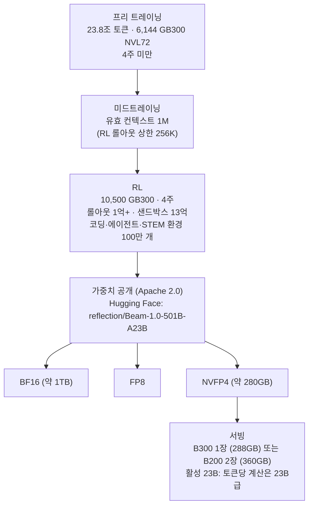

*501개 진료실로 구성된 대형 병원이 아니라, 한 번에 23명만 참여하는 진료. 희소 MoE의 구조를 형상화한 이미지입니다.*

## 왜 읽어야 하나

GPU 플릿에 대형 오픈 모델을 올려 멀티테넌트 서빙을 검토하는 인프라·플랫폼 엔지니어라면, 이 모델카드가 바로 판단 자료입니다. 결론부터 씁니다. **Reflection AI가 10월 16일 Apache 2.0으로 공개한 Beam(501B-A23B)는 서구 오픈웨이트 프런티어에 대한 신뢰할 수 있는 진입점입니다. 다만 '3~4배 적은 컴퓨트'는 공급자 측 추론 효율 주장이지, 실측 배포 비용이 아닙니다.** 독립 평가는 원형(raw capability)에서 Kimi K3·GLM 5.3보다 뒤지고, 컨텍스트 상한·가격·안전성 보고 모두 아직이라는 점을 지적합니다.

*501B 총 파라미터 대 토큰당 활성 23B를 대비한 요약 슬라이드입니다. 'Apache 2.0으로 공개된 신뢰할 수 있는 진입점이지만, 공급자의 비용 효율 주장은 실측 배포 환경에서 재검증되어야 한다'는 이 글의 결론을 한 장에 담았습니다.*

## 쉽게 말하면

전문의가 501명 있는 대형 병원을 상상해 보세요. 환자가 오면 501명 전부가 보는 것이 아니라, 내과 진료를 받는 데 필요한 23명만 호출됩니다. 병원의 총 능력(건물, 장비, 인원)은 어마어마하지만, 한 번의 진료가 소비하는 비용은 23명의 몫입니다. Beam이 바로 그 병원입니다. 총 파라미터 501B, 토큰마다 활성 23B. 건물(가중치)은 크고, 진료(추론)는 경량입니다. 뒤에 '서빙과 온프레미스 요구'와 '한계 및 반론'에서 이 병원 비유를 다시 꺼냅니다.

*희소 활성화 매트릭스를 대형 병원 메타퍼로 본 슬라이드입니다. 총 인프라 501B(전체 가중치)와 단일 워크로드 23B(환자 1명당 동시 호출 전문의)의 구분, 그리고 KV 캐시가 23B급으로 유지된다는 점이 정리돼 있습니다.*

## 개요

Reflection AI는 2024년 미국 브루클린에서 설립된 오픈웨이트 AI 회사입니다. 대표 Misha Laskin과 CTO Ioannis Antonoglou는 모두 전(前) Google DeepMind 연구원입니다. Antonoglou는 DeepMind 창립 엔지니어로 AlphaGo와 MuZero 개발에 참여하고 Gemini의 RLHF 훈련을 이끈 이력입니다. 회사는 '서구의 오픈웨이트 프런티어(Western open-weight frontier)'를 슬로건으로 내걸고, 오픈 가중치 모델과 AI 개발 보조용 소프트웨어 에이전트를 만듭니다. NVIDIA가 2025년 라운드에 참여했고, Beam 학습 전 과정이 NVIDIA GB300 시스템으로 수행된 것은 @NVIDIAAI의 "Welcome Beam!" 공지(10월 18일 RT 기준)가 확인시켜 준 바입니다.

Beam은 이 회사의 첫 번째 모델입니다. 10월 5일에 발표되고, 10월 16일에 Hugging Face에 가중치가 올라갔습니다. 회사 설명에 따르면 Beam은 시리즈의 첫 모델이며, 후속 모델 훈련은 이미 진행 중이라고 합니다. 포지셔닝은 코딩·추론·에이전트 워크로드의 'workhorse(일용 마력)'입니다.

시점 자체도 이 글의 맥락입니다. DeepSeek·Qwen·GLM 등 중국발 오픈 모델이 '동급 능력을 더 싸게'라는 축으로 프런티어를 밀어온 가운데, 서구 자본과 서구 레퍼런스를 가진 팀이 같은 축에 진입했다는 것입니다. Reflection은 그 '서구 프런티어' 카드를 자사의 슬로건으로 직접 쓰고 있고, NVIDIA가 학습 하드웨어(GB300)와 투자 양쪽에서 붙어 있는 구조입니다.

## 이 모델은 무엇인가

Beam은 희소 Mixture-of-Experts(sparse MoE) 구조로, 총 파라미터 501B 중 토큰마다 활성 23B입니다. 비유로 치면 병원은 501개 진료실을 지었지만, 한 환자에게 병행하는 진료는 23개입니다.

*GB300 기반 전방위 학습 파이프라인 슬라이드입니다. 프리 트레이닝(23.8조 토큰, 6,144개 GB300 NVL72, 4주 미만), 미드트레이닝(컨텍스트 1M 확장, RL 롤아웃 상한 256K), RL(10,500개 GB300, 롤아웃 1억+·샌드박스 13억)의 세 단계가 정리돼 있습니다.*

학습 규모는 공식 블로그가 상세하게 공개했습니다. 프리트레이닝은 23.8조 토큰을 6,144개의 NVIDIA GB300 NVL72로 4주 미만 동안 학습했습니다. 이어 RL이 10,500개 GB300에서 4주간 수행됐고 롤아웃 1억 회 이상, 샌드박스 13억 개, 코딩·에이전트·STEM 환경 100만 개를 만들었습니다. 동시 롤아웃 11만, 동시 샌드박스 17만이라는 피크 수치도 보고했습니다.

컨텍스트는 이번 릴리스의 헤드라인입니다. 1M 토큰. RL 롤아웃은 256K 토큰까지 수행했고, 미드트레이닝(midtraining)으로 유효 컨텍스트를 1M까지 밀어 올렸다고 합니다. 다만 이 '1M'이 실제 API 상한과 같은 숫자인지는 다음 '한계' 섹션에서 다룹니다.

가중치는 세 포맷으로 나왔습니다. BF16(약 1TB), FP8, NVFP4(약 280GB). Apache 2.0 라이선스로 Hugging Face의 reflection 조직에 공개됐고, API는 platform.reflection.ai에서 얼리 액세스 형태로 운영됩니다.

희소 MoE의 추론 동학을 한 번 더 짚으면, '활성 23B'의 의미가 분명해집니다. MoE 레이어의 피드포워드 네트워크는 여러 expert로 쪼개져 있고 각 토큰마다 라우터가 그중 일부 expert만 골라 통과시킵니다. 그래서 파라미터 총량(501B)이 저장 비용과 지식 용량을 결정하고, 활성 파라미터(23B)가 토큰당 matmul 비용과 KV 캐시를 결정합니다. Beam의 효율 주장은 바로 이 분리에서 나옵니다. 지식을 501B로 쌓되, 계산은 23B로 한다는 것입니다. 다만 이 분리에는 대가가 붙습니다. expert 전체가 DRAM에 상주해야 하므로 가중치 footprint는 여전히 501B 규모이고, expert 접근 패턴이 cache 비효율을 만들 수 있습니다. '활성 23B'를 '모델이 23B만큼만 든다'로 읽으면 안 되는 이유가 여기 있습니다.

## 보고된 벤치마크

아래 수치는 전부 공급자 보고입니다. 공식 블로그(10월 8일 점수 갱신)의 대표 값을 축으로 잡으면, 코딩 검증 계열에서 SWE-bench Verified 80.9, Terminal-Bench v2.1 80.1, SWEBench Multilingual 78.0, SWE-bench Pro v1 65.5입니다. 좀 더 힘든 에이전트 코딩 행에서는 DeepSWE v1.1이 44.4, SWE-bench Pro v2-Hard가 77.2, SWE Atlas Codebase QnA가 34.6입니다.

수학·추론은 AIME 2026 97.8, GPQA Diamond 90.5로 상단권입니다. HLE(도구 없이)는 36.2, SciCode는 49.7입니다. 장문 컨텍스트 활용에서는 LongBench v2 65.5, AA-LCR 79.3, IFBench 79.7입니다. 웹 에이전트 계열인 BrowseComp(컨텍스트 관리 포함) 77.4, DeepSearchQA 80.1, tau3 banking 38.0, MCP Atlas 78.7, AutomationBench(public) 37.0입니다.

*강점을 보여주는 슬라이드입니다. 검증형 코딩(SWE-bench Verified 80.9, Terminal-Bench v2.1 80.1)과 수학·추론(AIME 2026 97.8, GPQA Diamond 90.5)에서 동급 오픈웨이트 최상단권 지표를 기록한다는 요약입니다.*

양자화별 점수는 Hugging Face 공식 블로그(10월 16일)가 공개했습니다. 서빙 관점에서 가장 중요한 표입니다.

| 벤치마크 | BF16 | FP8 | NVFP4 |
|---|---:|---:|---:|
| DeepSWE v1.1 | 43.3 | 43.0 | 42.7 |
| SWE-bench Pro v2-Hard | 76.5 | 78.4 | 78.6 |
| Terminal-Bench v2.1 | 80.1 | 78.9 | 78.2 |
| SWE-bench Verified | 81.6 | 80.2 | 80.7 |
| AIME 2026 | 97.7 | 98.0 | 97.5 |
| HLE (도구 포함) | 51.1 | 51.1 | 51.1 |
| GPQA Diamond | 90.6 | 90.3 | 89.3 |
| LongBench v2 | 67.5 | 67.6 | 67.2 |

NVFP4에서 손실이 큰 행은 없습니다. 오히려 SWE-bench Pro v2-Hard와 AIME는 NVFP4가 BF16보다 약간 높게 나옵니다. 280GB로 들어가는 포맷이 품질을 거의 유지한다는 뜻이라, 서빙 비용 계산에서 NVFP4를 기본 가정으로 잡아도 됩니다.

독립 평가(DataCamp, 10월)는 같은 공급자 수치를 경쟁 모델과 나란히 배치합니다.

| 벤치마크 | Beam | GLM 5.2 | GLM 5.3 | Kimi K3 | DeepSeek V4.1 Flash |
|---|---:|---:|---:|---:|---:|
| Terminal-Bench v2.1 | 80.1 | 81.0 | 88.2 | 88.3 | 90.6 |
| DeepSWE v1.1 | 44.4 | 44.0 | 61.0 | 68.0 | 74.2 |
| SWE-bench Pro v2-Hard | 77.2 | NR | 84.3 | 88.2 | NR |
| HLE | 36.2 | 40.5 | 42.3 | 46.9 | NR |
| AIME 2026 | 97.8 | 99.2 | NR | NR | NR |
| GPQA Diamond | 90.5 | NR | 91.7 | 93.5 | NR |
| BrowseComp | 77.4 | NR | NR | 91.2 | NR |
| DeepSearchQA | 80.1 | NR | NR | 95.0 | NR |

패턴이 일관됩니다. 검증형 코딩(SWE-bench Verified 80.9)에서는 경쟁력이 있고 더 힘든 에이전트 코딩 행(DeepSWE v1.1 44.4 대 Kimi K3 68.0, DeepSeek V4.1 Flash 74.2)에서는 격차가 큽니다. 추론(HLE 36.2)도 GLM 5.2·Qwen 3.8-Max·Kimi K3보다 낮습니다. 웹 검색 활용(BrowseComp 77.4 대 91.2, DeepSearchQA 80.1 대 95.0)이 가장 큰 격차입니다. 이 독립 평가의 결론은 "신뢰할 수 있는 오픈웨이트 진입점이지만, 아직 계획(planning)을 걸 단계는 아니다"입니다.

*한계를 보여주는 슬라이드입니다. 에이전트 코딩(DeepSWE v1.1)과 웹 검색(BrowseComp)에서 Kimi K3·DeepSeek 대비 격차가 드러난다는 점을 막대 비교로 정리했습니다.*

## 서빙과 온프레미스 요구

*배포 양자화 전략 슬라이드입니다. BF16(약 1TB, 4x B200)과 FP8, 그리고 NVFP4(약 280GB, 1x B300 또는 2x B200)의 footprint 대비를 보여줍니다. NVFP4가 핵심 레버리지라는 점을 강조합니다.*

병원의 진찰 비용을 정하는 것은 '활성 23B'입니다. 토큰당 계산량은 23B dense 모델과 같은 급이므로, 추론 비용 구조는 건물의 크기(501B)가 아니라 동시 진료 인원(23B)으로 잡습니다. 가중치 footprint는 NVFP4 약 280GB입니다.

Hugging Face 블로그의 배포 노트는 후보 하드웨어로 B200(180GB)과 B300(288GB)를 거론합니다. NVFP4 280GB는 B200 한 장에는 들어가지 않고 B300 한 장(288GB) 또는 B200 두 장(360GB)에 들어갑니다. BF16(약 1TB)은 B200 4장(720GB)보다 크므로, 실용적인 배포 대상은 FP8 또는 NVFP4 포맷입니다.

포맷별 용량은 단순 산술과도 일치합니다. 501B 파라미터에 BF16이면 2바이트, 약 1TB. FP8이면 1바이트, 약 500GB. NVFP4면 0.5바이트 이하이고, 발표된 280GB는 가중치 외에 버퍼가 포함된 합계로 봅니다. 8xRTX Pro 6000(768GB급) 구성이 거론되는 것은 FP8 배포 시나리오로 읽힙니다.

KV 캐시 이야기도 유리합니다. HF 블로그 노트 기준, 장문 컨텍스트의 캐치는 활성 23B 구조에서 약 36GiB급으로, dense 모델의 208GiB급 대비 여섯 배가량 작습니다. 병원이 501개 진료실을 갖고도 한 번에 23명만 부르는 구조라, 대기실(KV 캐시)도 그 규모에 맞춰 작습니다.

다만 '3~4배 적은 추론 컴퓨트' 주장에는 유보가 붙습니다. 이것은 추론 테스트에서의 효율 비교입니다. 프롬프트 처리(prefill), 장문 컨텍스트의 추가 어텐션 비용, 서빙 오버헤드를 뺀 값입니다. DataCamp는 "실측 배포 비용이 아니다"며, 비교 방법 자체가 희소 모델(Beam)에게 유리하게 작용한다고 지적합니다. 도입 판단에는 자기 서빙 환경에서 재측정이 필요합니다.

## ThakiCloud 제품 적용 시사점

*ThakiCloud 플랫폼 적용 2-Track 전략 슬라이드입니다. ai-platform 렌즈(B200 상주 서빙, NVFP4 탑재, 서빙 프로브 후 카탈로그 판단)와 Paxis 렌즈(검증형 코딩 태스크로 한정해 A/B 후보군)를 나란히 담았습니다.*

**ai-platform 렌즈(서빙·양자화).** ThakiCloud의 ai-platform은 이미 NVFP4 양자화 엔드포인트를 운영 환경에서 돌리고 있습니다(Qwen3.8-27B NVFP4, B200 상주 서빙). Beam NVFP4(약 280GB)는 B200 2장 구성에 들어갑니다. 양자화 파이프라인을 새로 만들 필요가 없는 크기입니다. 500B급 오픈 모델을 카탈로그에 추가하는 문턱이 'NVFP4를 서빙할 수 있는가'로 내려온다는 뜻입니다. 활성 23B가 주는 밀도는 멀티테넌트 서빙의 배치 단위에 해당합니다. 501B급 지식을 확보하면서 요청당 추론 예산은 23B급을 유지하면, 같은 카드로 올리는 동시 요청 수가 늘어납니다. 작업 순서는 명확합니다. 먼저 서빙 프로브(자기 환경의 처리량·latency 실측), 이어 NVFP4 대 BF16 품질 재측정, 마지막에 카탈로그 등록 판단.

**Paxis 렌즈(에이전트 워크로드).** Beam의 타깃이 코딩·에이전트인 만큼, Paxis 에이전트의 도구 호출 루프와 코드베이스 QnA는 맞는 워크로드 계열입니다. 다만 약한 축을 먼저 볼 필요가 있습니다. SWE Atlas Codebase QnA(34.6)와 웹 검색 활용(BrowseComp 77.4, Kimi K3 91.2)이 경쟁 모델보다 낮습니다. 이 둘이 바로 Paxis 에이전트가 자주 쓰는 능력입니다. Beam을 기존 에이전트 모델의 '대체재'가 아니라, 코딩·검증 행에서 A/B 테스트할 수 있는 workhorse 후보로 넣는 것이 정합적인 위치입니다.

## 한계 및 반론

*도입 전 체크리스트 슬라이드입니다. 마케팅 주장(3~4배 적은 컴퓨트, 1M 컨텍스트, 엔터프라이즈급 플랫폼)과 엔지니어링 현실(prefill·장문 어텐션 비용, 실제 API 상한 262K, 미공개 토큰 가격과 안전성 평가)을 대조합니다.*

첫째, 벤치마크 수치는 전부 공급자 자체 측정입니다. 독립 재현은 아직 없으며, DataCamp의 분석도 공급자 값끼리 나란히 놓은 비교입니다. 둘째, 효율 주장은 prefill·장문 어텐션·서빙 오버헤드를 제외한 값이라 '3~4배 적은 컴퓨트'를 그대로 배포 비용으로 환산하면 안 됩니다. 셋째, 1M 컨텍스트는 명목 값입니다. RL 학습은 256K까지 수행했고, DataCamp 확인 기준으로 API 베타의 총 상한은 262,144 토큰, 출력 상한은 131,072 토큰입니다. 병원이 '건물이 1M 평'이라고 해도, 한 번에 예약을 받는 진료실은 26만 개가 아닙니다. 넷째, 토큰당 가격은 미공개이고, 안전성 평가 결과는 기술 보고서를 약속했을 뿐 아직 나온 것이 없습니다. 다섯째, 원형 능력에서 회사 스스로 Kimi K3가 앞서 있다고 인정하며, 독립 평가도 더 힘든 코딩 행(DeepSWE v1.1 44.4 대 68.0)과 추론(HLE 36.2 대 46.9)에서 격차를 확인합니다. CritPt는 15.6으로 Kimi K3(23.4)의 절반가량입니다. 501명의 전문의가 있다고 해서 모든 병에 강한 것이 아니라, 강한 진료과가 어디인지가 질문입니다. 현재 답은 '검증형 코딩과 수학은 강하고, 깊은 에이전트·웹 검색은 약하다'입니다.

## 정리

Beam이 주는 가장 큰 신호는, 오픈웨이트 경쟁에 '효율'이라는 축이 들어왔다는 것입니다. 중국발 오픈 모델들이 '능력' 축을 장악한 뒤, Reflection은 '동급 능력을 3~4배 적은 컴퓨트로'라는 효율 축의 주장으로 진입했습니다. ThakiCloud처럼 추론 비용을 서비스 단가로 받아내는 플랫폼에, 효율 축은 바로 지켜봐야 하는 축입니다. 병원 비유로 마무리하면, Beam은 건물이 크고 진찰이 빠른 병원입니다. 다만 모든 병을 보는 것이 아니라, 강한 진료과가 어디인지 확인한 다음 그 과의 진료를 예약하는 방식으로 접근해야 합니다.

독자 takeaway를 세 가지로 남깁니다. 코딩·에이전트 workhorse를 검토 중이라면, Beam NVFP4를 shortlist에 넣고 자기 서빙 환경에서 재측정하세요. 공급자 수치로 계획을 세우지 마세요. 추론을 구매하는 쪽이라면, 토큰당 가격이 미공개라 API는 아직 얼리 액세스 단계입니다. 1M 컨텍스트의 명목과 상한 격차, 그리고 안전성 보고는 기술 보고서가 나올 때까지 '한계'로 묶어 두세요.

*정리 슬라이드입니다. '공급자의 수치로 계획하지 마십시요. 직접 측정하십시오'라는 결론과, NVFP4 실측 검증·256K 기준 설계·태스크별 분리 테스트의 3단계 액션을 담았습니다.*

한 줄 결론: **501B의 지식을 23B의 계산으로 서빙한다는 주장은 Apache 2.0 가중치로 도착했습니다. 다만 배포 비용은 실측값이지, 주장이 아닙니다.**

## 출처

- Reflection AI 공식 블로그: [Introducing Beam](https://reflection.ai/blog/introducing-beam) (2026-10-05, 점수 갱신 10-08)
- Hugging Face 공식 블로그: [Reflection Beam](https://huggingface.co/blog/reflection-beam) (2026-10-16)
- Hugging Face 모델: [reflection/Beam-1.0-501B-A23B](https://huggingface.co/reflection/Beam-1.0-501B-A23B) · [FP8](https://huggingface.co/reflection/Beam-1.0-501B-A23B-FP8) · [NVFP4](https://huggingface.co/reflection/Beam-1.0-501B-A23B-NVFP4)
- DataCamp 독립 평가: [Reflection AI Beam](https://www.datacamp.com/blog/reflection-ai-beam)
- NVIDIA AI 공지 RT (2026-10-18): [x.com/hjguyhan/status/2111792912770175430](https://x.com/hjguyhan/status/2111792912770175430) (RT of @NVIDIAAI)
- Reflection AI: [reflection.ai](https://reflection.ai)
