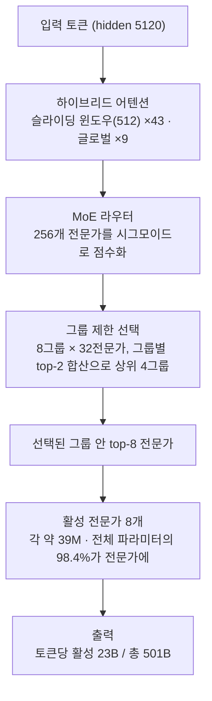

## 왜 읽어야 하나

GPU 팜을 운용하거나 온프렘에서 frontier급 모델을 서빙할지 오늘 판단하는 엔지니어를 위해 씁니다. 결론을 먼저 말합니다. **Beam의 가치는 벤치마크 순위가 아니라 "501B 총 파라미터, 토큰당 23B 활성"이라는 희소성의 경제학에 있고 NVFP4까지 양자화돼 vLLM이 출시 당일부터 지원하는 형태는 Metis와 Telox에서 다루는 모델 프로필과 같습니다.** 벤치마크 숫자 자체는 아직 Reflection AI의 자체 보고에 머물고 있다는 점도 함께 짚어야 합니다.

## 개요

Reflection AI는 10월 5일 첫 오픈웨이트 모델 **Beam 1.0**을 발표했고 10월 16일 가중치를 공개했습니다. 라이선스는 **Apache 2.0**입니다. NVIDIA의 공식 채널이 "Welcome Beam!"이라는 문구로 이 출시를 알렸고 보도에 따르면 NVIDIA는 Reflection에 8억 달러를 투자해 평가액을 250억 달러 수준까지 끌어올린 주주입니다.

Beam은 총 **501B 파라미터**의 희소 Mixture-of-Experts(MoE) 모델로, 토큰당 활성화되는 파라미터는 **23B**입니다. 컨텍스트 윈도우는 **1M 토큰**. 표방하는 작업은 코딩, 추론, 에이전틱(long-horizon agentic) 워크로드입니다.

"오픈"의 의미도 여기서 갈립니다. API 구독 모델이 아니라 가중치를 소유하는 것은, 온프렘 환경에서 모델 업데이트 주기와 데이터 유출 경계를 자기가 정할 수 있다는 뜻입니다. 국공유주 요구가 있는 현장, 코드베이스 전체를 외부 API로 넘길 수 없는 조직에서는 Apache 2.0이라는 라이선스 한 줄이 조달(procurement) 문서를 통과시키는 근거가 됩니다. Beam이 frontier급 스펙을 "소유 가능한" 형태로 내놓은 것은 이 수요를 겨냥했다고 해석할 수 있습니다.

이 조합이 중요한 이유는 단순합니다. "총 파라미터는 frontier급, 활성 파라미터는 20B대"라는 형태는 추론 비용은 dense 23B 모델과 비슷한 수준에서, 표현력은 500B급에 가까워지는 구조입니다. 오픈웨이트 frontier 모델에서 이 프로필이 NVFP4까지 정밀도 옵션을 갖춘 채 나온 것은 이번이 처음에 가깝습니다.

시점도 주목할 만합니다. 오픈웨이트 frontier의 경쟁 구도는 DeepSeek, Qwen, GLM이 주도하고 있었고, 서방 자본이 뒷받침하는 모델이 이 구도에 들어온 것이 Beam입니다. NVIDIA가 투자 주주인 회사가 GB300 클러스터로 훈련해 Apache 2.0으로 가중치를 내놓는 구조는 "하드웨어 생태계와 오픈웨이트 생태계를 한 번에 묶는" 전략입니다. 추론 엔진 vLLM이 출시 당일부터 지원하고 서빙 파트너 TokenSpeed가 GB200 경로를 열었다는 점에서, 출시는 모델 하나가 아니라 스택 전체가 함께 나온 것입니다.

## 모델은 무엇인가

Beam 1.0의 구조는 모델카드와 Hugging Face 공개 정보에서 확인됩니다.

- **52개 레이어**: dense 레이어 3개(SwiGLU MLP)와 MoE 레이어 49개
- **모든 MoE 레이어에 256개 전문가**: 각 전문가가 SwiGLU MLP(intermediate 2,560)로 약 39M 파라미터를 담고 전체 파라미터의 98.4%가 전문가 안에 있습니다
- **그룹제한(top-k 8) 라우팅**: 라우터가 256개 전문가를 시그모이드로 점수화하고 32개씩 묶은 8개 그룹 중 그룹별 top-2 합산으로 상위 4개 그룹을 골라 그 안에서 top-8 전문가를 활성화합니다
- **하이브리드 어텐션**: 512 토큰 슬라이딩 윈도우 어텐션 43개 레이어(RoPE)와, 6개 레이어마다 한 번씩 마지막 포함 9개 레이어의 글로벌 어텐션(위치 부호 없음)이 섞여 있습니다. hidden size 5,120

*레이어 구성: 3개 dense(SwiGLU) + 49개 MoE, 전체 파라미터의 98.4%가 256개 전문가 안에 있다*

슬라이딩 윈도우와 글로벌 어텐션을 섞는 하이브리드 구조는 1M 컨텍스트에서 KV 캐시가 과도하게 커지지 않게 하는 핵심 장치입니다. 대부분의 레이어가 512 토큰밖에 보지 않으므로 긴 컨텍스트의 KV 비용은 dense 모델보다 크게 낮아지고 필요할 때만 글로벌 레이어가 전체 토큰을 봅니다.

왜 전문가를 256개까지 쪼갰는지도 짚을 가치가 있습니다. MoE에서 전문가 수가 늘면 각 토큰의 표현 공간은 넓어지지만, 라우팅이 편중되면 일부 전문가만 과사용되고 나머지는 사실상 죽은 파라미터가 됩니다. Beam은 그룹제한 라우팅으로 이 편중을 줄이도록 설계됐습니다. 256개 전체에서 바로 top-8을 고르지 않고, 32개 묶음 8개 그룹의 대표성(top-2 합산)을 먼저 봐서 상위 4개 그룹만 살리고 그 안에서 8개를 고릅니다. 전문가 활용의 균등성과 토큰당 성능을 동시에 잡는 설계이고, 대규모 MoE를 안정적으로 서빙하려면 라우터 설계도 메모리 못지않게 중요합니다.

*1M 컨텍스트의 KV 비용을 막는 하이브리드 어텐션: 512 토큰만 보는 레이어 43개, 전체를 보는 레이어 9개*

### MoE 라우팅 흐름

토큰 하나가 MoE 레이어를 지나가는 경로를 아래 다이어그램에 그렸습니다.

*토큰당 23B만 활성화되는 Beam의 MoE 라우팅 경로(그룹제한 top-8)*

### 훈련 이력

보도에 따르면 pretraining은 **6,144개 NVIDIA GB300 NVL72 GPU 클러스터에서 4주 미만**, RL(강화학습) 단계는 **10,500개 GB300 GPU에서 4주**로 진행됐습니다. 1만 개가 넘는 GPU를 RL 한 단계에 쓴 기록은 오픈웨이트 모델 중에서도 드물고, "코딩·에이전틱 최적화"라는 포지셔닝의 배경이 여기 있습니다.

*오픈웨이트 뒤에 선 인프라 스케일: GB300 NVL72 6,144개로 pre-training, 10,500개로 RL*

## 벤치마크 (자체 보고 기준)

아래 수치는 Reflection AI의 자체 보고입니다. 서드파티 벤치마크 플랫폼(Artificial Analysis, tau-bench 등)에는 아직 등재돼 있지 않아 독립 재검증이 남아 있습니다.

| 벤치마크 | 수치 | 비고 |
|---|---|---|
| SWE-bench Verified | 81.6% (BF16) | 에이전틱 코딩 |
| AIME 2026 | 97.8% (FP8: 98.0%) | 수학 추론 |
| GPQA Diamond | 90.5% | 대학원급 과학 추론 |
| HLE (no tools) | 36.2% (BF16 36.0 · NVFP4 34.8) | Humanity's Last Exam |

서드파티 분석(DataCamp)은 Beam이 GLM-5.2와 추론에서 같은 선을 유지하면서도 추론 컴퓨트가 3~4배 적다고 보고하고 에이전틱 코딩에서는 Kimi K3보다 뒤처진다고 평가했습니다. 자체 보고라는 전제를 붙이면, "23B 활성으로 이 수치를 낸다"는 주장이 Beam의 실질 제안입니다.

수치를 읽는 방법도 구분해야 합니다. SWE-bench Verified 81.6%는 에이전틱 코딩, 즉 리포지토리를 탐색하고 패치를 쓰고 테스트를 돌리는 긴 루프에서 나온 점수입니다. 한 번의 퀴즈 응답이 아니라 수십 번의 도구 호출을 견뎌야 나오는 숫자이므로, 1M 컨텍스트와 RL 훈련의 효과가 반영됐을 것으로 볼 수 있습니다. HLE no-tools 36.2%는 frontier 모델 전반이 낮은 점수대에 있는 영역이고, "도구 없이"라는 조건을 붙여 읽는 편이 정확합니다. AIME 97.8% 같은 수학 점수는 오픈웨이트 모델 간 변별력이 이미 떨어진 영역이라 Beam의 위치는 SWE-bench와 HLE로 보는 편이 적절합니다.

## 서빙 및 배포

Beam은 서빙 스택 지원이 출시와 함께 나왔습니다.

- **vLLM 출시 당일 지원**: vLLM 공식 블로그가 10월 16일 "Serving Reflection Beam on vLLM from Day 0"를 올렸고 reasoning 파싱과 NVIDIA Blackwell 최적화를 포함합니다. 공식 레시피(`recipes.vllm.ai`의 reflection/Beam-1.0-501B-A23B)가 공개돼 있습니다
- **세 가지 정밀도**: Hugging Face에 `reflection/Beam-1.0-501B-A23B` (BF16), `-FP8`, `-NVFP4`가 함께 올라와 있습니다
- **GB200 서빙**: TokenSpeed와 파트너십으로 출시일부터 GB200 기반 서빙을 지원합니다

메모리는 파라미터 수로 바로 계산됩니다. 501B를 BF16(2바이트)으로 담으면 약 1.0TB, FP8이면 약 500GB, NVFP4이면 약 250GB이며, 가중치만 기준이고 오버헤드는 포함하지 않았습니다. 참고로 ThakiCloud의 B200 노드는 8x192GB, 단일 노드 1.5TB입니다. **BF16 원본도 단일 B200 노드에 올라가고 FP8이면 여유가 생깁니다.** 소비자 GPU에서 돌리는 수준의 "오픈"이 아니라, 데이터센터에서 소유하고 운용하는 "오픈"입니다.

*B200 단일 노드 기준 수치별 가중치 메모리: BF16 약 1.0TB, FP8 약 500GB, NVFP4 약 250GB*

1M 컨텍스트 서빙의 실질 비용은 KV 캐시에 있습니다. 하이브리드 어텐션 구조가 이를 크게 완화하지만, `max_model_len`을 실제 작업의 필요 길이로 줄이고 `max_num_seqs`를 노드 VRAM에 맞게 잡는 서빙 튜닝은 여전히 필요합니다. 이 글에는 서빙 성능 수치가 없습니다. 실제 성능은 측정한 뒤 다시 정리하겠습니다.

256개 전문가 구조는 서빙 토폴로지에 직접 제약을 줍니다. 활성 파라미터가 23B라 해도 전문가 전체(약 490B 분량)가 메모리에 올라가야 하므로, expert parallelism을 어떻게 나누느냐가 배치율의 상한을 결정합니다. 노드 안 8개 GPU로 전문가를 분할하는 구성이라면 노드 내 NVLink/스위치 대역폭이 병목이고, 노드 간으로 나가면 네트워크가 병목입니다. vLLM 레시피가 Blackwell 최적화를 포함한다는 점은 이 분할 경로에 대한 최적화가 출시 당일 제공된다는 뜻이며, 1M 컨텍스트라면 KV 캐시 양자화 옵션까지 함께 검토할 지점입니다. 우리 팜에서의 검증 순서는 같습니다. 정밀도별(FP8/NVFP4) 메모리 적합성 확인, 전문가 분할 대역폭 실측, 실제 워크로드 길이 기준의 KV 예산 산정입니다. 이 세 가지를 통과해야 "1M 서빙 가능"이 아니라 "1M 서빙 경제적"이 됩니다.

## ThakiCloud 제품 적용 시사점

### ai-platform 렌즈(서빙·인프라)

Beam은 Metis 서버리스와 Telox GPUaaS가 수용하기 좋은 프로필입니다. 총 파라미터 501B는 온프렘 고객이 "self-hosting"을 말할 때 꺼내는 규모이고, 활성 23B는 그 규모가 추론 비용에 그대로 반영되지 않는다는 뜻입니다. FP8/NVFP4 빌드가 vLLM 레시피와 함께 공개된 것은 멀티테넌트 서빙 환경에서 정밀도 옵션을 노드별로 골라 쓸 수 있다는 말입니다. Kueue로 GPU를 스케줄링하는 우리 팜에서는, Beam BF16이 단일 B200 노드에 들어간다는 사실이 예약·할당 산정의 하한을 낮춥니다.

*501B의 명성에 23B의 청구서: 멀티테넌트 데이터센터 서빙에 최적화된 프로필*

### Paxis 렌즈(에이전트)

"long-horizon agentic 작업 표방 + 1M 컨텍스트"는 Paxis가 다루는 워크플로우와 겹습니다. 에이전트가 수십 번의 도구 호출을 하나의 컨텍스트 안에서 수행할 때, 컨텍스트 길이가 곧 작업 수명의 상한입니다. 1M 윈도우는 에이전트 워커에게 "세션이 끊기지 않는 길이"를 제공하며 23B 활성은 그 세션 1시간당 비용을 dense 모델 대비 낮출 수 있습니다. 저비용 서빙이 에이전트 경제성을 만든다는 구조를 Beam에서도 볼 수 있습니다.

구체적으로, 코드베이스 전체를 컨텍스트에 싣고 수십 번의 파일 수정을 이어가는 에이전트 워크플로우는 지금껏 "컨텍스트 초과"에서 세션을 끊고 요약으로 다시 시작하는 패턴이 불가피했습니다. 1M 윈도우는 그 요약-재시작 주기를 한 세션 안으로 가져오는 길이이고, 요약 주기가 줄어드는 만큼 컨텍스트 손실로 인한 회귀 버그도 줄어들 것으로 기대됩니다. Paxis의 DAG 멀티에이전트 구성에서 워커 한 마리의 컨텍스트가 작업 수명의 상한이었던 문제를, 모델 선택 하나로 완화하는 케이스입니다.

## 한계 및 반론

짚어야 할 한계는 다섯 가지입니다.

1. **자체 보고 벤치마크.** 서드파티 재검증 전까지는 81.6%나 90.5%를 "공식 수치"로 다뤄서는 안 됩니다. 경쟁 모델 비교도 Reflection의 프레임 안에서 읽어야 합니다.
2. **양자화 민감도.** HLE no-tools가 NVFP4에서 36.0 → 34.8로 1.2p 내려간 것은, "NVFP4로 무조건 갈아끼워도 된다"는 말에 조건을 붙입니다. 추론 민감 작업이라면 FP8이 안전선입니다.
3. **메모리 벽.** 501B 총 파라미터는 단일 데이터센터 노드(1.5TB)의 한계에 부딪힙니다. BF16 원본 서빙은 노드 VRAM 대부분을 가중치에 쓰게 만들고 KV와 배치에는 남은 조각이 남습니다. H100/H200 80GB 팜이라면 FP8/NVFP4가 사실상 필수입니다.
4. **재현 비용.** 10,500 GB300의 RL 단계는 "오픈웨이트이므로 누구든 재현 가능"이라는 일반적 의미에서 동떨어져 있습니다. 가중치를 가져다 쓰는 것과 같은 모델을 다시 만드는 것은 별개의 문제입니다.
5. **1M은 옵션이지 목표가 아닙니다.** 실제 에이전트 워크로드의 대부분은 1M이 아니라 128K~256K에서 끝납니다. 1M까지 `max_model_len`을 열면 KV 예산이 배치율을 눌러 단위 비용이 오히려 오를 수 있습니다. 1M은 "필요할 때 끊기지 않는 상한"으로 쓰이는 것이 맞고, 일상 서빙은 워크로드 분포에 맞춰 길이를 재단하는 것이 정답입니다.

## 정리

Beam 1.0이 보여주는 것은 오픈웨이트 frontier가 "희소 + 양자화 + 출시 당일 추론 엔진 지원"이라는 세 요소를 함께 갖춘 형태로 나오고 있다는 점입니다. 서빙 팀에 남는 질문은 벤치마크가 아니라 셋입니다. **내 팜에서 어느 수치로 돌릴 것인가, 단일 노드로 충분한가, 추론 엔진 레시피가 갖춰져 있는가.**

*오픈웨이트 프론티어 수렴에 대한 엔지니어링 체크리스트: 정밀도 선택, 노드 검증, 레시피 완성* Beam은 이 세 질문에 답할 수 있는 상태로 출시됐습니다. Blackwell 노드가 있다면 FP8 레시피에서 시작하고 온프렘 고객이 NVFP4를 원한다면 HLE 1.2p 격차를 수용할 수 있는지로만 판단하면 됩니다. 벤치마크는 서드파티 재검증이 나오는 대로 이 글에 보강하겠습니다.

다음 단계도 예고해 둡니다. Beam BF16과 FP8 빌드를 우리 B200 노드에 올리고, 실제 워크로드 길이 분포 기준으로 KV 예산과 배치율을 재단한 서빙 실측을 진행할 예정입니다. 전문가 분할 대역폭과 1M 컨텍스트에서의 단위 토큰 비용 수치가 나오면, 이 글의 "계산" 부분을 "측정" 부분으로 교체하겠습니다.

### 출처

- [Introducing Beam 공식 블로그 (Reflection AI)](https://reflection.ai/blog/introducing-beam)
- [Reflection Beam 1.0 model card (Hugging Face)](https://huggingface.co/reflection/Beam-1.0-501B-A23B)
- [Serving Reflection Beam on vLLM from Day 0 (vLLM 공식 블로그)](https://vllm.ai/blog/2026-10-16-reflection-beam)
- [DataCamp Beam 분석](https://www.datacamp.com/blog/reflection-ai-beam)
- [NVIDIA 공식 RT (X)](https://x.com/hjguyhan/status/2111792912770175430)
