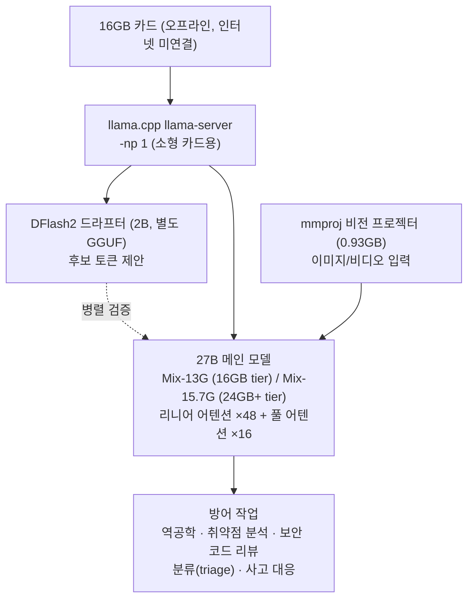

## 왜 읽어야 하나

오늘 온프렘 보안 라인에 로컬 모델을 넣을지, 엣지 서빙 계획에 사이버 방어 워크로드를 포함할지 판단하는 엔지니어를 위해 씁니다. 결론을 먼저 말합니다. **OrcaCyber Nano 1.0의 가치는 벤치마크 숫자가 아니라 "27B 방어 특화 모델을 16GB 카드에 올린다"는 형태에 있습니다.** 이 형태는 "코퍼스가 건물을 나가지 않는" 환경에 로컬 27B 방어 전문가라는 첫 옵션을 제공합니다. 동시에 '긴급(emergency) 릴리스'라는 라벨은 사이버 전용 평가가 끝나기 전에 가중치가 나왔다는 뜻이라, 숫자에 대해서는 주의가 필요합니다.

## 개요

OrcaRouter는 10월 20일 "🚨 Emergency release"라는 표현과 함께 **OrcaCyber Nano 1.0**의 오픈웨이트 공개를 알렸습니다. OrcaCyber 시리즈(Nano, Zero, Ultra)의 Nano 라인 첫 모델입니다. Zero 1.0이 9월 17일에, Zero 1.5가 10월 10일에 나왔고 Nano가 가장 늦었습니다. 그런데 "긴급"이라는 말이 가장 늦은 모델에 붙어 있습니다.

발표에 따르면, 사이버 전용 평가가 완료되기 전에 출시를 앞당긴 것입니다. 전용 평가는 추후 별도로 공개할 예정입니다. 보안 특화 모델이 방어 벤치마크를 다 돌리기 전에 가중치를 내놓은 케이스입니다.

OrcaRouter는 OpenAI 호환 LLM 게이트웨이 "OrcaRouter"를 운영하는 팀입니다. 허깅페이스 org(orcarouter)에는 31개 모델이 있고 대부분은 다른 회사의 모델을 양자화·변형한 것입니다(Qwen3.8-27B-Uncensored 계열, DeepSeek-V4-Flash-Vision-Uncensored 계열 등). OrcaCyber는 이 org에서 자기 이름으로 내놓은 시리즈입니다. OrcaCyber 사이트(orcacyber.ai)는 이걸 "cyber harness for defenders(방어자를 위한 사이버 하네스)"라고 소개하고 현재 "Private testing" 상태라고 표시합니다. OrcaRouter의 사이버 페이지는 "models and defenses for security teams(보안 팀을 위한 모델과 방어)"이라는 한 줄로 시작합니다.

보안 특화 오픈웨이트가 왜 필요했는지에 대한 답은 출시 태도 안에 이미 있습니다. 방어 보안 작업에는 "코퍼스가 건물을 나가지 않는다"는 제약이 있고, 코드와 구성 파일, 사고 로그 같은 자료가 그 제약 안에 있습니다. 이 자료가 외부 API로 나갈 수 없는 곳이 바로 방어 팀의 현장입니다. 자기 하드웨어에서 오프라인으로 돌아가는 로컬 모델만이 이 제약에 맞는 형태입니다.

## 모델은 무엇인가

모델카드(`orcarouter/OrcaCyber-Nano-1.0`)에서 읽히는 사실은 이렇습니다.

- **27B dense**: MoE가 아니라 전체 파라미터가 매 토큰마다 모두 활성화되는 구조
- **262,144 토큰 컨텍스트**: 256K
- **VL 하이브리드**: 텍스트와 이미지/비디오 입력, 텍스트 출력. 비전 프로젝터(mmproj) 파일이 별도로 딸려 있음
- **아키텍처 클래스 `Qwen3_5ForConditionalGeneration`**: 64개 레이어, hidden 5,120. 레이어 중 48개가 리니어 어텐션(linear attention), 16개가 풀 어텐션(full attention)
- **라이선스 `qwen`**, 접근 게이트드(파일 다운로드 전 조건 동의 필요)
- 베이스 모델은 공식적으로 미확인. 발표문이 "Based…"에서 잘리고 커뮤니티의 추측(27B Qwen 계열)에는 공식 답변이 없었음

16GB 카드에 27B dense가 들어간다는 말은 보통의 산술로는 성립하지 않습니다. 27B를 BF16으로 담으면 가중치만 약 54GB이고 8비트(Q8)로도 약 27GB입니다. 모델카드가 제시하는 방법은 세 가지입니다. 첫 번째는 가중치 크기 자체를 줄인 혼합 정밀도 GGUF 빌드입니다(13G, 15.7G). 두 번째는 스펙추리 데코딩(speculative decoding)으로, 2B DFlash2 드라프터와 MTP(multi-token prediction) 헤드가 그 역할입니다. 세 번째는 하이브리드 어텐션으로, 컨텍스트 길이에 비례해 커지지 않는 리니어 어텐션 48개 레이어와 커지는 풀 어텐션 16개 레이어의 조합입니다.

첫 번째는 "얼마나 작은가"의 문제고, 두 번째와 세 번째는 "그 작은 것이 어떻게 도는가"의 문제입니다. 두 번째는 속도를, 세 번째는 컨텍스트 예산을 결정합니다. 리니어 어텐션 레이어는 시퀀스 길이에 비례한 KV 캐시 대신 레이어당 고정 크기의 순환 상태를 유지합니다. 262K 컨텍스트의 KV 비용은 그래서 16개 풀 어텐션 레이어에 묶입니다. "262K 컨텍스트를 16GB 카드에서"라는 문장이 구조적으로 가능해지는 지점이 여기입니다.

로컬 사이버 방어 스택의 구성은 아래 도표와 같습니다.

*오프라인 로컬 방어 스택: 드라프터가 후보 토큰을 제안하고 27B 메인 모델이 검증하는 스펙추리 데코딩, 비전 프로젝터는 별도 파일로 딸립니다.*

## 서빙 및 배포

카드 리포지토리에 실제로 실리는 파일은 GGUF 네 개입니다.

| 파일 | 크기 | 카드에 적힌 역할 |
|---|---|---|
| AI-Defense-Mix-15.7G.gguf | 15.70GB | 최고 품질 빌드 (MTP 헤드 포함) |
| AI-Defense-Mix-13G.gguf | 12.99GB | 16GB 카드용 (MTP 드라프터 포함) |
| AI-Defense-DFlash2-Q8_0.gguf | 2.06GB | DFlash2 스펙추리 드라프터 |
| mmproj-...-F16.gguf | 0.93GB | 비전 프로젝터 (이미지 입력) |

카드의 메모리 가이드는 두 단계로, 16GB 카드는 13G 빌드를, 24GB+ 카드는 15.7G + DFlash2 드라프터 + 비전을 씁니다. llama-server 기본값인 4개 슬롯은 소형 카드에서 `-np 1`로 줄이라는 참고도 붙어 있습니다.

"16GB"라는 말은 컨텍스트가 짧거나 중간이라는 전제 위에서 읽어야 합니다. 가중치와 드라프터만으로도 카드 용량의 대부분을 쓰게 되는데, 262K 전체 컨텍스트의 KV 예산은 그보다 훨씬 작습니다. 하이브리드 어텐션이 컨텍스트 성장에 따른 KV 증가 속도를 크게 낮추기는 하지만, "16GB 카드에 맞는다"와 "16GB에서 262K를 돌린다"는 다른 주장입니다. 카드가 주장하는 것은 전자입니다.

추론 제공자(inference provider)는 이 모델을 서빙하지 않습니다. 카드는 "any Inference Provider에 의해 배포되지 않는다"고 명시하고, 배포 채널은 GGUF 다운로드 후 직접 실행 하나뿐입니다. 즉 API로 쓰는 모델이 아니라, 본질적으로 로컬인 모델입니다. 작성 시점 기준 월 다운로드 약 18,600회, 좋아요 135개를 기록하고 있습니다. 게이트드 리포지토리에서 적지 않은 채택 신호입니다.

독립된 커뮤니티 실측도 하나 기록할 가치가 있습니다. 커뮤니티 벤치마크 플랫폼 llm-bench.io에서 13G 빌드를 단일 GPU로 돌린 실행이 피크 약 44 토큰/초를 남겼습니다. 벤더 수치가 아니라, 설정이 명시되지 않은 결과라는 한계는 붙입니다. 속도 참고 범위로는 충분합니다.

## 벤치마크 (자체 보고 기준)

카드에 실린 수치입니다. 카드 스스로가 "Benchmark harness, settings and full result tables are being finalized(벤치마크 하네스·설정·전체 결과표는 마무리 중)"이라고 적었습니다.

| 벤치마크 | 점수 | 종류 |
|---|---|---|
| MATH-500 | 98.60 | 수학 추론 |
| GSM8K | 97.50 | 수학 추론 |
| AIME 2025 | 96.23 | 수학 추론 |
| HumanEval+ | 93.29 | 코드 |
| LiveCodeBench | 92.23 | 코드 |
| GPQA Diamond | 88.28 | 과학 추론 |
| MBPP+ | 84.66 | 코드 |
| IFEval | 82.81 | 지시 준수 |
| SWE-bench | 78.40 | 에이전틱 코딩 |
| Terminal-Bench 2.1 | 72.50 | 에이전틱 터미널 |
| IFBench | 56.33 | 지시 준수 |
| BigCodeBench | 49.82 | 코드 |

전부 자체 보고입니다. 서드파티 플랫폼 등재는 아직 없어 독립 재검증이 남아 있습니다.

이 표를 읽을 땐 수치의 크기가 아니라 **없는 것**을 봐야 합니다. 사이버 방어 모델을 표방하는 카드에, 사이버 특화 수치가 하나도 없습니다. SWE-bench 78.40이나 Terminal-Bench 72.50 같은 일반 에이전틱 코딩 점수가 최선입니다. 대조적으로 같은 카드는 시리즈의 Zero 1.5를 "CyberGym Level 1 pass@1 98.01%, 1M 컨텍스트, function calling, OpenAI 호환 API"라고 소개합니다. 사이버 숫자는 Zero 라인에 있고 Nano에는 없습니다. OrcaRouter의 X 게시물은 GPT-5, GLM-5.3 Flash, DeepSeek V4 Flash와 동급이라는 주장도 담고 있지만, 이 역시 벤더의 주장입니다.

"긴급 릴리스"라는 라벨의 의미가 가장 분명하게 드러나는 지점이 여기입니다. 해당 모델의 포지션에 가장 관련성 높은 숫자가 아직 나온 것이 없는 상태에서 가중치가 먼저 나온 것입니다. OrcaCyber 사이트의 슬로건 "Proven, not guessed(증명되고, 추측되지 않는다)"와 실제 출시 태도의 격차는 읽는 사람이 가려야 할 부분입니다.

## ThakiCloud 제품 적용 시사점

### ai-platform 렌즈 (서빙 · 인프라)

OrcaCyber Nano 1.0은 ThakiCloud의 온프렘과 엣지 비즈니스가 가장 직접적으로 받는 프로필입니다.

**온프렘 방어 라인.** "코퍼스가 건물을 나가지 않는다"는 제약은 보안 워크로드에서 옵션이 아니라 작업 성립 조건입니다. 온프렘(Aegis) 배포 환경에서 이 제약이 가장 강한 곳이 코드 코퍼스와 사고 로그입니다. 오프라인 GGUF 27B는 그 옆에 놓일 수 있는 최초의 "방어 특화" 옵션입니다. 하이브리드 어텐션 구조 덕분에 제약된 하드웨어의 장문 컨텍스트 KV 예산 계산도, 일반 dense 27B보다 유리합니다.

**16GB tier는 엣지.** metis-edge가 담당하는 "어느 하드웨어에 어느 모델이 들어가는가"라는 질문에, 16GB 카드에 맞는 13G GGUF는 "27B급, 소비자 카드 1장" 포맷의 첫 구체적 후보입니다. GGUF/llama.cpp는 vLLM/transformers 경로와 공존하는 엣지 런타임이고, 16GB/24GB+ 두 단계 빌드 구조는 "하드웨어에 맞춰 어떻게 줄일 것인가"라는 양자화 전략을 제품 형태로 보여 줍니다.

**스펙추리 데코딩은 이미 우리 프로덕션에 있습니다.** DFlash2 방식은 ThakiCloud의 B200 서빙 스택에서 NVFP4와 함께 프로덕션으로 돌리고 있는 스펙추리 데코딩 방식입니다. OrcaCyber 카드는 이 방식이 데이터센터 전용이 아니라 "2B 드라프터 + 16GB 카드" 형태로 내려오고 있음을 보여줍니다. 빌드에 내장된 MTP 헤드도 같은 계열의 장치입니다.

### Paxis 렌즈 (에이전트)

"cyber harness for defenders"라는 자기 소개는, 모델 자체가 아니라 모델을 다루는 제어 평면(방화벽·가드레일 같은 통제 계층)이 제품이라는 뜻입니다. OrcaRouter 사이버 페이지에 묶여 나오는 것들이 그것입니다: 에이전트 방화벽, 가드레일, 코드 리뷰 머지 게이트, 컴플라이언스 팩.

이는 Paxis의 영역과 같은 구조입니다. Paxis는 ThakiCloud의 Agent-Native Cloud로, 스킬·도구·정책·감사로그를 일급 리소스로 다루는 제어 평면입니다. 격리된 샌드박스 안에서 로컬 모델을 돌려 역공학·취약점 분석을 수행하고 대외 연결이 제로인 방어 에이전트는, Paxis의 샌드박스 격리와 정책 게이트가 가장 필요한 구성입니다. OrcaRouter의 방화벽·가드레일·머지 게이트 묶음은, 에이전트 행동 관제가 보안 요구사항이 되고 있다는 시장의 증거이기도 합니다.

둘을 합치면 한 문장이 됩니다. 16GB급 비용의 로컬 서빙(ai-platform)이 인터넷에 연결하지 않는 방어 에이전트(Paxis)를 실행 가능하게 만듭니다. 로컬 모델의 단위 서빙 비용이, 방어 팀이 오프라인으로 돌릴 에이전트 수를 정합니다.

## 한계 및 반론

**사이버 평가가 없습니다.** "긴급" 상태로 나온 모델은, 자기 포지션에 가장 관련성 높은 수치가 아직 공개되지 않은 모델입니다. 전용 평가가 공개될 때까지 "사이버 방어 특화"는 벤더의 포지셔닝 주장으로만 읽어야 합니다.

**베이스 모델이 미확인이고, 라이선스 확인이 먼저입니다.** 발표문이 "Based…"에서 끊기고 아키텍처 클래스만 `Qwen3_5ForConditionalGeneration`입니다. 같은 org의 이전 모델(Qwen3.8-27B-Uncensored)도 동일한 클래스를 썼기에 추정은 강하지만, 베이스는 공식적으로 확인되지 않았습니다. 라이선스 태그가 `qwen`인 점을 고려하면, Qwen 계열 라이선스에 붙는 상업 이용 조건을 구매 검토 단계에서 확인해야 합니다. 게이트드 접근(다운로드 전 조건 동의)도 같은 문제의 일부입니다. "오픈웨이트"는 사실이지만 "무조건 써도 된다"는 아닙니다.

**숫자는 전부 자체 보고입니다.** SWE-bench 78.40, Terminal-Bench 72.50은 대형 모델군에서도 상위권으로 읽히는 수치입니다. 그런데 하네스가 "마무리 중"이고 독립 재검증이 없는 상태입니다. 지금까지 나온 숫자는 다른 모델과의 비교 근거가 아니라, 벤더 프레임 안의 참고치로만 써야 합니다.

**사업 포지션과 함께 읽어야 합니다.** OrcaRouter는 게이트웨이/라우터 사업입니다(GitHub org 24개 리포지토리, 1,400+ API 커넥터). 모델의 오픈웨이트 공개는 사이버 하네스(방화벽 · 가드레일 · 컴플라이언스 팩)로 이어가는 입구일 가능성이 큽니다. 하네스 없이 모델만 쓰는 팀의 관점에서는, 독립된 가중치 품질 검증이 남아 있습니다.

**"16GB"에는 전제가 있습니다.** 컨텍스트가 짧거나 중간일 때 성립하는 주장입니다. 실제 triage·incident response 작업은 데모보다 긴 컨텍스트를 씁니다. 자기 하드웨어에서 메모리 산정을 다시 하는 것은 선택이 아니라 전제입니다.

## 정리

OrcaCyber Nano 1.0이 팀에 남기는 것은 세 가지, 그리고 신호 하나입니다.

온프렘 보안 팀에게는 "27B급, 로컬, 방어 특화"라는 첫 옵션입니다. 형태(오프라인 GGUF, 16GB/24GB+ 두 단계, 비전)는 "코퍼스가 건물을 나가지 않는" 제약과 맞습니다. 다만 라인에 올리기 전, 사이버 전용 평가의 공개를 기다리고 라이선스 조건의 검토를 마치는 것이 순서입니다.

서빙 엔지니어에게는 하이브리드 어텐션과 스펙추리 데코딩의 조합 사례입니다. 27B dense를 16GB에 올리는 방법은, 64개 레이어 중 48개를 리니어 어텐션으로 두고 2B 드라프터를 붙이는 것에서 성립합니다. 다음 "노트북 30B"들은 같은 방식을 따라 나올 가능성이 큽니다.

ThakiCloud 팀에게는 측정 대상입니다. 라이선스 조건의 검토가 끝나면 13G 빌드의 토큰/초, 컨텍스트별 KV 예산, DFlash2 드라프터의 수용률을 우리 H100 노드에서 실측해 이 글에 보강할 예정입니다.

마지막으로, "긴급 릴리스" 자체를 신호로 남깁니다. 사이버 숫자가 완성되기 전에 가중치를 내놓은 것은, "인터넷에 연결하지 않고 방어하는 로컬 모델"에 대한 수요가 평가 인프라보다 먼저 도착했다는 뜻입니다. 보안 팀에서 로컬 모델을 검토하는 사람이라면, 이 글에서 추가할 체크리스트 항목은 하나입니다. 전용 평가가 공개될 때, 그 숫자가 이 포지션을 지키는지 다시 보는 것입니다.

### 출처

- [OrcaCyber Nano 1.0 model card (Hugging Face)](https://huggingface.co/orcarouter/OrcaCyber-Nano-1.0)
- [OrcaRouter X 긴급 릴리스 공지](https://x.com/OrcaRouter/status/2111871993532580058)
- [OrcaRouter X 성능 게시](https://x.com/OrcaRouter/status/2111877229340934579)
- [OrcaCyber 사이트](https://www.orcacyber.ai)
- [OrcaRouter Cyber 페이지](https://www.orcarouter.ai/cyber)
- [OrcaCyber Zero 1.5 모델 페이지](https://www.orcarouter.ai/models/orca/orcacyber-zero-1.5)
- [본 릴리스 RT (X)](https://x.com/hjguyhan/status/2112442528469512462)
