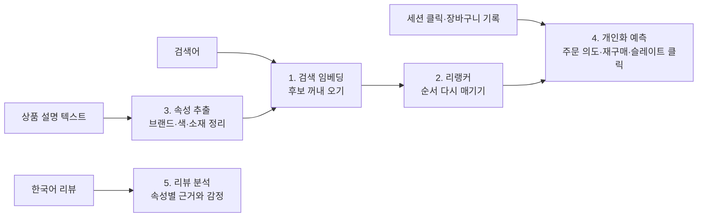

쇼핑몰에 AI 기능을 붙이려는 개발자와 데이터 담당자께 드리는 글입니다. 쇼핑몰 AI는 모델 하나로 되지 않습니다. 상품 찾기, 순서 매기기, 상품 정보 정리, 손님 행동 예측, 리뷰 읽기가 각각 다른 모델의 몫입니다.

다키클라우드는 이 다섯 칸을 맡는 모델 8종을 공개 저장소에 올렸습니다. 모두 공개 데이터로 학습했고 같은 데이터의 강한 기준선과 비교한 결과를 모델 카드에 남겼습니다. 이 글은 여덟 개를 하나의 흐름으로 묶어, 어느 모델을 어디에 끼우면 되는지 설명합니다. 숫자는 모두 각 모델 카드에 공개된 값입니다.

## 쉽게 말하면

동네 서점을 떠올려 보시면 됩니다. 손님이 "비 오는 날 읽기 좋은 얇은 소설"을 찾는다고 해 보겠습니다. 직원은 먼저 서가에서 그럴듯한 책을 한 아름 꺼내 옵니다. 그다음 손님 말을 다시 곱씹으며 가장 맞는 책을 맨 위에 올립니다.

책을 권하려면 판형, 출판사, 쪽수 같은 정보가 정리돼 있어야 합니다. 경험 많은 직원은 이 손님이 오늘 계산대로 갈지, 다음 주에 또 올지도 어렴풋이 압니다. 마지막으로 책마다 꽂힌 독자 메모 카드를 읽고 "다들 결말이 아쉽다고 하네요"라고 귀띔합니다.

커머스 모델 8종은 이 서점 직원의 일을 나눠 맡습니다. 서가에서 꺼내 오기, 순서 정하기, 책 정보 옮겨 적기, 손님 짐작하기, 메모 카드 읽기가 각각 한 모델입니다. 한 사람에게 다 맡기지 않고 칸마다 잘하는 모델을 둔 구성입니다.

## 여덟 모델이 맡는 자리



흐름은 크게 다섯 칸입니다. 검색 임베딩이 수만 개 상품에서 후보를 꺼내면 리랭커가 그 후보의 순서를 다시 정합니다. 속성 추출 모델은 상품 설명에서 브랜드나 색을 뽑아 검색과 필터가 쓸 정보를 만듭니다. 개인화 예측 모델 세 개는 세션 기록을 보고 주문, 재구매, 클릭 가능성을 점수로 냅니다. 리뷰 모델은 한국어 리뷰에서 속성별 근거 구간과 감정을 찾습니다.

| 칸 | 저장소 | 학습 데이터 | 언어 | 비교 기준선 대비 결과 |
|---|---|---|---|---|
| 검색 | [Commerce-Search-EmbeddingGemma-2](https://huggingface.co/ThakiCloud/Commerce-Search-EmbeddingGemma-2) | Amazon ESCI | 영어 | pool nDCG@10 0.6045 → 0.6256 |
| 순서 | [Commerce-Rerank-Qwen3-8B](https://huggingface.co/ThakiCloud/Commerce-Rerank-Qwen3-8B) | Marqo-GS-10M | 영어 | nDCG@10 0.6089 → 0.6968 |
| 순서 | [Commerce-Rerank-Qwen3-8B-LoRA](https://huggingface.co/ThakiCloud/Commerce-Rerank-Qwen3-8B-LoRA) | 위와 같음 | 영어 | 위 모델의 재현용 어댑터 |
| 속성 | [Commerce-Attribute-Qwen3.5-4B](https://huggingface.co/ThakiCloud/Commerce-Attribute-Qwen3.5-4B) | Amazon Berkeley Objects | 영어 | F1 0.640 → 0.928 |
| 예측 | [Commerce-OrderIntent-OTTO-LGBM](https://huggingface.co/ThakiCloud/Commerce-OrderIntent-OTTO-LGBM) | OTTO 세션 | 언어 무관 | PR-AUC 0.3601 → 0.4128 |
| 예측 | [Commerce-Repurchase-OTTO-LGBM](https://huggingface.co/ThakiCloud/Commerce-Repurchase-OTTO-LGBM) | OTTO 세션 | 언어 무관 | AUC 0.6243 → 0.6861 |
| 예측 | [Commerce-Slate-Click-FINN-LGBM](https://huggingface.co/ThakiCloud/Commerce-Slate-Click-FINN-LGBM) | FINN.no Slate | 언어 무관 | MRR 0.4421 → 0.4630 |
| 리뷰 | [Commerce-Review-KO-RoBERTa-Large](https://huggingface.co/ThakiCloud/Commerce-Review-KO-RoBERTa-Large) | AI-Hub 속성기반 감정분석 | 한국어 | Joint F1 0.6820 → 0.8267 |

여덟 저장소는 [Commerce FM 컬렉션](https://huggingface.co/collections/ThakiCloud/commerce-fm-korean-shopping-mall-models-6ad32c59e6f5788209ce7770)에 함께 묶여 있습니다. 표의 기준선은 각 카드가 정한 비교 대상 가운데 가장 강한 것입니다. 지표가 모델마다 다르므로 행끼리 숫자 크기를 비교하시면 안 됩니다.


*패널마다 지표가 다릅니다. 빗금 막대가 기준선, 파란 막대가 공개 모델입니다. 수치는 각 모델 카드에서 옮겼습니다.*

## 1. 서가에서 꺼내 오기: 상품 검색 임베딩

Commerce-Search-EmbeddingGemma-2는 영어 검색어와 상품 텍스트를 같은 768차원 공간에 놓는 임베딩 모델입니다. [EmbeddingGemma 2](/tech-blog/ko/owm/embeddinggemma-2-multimodal-embedding/)의 텍스트 부분만 Amazon ESCI 학습 분할로 미세조정했습니다. 이미지와 오디오 부분은 원본과 바이트 단위로 같습니다.

ESCI 개발 분할의 상품 4만 397개를 한 색인에 넣고 2,073개 검색어로 쟀습니다. 전체 색인 기준 nDCG@10은 원본 0.60에서 0.63으로 올랐습니다. 차이는 2.11%p이고 95% 신뢰구간이 0을 넘습니다. 같은 조건에서 Qwen3-Embedding-8B는 0.57, 키워드 검색 BM25는 0.46이었습니다. 텍스트 부분 약 2억 7천만 파라미터로 80억 파라미터 모델보다 높은 점수를 냈습니다.

```python
from sentence_transformers import SentenceTransformer

model = SentenceTransformer("ThakiCloud/Commerce-Search-EmbeddingGemma-2")
model.max_seq_length = 1024
q = model.encode(["waterproof running shoes wide fit"], prompt_name="query", normalize_embeddings=True)
d = model.encode(["Trail Runner GTX. brand: Acme. color: black. Waterproof membrane, wide toe box"],
                 prompt_name="document", normalize_embeddings=True)
print(q @ d.T)
```

검색어에는 `prompt_name="query"`, 상품에는 `prompt_name="document"`를 꼭 붙이셔야 합니다. 빼면 품질이 떨어집니다. 한계도 분명합니다. 영어만 학습하고 평가했습니다. 이미지로 텍스트를 찾는 성능은 오히려 떨어졌습니다(R@1 기준 5.4%p 하락). 이미지 검색이 필요하면 원본 모델을 쓰셔야 합니다.

한국어 검색어로 상품 이미지를 찾는 경우라면 작은 질의 인코더를 따로 쓰시면 됩니다. [EmbeddingGemma 2를 작게 쓰는 법](/tech-blog/ko/tutorials/eg2-edge-usage-guide/)에서 설명한 K4 인코더가 그 자리를 맡습니다.

## 2. 순서 다시 매기기: 리랭커

서가에서 꺼낸 책 더미는 순서가 거칠습니다. Commerce-Rerank-Qwen3-8B는 검색어 하나와 상품 제목 후보들을 받아 후보마다 점수를 매깁니다. Qwen3-Reranker-8B에 LoRA를 붙여 Marqo-GS-10M 쇼핑 순위 데이터로 학습한 뒤 bf16 가중치로 병합했습니다.

학습에 없던 검색어 1만 9,647개로 한 번만 연 봉인 평가에서 nDCG@10이 0.61에서 0.70으로 올랐습니다. 차이는 +8.79%p이고 95% 신뢰구간은 +8.60에서 +8.98%p입니다. 개발 분할에서는 세 시드 모두 비교한 공개 리랭커 설정 다섯 가지보다 높았습니다.

```python
from huggingface_hub import hf_hub_download
import importlib.util

p = hf_hub_download("ThakiCloud/Commerce-Rerank-Qwen3-8B", "inference.py")
spec = importlib.util.spec_from_file_location("inference", p)
mod = importlib.util.module_from_spec(spec); spec.loader.exec_module(mod)

rr = mod.CommerceReranker("ThakiCloud/Commerce-Rerank-Qwen3-8B")
rr.rerank("waterproof trail running shoes men", [
    "Men's Gore-Tex Trail Running Shoe, Waterproof",
    "Women's Road Running Shoe, Breathable Mesh",
    "Shoe Waterproofing Spray 300ml",
], top_k=3)
```

점수는 한 검색어 안에서 순서를 정하는 값이지 확률이 아닙니다. B200 한 장에서 후보 약 50개를 한 번에 매기면 검색어당 145ms가 걸렸습니다. 주의할 점은 학습 목표입니다. 사람이 매긴 관련도가 아니라 Google Shopping의 노출 순서를 배웠습니다. 그래서 그 순서에 섞인 인기도나 광고 경향까지 물려받을 수 있습니다. 상품 제목만 보며 영어만 확인했습니다.

[Commerce-Rerank-Qwen3-8B-LoRA](https://huggingface.co/ThakiCloud/Commerce-Rerank-Qwen3-8B-LoRA)는 병합 전 어댑터입니다. 학습을 재현하거나 어댑터 형태로 올리고 싶을 때 씁니다. 병합 가중치에서 원본을 뺀 값과 어댑터 변화량의 코사인 중앙값이 0.99에 가까웠습니다. 다만 공개 수치는 병합 모델로 잰 것이고 어댑터 경로를 따로 평가하지는 않았습니다.

## 3. 책 정보 옮겨 적기: 속성 추출

검색과 필터는 상품 정보가 정리돼 있어야 제대로 돕니다. Commerce-Attribute-Qwen3.5-4B는 Qwen3.5-4B용 LoRA 어댑터입니다. 영어 상품 설명을 읽고 브랜드, 색, 소재, 스타일, 모델명, 패턴, 모양, 원단, 마감 9가지 속성을 뽑습니다.

이 모델의 원칙은 옮겨 적기입니다. 값은 반드시 본문에서 글자 그대로 복사하고 본문에 없으면 `null`을 돌려줍니다. 돌려준 값의 99.99%가 입력 본문의 부분 문자열이었고 값마다 본문 위치가 함께 나옵니다.

Amazon Berkeley Objects 상품 7,916건의 평가에서 F1은 0.93이었습니다. 학습 값 사전으로 가장 긴 일치를 찾는 기준선은 0.64였습니다. 원본 모델을 같은 프롬프트로 쓰면 0.47이었습니다. 없는 값을 지어내는 비율은 3.4%로, 사전 기준선 18.1%와 원본 23.7%보다 낮았습니다.

```python
from huggingface_hub import snapshot_download
import sys

path = snapshot_download("ThakiCloud/Commerce-Attribute-Qwen3.5-4B")
sys.path.insert(0, path)
from inference import CommerceAttributeExtractor

x = CommerceAttributeExtractor(adapter=path)
text = "Trail Runner GTX Men's Running Shoe, Black, Waterproof Mesh Upper | Wide toe box"
out = x.extract(text, attrs=["brand", "color", "material", "style"], category="shoes")
```

한계는 카드에 그대로 적혀 있습니다. 평가 문항의 약 71%가 휴대폰 케이스 상품입니다. 이를 빼면 F1은 0.90, 기준선은 0.67입니다. 같은 데이터 분포 안의 결과이고 영어만 확인했습니다. 이미지에서 색을 짐작하는 식의 추론은 일부러 하지 않습니다.

## 4. 손님 짐작하기: 주문 의도, 재구매, 슬레이트 클릭

서점 직원의 감에 해당하는 칸은 세 모델이 나눠 맡습니다. 셋 다 LightGBM 모델이고 CPU로 학습했습니다. 새 구조를 제안하는 모델이 아니라 검증된 알고리즘에 직접 설계한 특성을 얹은 참조 모델입니다.

**Commerce-OrderIntent-OTTO-LGBM**은 세션의 첫 3~10개 이벤트를 보고 24시간 안에 주문할 확률을 냅니다. 독일 온라인 쇼핑몰 OTTO의 세션 데이터로 학습했습니다. 봉인 평가 108만 9,902개 세션에서 PR-AUC는 0.41이었습니다. 같은 특성의 로지스틱 회귀는 0.36, 양성 비율을 그대로 쓰는 상수 기준은 0.11이었습니다. 개발 분할에서는 함께 학습한 신경망 모델 세 종류도 이 모델을 넘지 못했습니다.

```python
import sys
from huggingface_hub import snapshot_download

path = snapshot_download("ThakiCloud/Commerce-OrderIntent-OTTO-LGBM")
sys.path.insert(0, path)
from inference import OrderIntentModel

m = OrderIntentModel(path)
t = 1_661_100_000
sessions = [{"session": 1, "events": [
    {"aid": 1460571, "ts": t, "type": "clicks"},
    {"aid": 1460571, "ts": t + 40, "type": "carts"},
    {"aid": 108125, "ts": t + 300, "type": "clicks"},
]}]
print(m.predict_sessions(sessions))
```

**Commerce-Repurchase-OTTO-LGBM**은 이미 한 번 주문한 세션이 앞으로 7일 안에 다시 주문할 확률을 냅니다. 구매 이력 특성 14개와 탐색 행동 특성 15개를 씁니다. 세 기준일을 합친 AUC는 0.69로, 고전적 재구매 모형 BG/NBD와 Pareto/NBD의 0.62보다 높았습니다. 기준일 3개와 시드 3개로 만든 9칸 모두에서 BG/NBD를 이겼습니다.

이 모델은 순위를 매기는 용도로 쓰셔야 합니다. 확률 보정은 BG/NBD가 더 좋습니다(보정 오차 0.03 대 0.01). 향상은 탐색 행동 특성에서 나왔습니다. 구매 이력 특성만 쓰면 BG/NBD와 거의 같거나 약간 낮았습니다.

**Commerce-Slate-Click-FINN-LGBM**은 한 화면에 보여 준 상품 목록에서 사용자가 무엇을 누를지 순서를 매깁니다. 노르웨이 온라인 마켓플레이스 FINN.no의 데이터로 순위 학습 모델을 만들었습니다. 학습에 없던 사용자 1만 9,922명에서 MRR은 0.46으로, 클릭률 순 정렬 0.44보다 약 2.1%p 높았습니다. 슬레이트 밴딧이 쓰는 보상 모델 자리입니다. 데이터에 노출 확률 기록이 없으므로, 새 추천 정책의 가치를 추정하는 모델은 아닙니다.

세 모델 모두 같은 점을 조심하셔야 합니다. 상품 통계가 OTTO나 FINN.no의 상품 ID에 묶여 있습니다. 다른 쇼핑몰의 ID를 넣으면 해당 특성이 "본 적 없음" 값으로 바뀝니다. 그때의 정확도는 재지 않았습니다. 그대로 꽂아 쓰는 모델이 아니라 검증된 특성 설계로 보셔야 합니다. 자기 로그로 상품 통계를 다시 만들고 다시 학습하는 것이 맞는 사용법입니다. 한국 쇼핑몰에서 잘 맞는다고는 주장하지 않습니다.

## 5. 메모 카드 읽기: 한국어 리뷰 분석

여덟 모델 가운데 한국어를 직접 다루는 것은 Commerce-Review-KO-RoBERTa-Large 하나입니다. 리뷰마다 근거 구간을 본문 글자 그대로 가리키고 112개 속성 카테고리와 긍정, 부정, 중립 감정을 붙입니다. 가격, 사이즈, 내구성, 향 같은 카테고리입니다. 출력이 언제나 리뷰 안 위치를 가리키므로, 뒤 단계 답변이 요약 대신 근거 문장을 보여 줄 수 있습니다.

`klue/roberta-large` 전체를 AI-Hub 속성기반 감정분석 데이터로 미세조정했습니다. 상품이 겹치지 않게 떼어 둔 봉인 평가 1만 8,858건에서 zero-shot으로 쓴 27B 지시형 모델과 비교했습니다. Joint F1은 0.68에서 0.83으로 올랐습니다. 근거 없는 주장 비율은 9.1%에서 6.1%로 내려갔습니다. 잰 지표는 모두 이 모델이 높았습니다.

```python
from huggingface_hub import hf_hub_download
import importlib.util

p = hf_hub_download("ThakiCloud/Commerce-Review-KO-RoBERTa-Large", "inference.py")
spec = importlib.util.spec_from_file_location("inference", p)
mod = importlib.util.module_from_spec(spec); spec.loader.exec_module(mod)

m = mod.ReviewABSA("ThakiCloud/Commerce-Review-KO-RoBERTa-Large")
m.predict(["배송은 빨랐는데 사이즈가 생각보다 작아요"], ["여성의류"])
```

기본 `token-classification` 파이프라인으로는 결과가 제대로 풀리지 않습니다. 저장소의 `inference.py`를 쓰셔야 합니다. 두 번째 인자는 상품 대분류이고 허용 값 20개는 `meta.json`에 있습니다.

향상의 상당 부분은 이 데이터의 구간 경계와 카테고리 규칙을 익힌 결과입니다. zero-shot 모델은 그 규칙을 알 수 없습니다. 그래서 다른 쇼핑몰 리뷰나 다른 주석 체계에서도 같은 격차가 난다고 주장하지 않습니다. 텍스트에 드러나지 않은 암묵적 속성도 뽑지 않습니다. 라이선스는 CC BY-SA 4.0이라, 이 가중치로 만든 모델도 같은 조건으로 공개해야 합니다.

## 어디에 쓰면 되나

가장 자연스러운 자리는 영어권 상품 검색입니다. 검색 임베딩으로 후보를 뽑고 리랭커로 상위 목록을 다시 정렬하는 2단 구성이 바로 됩니다. 상품 설명이 엉성한 카탈로그라면 속성 추출로 필터용 정보를 먼저 채울 수 있습니다.

개인화 예측 세 모델은 출발점으로 쓰시는 편이 맞습니다. 카드에 공개된 특성 정의와 코드를 가져가 자기 쇼핑몰 로그로 다시 학습하는 방식입니다. 주문 의도는 장바구니 이탈 대응에, 재구매는 다시 올 손님 순위에, 슬레이트 클릭은 추천 목록 정렬에 대응합니다.

한국어 리뷰 모델은 리뷰 요약이나 상담 답변이 근거를 보여 줘야 할 때 씁니다. "사이즈가 작다는 리뷰가 많습니다"라고 말할 때 실제 리뷰 문장을 함께 내보이는 식입니다.

다키클라우드가 만드는 업무 자동화 플랫폼 Paxis 관점에서 보면 이 모델들은 커머스 업무 단계의 부품입니다. 상품 정보 정리, 리뷰 근거 확인, 고객 대상 선정처럼 반복되는 단계를 작은 전용 모델이 맡는 구성을 생각해 볼 수 있습니다. 다만 이 모델들은 아직 어떤 제품에도 통합되지 않았습니다. 지금은 공개 연구 결과이자 재현 가능한 출발점입니다.

## 공통 한계

먼저 언어입니다. 검색, 리랭커, 속성 추출은 영어 데이터로만 학습하고 평가했습니다. 한국어 쇼핑몰에서 얼마나 맞는지는 재지 않았습니다. 한국어를 직접 다루는 것은 리뷰 모델뿐입니다.

다음은 데이터 분포입니다. 대부분 같은 분포의 test에서 기준선을 이긴 결과입니다. 다른 카탈로그, 다른 주석 체계, 다른 국가의 쇼핑몰로 옮겨도 같은 격차가 난다는 근거는 없습니다. 개인화 예측 모델은 특히 상품 ID가 데이터셋에 묶여 있습니다.

마지막으로 비교 범위입니다. 각 카드는 공개 기준선이나 같은 데이터의 단순 기준선과 비교했습니다. 다른 팀이 미세조정한 모델이나 상용 API와는 비교하지 않았습니다. 그래서 최고 성능이라는 주장은 하지 않습니다.

## 정리

서점 직원 한 사람이 모든 일을 잘하기는 어렵습니다. 서가에서 꺼내는 사람, 순서를 고르는 사람, 정보를 옮겨 적는 사람, 손님을 짐작하는 사람, 메모 카드를 읽는 사람을 따로 두면 각자 확인할 수 있는 기준이 생깁니다. 이번에 공개한 여덟 모델은 그 다섯 칸에 하나씩 기준선을 넘긴 결과를 채워 둔 것입니다. 각 칸이 어디까지 확인됐는지는 모델 카드에 숨기지 않고 적어 두었습니다.

*측정 출처: 각 Hugging Face 모델 카드에 공개된 다키클라우드 자체 측정값입니다.*
