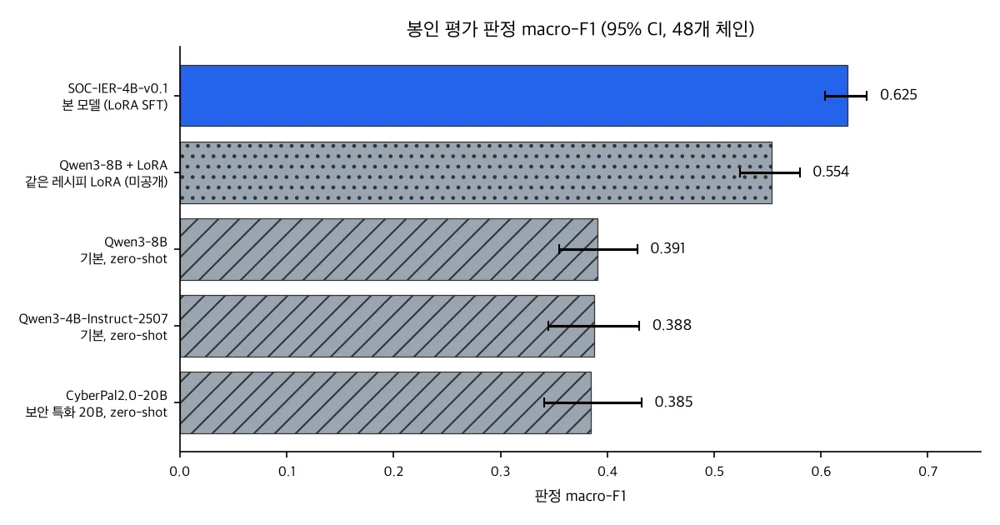
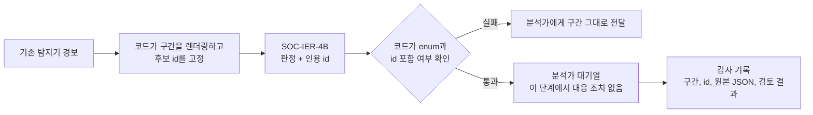

보안관제 분석가와 탐지 체계를 운영하시는 분께 드리는 글입니다. 이번에 공개하는 작은 모델은 한 가지 질문에 답합니다. 눈앞의 짧은 기록 구간에 공격의 증거가 실제로 있느냐는 질문입니다.

모델은 서버에서 몇십 초 동안 일어난 일의 기록과 번호 목록을 받습니다. 그리고 판정과 함께 근거로 삼은 기록의 번호를 돌려줍니다. 프롬프트는 목록에 있는 번호만 인용하도록 정해 두었습니다. 봉인 평가에서는 학습한 모델이든 아니든 목록 밖 번호를 인용한 모델이 없었습니다. 다키클라우드는 이 모델을 연구용으로 공개합니다. 자동 차단에 쓰는 모델이 아니라 분석가 옆에서 근거를 짚어 주는 모델입니다.

## 쉽게 말하면

카드 명세서를 들여다보며 도용 결제를 찾는 일을 떠올려 보시면 됩니다. 명세서에는 줄마다 번호가 붙어 있습니다. 카드사에 신고하려면 "이 줄과 이 줄이 수상합니다"라고 번호로 짚어야 합니다. 명세서에 없는 결제를 지어내서 신고할 수는 없습니다.

평범한 줄 하나만으로 도용이라고 단정해서도 안 됩니다. 동네 편의점 결제 한 건은 그냥 장보기입니다. 반면 새벽에 해외 쇼핑몰 결제가 연달아 찍혔다면 그 줄들이 바로 증거입니다. 가끔은 정말로 어느 쪽인지 알 수 없는 줄도 있습니다.

이번 모델은 이 명세서 판독만 하도록 연습한 모델입니다. 명세서 한 장은 텔레메트리 구간 하나입니다. 줄 번호는 이벤트 ID입니다. 모델은 "증거 있음", "평범한 활동", "판단 불가" 가운데 하나를 고르고 근거가 된 줄 번호만 적어 냅니다.

## 어떤 모델인가

모델 이름은 SOC-IER-4B-v0.1입니다. 입력은 프로세스 실행, DNS, HTTP, 네트워크 흐름 같은 호스트 이벤트입니다. 이벤트마다 `[ev_...]` 형태의 번호가 붙습니다. 출력은 JSON 객체 하나입니다. 사건 범주, 근거 이벤트 번호 목록, 판정, 60단어 이내의 짧은 이유가 들어갑니다.

판정은 `SUPPORTED`, `INSUFFICIENT`, `UNKNOWN` 세 가지입니다. 사건 범주는 자격 증명 탈취, 데이터 유출, 컨테이너 침해 등 일곱 가지와 `none`입니다. 예를 들어 고객 DB를 tar로 묶고 처음 보는 도메인을 조회하고 curl로 올려 보내는 구간이 있다고 해 보겠습니다. 이때 모델은 그 세 줄을 근거로 데이터 유출 증거가 있다고 답하도록 배웠습니다.

기반 모델은 Qwen3-4B-Instruct-2507입니다. 여기에 LoRA SFT를 했고 생각 모드는 끄고 학습했습니다. 라이선스는 Apache-2.0입니다. 프롬프트는 영어로만 학습하고 평가했습니다.

## 무엇으로 배웠나

학습 데이터는 603건입니다. 483건은 사내 사이버 레인지에서 나왔습니다. 레인지는 저희가 직접 꾸린 시험 환경이며 고객 데이터나 운영 데이터는 들어 있지 않습니다. 나머지 120건은 공개 데이터셋 witfoo/precinct6-cybersecurity에서 다시 만든 보조 구간입니다.

정답은 사람이 붙이지 않았습니다. 레인지의 공격 스크립트가 무엇을 언제 했는지 알고 있으니, 판정과 근거 번호는 그 기록에서 나옵니다. 공격 구간마다 같은 호스트의 평범한 구간을 짝으로 두었습니다. 명세서로 치면 도용이 찍힌 달과 평범한 달을 나란히 놓고 배운 셈입니다.

학습은 H100 NVL 한 장에서 약 14분 걸렸습니다. 레시피는 CyberSecQwen-4B 모델 카드에 공개된 것을 따랐고 데이터가 작아 에폭만 10에서 3으로 줄였습니다.

## 봉인 평가 결과

평가 세트는 모델 선택이 끝난 뒤 한 번만 열었습니다. 독립된 사건 chain 48개, 구간 239개로 이뤄져 있습니다. 학습에 없던 공격 계열에서 나온 chain입니다. 모든 모델을 같은 프롬프트와 같은 파서, 같은 디코딩으로 쟀습니다.

비교 기준은 학습하지 않은 기반 모델(Qwen3-4B-Instruct-2507), Qwen3-8B, 같은 레시피로 학습한 8B(내부용, 미공개), 보안 특화 모델 CyberPal2.0-20B입니다. 학습하지 않은 모델은 모두 같은 입력을 zero-shot으로 풀었습니다.


*봉인 평가 판정 macro-F1과 95% 신뢰구간입니다. 수치는 모델 카드에서 그대로 옮겼습니다.*

| 모델 | 설정 | 판정 macro-F1 [95% CI] | 판정 정확도 | 증거 재현율 | 증거 정밀도 | False-SUPPORTED | 사건 누락 | Phantom id |
|---|---|---|---|---|---|---|---|---|
| **SOC-IER-4B-v0.1** | LoRA SFT | **0.625** [0.604, 0.643] | 0.916 | 0.895 | 0.929 | 0.064 | 0.061 | 0 |
| Qwen3-4B-Instruct-2507 | 기본, zero-shot | 0.388 [0.345, 0.430] | 0.603 | 0.532 | 0.615 | 0.688 | 0.070 | 0 |
| Qwen3-8B + LoRA (미공개) | 같은 레시피 | 0.554 [0.524, 0.580] | 0.812 | 0.706 | 0.743 | 0.088 | 0.219 | 0 |
| Qwen3-8B | 기본, zero-shot | 0.391 [0.355, 0.428] | 0.573 | 0.263 | 0.347 | 0.352 | 0.447 | 0 |
| CyberPal2.0-20B | 기본, zero-shot | 0.385 [0.341, 0.432] | 0.565 | 0.565 | 0.641 | 0.336 | 0.465 | 0 |

이 결과는 이 과제와 이 벤치마크에서만 성립합니다. 비교가 말하지 않는 것은 두 절 뒤에서 따로 정리했습니다.

## 학습이 바꾼 것과 바꾸지 않은 것

기반 모델과 비교하면 학습으로 달라진 것은 세 가지입니다. 가장 크게 줄어든 것은 오탐입니다. 기본 4B 모델은 평범한 구간의 68.8%를 공격 증거로 불렀는데, 학습 뒤에는 6.4%로 내려갔습니다. 근거를 짚는 능력도 좋아졌습니다. 증거 재현율은 0.532에서 0.895로, 증거 정밀도는 0.615에서 0.929로 올랐습니다. 판정 정확도는 0.603에서 0.916이 됐습니다.

사건 누락은 0.070에서 0.061로 거의 그대로입니다. 카드가 해석할 수 없다고 밝힌 크기의 차이입니다. 그러니 이번 개선은 공격을 더 많이 잡은 데서 오지 않았습니다. 평범한 활동을 공격으로 부르지 않게 되었고, 그러면서 맞는 줄을 짚게 된 것입니다.

Phantom id 열은 학습하지 않은 모델까지 포함해 모든 행이 0입니다. 그래서 목록에 있는 번호만 인용하는 성질은 이 벤치마크에서 학습이 아니라 프롬프트 계약에서 나온 것으로 봐야 합니다. 그래도 실무에서는 중요합니다. 평가에 쓴 스키마가 증거 id를 일부러 묶지 않았기 때문입니다.

판정 macro-F1은 세 판정의 F1을 평균한 값입니다. 뒤에서 말씀드리듯 `UNKNOWN`은 어느 모델도 맞히지 못했습니다. 그래서 이 지표의 실질 상한은 약 2/3이고 0.625도 이 점을 감안하고 읽어야 합니다.

개발 세트도 같은 방향을 가리킵니다. 학습과 같은 캡처에서 chain만 분리한 12개 chain, 70개 구간에서 이 모델은 0.618 [0.590, 0.648]을 기록했습니다. 같은 세트에서 기반 모델은 0.387, CyberPal2.0-20B는 0.422였습니다. 한 분할에서만 우연히 나온 결과는 아니라는 뜻입니다.

같은 레시피로 학습한 8B보다 4B가 더 나았다는 점도 눈에 띕니다. 8B는 공격 구간의 21.9%를 놓쳤고 4B는 6.1%만 놓쳤습니다. 다만 이번 실험 하나의 결과이며 그 이유를 따로 분석하지는 않았습니다.

## 이 비교가 말하지 않는 것

CyberPal2.0-20B는 보안 특화 20B 모델입니다. 저희는 이 모델을 zero-shot으로, 저희 출력 형식에 맞춰, 학습한 적 없는 텔레메트리 구간에 돌렸습니다. 이 표는 CyberPal2.0-20B가 보안 모델로서 약하다는 뜻이 아닙니다. 오히려 그 오탐률 33.6%는 Qwen 기본 모델의 절반 수준입니다.

표가 말하는 것은 더 좁습니다. 과제 예시 603건만으로 4B 모델이 학습 없이 쓴 모델들의 구간(0.385에서 0.391 사이)을 벗어났고 신뢰구간도 겹치지 않습니다. 이 과제와 이 벤치마크에서만 성립하는 결과라는 점은 분명히 해 둡니다.

## 병합 가중치를 믿을 수 있는 이유

LoRA를 16비트 가중치에 합치면 모델이 조용히 달라질 수 있습니다. LoRA가 더하는 변화량이 16비트 해상도에 비해 작기 때문입니다. 그래서 병합본과 원래의 기본 모델+어댑터를 같은 309개 구간에서 비교했습니다. 통과 기준 일곱 가지는 결과를 보기 전에 정해 두었습니다.

처음 만든 bf16 병합본은 떨어졌습니다. 사건 범주 일치율이 94.8%로 기준 95%에 조금 못 미쳤습니다. 이 병합본은 공개하지 않았습니다. 두 번째는 fp32에서 합친 뒤 fp16으로 한 번만 바꿔 저장했습니다. 이쪽은 일곱 기준을 모두 통과했습니다.

fp16 병합본은 greedy 디코딩에서 판정이 어댑터와 309개 모두 같았습니다. 사건 범주 일치율은 98.1%, 증거 번호 집합 일치율은 99.7%였습니다. 봉인 평가의 3회 다수결 결과도 어댑터와 똑같았습니다. 어댑터로 잰 수치를 병합 모델의 수치로 싣는 근거가 여기에 있습니다. fp16 가중치를 bf16으로 읽으면 첫 병합본의 손실이 다시 생길 수 있습니다. `dtype="auto"`로 두시길 권합니다.

그래도 병합 가중치가 기본 모델+어댑터와 비트 단위로 같지는 않습니다. 다시 양자화하거나 dtype을 바꾸셨다면 이 수치를 그대로 믿지 마시고 다시 재셔야 합니다.

## 직접 실행해 보기

모델은 학습 때와 똑같은 시스템 프롬프트와 입력 형식을 기대합니다. 사용자 턴은 헤더 한 줄, 이벤트당 `[id] key=value …` 한 줄, 후보 id 목록, 마무리 문장으로 이뤄집니다. 형식이 바뀌면 판정 값과 번호 인용 규칙이 흔들릴 수 있습니다. 아래 명령은 모델 카드와 저장소의 `inference_example.py`에서 가져왔습니다. 2026-11-01에 공개된 revision으로 고정했습니다.

| 저장소 | Revision (main, 2026-11-01) |
|---|---|
| ThakiCloud/SOC-IER-4B-v0.1 | `9593f0cc3567e59d5dcd03d8656f5bbcb2acb232` |
| ThakiCloud/SOC-IER-4B-v0.1-LoRA | `64d28306809312d67d983c42617daeda74341197` |
| Qwen/Qwen3-4B-Instruct-2507 (어댑터의 기반 모델) | `cdbee75f17c01a7cc42f958dc650907174af0554` |

가장 빠른 확인 방법은 예제 스크립트입니다. 시스템 프롬프트 원문과 합성 구간 하나가 들어 있습니다. 평가와 같은 디코딩으로 모델을 돌리고, 답이 계약을 지켰는지 출력합니다.

```bash
pip install "transformers>=4.51" torch peft    # peft는 --lora에만 필요합니다
hf download ThakiCloud/SOC-IER-4B-v0.1 inference_example.py \
  --revision 9593f0cc3567e59d5dcd03d8656f5bbcb2acb232 --local-dir soc-ier
python soc-ier/inference_example.py --merged   # 병합 fp16 가중치, 실행 시 PEFT 불필요
python soc-ier/inference_example.py --lora     # 고정 revision 기반 모델 + 어댑터, 수치를 잰 구성
```

출력 마지막 줄은 `contract: OK`이거나 발견된 문제 목록입니다. 스키마 키, enum 값, 후보 목록 밖 증거 id를 검사합니다.

평가는 vLLM 구조화 출력으로 했습니다. 아래 코드는 같은 스크립트의 프롬프트와 예제 구간을 다시 쓰므로 그대로 실행됩니다. 스키마는 판정과 사건 범주 값을 묶지만 증거 id는 일부러 열어 둡니다. 그래야 phantom id를 잴 수 있습니다.

```python
# pip install vllm==0.28.0   (카드 수치를 잰 버전)
import importlib.util, json
from huggingface_hub import hf_hub_download
from vllm import LLM, SamplingParams
from vllm.sampling_params import StructuredOutputsParams

REV = "9593f0cc3567e59d5dcd03d8656f5bbcb2acb232"
path = hf_hub_download("ThakiCloud/SOC-IER-4B-v0.1", "inference_example.py", revision=REV)
spec = importlib.util.spec_from_file_location("soc_ier_example", path)
ex = importlib.util.module_from_spec(spec); spec.loader.exec_module(ex)   # SYSTEM_PROMPT, USER_PROMPT, check() 정의
messages = [{"role": "system", "content": ex.SYSTEM_PROMPT}, {"role": "user", "content": ex.USER_PROMPT}]

SCHEMA = {"type": "object", "additionalProperties": False,
          "required": ["incident_category", "supporting_evidence_ids", "decision", "rationale"],
          "properties": {"incident_category": {"type": "string", "enum": ["credential_compromise", "data_exfiltration", "container_compromise",
                                                                           "service_account_abuse", "supply_chain_loader", "discovery_sweep",
                                                                           "network_block_correlation", "none"]},
                         "supporting_evidence_ids": {"type": "array", "items": {"type": "string", "maxLength": 24}, "maxItems": 16},
                         "decision": {"type": "string", "enum": ["SUPPORTED", "INSUFFICIENT", "UNKNOWN"]},
                         "rationale": {"type": "string", "maxLength": 480}}}

llm = LLM(model="ThakiCloud/SOC-IER-4B-v0.1", revision=REV, dtype="auto", max_model_len=8192)   # float16으로 읽힘, bfloat16 강제 금지
sp = SamplingParams(temperature=0.3, top_p=0.95, max_tokens=320, structured_outputs=StructuredOutputsParams(json=SCHEMA))
answer = json.loads(llm.chat([messages], sp)[0].outputs[0].text)
print(answer, "contract:", ex.check(answer) or "OK")
```

스키마로는 id 규칙을 강제할 수 없으니 호출하는 쪽 코드가 확인해야 합니다. 직접 만든 구간이라면 렌더링한 후보 목록과 대조하시면 됩니다.

```python
def phantom_ids(answer, candidate_ids):
    allowed = set(candidate_ids)
    return [i for i in answer["supporting_evidence_ids"] if i not in allowed]
# 결과가 비어 있지 않으면 그 답은 쓰지 않고, 구간을 그대로 사람에게 넘깁니다
```

카드의 수치는 모두 temperature 0.3, top_p 0.95, 최대 320토큰으로 3회 샘플링한 뒤 `decision`만 다수결한 값입니다. greedy 디코딩도 잘 동작하며 병합 검사에는 greedy를 썼습니다.

```python
from collections import Counter
runs = [json.loads(llm.chat([messages], sp)[0].outputs[0].text) for _ in range(3)]
decision = Counter(r["decision"] for r in runs).most_common(1)[0][0]
```

수치를 잰 구성을 그대로 재현하시려면 어댑터를 vLLM LoRA 경로에서 bf16으로 돌리시면 됩니다. 어댑터 카드의 코드에 어댑터 revision만 고정했습니다. 위의 `messages`와 `sp`를 그대로 씁니다.

```python
from vllm.lora.request import LoRARequest
from huggingface_hub import snapshot_download

adapter = snapshot_download("ThakiCloud/SOC-IER-4B-v0.1-LoRA", revision="64d28306809312d67d983c42617daeda74341197")
llm = LLM(model="Qwen/Qwen3-4B-Instruct-2507", revision="cdbee75f17c01a7cc42f958dc650907174af0554", dtype="bfloat16",
          max_model_len=8192, enable_lora=True, max_lora_rank=64)
print(llm.chat([messages], sp, lora_request=LoRARequest("soc-ier", 1, adapter))[0].outputs[0].text)
```

어댑터 저장소에는 학습 설정과 손실 곡선을 담은 `train_report.json`도 있습니다. 어댑터 파일의 sha256은 카드에 적혀 있습니다. 각 산출물은 잰 dtype 그대로 서빙하셔야 합니다. 병합 가중치는 fp16(`dtype="auto"`), 기본 모델+어댑터는 bf16입니다. `max_model_len`은 카드가 평가한 값인 8,192로 두십시오.

## 아직 못 하는 일

`UNKNOWN`은 한 번도 맞히지 못했습니다. 이 모델뿐 아니라 비교한 모든 모델이 그 판정의 F1이 0이었습니다. 학습 데이터에 그 예시가 9건뿐이었습니다. 명세서로 치면 "모르겠다"고 말해야 할 줄에도 도용이나 정상 가운데 하나를 고릅니다. v0.1에서는 `UNKNOWN`을 지원하지 않는 판정으로 보셔야 합니다.

오탐 6.4%도 작지 않습니다. 평범한 구간 열여섯 개 가운데 하나꼴로 공격 증거라고 부르는 셈입니다. 관제 현장에서는 분석가의 시간을 잡아먹는 실제 비용이 됩니다. 그래서 다음 버전에서 줄이려는 두 목표 가운데 하나로 잡았습니다.

평가가 같은 레인지 안에서 이뤄졌다는 점도 기억해 주십시오. 공격 계열은 학습과 평가가 다르지만 센서, 호스트, 평범한 배경 활동은 같습니다. 다른 EDR이나 eBPF 스키마, 실제 운영 트래픽에서 통하는지는 확인하지 않았습니다. 평가 구간 하나가 전체의 0.4%이므로 몇 %p 이내의 차이는 해석하기 어렵습니다.

정답이 공격 스크립트에서 나왔다는 점도 한계입니다. 분석가가 보면 개별 구간에서 판정이 다를 수 있습니다. 후보 이벤트 16개 이하, 약 2~3천 토큰 구간을 `max_model_len` 8,192로만 평가했습니다. 더 긴 구간은 시험하지 않았습니다.

## 어디에 쓰면 되나

첫째 자리는 분석가 보조입니다. 경보가 올라온 구간에서 어느 줄이 공격 가설을 받치는지 먼저 짚어 주면, 분석가는 그 줄부터 확인할 수 있습니다. 최종 판단은 사람이 합니다.

둘째는 섀도 평가입니다. 기존 탐지 파이프라인 옆에 붙여 두고 판정만 기록해 비교하는 방식입니다. 운영 텔레메트리에서 어떻게 동작하는지는 아직 검증되지 않았습니다. 그 검증부터 이 자리에서 해 보시길 권합니다.

자동 차단이나 격리처럼 모델 출력만 보고 대응하는 용도는 권하지 않습니다. 가중치는 공개되어 있습니다. 내려받은 뒤에는 Transformers나 vLLM으로 자체 GPU에서 돌리므로 추론에 외부 API 호출이 필요하지 않습니다.

## Paxis와 Metis: 지금 있는 것과 설계안

지금 있는 것은 위의 Hugging Face 저장소 두 개입니다. SOC-IER-4B는 아직 다키클라우드의 어떤 제품에도 들어가 있지 않습니다. 업무 자동화 플랫폼 Paxis에 탑재되지 않았고, 추론 플랫폼 Metis에서 제공하는 모델도 아닙니다.

아래는 출시된 기능이 아니라 설계안입니다. Paxis는 모든 실행 단계를 정책 게이트와 감사 기록으로 통과시킵니다. 증거를 번호로 짚는 모델은 그런 구조에서 "왜 이 조치를 하려는가"를 기록으로 남기는 재료가 될 수 있습니다. 그렇게 만든 분류 단계라면 아래 모양이 됩니다.



*설계 예시일 뿐입니다. 이 단계들은 아직 Paxis 기능이 아닙니다.*

서빙 쪽에서는 병합 저장소가 Metis 같은 추론 플랫폼에 올리기 맞는 단위입니다. 어댑터 설정이 필요 없고, fp16을 유지하며, 평가한 범위 안에서 써야 합니다. 양자화한 변형은 새 모델로 보고 다시 재야 합니다. 작은 모델이 정형 업무를 맡는 다른 사례는 [KoToolAct-4B 공개 글](/tech-blog/ko/owm/kotoolact-4b-korean-tool-execution/)에서 보실 수 있습니다.

## 공개한 것

| 저장소 | 형식 | 용도 |
|---|---|---|
| [ThakiCloud/SOC-IER-4B-v0.1](https://huggingface.co/ThakiCloud/SOC-IER-4B-v0.1) | 병합 fp16 | 바로 실행, Transformers와 vLLM용. `inference_example.py`와 한국어 카드 [`MODEL_CARD.ko.md`](https://huggingface.co/ThakiCloud/SOC-IER-4B-v0.1/blob/main/MODEL_CARD.ko.md) 포함 |
| [ThakiCloud/SOC-IER-4B-v0.1-LoRA](https://huggingface.co/ThakiCloud/SOC-IER-4B-v0.1-LoRA) | PEFT 어댑터 | 재현용. [`train_report.json`](https://huggingface.co/ThakiCloud/SOC-IER-4B-v0.1-LoRA/blob/main/train_report.json), 카드의 어댑터 sha256, `inference_example.py --lora`, 한국어 카드 포함 |

학습과 평가 데이터는 공개하지 않습니다. 레인지 텔레메트리에는 저희 시험 환경의 호스트 이름, 주소, 시나리오가 들어 있기 때문입니다. WitFoo에서 만든 보조 구간은 공개 원본에서 다시 만들 수 있습니다.

명세서를 다 읽고 범인을 지목하는 일은 여전히 분석가의 몫입니다. 이 모델은 어느 줄을 먼저 보시면 되는지 번호로 짚어 드리는 데까지만 합니다. 인용된 번호가 모두 목록에 있는지는 여러분의 코드에서 한 번 더 확인하셔야 합니다.

*측정 출처: SOC-IER-4B-v0.1 모델 카드에 공개된 봉인 평가와 개발 세트 결과입니다. vLLM 0.28.0, H100 NVL 한 장(비교용 20B 모델은 H200 NVL)에서 같은 입력으로 쟀습니다. 학습한 모델은 기본 모델+어댑터를 vLLM LoRA 경로에서 bf16으로 쟀습니다. 병합 fp16 가중치는 병합 동등성 검사를 통과했으므로 그 수치를 이어받습니다.*

## 업데이트 내역

**2026-11-01**

- id 규칙을 학습 덕분으로 돌리던 문장을 고쳤습니다. 봉인 표에서 phantom id는 학습하지 않은 기준 모델을 포함해 모든 모델이 0입니다.
- 모델 카드의 판정 정확도와 Phantom id 열을 봉인 표에 넣었습니다. 학습이 바꾼 것을 다루는 절과 개발 세트 결과도 더했습니다.
- macro-F1을 카드 값 0.625로 통일했습니다. 이전 문장 하나는 0.63으로 반올림해 적었습니다.
- 실행 안내를 채웠습니다. 설치, 예제 스크립트, import와 스키마를 갖춘 vLLM 코드, vLLM 어댑터 경로, id 포함 여부 검사, 고정 revision을 넣었습니다. 다수결은 `decision`에만 적용한다는 점도 밝혔습니다.
- 폐쇄망에서 돌리기 쉽다는 근거 없는 문장을 지웠습니다. 대신 사실인 내용을 적었습니다. 내려받은 가중치로 추론할 때 외부 API 호출이 필요하지 않다는 점입니다.
- Paxis와 Metis에 대해 지금 있는 것과 설계안을 나눴습니다. 병합 뒤 재측정 안내, `max_model_len` 8,192 한계, 공개 수치를 기본 모델+어댑터로 쟀다는 점도 적었습니다.
- 용어를 한국어 모델 카드에 맞췄습니다. 사고 유형은 사건 범주, 근거 재현율은 증거 재현율, 공격 놓침은 사건 누락으로 바꿨습니다.
