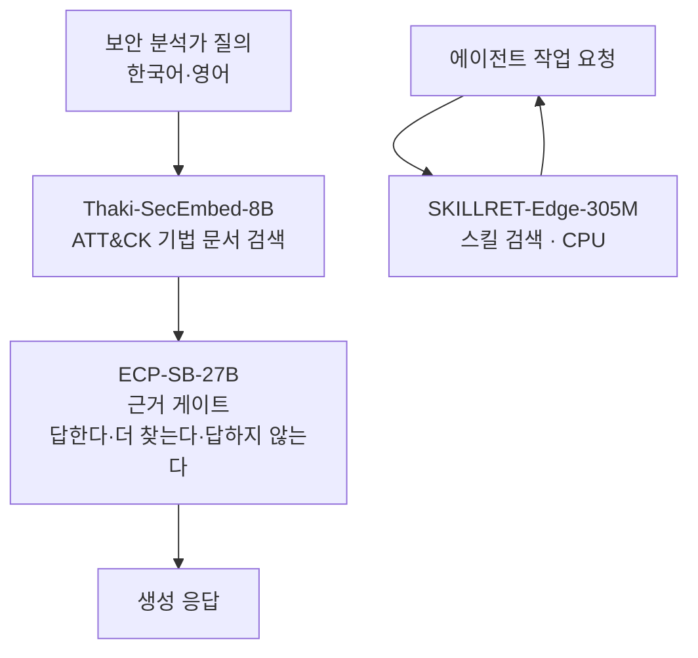

사내망에서 보안 문서를 찾아야 하거나, RAG가 근거 없이 답하는 것을 막아야 하거나, 에이전트가 쓸 스킬을 CPU에서 골라야 하는 분께 드리는 글입니다. 이번에 공개하는 세 모델이 각각 그 한 칸을 맡습니다.

먼저 밝혀 둘 것이 있습니다. 셋 중 둘은 학습을 시작하기 전에 걸어 둔 합격선을 넘지 못했습니다. 다키클라우드는 그 사실을 지우지 않고 모델 카드 첫 화면에 적은 뒤 그대로 공개했습니다. 아래 숫자를 보시고 쓸지 말지 정하시면 됩니다.

## 쉽게 말하면

시험 문제를 누가 냈느냐에 따라 같은 학생의 점수가 달라집니다. 선생님이 수업에서 쓰던 문제집으로 시험을 내면 그 수업을 들은 학생이 유리합니다. 다른 학교 선생님이 낸 문제로 보면 실력이 더 솔직하게 드러납니다.

모델 평가도 같습니다. 학습 문제를 만든 그 생성기로 시험 문제까지 만들면, 점수가 올라도 실력이 올랐다고 말하기 어렵습니다. 그래서 다키클라우드는 공개 여부를 정하는 합격선을 학습 전에 글로 적어 둡니다. 결과가 나온 뒤에는 그 선을 고치지 않습니다. 이번 세 모델 중 하나는 그 선을 넘었고, 둘은 넘지 못했습니다.

## 세 모델이 서는 자리

왼쪽 줄기는 보안 질의가 지나가는 길입니다. 임베딩이 관련 문서를 찾아 오면, 게이트가 그 근거로 답해도 되는지를 먼저 판정합니다. 오른쪽 줄기는 에이전트가 수천 개 스킬 중 지금 쓸 것을 고르는 길입니다. GPU 없이 돌아갑니다.

## 같은 어댑터에 판정이 두 개 나왔습니다

Thaki-SecEmbed-8B-Preview는 Qwen3-Embedding-8B에 LoRA를 얹어 MITRE ATT&CK 기법 문서를 찾게 만든 어댑터입니다. 학습에는 공개 데이터인 ATT&CK STIX만 썼습니다.

공개 판정의 근거가 된 것은 왼쪽입니다. 583문항짜리 사전등록 held-out에서 nDCG@10이 0.686으로 기본 모델 0.670보다 높았지만, 신뢰구간이 0을 포함했습니다. 판정은 분명한 차이 없음입니다. 저희는 개선을 주장하지 않습니다. 세 개 시드를 따로 학습해 보니 점수가 0.676에서 0.705까지 흩어졌는데, 이 흔들림이 기본 모델과의 차이만큼 컸습니다. 주장을 접은 이유가 여기에 있습니다.

오른쪽은 공개한 뒤에 잰 값입니다. Blind-B는 학습 교사와 다른 모델들이 문제를 내고 정답은 ATT&CK STIX 관계로 코드가 정하는 2,025문항 벤치입니다. 여기서는 0.694 대 0.550으로 벌어졌고 신뢰구간도 0에서 멀리 떨어졌습니다. 두 결과는 모순이 아니라 같은 이야기의 두 면입니다. 학습과 같은 출제기로 만든 문제는 두 모델을 가르지 못했습니다. 독립 출제기로 만든 문제는 갈랐습니다. 다만 이 측정은 공개 결정 뒤에 나왔으므로 사전등록 판정을 뒤집지 않습니다.

대가도 있습니다. 일반 검색 성능을 네 벌로 확인했는데, 금융 질의응답인 FiQA-2018에서 0.650이 0.610으로 내려갔습니다. 사전등록한 파국 기준인 10%에는 못 미치지만 통계적으로 분명한 하락입니다. 금융 문서를 찾는 자리라면 기본 모델을 쓰시는 편이 낫습니다.

## 안전장치로 쓰지 말라고 적었습니다

ECP-SB-27B-Research는 H200 한 장에 Qwen3.8-27B를 한 번만 올려 두 개의 API를 띄우는 패키지입니다. 하나는 평범한 생성입니다. 다른 하나는 검색 직후 생성 직전에 답할지, 더 찾을지, 답하지 않을지를 정하는 근거 게이트입니다. 기본 가중치는 복사하지 않고 네 개 시드의 LoRA와 판정 머리, 봉인한 임계값만 담았습니다.

배포 점검은 통과했습니다. 기본 모델만 서빙하는 vLLM과 같은 조건으로 비교했을 때 생성 전용 트래픽은 기준 안에 들었습니다. 게이트 요청 256건은 오프라인 기준값과 한 건도 달라지지 않았습니다. 다만 p99 로그확률 격차가 기준선을 0.00000286 차이로 통과했습니다. 통과는 통과이되 여유가 없었습니다. 그래서 혼합 트래픽에서 생성이 기본 모델과 똑같다고는 적지 않았습니다. 64개 중 6개가 달랐고 원인을 귀속하지 못했기 때문입니다.

넘지 못한 선은 따로 있습니다. 근거가 모자란데도 답해 버린 비율이 시드 묶음 기준 6.5%입니다. 목표는 5%였습니다. 0.047부터 0.093까지 시드마다 편차도 컸습니다. 그래서 모델 카드에는 이 게이트를 안전 통제 수단으로 쓰지 말라고 적었습니다. 연구 배포이고 프로덕션 인증이 아닙니다.

| 점검 항목 | 결과 |
|---|---|
| 기본 가중치 1회 적재, 단일 GPU 프로세스 | 통과 |
| 생성 API와 게이트 API 동시 응답 | 통과 |
| 혼합 트래픽에서 게이트 판정 256건 | 통과, 변동 0건 |
| 혼합 트래픽에서 생성이 기본과 동일 | 미입증, 64건 중 6건 상이 |
| 프로덕션 안전성 | 미인증, 미답변율 6.5% 대 목표 5% |

## 통과한 쪽은 CPU에서 돕니다

SKILLRET-Edge-Arctic-305M은 에이전트가 쓸 스킬을 찾는 305M 임베딩입니다. 8B 교사에서 증류했고 ONNX FP32로 CPU에서 돕니다. 사전등록 게이트는 영어 품질을 지키면서 한국어를 올리는 것입니다. 둘 다 넘었습니다. 공개 테스트 분할에서 영어 nDCG@10이 0.6B 기준선보다 1.07점 높았습니다. 한국어는 저비트 비교 대상보다 11.99점 높았습니다.

쓸 자리를 가르는 숫자는 품질보다 지연과 메모리입니다.

| 호스트 | 스레드 | 이 모델(ONNX FP32) p50 | 최대 RSS | 0.6B Q4_1(llama-server) p50 | 최대 RSS |
|---|---|---|---|---|---|
| AMD EPYC 9355 | 1 | 133.8 ms | 2.0 GB | 1,973 ms | 3.58 GB |
| AMD EPYC 9355 | 4 | 47.7 ms | 2.1 GB | 582 ms | 3.58 GB |
| Apple M4 Pro | 1 | 36.0 ms | 3.0 GB | 2,073 ms | 3.58 GB |

다만 이 표는 가중치 둘이 아니라 서빙 구성 둘을 비교한 것입니다. 오른쪽은 슬롯 16개를 잡아 둔 HTTP 서버라 메모리 대부분이 KV와 연산 버퍼입니다. 양자화 기법 자체가 느리다는 뜻이 아닙니다. 그리고 INT8 빌드는 없습니다. 동적 INT8과 정적 QDQ INT8 모두 품질 게이트를 통과하지 못해 FP32만 올렸습니다. ONNX 파일이 1.23GB이니 휴대폰에 넣을 크기가 아닙니다. CPU 서버에서 쓰는 빠른 검색기로 보시면 맞습니다.

## 서빙할 때 알아 두실 것

SecEmbed는 어댑터라 기본 모델과 함께 올려야 합니다. 기본 차원은 4096입니다. 잘라 쓰는 차원은 MRL로 학습하지 않았으므로 잘라 쓰실 때는 직접 재 보셔야 합니다. ECP-SB는 vLLM 0.28.0에서만 검증했습니다. 0.31 이식은 계획만 있고 검증되지 않았으며, 게이트 분기가 모든 토큰마다 돌기 때문에 비용도 공짜가 아닙니다. SKILLRET-Edge는 반대로 가장 간단합니다. 질의에 `query: ` 접두사를 붙이고 ONNX Runtime으로 부르면 끝입니다. 출력은 그래프 안에서 이미 L2 정규화됩니다.

셋 다 Apache-2.0입니다. 학습에 쓴 외부 데이터는 공개 라이선스만 썼습니다. 폐쇄망에 그대로 들여놓을 수 있는 조건이라는 뜻입니다.

## 왜 미달한 것까지 공개하는가

보안과 금융 쪽 고객이 가장 먼저 묻는 질문은 성능이 아니라 "이 숫자를 누가 어떻게 쟀는가"입니다. 통과한 것만 공개하면 그 질문에 답할 수 없습니다. 합격선을 먼저 적고 결과가 나온 뒤 그 선을 고치지 않는 방식은 자랑이 줄어드는 대신 숫자의 수명이 길어집니다.

다키클라우드가 만드는 업무 자동화 플랫폼 Paxis는 에이전트의 모든 실행을 정책 게이트와 감사 기록으로 통과시킵니다. 근거가 모자랄 때 멈추는 판단은 그 구조의 앞단에 들어갈 재료입니다. 스킬 검색기는 수천 개 스킬 중 지금 쓸 것을 고르는 자리에 들어갑니다. 다만 이번 세 모델은 아직 어떤 제품에도 들어가 있지 않습니다. 세 번째 모델이 GPU 없이 CPU에서 47.7ms에 답한다는 점은 온프렘과 폐쇄망 환경에서 특히 쓸모가 있습니다. GPU 한 장 없이도 에이전트의 스킬 선택 단계를 돌릴 수 있기 때문입니다.

## 다음에 무엇을 재나

ECP-SB는 vLLM 0.31 이식과 함께, 같은 접두사를 두 번 계산하지 않도록 forward를 재사용하는 작업이 걸려 있습니다. 미답변율은 별도의 독립 평가로 다시 잽니다. 목표를 못 넘긴 숫자는 다음 측정으로 갱신하지, 지난 숫자를 고쳐 쓰지 않습니다.

SKILLRET-Edge는 다국어 확장과 더 작은 학생 모델이 다음 순서입니다. 22M급 학생을 INT8로 22.7MB까지 줄이는 쪽을 봅니다. 네 개 임베더 계열에 걸친 사후 양자화 비교는 논문으로 정리합니다.

SecEmbed는 Preview 상태를 유지합니다. Blind-B는 한 번 썼으니 이제 블라인드가 아니라 회귀 벤치로만 씁니다. 다음 판정은 새 블라인드 셋으로 받아야 합니다. 그 전에 FiQA 하락을 줄이는 일이 숙제로 남습니다.

## 공개한 것

| 저장소 | 형식 | 상태 |
|---|---|---|
| [ThakiCloud/Thaki-SecEmbed-8B-Preview](https://huggingface.co/ThakiCloud/Thaki-SecEmbed-8B-Preview) | LoRA 어댑터 | 프리뷰, 사전등록 판정은 차이 없음 |
| [ThakiCloud/ECP-SB-27B-Research](https://huggingface.co/ThakiCloud/ECP-SB-27B-Research) | 시드 가중치와 매니페스트 | 연구 배포, 프로덕션 미인증 |
| [ThakiCloud/SKILLRET-Edge-Arctic-305M](https://huggingface.co/ThakiCloud/SKILLRET-Edge-Arctic-305M) | ONNX FP32와 PyTorch | 사전등록 게이트 통과 |

평가를 먼저 적고 결과를 나중에 보는 순서를 지키면, 좋은 소식과 나쁜 소식이 같은 무게로 남습니다. 이번 공개에서 지키고 싶었던 것은 세 모델의 점수가 아니라 그 순서였습니다.

*측정 출처: 세 모델의 Hugging Face 모델 카드에 공개된 평가표입니다. ECP-SB 배포 점검은 H200-NVL 한 장과 vLLM 0.28.0, SKILLRET-Edge CPU 측정은 AMD EPYC 9355와 Apple M4 Pro에서 쟀습니다.*
