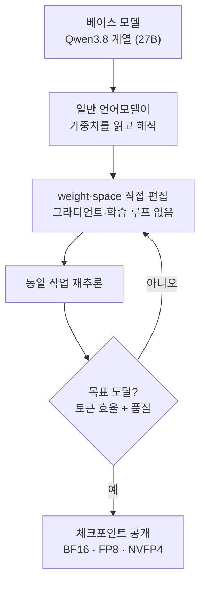

## 왜 읽어야 하나

오픈웨이트 지형을 추적하는 ML 인프라 엔지니어, 그리고 GPU 큐와 추론 비용 라인에서 일하는 팀이라면 이 글을 "가중치를 직접 고치는 모델"이라는 새 클래스를 지켜볼 가치가 있느냐를 판단하기 위해 읽으면 됩니다. 핵심 결론을 먼저 적습니다. varien이 11월 6일에 공개한 첫 모델 Qwen Concept 27B는 학습 없이 가중치를 직접 편집해 thinking token을 54% 줄였다고 주장합니다. 다만 작성일 기준으로 가중치 링크가 아직 검증되지 않았기 때문에, 지금 필요한 태도는 바로 도입이 아니라 "링크 확인까지 대기하고, 확인 이후 자체 검증"입니다.

## 쉽게 말하면

사후 학습(post-training)은 모든 악보를 처음부터 다시 배운 것처럼 비쌉니다. weight-space editing은 다릅니다. 피아노를 다시 배우지 않고, 튜너가 조율대에 앉아서 특정 현의 장력을 직접 조절하는 작업에 가깝습니다. 여기서 튜너는 일반 언어모델입니다. MIT CSAIL 실험에서는 GPT-6 Astra가 현(가중치)을 읽고, 몇 가지만 고르게 튜닝되어 있는 것을 골라 직접 조절했습니다. 연습(그라디언트, 학습 루프)은 없습니다. Qwen Concept 27B는 이렇게 조율된 뒤 처음으로 공개된 오픈모델이라는 점에서 의미가 있습니다. 이후 이 글은 "조율"이라는 비유를 끝까지 씁니다.

## 개요

흐름이 빠릅니다. 11월 2일, MIT CSAIL이 "Sparks of Weight-Space Programming"이라는 블로그 포스트를 내놓았습니다. 저자는 Rikiya Takehi, Jayden Teoh, Alex Zhang, Omar Khattab이며, 포스트 자체는 비피어리뷰로 명시되어 있습니다. 핵심 실험은 이렇습니다. GPT-6 Astra가 Qwen3.5-0.8B의 가중치 중 0.016%만 직접 수정했습니다. 그 결과 MATH-500은 7.9%에서 48.1%로, GSM8K는 13.8%에서 67.1%로 올랐습니다. 일반적인 학습 실행이면 GPU 시간이 들 법한 결과가, 가중치 편집만으로 나온 것입니다.

4일 뒤, 11월 6일에 개발 조직 varien이 "our first model"이라고 부르는 Qwen Concept 27B를 공개했습니다. 발표는 두 갈래로 나왔습니다. varien의 1인칭 트윗("We've open-sourced Qwen Concept 27B")과, "사람과 AI 에이전트를 위한 실험적 디지털 거버넌스 프로젝트"라고 자신을 소개하는 Concept Country의 서술입니다. 두 발표는 같은 모델, 같은 기법, 같은 수치 묶음을 가리킵니다.

## Qwen Concept 27B, 무엇인가

모델은 27B 규모로, 베이스는 Qwen 모델입니다. 발표 원문은 베이스를 Qwen3.8 계열로 지칭하며(2차 보도가 인용한 원문 기준), 이는 본 베이스가 다키클라우드가 서빙 중인 Qwen3.8-27B와 같은 계열임을 뜻합니다. 이 글이 다루는 "Concept 27B"는 그 베이스 위에 학습을 새로 돌린 변종이 아니라, 베이스 가중치에 직접 편집을 적용한 변종입니다. 차이가 큽니다. 후자의 생산 비용에는 학습 루프가 없고, 대신 "읽기, 편집, 검증"이 들어 있습니다.

개발자가 발표한 수치를 모으면 다음 표가 됩니다.

| 항목 | 개발자 주장 | 검증 상태 |
|---|---|---|
| thinking token | 54% 감소 (베이스 대비) | 제삼자 재현 없음 |
| GPQA Diamond | 3% 향상 (베이스 대비) | 제삼자 재현 없음 |
| 전력당 유용 토큰 | 30% 향상 | 제삼자 재현 없음 |
| 개발 환경 | 로컬 NVIDIA DGX Spark | 발표 |
| 체크포인트 | BF16·FP8·NVFP4 무료 | 작성일 현재 가중치 링크 미검증 |
| 라이선스 | "무료" (구체 라이선스 미기재) | 확인 필요 |

작성일(11월 7일) 기준으로 Hugging Face에서 모델 검색과 varien 조직 페이지, GitHub 저장소 검색을 모두 시도했으나 가중치를 찾지 못했습니다. 즉 "open-sourced"는 발표 단계의 진술이며, 실제로 내려받을 수 있는 아티팩트는 아직 확인되지 않은 상태입니다. 이 글의 모든 수치는 그 전제 위에서 읽어야 합니다.

## weight-space programming, 배경

용어의 정의를 정리합니다. "일반 언어모델이 다른 신경망의 가중치를 해석하고 직접 작성하는 방식"이며, 그라디언트 강하와 학습 루프를 쓰지 않는다는 점입니다. programming이라는 단어가 붙는 이유는, 모델을 편집하는 행위 자체가 "코드를 쓰는" 것과 같은 범주라는 주장이기 때문입니다. 대상만 텍스트 파일이 아니라 신경망 안의 수치입니다.

이 이야기가 추측을 넘어선 데는 11월 2일 실험의 규모가 역할을 했습니다. 0.8B 소형 모델에서 가중치의 0.016%만 건드려 MATH-500을 7.9%에서 48.1%로 올린 것입니다. 같은 수준을 학습으로 만들려면 보통 상당한 실행이 필요합니다. 그 뒤로 같은 방향의 연구(arXiv 2611.04268, 2611.07319)와 편집 툴 저장소(openwsp, wsp-kit 계열)가 등장했습니다. "모델을 고치는 방식"이 데이터와 학습에서 읽기와 편집과 검증 쪽으로 이동하고 있는지 확인하는 것, 이것이 지금 해야 할 일입니다.

여기서 의외인 부분은 "읽기" 능력입니다. 가중치를 편집하려면 먼저 가중치를 해석해야 하고, 일반 언어모델이 다른 신경망의 가중치를 해석해서 의미 있는 위치를 골랐다는 것이 실험의 전제입니다. 가중치가 단순히 실수 값의 덩어리가 아니라, 외부 모델의 언어모델이 읽을 수 있을 만큼 구조화된 것이라면, 해석가능성(interpretability) 연구와 편집 작업이 하나의 언어로 이어진다는 뜻입니다. 조율사가 현을 고르려면 현의 위치를 알아야 하는 것과 같은 이치입니다. 이 전제가 성립한다면, 편집 대상이 되는 모델과 편집을 수행하는 모델은 같은 토큰 공간에서 대화할 수 있습니다.

## 왜 thinking token이 줄어드는가

thinking token은 모델이 답을 내리기 전에 스스로 생성하는 추론 토큰입니다. 추론형 모델은 질문이 오면 긴 내부 사고를 먼저 뽑아내는데, 그 생성 비용이 추론 청구서 그대로 반영됩니다. weight-space editing이 이 토큰 수를 줄였다는 주장은, "장게 생각해도 정확도는 유지한다"는 방향의 가중치 변경이 있었음을 뜻합니다. 54%라는 숫자 자체는 검증되지 않지만, 기전이 가리키는 방향은 명확합니다. 추론 비용이 학습이 아니라 편집으로 낮아질 수 있다는 것입니다.

그리고 "추가 포스트트레이닝 없이 전력당 유용 토큰 30% 향상"이라는 진술이 붙습니다. 서빙 팀 관점에서 이것은 "조금 더 좋은 모델" 이야기가 아니라, 같은 품질 대비 추론 단가가 어떻게 내려가느냐의 이야기입니다. thinking token이 줄면 동일 질의당 생성 토큰이 줄고, 생성 토큰이 줄면 카드 점유 시간과 전력이 줄어듭니다. 온프레미스에서 이 체인은 곧 월 요금으로 환산됩니다.

## 실제로 뭘 할 수 있는가

지금 당장 실행 가능한 것은 아무것도 없습니다. 내려받을 가중치 링크가 없기 때문입니다. 할 수 있는 준비는 두 가지입니다.

첫째, 가중치 공개를 지켜보는 것입니다. varien 조직 페이지는 작성일 현재 존재하지 않으므로, 공개가 되면 Hugging Face의 varien 조직 아래에 올라올 가능성이 큽니다. BF16, FP8, NVFP4 세 체크포인트가 함께 오면 서빙 준비는 단순해집니다.

둘째, 검증 수트를 미리 준비하는 것입니다. thinking token 54% 감소는 발표 자료로는 알 수 없는 숫자입니다. 자기 작업의 eval set에서 베이스와 편집 모델을 함께 돌리거나, 최소한 베이스의 thinking token 분포를 미리 찍어 두어야 비교가 성립합니다. 베이스가 Qwen3.8 계열이면 이 준비는 이미 하던 일입니다.

NVFP4 체크포인트가 발표대로 제공되면 실행 경로는 더 짧아집니다. 27B급 NVFP4 모델은 단일 고메모리 GPU에 올라가는 규모입니다. 다키클라우드의 ai-platform은 이미 Qwen3.8-27B의 NVFP4 GPTQ 버전을 서빙 환경에서 돌리고 있습니다. 같은 베이스, 같은 양자화 계열, 같은 서빙 스택에서 "편집된 버전"과 "원본"을 정면 비교할 수 있는 조건이 되는 것입니다.

서빙 측에서는 thinking token 감소가 KV 캐시로도 이어집니다. 생성 토큰이 줄면 요청당 점유 시간이 줄고, 같은 GPU에서 처리할 수 있는 동시 요청 수(throughput)가 올라갑니다. 온프레미스 환경에서는 이 체인이 곧 카드를 더 사지 않고 용량을 더 만드는 계산으로 바뀝니다. 단, 전제는 하나입니다. 편집이 품질을 지키는 범위 내에서 thinking token을 줄였을 때, 라는 것. 그 범위는 자기 eval set에서 확인하는 것 밖에는 없습니다.

## ThakiCloud 제품 적용 시사점

**ai-platform(서빙 경제성·온프레미스).** 모델 운영의 단위가 바뀌고 있습니다. 그간 단위는 학습이었습니다. 파인튜닝, RL 포스트트레이닝, 데이터 큐레이션은 모두 "컴퓨트로 가중치를 만든다"는 구조의 투자였습니다. weight-space editing은 그 안에 "편집"이라는 더싼 단위를 도입합니다. 편집의 원가가 GPU 시간이 아니라 검증입니다. 편집 이후에 "품질이 안 빠졌다"를 증명하는 테스트 스위트 실행이 들어가야 하니까요. 그래서 ai-platform의 모델 파이프라인에서 eval 수트의 지분이 오릅니다. 모델을 고칠 수 있는 주체가 넓어졌으니, 고친 뒤 확인할 도구의 값도 함께 오르는 구조입니다.

**Paxis(새 액션 클래스).** Paxis는 Skills·Tools·Policies·Audit Logs를 일급 리소스로 다루는 Agent-Native Cloud입니다. weight-space programming은 이 목록에 "모델 가중치 편집"이라는 새로운 액션 클래스를 추가합니다. 에이전트가 작성하는 프로그램이 텍스트 파일이 아니라 모델의 가중치가 되는 순간이 생긴 것입니다. 그리고 변경 규모가 리뷰 가능한 단위입니다. MIT CSAIL 실험의 0.016%가 27B 모델에서도 유지된다면, 코드 PR에서 익숙한 "작고 리뷰 가능한 diff" 개념이 모델에도 확장됩니다. 편집 자체는 저렴합니다. 다만 저비용 편집은 반드시 정책 게이트와 감사로그, 그리고 편집 전후의 eval 결과 대조와 함께 실행되어야 자산이 됩니다. Paxis 관점에서 "가중치 편집을 승인 가능한 워크플로로 만들겠다"는 질문은 머지않아 실재가 됩니다.

## 한계 및 반론

첫째, 기반 자체가 비피어리뷰입니다. MIT CSAIL 포스트가 스스로 비피어리뷰임을 명시하고, Qwen Concept 27B의 수치는 개발자 보고입니다. 제삼자 재현이 없으며, 재현할 가중치가 현재 없습니다.

둘째, 일반화가 증명되지 않았습니다. Sparks 실험은 0.8B 소형 모델에서 나왔습니다. 같은 편집 방식이 27B에서 동일한 이점을 주는지는, 가중치가 공개되어도 별도 실험이 필요합니다.

셋째, 회귀를 눈으로 보지 못합니다. 코드 diff가 리뷰되는 이유는 사람이 코드를 읽을 수 있기 때문입니다. 가중치의 0.016%가 숫자로는 변경되어도, 그 의미는 테스트 스위트 밖에는 보이지 않습니다. 수트가 얇으면 "조율"은 "예측 불가 미세 조절"로 전락합니다. 조율의 품질은 조율사의 귀만큼만 좋다는 뜻입니다.

넷째, 라이선스가 불분명합니다. "무료"는 라이선스가 아닙니다. Apache 2.0이든 MIT이든, 상업 사용 전에는 명시된 라이선스 문구가 있어야 합니다. 발표 자료에 그 문구가 보이지 않는 한, 기업 도입 판단은 보류가 정답입니다.

## 정리

Qwen Concept 27B는 weight-space editing을 논문 단계가 아니라 공개 모델 단계로 끌어온 첫 사례입니다. thinking token 54% 감소, 전력당 유용 토큰 30% 향상이라는 주장은 능력 이야기가 아니라 추론 비용 이야기입니다. 독자에게 필요한 다음 행동은 세 가지입니다.

1. 가중치 공개 링크를 지켜봅니다. varien 조직(Hugging Face)이 첫 후보입니다.
2. 공개되면, 자기 eval set에서 thinking token 수치를 재검증한 뒤 채택 여부를 정합니다.
3. NVFP4 체크포인트가 함께 오면, 이미 서빙 중인 같은 베이스(NVFP4 GPTQ)와 정면 비교를 수행합니다.

조율은 값싸지만, 조율은 조율사의 귀만큼만 믿음직합니다. weight-space editing과 포스트트레이닝의 차이는 원가에도 있지만, 결국 이 검증 구조의 차이입니다. 다음 주에는 가중치가 실제로 내려오는지부터 확인하면 됩니다.

## 출처

- AGI Hunt, "Concept Country open-sources first model, Qwen Concept 27B" (2026-11-06). https://agihunt.info/en/p/1a1b16e2fc82298ba599eebdbd8
- varien 발표 (X). https://x.com/varien/status/2118684136747454907
- Gabriel Garrett (X, AGI Hunt이 인용한 원문). https://x.com/GabGarrett/status/2118722771169804501
- Wikipedia, "Weight-space programming". https://en.wikipedia.org/wiki/Weight-space_programming
- MIT CSAIL, "Sparks of Weight-Space Programming" (블로그 포스트, 2026-11-02, 비피어리뷰).
- Hugging Face 모델 검색·varien 조직 페이지, GitHub 저장소 검색 (2026-11-07 기준, 가중치 미발견).
