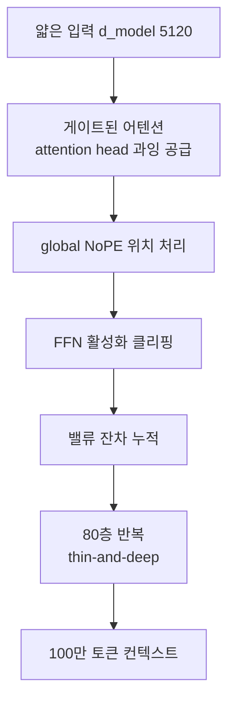

## 왜 읽어야 하나

미국 오픈웨이트 코딩 모델을 추적하는 ML 인프라 엔지니어, 온프레미스 서빙 비용을 따지는 팀, 에이전틱 코딩 작업의 실행 단가를 낮추고 싶은 Paxis 운영자라면 이 글을 읽으면 됩니다. 핵심 결론을 먼저 적습니다. 리커시브AI(Ricursive Intelligence)가 11월 4일에 공개한 첫 모델 **Ripple-65B Preview**는 65B 파라미터의 dense Transformer, 최대 100만 토큰 컨텍스트, Apache 2.0 라이선스라는 세 가지 축 위에, 에이전틱 코딩에서 미국 오픈웨이트 최상위(TerminalBench 2.1 80.52, 자체 보고)를 주장합니다. 발표 기준 총 R&D 비용이 약 3,200만 달러로 이전 오픈웨이트 SOTA의 1/10이라는 점까지 합치면, "큰 모델이 아니라 싼 모델이 코딩을 잘한다"는 쪽으로 오픈웨이트 지형이 움직이고 있음을 가리킵니다. 쓸지 말지는 아래 벤치마크와 서빙 요건을 보고 정하시면 됩니다.

## 쉽게 말하면

대부분의 언어 모델은 넓고 낮은 건물처럼 생겼습니다. 한 층(attention head나 hidden 차원)이 넓고 층수가 적으면 한 층당 계산이 무겁습니다. Ripple은 반대로 얇고 높은 탑을 택했습니다. hidden 차원(d_model)을 5,120으로 비교적 좁게 두고 층을 80층까지 쌓는 thin-and-deep 설계입니다. 같은 65B라도 층이 많고 얇으면 한 단계가 가볍고, 그 얇은 단계가 길게 이어져 깊이 있는 변환을 하는 구조입니다. 발표 자료는 이 설계를 "Gemma 3N처럼" 얇고 깊게 잡았다고 표현합니다. 이름의 물결(Ripple)은 여기서 빌려오면, 얇은 층 하나가 보내는 신호가 80층을 타고 멀리까지 퍼져 나간다는 느낌입니다.

## 개요

리커시브AI는 미국 오픈웨이트 모델사를 새로 열었습니다. Ripple-65B Preview가 그 첫 모델이고, 공개 자료에 따르면 이 회사는 자사 제품 뒤에 있는 비공개 모델의 "일반 목적 변형"을 오픈웨이트로 내놓는 방식을 택했습니다. 가중치는 Hugging Face의 `ricursiveAI/Ripple-65B-Preview`에 올라 있으며, BF16 instruction-tuned 모델과 BF16 base 모델, 그리고 배포용 NVFP4 양자화 체크포인트가 함께 제공됩니다. 호스팅은 Together AI, GMI Cloud, OpenRouter, Fireworks에서 즉시 열립니다.

학습 규모는 발표 기준으로 12조 토큰입니다. 단계별 구성을 보면 pretrain이 12조, midtrain이 2,000억, long context 학습이 65억, SFT가 1,830억, long context SFT가 135억 토큰입니다. 100만 토큰(1,048,576) 컨텍스트를 지원하는 것도 같은 학습 흐름 안에서 long context 단계를 따로 둬서 달성했습니다. 비용은 "처음부터 전체 R&D로 약 3,200만 달러"이며, 이 수치는 이전 에이전틱 코딩 오픈웨이트 SOTA 대비 1/10이라고 회사 측이 강조합니다.

단계별 토큰 구성에서 실무적으로 읽을 부분이 있습니다. pretrain 12조 토큰에 비해 long context(65억)·long context SFT(135억)은 두 자리 비율에 못 미칩니다. 즉 "100만 컨텍스트"라는 장점은 막대한 추가 학습이 아니라, 짧은 구간의 집중 학습으로 얹은 능력이라는 뜻입니다. 같은 65B를 더 긴 컨텍스트로 쓰려는 다른 팀이 반복되는 질문, 이 추가 단계를 어디까지 투자했느냐는 점에서 Ripple은 "저비용으로 긴 컨텍스트를 확보한" 사례로 꼽힙니다. 물론 이 단계 학습만으로 100만 토큰 전체 구간에서 품질이 균일하게 유지되는지는 공개 수치로는 확인되지 않으며, 아래 한계에서 다시 짚습니다.

## 아키텍처, thin-and-deep

Ripple의 구조적 선택은 dense Transformer에서 얇고 깊게 간다는 것입니다. d_model 5,120, 총 80층, attention head 수를 과잉 공급(overprovision)하는 구성이 핵심입니다. 발표 자료에서 지목한 구조 기술은 네 가지입니다. FFN activation clipping(활성화 클리핑), gated attention(게이트된 어텐션), global NoPE(위치 인코딩의 RoPE를 전역적으로 배제하고 절대·무 위치 신호를 쓰는 방식), value residuals(밸류 잔차)입니다.



이 구조가 주는 실무적 함의는 두 가지입니다. 첫째, 한 층이 얇으니 배치당 계산이 가볍고, 그 가벼운 단계를 많이 쌓아 깊이를 확보하는 방식입니다. 둘째, global NoPE와 value residuals는 긴 컨텍스트에서 위치 신호와 정보 흐름을 안정적으로 유지하려는 설계로, 100만 토큰 컨텍스트를 dense 모델에서 가능하게 하는 기둥입니다. 65B라는 중간 규모에서 이런 구조 기술을 조합한 점은, "파라미터 수 경쟁"이 아니라 "구조와 학습 비용 경쟁"으로 오픈웨이트가 옮겨가고 있다는 신호입니다.

## 벤치마크

아래는 instruction-tuned 모델의 주요 수치입니다. 모든 값은 발표 자료(self-reported)에서 가져온 것으로, 제삼자 재측정이 아닙니다. 코딩·에이전트 항목이 강하고, 수학·일반 지식도 상위권입니다.

| 벤치마크 | 수치 | 비고 |
|---|---|---|
| TerminalBench 2.1 | 80.52 | 미국 오픈웨이트 SOTA 주장(자체 보고) |
| SWE-bench Verified | 76.5 | |
| SWE-bench Pro v1.0 | 61.42 | |
| SWE-bench Pro v2.0 Hard | 79.1 | |
| DeepSWE 1.1 | 44.3 | |
| MCP Atlas | 71.67 | 에이전트 도구나동 |
| AIME 2025 | 98.3 | 수학 |
| GPQA Diamond | 85.2 | 과학 추론 |
| MMLU | 89.6 | 일반 지식 |
| MMLU-Pro | 84.2 | |
| IFBench | 79.2 | 지시 준수 |

이 벤치마크들이 무엇을 잰다는 점을 짚으면 숫자의 의미가 선명해집니다. TerminalBench 2.1은 모델이 터미널 안에서 다단계 작업(파일 조작, 스크립트 실행, 환경 설정)을 스스로 끝내는 능력을 측정합니다. SWE-bench 계열은 실제 소프트웨어 저장소에서 버그 리포트를 읽고 패치를 만들어 통과시키는 능력을 측정하며, Verified는 검증된 문제 집합, Pro v2.0 Hard는 난이도를 높힌 변형입니다. MCP Atlas는 모델이 외부 도구(MCP 서버)를 올바르게 호출해 작업을 완주하는 능력을 측정합니다. 세 가지를 합치면 "코드만 잘 쓰는 것"이 아니라, 환경을 조작하고 도구를 부르고 실제 저장소를 고치는 에이전틱 코딩 전체 스펙트럼을 잰 것입니다. Ripple이 이 세 축에서 동시에 상위에 있다는 것이 이번 발표의 실체입니다.

강점은 에이전틱 코딩 구간입니다. 터미널 기반 작업(TerminalBench 2.1)에서 80.52, 실제 저장소 문제 해결(SWE-bench 계열)에서 Verified 76.5·Pro v2.0 Hard 79.1, 에이전트 도구나동(MCP Atlas)에서 71.67을 기록했습니다. 반면 SciCode 39.4, AutomationBench 36.4, τ³-bench banking 31.27 같은 영역은 상대적으로 낮아, "코딩 에이전트"라는 특정 작업에 특화되어 있고 범용 도메인까지 고르게 강하지는 않다는 점이 수치로 드러납니다. base 모델은 MMLU 5-shot 83.7, HumanEval pass@1 70.9, GSM8K 88.5 수준입니다.

## 가중치 확보 및 실행

가중치는 `ricursiveAI/Ripple-65B-Preview`에서 BF16(약 130GB급)로 내려받습니다. 배포 효율을 위한 NVFP4 체크포인트가 함께 제공되며, 이 변형은 발표 자료에서 NVIDIA DGX Spark(소형 온프레미스 머신) 실행을 명시적으로 겨냥합니다. 호스팅 경로는 Together AI, GMI Cloud, OpenRouter, Fireworks에서 API로 즉시 사용 가능합니다.

제공 변형은 세 가지입니다.

| 변형 | 정밀도 | 용도 |
|---|---|---|
| Instruction-tuned | BF16 | 서빙·추론, 대화·에이전트 작업 |
| Base | BF16 | 파인튜닝 출발점 |
| NVFP4 | 4비트 양자화 | 배포·온프레미스, DGX Spark급 실행 |

Base 모델이 따로 제공되는 것이 실무에서 중요한 이유는 여기 있습니다. instruction-tuned 모델을 그대로 써도 되지만, 자사 도메인(내부 API, 사내 저장소 규칙, 에이전트 작업 정의)에 맞출 파인튜닝을 하려면 base 모델이 출발점이 됩니다. Apache 2.0은 base 가중치에 대한 파생·수정까지 허용하므로, "다운로드한 모델을 그대로 쓰는 것"과 "자사 워크플로에 맞춰 SFT한 모델을 쓰는 것" 두 경로를 모두 열립니다. 65B는 LoRA나 QLoRA 같은 효율 파인튜닝이 실용적인 규모이기도 해, 전 가중치 학습이 아니라 어댑터만 학습해 도메인 전환을 하는 경로가 열립니다.

라이선스가 Apache 2.0인 점도 실무에서 중요합니다. per-seat나 호출 횟수 제한이 없는 오픈 라이선스로, 가중치를 내려받아 온프레미스에서 서빙하거나 파생 모델로 파인튜닝해 내부에 쓰는 것까지 허용입니다. 코딩 에이전트처럼 모델 호출이 잦은 워크로드일수록, 호스팅 API의 토큰 단가 대신 고정된 카드·전력 비용으로 갈 수 있는 여지가 커집니다. 이 자유는 65B라는 규모가 "우리 데이터·우리 워크플로로 직접 다룰 수 있는" 수준이라는 뜻이기도 합니다.

온프레미스에서 돌리는 표준 서빙 경로는 vLLM입니다. NVFP4 변형과 긴 컨텍스트를 함께 잡는다면 대략 이런 형태입니다.

```bash
pip install -U vllm
vllm serve ricursiveAI/Ripple-65B-Preview \
  --quantization nvfp4 \
  --max-model-len 1048576 \
  --gpu-memory-utilization 0.90
```

이 명령은 모델카드의 제공 변형을 전제로 한 일반적인 서빙 설정이며, 본 글에서 직접 실행해 측정한 수치는 아닙니다.

실무에서 결정 변수는 컨텍스트 길이입니다. 65B 모델을 NVFP4로 양자화하면 가중치 자체는 실수용 하나에서 4비트 정도로 압축되지만, 컨텍스트가 차오르며 쌓이는 KV 캐시는 모델 파라미터와 별개의 메모리를 씁니다. KV 캐시는 배치당 토큰 길이에 비례해 커지므로, 100만 토큰을 한 컨텍스트에 채우면 가중치 메모리보다 KV 캐시가 더 큰 비중을 차지할 수 있습니다. 그래서 긴 문서를 통째로 넣는 용도가 아니라면 `--max-model-len`을 실제 필요 길이(예: 수십만)로 줄이고, 그 자리에 배치량이나 카드당 병렬 요청 수를 높이는 쪽이 단가가 낮아집니다. "100만 지원"이라는 숫자는 용량 상한이지, 100만으로 서빙해야 한다는 뜻은 아닙니다.

## ThakiCloud 제품 적용 시사점

이 모델은 ThakiCloud의 두 제품 모두에 닿습니다.

**ai-platform(온프레미스·서빙 경제성).** 65B dense 모델을 Apache 2.0으로 열고, NVFP4 체크포인트까지 제공하며, DGX Spark급 소형 머신 실행을 명시한 것은 온프레미스 서빙에 직접적인 의미입니다. 다키클라우드의 ai-platform은 K8s 위에서 vLLM으로 오픈웨이트 모델을 멀티테넌트 서빙하는데, "양자화 변형이 공식으로 주어지는" 모델은 서빙 파이프라인의 불확실성을 줄입니다. 100만 토큰 컨텍스트는 긴 문서·저장소 전체를 한 컨텍스트에 넣는 워크로드에, KV 캐시 비용을 어떻게 관리하느냐가 실행 가능 여부를 가르는 축이 됩니다. 이전 SOTA 대비 1/10 R&D 비용이라는 프레임은 서빙 단가(전력당·카드당 처리량)와 함께 따져야 합니다.

**Paxis(에이전트 실행 경제성).** Paxis는 960개 이상의 스킬을 BM25로 골라 격리 샌드박스에서 실행하고 모든 행동을 정책 게이트와 감사로그로 통과시키는 Agent-Native Cloud입니다. 에이전틱 코딩이 강한 모델은 이 실행 경제성의 하단을 바꿉니다. 터미널·저장소 작업(TerminalBench, SWE-bench 계열)에서 강하고 Apache 2.0이며 DGX Spark에서 돌 수 있으면, Paxis의 CostRouter가 "이 에이전트 단계에는 이 로컬 모델을 쓴다"는 선택지를 한 칸 더 갖게 됩니다. 범용 도메인(SciCode, τ³-bench)이 상대적으로 낮다는 점은, 모델별 강점이 다른 에이전트 작업에 따라 선택 기준이 되야 한다는 Paxis의 전제와 정확히 맞물립니다.

## 한계 및 반론

첫째, "미국 오픈웨이트 SOTA"와 TerminalBench 2.1 80.52는 모두 회사 자체 보고입니다. 제삼자가 같은 조건(프로마드, 템플릿, 샘플 수)에서 재측정하기 전에는 순위 해석을 조심해야 합니다. SWE-bench Pro v2.0 Hard 79.1이 v1.0 61.42보다 크게 높은 점도, 벤치마크 버전 간 난이도·문항 구성 차이일 수 있어 동률 비교로 읽으면 안 됩니다.

둘째, 모델명이 Preview입니다. 정식 버전이 아니라 개발·피드백 수집용 배포일 가능성이 높고, 가중치·체크포인트 구성이 이후 바뀔 수 있습니다. 65B dense는 규모 자체가 크지 않아, "프런티어"라는 표현을 붙이려면 같은 65B 구간 다른 모델과의 정면 비교가 필요합니다.

셋째, 컨텍스트 100만 토큰은 "최대 지원"이지 "실사용 권장"이 아닙니다. 실제 긴 문서 처리에서 품질 유지, KV 캐시 메모리, 첫 토큰 지연이 어떻게 변하는지는 공개 자료에 수치가 없으므로 확인 전에는 [추정]으로만 다뤄야 합니다.

## 정리

Ripple-65B Preview는 "비싼 프런티어"가 아니라 "싼, 그리고 코딩에 강한" 오픈웨이트를 미국에 첫 번째로 내세운 모델입니다. thin-and-deep(d_model 5,120·80층)과 global NoPE, value residuals 같은 구조 기술, 12조 토큰 학습, NVFP4 공식 체크포인트, DGX Spark 실행, Apache 2.0이라는 조합이 실무자의 다음 행동을 만듭니다. 온프레미스 서빙을 계획한다면 NVFP4 변형의 실제 메모리·처리량을 DGX Spark급 하드웨어에서 먼저 재측정하는 것, Paxis를 돌린다면 코딩 에이전트 단계에 이 모델을 CostRouter 후보로 넣고 강점이 약한 범용 도메인(SciCode·τ³-bench)을 어느 모델이 메울지 짝을 정하는 것, 이 두 가지가 바로 다음 실험입니다. Preview라는 점은, 정식 버전과 제삼자 재측정이 나오면 이 벤치마크를 다시 읽어야 한다는 뜻이기도 합니다.

## 출처

- 리커시브AI 공식 발표: [ricursive.com/ripple](https://ricursive.com/ripple)
- Hugging Face 모델카드: [ricursiveAI/Ripple-65B-Preview](https://huggingface.co/ricursiveAI/Ripple-65B-Preview)
- HuggingNews: [RicursiveAI Launches 65B Ripple Model With New Coding Benchmarks](https://huggingnews.com/ai/ricursiveai-launches-65b-ripple-model-with-new-coding-benchmarks-for-us-56ffa3d8)

> 벤치마크 수치는 전부 회사 자체 보고(self-reported)이며, 본 글에서 재측정한 값이 아닙니다. Preview 배포이므로 정식 버전 발표 시 수치가 바뀔 수 있습니다.
