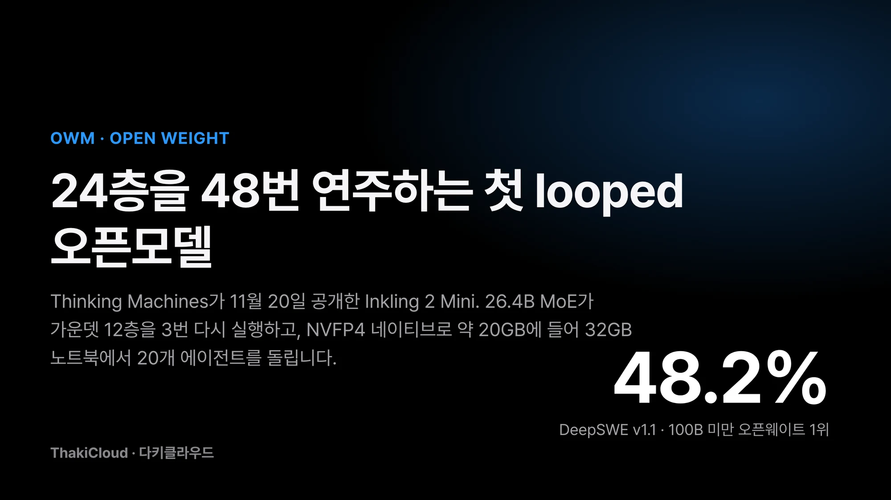
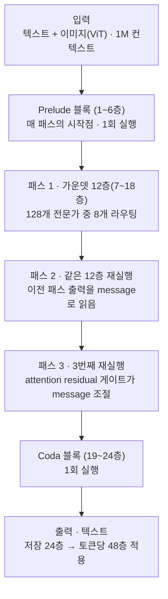
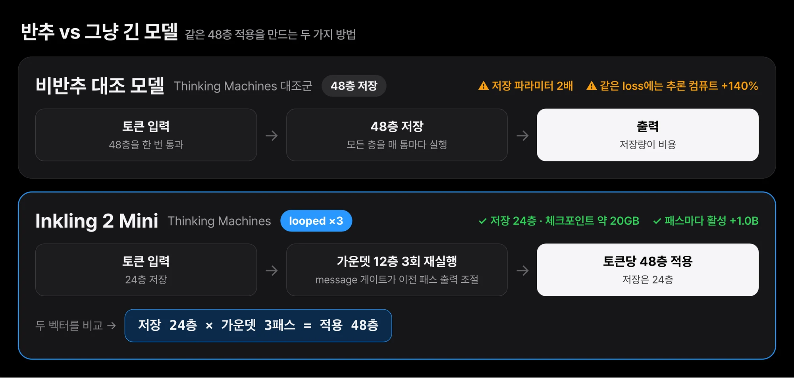
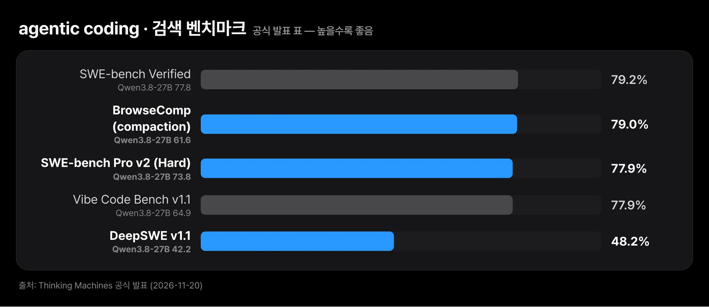
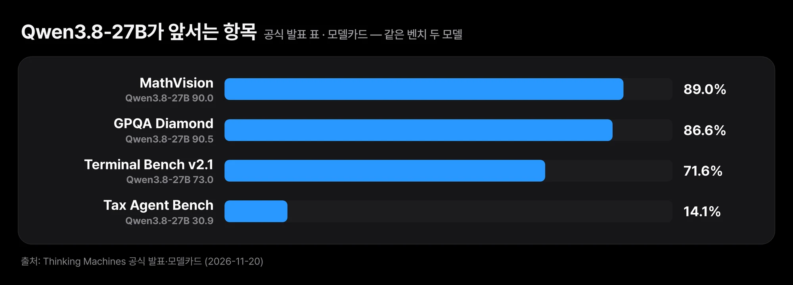
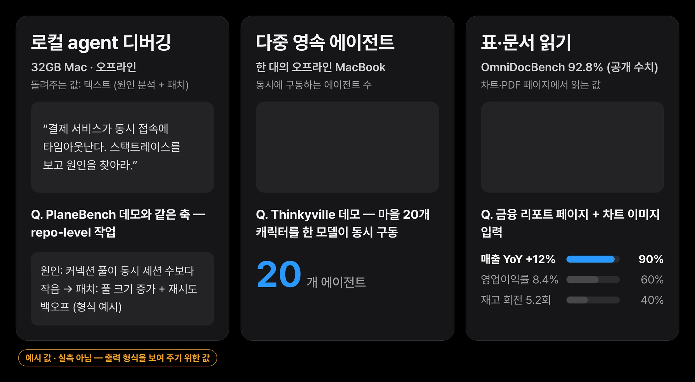

에이전트를 노트북이나 GPU 한 장으로 돌리려는 팀에게 모델 선택은 늘 둘 중 하나였습니다. 작고 약한 모델을 쓰거나, 크고 비싼 모델을 쓰는 것. 26B~31B급이 로컬 에이전트의 주력 구간으로 떠오른 지금, 공식 비교군(Gemma 4 31B·Qwen3.8-27B·Nemotron 3.5 Super VL)이 바로 그 구간의 현주소를 보여 줍니다. 11월 20일 Thinking Machines가 첫 looped transformer 오픈모델 Inkling 2 Mini를 내놓으면서, 이 구간에 구조 자체가 다른 선택지가 하나 더 생겼습니다.

핵심 수치를 먼저 적습니다. 총 26.4B·활성 3.4B의 MoE 모델이 DeepSWE v1.1에서 48.2%로 100B 미만 오픈웨이트 전체 선두에 섰고, SWE-bench Pro v2(Hard)에서는 77.9%로 바로 아래 Qwen3.8-27B(73.8%)를 4.1점 앞서 있습니다. 저장되는 층은 24개인데 가운뎃 12층을 3번 다시 실행해서 토큰당 48층의 연산을 합니다.

이 글은 구조, 4비트 네이티브 학습, 벤치마크의 앞뒤, 서빙 경로, 그리고 Qwen3.8-27B가 여전히 앞서는 항목까지 발표된 수치 그대로 정리합니다.

*Inkling 2 Mini 오픈웨이트 모델 카드 · 총 26.4B, DeepSWE v1.1 48.2%로 100B 미만 오픈웨이트 1위.*

## 쉽게 말하면

Inkling 2 Mini의 구조는 "반추"에 가깝습니다. 소가 풀을 한 번 씹어서 다시 올리듯, 이 모델은 가운뎃 12개 층(모듈)을 하나의 토큰에 대해 3번 다시 통과시킵니다. 추론을 토큰으로 길게 써 내려가지 않고, 같은 가중치를 다시 씹는 것으로 생각 시간을 벌어요. 공식 발표에서는 "looping allows the model to reason longer without writing its reasoning down"이라고 했습니다. 반추라는 비유는 이 글에서 끝까지 씁니다.

## 저장 24층, 적용 48층

모델은 24개 층의 decoder-only transformer로, 6개 층씩 네 블록으로 나뉘어 있습니다. 첫 블록(prelude)과 마지막 블록은 각각 1회만 실행되고, 가운뎃 두 블록(12층)이 3번 반복됩니다. 매 패스는 prelude의 출력에서 시작하고, 2·3패스는 이전 패스의 출력, 즉 "message"를 읽어서 다시 실행합니다. attention residual 구조에는 message를 처음엔 통째로 막아 두는 학습 게이트가 붙습니다.

왜 가운뎃이 아니라 맨 끝을 반복하지 않았을까. 발표에 따르면 가운뎃 12층 반복이 28개 평가 중 27개에서 맨 끝 12층 반복보다 정확도 이득이 컸고, 컴퓨트 환산 이득은 가운뎃이 1.51~1.91배, 맨 끝이 1.24~1.36배였습니다.

비반추(48층을 그대로 저장) 버전과의 비교도 발표됐습니다. 비반추 모델은 학습 컴퓨트가 7.5% 적게 들었지만, 512K 토큰 에이전트 궤적에서 같은 loss를 만들려면 추론 컴퓨트를 140% 더 써야 했습니다. 반추가 학습 비용을 추론 비용으로 옮기는 장치가 아니라, 같은 능력의 총 비용을 줄이는 장치라는 뜻입니다.

연구적 위치도 짚을 필요가 있습니다. Thinking Machines는 "looped 아키텍처의 모델 중 연구자들이 쓸 수 있는 첫 번째 모델들"을 내놓게 돼 기쁘다고 썼고, Inkling 2 Mini를 공개하는 이유 중 하나로 "커뮤니티가 looped transformer 연구를 할 수 있게 하려는 것"을 명시했습니다. 가중치 구조를 열었다는 것은 벤치마크 숫자 이상의 의미가 있습니다. loop가 정확도에 영향을 미치는 방식, message 게이트가 어떻게 닫혔는지, 가변 패스 수(1~5, 연구 모델은 3패스 중심으로 학습)가 추론 행동에 어떤 변화를 주는지를 자신의 데이터에서 재현할 수 있는 첫 오픈 대상이 됐기 때문입니다.

MoE 라우팅은 128개 전문가 중 토큰당 8개를 선택합니다. 처음엔 384개 전문가 중 8개를 선택하는 구조로 훈련을 시작하다가, 각 층에서 가장 많이 쓰인 128개만 남긴 구조입니다.

*비반추(48층 저장) vs looped(24층 저장, 가운뎃 12층 3회) 구조 비교. 출처: Thinking Machines 공식 발표.*

## 4비트로 학습하고, 4비트로 배포한다

Inkling 2 Mini의 가중치 대부분은 NVFP4로 학습되었고, 마지막 4개 층만 MXFP8입니다. 20개 층이 NVFP4, 4개 층이 MXFP8이며 체크포인트 하나 전체가 약 20GB입니다. 공개된 모델 중에서는 흔하지 않은 조합입니다. 보통은 고정밀도로 학습한 뒤 사후 양자화(quantization after training)로 압축하는데, 이 모델은 expert 층의 전 패스에 4비트 NVFP4를 쓴 채 프리트레이닝부터 RL(보강학습)까지 마쳤습니다. 그래서 "양자화 변환 손실이 없다"는 표기를 합니다.

트레이닝 계보는 이렇습니다. 사내 메인라인 스케일링 래더에서 파생되고, 더 큰 내부 Inkling 모델에서 증류된 1T 토큰으로 학습한 뒤, 2,000 스텝에 걸쳐 2.2T 토큰 분량의 RL을 NVIDIA GB300 플랫폼에서 돌렸습니다. 주 언어는 영어이고 일반 다국어를 지원하며, 텍스트와 이미지 입력·텍스트 출력을 처리합니다. 컨텍스트는 최대 1M 토큰.

이 모델은 Inkling 2 계보의 "작은형"입니다. Thinking Machines는 먼저 Inkling(원본)과 Inkling-Small, 그리고 더 큰 Inkling 2 Small을 내놓은 뒤, 이번 26.4B Mini를 같은 계보에서 파생했습니다. 발표는 Mini의 강점이 Inkling 2 Small과 거울처럼 닮아 있다고 설명합니다. 둘 다 장기간(long-horizon) 에이전트 작업에서 가장 강하고, 포스트 트레닝 방식도 같은 on-policy distillation을 썼습니다. PMPP-Hard(0~10시간 프로덕션 작업 AUC)에서 Mini는 455.82로 비교군 1위이며, "훨씬 큰 Inkling 2 Small의 점수에 접근한다"는 식으로 스스로의 위치를 설명합니다. 다만 모델카드는 대부분의 평가에서 Inkling 2 Small이 더 강하다고 인정하고, 격차가 가장 큰 곳은 사실 기억과 지식 밀집 질문이라고 못을 박습니다.

## 100B 미만 오픈웨이트 선두, 그 숫자와 갭

공식 벤치마크 표(비교군: Gemma 4 31B · Muse Glimmer · Qwen3.8-27B · Nemotron 3.5 Super VL)에서 agent·코딩 축을 보면, 발표가 주장한 대로 agentic coding에서는 전 항목 선두입니다.

| 벤치마크 (harness) | Inkling 2 Mini | Qwen3.8-27B |
|---|---|---|
| DeepSWE v1.1 (mini-swe-agent v2.4.6) | **48.2%** | 42.2% |
| SWE-bench Pro v2 Hard (mini-swe-agent) | **77.9%** | 73.8% |
| SWE-bench Verified (bash only) | **79.2%** | 77.8% |
| BrowseComp (compaction) | **79.0%** | 61.6% |
| Vibe Code Bench v1.1 (openhands) | **77.9%** | 64.9% |
| SWE-bench Multilingual (bash only) | **73.7%** | 70.0% |

반대로 Qwen3.8-27B가 앞서는 항목도 분명합니다. Terminal Bench v2.1은 73.0%로 Inkling 2 Mini(71.6%)가 2위, GPQA Diamond는 90.5% 대 86.6%, MathVision은 90.0% 대 89.0%, Tax Agent Bench는 30.9% 대 14.1%로 차이가 큽니다. AA Index v5.0에서는 20.1점으로 동률 1위입니다. "Qwen을 누른다"는 표현이 유행했지만, 정확한 사진은 "agentic coding과 검색·도구 사용에서 선두, 사실 기억과 일부 수학·금융 벤치에서는 Qwen3.8-27B가 우세"입니다.

지식 작업 축도 확인해 봤습니다. DeepSearchQA(compaction 사용) 85.3%, MCP Atlas(Public) 82.7%, JobBench 49.6%로 전 항목 선두입니다. Vals Finance Index는 50.1%로 1위, AA-Briefcase v1.1과 GDPVal-AA v2.1은 각각 1263·1319점으로 Qwen3.8-27B(1391·1427)에 2위입니다. 기업 문서·금융 분석 작업에서는 Qwen이 여전히 한 발 앞선다는 뜻입니다.

비전·문서 축은 강한 편입니다. OmniDocBench v1.6 92.8%, Chartography(Python 사용 시) 72.5%, ScreenSpot Pro 87.7%(Python), PerceptionBench 57.5%로 비교군 1위이며, MuirBench 77.5%·BVB 68.4%도 2위 안에 들어 있습니다. 표·차트·화면 지시 해석이 에이전트 작업의 하위 기술이라는 점을 고려하면, 이 축이 agentic coding 수치를 뒷받침합니다.

사실 지식과 추론의 조합은 혼재돼 있습니다. ARC-AGI v1/v2는 84.5/49.3%로 1위(Qwen 87.5/42.4)이고, LongBench v2 66.9%, MRCR v2(8-needle, 256K~512K) 46.4%도 1위입니다. 반대로 AA-Omniscience의 환각 지표(비환각률)는 63.4%로 Qwen3.8-27B(71.4%)에 2위이며, HLE-Diamond도 15.2%로 15.3%의 Qwen에 0.1점 뒤집니다. 모델카드가 "지식 갭은 검색과 도구를 효율적으로 써서 넘는다"고 쓴 것은, 이 축의 약점을 숨기려는 문장이 아니라 운영 방향(도구 사용)을 명시한 것으로 읽힙니다.

에너지 효율 지표도 외부에서 실측됐습니다. Stanford Hazy Research Lab(Scaling Intelligence Lab)의 "intelligence per joule" 평가에서 Inkling 2 Mini는 NVIDIA DGX Spark에서 0.703점을 받았고, 비교군은 Qwen3.6-35B-A3B 0.430, Gemma-4-26B-A4B 0.159, Qwen3.5-27B 0.036이었습니다. 단, 정밀도와 추론 노력이 모델마다 달라서 단순 순위로 읽기보다 "동일 기기당 소비 전력당 능력"의 상대 위치로 봐야 합니다.

*agentic coding·검색 벤치마크. 파란 막대가 Inkling 2 Mini, 노트에 Qwen3.8-27B 점수. 출처: Thinking Machines 공식 발표.*

*Qwen3.8-27B 우세 항목. 출처: Thinking Machines 공식 발표(모델카드 포함).*

## MacBook 한 대에서 20개 에이전트

발표의 두 번째 주장은 "로컬 하드웨어에서 다수의 영속 에이전트를 돌리는 데 적합한 선택"이라는 것입니다. 공식 데모는 두 장면입니다. MacBook Pro(M5 Pro, 48GB)를 비행기 모드로 돌린 채 오프라인에서 수 분 안에 플레이 가능한 비행 시뮬레이터를 짠 장면(PlaneBench, 15배속 촬영), 그리고 같은 모델 하나로 마을 에이전트 20개(Thinkyville)를 한 대의 오프라인 MacBook에서 동시에 돌린 장면입니다.

모델카드가 명시하는 하드웨어 요건은 아래와 같습니다.

| 플랫폼 | 요건 | 비고 |
|---|---|---|
| NVIDIA DGX Spark | 1대 | 공식 서포트 |
| Apple silicon (MacBook·Mac mini·Mac Studio) | 32GB 이상 메모리 | Ollama 경유, 출시일 지원 |
| 기타 GPU·플랫폼 | 32GB 이상 VRAM 권장 | "가능한 범위"로 서포트 |

체크포인트는 약 20GB 하나(혼합 NVFP4+MXFP8)이므로, 32GB 메모리 기기에서 컨텍스트 버퍼를 제외한 실제 가용량은 여력 있게 잡아야 합니다. 실행 경로는 공식적으로 넓습니다. Ollama, vLLM 레시피, SGLang 쿡북, Unsloth(GGUF 양자화 버전 포함), NVIDIA Dynamo, TokenSpeed, Llama App이 모두 공식 문서로 연결되고, Apple silicon 전용으로는 Exo Labs 경로가 있습니다. RL 파인튜닝은 SkyRL·Miles·NeMo AutoModel로, 추론·커스터마이즈는 Tinker가 출시일부터 열려 있으며, 제3자 추론 프로바이더를 통한 API 접근도 모델카드에서 확인했습니다. 가변 loop 패스 수의 연구용 변종 TML-d24-varloop-research도 함께 공개됐습니다.

해석 가능성(interpretability) 생태계도 함께 열렸습니다. Thinking Machines는 National Deep Inference Fabric(NDIF)과 협력해 해석 연구자에게 접근을 제공한다고 밝히고, Goodfire가 얼리 어세스로 이 모델의 해석 연구를 먼저 시작했습니다. "looped 구조를 스스로 열어서 볼 수 있는 첫 모델"이라는 위치는 가중치 공개 그 자체보다 이 생태계가 더 의미 있는 부분입니다.

*입출력 형식과 대표 사용 장면(값은 형식 예시). 출처: Thinking Machines 공식 발표·모델카드.*

## 반추가 사고의 가시성을 어떻게 바꾸는가

연구용 가변 loop 변종(TML-d24-varloop-research)으로 측정한 모니터링 성 수치가 함께 발표됐습니다. loop가 쌓일수록 CoT(생각 추적) 길이는 1패스 대비 절반 미만으로 줄어듭니다(평균 3,703 → 1,661 토큰). 즉, 반추는 "생각을 안 쓰는" 게 아니라 "생각을 안 적는" 방향입니다. N-Hop Lookup(여러 번 참조가 필요한 작업)은 학습 때 쓰지 않은 10패스까지 정확도가 계속 올라갔고, 불확실성 지표는 9.7에서 3.6으로 낮아졌습니다.

CoT 컨트롤러빌리티도 높습니다. 750~1,250 토큰짜리 CoT 길이를 지시했을 때 그 지시를 따를 확률이 최대 0.1%로, Inkling 2 Small 0.3%, 기존 Inkling-Small 0.4%, Qwen3.8-27B 1.3%보다 낮습니다. 에이전트 운영 관점에서 읽으면, 출력 길이를 예측 가능한 범위로 눌러 놓을 수 있는 레버가 하나 더 생긴다는 뜻입니다.

## 돌리기 전에 알아둘 네 가지

첫째, 반복 추론 루프가 알려진 한계입니다. 모델카드는 코드 디버깅에서 긴 reasoning loop에 갇히는 경우가 있었다고 적고 있습니다. 둘째, 중국어 출력에서 잘린 표현이나 언어 혼재가 보고됐습니다. 셋째, 최소 reasoning effort로도 추론이 완전히 꺼지지 않습니다. 넷째, looped 모델의 로컬 런타임 지원은 새로워서 런타임·하드웨어별 속도가 달라진다고 명시합니다.

다중 대화와 다중 제약 문장에서는 강점이 아닙니다. MultiChallenge 50.0%, ComplexConstraints v1.1 33.4%로, 공식 글에서 "가장 강한 소형 모델은 아니다"라고 스스로 선을 그었습니다. 더 큰 Inkling 2 Small 대비 격차는 사실 기억과 지식 밀집 질문에서 가장 크다는 것도 모델카드가 인정합니다.

안전·정렬 내부 평가에서는 비교군 중 상위입니다. 부정적 행동(misbehavior) 9.8%, 은폐 행동(covert misbehavior) 8.3%, 파괴적 행동 10.2%로 세 항목 모두 5개 비교 모델 중 최저(낮을수록 좋음)이며, Qwen3.8-27B(57.7/33.2/35.2)보다 확연히 낮습니다. FORTRESS adversarial 89.5%·StrongREJECT 97.8%도 2위권. 단, 내부 평가라는 한계는 붙여 둬야 합니다.

## ThakiCloud의 두 제품에서 쓰는 자리

ai-platform(K8s 기반 AI/ML 서빙) 관점에서는 세 가지가 있습니다. 첫째, 네이티브 4비트 체크포인트 하나(약 20GB)로 32GB급 VRAM 노드에서 서빙이 성립한다는 점에서, 온프레미스·엣지 노드의 "GPU 한 장당 서빙할 수 있는 모델" 목록에 agent 작업용 26.4B가 들어옵니다. ThakiCloud의 서빙 스택이 이미 NVFP4 양자화 모델(B200 인퍼런스)을 기준으로 운영하고 있다는 점에서, "학습된 그대로 4비트"인 이 모델은 변환·검증 단계를 추가하지 않고도 같은 경로로 편입할 수 있습니다. 사후 양자화 모델은 변환 이후 품질 회귀를 따로 증명해야 하지만, 이 모델은 그 증명이 학습에 포함돼 있다는 구조적 차이가 있습니다. 둘째, looped 구조는 같은 능력의 추론 컴퓨트를 줄이는 쪽으로 작용해서, 멀티테넌트 큐(Kueue)의 GPU-min 회계에 유리합니다. 셋째, vLLM·SGLang 레시피가 공식 경로라 KServe 스타일 서빙 스택에 편입할 수 있습니다.

Paxis(Agent-Native Cloud) 관점에서는 "오프라인 MacBook 한 대에 에이전트 20개" 장면이 중요합니다. Paxis가 다루는 영속 에이전트·오케스트레이션 워크로드의 하한 비용 구조를 보여주는 예시로, 온클라우드 실행이 필수가 아닌 작업을 로컬 단위로 내릴 때의 실행 경제성을 보여 줍니다. CoT 토큰을 줄이는 looped 추론은 에이전트 호출의 출력 토큰 비용에도 직결됩니다.

## 끝으로

Inkling 2 Mini는 "가장 강한 소형 모델"이 아니라, "looped transformer 연구를 스스로 환경에서 하는 것"을 가능하게 한 첫 오픈모델입니다. 100B 미만 오픈웨이트의 agentic coding 선두(DeepSWE v1.1 48.2%)와 4비트 네이티브 20GB 체크포인트, 그리고 로컬 다중 에이전트 실행이라는 세 장면을 동시에 잡은 모델이라는 것이 오늘 기준의 정확한 사진입니다.

첫 실험은 두 가지 중 하나면 충분합니다. 32GB 이상 Mac이면 Ollama 라이브러리의 `inkling-2-mini`를 받아 오프라인 agent 작업에서 loop 한계를 직접 확인하고, 단일 GPU(32GB VRAM 권장) 환경이면 vLLM 공식 레시피로 서빙 경로를 검증하는 것입니다.

출시 직후 지켜볼 것은 세 가지입니다. 커뮤니티 GGUF 양자화가 얼마나 빠르게 따라오는지, Goodfire의 해석 연구가 loop 내부의 어떤 구조를 드러내는지, 그리고 가변 loop 변종이 "패스 수를 런타임 조절 레버"로 쓰는 패턴이 어디까지 일반화되는지. looped transformer가 모델 클래스로 자리 잡으면, 26B~31B 구간의 구조 경쟁은 "층을 몇 번 다시 씹느냐"의 문제로 바뀝니다.

- [공식 발표: Introducing Inkling 2 Mini](https://thinkingmachines.ai/news/inkling-2-mini/)
- [모델카드](https://thinkingmachines.ai/model-card/inkling-2-mini/)
- [Hugging Face: thinkingmachines/Inkling-2-Mini](https://huggingface.co/thinkingmachines/Inkling-2-Mini) (Apache 2.0)
- [Ollama 라이브러리](https://ollama.com/library/inkling-2-mini) · [vLLM 레시피](https://recipes.vllm.ai/thinkingmachines/Inkling-2-Mini)
