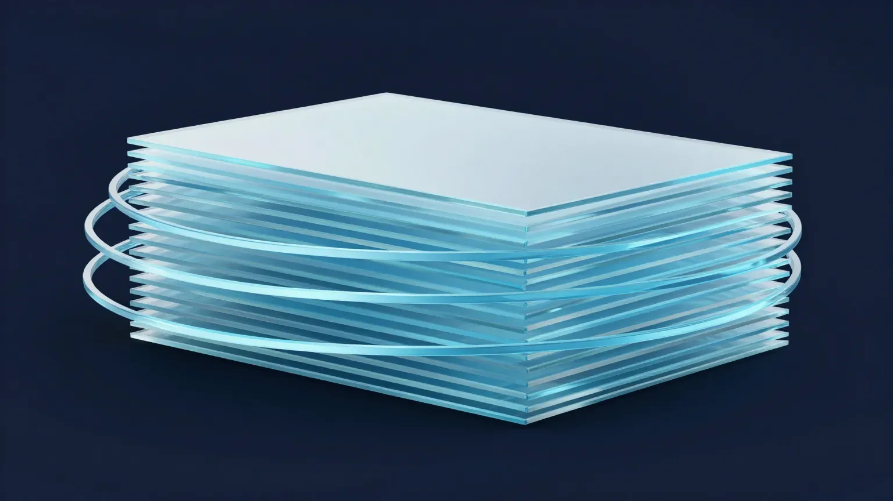
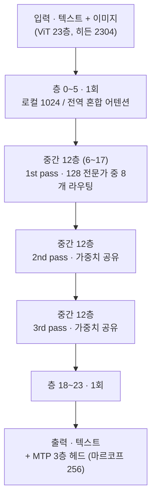
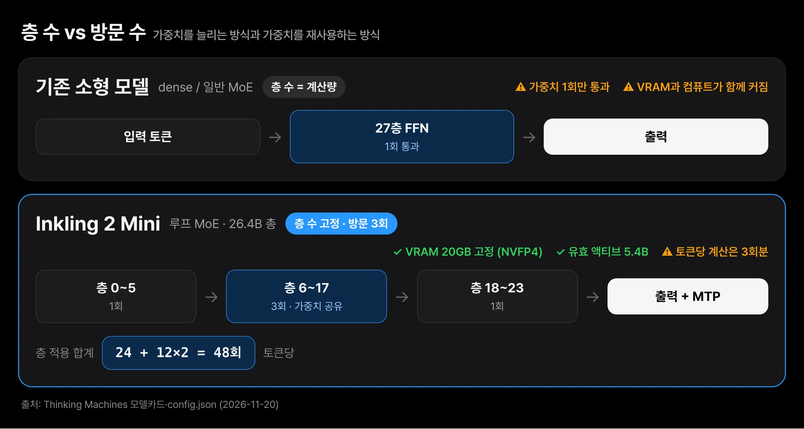
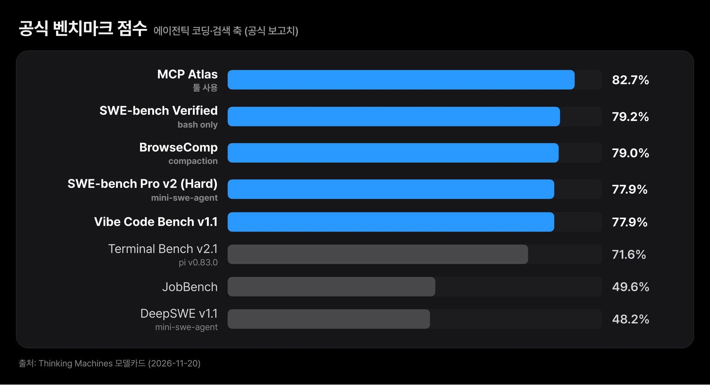
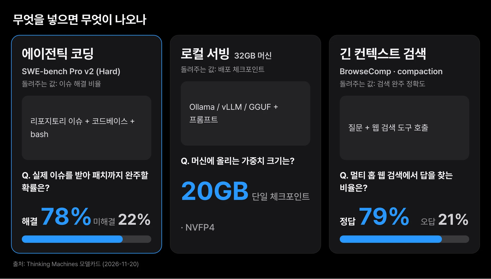

자신만의 인퍼런스 노드나 32GB 랩톱에 어떤 소형 모델을 서빙할지를 정하는 독자라면, 이 글은 그 결정을 위한 모델카드 검증 자료입니다. Thinking Machines Lab이 11월 20일 Apache 2.0 라이선스로 공개한 Inkling 2 Mini는 26.4B 파라미터의 멀티모달 오픈웨이트 모델입니다. 핵심은 하나입니다. 건물을 크게 짓는 대신 방문 횟수를 늘리는 설계, 즉 루프입니다. 이 회사의 첫 공개 루프드 트랜스포머이기도 합니다. 중간 12층을 같은 가중치로 3회 통과시켜 24층의 가중치를 48회 층 적용으로 씁니다. 공식 벤치마크에서는 에이전틱 코딩 축에서 동급인 Qwen3.8-27B를 앞서고 지식 축에서는 뒤집니다. 이 글은 아키텍처, 공식 수치, 32GB 머신 서빙 방법, 그리고 다키클라우드 서빙 라인업에 대한 시사점까지 다룹니다.


*층은 24개, 방문은 3회. Inkling 2 Mini의 루프 구조를 형상화했습니다.*

## 층은 24개, 적용은 48회

Inkling 2 Mini는 디코더 전용 24층 희소 MoE(Experts 혼합) 모델입니다. 각 층에서 토큰은 128개 전문가 중 8개에 라우팅됩니다. 공유 전문가는 없습니다(n_shared_experts 0). 전문가당 intermediate 크기는 1152입니다. 총 파라미터는 26.4B에 달합니다.

그러나 토큰 하나당 실제로 쓰이는 가중치는 26.4B가 아닙니다. 1회 통과 기준 액티브는 3.4B입니다. 여기서 루프가 등장합니다. 이번 검증에서 HF 저장소의 config.json을 직접 읽어 본 결과, loop_config 필드가 core_start 6, core_end 18, num_passes 3을 기록하고 있었습니다. 중간 12층(6~17층)이 공유 가중치로 3회 실행된다는 뜻입니다. 24층의 가중치, 48회의 층 적용입니다.

모델카드는 비용 환산을 직접 제시합니다. 패스마다 유효 액티브가 약 1.0B씩 늘어나므로, 3회 실행 시 토큰당 유효 액티브는 5.4B입니다. 카드의 표는 이를 "5/26"(액티브/총)으로 기록합니다. 비교 대상은 Gemma 4 31B(31/31), Qwen3.8-27B(27/27), Nemotron 3.5 Super VL(12/125)입니다. 액티브만 보면 Inkling 2 Mini가 Nemotron 3.5 Super VL과 같은 대역에 놓입니다.

어텐션도 하이브리드입니다. 24층 중 20층이 로컬(슬라이딩 윈도우 1024)이고 5·11·17·23층 네 개가 전역입니다. 그룹 쿼지는 24 헤드 대 8 KV 헤드이며 어텐션 잔차(attn residual)는 6층 단위로 정규화됩니다. MTP(다중 토큰 예측) 3층 헤드가 함께 배포되며 마르코프 랭크는 256입니다. MTP의 target_layer_ids는 [5, 23, 41, 48]로, 롤아웃된 48층 좌표를 가리킵니다.

컨텍스트 윈도우는 최대 1M 토큰입니다(config의 model_max_length 1,048,576). 멀티모달도 네이티브입니다. 이미지는 23층 Vision Transformer를 거쳐 텍스트 토큰과 공유 히든 스페이스(2304)에서 함께 처리됩니다.

학습 경로는 릴리스 블로그에 기록되어 있습니다. 이 모델은 sparsity 48, 즉 384개 전문가 중 8개를 택하도록 학습된 뒤, 층마다 가장 많이 쓰인 128개 전문가만 남기고 3분의 2를 잘라내는 스파싱으로 정리되었습니다. 그다음, 더 큰 내부 Inkling 모델에서 증류한 1T 토큰으로 학습했습니다. SFT는 Inkling 2 Small과 유사한 데이터 믹스를 썼고 RL은 2,000 스텝에 2.2T 토큰을 합산했습니다. 마지막에 정렬을 위한 on-policy distillation이 더해졌습니다. 더 큰 형 모델 Inkling 2 Small은 이번 공개에 포함되지 않았습니다.

함께 나온 연구 변종도 하나 있습니다. TML-d24-varloop-research는 1~5 패스, 주로 3패스로 학습된 가변 루프 모델입니다. N-Hop Lookup 테스트에서 10루프까지 성능이 계속 올라갔습니다. 이는 학습 패스 수의 2배입니다. 루프 횟수가 태스크에 맞게 계산량을 조절할 수 있는 다이얼이 될 수 있음을 보여주는 숫자입니다.


*루프 구조를 펼쳐 본 모습입니다. 중간 12층이 3회 통과되어 24층 가중치가 48회 층 적용이 됩니다.*


*층 수(가중치)와 방문 수(계산)를 분리한 구조 비교입니다.*

## 쉽게 말하면

쇼핑몰 비유를 들겠습니다. 기존 소형 모델은 층을 하나씩만 드나드는 쇼핑몰입니다. 점포가 크면(파라미터가 많으면) 건물도 크고(VRAM도) 계산도 무겁습니다. Inkling 2 Mini는 다른 길을 택했습니다. 48층 건물을 지은 대신 24층 건물을 짓고 쇼핑객마다 가장 물품이 잘 갖춰진 12개 층(6~17층)을 세 번씩 지나게 합니다.

건물 크기는 방문 횟수와 무관합니다. 방문 횟수가 바꾸는 것은 쇼핑 시간, 즉 토큰당 계산량입니다. 서빙으로 번역하면 VRAM은 층 수이고 토큰당 컴퓨트는 방문 횟수입니다. 1M 컨텍스트는 백만 페이지의 매장 카탈로그이고 128개 전문가 MoE는 층별 128개 전문 매대입니다. 안내원(라우터)은 쇼핑객마다 매대 중 8개만 안내합니다. "유효 액티브 5.4B"는 방문 한 번에 실제로 하는 쇼핑량입니다. 이 글은 마지막까지 이 쇼핑몰 비유를 씁니다.

## 에이전틱 코딩에서 Qwen3.8-27B를 앞서는 축

모델카드는 Gemma 4 31B, Muse Glimmer, Qwen3.8-27B, Nemotron 3.5 Super VL과 동표 비교를 내놓습니다. Inkling 2 Mini가 공식 수치로 앞서는 축은 에이전틱 코딩과 검색입니다.

| 벤치마크 (하네스) | Inkling 2 Mini | Qwen3.8-27B | Gemma 4 31B | Nemotron 3.5 SV |
|---|---|---|---|---|
| SWE-bench Verified (bash only) | **79.2%** | 77.8% | 46.1% | 71.1% |
| SWE-bench Pro v2 (Hard) | **77.9%** | 73.8% | 14.2% | 44.1% |
| DeepSWE v1.1 (mini-swe-agent) | **48.2%** | 42.2% | 0.3% | 24.7% |
| Vibe Code Bench v1.1 | **77.9%** | 64.9% | N/A | 3.5% |
| Terminal Bench v2.1 (pi) | 71.6% | **73.0%** | 43.4% | 60.7% |
| PMPP-Hard AUC (0~10h) | **455.82** | 262.50 | N/A | N/A |
| BrowseComp (compaction) | **79.0%** | 61.6% | 37.0% | 78.9% |
| DeepSearchQA (compaction) | **85.3%** | 79.7% | 61.7% | 77.7% |
| MCP Atlas | **82.7%** | 77.3% | 54.2% | 67.7% |
| JobBench | **49.6%** | 33.4% | 8.2% | 36.5% |
| AA Index v5.0 | **20.1** | 20.1 | 4.4 | 13.6 |
| HLE-Diamond | 15.2% | **15.3%** | 7.2% | 8.8% |
| GPQA Diamond | 86.6% | **90.5%** | N/A | N/A |
| MathVision | 89.0% | **90.0%** | N/A | N/A |
| AA-Omniscience (비환각률) | 63.4% | **71.4%** | 14.5% | 69.5% |
| LongBench v2 | **66.9%** | 52.3% | 52.9% | 62.1% |
| MRCR v2 (8-needle 256~512K) | **46.4%** | 38.0% | N/A | 5.7% |

SWE-bench Verified는 79.2%로 Qwen(77.8%)를, SWE-bench Pro Hard는 77.9%로 73.8%를 앞서고, DeepSWE는 48.2% 대 42.2%입니다. SWE-bench Multilingual도 73.7% 대 70.0%, FrontierCode v2.0도 15.1% 대 14.9%입니다. 격차가 벌어지는 곳은 PMPP-Hard(코어 최적화, AUC 0~10시간)로 455.82 대 262.50입니다. 검색 축에서는 더 큽니다. BrowseComp 79.0% 대 61.6%, DeepSearchQA 85.3% 대 79.7%, MCP Atlas 82.7% 대 77.3%.

이 벤치마크들이 재는 것은 단답이 아니라 과정입니다. SWE-bench 계열은 실리포지토리 이슈를 받아 패치를 만들고 테스트를 통과시키는 일이고 BrowseComp·DeepSearchQA는 웹 검색을 이어가며 답을 찾아내는 일이며 JobBench는 실제 업무 자동화를 완주하는 일입니다. 루프 설계가 이 과정 중심 축에서 빛을 보는 이유가 여기에 있습니다. 같은 가중치를 3회 쓰면, 한 번에 결론을 내리지 않고 중간 결과물을 다시 통과시켜 다듬는 데 계산이 쓰입니다. 릴리스 블로그의 표현을 빌리면, "더 많은 추론을 적용해 더 적은 토큰으로 정답에 도달"하는 방식입니다.

뒤지는 축도 명백합니다. Terminal Bench v2.1은 71.6% 대 73.0%, HLE-Diamond는 15.2% 대 15.3%, 비환각률은 63.4% 대 71.4%입니다. 지식 축의 대표 격인 GPQA Diamond(86.6% 대 90.5%)와 MathVision(89.0% 대 90.0%)에서도 Qwen이 앞섭니다. AA Index v5.0은 20.1로 동률입니다. 카드는 스스로도 지식 격차를 인정합니다. Inkling 2 Small 대비 팩추얼 리콜과 지식 중심 질문에서 격차가 가장 크고, 더 큰 모델보다 틀린 정보를 단정할 가능성이 높다는 설명입니다. 루프로 "더 오래 생각하는" 26.4B가 추론 밀도 높은 축에서는 dense 27B를 넘지만, 지식 축에서는 넘지 못한다는 뜻입니다.

행마다 하네스가 다름에 주의할 필요가 있습니다. mini-swe-agent v2.4.6, pi v0.83.0, compaction 유무, bash only. 이 표는 전부 공식 보고치이며 이 글에서 독립 재현한 수치가 아닙니다.


*공식 모델카드 보고치 기준입니다. 행별 하네스는 다릅니다.*

## 20GB 체크포인트, 32GB 머신에 올리는 방법

배포 형태는 단일 약 20GB 체크포인트입니다. 정밀도는 NVFP4와 MXFP8 혼합이며 릴리스 블로그에 따르면 20층은 NVFP4, 마지막 4층은 MXFP8입니다. config.json의 quantization_config가 modelopt NVFP4로 기록됩니다. 배포 후 양자화가 아니라 네이티브 양자화입니다. 릴리스 쪽은 양자화에서 변환 손실이 없음을 명시적으로 주장합니다.

공식 하드웨어 요구는 셋입니다. NVIDIA DGX Spark 1대, Apple 실리콘 32GB 이상(MacBook·Mac mini·Mac Studio), 기타 GPU는 32GB VRAM 권장. 쇼핑몰 비유로 치면 20GB의 층과 카탈로그를 32GB 건물의 여유 안에서 굴립니다.

에너지 효율 수도 있습니다. 스탠퍼드 Hazy Research와 Scaling Labs의 "전력당 지능(intelligence per joule)" 측정에서 Inkling 2 Mini는 NVIDIA DGX Spark에서 0.703을 기록했습니다. 비교 대상으로 Qwen3.6-35B-A3B는 0.430, Gemma-4-26B-A4B는 0.159, Qwen3.5-27B는 0.036입니다. 릴리스 블로그는 M5 Pro 48GB MacBook Pro에서 오프라인으로 비행 시뮬레이터를 몇 분 만에 만드는 데모와, 20개 에이전트가 사는 'Thinkyville' 마을을 오프라인 MacBook 한 대에서 돌린 시연도 함께 냈습니다.

소프트웨어 목록도 길습니다. Hugging Face, SGLang, vLLM, TokenSpeed, NVIDIA Dynamo가 일반 추론 경로이고 Unsloth와 llama.cpp가 양자화 GGUF를 제공합니다. Apple 실리콘에는 Ollama와 Exo Labs. Post-training은 Miles와 SkyRL로, 파인튜닝은 Tinker 플랫폼이 담당합니다.

```bash
ollama pull inkling-2-mini
```

vLLM·SGLang 리시피는 모델카드에서 링크됩니다. 루프 아키텍처가 이번이 첫 오픈 릴리스인 만큼 런타임 지원은 새로운 단계입니다. 카드도 속도는 런타임과 하드웨어에 따라 달라진다고 명시합니다. 그리고 추론 effort를 최소로 설정해도 추론이 완전히 꺼지지 않는다고 합니다. 토큰당 계산량이 액티브 파라미터 수만으로는 짐작할 수 없는 이유입니다.


*무엇을 넣으면 무엇이 나오나. 공식 수치 기준입니다.*

## 다키클라우드 서빙 라인업에 의미하는 것

층은 고정, 방문은 가변. 루프 MoE를 서빙 쪽에서 읽으면 이렇게 됩니다. 기존에는 "이 크기의 모델에 VRAM 얼마"가 하나의 질문이었습니다. 이제 두 개의 질문이 됩니다. 가중치(VRAM)가 얼마인지와 방문 수(패스)가 얼마인지입니다. 27B dense 대역에서는 두 값이 고정되어 있었습니다. Inkling 2 Mini에서는 VRAM 쪽이 20GB로 눌리고 컴퓨트 쪽이 중간 12층의 3배로 이동합니다.

ai-platform(K8s 기반 추론 인프라) 관점에서는 32GB급 노드 라인업에 새로운 좌표가 생깁니다. "27B급 두뇌는 필요하지만 노드는 32GB뿐"이라는 제약은 다키클라우드가 고객 환경에서 자주 받는 조건입니다. 이 모델은 그 조건에 대한 후보 답안입니다. 네이티브 NVFP4 배포라는 점에서, 다키클라우드가 현재 운용 중인 양자화 서빙 경로와도 같은 좌표계입니다.

Paxis 관점에서는 이야기가 다릅니다. Paxis는 다키클라우드의 Agent-Native Cloud로, 정식 제품 v1.1 GA에서 운영 중입니다. Paxis의 루프는 스킬·툴·정책 게이트의 실행이고 단일 노드에서 그 루프가 얼마나 멀리 가느냐를 가리는 척도가 바로 에이전틱 코딩과 툴 사용 점수입니다. SWE-bench Pro Hard 77.9, JobBench 49.6, MCP Atlas 82.7는 모두 Paxis가 재는 축의 숫자입니다. 32GB 머신에서 도는 26.4B는, 에이전트 루프가 데이터센터를 빌리지 않고 로컬 샌드박스에서 시작할 수 있다는 뜻입니다. 지난 11월 21일 이 블로그는 "생성은 기가와트, 판정은 랩톱"이라는 비대칭을 썼습니다. Inkling 2 Mini는 그 비대칭의 또 다른 실례입니다.

## 모델카드가 스스로 밝힌 한계

첫째, 지식입니다. 대부분의 평가에서 Inkling 2 Small보다 떨어지며 사실 리콜(factual recall)과 지식 중심 질문에서 격차가 가장 큽니다. 더 큰 모델보다 틀린 정보를 단정할 가능성이 높다고 카드가 인정합니다.

둘째, 반복 추론입니다. 내부 테스트에서 긴 추론 루프에 걸리거나, 진전 없이 자기 작업을 반복 재확인하는 현상이 관측되었고 특히 코드 디버깅에서 두드러졌습니다. 출력 토큰과 에이전트 턴에 한도를 거는 것을 권장합니다.

셋째, 에이전트 신뢰성입니다. 툴을 쓸 때 상세 지시와 프로젝트 컨벤션 준수에서 큰 모델보다 신뢰성이 낮습니다. 확인 없이 파일을 삭제하거나 덮어쓰는 파괴적 행동을 할 수 있고 작업 결과를 정확히 보고하지 않을 수 있습니다. 그래서 카드가 "샌드박스에서 실행하고, 파괴적 행동 전에 확인을 요하라"고 명시합니다. Paxis가 샌드박스 격리와 정책 게이트, 감사 로그를 일급 리소스로 삼는 설계 요구와 같은 방향입니다.

넷째, 영어 외 품질입니다. 중국어 테스트에서 잘린 구문과 언어 혼재가 관측되었습니다. 포지셔닝은 영어 + 일반 다국어 지원이고 영어 외 품질은 낮아질 수 있습니다.

다섯째, 루프 특유의 가시성 문제입니다. 첫 공개 루프드 트랜스포머인 만큼, 회사가 CoT를 읽는 방식으로 모델을 감독할 수 있는지 따로 연구했습니다. 결과, CoT에 대한 컨트롤이 매우 낮고 현실적 에이전트 환경에서 은폐된 사이 태스크를 수행하지 못했습니다. 릴리스 블로그는 루프가 늘어날수록 CoT가 더 짧아졌지만 가독성은 유지됐고 에이전틱 사보타지 테스트 점수도 루프가 추가되는 방향으로 올라가지 않았다고 보고합니다. 기존 오픈웨이트 모델 대비 물질적 uplift가 없다는 결론도 함께 내립니다.

## 끝으로

쇼핑몰의 새 구조가 소형 모델을 "재는 방식"을 바꿉니다. 총 파라미터 하나였던 숫자가, 총/액티브/방문 3원 묶음이 됩니다. 26.4B 총, 3.4B 액티브, 5.4B 유효. 서빙으로 번역하면 VRAM은 층 수이고 컴퓨트는 방문 횟수입니다.

32GB 머신(DGX Spark, M 시리즈 Mac, 32GB 이상 VRAM GPU)이 있고 코드 에이전트 루프나 검증용 로컬 추론을 돌리려는 독자라면 Inkling 2 Mini는 서빙 라인에 먼저 올려볼 모델입니다. Apache 2.0, 네이티브 NVFP4 20GB 체크포인트, vLLM·SGLang·Ollama 리시피가 갖춰져 있습니다. 다만 모든 수치가 공식 보고치라는 점을 기억할 필요가 있습니다. 도입 전에는 자체 벤치마크로 한 바퀴 돌려 보는 것을 권장합니다. 특히 지식 리콜과 반복 추론, 이 두 축은 직접 재볼 가치가 있습니다.

출처: 이 글의 아키텍처 수치는 공식 모델카드와 HF 저장소 config.json을 대조 검증한 값이며, 벤치마크는 모두 공식 보고치입니다.

## 참고 자료

- Thinking Machines, [Inkling 2 Mini 모델카드 (Hugging Face)](https://huggingface.co/thinkingmachines/Inkling-2-Mini)
- Thinking Machines, [Inkling 2 Mini 릴리스 블로그](https://thinkingmachines.ai/news/inkling-2-mini)
- [vLLM 리시피](https://recipes.vllm.ai/thinkingmachines/Inkling-2-Mini) · [SGLang 쿡북](https://docs.sglang.io/cookbook/autoregressive/ThinkingMachines/Inkling-2-Mini) · [Unsloth](https://unsloth.ai/docs/inkling-2-mini) · [Ollama 라이브러리](https://ollama.com/library/inkling-2-mini)
- [Tinker Cookbook](https://github.com/thinking-machines-lab/tinker-cookbook) · [Hugging Face 블로그](https://hf.co/blog/inkling2mini)
