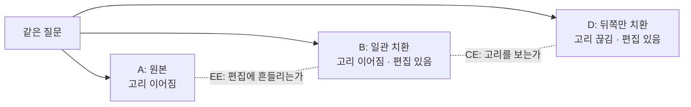

검색한 문서를 보고 답할지 말지 정하는 모델은 정확도 하나로 평가하기 쉽습니다. 저희도 그렇게 시작했습니다. 그런데 정확도를 1.1%p 올린 실험에서 근거가 부족한 질문에 답한 경우가 30% 늘었습니다. 정확도가 오르는 것과 올바른 근거로 판단하는 것은 다른 문제였습니다.

검색 기반 에이전트의 품질 지표를 정하는 분, 혹은 모델 개선 실험이 정말 개선인지 판정해야 하는 분께 이 글을 권합니다. 지난 글에서 소개한 공유 결정 어댑터를 세 번 고쳐 보면서 지표끼리 부딪힌 기록입니다.

## 쉽게 말하면

객관식 시험을 보는 학생을 떠올려 보겠습니다. 이 시험에는 "모르겠음" 칸이 있고 모르면서 찍어 틀리면 크게 감점됩니다. 좋은 학생은 아는 문제는 답하고 모르는 문제는 모르겠음을 고릅니다.

어떤 학생의 점수가 올랐다고 해 보겠습니다. 아는 문제를 더 많이 맞혀서 올랐을 수도 있습니다. 반대로 모르는 문제를 더 많이 찍었는데 운 좋게 몇 개가 맞았을 수도 있습니다. 점수만 보면 둘은 구별되지 않습니다.

저희 모델에게 "아는 문제"는 검색한 문서에 답의 근거가 다 있는 질문입니다. "찍기"는 근거가 부족한데도 답변을 고르는 일입니다. 이 글은 점수가 오른 학생이 사실은 더 많이 찍고 있었다는 이야기입니다.

<!-- nlm-visual -->
## 무엇을 해봤나

### 세 가지 지표

첫째는 정확도입니다. 답변, 재검색, 중단 세 행동 중 정답 행동을 고른 비율입니다.

둘째는 근거 없는 답변 비율(UAR)입니다. 모델이 답변을 고른 문항 가운데 실제로는 근거가 부족했던 비율이고 시험으로 치면 찍은 답의 비율입니다. 제품에서 가장 직접적인 위험 지표입니다.

셋째는 [ChainCheck](https://huggingface.co/datasets/ThakiCloud/ChainCheck)라는 반사실 평가입니다. 같은 질문에 문서를 세 가지로 바꿔 넣습니다.

| 칸 | 문서 | 연결 고리 | 편집 |
|---|---|---|---|
| A | 원본 그대로 | 이어짐 | 없음 |
| B | 연결 고리의 중간 개체를 모든 문서에서 일관되게 바꿈 | 이어짐 | 있음 |
| D | 뒤쪽 문서에서만 중간 개체를 바꿈 | 끊김 | 있음 |

B와 D는 둘 다 편집됐지만 D만 고리가 끊깁니다. 그래서 B와 D를 얼마나 잘 가르는지가 고리를 보는 능력(CE)입니다. A와 B는 고리가 같으니 둘의 점수 차이는 고리가 아니라 편집 자체에 반응한 정도(EE)입니다. 종합 지표 Σ는 CE에서 EE의 크기를 뺀 값이라, 높을수록 편집이 아니라 고리를 보고 판단한다는 뜻입니다. 바꿔 넣는 개체가 실제 인물이면 real, 지어낸 이름이면 fict라고 부릅니다.

*B와 D는 편집 여부가 같고 고리만 다릅니다. A와 B는 고리가 같고 편집 여부만 다릅니다.*

### 네 개의 모델

출발점은 Q7입니다. [지난 글](/tech-blog/ko/research/shared-decision-adapter-27b/)에서 소개하고 [Hugging Face에 공개한](https://huggingface.co/ThakiCloud/ECP-Q7-27B-Research) 어댑터이고 원본 모델은 고정한 채 218만 파라미터만 학습했습니다. 그 위에서 세 가지를 바꿨습니다.

- **Q9**: 학습 데이터를 늘렸습니다. 2단계 질문은 그대로 두고 3단계·4단계 질문을 더 넣었습니다.
- **Q10-R**: Q9에서 재검색·중단이 정답인 문항의 손실 가중치를 1.5배로 올렸습니다. 찍기를 벌주는 방향입니다.
- **Q10-N**: Q9에서 편집 불변성을 가르치는 문항 넷 중 하나를 지어낸 이름으로 바꾼 쌍으로 교체했습니다. fict 쪽 편집 반응을 줄이려는 시도입니다.

Q10-R과 Q10-N은 한 번에 하나만 바꾼 비교이고 둘을 합치지는 않았습니다. 판정 규칙과 통과선은 학습 전에 문서로 고정했습니다.

## 나온 결과

네 모델을 같은 평가 묶음에서 잰 결과입니다.

| 모델 | 정확도 | 근거 없는 답변 비율 | ChainCheck Σ (fict) |
|---|---|---|---|
| Q7 | .9276 | .0662 | .449 |
| Q9 | .9389 | .0818 | .354 |
| Q10-R | .9355 | .0720 | .371 |
| Q10-N | .9382 | .0882 | .428 |

*네 시드 평균입니다. 같은 개발 묶음을 반복해서 쓴 탐색 실험이고 8개씩 묶어 잰 이전 평가 프로토콜의 값입니다. Q7과 Q9 사이에는 데이터 차이와 체크포인트 선택 차이가 섞여 있습니다. 독립적인 제품 인증 결과가 아닙니다.*

어느 행에서도 세 지표가 함께 좋아지지 않았습니다. 하나씩 보겠습니다.

### Q9: 점수는 올랐지만 더 많이 찍었습니다

Q9의 정확도는 Q7보다 1.1%p 높았고 95% 구간도 0을 넘었습니다. 그런데 근거 없는 답변 비율도 6.6%에서 8.2%로 올랐습니다. 네 시드 중 이 비율이 5% 이하인 시드는 하나도 없었습니다.

원인을 쪼개 보니 Q9는 모든 상태에서 답변을 더 자주 골랐습니다. 답변 비율은 39.0%에서 41.8%로 올랐습니다. 전체 답변 수는 7% 늘었는데 근거 없는 답변 수는 30% 늘었습니다. 분모보다 분자가 훨씬 빨리 커진 것입니다. 정확도가 오른 이유는 근거가 충분한 문항에서 놓쳤던 답변을 되찾았기 때문이었습니다.

ChainCheck도 나빠졌습니다. fict Σ가 0.45에서 0.35로 떨어졌는데, 줄어든 것은 고리를 보는 능력이 아니었습니다. CE는 거의 그대로였고 EE가 커졌습니다. 원본 A에 대한 확신은 크게 올랐지만 일관되게 바꾼 B에 대한 확신은 거의 그대로였습니다. 고리는 같은데 편집됐다는 사실만으로 점수가 갈리기 시작한 것입니다.

### 같은 단계에서 다시 비교하니 이야기가 달라졌습니다

학습 로그를 다시 보니 비교 자체에 함정이 있었습니다. Q7은 시드 두 개에서 학습 중간 체크포인트가 선택됐고 Q9는 네 시드 모두 마지막 체크포인트가 선택됐습니다. 즉 Q9와 Q7의 차이에는 데이터 변화와 학습 길이 변화가 섞여 있었습니다.

같은 학습 단계끼리 맞춰 보면 중간 지점에서 두 모델의 정확도는 거의 같았습니다. Q9의 정확도 상승은 학습 후반에만 나타났습니다. 처음 표에서 Q9가 나아 보였던 위험 순위 지표도 같은 단계에서 보면 오히려 Q7보다 2.9%p 낮았습니다. 처음 보인 개선은 체크포인트 선택이 만든 착시였습니다.

### Q10-R: 경계만 움직였습니다

찍기를 벌주자 근거 없는 답변 비율은 8.2%에서 7.2%로 내려갔습니다. 하지만 정확도도 0.3%p 떨어져 미리 정한 허용폭을 넘었습니다.

더 중요한 것은 위험 순위가 나아지지 않았다는 점입니다. 답변 임계값을 움직이며 근거 충분 문항을 얼마나 많이 답할 수 있는지 보는 지표의 차이는 95% 구간이 0을 포함했습니다. 모델이 위험한 문항을 더 잘 알아본 것이 아닙니다. 그냥 답변을 덜 하게 됐을 뿐입니다. 시험으로 치면 모르는 문제를 알아보는 능력은 그대로인데 전체적으로 덜 찍게 된 셈입니다.

### Q10-N: 편집 반응은 줄었지만 찍기는 늘었습니다

지어낸 이름 쌍을 섞자 목표했던 fict 쪽은 크게 회복됐습니다. fict Σ가 0.35에서 0.43으로 올랐고 편집 반응 EE는 절반 이하로 줄었습니다. 정확도와 real 쪽 Σ도 유지됐습니다.

그런데 근거 없는 답변 비율은 8.2%에서 8.8%로 다시 올랐습니다. 사전에 정한 규칙상 이것만으로 통과가 아닙니다. 게다가 학습에 쓰인 적 없는 문서 묶음으로 범위를 좁히면 fict 개선이 통계적으로 검출되지 않았습니다. 이 개선이 새로운 문서로 일반화된다고는 아직 말할 수 없습니다.

즉, 사람 말로는 편집에 덜 흔들리게 가르치자 편집에는 강해졌지만, 근거 없이 답하는 습관은 오히려 조금 늘었습니다.

### 두 위험은 같은 문제가 아니었습니다

근거 없는 답변 비율과 편집 반응이 같은 원인에서 나온다면 둘은 같은 시드에서 함께 움직여야 합니다. Q7에서 Q9로 갈 때 시드별로 보니 그렇지 않았습니다. 한 시드에서는 편집 반응만 크게 늘었고 다른 시드에서는 근거 없는 답변 비율만 올랐습니다. 시드 네 개로 원인이 둘이라고 증명할 수는 없습니다. 하지만 둘을 하나의 손실로 묶어 한꺼번에 고칠 근거는 사라졌습니다.

## 그래서 무엇을 바꾸면 되나

첫째, 정확도 옆에 근거 없는 답변 비율을 항상 같이 잽니다. Q9처럼 정확도가 확실히 오른 실험도 위험은 올라갈 수 있습니다.

둘째, 위험을 줄였다는 주장은 순위 지표로 확인합니다. 근거 없는 답변 비율 하나는 임계값만 옮겨도 내려갑니다. Q10-R이 그 예입니다. 같은 커버리지에서 위험이 줄었는지를 봐야 판단 능력이 좋아졌다고 말할 수 있습니다.

셋째, 모델 둘을 비교할 때는 학습 단계를 맞춥니다. 각자 최고 체크포인트를 골라 비교하면 데이터 효과와 학습 길이 효과가 섞입니다.

넷째, 평가 데이터의 독립성을 따로 셉니다. 이번 실험에서 ChainCheck 평가 쌍 일부는 원천 문서가 학습 데이터와 겹쳤습니다. 겹치지 않는 쌍만 따로 떼어 봐야 개선이 일반화되는지 알 수 있습니다.

ThakiCloud 관점에서 이 결과는 Paxis가 에이전트 품질을 어떻게 재야 하는지와 연결됩니다. 문서를 찾아 답하는 에이전트를 운영할 때 맞힌 비율만 보면 근거 없이 답하는 위험이 늘어나는 것을 놓칩니다. Maxis로 판단 모델을 다시 학습할 때도 정확도, 근거 없는 답변 비율, 반사실 불변성을 함께 통과해야 개선으로 인정하는 기준이 필요합니다.

<!-- nlm-visual -->
## 못 믿을 부분

먼저 평가 묶음의 재사용입니다. 네 모델 모두 같은 개발 묶음으로 반복 평가했고 Q10의 아이디어도 그 묶음을 본 뒤에 나왔습니다. 그래서 이 글의 결과는 확증이 아니라 탐색입니다. 봉인해 둔 시험 묶음과 보정 묶음은 열지 않았습니다.

둘째, 독립 재현이 아직 없습니다. 같은 평가를 다른 원천 데이터로 다시 만들려고 2WikiMultihopQA로 시도했지만 실패했습니다. 독립성 기준을 맞추고 나니 남은 문항이 검정력 목표에 못 미쳤습니다. 방해 문단을 교체한 흔적도 분류기로 구별됐습니다. 미리 정한 규칙대로 기준을 낮추지 않고 그 경로를 닫았습니다. 지금은 다른 독립 원천으로 새 평가를 설계하는 단계입니다.

셋째, 규모가 작습니다. 시드는 네 개이고 시드 하나의 체크포인트만 바꿔도 근거 없는 답변 비율이 몇 %p씩 흔들렸습니다. 그 흔들림이 모델 간 차이보다 클 때도 있었습니다.

넷째, 데이터 범위입니다. 영어 합성 문단으로 만든 다단계 질문만 썼고 한국어 기업 문서는 검증하지 않았습니다.

*이 글의 수치는 저희 H200 GPU에서 실제로 잰 값이며 연구 원장에 기록된 결과만 인용했습니다.*
