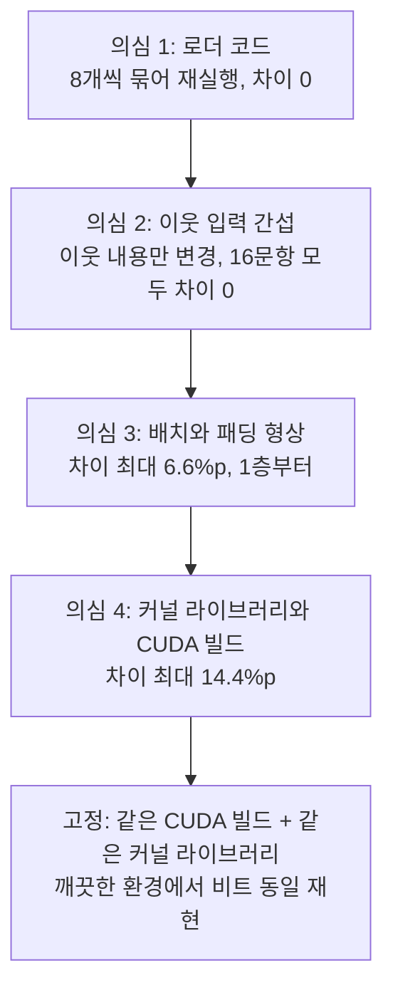

연구용 모델을 공개할 때는 보통 가중치와 의존성 목록을 함께 올리면 충분하다고 생각합니다. 저희도 그렇게 생각했습니다. 그런데 공개 직전 검증에서 공개용 로더가 기준 결과를 재현하지 못했습니다. 가중치와 코드는 맞았는데 판단 확률이 달랐습니다.

판단 결과를 감사하거나, 같은 입력에 같은 판단이 나와야 하는 서비스를 운영하는 분께 이 글을 권합니다. 정확도가 재현되는 것과 확률이 비트 단위로 재현되는 것은 서로 다른 요구사항이었습니다.

*글의 핵심 개념을 형상화했습니다.*

## 쉽게 말하면

같은 레시피와 같은 반죽으로 빵을 굽는다고 해 보겠습니다. 오븐에 한 판만 넣고 구울 수도 있고 여러 판을 한꺼번에 넣고 구울 수도 있습니다. 여러 판을 같이 넣으면 열이 도는 방식이 조금 달라져 빵 색이 미세하게 바뀝니다. 오븐 회사가 다르면 같은 온도 설정에서도 결과가 또 다릅니다.

맛을 보는 사람 대부분은 차이를 모릅니다. 하지만 빵 색을 기준으로 합격과 불합격을 가르는 검사라면 이야기가 달라집니다. 경계 근처의 빵은 오븐에 따라 합격했다가 불합격하기도 합니다.

저희 판단 어댑터가 그 검사입니다. 반죽은 입력이고 레시피는 가중치입니다. 오븐은 실행 환경입니다. 몇 판을 같이 넣느냐는 배치와 패딩이고 오븐 회사는 CUDA 빌드와 커널 라이브러리입니다.

<!-- nlm-visual -->

## 무엇을 해봤나

### 공개 전 검증에서 생긴 일

[지난 글](/tech-blog/ko/research/shared-decision-adapter-27b/)에서 소개한 판단 어댑터를 공개하기 전, 공개용 로더가 기준 결과를 재현하는지 확인했습니다. 기준 결과는 학습 때 쓰던 평가 코드가 입력 8개를 한 번에 묶어 계산한 확률입니다. 공개용 로더는 입력을 하나씩, 패딩 없이 계산합니다.

같은 가중치인데 확률이 맞지 않았습니다. 시드마다 확률 차이가 최대 2.6~4.5%p였습니다. 시드 하나에서는 64개 중 1개 문항의 판단이 바뀌었습니다.

### 원인을 하나씩 갈랐습니다

로더 코드부터 의심했습니다. 그런데 같은 로더로 기준과 똑같이 8개씩 묶어 돌리면 차이가 0이었습니다. 하나씩 돌린 결과를 두 번 반복해도 차이가 0이었습니다. 로더와 가중치와 프롬프트는 모두 맞았습니다. 차이는 계산 경로 자체에서 나왔습니다.

다음으로 가장 걱정스러운 가능성을 확인했습니다. 같은 배치에 들어간 다른 입력이 판단에 영향을 주는지였습니다. 그렇다면 한 사용자의 판단이 옆 사용자의 입력에 따라 바뀌는 셈이고 공개를 멈춰야 합니다. 배치 크기와 패딩 길이를 고정한 채 이웃 입력의 내용만 바꿔 봤더니 16개 문항 모두 차이가 0이었습니다.

그다음 형상만 바꿔 봤습니다.

| 바꾼 것 | 확률 최대 차이 | 처음 달라진 층 | 바뀐 판단 |
|---|---|---|---|
| 같은 형상에서 이웃 입력 내용만 | 0 | 없음 | 0 |
| 한 입력에 패딩만 추가 | 6.6%p | 1층 | 0 |
| 배치 크기 1 → 8 | 3.9%p | 1층 | 0 |
| 배치 8에서 패딩 길이 1,024 → 1,536 | 0.9%p | 45~46층 | 0 |

*16개 문항, 시드 하나로 잰 진단입니다.*

패딩을 넣는 순간 첫 층부터 숫자가 달라졌습니다. 이웃 입력의 영향은 이 표본에서 보이지 않았습니다. 다만 커널 탓인지 마스킹 탓인지, 정확한 원인은 아직 특정하지 못했습니다.

### 전체 평가를 하나씩 계산하면

공개 수치를 로더가 실제로 도는 방식으로 정의하기로 했습니다. 개발용 9,724문항 전체를 네 시드 모두 하나씩 다시 계산했습니다.

| 시드 | 8개씩 묶은 정확도 | 하나씩 정확도 | 판단 일치율 |
|---|---|---|---|
| 1 | .9307 | .9295 | .9944 |
| 2 | .9300 | .9301 | .9948 |
| 3 | .9425 | .9422 | .9971 |
| 4 | .9074 | .9061 | .9934 |

평균 정확도는 92.8%에서 92.7%로, 차이는 0.07%p였습니다. 95% 구간은 −0.15%p에서 +0.01%p로 0을 포함했습니다. 그런데 판단 일치율은 99.3~99.7%였습니다. 정확도는 거의 같아도 문항 수십 개의 판단은 실제로 바뀌었다는 뜻입니다.

즉, 사람 말로는 성적표 점수는 같게 나왔지만 몇몇 답안지는 다른 답을 적었습니다.

### 깨끗한 환경에서 돌리면

마지막으로 공개 파일만 깨끗한 가상 환경에 설치해 돌려 봤습니다. 이번에도 맞지 않았습니다. 원인을 가르려고 같은 파드에서 환경만 바꿔 세 번 돌렸습니다.

| 실행 환경 | 기준과의 확률 최대 차이 | 바뀐 판단 |
|---|---|---|
| CUDA 12.8용 torch, 커널 라이브러리 없음 | 14.4%p | 0 / 64 |
| CUDA 12.8용 torch, 커널 라이브러리 있음 | 9.4%p | 0 / 64 |
| CUDA 13.0용 torch, 커널 라이브러리 있음 | 0 (비트 동일) | 0 / 64 |

*시드마다 64문항으로 확인했습니다. 커널 라이브러리는 flash-linear-attention 0.5.2입니다.*

원인 하나는 코드에서 바로 확인됐습니다. 기준 환경에는 커널 라이브러리가 깔려 있었습니다. 그래서 모델 일부 층의 핵심 연산이 그 라이브러리의 커널로 돌았습니다. 실행 로그에는 빠른 경로를 쓸 수 없어 기본 구현으로 돌린다는 경고가 떴는데도 그랬습니다. 경고는 다른 보조 라이브러리 하나가 빠졌다는 뜻이었고 실제로는 대부분의 연산이 빠른 커널을 쓰고 있었습니다. 깨끗한 환경에는 그 라이브러리가 없어서 같은 층이 기본 구현으로 돌았습니다.

의심 대상을 하나씩 거르고 고정까지 이른 과정을 도표로 정리했습니다.

## 나온 결과

세 가지가 분명해졌습니다.

첫째, 같은 가중치에서도 실행 환경이 판단 확률을 실제로 바꿉니다. 최대 14.4%p는 작은 반올림 오차로 볼 수 없습니다. 이번 표본에서는 판단이 뒤집히지 않았지만, 결정 경계에 가까운 다른 입력에서도 그러리라는 보장은 없습니다.

둘째, 이웃 입력의 간섭은 관측되지 않았습니다. 차이는 입력을 어떤 모양으로 묶느냐에서 나왔습니다.

셋째, 정확한 재현은 가능합니다. 같은 CUDA 빌드와 같은 커널 라이브러리를 쓰면 새로 만든 환경에서도 확률이 비트 단위까지 같았습니다.

그래서 공개 패키지를 이렇게 고정했습니다. 의존성 목록에 torch의 CUDA 빌드와 커널 라이브러리 버전까지 적었습니다. 로더는 실행할 때 환경을 확인하고 검증된 조합과 다르면 경고를 냅니다. 공식 지원 범위는 입력 하나씩, 패딩 없이 계산하는 방식으로 제한했습니다. 카드에는 다른 환경에서 확률이 달라진다는 사실을 수치와 함께 적었습니다.

## 그래서 무엇을 바꾸면 되나

판단을 내리는 모델을 공개하거나 운영한다면 재현성을 세 단계로 나눠 확인하는 편이 좋습니다. 정확도가 재현되는지, 개별 판단이 재현되는지, 확률이 비트 단위로 재현되는지입니다. 이번 사례처럼 첫 단계는 통과하고 둘째 단계는 통과하지 못할 수 있습니다.

의존성 목록에 패키지 이름과 버전만 적는 것으로는 부족했습니다. 같은 버전의 torch라도 CUDA 빌드가 다르면 결과가 달랐습니다. 설치되어 있기만 해도 계산 경로를 바꾸는 선택적 라이브러리도 있었습니다. 그런 라이브러리는 적어 두지 않으면 아무도 모르게 빠집니다.

로그 경고를 그대로 믿지 않는 습관도 필요합니다. 이번 경고는 빠른 경로를 전혀 쓰지 않는다고 읽혔지만, 실제로는 대부분 쓰고 있었습니다. 어떤 커널로 도는지는 코드에서 직접 확인해야 했습니다.

ThakiCloud 관점에서 이 문제는 Metis의 서빙과 바로 이어집니다. 서빙 엔진은 처리량을 위해 요청을 묶어 계산하는데, 묶는 방식이 판단을 바꾼다면 같은 질문에 시간대마다 다른 판단이 나올 수 있습니다. Paxis에서 에이전트의 판단을 감사할 때도 같은 입력에 같은 결과가 나와야 기록을 믿을 수 있습니다. 판단 계층을 공유 서빙에 올리기 전에 이 재현성 단계를 먼저 통과시켜야 합니다.

공개 패키지와 실행 환경 고정본은 [Hugging Face의 ECP-Q7-27B-Research](https://huggingface.co/ThakiCloud/ECP-Q7-27B-Research)에 있습니다.

<!-- nlm-visual -->

## 못 믿을 부분

먼저 진단 규모가 작습니다. 형상 진단은 시드 하나, 16개 문항이었고 환경 비교는 시드마다 64개 문항이었습니다. 이 범위에서 판단이 뒤집히지 않았다는 사실을 전체 데이터로 넓혀 말할 수 없습니다.

둘째, 패딩 차이의 원인을 밝히지 못했습니다. 첫 층부터 달라진다는 사실까지는 확인했지만, 특정 커널 때문인지 마스킹 처리 때문인지는 아직 모릅니다.

셋째, 하드웨어 범위가 좁습니다. 비트 단위 재현은 저희가 검증한 GPU와 런타임 조합에서만 확인했습니다. 다른 GPU 세대에서도 같은 결과가 나온다고는 아직 말할 수 없습니다.

넷째, 배치 추론은 지원하지 않습니다. 실제 서빙처럼 요청을 묶어 처리하는 경로는 이번 공개 범위에서 뺐습니다.

*이 글의 수치는 저희 H200 GPU에서 실제로 잰 값이며 연구 원장에 기록된 결과만 인용했습니다.*
