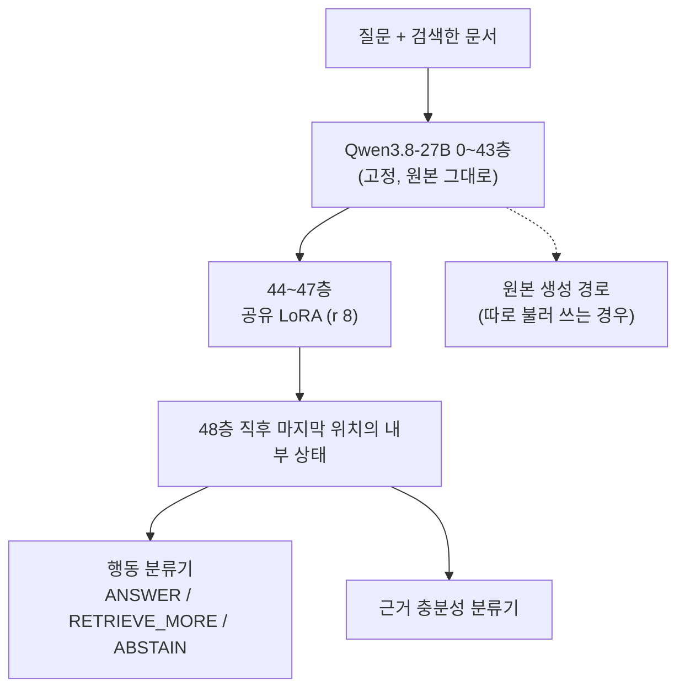

기업마다 자기 업무에 맞춘 대형 언어 모델을 따로 운영하는 일이 흔해졌습니다. 같은 뿌리에서 나온 한국어 모델, 금융 모델, 상담 모델이 나란히 도는 식입니다. 그런데 검색한 문서로 답할지, 더 찾을지, 멈출지 판단하는 기능을 모델마다 다시 학습해야 한다면 비용이 모델 수만큼 늘어납니다.

저희는 원본 모델을 한 글자도 바꾸지 않고 판단만 맡는 작은 부품을 따로 학습했습니다. 학습한 파라미터는 약 218만 개로, 27B 모델의 0.01%에도 못 미칩니다. 이 부품 하나를 파생 모델 네 개에 그대로 붙였을 때 정확도 차이는 0.3%p 이내였습니다. 검색 기반 에이전트를 여러 모델 위에서 운영하는 분이라면 읽어 볼 만합니다.

*NotebookLM이 소스를 종합해 생성한 인포그래픽입니다.*

## 쉽게 말하면

은행 지점 여러 곳을 떠올려 보겠습니다. 지점마다 상담원의 전문 분야가 다릅니다. 한 지점은 외국인 고객에 강하고 다른 지점은 대출 상담에 강합니다. 그래도 고객이 낸 서류를 보고 할 일은 같습니다. 서류가 충분하면 바로 답하고 모자라면 서류를 더 받아 오고 받을 길이 없으면 상담을 멈춥니다.

이 세 가지 판단을 지점마다 따로 교육하는 대신, 모든 상담원이 같이 쓰는 판정표 한 장을 만들 수 있을까요. 판정표는 상담원의 전문 지식을 바꾸지 않습니다. 상담원이 서류를 읽고 머릿속에 정리한 메모를 보고 세 칸 중 하나에 체크할 뿐입니다.

저희가 만든 것이 이 판정표입니다. 상담원은 27B 언어 모델이고 머릿속 메모는 모델 내부의 중간 계산 결과입니다. 판정표의 세 칸은 답변(ANSWER), 재검색(RETRIEVE_MORE), 중단(ABSTAIN)입니다.

<!-- nlm-visual -->
## 무엇을 해봤나

### 판정표의 구조

기반 모델은 Qwen3.8-27B이고 가중치는 전부 고정했습니다. 모델은 64층인데, 판정표는 그중 앞쪽 48층까지만 씁니다. 0층부터 43층까지는 원본 그대로 계산합니다. 44층부터 47층까지 네 층에만 작은 LoRA를 붙였습니다. 48층을 지난 직후, 질문과 문서를 다 읽은 마지막 위치의 내부 상태를 꺼내 작은 분류기 두 개에 넣습니다.

*판정표는 48층에서 멈추므로 판단 한 번에 모델 전체가 아니라 앞쪽 4분의 3만 계산합니다. 연구용 구조도이며 생성 경로와 한 서빙 엔진 안에서 같이 도는 통합은 아직 구현하지 않았습니다.*

학습한 파라미터는 LoRA 2,162,688개와 분류기 20,484개, 합쳐 2,183,172개입니다. 판정표가 텍스트를 만들지 않는다는 점도 중요합니다. 판정표는 세 행동의 확률만 돌려주고 답을 쓰려면 원본 모델을 따로 불러야 합니다.

### 학습과 평가

학습 데이터는 MuSiQue라는 다단계 질의응답 데이터에서 만들었습니다. 한 질문에 대해 문서를 바꿔 가며 정답 행동이 데이터 구성만으로 정해지게 했습니다. 연결 고리가 다 있으면 답변이 정답입니다. 고리 하나가 빠졌는데 더 찾을 수 있으면 재검색이고 더 찾을 수 없으면 중단입니다.

평가는 개발용 1,436개 질문 묶음에서 했습니다. 학습 시드는 네 개를 돌렸고 대표값은 가장 잘 나온 시드가 아니라 네 시드의 평균입니다. 공개한 수치는 로더가 실제로 도는 방식, 즉 입력 하나씩 패딩 없이 잰 값입니다.

### 다른 모델에 그대로 붙이기

같은 판정표를 Qwen3.8-27B에서 파생된 27B 모델 네 개에 다시 학습하지 않고 붙였습니다. 네 모델 모두 구조는 원본과 같고 가중치만 다릅니다. 모델 이름은 공개하지 않고 파생 A부터 D로 부릅니다.

## 나온 결과

### 원본 모델에서

네 시드 평균 정확도는 92.7%였고 가장 높은 시드는 94.2%였습니다.

| 시드 | 정확도 | 근거 없는 답변 비율(UAR) | 근거 충분 문항 커버리지* |
|---|---|---|---|
| 1 | .930 | .042 | .885 |
| 2 | .930 | .081 | .785 |
| 3 | .942 | .088 | .892 |
| 4 | .906 | .054 | .802 |
| 평균 | .927 | .066 | .841 |

*\* 같은 평가 묶음에서 답변 임계값을 움직여 UAR을 5% 이하로 맞췄을 때 답할 수 있는 근거 충분 문항의 비율입니다. 표본 안에서 계산한 진단값입니다.*

근거 없는 답변 비율은 답변을 고른 문항 가운데 실제로는 근거가 부족했던 비율입니다. 네 시드 중 세 시드에서 이 값이 5%를 넘었습니다. 정확도가 높아도 아무 근거 없이 답하는 경우가 남아 있다는 뜻입니다.

참고로 같은 평가 묶음에서 모델 전체를 미세조정한 RAG-Gate-27B는 95.7%였습니다. 이 값은 다른 모델을 다른 방식(8개씩 묶은 배치)으로 잰 결과라 직접 비교할 수는 없습니다. 다만 판정표가 전체 미세조정보다 정확하지 않다는 방향은 분명합니다.

### 파생 모델에서

판정표를 다시 학습하지 않고 파생 모델에 붙였을 때 정확도는 거의 그대로였습니다.

| 모델 | 정확도 (원본 → 파생) | 차이 [95% 구간] | UAR (원본 → 파생) | 판단 일치율 |
|---|---|---|---|---|
| 파생 A | .928 → .928 | +.001 [−.001, +.002] | .066 → .067 | .989 |
| 파생 B | .928 → .931 | +.003 [+.001, +.006] | .066 → .072 | .981 |
| 파생 C | .928 → .927 | −.001 [−.004, +.003] | .066 → .084 | .958 |
| 파생 D | .928 → .926 | −.001 [−.004, +.001] | .066 → .058 | .979 |

*이 표는 8개씩 패딩해 묶어 잰 이전 프로토콜의 값이며, 입력 하나씩 재는 방식은 적용하지 않았습니다. 파생 D는 계보가 완전히 확인되지 않아 측정값만 싣습니다.*

정확도 차이는 네 모델 모두 0.3%p 이내였습니다. 하지만 근거 없는 답변 비율은 모델마다 다르게 움직였습니다. 파생 C에서는 6.6%에서 8.4%로 올랐습니다. 정확도가 유지된다고 위험까지 유지되는 것은 아닙니다.

즉, 사람 말로는 판정표를 다른 지점 상담원에게 그대로 줘도 맞히는 비율은 거의 같았지만, 근거 없이 답하는 습관은 지점마다 조금씩 달랐습니다.

### 실행 환경에 따라 확률이 달라졌습니다

공개 전 검증에서 예상하지 못한 사실도 나왔습니다. 같은 가중치라도 실행 환경이 다르면 판단 확률이 달라졌습니다. 기준 환경과 같은 조합에서는 확률이 비트 단위까지 똑같이 나왔습니다. 반면 CUDA 빌드가 다르고 일부 커널 라이브러리가 빠진 환경에서는 확률이 최대 0.14까지 달랐습니다.

시드별로 64문항을 확인한 범위에서는 판단이 뒤집힌 경우가 없었습니다. 그래도 결정 경계 근처의 다른 입력에서 같으리라는 보장은 없습니다. 그래서 공개 패키지에 정확한 실행 환경을 고정하고 다른 환경에서는 로더가 경고를 내게 했습니다.

## 그래서 무엇을 바꾸면 되나

이번 결과가 말하는 것은 높은 정확도가 아닙니다. 이미 배포한 모델을 그대로 둔 채, 근거 판단만 별도의 가벼운 계층으로 떼어 내 여러 모델에 나눠 쓸 수 있다는 가능성입니다.

여러 파생 모델을 운영하는 팀이라면 판단 기능을 모델마다 다시 학습하기 전에 이런 순서를 고려할 수 있습니다. 먼저 공통 판정표를 하나 학습합니다. 그다음 파생 모델마다 정확도와 함께 근거 없는 답변 비율을 따로 잽니다. 정확도만 보면 파생 C 같은 위험 상승을 놓칩니다.

ThakiCloud 관점에서 이 방향은 Paxis와 직접 이어집니다. Paxis의 에이전트는 문서를 찾아 답하기 전에 답해도 되는지를 판단해야 하고 고객마다 다른 모델을 쓰더라도 그 판단 기준은 하나로 관리하는 편이 낫습니다. 판정표만 따로 학습하는 방식은 Maxis에서 모델 전체를 다시 학습하는 비용을 줄입니다. 원본 모델을 그대로 두는 구조라 Metis에서 이미 서빙 중인 모델 위에 판단 계층을 얹는 그림도 가능합니다. 다만 그 공유 서빙은 아직 구현하지 않았습니다.

공개한 가중치 네 개와 로더, 합성 예시는 [Hugging Face의 ECP-Q7-27B-Research](https://huggingface.co/ThakiCloud/ECP-Q7-27B-Research)에 있습니다.

<!-- nlm-visual -->
## 못 믿을 부분

먼저 평가 묶음 문제입니다. 모든 수치는 개발용 묶음에서 쟀고 시드별 체크포인트도 같은 묶음으로 골랐습니다. 그래서 실제보다 좋게 나왔을 수 있습니다. 봉인해 둔 시험 묶음은 이 판정표로 열지 않았습니다.

둘째, 안전 인증이 없습니다. 근거 없는 답변 비율은 네 시드 중 세 시드에서 5%를 넘었습니다. 별도 보정 데이터에서 이 비율의 통계적 상한을 인증하지도 않았습니다. 공개한 합성 예시 중에는 동명이인에 관한 문서만 주고 악기를 묻는 문항이 있습니다. 이 문항에서 네 시드 모두 답변을 골랐습니다. 근거가 부족해도 항상 거절하지는 않는다는 직접적인 예입니다.

셋째, 전이의 범위가 좁습니다. 파생 모델 네 개는 모두 원본과 구조가 같고 48층에서 원본과 판단이 95.8% 이상 겹칩니다. 그래서 이 결과는 같은 모델 계열 안의 전이일 뿐, 다른 구조로 옮겨 간다는 뜻은 아닙니다. 파생 모델의 이름을 밝히지 않았으므로 이 전이 결과는 공개 가중치만으로는 재현할 수 없습니다.

넷째, 운영 조건입니다. 데이터는 영어 합성 문단이고 한국어 기업 문서는 검증하지 않았습니다. 로더는 입력을 하나씩만 처리합니다. 패딩해서 묶으면 확률이 최대 0.07 달라졌는데, 원인이 특정 커널인지 마스킹인지는 아직 밝히지 못했습니다.

*이 글의 수치는 저희 H200 GPU에서 실제로 잰 값이며 연구 원장에 기록된 결과만 인용했습니다.*
