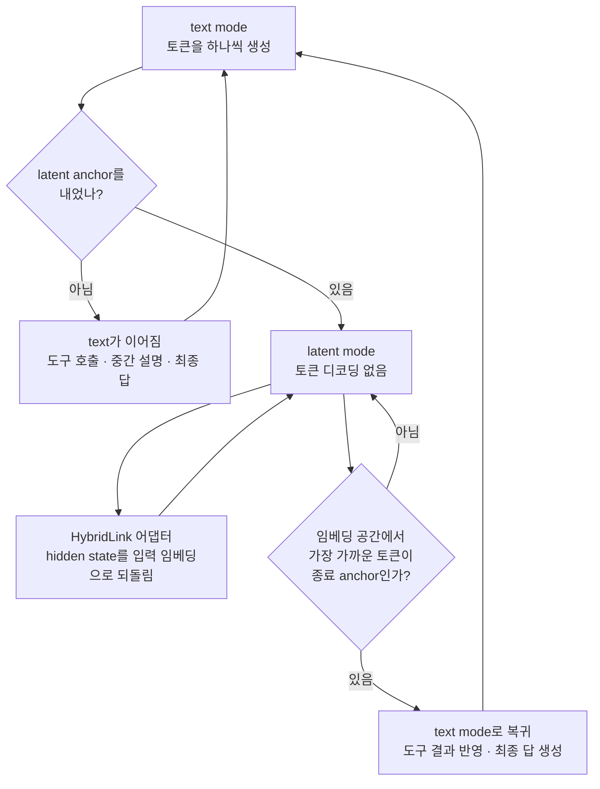

## 왜 읽어야 하나

에이전트 워크로드의 토큰 청구서를 책임지는 사람, 즉 Paxis 같은 agent 플랫폼에서 서빙·비용·SLO를 함께 보는 엔지니어라면 이 논문이 다음 분기의 비용 곡선을 움직일 수 있는 결과입니다. 핵심 결론은 하나입니다. 모든 intermediate thinking을 텍스트 토큰으로 뽑아내지 않아도, 도구 사용과 최종 답까지 텍스트로 하는 에이전트는 만들 수 있고, 그렇게 만들면 성능은 오히려 오릅니다. Stanford와 Together AI의 "Hybrid Reasoning Agents"(arXiv 2610.18861, 2026-10-13)는 Qwen3-Base 4B·8B·14B에서 11개 벤치마크를 평가해, 텍스트 에이전트 baseline 대비 평균 10.4% 성능 향상과 노출 토큰 35.5~54.7% 절감, 추론 속도 1.8~2.6x, 비용 2.7~3.7x 절감을 보고합니다.

> 📄 **심층 리뷰 전문(DOCX)**: 이 논문의 상세 피어리뷰를 [Google Drive에서 다운로드](https://drive.google.com/file/d/1bMo1hynw2gamzIO7yxxdx5ow2UeScgtK/view)할 수 있습니다.

*생각은 잠재 공간에서, 행동은 텍스트로. 이 논문의 한 줄 요약과 두 개의 핵심 지표(디코딩 토큰 54.7% 절감, 성능 10.4% 향상)가 담긴 표지 슬라이드입니다.*

## 쉽게 말하면

수학 문제를 풀 때 모든 중간 단계를 노트에 적지 않습니다. 큰수는 머릿속에서 굴리고, 사람에게 넘겨줄 답과, 나중에 다시 볼 중요한 계산만 종이에 적습니다. HybridAgent가 모델에게 배운 습관이 정확히 이 것입니다. "생각"은 아무것도 쓰지 않은 채 모델 내부(잠재 공간, latent space)에서 하고, "행동"인 툴 호출과 최종 답만 텍스트로 씁니다. 그리고 이 경계가 "생각을 50단계를 숨기고 나서 말해라" 같은 고정 규칙이 아니라, 학습으로 정해지는 적응적 규칙인 것이 핵심입니다. 이 비유를 기억해 두세요. 뒤에서 한계와 정리 섹션이 같은 종이를 꺼냅니다.

## 개요

에이전트의 비용 구조에서 디코딩이 지배적인 축입니다. long reasoning 모델이 생각의 사슬을 텍스트로 다 뽑으면, 그 토큰 하나하나가 GPU-초로 환산됩니다. 에이전트 워크로드는 여기에 도구 호출을 반복하는 턴 수를 얹기 때문에, 작업 하나당 청구서가 reasoning 토큰과 tool-turn 토큰의 곱으로 불립니다. 그래서 비용을 줄이는 방향의 연구가 두 갈래로 나뉘어 왔습니다.

*에이전트 비용의 구조와 이 논문의 답: 청구서는 (reasoning 토큰 + tool-turn 토큰) × GPU-초이고, 생각은 은닉된 채로, 행동은 명시적으로. 오른쪽 지표는 논문의 핵심 결과(토큰 절감 최대 54.7%, 비용 3.7x, 성능 +10.4%)입니다.*

첫 갈래는 잠재 추론 자체입니다. Coconut 같은 라인이 hidden state로 생각하게 하는 시도인데, 그러면 도구 호출과 사용자 관측이 어려워지고 사고 과정을 들여다볼 수 없는 블랙박스가 됩니다. 두 갈래는 여전히 텍스트입니다. ARPO나 GRPO 같은 에이전틱 RL이 추론을 효율적으로 학습하지만, "쓰는 것"의 총량을 줄이려면 쓰는 방식 자체를 바꿔야 합니다. 줄여도 성능이 안 떨어지는지, 아니면 줄이는 대로 성능이 따라떨어지는지가 핵심 문제입니다.

이 논문의 주장은 이 두 갈래가 하나일 수 있다는 것입니다. 단일 생성 과정 안에서 텍스트 모드(행동)와 잠재 모드(사고)를 오가게 하고, 전환 시점까지 학습으로 배웁니다. 발표 주체는 Stanford와 Together AI이며, 2026년 10월 13일 arXiv 등록과 함께 코드가 MIT 라이선스로, 8B·14B 어댑터 가중치와 학습 데이터셋(HybridSFT-v1/v2, HybridRL)이 Hugging Face에 공개됐습니다. 실험은 3가지 모델 규모(4B·8B·14B)와 11개 벤치마크로 진행됐습니다. 수학은 AIME 25·AIME 26·MATH500, 지식·과학·의학은 GPQA-Diamond·MedQA·MuSiQue, 에이전트 추론은 GAIA·HLE·WebWalker·SealQA·DSQA입니다.

## 이 기술은 무엇인가

구조는 백본, 전환 장치, 학습 절차라는 세 개의 부품으로 이루어집니다.

*HybridAgent를 구성하는 세 모듈: Qwen3-Base 백본(4B·8B·14B), 약 10M 파라미터의 HybridLink 어댑터, 그리고 54K 궤적 학습(HybridSFT)과 모드 무보상 RL(HybridRL).*

**백본**은 Qwen3-Base 4B·8B·14B입니다. 논문의 모든 수치는 이 백본 위에서 나옵니다. frontier급 모델이 아니라 오픈 백본이라는 점에 주목할 가치가 있습니다. 결과의 상당 부분이 "모델을 잘 고른 것"에서 나오지 않고, 하이브리드 구조 자체에서 나온다는 뜻이기 때문입니다.

**전환 장치는 HybridLink**라는 경량 어댑터입니다. 형태는 hidden state를 입력 임베딩 공간으로 되돌리는 residual 연결 `h + W2 σ(W1 h)`이고, 크기는 4B LLM 기준 약 10M 파라미터입니다. 백본이 14B라면, 전환을 맡는 부품이 모델 전체의 몇 퍼센트도 되지 않는다는 뜻입니다. 동작은 이렇습니다. text mode에서 생성하던 모델이 latent anchor를 내면, 생성은 토큰 디코딩을 멈추고 잠재 모드에 들어갑니다. 각 스텝마다 HybridLink가 최종 레이어 hidden state를 다음 입력으로 되먹여주므로, 모델은 "아무것도 쓰지 않은 채" 상태를 굴립니다. 토큰이 안 나오니 디코딩 비용도 쌓이지 않습니다. 언제 다시 입을 열지는 임베딩 공간에서 현재 상태를 투영했을 때 가장 가까운 토큰이 종료 anchor가 되는 순간으로, 사전에 길이나 주기를 고정하지 않습니다.

*HybridAgent의 한 번의 생성: text mode에서 토큰을 뽑고, latent anchor가 나오면 HybridLink를 거쳐 토큰 없이 사고하고, 종료 anchor가 감지되면 다시 text mode로 돌아옵니다. 전환 시점은 고정되지 않고 학습으로 결정됩니다.*

기존 잠재 추론 시도와의 차이는 HybridLink의 형태에서 바로 보입니다. Coconut은 모델의 최종 hidden state를 다음 입력 임베딩으로 그대로 되먹여 단계형 커리큘럼으로 잠재 사고를 학습합니다. SoftCoT는 동결된 보조 모델의 soft thought를 백본에 투영하고, SoftThinking은 어휘 임베딩의 확률가중 혼합을 씁니다. HybridLink는 두 선형 레이어의 residual 연결로 hidden state를 대체하지 않고 작은 경로를 더합니다. 어댑터가 꺼져 있어도 백본의 원능력이 그대로 남는 형태입니다. 논문의 4B 비교에서 이 선택의 효과가 직접 나옵니다. 같은 백본에서 AIME25 기준으로 Coconut 10.6, SoftCoT 14.8, 표준 text SFT 19.0, HybridAgent 35.2(RL 완료 후)입니다. 잠재 라인이 "텍스트 능력을 희생해 효율을 사는 거래"라고 여겨졌지만, 이 표는 다른 답을 보입니다.

투명성도 구조적으로 확보해 둔 편입니다. 잠재 단계의 배정, 즉 어떤 단계를 latent로 하고 어떤 단계를 text로 남길지는 expert 판단과 모델 예측 entropy로 자동 할당되고, 툴 호출과 audit가 필요한 핵심 단계는 text로 유지됩니다. 사용자에게 보여야 할 부분은 숨겨지지 않는다는 뜻입니다. 논리는 정리 두 개로 뒷받침됩니다. 연속 작업 기억인 KV 캐시가 latent thoughts를 텍스트로 변환하지 않아도 완전한 이력을 보존한다는 정리 A.1, exact replay 하에 텍스트 위치의 그래디언트가 완전 hybrid trajectory likelihood의 그래디언트와 같다는 정리 C.3입니다. 전자는 도구가 사고를 끊는 중간에도 생각이 손실되지 않는다는 뜻이고, 후자는 아래 최적화 설계가 ad hoc이 아니라 보장에서 나온 것임을 말합니다.

## 학습: HybridSFT와 HybridRL

1단계 **HybridSFT**는 기존 text agentic SFT 데이터를 필터링하고 자동 주석해 54K 하이브리드 궤적을 만듭니다. 여기서 기존 궤적의 텍스트 중간 단계를 그대로 latent로 바꾸지 않는 것이 중요합니다. 어떤 단계가 "머릿속 계산"이고 어떤 단계가 "종이에 적어야 할 것"인지의 경계를 주석 단계에서 먼저 세운 뒤 학습에 넘기는 것입니다. 학습은 세 구간으로 나눕니다. 먼저 anchor 형식을 켜는 format activation, 그다음 백본을 동결하고 latent hidden state와 목표 임베딩을 정렬하는 HybridLink activation, 마지막에는 모델이 자기 HybridLink로 만든 latent를 스스로의 입력으로 다시 쓰는 self-conditioned two-pass입니다. 마지막 구간이 핵심입니다. 학습 때와 추론 때의 입력 분포를 맞춘 것이 아니라, 추론 시 실제로 흐를 자기 생성 latent를 입력으로 다시 훈련시켜, 자기 출력에 대한 자기 보장을 만듭니다. 손실은 text 위치가 cross-entropy, latent 위치가 regression입니다.

2단계 **HybridRL**은 deep reasoning 12K·agentic search 1K 예제 위에서 진행합니다. rollout batch 512(64×8), 8개 minibatch. 보상은 `r_correct + r_format + r_tool`, 즉 정확성·형식·멀티툴 사용 세 가지입니다. 의도적으로 "잠재 모드를 얼마나 썼는가"에 대한 명시적 보상을 두지 않는 것이 설계의 초점입니다. 언제 속으로 생각할지는 보상 함수가 지시하는 것이 아니라, 과제를 잘 푸는 과정에서 자연스럽게 학습됩니다. 모드 사용에 직접 보상을 걸면, 실제로는 무용한 단계까지 잠재로 숨기는 파생 행동이 생기기 쉬운데, 이 설계는 그 위험을 피합니다. 최적화 측면에서도 HybridLink는 고정하고 latent 컨텍스트를 exact replay하며, likelihood ratio는 실제로 샘플링된 text 위치에서만 계산합니다. 학습이 불안정해지기 쉬운 잠재 구간은 그라디언트에서 제외하는 셈입니다.

## 논문이 보고한 결과

아래 수치는 전부 논문 원문(초록 + 전문)에서 확인한 값입니다.

에이전트 벤치마크에서 HybridAgent는 같은 규모 텍스트 에이전트 baseline을 전 영역에서 앞섭니다. 14B 기준 GAIA 평균 52.4점으로, ARPO 학습 텍스트 에이전트(43.7)보다 8.7점, GRPO(36.9)보다 15.5점 높습니다. 레벨별로는 GAIA Lv1 53.8, Lv2 55.8, Lv3 33.3. WebWalker 평균 49.5, HLE 평균 16.0, SealQA S-0/Hard 24.3/37.8, DSQA 정확도/F1 21.7/46.8입니다. 8B도 같은 방향입니다. GAIA 43.7(ARPO 38.8, GRPO 32.0), WebWalker 42.5, HLE 14.4, SealQA 22.5/35.8, DSQA 20.0/40.7.

| 규모 | 방법 | GAIA avg | WebWalker avg | HLE avg | MATH500 | AIME 25/26 |
|---|---|---:|---:|---:|---:|---:|
| 14B | GRPO | 36.9 | 38.5 | 8.6 | - | - |
| 14B | ARPO | 43.7 | 40.5 | 10.0 | 87.0 | 42.1/43.3 |
| 14B | HybridAgent | 52.4 | 49.5 | 16.0 | 88.2 | 43.3/45.8 |
| 8B | ARPO | 38.8 | 32.0 | 8.8 | 82.8 | 37.1/41.5 |
| 8B | HybridAgent | 43.7 | 42.5 | 14.4 | 84.6 | 39.2/43.3 |

*GRPO의 수학 벤치마크 수치는 전문의 결과 표에 실려 있지 않아 제외했습니다. 확인된 값만 표기합니다.*

*규모별 요약: 14B는 GAIA 52.4(ARPO 대비 +8.7)로 최고 정확도, 8B는 노출 토큰 302개(절감 49.3%)로 균형, 4B는 컴퓨팅 스텝 62.5% 감소·비용 3.7x로 최대 절감.*

지식·과학·의학 축도 같은 방향입니다. 14B HybridAgent의 GPQA-Diamond 55.1, MedQA 81.7, MuSiQue 34.5는 같은 규모 ARPO(54.0, 80.3, 31.5)를 모두 앞섭니다. 도구 사용이 없는 순수 추론 과제에서도 잠재 전환이 해가 되지 않는다는 신호입니다.

효율의 축이 이 글의 진짜 포인트입니다. 14B HybridAgent는 instance당 노출 text 토큰이 284개인데, 텍스트 에이전트는 497개입니다. 8B는 302 대 596. 벤치마크에 따라 다르지만 노출 토큰 절감 폭은 35.5~54.7%, 추론 속도는 1.8~2.6x(텍스트 에이전트 대비 2.1x), 비용 절감은 2.7~3.7x로 보고됩니다. 초록의 표현을 그대로 쓰면 "cheaper reasoning need not cost accuracy"입니다. 성능 +10.4%가 "잠재로 생각을 하면 빠지니까 그 손해가 없다"가 아니라, baseline보다 더 잘하면서 덜 쓴다는 뜻입니다.

비용 수치의 기준을 짚어 둡니다. 논문의 계산은 토큰 단가가 아니라 스텝 단가입니다. text와 latent 스텝 하나를 각각 backbone forward pass 한 번으로 과금하고, text 스텝은 vocabulary projection, latent 스텝은 HybridLink 어댑터의 비용을 더합니다. 화폐 환산은 $2.50 per H100-hour, peak BF16 처리량의 10% utilization 가정이며, prompt prefill과 외부 도구 실행은 제외합니다. 그 결과 계산량은 62.5~72.9% 감소하고, 비용은 4B가 $359에서 $98(3.7x), 8B가 $439에서 $121(3.6x), 14B가 $470에서 $176(2.7x)로 줄어듭니다. 절감 폭이 소형에서 크다는 것은 논문이 직접 짚는 관찰입니다. 작은 모델일수록 text projection의 상대 비용이 크기 때문입니다.

산출물도 함께 확인했습니다. GitHub(togethercomputer/HybridAgent)은 MIT 라이선스로 hybrid_agent(생성 엔진), hybrid_sft, hybrid_rl, hybrid_inference(배치 실행), interpretable_latent_mode(잠재 단계 검사용 모듈)를 담고 있습니다. Hugging Face에는 HybridAgent-8B-Agentic·HybridAgent-14B-Agentic 어댑터(ckpt에 adapter.pt 포함)와 학습셋 3종(HybridAgent-HybridSFT-v1, v2, HybridAgent-HybridRL)이 공개되어 있습니다. 백본만 있으면 어댑터 얹기 실험이 가능한 구조이고, interpretable_latent_mode 모듈은 잠재 단계를 검사하기 위한 진입점을 제공합니다.

## ThakiCloud 제품 적용 시사점

두 렌즈가 다 걸립니다. 에이전트 논문이므로 Paxis가 먼저이고, 디코딩 비용 논리가므로 Metis가 뒤를 받칩니다.

*두 렌즈의 요약: Paxis는 "긴 추론 + 짧은 행동" 워크플로우의 노출 토큰 단가를 낮추는 구조적 레버, Metis는 디코딩 GPU-초 절감을 처리량과 $/1M tok 하락으로 전환. 하단 한계 블록은 아래 섹션의 투명성 논의를 예고합니다.*

**Paxis 렌즈**: 에이전트 플랫폼의 비용 청구서는 토큰 수로 찍힙니다. Paxis에서 도는 agent의 상당 부분이 "긴 추론 + 짧은 행동"형 워크플로우(계획 세우기, 결과 해석, 다음 액션 선택)라면, 이 논문이 가리키는 방향은 그 추론의 노출 단가를 낮추는 구조적 레버입니다. 2.7~3.7x 비용 절감이 실 워크로드에서 그대로 재현된다는 뜻은 아닙니다(아래 한계 참조). 하지만 "노출 토큰"이라는 축을 고정 상수가 아니라 설계 변수로 만들었다는 사실 자체가 agent economics의 표를 바꿉니다. Paxis의 실행 계층에서 skill 호출·도구 사용·정책 게이트 통과 같은 "사용자가 반드시 봐야 할 것"은 텍스트에, 중간 탐색은 잠재로 두는 것이 바로 이 paper의 hybrid 분업이고, 감사 로그의 대상도 따라서 "행위"에 집중됩니다.

**Metis 렌즈**: 서빙 관점에서 노출 토큰 절감은 디코딩 구간 GPU-초 절감으로 직결됩니다. ThakiCloud의 Metis는 다양한 고객 환경에서 모델을 서빙하는데, 같은 체크포인트를 더 적은 디코딩으로 돌리게 하는 것은 endpoint당 처리량과 $/1M tok의 둘 다를 움직입니다. 이 논문의 수치는 저자의 self-hosted 환경 기준이라 그대로 인용하는 것은 아닙니다. 우리 클러스터에서 같은 어댑터를 실 워크로드에 얹고, serve 설정을 명시하고 반복 측정하는 규율에 맞춰 재계산하는 것이 다음 실험입니다.

## 한계 및 반론

종이에 쓴 것만으로 판정할 수 없는 부분이 있습니다. 첫째, 절감 수치의 기준선입니다. 35.5~54.7%는 "텍스트 에이전트 baseline(ARPO/GRPO 학습)"과의 비교이고, frontier급 thinking 모델의 긴 사슬과 비교한 값이 아닙니다. 규모도 4B~14B로, "크기가 오르면 여전히 성립하나"는 논문에 답이 없습니다. 둘째, 투명성입니다. 잠재 단계는 hidden state로 존재하고, 검사(readout)는 provider가 소유한 HybridLink를 통해서만 가능합니다. 논문의 Discussion 자체가 이 점을 짚습니다. 기존 text chain-of-thought는 사용자가 그 자체로 사고를 볼 수 있었지만, hybrid에서는 사용자가 보지 않는 부분이 구조적으로 늘고, 그것을 모니터링할 수 있는 쪽은 provider입니다. agent의 행위를 정책 게이트와 감사 로그로 통제하는 플랫폼을 운용한다면, "속으로 한 생각"의 auditability는 도입 전에 답이 필요한 질문입니다. interpretable_latent_mode 모듈이 부분 답을 주지만, 잠재 단계를 의사텍스트로 풀어보는 것은 원 추론의 복원이 아니라 해석입니다. 셋째, 일반화입니다. 11개 벤치마크가 모두 추론·에이전트 중심입니다. 실제 production 워크로드(고객 대화, 검색, 코드)에서 전환 시점 학습이 같은 이점을 주는지, 그리고 "언제 입을 열지"가 공격 표면이 되는 지점은 논문이 다루지 않습니다. 넷째, 비용 모델의 경계입니다. 위의 절감은 prefill과 도구 실행을 제외한 스텝 단가 계산입니다. tool-heavy 워크로드에서 도구 실행 시간이 지배적이라면 잠재 스텝 절감의 상대 효과는 줄어듭니다. 또 실험에서 latent span은 16~256 스텝으로 제한되어 있고, 이 범위를 넘는 긴 잠재 사고에서 종료 신호 휴리스틱이 어떻게 행동하는지는 검증 밖입니다. 다섯째, 이 수치는 논문의 own 측정입니다. ThakiCloud 산출물로 인용하기 전에는 우리 서빙 환경에서 재측정이 필요하고, 그때까지는 "저자가 보고한 값"이라는 라벨을 붙여 둡니다.

## 정리

"생각"과 "행동"의 경계는 오랫동안 sampling과 프롬프트의 문제였습니다. 이번 논문은 그 경계를 10M 파라미터 어댑터와 2단계 학습으로 아키텍처의 일부로 옮겼습니다. 결과는 성능 +10.4%와 노출 토큰 절감 35.5~54.7%가 같은 방향이라는 것입니다. 더 싼 추론이 정확도를 대가로 삼지 않는다는 첫 번째이자, 상당한 증거입니다.

에이전트 워크로드를 서빙하거나 비용을 보는 사람에게는 다음 행동이 있습니다. HybridAgent-14B 어댑터를 자기 백본에 얹어 가장 비싼 워크로드 하나에서 "노출 토큰 per passed task"를 재보는 것입니다. 이 paper가 그 축을 재게 해 주는 자, 즉 scratch paper를 언제 접을지를 결정 변수로 만든 paper입니다. 그 숫자가 우리 환경에서도 같은 방향이라면, agent economics의 다음 분기는 모델 선택이 아니라 생성의 분업 구조로 이동합니다.

*자료 위치: 논문(arXiv 2610.18861), MIT 라이선스 코드, Hugging Face 가중치·데이터셋, 그리고 Google Drive의 심층 리뷰 전문. ThakiCloud의 다음 실험은 인프라 환경 내 14B 어댑터 파일럿과 노출 토큰 재측정입니다.*

*출처: [Hybrid Reasoning Agents, arXiv 2610.18861](https://arxiv.org/abs/2610.18861) (Jiaru Zou, Yunzhe Qi, Sirui Chen, Federico Bianchi, Shang Zhu, Pan Lu, Jingrui He, James Zou, 2026-10-13). 코드 [github.com/togethercomputer/HybridAgent](https://github.com/togethercomputer/HybridAgent) (MIT). 가중치·데이터셋 [huggingface.co/collections/togethercomputer/hybridagent](https://huggingface.co/collections/togethercomputer/hybridagent). 본 글의 수치는 논문 원문(초록 + 전문)에서 확인한 값이며, ThakiCloud 측 재측정은 아닙니다.*

> 📄 **심층 리뷰 전문(DOCX)**: 이 논문의 상세 피어리뷰를 [Google Drive에서 다운로드](https://drive.google.com/file/d/1bMo1hynw2gamzIO7yxxdx5ow2UeScgtK/view)할 수 있습니다.
