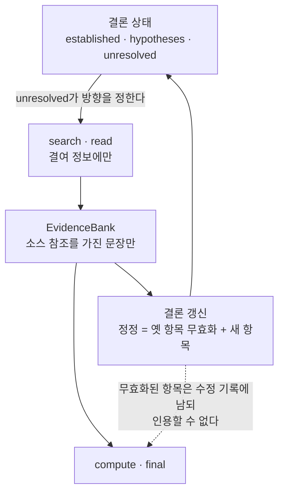

수천 개의 문서에 답이 흩어져 있는 문제를 에이전트에 맡기면 정답률을 가르는 것은 탐색 횟수가 아니라, 찾은 것을 어떻게 쌓느냐인 경우가 많습니다. 같은 모델, 같은 예산, 증거를 조직하는 방식이 다른 실험이 하나 있습니다.

100M 토큰 규모 재무 문서 코퍼스에서 하네스만 바꿨더니 같은 모델의 정답 일치율이 4.4에서 61.1로 올랐습니다. 기존 코퍼스에서는 15.8에서 60.2로 올랐고, 비교 대상이 된 잘 알려진 코딩 에이전트 하네스 두 가지보다 12점에서 19점까지 앞섰습니다. 프로그램 기반 하네스와 함께 예산을 맞춘 네 가지 비교에서 이 하네스가 전부에서 가장 높았습니다.

이 실험의 주체는 LongHarness라는 하네스입니다. 핵심은 모델에 더 많은 컨텍스트를 주는 것이 아니라, 모은 증거와 현재 결론을 대화 밖의 명시 상태로 빼내어 관리하는 구조입니다. 에이전트 실행 인프라를 만들거나, 장문 문서 작업을 돌리는 에이전트의 메모리를 설계하는 분께 이 글을 권합니다. 그 구조가 어떤 실패를 막는지, 그리고 실행 인프라에 무엇을 바꾸라는 신호인지 짚어 봅니다.

*모은 증거와 현재 결론을 대화 밖에서 분리해 관리하는 LongHarness의 핵심 개념을 형상화했습니다.*

*모델과 예산을 바꾸지 않고 증거를 대화 밖에서 관리하는 하네스만으로 정답 일치율이 4.4에서 61.1로 상승했습니다.*

> 📄 **심층 리뷰 전문(DOCX)**: 이 논문의 상세 피어리뷰를 [Google Drive에서 다운로드](https://drive.google.com/file/d/1ecogVdRWzMAaLo_GsebScswNIaeDDqkz/view)할 수 있습니다.

## 쉽게 말하면

조사 보고서를 쓸 때 대부분은 습관이 있습니다. 서랍에서 서류를 꺼내면 노트에 쪽수와 핵심 문구를 적습니다. 따로 '보고서에 넣을 주장'과 '아직 확인 안 된 사항' 목록을 두고, 그 목록이 '여기가 빠져 있다'고 하면 그때만 다시 서랍을 엽니다. 새 규정이 나와 숫자가 바뀌면 옛 쪽에 취소선을 긋고 새 쪽을 적습니다. 계산과 결론에는 긋지 않은 쪽만 씁니다.

*서랍에서 서류를 꺼내면 노트에 쪽수와 핵심 문구만 적고, 확인 안 된 사항 목록이 다시 서랍을 열게 하는 인간의 작업 방식을 LongHarness가 에이전트에 부여합니다.*

LongHarness가 에이전트에게 붙인 구조가 정확히 이것입니다. 노트가 증거 은행이고, 주장 목록이 결론 상태이며, '아직 확인 안 된 사항'이 다음 탐색을 이끄는 열쇠입니다. 노트에는 실제로 펼쳐 본 쪽만 적고, 정정은 원본을 고치는 것이 아니라 새 항목으로 적고 옛 항목을 무효화하는 것입니다. 계산과 최종 답에는 무효화된 항목을 쓸 수 없습니다.

그동안 에이전트는 모든 것을 대화 위에 쌓는 습관이 있었습니다. 검색한 것, 읽은 것, 결론 내린 것, 정정한 것이 한 덩이에 자라났습니다. 덩이가 커지면 '아직 뭘 모르고 있는가', '어떤 숫자가 최신인가'를 매번 다시 훑어야 합니다. LongHarness는 그 둘을 대화 밖으로 빼내, 증거와 결론이라는 두 상태로 나누어 관리합니다.

이 구조가 푸는 실패는 두 가지입니다. 하나는 목록을 보지 않고 서랍만 이리저리 뒤지는 탐색 그 자체를 계속하는 일입니다. 다른 하나는 숫자가 바뀐 줄은 알았는데 계산에는 옛 숫자를 쓰는 일입니다. 이 실험은 그 둘을 구조적으로 조직했을 때 같은 모델의 정답률이 어떻게 바뀌는지 보여 줍니다.

## 무엇을 해봤나

### 실패를 먼저 짚었습니다

문서가 1,435개인 코퍼스에서 특정 값을 찾아 계산하는 문제라면, 모델 능력은 드물게 병목이 됩니다. 논문은 실제 사례를 하나 보여 줍니다. 80개월 치 지출의 기하평균을 구하는 문제에서 한 하네스는 표를 찾은 뒤 뒤로 103번 연속 읽었습니다. 1942년 5월 값을 4,100으로 계산에 썼다가 뒤늦게 4,400으로 고쳐야 한다는 것을 알아챘지만, 최종 답에는 옛 값이 그대로 남아 있었습니다. 오차의 크기는 상대 0.1퍼센트 수준, 맞고 틀림의 경계입니다. 같은 문제를 LongHarness는 10개의 액션으로 정답을 냈습니다.

논문은 이런 실패를 두 갈래로 이름 붙입니다. 무한 탐색은 필요한 정보의 결함을 해결하지 못한 채 검색을 계속해 예산을 소진하는 일이고, 증거 표류는 모은 증거나 정정이 이후 추론에 반영되지 않아 낡은 값 위에 결론이 서는 일입니다. 두 현상은 같은 원인, 대화 속에 증거와 결론이 섞인 암시적 상태 관리에서 나옵니다.

*1942년 5월 값을 4,400으로 고쳐야 한다는 것을 알아챘는데도 계산에는 옛 값이 남는 증거 표류가 대표적인 사례입니다.*

### 증거 은행과 결론 상태

LongHarness가 관리하는 상태는 세 가지입니다. E는 활성 증거로, 소스 참조를 가진 문장만 받습니다. C는 결론 상태로, 세 목록을 가집니다. 첫 목록은 활성 증거로 정당화된 결론이고, 두 번째는 그럴듯하지만 굳지 않은 해석이며, 세 번째는 답을 바꿀 수 있는 구체적인 결여 정보입니다. H는 이전 추론과 관찰의 기록입니다.

사이클은 단순합니다. 결여 정보 목록이 다음 탐색의 방향을 정하고, 새로 모은 증거가 증거 은행에 채택된 뒤 결론 상태를 갱신합니다. 검색 스니펫은 길 찾기 보조물이지 인용 가능한 증거가 아닙니다. 인용하려면 실제로 읽어서 소스를 등록한 뒤 그 소스를 지칭하는 문장만 은행에 들어갑니다. 정정은 원본을 바꾸지 않습니다. 새 항목을 적고 옛 항목을 무효화하거나, 그대로 지우기만 합니다. 무효화와 철회된 항목은 수정 기록에 남지만, 계산과 최종 답에서 인용할 수 없습니다.

중요한 설계 판단은 이겁니다. 무효화된 증거를 전제로 하던 결론을 런타임이 자동으로 고쳐 주지 않습니다. 정정을 인지하고 정정 연산을 호출하는 일은 모델 몫입니다. 표류는 줄지만 원천 차단은 되지 않는다는 뜻입니다.

*LongHarness의 추론 사이클. 증거와 결론이 대화 밖에서 서로를 갱신합니다.*

*결여 정보가 다음 탐색의 방향을 지정하고, 검색으로 모은 문장은 소스를 등록한 뒤 증거 은행에 채택되어 결론 상태를 갱신합니다.*

### 비교 설계

벤치마크는 네 곳입니다. OfficeQA Pro V1은 133문제, 미국 재무부 발행 697개 문서, 약 100M 토큰입니다. V2는 90문제, 1,435개 문서로 코퍼스가 두 배입니다. AA-LCR-1.1은 100문제, 세트당 평균 99.3K 토큰이고, LongBench v2의 Long 자구는 108문제, 컨텍스트 중위가 204K 어휘입니다.

백본은 GLM-5.3-Flash와 Qwen3.8-Flash 두 가지입니다. 각각 direct reasoning(BM25로 검색해 256K 윈도우에 올림, 도구 없음), Claude Code, Codex, 프로그램 기반 REPL 하네스 RLM, LongHarness를 비교합니다. 하네스 모두에게 200턴을 주었고, LongHarness에는 검색 60회, 누적 읽기 1M 토큰, 읽기당 16,384 토큰의 상한이 있습니다. 표본은 temperature 1, top-p 0.95, 최대 추론 effort. 예산을 맞췄기 때문에 구조의 비교입니다.

## 나온 결과

### 같은 모델, 구조만으로 14배

정답 일치율(exact match, 퍼센트)입니다.

| 백본 | 하네스 | V1 | V2 | AA-LCR | LongBench v2 | 평균 |
|---|---|---:|---:|---:|---:|---:|
| GLM-5.3-Flash | direct | 15.8 | 4.4 | 80.0 | 62.0 | 40.6 |
| GLM-5.3-Flash | Codex | 46.6 | 42.2 | 77.0 | 69.4 | 58.8 |
| GLM-5.3-Flash | Claude Code | 48.1 | 35.6 | 79.0 | 63.0 | 56.4 |
| GLM-5.3-Flash | RLM | 45.1 | 38.9 | 56.0 | 60.2 | 50.0 |
| GLM-5.3-Flash | LongHarness | 60.2 | 61.1 | 84.0 | 75.9 | 70.3 |
| Qwen3.8-Flash | direct | 15.8 | 4.4 | 80.0 | 54.3 | 38.6 |
| Qwen3.8-Flash | Codex | 49.6 | 50.0 | 81.0 | 69.4 | 62.5 |
| Qwen3.8-Flash | Claude Code | 53.4 | 41.1 | 83.0 | 63.9 | 60.3 |
| Qwen3.8-Flash | LongHarness | 61.7 | 51.1 | 87.0 | 76.9 | 69.2 |

direct와 LongHarness의 격차는 V1에서 44.4점, V2에서 56.7점입니다. 최강 하네스 대비 격차는 GLM 기준 V1 12.0점, V2 18.9점입니다. 코퍼스가 두 배가 된 V2에서 direct는 4.4로 거의 무너지는데 LongHarness는 61.1을 유지합니다.

*문서의 양이 두 배로 늘어나자 기존 방식은 4.4퍼센트로 무너졌지만, LongHarness는 61.1퍼센트를 유지했습니다.*

### 차이가 나는 단계가 보입니다

논문은 과정을 세 단계로 떼어 봤습니다. 필요한 증거를 얼마나 찾았는지, 증거 편집(추가·취소선)이 성사되었는지, 모은 증거가 계산과 판단으로 올바르게 변환되었는지입니다. GLM 기준 기존 코퍼스에서 Claude Code는 첫 단계가 85.0인데 마지막 단계가 66.0입니다. Codex는 77.5, LongHarness는 80.8입니다. 새 코퍼스로 가면 마지막 단계에서 Claude Code는 58.2이고 LongHarness는 79.7입니다.

차를 내는 것은 찾는 일이 아니라, 찾은 것을 제대로 쓰는 일입니다. 노트 비유로 말하면 서랍을 뒤지는 솜씨는 비슷하고, 노트에 적힌 값과 주장 목록이 동기화되는지에서 갈립니다.

### 메모를 모방하는 것과 다릅니다

추출 실험은 각 메커니즘의 몫을 보여 줍니다. GLM 기준, V1/V2 exact(전체 대비 감소분)입니다.

| 변형 | V1 | V2 | 감소 |
|---|---:|---:|---|
| 전체 LongHarness | 60.2 | 61.1 | 기준 |
| 결론이 탐색을 이끄는 구조 제거 | 55.6 | 53.3 | 4.5 / 7.8 |
| 지속 상태 제거 | 55.6 | 53.3 | 4.5 / 7.8 |
| 증거만 쌓고 정정 규칙 없음 | 56.4 | 51.1 | 3.8 / 10.0 |
| 자유 형식 노트 | 53.4 | 53.3 | 6.8 / 7.8 |

자유 형식 노트, 즉 대화 위에 다 쌓던 방식의 모방은 V1에서 6.8점 낮습니다. 증거는 쌓지만 취소선 규칙이 없는 변형은 V2에서 10.0점 낮습니다. 정정을 조직하는 메커니즘이 어려운 코퍼스일수록 더 크게 작용합니다.

*정정을 엄격히 통제하는 규칙 하나만 빠져도 점수는 즉각 추락합니다.*

### 격차는 모델과 벤치마다 다릅니다

Qwen3.8-Flash에서는 V1이 61.7로 최강 하네스보다 8.3점 높지만, V2는 51.1로 Codex(50.0)보다 1.1점뿐입니다. 부록의 3런 보고(GLM 전용)에서는 LongHarness의 변동이 0.4점에서 1.3점인데, Claude Code V2는 4.2점입니다. Codex는 V2 문제의 21.1퍼센트에서 턴 예산을 소진했고, 중간 턴 수는 LongHarness 30, Codex 43, Claude Code 116입니다. 같은 200턴을 각자 다르게 쓰다가, 쓰는 데 다 쓰지 못하고 끝나는 경우가 생긴다는 뜻입니다.

## 그래서 무엇을 바꾸면 되나

에이전트 실행 인프라를 만드는 팀이라면, 윈도우보다 큰 코퍼스를 다루는 작업을 돌리기 전에 세 가지를 분리해 보세요.

*다음 탐색은 결여 정보 목록이 정하고, 정정은 부록 방식으로 기록되며, 예산은 검색 회수와 누적 읽기 토큰까지 지표화합니다.*

첫째, 다음 탐색을 모델의 재량이 아니라 결여 정보 목록이 정하게 합니다. 뭘 모르고 있는지가 명시된 상태가 되면 탐색이 목표 지향적으로 바뀌고 예산 소진이 줄어듭니다. 둘째, 정정을 부록 방식으로 만듭니다. 옛 값을 고치는 것이 아니라 새 값을 적고 옛 값을 무효화하며, 계산 단계에서 무효 값을 쓰는 것을 차단합니다. 수정 기록이 곧 감사 로그가 됩니다. 셋째, 예산을 턴 하나로만 잡지 않습니다. 검색 회수와 누적 읽기 토큰을 일급 지표로 올려야 비용과 탐색의 균형이 보입니다.

ThakiCloud에서는 이 구조를 Paxis의 에이전트 메모리 레이어에 가져갈 방향을 검토하고 있습니다. 증거 은행의 수정 기록은 감사 로그와 같은 형식이고, unresolved 주도 탐색은 정책 게이트가 붙이는 제어입니다. Metis 추론 쪽으로는 누적 read 토큰을 출력 토큰과 나란히 올리는 비용 지표가 해당합니다. Maxis 관점에서 보면 구조화된 증거·결론 갱신 궤적은 원시 대화 히스토리보다 정제된 학습 데이터가 됩니다.

## 못 믿을 부분

*비교 실험은 Flash 계열 소형 모델 두 종에 한정되고, 정정 fidelity의 최종 책임은 여전히 모델에게 있습니다.*

첫째, 헤드라인이 1런입니다. 계산 자원 제약으로 주요 비교는 설정당 1회이고, 3런 보고는 GLM 백본의 부록에만 있습니다. 둘째, 모델 무관이라는 말의 근거가 Flash 계열 소형 백본 두 개입니다. dense 프런티어 모델에서 같은 이득이 나오는지, 혹은 모델이 스스로 상태를 관리해 이득이 줄어드는지는 알 수 없습니다. 셋째, 정정 fidelity의 최종 책임은 모델에게 있습니다. 런타임은 무효 항목의 인용만 막지, 계산에 들어간 값이 소스와 일치하는지는 확인하지 않습니다. 넷째, 코드와 트레이스가 공개되어 있지 않고 비용·지연 보고가 없습니다. 0.1퍼센트 오차 사례도 저희가 직접 검증할 수 있는 것은 아닙니다. 다섯째, 도메인이 문서 중심입니다. 소프트웨어나 과학 코퍼스에 같은 구조가 작동하는지는 이 논문의 범위 밖입니다.

*자료 위치: 논문(arXiv 2610.13075), OfficeQA Pro 벤치마크 저장소(github.com/databricks/officeqa), 그리고 Google Drive의 심층 리뷰 전문.*

> 📄 **심층 리뷰 전문(DOCX)**: 이 논문의 상세 피어리뷰를 [Google Drive에서 다운로드](https://drive.google.com/file/d/1ecogVdRWzMAaLo_GsebScswNIaeDDqkz/view)할 수 있습니다.

*이 글의 수치는 논문 원문(arXiv 2610.13075v1)에서 확인한 값이며, 정밀한 값은 표와 캡션에 기록했습니다.*
