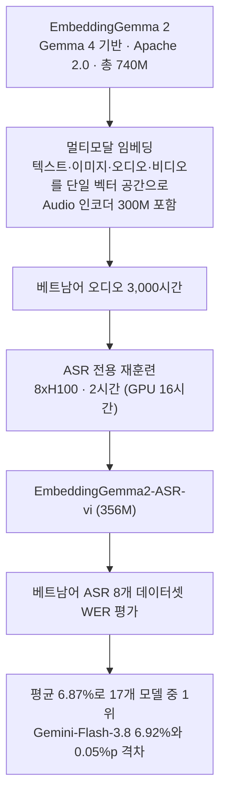

## 왜 읽어야 하나

다국어 환경에서 STT(음성 인식)를 운영하고 어떤 언어에 어떤 모델을 쓸지 고르는 엔지니어, ASR 비용을 설계하는 분을 대상으로 씁니다. 핵심 결론을 먼저 세웁니다. 특정 언어에 3,000시간짜리 오디오 데이터가 있다면, 400M 미만 오픈 모델을 그 언어용으로 재훈련해 2B대 대형 API ASR의 WER(단어 오류율)을 밑돌 수 있고, 훈련 비용은 GPU 16시간(8xH100, 2시간)에 그칩니다. "다국어 STT의 기본값은 대형 API 모델"이라는 전제를 뒤집는 제안입니다.

*소리가 벡터와 전사(text)로 바뀌는 순간을 형상화한 이미지.*

## 개요

2026년 10월 14일, Polyskill의 @stablequan이 X에 벤치마크 테이블 하나를 올렸습니다. "구글 Gemma Embedding 2 모델을 베트남어 오디오 3,000시간으로 훈련했는데 SOTA에 도달했다. 8xH100에 2시간이면 됐다"는 내용입니다. 테이블은 베트남어 ASR 데이터셋 8종(bud500, cv17, fleurs, gigaspeech2, lsvsc, phoaudiobook, vimd, VIVOS) 위에서 17개 모델의 WER를 비교합니다. 숫자가 낮을수록 좋습니다. 주인공 **EmbeddingGemma2-ASR-vi(356M)** 는 평균 6.87%로 1위를 기록합니다.

베이스가 된 EmbeddingGemma 2는 Google DeepMind가 2026년 10월 6일 공개한 오픈웨이트 멀티모달 임베딩 모델입니다. 텍스트·이미지·오디오·비디오를 단일 벡터 공간으로 인코딩하며, Gemma 4 아키텍처 기반 740M 파라미터, Apache 2.0 라이선스입니다. 공식 포지셔닝은 "자기 크기에 비해서는 최상의(on-device) 멀티모달 임베딩 오픈 모델"이고, 용도는 시맨틱 검색·RAG·클러스터링입니다. ASR 모델이 아닙니다. 이번 실험은 이 모델을 음성 인식 모델로 전용화한 것이라 의미가 있습니다.

공식 발표에 든 용도도 retrieval 쪽입니다. 목소리 메모에서 특정 영상 클립을 찾는 것, 몇 시간짜리 오디오 녹음을 텍스트 쿼리로 검색하는 것 같은 것들이죠. 오디오 쪽은 본래 "소리를 찾는" 도구이지, "소리를 옮겨 적는" 도구가 아닙니다. 이 실험의 방향을 한 문장으로 하면, 찾는 도구를 쓰는 도구로 돌린 것입니다.

## 이 모델은 무엇인가

EmbeddingGemma 2의 구조는 모달리티별 인코더를 골라 붙이는 방식입니다. Hugging Face 카드 기준으로 총 파라미터 740M이며, 구성은 Backbone 130M, Embedder 140M, Vision 170M, Audio 300M입니다. 모달리티별 선택 로드 구성도 정해져 있습니다. 텍스트만 270M, 텍스트+이미지 440M, 텍스트+오디오 570M, 전체 멀티모달 740M. 공식 벤치마크는 MTEB multilingual v2 61.36, MIEB lite 64.64, 그리고 오디오 임베딩 벤치마크 MAEB 49.39입니다. 차원 축소(Truncation) 성능도 카드에 실려 있습니다. MAEB 점수가 768차원 기준 49.39에서 128차원으로 줄여도 46.92를 유지하는 수준이죠. 벡터를 6분의 1로 압축해도 성능의 대부분을 지키는 이 유연성은 소형 모델 서빙 환경에서 의미 있는 숫자입니다. 오디오 작업에 쓰는 570M 구성이 이미 "음성 이해"에 최적화되어 있습니다.

저자가 재훈련한 모델은 벤치마크 테이블에 356M으로 표시됩니다. 카드의 텍스트+오디오 구성(570M)보다 작는데, 정확히 어떤 구성을 베이스로 삼았는지는 공개되지 않았습니다. 아래 수치는 저자의 테이블 기준입니다. 훈련 데이터는 베트남어 오디오 3,000시간, 훈련 시간은 H100 8장에 2시간, GPU 16시간입니다.

임베딩 모델은 본래 "그 소리를 벡터로 나타내는" 모델입니다. 소리 자체를 이해하도록 훈련된 오디오 인코더를 갖고 있으므로, 그 위에 각인(전사) 출력을 붙여 언어별 오디오로 재훈련하는 경위는 자연스럽습니다. 임베딩이 잘되는 모델은 유사한 소리를 가까운 벡터에 놓는다는 뜻이고, 인식에는 그런 구분이 곧 정확도로 이어질 수 있습니다. 실제로 일반화되는지는 다음 섹션의 한계를 함께 읽어야 합니다.

## 벤치마크 결과

아래 테이블은 저자 스크린샷의 비교 집 상위행을 정리한 것입니다. WER(%)이며, 낮을수록 좋습니다.

| 모델 | 파라미터 | 평균 | bud500 | cv17 | fleurs | gigaspeech2 | lsvsc | phoaudiobook | vimd | VIVOS |
|---|---|---|---|---|---|---|---|---|---|---|
| **EmbeddingGemma2-ASR-vi** | 356M | **6.87%** | **1.62%** | 10.19% | 6.75% | 12.34% | **5.48%** | 1.35% | **9.05%** | 8.15% |
| Gemini-Flash-3.8 | 미공개 | 6.92% | 1.83% | 10.12% | 5.98% | 10.16% | 5.91% | 1.60% | 10.25% | 9.36% |
| MAI-Transcribe-2.0 | 미공개 | 6.96% | 2.45% | 10.15% | 5.86% | 10.15% | 6.07% | 1.40% | 10.25% | 9.48% |
| Cohere Transcribe 03-2026 | 2,066M | 7.01% | 3.93% | 11.09% | 5.64% | 10.27% | 6.98% | 1.74% | 10.34% | 6.07% |
| Qwen3-ASR-1.7B | 2,038M | 7.01% | 5.20% | 11.31% | **4.88%** | **8.47%** | 6.60% | 1.85% | 10.54% | 7.25% |
| ElevenLabs Scribe v2 | 미공개 | 7.08% | 3.21% | 10.44% | 5.62% | 10.43% | 6.11% | 1.45% | 10.50% | 9.14% |
| PhoWhisper-large | 1,543M | 7.21% | 9.51% | 9.12% | 5.31% | 10.14% | 6.81% | **0.87%** | 11.38% | **4.52%** |
| Whisper large-v2 | 1,543M | 15.63% | 32.71% | 19.35% | 10.75% | 19.70% | 11.07% | 3.06% | 17.29% | 11.09% |
| Whisper small | 242M | 28.81% | 65.50% | 31.08% | 20.59% | 27.44% | 20.21% | 11.21% | 30.66% | 23.80% |

EmbeddingGemma2-ASR-vi의 평균 6.87%가 1위이지만, 2위 Gemini-Flash-3.8(6.92%)과의 격차는 0.05%p입니다. MAI-Transcribe-2.0(6.96%), Cohere Transcribe 03-2026(7.01%), Qwen3-ASR-1.7B(7.01%), ElevenLabs Scribe v2(7.08%)도 모두 0.2%p 이내 차이로 쭉 붙어 있습니다. 데이터셋별로 보면 신규 모델은 8종 중 3종(bud500, lsvsc, vimd)에서 최저입니다. cv17과 phoaudiobook은 PhoWhisper-large(9.12%, 0.87%)가, fleurs와 gigaspeech2는 Qwen3-ASR-1.7B(4.88%, 8.47%)가, VIVOS는 Cohere Transcribe 03-2026(6.07%)가 각각 앞섭니다. "전 종목 압승"이 아니라 "평균이 가장 낮고, 8종 중 3종에서 최저"입니다.

베이스라인 간격이 더 큽니다. Whisper large-v2는 15.63%, Whisper small은 28.81%입니다. 베트남어 특화 모델(PhoWhisper 계열, 그리고 이번 신규 모델)이 범용 모델보다 1~2배 정확하다는 뜻입니다. 특정 언어로 갈아타는 것 자체가 실적인 셈입니다.

단, 이 테이블을 그대로 믿기 전 두 가지가 붙습니다. 첫째, 저자가 스스로 보고한(self-reported) 벤치마크입니다. 데이터셋 스플릿, 오디오 정규화, 디코딩 파라미터가 알려지지 않았고, 모델 가중치와 훈련 코드는 공개되지 않았습니다. 둘째, "SOTA"는 이 테이블의 17개 모델 중 1위라는 뜻이지, 세계 전체 ASR에 대한 절대 주장이 아닙니다.

## ThakiCloud 제품 적용 시사점

ThakiCloud의 ai-platform(K8s 기반 AI/ML SaaS 인프라)은 모델 서빙과 학습을 고객 환경에 제공합니다. 우리가 STT 표준 엔진으로 운용 중인 Qwen3-ASR-1.7B는 이 테이블에서 베트남어 7.01%입니다. 이번 실험의 실무적 독법은 이렇습니다. 비영어권 언어에서 언어 특화 소형 모델은 범용 대형 모델의 현실적 대안이며, 비용 구조가 완전히 다릅니다.

첫째, 훈련 경제학입니다. GPU 16시간은 K8s GPU 학습 인프라에서 작은 양입니다. 베트남어 통화량이 매일 쌓이는 콜센터·고객지원 시나리오에서 과금제 API ASR(Gemini-Flash-3.8, ElevenLabs Scribe, Cohere Transcribe 등)의 월간 과금+통화당 과금과 비교하면, 셀프호스트 356M 모델이 총 비용에서 이길 가능성이 높습니다. 356M 규모는 싱글 GPU, 심지어 엣지에서도 서빙 가능해 온프레미스·소버린 배포가 잦은 우리 고객 환경에 후보가 됩니다.

둘째, Paxis 관점입니다. Paxis는 ThakiCloud의 Agent-Native Cloud로, 에이전트가 통화를 받거나 음성 입력을 처리하는 보이스 워크플로를 운영합니다. 언어별 STT 모델 선택은 에이전트 실행 비용의 직결 항목입니다. 이번 실험의 방향(언어당 소형 특화 모델)이 재현으로 확인되면, Paxis 보이스 워크플로는 "각 언어를 자기 전용 모델로 라우팅"하는 설계가 가능해집니다. 같은 임베딩 모델은 화자 검색·보이스 검색 같은 retrieval 용도로도 재사용되니, 서빙하는 것 하나에 두 용도가 붙는 구조입니다.

## 한계 및 반론

가장 큰 숫자 격차, 1위와 2위 사이의 0.05%p를 정직하게 읽어야 합니다. 평가 하네스가 다르면 측정 노이즈로 설명 가능한 범위입니다. "소형 모델이 이겼다"는 헤드라인보다, "베트남어 특화 356M 모델이 베트남어 데이터셋에서 최고 API ASR과 동급에 도달했다"가 정확합니다.

3,000시간의 오디오는 "2시간"이라는 주장에 들어 있지 않은 비용입니다. 데이터 수집·청소·라벨링의 큐레이션 비용이 알 수 없고, 데이터가 적은 언어에서는 같은 결과가 기대되지 않습니다. 베트남어 단일 언어 케이스라는 점도 한계입니다. 다른 low-resource 언어로 일반화되는지는 미검증이며, 베이스가 임베딩 모델인 것도 양면적입니다. 본래 ASR으로 훈련된 것이 아니라 상한이 전용 ASR 모델보다 낮을 수 있고, 실제로 phoaudiobook에서는 PhoWhisper-large(0.87%)가 신규 모델(1.35%)보다 앞섭니다.

## 정리

충분한 데이터가 있는 단일 언어는 STT 모델 선택의 공식을 바꿉니다. 특정 언어용 ASR을 사기 전에, 그 언어 특화 오픈 모델이 있는지부터 확인하고, 재훈련 비용(GPU 16시간 규모)이 API 월간 과금 합계보다 싼지 계산할 가치가 있습니다. 이번 테이블은 모델과 코드가 공개되지 않아 직접 검증은 못 하지만, "범용 대형 모델보다 언어 특화 소형 모델"이라는 방향 자체는 언어별 ASR 문헌과 일치합니다.

출처:

- @stablequan 게시: https://x.com/stablequan/status/2110209860511932554 (2026-10-14)
- Google EmbeddingGemma 2 모델 카드: https://huggingface.co/google/embeddinggemma-2
- Google 공식 발표: https://blog.google/innovation-and-ai/technology/developers-tools/embeddinggemma-2/ (2026-10-06)
- 벤치마크 테이블: 저자 스크린샷 (self-reported, 가중치 미공개)
