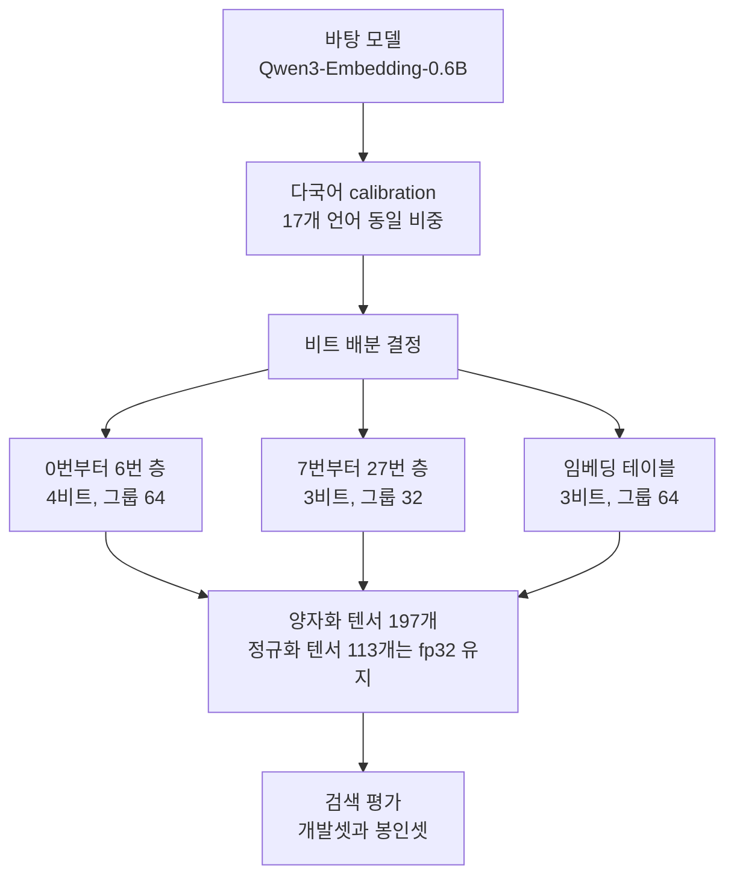

다국어 검색 임베딩 모델을 저비트로 줄여서 쓰려는 분께 이 글을 권합니다. 결론을 먼저 적겠습니다. 층마다 비트를 다르게 나눈 배치가 모든 층에 같은 비트를 준 배치보다 양자화 payload 기준으로 0.95% 작았고, 아홉 개 검색 평가셋 가운데 다섯 곳에서 더 좋은 점수를 냈습니다. 그런데 그 이득이 어디서 왔는지는 아직 지목하지 못했습니다. 이 글은 그 두 가지를 같은 비중으로 다룹니다.

모델은 Qwen3-Embedding-0.6B를 바탕으로 만들었고 오늘 [Hugging Face](https://huggingface.co/ThakiCloud/Qwen3-Embedding-0.6B-MultiCal-M1a-GPTQ)에 올렸습니다. 연구 프리뷰이고, 품질 비교의 기준점으로 쓰시라고 공개했습니다.

*층마다 눌린 정도를 다르게 둔 구조를 형상화했습니다.*

## 쉽게 말하면

여행 가방을 싸는 일로 바꿔 보겠습니다. 가방 무게는 정해져 있고 옷은 다 넣어야 합니다. 보통은 모든 옷을 같은 힘으로 압축해서 넣습니다. 압축 봉투 하나에 전부 담고 끝까지 눌러 공기를 빼는 방식입니다.

그런데 옷마다 구김에 버티는 정도가 다릅니다. 정장 재킷은 세게 누르면 꺼냈을 때 입기 어렵고, 티셔츠는 꽉 눌러도 털면 됩니다. 그러면 재킷은 조금만 누르고 티셔츠를 더 세게 눌러서, 전체 무게는 같거나 조금 줄이면서 꺼냈을 때 상태를 낫게 만들 수 있습니다.

이 글의 모델이 한 일이 그것입니다. 신경망의 층을 옷이라고 보고, 앞쪽 일곱 층에는 비트를 더 주고 나머지 층에서 그만큼을 돌려받았습니다. 가방 무게에 해당하는 것이 저장 용량이고, 꺼냈을 때 입을 수 있는 상태에 해당하는 것이 검색 품질입니다. 이 가방 비유는 글 끝까지 그대로 씁니다.

## 균일하게 누르는 것이 기본값입니다

양자화는 모델 가중치를 원래보다 적은 비트로 적어 두는 일입니다. 16비트로 저장하던 숫자를 3비트나 4비트로 줄이면 파일이 작아지고 내려받는 시간도 줄어듭니다. 대신 숫자를 거칠게 적으니 모델이 하던 일을 그만큼 덜 잘하게 될 수 있습니다.

보통은 모든 층에 같은 설정을 줍니다. 저희가 기준선으로 삼은 배치도 그렇습니다. 28개 층 전부를 3비트로 적고, 32개 값마다 scale과 min을 하나씩 두는 균일 배치입니다. 이 글에서는 이것을 균일 3비트 배치라고 부르겠습니다. 구현도 운영도 단순하고, 비교의 출발점으로 쓰기에 적당합니다.

균일 배치를 의심할 이유는 있습니다. 층마다 하는 일이 다르니 거칠게 적었을 때 손해 보는 정도도 다를 수 있습니다. 다만 저희는 "앞쪽 층이 더 민감하다"는 통념을 그대로 받아들이고 시작하지는 않았습니다. 통념이 맞는지 보려면 저장 예산을 거의 같게 묶어 두고 배치만 바꿔서 재야 합니다. 예산을 풀어 주면 품질이 좋아지는 것은 당연하고, 그건 배치의 공로가 아닙니다.

## M1a가 비트를 나눈 방식

공개한 배치를 M1a라고 부릅니다. 바탕 모델은 Qwen/Qwen3-Embedding-0.6B이고 리비전 97b0c614be4d77ee51c0cef4e5f07c00f9eb65b3을 썼습니다. 비트는 아래와 같이 나눴습니다.

| 대상 | 비트 | 그룹 크기 |
|---|---|---|
| 0번부터 6번 층 | 4비트 | 64 |
| 7번부터 27번 층 | 3비트 | 32 |
| 임베딩 테이블 | 3비트 | 64 |

그룹 크기는 scale과 min을 몇 개 값마다 하나씩 둘지를 정합니다. 그룹이 작으면 숫자를 더 촘촘하게 따라가지만 scale과 min을 저장할 자리가 늘어납니다. 그래서 비트 폭과 그룹 크기는 같은 예산을 나눠 쓰는 두 손잡이입니다. 앞쪽 일곱 층은 비트를 4로 올리면서 그룹을 64로 키워 저장 비용을 되돌려 받았습니다.

방식은 그룹별 비대칭 min과 max이고, scale과 min은 fp16으로 적습니다. 정규화 가중치는 양자화하지 않고 fp32로 남겼습니다. 결과물에는 양자화된 텐서가 197개, fp32로 남은 정규화 텐서가 113개 들어 있습니다. 양자화기는 GPTQ 계열의 자체 구현이고, 새 알고리즘을 주장하지는 않습니다.

calibration은 17개 언어를 같은 비중으로 섞었습니다. 영어는 FineWeb-Edu에서, 나머지 16개 언어는 FineWeb-2에 있는 FLORES 언어들에서 가져왔고, 256개 시퀀스에 각 256 토큰을 썼습니다. calibration 원문과 토큰 id는 재배포하지 않습니다. 모델 카드에 출처만 적었습니다.

한 가지 분명히 해 둘 점이 있습니다. 이번에 공개한 것은 모델이고 코드가 아닙니다. 양자화 엔진과 비트 배분 구현은 비공개로 둡니다. 공개한 파일만으로 모델을 돌릴 수 있게 만드는 것이 저희 쪽 숙제였고, 그 이야기는 다음 글에서 따로 다루겠습니다.

## 예산은 어디서 나왔나

앞쪽 층에 비트를 더 주면 그만큼을 어디선가 꺼내 와야 합니다. 어디서 꺼냈는지는 값 하나에 드는
비용을 세어 보면 보입니다. 저장 비용은 비트 폭만으로 정해지지 않고, 그룹마다 들어가는 fp16
scale과 fp16 min까지 더해서 봐야 합니다.

| 설정 | 값 하나에 드는 비용 |
|---|---|
| 3비트, 그룹 32 (기준선) | 3비트 + 32비트를 32개로 나눈 1비트 = 4.0비트 |
| 4비트, 그룹 64 (앞쪽 층) | 4비트 + 32비트를 64개로 나눈 0.5비트 = 4.5비트 |
| 3비트, 그룹 64 (임베딩 테이블) | 3비트 + 0.5비트 = 3.5비트 |

앞쪽 일곱 층은 값마다 0.5비트를 더 쓰고, 임베딩 테이블은 값마다 0.5비트를 덜 씁니다. 그리고
이 모델에서 임베딩 테이블은 단일 텐서로는 가장 큽니다. 어휘 15만 개가 넘는 행을 가지고 있기
때문입니다. 그래서 앞쪽 층에 들어간 추가 비용을 임베딩 테이블에서 돌려받는 구조가 됩니다.
가방 비유로 말하면 재킷을 살살 누른 대신 가장 부피가 큰 이불을 더 세게 눌러 자리를 만든 셈입니다.

이 산술은 왜 예산이 거의 유지되는지를 설명해 주지만, 실제 파일에서 몇 바이트가 줄었는지는
따로 세어야 합니다. 텐서 모양과 패킹 경계에 따라 값이 조금씩 달라지기 때문입니다. 아래 표의
숫자가 그렇게 센 결과입니다.

## 0.95%는 무엇의 0.95%인가

크기 이야기를 할 때 자주 섞이는 세 가지 값이 있습니다. 저희는 이것을 섞지 않고 따로 적습니다.

| 값 | 바이트 |
|---|---|
| 양자화 payload 회계 | 295,029,952 |
| 가중치 파일 | 295,391,600 |
| 모델 디렉터리 전체 | 311,275,695 |

payload 회계는 양자화된 가중치와 그에 딸린 scale, min이 차지하는 바이트를 계산한 값입니다. 가중치 파일은 그 payload에 safetensors 헤더가 붙은 실제 파일 크기입니다. 모델 디렉터리는 토크나이저와 설정 파일까지 합한 값이라 가장 큽니다.

균일 3비트 배치의 payload 회계는 297,855,488 바이트였습니다. M1a는 295,029,952 바이트이니 2,825,536 바이트가 적고, 비율로는 0.95%입니다. 가방 비유로 말하면 무게를 거의 그대로 두고 압축 방식만 바꾼 셈입니다.

여기서 중요한 단서를 달아야 합니다. 이 0.95%는 payload 회계 열만 쓴 값입니다. 균일 배치의 가중치 파일 크기는 기록해 두지 않았기 때문에 디스크에 올려놓았을 때 실제로 몇 바이트가 다른지는 알 수 없습니다. 그래서 저희는 이 숫자를 "디스크가 0.95% 줄었다"로 바꿔 쓰지 않습니다. 회계 기준으로 거의 같은 예산이라는 것을 보이는 데까지가 이 값의 역할입니다.

## 나온 결과

평가는 nDCG@10으로 했고, 빌드 seed 세 개의 평균을 썼습니다. 판정은 결과를 보기 전에 정해 둔 규칙을 따랐습니다. seed를 바꿔 다시 빌드했을 때 생기는 잡음의 하한을 먼저 구하고, 쌍체 부트스트랩 구간을 함께 봐서 차이가 그 잡음보다 큰지를 묻는 방식입니다.

개발셋 결과입니다.

| 평가셋 | 균일 3비트 | M1a | 판정 |
|---|---|---|---|
| E1 (FLORES 기반 교차언어 검색) | 70.13 | 76.25 | M1a 우세 |
| FLORES | 90.02 | 92.12 | M1a 우세 |
| MIRACL bn | 53.47 | 57.06 | M1a 우세 |
| MIRACL hi | 41.69 | 45.27 | M1a 우세 |
| MIRACL ja | 58.54 | 60.37 | M1a 우세 |
| MIRACL ko | 55.54 | 57.18 | 귀속 불가 |
| NFCorpus | 32.67 | 33.80 | 귀속 불가 |

봉인셋은 이 비교에 한 번만 썼습니다.

| 평가셋 | 균일 3비트 | M1a | 판정 |
|---|---|---|---|
| MIRACL te | 53.60 | 56.57 | 귀속 불가 |
| MIRACL sw | 41.25 | 43.68 | M1a 우세 |
| SciDocs | 20.65 | 20.89 | 귀속 불가 |

"귀속 불가"를 "같다"로 읽으면 안 됩니다. 이 판정은 차이가 빌드 잡음 안에 들어 있어서 그 차이를 배치의 공로로 돌릴 수 없다는 뜻입니다. MIRACL te가 좋은 예입니다. 점수는 53.60에서 56.57로 3포인트 가까이 올랐는데, 그 평가셋의 잡음 하한이 5.23이라 이득보다 잡음이 큽니다. 올랐을 수도 있고 다음 빌드에서 내려갈 수도 있습니다. 모르는 것을 모른다고 적는 칸입니다.

잡음이 이렇게 큰 이유는 seed 산포를 보면 짐작하실 수 있습니다. 같은 설정으로 seed만 바꿔 세 번 빌드했을 때 NFCorpus는 32.97, 34.34, 34.09가 나왔고 FLORES는 91.67, 92.64, 92.05가 나왔습니다. 양자화는 층을 따라가며 오차를 보정하는 과정이라 작은 차이가 뒤쪽으로 번집니다. 그래서 한 번 빌드한 값을 그대로 표에 적는 방식은 쓰지 않았습니다. 공개하는 가중치는 seed 0 하나이고, 다른 두 seed는 산포를 확인하실 수 있게 카드에 수치와 해시만 적었습니다.

## 원인을 한 곳으로 몰 수 없었습니다

이 글에서 가장 조심해서 읽어 주셨으면 하는 부분입니다. M1a가 균일 배치보다 좋게 나온 평가셋이 다섯 곳이지만, 저희는 그 이유를 "앞쪽 층을 보호했기 때문"이라고 적지 않습니다.

M1a는 세 가지를 한꺼번에 바꿨습니다. 앞쪽 일곱 층의 비트 폭을 올렸고, 같은 층들의 그룹 크기를 키웠고, 임베딩 테이블의 그룹 크기도 바꿨습니다. 이득이 이 가운데 어디서 왔는지는 이 실험만으로 갈라낼 수 없습니다. 효과를 앞쪽 층으로 국소화해 보려고 후속 실험을 따로 돌렸지만, 그 실험은 결과를 보기 전에 정해 둔 통과 조건을 넘지 못했습니다.

그래서 지금 말할 수 있는 것은 "M1a라는 구성 전체가 이 예산에서 이만큼 나왔다"까지입니다. 가방 비유로 돌아가면, 재킷을 살살 눌렀기 때문인지 티셔츠를 더 눌렀기 때문인지 아니면 봉투를 바꿔서인지 아직 모르는 상태입니다. 여기서 한 단계 더 가려면 처리군과 대조군을 각각 여러 번 빌드해서 산포 안에서 비교해야 합니다.

## ThakiCloud에서는

저희 ai-platform은 Kubernetes 위에서 GPU 작업을 Kueue 큐로 돌리고, 고객 환경에 모델을 서빙합니다. 온프렘 요구가 있는 고객이 많아서 모델 크기와 내려받는 시간이 실제 도입 비용에 그대로 들어갑니다. 저비트 임베딩이 저희에게 중요한 이유가 여기 있습니다.

이번 작업이 바로 그 비용을 줄여 준다고 말하기는 어렵습니다. 줄어든 것은 저장과 다운로드이고, 실행 중 메모리나 지연은 재지 않았습니다. 대신 이번 실험이 운영에 남긴 것은 판정 규칙입니다. 양자화 체크포인트를 비교할 때 seed를 바꿔 다시 빌드한 산포를 먼저 구하고, 그 잡음보다 큰 차이만 공로로 인정하는 절차를 저희 평가 경로에 넣었습니다. 이 절차가 없으면 빌드 운에 따라 생긴 차이를 레시피의 성과로 보고하게 됩니다. 고객 환경마다 다시 양자화해서 납품하는 일을 하다 보면 이 구분이 특히 비싸집니다.

## 못 믿을 부분

연구 프리뷰입니다. 서빙 속도와 GPU 메모리 절감은 이 모델에서 재지 않았으니 그 주장으로 인용하지 말아 주십시오. 줄어든 것은 디스크와 다운로드입니다.

개발셋은 홀드아웃이 아닙니다. 저희가 배치를 고르는 과정에서 보던 평가셋이라, 거기서 좋게 나온 것은 당연히 조금 유리한 조건입니다. 봉인셋을 따로 두고 한 번만 쓴 이유가 그것입니다.

모델 하나와 예산 하나에서 얻은 결과입니다. 다른 임베딩 모델이나 다른 바이트 예산으로 일반화되지 않습니다. 균일 배치와의 비교만 했고 원래 정밀도와의 비교는 이 글에 넣지 않았습니다. 그리고 앞서 적었듯이 "귀속 가능한 손실 없음"은 "품질이 같다"보다 약한 말입니다.

## 정리

같은 예산 안에서 비트를 층마다 다르게 나눠 봤고, 아홉 개 평가셋 가운데 다섯 곳에서 더 좋은 점수를 받았습니다. payload 회계로는 0.95% 작았습니다. 동시에 그 이득의 원인을 한 곳으로 지목하지 못했다는 것도 같이 공개합니다. 둘 중 하나만 적으면 다음 사람이 잘못된 교훈을 가져가게 됩니다.

저비트 임베딩을 다루신다면 두 가지를 가져가시면 좋겠습니다. 첫째, 비트 폭과 그룹 크기는 같은 예산을 나눠 쓰는 손잡이라서 한쪽만 보고 비교하면 예산이 어긋납니다. 둘째, 양자화 비교에서는 seed를 바꿔 다시 빌드한 산포를 먼저 재야 합니다. 그 산포를 모르면 올랐는지 흔들렸는지 구별할 수 없습니다. 가중치는 [Hugging Face](https://huggingface.co/ThakiCloud/Qwen3-Embedding-0.6B-MultiCal-M1a-GPTQ)에 있으니 직접 재보셔도 됩니다.
