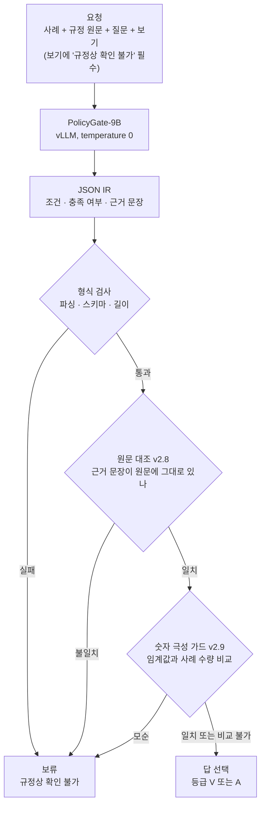

한국어 규정을 읽는 90억 매개변수 모델을 공개했습니다. 이 모델은 결정을 내리지 않습니다. 사례와 규정 원문을 읽고 어떤 조건이 걸렸는지, 사례가 그 조건을 충족하는지, 그 근거가 어느 문장인지를 적기만 합니다. 답은 함께 공개한 코드가 그 기록을 원문과 하나씩 맞춰 본 뒤에 고릅니다. 맞지 않으면 "규정상 확인 불가"로 보류합니다.

저희가 짠 두 개발 셋에서 틀린 답을 허용한 경우는 0건이었습니다. 정답을 낼 수 있었는데 보류한 비율은 2.0%p와 4.9%p였습니다. 지원금 자격이나 수수료 감면처럼 잘못 허용하면 되돌리기 어려운 판단에 언어 모델을 붙이려는 분께 이 글을 권합니다. 모델 이름은 Thaki-PolicyGate-9B v0.1이고 Hugging Face에 올렸습니다.

*읽는 일과 결정하는 일을 나눈 구조를 형상화했습니다.*

## 쉽게 말하면

은행 대출 창구를 떠올려 보겠습니다. 창구 직원은 손님 서류를 읽고 심사표에 옮겨 적습니다. 소득이 얼마인지, 재직 기간이 몇 년인지, 그 내용이 서류 몇 쪽에 있는지를 적습니다. 승인 도장은 심사관이 찍습니다. 심사관은 심사표의 칸마다 서류 원본을 펼쳐 보고 적힌 문장이 정말 있는지 확인합니다. 하나라도 맞지 않으면 도장을 찍지 않고 서류를 돌려보냅니다.

지난번 4B 모델은 창구 직원이 도장까지 찍는 구조였습니다. 서류를 읽고 곧바로 승인 확률을 말했습니다. 이번 9B는 창구 직원 역할만 합니다. 도장은 심사관 역할을 하는 코드가 찍습니다. 직원이 아무리 그럴듯하게 적어도 원본에 없는 문장은 통과하지 못합니다.

*읽는 일(모델)과 결정하는 일(코드)을 나눈 구조입니다.*

이 구조에는 대가가 하나 있습니다. 직원이 정답을 알았더라도 심사표에 서툴게 적으면 심사관은 돌려보냅니다. 그래서 이 모델의 성능은 두 숫자로 봐야 합니다. 하나는 틀린 승인이 몇 건인지이고 다른 하나는 승인할 수 있었던 건을 얼마나 돌려보냈는지입니다.

## 왜 4B에서 방향을 바꿨나

지난 9월에 공개한 [kd-4b-ko-v0](https://huggingface.co/ThakiCloud/kd-4b-ko-v0)는 Qwen3.5-4B-Base에 Kev 방식의 판정 헤드를 붙인 모델이었습니다. 질문과 보기를 한 번에 읽고 보기마다 확률을 냈습니다. 확신이 낮으면 답하지 않는 선택적 응답 층도 나중에 붙였습니다.

방향을 바꾼 계기는 그 4B 카드에 이미 적혀 있던 실험입니다. 시행령 기한 문항 591개 가운데 4B가 확신이 낮아 보류한 문항이 406개였습니다. 같은 문항을 4B가 직접 풀었을 때 정답률은 58.4%였습니다. 사내 27B 모델에게 날짜와 일수만 뽑게 하고 계산은 코드에 맡겼더니 99.3%가 나왔습니다.

*왼쪽은 4B가 보류한 기한 문항에서 두 방식의 정답률입니다. 오른쪽은 이번 9B의 두 개발 셋 결과입니다.*

모델이 숫자를 읽는 일과 그 숫자로 계산해 결론을 내는 일은 다른 능력이었습니다. 읽기는 모델이 잘했고 계산과 비교는 코드가 정확했습니다. 그래서 9B에서는 모델의 일을 읽기로 좁혔습니다.

## 무엇을 공개했나

공개한 것은 두 저장소입니다. [Thaki-PolicyGate-9B-v0.1](https://huggingface.co/ThakiCloud/Thaki-PolicyGate-9B-v0.1)은 Qwen3.5-9B에 LoRA를 학습한 뒤 병합한 추출 모델입니다. [Thaki-PolicyGate-runtime](https://huggingface.co/ThakiCloud/Thaki-PolicyGate-runtime)은 결정을 내리는 Backend와 HTTP API입니다. 둘은 [같은 컬렉션](https://huggingface.co/collections/ThakiCloud/thaki-policygate-korean-regulation-condition-checking-6ad31ba54339527205d81ce2)에 묶었습니다.

요청 하나가 지나가는 길은 아래와 같습니다.

Backend는 v2.6부터 층을 쌓아 온 결정론 코드입니다. 각 층은 아래 층 파일의 해시를 확인한 뒤에만 불러와집니다. 동결한 파일이 한 바이트라도 바뀌면 시작하지 않습니다. 요청당 Backend가 쓰는 시간은 p95 기준 3ms 아래입니다. 지연은 거의 전부 모델이 JSON을 쓰는 데서 나옵니다.

학습 데이터는 결정론 생성기로 뽑은 합성 레코드 6,151건입니다. 언어 모델이 쓴 레코드는 없습니다. 채움 조문은 국가법령정보센터의 법령 원문을 썼고, 기관과 인물과 수수료 규정은 생성기가 지어냈습니다. AI Hub 데이터는 쓰지 않았습니다.

## 숫자 극성 가드: 이번 버전에서 더한 것

v2.8까지의 Backend는 근거 문장이 원문에 있는지는 확인했지만 그 문장의 뜻이 조건과 맞는지는 모델 말을 믿었습니다. 그 틈으로 틀린 답이 네 건 나왔습니다.

카드에 실은 예시가 그중 하나입니다. 규정은 "같은 서류를 열 부 넘게 신청한 경우" 감면율을 100분의 47로 바꾼다고 정합니다. 사례에는 신청인이 서류를 두 부 요청했다고 적혀 있습니다. 모델은 이 예외 조건을 "충족"으로 적었습니다. 근거 문장은 원문에 그대로 있었으므로 v2.8은 그 기록을 받아들여 100분의 47을 답했습니다. 정답은 100분의 74입니다.

v2.9는 이런 경우 임계값과 사례 수량을 직접 읽어 비교합니다. 두 부는 열 부를 넘지 않으므로 모델이 적은 "충족"과 모순됩니다. 이때 Backend는 답을 보류로 내립니다. 비교는 네 조건이 모두 맞을 때만 합니다. 조건이 숫자 임계값이어야 하고, 사례 문장에 같은 단위의 수량이 하나뿐이어야 하며, 같은 사람의 같은 속성이어야 하고, 부정어가 없어야 합니다. 하나라도 불분명하면 손대지 않습니다.

*모델이 "충족"으로 잘못 적은 숫자 조건을 가드가 보류로 돌리는 과정입니다.*

가드는 답을 보류 쪽으로만 옮깁니다. 보류를 답으로 올리는 경로는 코드에 없습니다. 그래서 가드가 틀려도 결과는 틀린 승인이 아니라 불필요한 보류입니다. 모델의 극성을 일부러 뒤집은 변이 104건을 넣었을 때 가드는 104건을 모두 막았습니다.

## 나온 결과

평가는 B200 1장에서 vLLM 0.28.0으로 공개 코드 그대로 돌렸습니다. 셋은 두 가지입니다. VAL은 학습 때 본 템플릿의 새 문항 1,640개이고, DIAG는 일부러 까다롭게 짠 진단 문형 1,448개입니다.

VAL에서 정답 기록을 넣었을 때 Backend가 답할 수 있는 문항은 1,090개였습니다. 모델 경로는 그중 1,068개를 지켰고 22개를 보류했습니다. 추가로 보류한 비율이 2.0%p입니다. 틀린 답을 허용한 경우는 등급에 관계없이 0건이었습니다.

DIAG에서는 답할 수 있는 976개 가운데 928개를 지켰습니다. 추가 보류는 4.9%p이고 틀린 허용은 역시 0건이었습니다. 숫자 가드가 맡아야 할 네 건은 네 건 모두 막혔습니다.

서빙은 한 번만 쟀습니다. 동시 요청 1개일 때 지연은 p50 683ms, p95 737ms였습니다. 동시 8개에서 초당 7.3건, 동시 32개에서 초당 22.1건을 처리했고 오류는 없었습니다.

마지막으로 공개한 두 저장소를 빈 환경에서 새로 내려받아 다시 띄웠습니다. 같은 문항 300건에 대한 결정이 300건 모두 이전 실행과 같았습니다.

## 그래서 무엇을 바꾸면 되나

한국어 규정 조건 판단에 언어 모델을 쓰려면 모델 출력을 결정으로 쓰지 말고 검증할 기록으로 받는 편이 낫습니다. 근거 문장을 원문과 글자 단위로 대조하는 것만으로도 지어낸 근거는 걸러집니다. 숫자 비교처럼 코드가 정확한 일은 코드로 옮기는 것이 맞습니다.

또 하나는 평가 지표입니다. 보류할 수 있는 모델은 정확도 하나로 비교하면 안 됩니다. 틀린 허용 수와 불필요한 보류 비율을 따로 적어야 어느 쪽을 얼마나 내주었는지 보입니다.

## ThakiCloud에서는

이 구조는 Paxis의 정책 게이트와 같은 생각에서 나왔습니다. Paxis는 ThakiCloud의 Agent-Native Cloud로, 에이전트의 모든 행동을 정책 게이트와 감사 로그를 거쳐 실행합니다. PolicyGate의 IR에는 어떤 조건을 어느 문장으로 판단했는지가 남습니다. 결정 한 건마다 근거가 붙은 감사 기록이 생기는 셈입니다.

ai-platform 쪽에서 보면 이 모델은 GPU 1장과 오픈소스 vLLM만으로 돕니다. 외부 API를 부르지 않고 Backend는 Python 표준 라이브러리만 씁니다. 데이터를 밖으로 내보낼 수 없는 금융과 공공 고객의 망 안에서 그대로 돌릴 수 있습니다.

## 못 믿을 부분

먼저 평가 셋 두 개가 모두 저희 생성기에서 나왔습니다. 실제 공문이나 민원 문서에서는 재지 않았습니다. 독립 평가가 아니므로 위 수치는 개발 결과로 읽어야 합니다.

숫자 가드는 DIAG에서 틀린 허용 네 건을 본 뒤에 설계했습니다. 그래서 DIAG의 0건은 가드가 일반화된다는 근거가 되지 않습니다. 개발 데이터에서 가드가 실제로 계산한 단위도 부수, 차례, 나이 셋뿐입니다.

공개한 체크포인트는 학습 시드 하나입니다. 같은 방법을 시드 셋으로 돌린 연구는 저희 기준을 넘지 못했습니다. 이번 결과는 그중 좋은 체크포인트를 고른 것입니다.

greedy 디코딩도 실행마다 완전히 같지는 않았습니다. DIAG 추가 보류는 기록 실행에서 4.61%p, 다시 잰 두 번에서 4.72%p와 4.92%p였습니다. 서빙 수치는 한 번 잰 값이라 규모를 가늠하는 정도로만 봐야 합니다.

사례가 조건을 다른 말로 바꿔 진술하는 유형은 아직 풀지 못했습니다. DIAG에서 이 유형의 추가 보류는 11%p대입니다. 결과가 틀린 답이 아니라 보류로 끝난다는 점이 위안입니다. 학습 문서는 약 6천 토큰까지였고 더 긴 입력은 확인하지 않았습니다.

이 모델은 범용 결정 모델이 아닙니다. 라우팅이나 도구 선택, 영어 문서는 학습하지도 평가하지도 않았습니다. 사람의 검토 없이 승인이나 거절을 자동으로 실행하는 데 쓰면 안 됩니다.
