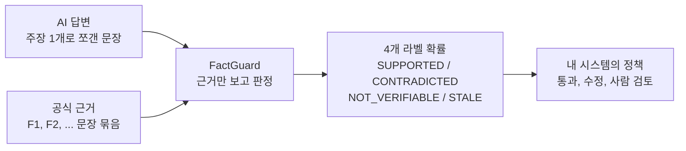
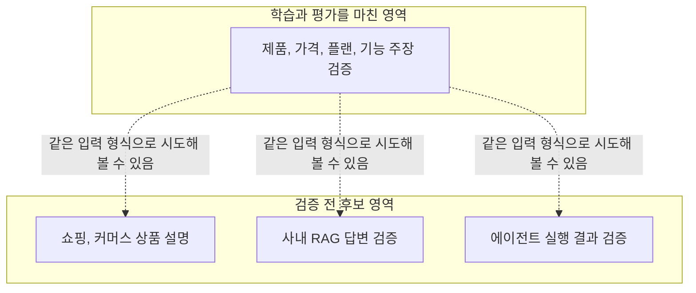

RAG, 쇼핑 AI, 상담 센터 챗봇, 에이전트처럼 AI가 가격과 기능을 사람 대신 말하는 서비스를 운영하신다면, 그 답변이 실제 근거와 맞는지 자동으로 확인하는 부품이 필요합니다. FactGuard는 근거 묶음과 주장 하나를 읽고 네 가지 라벨 중 하나를 고르는 모델이고, 4B, 8B, 9B, 27B 네 크기를 Apache-2.0으로 공개했습니다.

학습과 평가를 거친 범위는 제품, 가격, 플랜, 기능에 관한 주장 검증입니다. 쇼핑, 사내 RAG, 에이전트 결과 검증은 써 볼 만한 후보일 뿐 아직 검증하지 않았고, 이 글은 그 둘을 끝까지 따로 적습니다. 공개 성격은 연구 프리뷰입니다.

## FactGuard가 하는 일

모델에게 주는 것은 근거와 주장입니다. 근거는 공식 페이지에서 뽑은 문장 몇 줄(F1, F2, ...)이고, 주장은 AI 답변에서 뽑은 문장 하나입니다. 모델은 이 근거만 보고 주장이 맞는지 판정합니다. 근거에 없는 사실은 알려 주지 않고, 검색도 하지 않으며, 지금 가격이나 재고도 모릅니다.

판정은 정확히 네 가지 라벨 가운데 하나입니다.

- SUPPORTED: 근거가 주장 전체를 뒷받침합니다.
- CONTRADICTED: 근거가 주장과 양립할 수 없다고 말합니다.
- NOT_VERIFIABLE: 근거가 그 주장을 말하지 않아 확인할 수 없습니다.
- STALE: 과거 근거로만 뒷받침됩니다.

모델은 글을 생성하지 않습니다. 답할 자리에서 네 라벨에 해당하는 토큰의 점수만 읽어 소프트맥스로 확률을 만듭니다. 그래서 출력이 항상 네 라벨 중 하나이고, 확률이 같이 나옵니다. 참고로 UNRESOLVED는 모델의 출력이 아닙니다. 평가와 시스템 로직에서 쓰는 별도의 미결정 상태입니다.



*주장과 근거를 넣으면 네 라벨의 확률이 나오고, 그 확률로 무엇을 할지는 서비스가 정합니다.*

## 학습한 영역: AI 검색과 AEO/GEO

학습과 평가를 마친 영역은 AI가 브랜드의 제품, 가격, 플랜, 기능을 설명하는 장면입니다. AI 검색 엔진이 어느 SaaS의 요금제를 소개할 때 "Basic 플랜도 100GB"처럼 잘못 말하는 일은 흔합니다. 브랜드 쪽에서는 이런 오답을 찾아내 고쳐야 하고, 이것이 AEO/GEO 관점에서 FactGuard가 하는 일입니다. 공식 가격표를 근거로 두고 AI 답변의 주장을 하나씩 대조하면, 어떤 주장이 틀렸는지와 어떤 주장은 공식 페이지에 아예 없는지를 나눠 볼 수 있습니다.

## 후보 영역 셋: 아직 검증하지 않았습니다

아래 세 가지는 같은 방식으로 써 볼 수 있을 것 같다는 후보입니다. 이 영역에서 FactGuard의 성능을 측정한 적은 없습니다.



*실선 안쪽이 근거를 갖춘 영역이고, 점선으로 이어진 세 곳은 가설입니다.*

쇼핑 AI에서는 상품 상세 페이지의 사양과 배송 조건을 근거로 두고, AI가 말한 "무료 반품"이나 "방수"가 근거에 있는지 확인하는 용도를 떠올릴 수 있습니다. 사내 RAG에서는 검색된 문서 조각을 근거로, 생성된 답변의 문장이 그 조각에 실제로 들어 있는지를 보는 용도입니다. 에이전트에서는 도구 실행 로그를 근거로, 에이전트가 "예약을 완료했다"고 보고한 문장이 로그와 맞는지 보는 연구 방향입니다. 세 경우 모두 표, 계약서, 로그처럼 이번 학습 범위 밖의 근거 형태가 섞일 수 있어서, 가져다 쓰기 전에 직접 소규모로 먼저 재 보셔야 합니다.

## 네 가지 크기

네 모델은 각자의 기반 모델 위에 같은 방법으로 LoRA를 학습한 뒤 가중치에 병합한 BF16 체크포인트입니다. 어댑터를 따로 붙일 필요가 없습니다. 크기를 나눈 이유는 서비스마다 지연과 비용의 사정이 다르기 때문입니다.

| 모델 | 기반 모델 | p50 지연 |
|---|---|---|
| FactGuard-4B | Qwen3.5-4B | 85.5 ms |
| FactGuard-8B | Qwen3-8B | 68.1 ms |
| FactGuard-9B | Qwen3.5-9B | 105.6 ms |
| FactGuard-27B | Qwen3.8-27B | 182.8 ms |

지연은 모두 B200 한 장, 배치 1, 모델만 잰 중앙값입니다. 8B는 구조가 다른 모델(전 층 full attention, 다른 토크나이저, 텍스트 전용)이라 크기 순서와 지연 순서가 나란하지 않고, 이 표로 크기 순위를 말하지는 않겠습니다. 4B, 9B, 27B 체크포인트에는 비전 타워가 들어 있지만 학습하지 않았으므로 이미지 판정 능력은 주장하지 않습니다.

## 성능과 정직한 한계

봉인 평가를 거친 모델은 4B 하나입니다. 학습에 쓰지 않은 28개 브랜드의 반사실 문항 2,483개(eval-v6)에서 4B 단독 정확도는 0.913이었습니다. 틀린 지지는 27건, 틀린 모순은 37건입니다. 가중치 밖의 결정론적 규칙인 Claim Coverage Guard(guard/2.2)를 뒤에 붙이면 정확도는 0.908로 거의 같고 틀린 지지가 7건, 틀린 모순이 8건으로 줄어듭니다. 같은 가드를 붙인 Qwen3.8-27B 프롬프트 판정기는 0.918이었습니다.

이 비교에서 중요한 단서가 하나 있습니다. 27B 판정기를 4B로 대체해도 된다는 사전 등록 기준(비열등성)은 충족하지 못했습니다. 차이는 마이너스 1.1%p이고 95% 신뢰구간은 [-5.0, +4.3]이라 열등하지 않다고 말할 수 없습니다.

8B, 9B, 27B는 개발 셋 결과만 있고 봉인 평가는 대기 중입니다. 개발 셋 정확도는 8B 0.987(같은 프롬프트의 기반 모델 0.495), 9B 0.992(기반 0.260), 27B 0.993(기반 0.371), 4B 0.993입니다. 27B의 기반 수치는 라벨 토큰 프롬프트로 잰 값이라 위의 프롬프트 생성 판정기와는 다른 측정입니다. 이 숫자는 일반화 정확도가 아닙니다. 4B의 시드를 이 개발 셋으로 골랐고, 8B는 구조가 달라 순수한 크기 곡선도 아닙니다. 그리고 실제 AI 답변에서 자연스럽게 나오는 오류에 대한 정확도는 아직 확립되지 않았습니다.

## 개발자가 쓰는 법

각 저장소에 `example_inference.py`와 `label_contract.json`이 들어 있습니다. 규칙은 단순합니다. 채팅 템플릿을 쓰지 않고 원문 텍스트 프롬프트를 만듭니다. 머리말, 근거 묶음, 마지막 `\n\n판정:` 순서로 이어 붙이고, `add_special_tokens=False`로 토큰화하며, 입력은 1,024 토큰 이내로 유지합니다. 다음 토큰 자리에서 네 라벨 토큰의 점수를 읽습니다. 8B만 라벨 토큰 id가 (362, 425, 356, 422)로 다르고 나머지는 (357, 417, 351, 414)이며, 예제 스크립트가 알아서 계산합니다.

근거 묶음의 모양은 다음과 같습니다.

```text
대상 브랜드: <브랜드>
근거:
F1: [<페이지 제목>] <문장>
F2: [<페이지 제목>] <문장>
주장: <원자적 주장 하나>
```

## 실제로 돌려 본 세 가지 예

공개된 FactGuard-4B(Hub 커밋 29a66c89bdacb183b94cfa3ef6770f16603fa614)를 맥에서 CPU로 그대로 돌렸습니다. 브랜드는 가상의 "모아노트(MoaNote)"이고 근거는 세 줄입니다. Basic은 월 4,900원에 10GB, Pro는 월 12,900원에 100GB, Pro는 팀 공유 폴더를 지원합니다. 문항을 다시 쓰지 않고 한 번 만든 그대로 세 건을 돌렸으며, 아래는 나온 값 그대로입니다.

| 주장 | 기대 | 모델 판정 | 확률 |
|---|---|---|---|
| 모아노트 Pro 플랜은 저장공간 100GB를 제공한다. | SUPPORTED | SUPPORTED | 0.9998 |
| 모아노트 Basic 플랜에서도 저장공간 100GB를 쓸 수 있다. | CONTRADICTED | CONTRADICTED | 0.9983 |
| 모아노트 Pro 플랜은 오프라인 모드를 지원한다. | NOT_VERIFIABLE | NOT_VERIFIABLE | 1.0000 |

두 번째 문항의 나머지 확률은 NOT_VERIFIABLE 0.0014, SUPPORTED 0.0002였고, 세 번째는 다른 세 라벨이 모두 0.00002 미만이었습니다. 세 건 모두 기대와 맞았지만, 세 건은 동작을 보여 주는 예시일 뿐 정확도의 증거가 아닙니다. 쉬운 문항 세 개이고, 확률이 1에 가깝게 쏠리는 모습도 자연스러운 오류 분포에서 같은 확신이 나온다는 뜻은 아닙니다.

## 다음 단계: Generalist FactGuard

현재 모델은 제품, 가격, 플랜 주장에 맞춰져 있습니다. 표, 계약서, 사내 문서와 RAG, 한국어 NLI, 도구 실행 로그까지 근거 형태를 넓힌 Generalist FactGuard를 개발 중입니다. 아직 보고할 결과는 없습니다.

## 모델 링크

- 컬렉션: [FactGuard 모음](https://huggingface.co/collections/ThakiCloud/factguard-evidence-grounded-verification)
- [FactGuard-4B](https://huggingface.co/ThakiCloud/FactGuard-4B), [FactGuard-8B](https://huggingface.co/ThakiCloud/FactGuard-8B), [FactGuard-9B](https://huggingface.co/ThakiCloud/FactGuard-9B), [FactGuard-27B](https://huggingface.co/ThakiCloud/FactGuard-27B)

모두 Apache-2.0이며 병합된 BF16 가중치입니다. ThakiCloud 조직이 공개한 연구용 오픈 모델 계열이고, 제품 기능으로 제공하는 것이 아닙니다.
