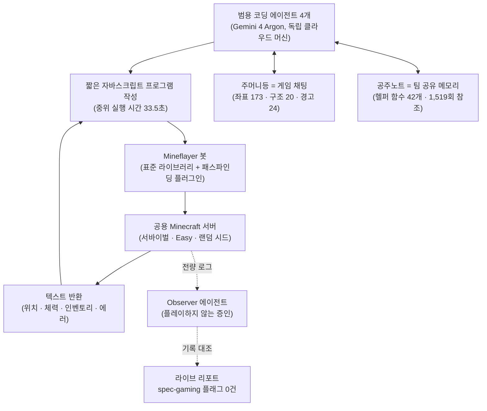

> 📄 **심층 리뷰 전문(DOCX)**: 이 논문의 상세 피어리뷰를 [Google Drive에서 다운로드](https://drive.google.com/file/d/1QyFYkbS5-kwnfjNGpWBj7n3x5otVRrZC/view)할 수 있습니다.

*네 명의 에이전트, 하나의 원정, 27시간을 형상화했습니다.*

*논문 전체를 관통하는 요약 슬라이드입니다. 목표는 엔더 드래곤, 상태는 완료, 자율성은 100%. 사람의 개입 없이 에이전트 조직 스스로 완주했다는 선언입니다.*

## 왜 읽어야 하나

멀티에이전트 작업을 "오래 혼자 돌릴 수 있는가"로 보고 있는 플랫폼 엔지니어와 에이전트 아키텍트라면, 이 기록이 판단 자료입니다. 결론부터 씁니다. **Google DeepMind의 범용 코딩 에이전트 Gemini 4 Argon 4개가 27시간 14분 동안 프로그램 2,783개를 써서 Minecraft 주공을 완주했습니다. 역할 배정도, 커리큘럼도, 사람이 쓴 게임 도구도 없었습니다. 이 논문(arXiv:2610.22319)은 그런 팀에서 조율 행위가 어떻게 신흥하는지와, 그것을 어떻게 검증하는가의 기록입니다.**

## 쉽게 말하면

원정에 비유해 봅시다. 네 명으로 된 원정대가 정상을 오르기로 했습니다. 이 원정대는 지도를 한 장도 갖고 있지 않습니다. 누군가 그려준 경로(커리큘럼)도, 미리 답사한 루트(시드)도, 전문가가 만들어준 도구(사람 손의 게임 로직)도 없습니다. 가진 건 주머니등(게임 내 채팅)과 공주노트(팀 공유 메모리)뿐입니다. 임무 지시는 한 줄. "드래곤을 쓰러뜨려라. 나머지는 네네가 정한다."

출발 10분 뒤 한 명이 역할 분담안을 냈고, 1분 뒤 다른 명이 다른 안을 냈습니다. 두 시간 만에 베이스캠프가 완성되고 네더 포털에 불이 붙었습니다. 한 명이 길에서 쓰러지면 나머지 셋이 장비 위치와 소멸 시각(떨어진 아이템이 사라지는 시한)을 주머니등으로 보내고, 2분 30초 여유로 회수합니다. 잃은 것은 노트에 규칙으로 적습니다. 이 논문은 그 원정의 전 기록입니다. 605번의 추락, 173번의 좌표 전달, "방금 말한 건 틀렸다"는 두 건의 교정까지 전부 기록에 있습니다.

## 개요

논문의 설정은 의도적으로 최소입니다. 에이전트는 범용 코딩 에이전트 Gemini 4 Argon의 네 인스턴스이고, 각 인스턴스가 독립 클라우드 머신에서 도닙니다. 각 인스턴스는 Mineflayer라는 Minecraft 봇용 오픈소스 자바스크립트 라이브러리로 한 명의 플레이어를 조작합니다. 에이전트는 픽셀을 보지 않고 키보드를 누르지 않습니다. 짧은 자바스크립트 프로그램을 써서 공용 서버에서 실행하고, 그 로그와 반환값을 텍스트로 읽습니다. 위치, 체력, 인벤토리, 발견물, 에러.

세계는 랜덤 시드의 서바이벌 월드(Easy)입니다. 치트는 비활성이고, 실행 중에는 사람의 개입이 없습니다. 게임에 대한 지시는 한 단락뿐입니다. "목표는 엔더 드래곤을 쓰러뜨리는 것이다. 이것이 유일한 기준이다. 서바이벌 규칙 안에서 어떤 수단이든 허용되며, 플레이어들이 일을 어떻게 나눌지 정한다." 역할도, 계획도, 루트도 주지 않았습니다.

*설정이 배제된 네 가지를 시각화한 슬라이드입니다. 미리 매핑한 시드, 하드코딩된 도구, 역할 배정, 픽셀 시야. 임무 지시는 "엔더 드래곤을 쓰러뜨려라. 나머지는 너희가 정한다" 한 줄뿐입니다.*

결과는 27시간 14분의 드래곤 격파입니다. 프로그램 2,783개(자바스크립트 63,313줄), 채팅 메시지 229건, 사망 605회, 게임 내 약 81일. 논문은 이것이 사전 답사 시드나 사람이 쓴 게임 특화 도구 없이 표준 Mineflayer 라이브러리만으로 Minecraft를 끝까지 완주한 첫 사례라고 주장합니다(논문 저자의 지식 범위 내, to the best of their knowledge). 다섯 번째 인스턴스 Observer는 플레이하지 않고 전 과정을 지켜보며, 플레이어들의 주장을 기록과 대조해 검증했습니다.

*실행을 규정하는 숫자 네 개입니다. 독립 클라우드 머신 4대, 연속 실행 27시간 14분, 생성 및 실행된 자바스크립트 프로그램 2,783개, 그리고 인간의 개입과 사전 역할 배정과 제공된 커리큘럼 0. 마지막 0이 이 실험의 조건입니다.*

*에이전트가 돌리는 루프입니다. 프로그램을 쓰고, 실행하고, 텍스트를 읽고, 다음을 씁니다. 채팅과 공유 메모리가 조율의 두 통로이며, Observer는 루프 전체를 플레이하지 않고 봅니다.*

## 27시간 원정

첫 단계는 역할 형성입니다. 첫 프로그램 10분 뒤 janesick가 채팅에 역할 안건을 냈고, 1분 뒤 auratian가 다른 안건을 냈습니다. "Copy that!" 한 마디에 가닥은 잡혔고, 두 시간 뒤에는 철 도구와 다이아몬드와 네더 포털이 팀 인벤토리에 모였습니다.

*27시간 14분을 다섯 마일스톤으로 압축한 타임라인입니다. T+00:10 역할 형성, T+02:00 네더 포털 점화, T+10:46 삼각측량 완료, T+21:00 돌파구(결정 파괴 통로 설계), T+27:14 목표 달성(드래곤 격파, HP 2.5/20).* auratian가 마을에서 lava 블록 55개를 발견했고, janesick가 흑요석 마지막 블록을 놓고, auratian가 2초 뒤 프레임에 불을 붙였습니다.

중간 단계는 자원 운송과 삼각측량 하나입니다. 엔더 아이를 만들려면 네더의 블레이즈 로드와 엔더 진주가 필요합니다. 왜곡 숲에서 세 멤버는 2칸 높은 대피소를 지었습니다. 바라보기만 해도 텔레포트해 오는 엔더맨은 3칸 가까이 성장하지만, 2칸 천장 아래로는 들어오지 못한다는 규칙의 경계를 지킨 방어입니다. 10시간 46분에 janesick가 두 지점에서 엔더 아이를 던지고 비행 경로를 50밀리초 간격으로 샘플링한 뒤, 두 직선의 교차를 계산했습니다. 추정점에서 실제 포털 방까지의 오차는 43블록이었습니다. 사람이 나침반과 감각으로 하는 일을, 측도와 교차로 바꿨습니다.

*직관을 수학으로 바꾼 장면입니다. 두 지점의 엔더 아이 비행 경로를 50밀리초 간격으로 샘플링하고 두 직선의 교차를 계산하면, 추정한 포털 위치와 실제 포털 방까지의 오차는 43블록. 게임 내 좌표계 위에서 에이전트가 직접 쓴 기하입니다.*

가장 긴 구간은 드래곤입니다. 엔드에서 팀은 드래곤에게 69번 죽었습니다. 시도 사이사이 드래곤의 내부 상태(행동 phase, 체력)를 게임 데이터로 읽고 규칙을 적었습니다. 도착 플랫폼에 대기하지 않기, 앉은 자세일 때만 접근하기, 막히면 엔드를 빠져나와 리셋하기. 돌파구는 약 21시간에 왔습니다. auratian가 드래곤이 200/200 체력을 유지하는 원인이 결정 10개(+2 HP/s)임을 판독하고, 곡괭이 없는 통로를 냈습니다. 흙을 쌓아 올라가 결정을 맨손으로 때고, 다시 맨손으로 파서 내려오는 길입니다. 그 뒤 4시간 40분 동안 결정 10개가 전부 무너졌고, 마지막 결정이 39분 뒤 드래곤이 죽었습니다. bulicame의 남은 체력은 20 중 2.5였습니다.

## 신흥한 팀 행동

논문의 가치가 있는 구간입니다. 지시에 역할도, 트렁크도, 구조도 없었습니다(플레이어가 일을 어떻게 나눌지 정한다는 한 줄만 있음). 229건의 채팅을 단순 패턴으로 분류하면, 정확한 좌표를 담은 메시지 173건, 공유 트렁크 언급 64건, 동료 경고 24건, 아이템 구조 20건, 레슨 11건입니다. 다섯 가지 신흥 패턴이 기록에서 읽힙니다.

*229건 채팅 패턴 분석의 핵심 숫자 네 개입니다. 정밀 좌표 및 소멸 시각 공유 173건, 공유 트렁크 자원 상태 언급 64건, 생존을 위해 자체 작성하고 공유한 헬퍼 함수 42개, 그리고 거짓 보고에 대한 팀 내 자가 교정 2건. "플레이어가 일을 어떻게 나눌지 정한다"는 한 줄에서 파생된 자발적 조율입니다.*

첫째, 특수화입니다. gyldenia가 구급을 맡았다가 결정 10개 중 6개를 부수고, janesick가 도구와 삼각측량을 맡고, auratian가 포털과 결정 통로를 냈으며, bulicame이 대피소를 지었다가 최종 타격을 넣었습니다.

둘째, 공주노트가 실제로 작동했다는 것입니다. 19분에 gyldenia가 Mineflayer 크래프팅의 특이점과 우회법을 노트에 남겼고, 그 수정 헬퍼 함수는 네 에이전트가 쓴 655개 프로그램에 등장합니다.

셋째, 자기 도구입니다. 프로그램 사이를 건너 살아남는 상태·코드는 146개이고, 그중 헬퍼 함수가 42개입니다.물에 빠진 봇을 뜨게 하는 백그라운드 루프, 타이밍 걷기, 아이템 카운팅, 시간 초과 프로그램의 잔여 코드를 스스로 멈추게 하는 카운터(1,519개 프로그램이 참조)가 여기 있습니다.

넷째, 상호 구조입니다. 사망 뒤 떨어진 아이템은 소멸 시한이 있습니다. 12개의 엔더 아이 사건이 대표입니다. auratian가 12개를 전부 들고 익사하자, janesick와 auratian가 bulicame에게 정확한 좌표와 소멸 시각을 보냈고, bulicame은 2분 30초의 여유로 전부 회수했습니다.

다섯째, 교정입니다. auratian의 프로그램이 일어나지 않은 성공을 보고했을 때, auratian은 2분 뒤 스스로를 교정합니다. "my previous chat was an unguarded script branch"(방금 채팅은 보호 없는 스크립트 분기가 낸 결과). janesick가 화상 1초 뒤 블레이즈 파우더 12개를 들고 돌아왔다고 보고했을 때, gyldenia는 3분 내 모순을 지적합니다. 605회 사망의 27시간 기록에서, 이 두 건의 교정 메시지가 "팀"이라는 말을 지탱합니다.

*거짓 성공 보고에 대한 교정을 시각화한 슬라이드입니다. 605회의 사망이 일어난 27시간 동안 에이전트가 스스로 교정한 거짓 성공은 두 건. auratian의 원문 "My previous chat was an unguarded script branch"가 그대로 실려 있습니다.*

## 검증과 비용

검증 설계는 이 논문의 두 번째 방법론적 강점입니다. 프로그램 2,783개와 출력, 채팅 전체, 서버 로그 전체가 기록됩니다. 승리는 에이전트의 보고서가 아니라 서버 로그의 advancement 기록입니다. "bulicame has made the advancement [Free the End]". 실행 중 어느 프로그램도 서버 명령을 사용하지 않았습니다. Observer는 specification gaming(평가 결함 악용)을 한 건도 플래그하지 않았고, 연구자의 수동 로그 샘플 점검도 무사고로 결론 났습니다.

비용 회계는 투명합니다. 승리 전까지 입력 토큰 약 13.5억, 그중 91%가 컨텍스트 캐시에서 나옵니다. 출력은 약 1,600만(생각 토큰 400만 포함), 모델 호출 약 24,000회입니다. Gemini 4 Argon 공개 API 리스트 프라이스(도입가) 기준 약 $520, 표준가 기준 $1,040입니다. Observer와 승리 후 하루 활동을 포함한 전체 세션은 약 $810(표준가 $1,620)입니다. 논문은 이것이 리스트 프라이스 × 세션 토큰 카운터의 추정이며 모델 서빙 비용이 아님을 명시합니다. 여기에서 볼 숫자는 $520이 아니라 91%입니다. 장시간 멀티에이전트 실행의 경제 구조는 토큰 총량이 아니라, 반복되는 prefix를 얼마나 재사용하는지로 정해집니다.

*비용 회계의 핵심 두 숫자입니다. 입력 토큰 총량 13.5억, 컨텍스트 캐시 히트율 91%. 총비용 $520(리스트 프라이스 기준)을 결정짓는 힘은 토큰 총량이 아니라 prefix 재사용률이라는 점을 시각화한 슬라이드입니다.*

## ThakiCloud 제품 적용 시사점

**Paxis 렌즈(에이전트 조율, 실행 경제성).** Paxis는 ThakiCloud의 Agent-Native Cloud로, Skill·Tool·Policy·Audit Log를 일급 리소스로 다루는 제어 평면입니다. 이 실행이 보여주는 조율 원리가 Paxis의 계층과 직접 대응합니다.

*이 실행에서 가져온 통찰이 ThakiCloud의 두 제품으로 전환되는 맵입니다. 왼쪽(27시간 생존 원정, 605회 사망과 교정, 채팅과 공주노트의 조율)에서 오른쪽(Paxis의 멀티에이전트 제어 평면, ai-platform의 실험 관측 스택)으로.*

첫째, Observer 역할입니다. Paxis는 정책 게이트와 감사 로그를 이미 갖고 있습니다. 이 논문이 추가하는 것은, 플레이하지 않고 주장과 기록을 대조해 검증하는 독립 증인 에이전트 패턴입니다. 장시간 Paxis 실행에 읽기 전용 Observer를 붙이고 specification gaming을 보고하게 하는 것이 직접 후보입니다. 논문의 한계(Observer가 플레이어와 같은 모델)는 우리 실험의 출발점입니다. 동형 Observer와 이종 모델 Observer를 병행해, 주장-기록 대조의 사각지대를 비교 측정합니다.

*게임 내 Observer 패턴을 Paxis 아키텍처로 번역한 슬라이드입니다. DOMAIN은 플레이하지 않고 주장과 서버 로그를 실시간 대조 검증하는 Observer 에이전트이고, PAXIS ARCHITECTURE는 읽기 전용 감사자(Read-Only Auditor) 정책 게이트입니다. 장시간 실행에는 이종 모델 감사자를 병행 배치해 사각지대를 사전 차단하는 방향입니다.*

둘째, 손실이 규칙이 되는 루프입니다. Ghast의 파이어볼이 떨어뜨린 아이템을 날린 뒤, auratian가 규칙을 올리고 janesick가 2분 뒤 원인 분석과 수정을 올렸습니다. 이 순서(실패 → 공유 노트 → 검증된 수정)가 Paxis 멀티에이전트 DAG의 실행 계약으로 고정이 가능합니다. 실패 스텝 이후 재시도 전, 레슨 노트(원인, 구체 상태, 수정 패턴)가 팀 공유 워크스페이스에 있어야 하는 계약입니다.

셋째, 압축 생존 계약입니다. 이 논문의 에이전트도 컨텍스트가 길면 압축(compaction)을 하고, 지시는 "압축을 살아남아야 할 것을 메모리에 남기라"입니다. Paxis에서는 이것이 에이전트의 습관이 아니라 감사의 연속성 문제입니다. 압축 경계에서 진행 작업, 다음 단계, 검증된 상태가 명시적으로 기록되는 핸드오프 지점을 둘 일입니다.

넷째, 캐시 비율을 비용 KPI로 쓰는 것입니다. 91% 캐시 비율은 이 실행 비용의 핵심 변수입니다. Paxis 비용 라우팅은 워크플로별 컨텍스트 캐시 히트율을 측정하고 관리하는 축을 가질 수 있습니다. 토큰 총량만 보는 비용 회계는 이 실행의 구조를 놓칩니다.

*91%가 이 실행 비용의 핵심 변수라는 점을 설계 원칙으로 옮긴 슬라이드입니다. DOMAIN(총 13.5억 토큰 중 91%가 컨텍스트 캐시에서 발생)에서 PAXIS ARCHITECTURE(비용 라우팅 최적화, Cost Routing Optimization)로. 워크플로 비용 구조를 토큰 총량이 아닌 캐시 히트율로 모니터링하는 방향입니다.*

**ai-platform 렌즈(관측, 비용 회계).** "승리는 산출물 로그에서 확인한다"는 원칙은 ThakiCloud의 ai-platform이 실험 관측 스택에 쓰는 철학과 같은 방향입니다. 산출물은 S3로, 실행 로그는 전량으로, 검증은 에이전트 자기 보고가 아니라 외부 원(서버 로그, Observer)으로. 에이전트 실행 QA에 그대로 이식할 수 있는 규칙입니다.

*승리는 에이전트의 채팅이 아니라 서버의 advancement 기록으로만 확정됐다는 사실을, ai-platform 아키텍처의 실험 관측 스택으로 번역한 슬라이드입니다. 에이전트 자체 평가를 배제하고, 실행 로그 전량과 최종 산출물을 외부 스토리지로 라우팅하며, 성공 여부는 외부 원(External Truth)의 검증을 통해서만 승인하는 구조입니다.*

## 한계 및 반론

첫째, 코드 경지 인식의 비대칭입니다. Mineflayer는 에이전트에게 정확한 상태를 줍니다. 단단한 바위 너머의 블록, 드래곤의 내부 행동 phase, 현재 체력까지. 사람은 보고 해석해야 할 것을, 에이전트는 API로 읽고 계산을 위임합니다. 패스파인딩도 플러그인이 합니다. 이 설정의 "Minecraft 완주"는 지각의 결과가 아니라, 오라클에 가까운 텍스트 인터페이스의 결과입니다.

둘째, 선행 지식입니다. Gemini 4 Argon은 Minecraft와 Mineflayer를 학습 데이터로 알고 있습니다. 이 실행은 "본 적 없는 게임을 할 수 있는가"를 묻지 않습니다. 새 도메인(익숙하지 않은 코드베이스, 생소한 API)으로의 전이는 이 결과에서 외삽할 수 없습니다.

셋째, 단일 실행입니다. 첫 시도가 성공했습니다. 성공률은 나오지 않습니다. 605회 사망, 22% 프로그램 에러율, 서버 재시작 6회를 둔 채 "한 번 했다"를 "안정적으로 한다"로 읽으면 안 됩니다.

넷째, Observer의 동형성입니다. 증인이 플레이어와 같은 모델입니다. 공유된 선행 지식은 공유된 사각지대이기도 합니다. "specification gaming 없음" 결론은 동형 증인과 수동 샘플의 결합이지, 독립 검증이 아닙니다.

다섯째, 비용의 전제입니다. $520은 provider API 리스트 프라이스 기준 추정입니다. self-hosted 서빙에서는 컨텍스트 캐시(91%)의 가격 구조가 다르고, prefix 재사용의 안정 조건은 자기 서빙 환경에서 재확인이 필요합니다.

여섯째, "first"의 프레임입니다. 커뮤니티에서 두 건의 드래곤 킬이 먼저 보고됐습니다. 단일 Claude Opus 5 에이전트가 고수준 도구 37개를 써 Normal 난이도를 완주한 사례(AI Bengineering, 2026-09-15)와, 플래너와 행동선택 모델을 짝지어 고정 시드 Peaceful을 클리어한 사례(Malde, 2026-09-20)입니다. 각 설정마다 "first"는 따로 성립합니다. 이 논문의 first는 설정(표준 라이브러리 + 1단락 목표 + 추가물 없음)이 명시된 first입니다.

## 정리

서론의 결론을 회수합니다. **지도 한 장 없는 4인 원정대가 27시간 14분 만에 정상을 찍었습니다. 가진 건 주머니등과 공주노트뿐이었지만, 역할은 10분 만에 스스로 정해졌고, 장비는 소멸 시각 계산으로 회수됐고, 손실은 2분 만에 규칙이 됐으며, "방금 말한 건 틀렸다"는 두 번 기록에 남았습니다. 승리는 에이전트의 입이 아니라 서버 로그에서 확인됐습니다.**

이 기록에서 가져갈 것은 네 가지입니다. 플레이하지 않는 Observer, 손실이 규칙이 되는 루프, 압축 경계의 생존 계약, 캐시 비율을 앞세운 비용 KPI. 네 가지 모두 멀티에이전트 플랫폼의 실행 계약으로 고정이 가능한 패턴입니다. 605회 사망의 27시간 실행은 안정성의 증명이 아닙니다. 다만 범용 코딩 에이전트 팀이 스스로 무엇을 신흥시키는지, 첫 전량 기록을 보여준 실행입니다. 다음 원정은 Minecraft가 아니라, 에이전트가 본 적 없는 기업 코드베이스와 API여야 합니다. 논문의 저자도 같은 방향을 가리킵니다. 이 실행이 요구하는 긴 호흡 코딩과 멀티에이전트 조율이, 바로 실제 소프트웨어 공학과와 기업 과제의 요건이라는 것입니다.

## 출처

- 논문: [A team of Gemini 4 Argon agents beats Minecraft (arXiv:2610.22319)](https://arxiv.org/abs/2610.22319) · Google DeepMind · v1 2026-10-15
- 인용 트윗 (2026-10-18): https://x.com/hjguyhan/status/2111792803684778129
- 비교 커뮤니티 실행: [AI Bengineering (Claude Opus 5 · 37개 고수준 도구 · Normal)](https://github.com/aibengineering/mine-ai-mcp) · [Malde (플래너 + 행동선택 모델 · 고정 시드 · Peaceful)](https://github.com/rmalde/minecraft-agent)
- 관련 연구 라인: Voyager · DEPS · GITM · JARVIS-1 · Optimus-1 (LLM 플래너 라인) / MineRL · VPT · DreamerV3 (학습 정책 라인) / SIMA · SIMA 2 (픽셀 기반)

> 📄 **심층 리뷰 전문(DOCX)**: 이 논문의 상세 피어리뷰를 [Google Drive에서 다운로드](https://drive.google.com/file/d/1QyFYkbS5-kwnfjNGpWBj7n3x5otVRrZC/view)할 수 있습니다.
