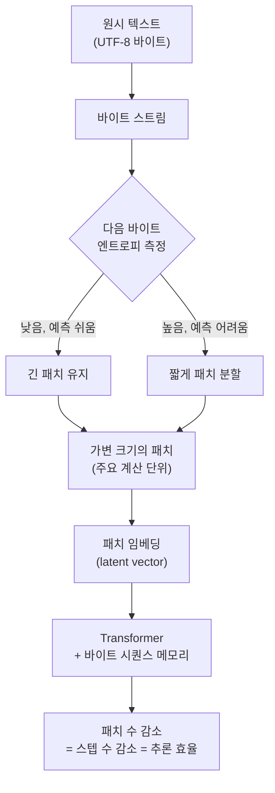

*글의 핵심 개념을 형상화했습니다.*

## 왜 읽어야 하나

블로그를 서빙하거나 그 서빙 비용을 재는 국내 엔지니어입니다. "토크나이저를 없애면 실제로 무엇이 달라지나"를 숫자로 보고 싶은 데이터 사이언티스트도 대상에 넣습니다. 10월 말, Meta가 LLM 시대를 끝낼 논문을 냈고 토큰을 영원히 없앴다는 트윗이 바이럴되었습니다. 이 글의 결론은 그 바이럴보다 담담합니다. BLT의 진짜 기여는 토큰을 없애는 것이 아니라 계산 단위를 정보 밀도에 맞춰 동적으로 재할당하는 것입니다. 추론 효율과 롱테일 견고성을 동시에 얻는 기제가 바로 그것입니다. 끝까지 읽으면 자기 서빙 스택에서 바이트 레벨 모델의 의미가 숫자로 보입니다.

*균일한 원시 바이트(좌)가 예측이 쉬운 곳은 길고 복잡한 곳은 짧게 패치로 재분할되는 것을 추상화했습니다.*

> 📄 **심층 리뷰 전문(DOCX)**: 이 논문의 상세 피어리뷰를 [Google Drive에서 다운로드](https://drive.google.com/file/d/1qtoBcv6efdHV-aMSAcOUmMt6DhcZy9KO/view)할 수 있습니다.

## 쉽게 말하면

한 장의 JPEG 사진 압축을 떠올려 보세요. JPEG는 사진을 8×8 픽셀 블록으로 잘라 압축합니다. 하늘 같은 빈 영역은 몇 개의 계수로 거칠게 표현합니다. 나무결 같은 복잡한 영역은 촘촘하게 표현합니다. 단순한 곳에는 공을 덜 들이고 복잡한 곳에만 세부 정보를 쓰는 방식입니다. BLT의 패치는 이 원리를 언어 모델 계산에 그대로 이식했습니다. 예측이 쉬운 텍스트는 긴 패치 하나로 넘어갑니다. 어려운 텍스트는 짧은 패치로 쪼개집니다. 어디에 얼마나 세분할지를 정하는 잣대가 다음 바이트의 엔트로피, 즉 놀람도입니다. 이 글에서는 JPEG 블록이라는 유비 하나로 BLT의 동작을 끝까지 설명합니다.

## 개요

토크나이저는 모든 LLM의 첫 단계입니다. 동시에 가장 오래된 전처리이기도 합니다. 텍스트를 서브워드 토큰으로 자릅니다. 그 토큰을 정수 id로 바꾼 뒤 모델을 학습합니다. 이 관행이 숨기는 비용이 있습니다. 고정 어휘를 학습해야 합니다. 다국어와 희귀 심볼과 코드에서는 토큰 분할이 언어 구조와 어긋납니다. 한 번 정한 어휘는 학습 중에 바꿀 수 없습니다.

바이트 레벨 언어 모델은 오래전부터 시도되어 왔습니다. 토크나이저를 없애면 전처리가 사라집니다. 모델이 모든 문자를 직접 다루는 매력이 있습니다. 하지만 바이트 단위 생성은 천천히 진행됩니다. 같은 의미에 더 많은 스텝을 써야 했습니다. 그래서 스케일링 경쟁에서 토큰 기반 모델에 밀려났습니다. BLT가 흐름을 바꾼 것은, 바이트를 하나씩이 아니라 정보 밀도에 맞게 패치를 잘라 계산 단위를 만들었기 때문입니다.

Meta FAIR 연구진은 2024년 말 Byte Latent Transformer, 즉 BLT를 공개했습니다. BLT는 고정 어휘 없이 원시 바이트 위에서 학습하는 바이트 레벨 LLM입니다. 8B 파라미터 규모까지의 FLOP-제어 스케일링 연구를 처음으로 제시했습니다. 토큰 기반 모델과 동급 성능을 내며 추론 효율과 견고성을 높인다고 주장합니다. 2026년 5월에는 같은 팀이 Fast BLT를 냈습니다. 느리다는 바이트 레벨의 최대 약점을 diffusion 기반 블록 해독으로 다뤘습니다. 10월의 바이럴은 새 논문을 낸 것이 아니라 BLT 라인의 재점화라는 점을 먼저 짚어 둡니다.

## 이 기술은 무엇인가

기존 접근은 BPE 같은 서브워드 학습으로 어휘를 만듭니다. 어휘는 정해지면 고정됩니다. 새로운 문자열은 그 어휘로 재조합됩니다. JPEG로 치면, 모든 사진을 같은 크기의 고정 블록으로만 자르는 방식에 가깝습니다. 하늘이든 나무결이든 블록 크기는 같습니다. BLT는 고정 어휘를 없앴습니다. 대신 데이터를 패치라는 가변 크기의 단위로 묶습니다.

패치 경계를 정하는 규칙이 하나 있습니다. 다음 바이트의 엔트로피가 낮은, 즉 예측이 쉬운 구간은 패치를 길게 유지합니다. 엔트로피가 높은 구간은 패치를 짧게 끊습니다. JPEG가 빈 하늘을 거칠게, 나무결을 세밀하게 다룸과 정확히 같습니다. 이 분할은 학습 중에 고정되지 않습니다. 입력마다, 구간마다 바뀝니다. 고정 어휘가 아니라 정보 밀도가 분할을 결정합니다.

패치는 단순한 분할이 아닙니다. transformer의 주요 계산 단위입니다. BLT는 패치에 대응하는 임베딩을 만듭니다. 새로운 주의력 메커니즘과 바이트 시퀀스 메모리를 함께 둡니다. 예측이 쉬운 구간은 긴 패치로 몇 스텝 만에 지나갑니다. 어려운 구간에만 스텝을 씁니다. 같은 텍스트를 더 적은 스텝으로 처리하는 것이 BLT 추론 효율 주장의 출발점입니다.

논문 제목이 Patches Scale Better Than Tokens인 이유가 여기에 있습니다. BLT의 스케일링은 한 칸이 아니라 두 칸입니다. 모델 크기와 패치 크기를 동시에 키울 수 있습니다. 토큰 기반 모델은 어휘가 정해져 있어 계산 단위의 크도를 쉽게 움직일 수 없습니다. BLT는 정보 밀도에 따라 단위를 재분할합니다. 그래서 모델과 단위를 함께 확장할 수 있습니다. FLOP를 고정했을 때 이 두-칸 스케일링이 토큰 모델보다 좋다는 것이 논문의 핵심 실증입니다.

여기서 FLOP-제어라는 말을 짚어 두면 좋습니다. 모델을 비교할 때 파라미터 수만 맞추면 공정하지 않습니다. 같은 파라미터라도 컨텍스트를 처리하는 데 쓰는 계산이 다를 수 있습니다. FLOP-제어는 두 모델이 같은 계산 예산, 즉 같은 FLOPs를 쓰도록 맞춰 놓고 성능을 비교하는 것입니다. 이 기준에서 BLT가 토큰 모델과 동급을 낸다는 것은, 같은 돈을 쓰고 같은 점수를 받았다는 뜻입니다. 그런데 BLT는 그 돈의 일부를 더 적은 스텝, 즉 더 짧은 패치 수로 썼습니다. 같은 성능에 더 적은 스텝을 쓰는 구조가, 추론 효율 주장의 근거가 됩니다.

고정 어휘를 없애면 얻는 두 번째 이익이 견고성입니다. 논문 초록은 추론 효율과 함께 롱테일 일반화와 견고성의 정성적 향상을 보고합니다. 어휘에 없는 문자열을 강제로 재조합하지 않습니다. 희귀 심볼이나 다른 언어의 글자도 원시 바이트로 그대로 받아들입니다. 고정 어휘 모델이 OOV를 다룰 때 생기는 갈라짐이 여기서는 존재하지 않습니다.

전처리 제거는 학습 쪽에도 영향을 미칩니다. 토크나이저-프리는 데이터를 그대로 학습에 넣을 수 있다는 뜻입니다. 전처리 파이프라인이 짧아지고, 어휘 갱신이 필요 없습니다. 반대로 같은 문장이 바이트 단위로는 길어지므로, 학습 시퀀스의 길이는 토큰 대비 더 길어질 수 있습니다. 이는 학습 배치와 컨텍스트 관리에 다른 조건을 요구합니다. 서빙에서의 이득이 학습에서는 비용으로 일부 되돌아올 수 있다는 점을 짚어 둡니다.

Fast BLT는 바이트 레벨의 느린 생성을 타깃으로 합니다. BLT-D는 diffusion 변형으로 한 사이클에 여러 바이트를 냅니다. BLT-S는 드래프트 모드입니다. BLT-DV는 검증 모드입니다. 드래프트-검증 구조를 짚어 보면, 작은 모델이 여러 바이트를 먼저 제안하고 큰 모델이 한 번에 검증하는 방식입니다. 제안이 맞으면 여러 바이트를 한 스텝에 확정합니다. 맞지 않으면 검증 모델만 다시 돌립니다. 서빙의 스펙추레이티브 디코딩과 같은 방향입니다. 논문의 메모리-밴드위드 비용 50% 이상 절감은 바로 이 라운드 축소에서 나옵니다. BLT 라인 전체를 묶는 실체도 확인했습니다. GitHub의 facebookresearch/blt는 2,100개 이상의 스타를 갖고, Meta Lingua 위에 얹혀 있습니다. HF에는 blt-1b와 blt-7b 모델이 올라 있습니다.

- 논문: [Byte Latent Transformer: Patches Scale Better Than Tokens (arXiv 2412.09871)](https://arxiv.org/abs/2412.09871)
- 후속: [Fast Byte Latent Transformer (arXiv 2605.08044)](https://arxiv.org/abs/2605.08044)
- 코드: [github.com/facebookresearch/blt](https://github.com/facebookresearch/blt)
- 모델: [facebook/blt-1b](https://huggingface.co/facebook/blt-1b), [facebook/blt-7b](https://huggingface.co/facebook/blt-7b)

## 실제 실험 결과

패치 분할이 실제로 단위 수를 줄이는지 확인했습니다. 우리 venv에서 BLT의 원리를 가볍게 재현했습니다. 학습한 BLT 모델이 아니라 엔트로피 기반 분할의 원리입니다. 영어와 코드와 한국어와 숫자열과 희귀 심볼이 섞인 475바이트, 328자, 62단어 다국어 샘플을 하나 만들었습니다. 이 샘플을 고른 이유는, BLT가 견고성을 주장하는 바로 그 구간, 즉 롱테일과 다국어와 코드가 한데 섞인 입력이기 때문입니다.

기준은 1차 바이트 마코프 모델입니다. 대표 코퍼스로 각 바이트 뒤에 이어질 바이트의 확률을 만듭니다. 샘플 위에서는 각 위치에서 다음 바이트의 놀람도, 즉 surprisal(bit)을 계산합니다. 놀람도가 상위 20%인 위치에 패치 경계를 찍습니다. 임계는 8bit였습니다. 1차 마코프는 BLT가 학습하는 엔트로피를 대폭 단순화한 근사입니다. 그러나 예측이 쉬운 곳과 어려운 곳이 패치 길이에 어떻게 반영되는가를 보여 주기에는 충분합니다.

*좌: 475바이트 다국어 샘플 기준 단위 수 비교. 우: 다음 바이트 놀람도 곡선과 상위 20% 패치 경계.*

같은 475바이트 샘플에 대해 원시 바이트는 475개였습니다. char 레벨은 328개였습니다. GPT-4의 BPE, cl100k_base는 179개였습니다. 동적 패치는 90개였습니다. 동적 패치가 어떤 고정 토크나이제이션보다 단위 수를 적게 냈습니다. 패치의 길이는 평균 6.27바이트였습니다. 최소 2바이트에서 최대 38바이트까지 벌었습니다. 예측이 쉬운 구간은 38바이트짜리 긴 패치로 한 번에 지나갑니다. 어려운 구간은 2바이트짜리 짧은 패치로 촘촘히 잘립니다. JPEG의 빈 하늘과 나무결이 정확히 이렇게 구분됩니다.

여기서 중요한 구분이 있습니다. 바이트 수 자체는 줄지 않습니다. 475바이트는 여전히 475바이트입니다. 컨텍스트의 실질 길이는 바이트로 잡힙니다. 줄어드는 것은 그 바이트를 처리하는 transformer 스텝 수입니다. 패치를 90개로 줄이면 90번만 계산하면 됩니다. 이것이 BLT가 추론 효율을 주장하는 근거입니다. 동시에 이 데모가 실제로 확인한 부분이기도 합니다.

패치 길이 분포의 벌림을 주목해 보세요. 평균 6.27바이트지만 최대 38바이트까지 뻗습니다. 이는 입력의 정보 밀도가 균일하지 않다는 뜻입니다. 숫자열이나 반복되는 코드는 긴 패치로, 희귀 심볼과 언어 경계는 짧은 패치로 분리됩니다. 고정 토크나이저는 이 벌림을 만들 수 없습니다. 어휘가 정해져 있기 때문입니다.

데모에서 실제로 잡힌 가장 긴 패치를 보면 원칙이 확인됩니다. 37바이트짜리 패치는 "# predictable code gets long patches"라는, 반복적인 코드 주석 줄이었습니다. 예측이 쉬운 줄을 하나로 삼켰습니다. 짧은 패치는 놀람도가 높은 위치, 즉 언어 경계나 희귀 심볼 근처에 몰렸습니다. 이것이 JPEG에서 빈 하늘을 하나의 거친 블록으로, 나무결을 수많은 세밀한 블록으로 나눈 것과 같은 구조입니다.

## ThakiCloud 제품 적용 시사점

ThakiCloud의 ai-platform은 K8s 위 vLLM으로 모델을 서빙합니다. 서빙 비용을 재는 가장 큰 축은 컨텍스트를 처리하는 스텝 수입니다. 패치나 토큰 같은 단위 수만큼 transformer가 돕니다. 그만큼 FLOPs와 메모리 이동을 냅니다. BLT의 동적 패치가 같은 의미의 텍스트를 더 적은 단위로 압축한다면, 같은 컨텍스트에서 서빙 단가가 낮아질 여지가 생깁니다.

Fast BLT의 diffusion 블록 해독도 서빙 관점에서 중요합니다. 서빙의 병목은 주로 메모리-밴드위드입니다. BLT-D가 한 사이클에 여러 바이트를 낸다는 것은, 동일 출력에 필요한 해독 라운드 수를 줄인다는 뜻입니다. 추정 50% 절감이 실제 서빙 지연으로 그대로 번역되는지는 아직 확인이 필요합니다. 하지만 방향은 KV 캐시와 배치 크기를 다루는 우리가 주목할 부분입니다. 온프렘과 self-hosting을 강조하는 ThakiCloud 입장에서, 서빙 단가와 견고성을 함께 움직이는 바이트 레벨 아키텍처는 장기적으로 서빙 포트폴리오의 한 축이 될 수 있습니다.

구체적으로 이 데모의 비를 대입해 보면, 같은 의미의 다국어 샘플을 BPE로 쓰면 179단위, 동적 패치로 쓰면 90단위였습니다. 약 2배입니다. 이 비가 모든 입력에서 그대로 유지되지는 않습니다. 하지만 부하가 코드와 숫자열과 다국어로 섞인 실제 에이전트 트래픽이라면, 이 정도의 단위 절감이 컨텍스트당 스텝 수로 전이될 여지가 큽니다. 스텝 수가 줄면 컨텍스트당 FLOPs가 줄고, 같은 GPU로 더 많은 요청을 담을 수 있습니다. 서빙 economics에서 이 2배는 단순한 스펙이 아니라, 단가와 처리량의 직접 변수로 읽힙니다.

한국어 서빙에서는 한 가지가 더 중요합니다. BPE 어휘는 보통 영어 중심 코퍼스로 학습됩니다. 그러면 한국어 한 단어는 여러 서브워드로 갈려 나옵니다. 바이트 레벨은 이 갈라짐이 없습니다. 한국어 글자는 UTF-8에서 3바이트로 균일하게 표현됩니다. 고정 어휘의 언어 편향을 제거하는 것이, 한국어를 서빙하는 플랫폼에서는 추론 효율뿐 아니라 품질의 문제이기도 합니다.

## 한계 및 반론

LLM 시대를 끝낸다는 표현은 과장입니다. BLT는 8B 규모 스케일링 연구입니다. frontier 모델을 대체한 것이 아닙니다. 더 큰 규모와 더 긴 컨텍스트에서 토큰 기반 모델 대비 우위가 이어지는지는, 아직 논문만으로는 답이 부족합니다.

바이트 레벨은 바이트를 줄이지 못합니다. 475바이트는 여전히 475바이트입니다. 컨텍스트 윈도우의 실질 한계는 바이트 수로 잡힙니다. JPEG가 사진의 픽셀 수를 줄이지는 못합니다. 줄이는 것은 블록의 표현 방법입니다. 한국어처럼 UTF-8에서 한 글자가 3바이트인 언어는, 영어보다 같은 의미에 더 많은 바이트를 씁니다. 패치 분할이 이를 얼마나 잘 상쇄하는지는 논문이 상세히 밝히지 않았습니다.

Fast BLT의 50% 절감은 추정 메모리-밴드위드 비용입니다. 실서빙 end-to-end 지연과 Throughput과의 대조는 제한적입니다. 이 글의 데모도 1차 마코프 근사입니다. 실제 BLT는 학습된 모델의 엔트로피를 씁니다. 패치 경계의 절대 위치는 다릅니다. 데모가 보여주는 것은 원리입니다. BLT의 성능 숫자가 아닙니다.

가변 패치에는 반대로 작용하는 면도 있습니다. 고정 토큰은 어휘가 정해져 있어 배치와 캐시가 예측 가능합니다. 가변 패치는 입력마다 단위 수와 길이가 달라집니다. 서빙에서는 이를 균일한 단위 길이로 모으지 못하면, 패치 가변성 자체가 새로운 병목이 될 수 있습니다.

가장 강한 반대 주장을 세워 보면, BLT의 성과는 8B 규모의 FLOP-제어 비교에서 나옵니다. 여기서 BLT가 토큰 모델을 이긴 것이 아니라 동급에 도달했다는 것은, 중요한 뉘앙스입니다. 잘 학습된 BPE 어휘는 규모가 커질수록 데이터에 더 잘 맞춰집니다. 즉, 우리 데모에서 본 2배의 단위 절감이 frontier 규모에서 그대로 유지될지는 미지수입니다. BPE가 이미 충분히 압축된 영역에서는, 가변 패치의 상대 이득이 줄 수 있습니다. 50% 절감도 추정값이라, 이 반대 주장은 현재로서는 반박하지 못한 상태입니다. BLT가 이 규모에서 우위를 입증해야, "토큰을 없앤다"는 말이 "8B에서 동급이다"라는 지금의 사실에서 한 발 더 나갈 수 있습니다.

## 정리

토큰을 없앤다는 말보다, 계산 단위를 정보 밀도에 맞춰 재할당한다는 말이 BLT를 더 정확히 설명합니다. JPEG가 빈 하늘은 거칠고 나무결은 세밀하게 압축하듯, BLT는 예측이 쉬운 곳은 긴 패치로, 어려운 곳은 짧은 패치로 transformer 스텝을 배분합니다. 우리 venv의 475바이트 샘플에서 이 원리는 90개 패치를 냈습니다. 어떤 고정 토크나이제이션보다 적은 단위 수입니다.

서빙 비용을 재는 엔지니어라면 다음 한 가지를 기억하면 됩니다. 토크나이저가 바뀐 뒤에도, 실제로 줄어든 것이 단위가 아니라 스텝 수인지 확인하세요. 패치 수를 재고, 그 수가 컨텍스트 처리 스텝으로 어떻게 전이되는지를 보면, BLT 라인의 서빙 의미가 숫자로 보입니다. 이것이 토큰을 없앤다는 바이럴 뒤에 있는, 담담하지만 실체 있는 기여입니다.

> 📄 **심층 리뷰 전문(DOCX)**: 이 논문의 상세 피어리뷰를 [Google Drive에서 다운로드](https://drive.google.com/file/d/1qtoBcv6efdHV-aMSAcOUmMt6DhcZy9KO/view)할 수 있습니다.
