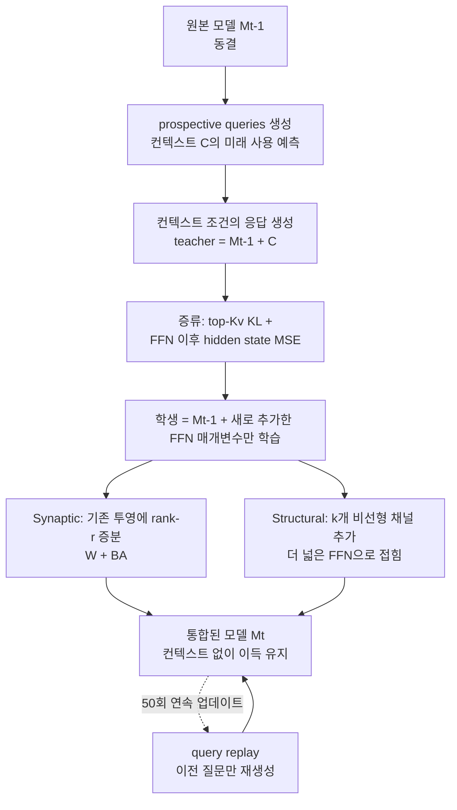

## 왜 읽어야 하나

에이전트 플랫폼을 돌리면서 "이번 대화에서 배운 것을 다음 세션에도 유지해야 하나"라는 결정을 내리는 팀, 그리고 파인튜닝으로 기억을 쓰면 모델 전체가 망가지는 문제(재앙적 망각)에 발목 잡힌 ML 엔지니어를 위한 글입니다. 결론부터 말하면, Zhejiang University와 ByteDance Seed가 내놓은 Cortex는 컨텍스트가 준 이득만 골라 가중치에 옮기는 방법 중, 연속 50회 업데이트라는 가장 잔혹한 설정에서도 이득 회복률(88.9%)과 기존 성능 보존률(99.8%)을 동시에 달성한, 이번 시점의 사실상 최강 설계입니다. 컨텍스트 메모리를 영구화할 방법을 고르는 팀이라면, 이 논문의 "미리 예측한 질문으로 증류한다"는 설계 원칙 하나가 선택 기준이 될 만큼 실용적입니다.

> 📄 **심층 리뷰 전문(DOCX)**: 이 논문의 상세 피어리뷰를 [Google Drive에서 다운로드](https://drive.google.com/file/d/1I5rK3Zzra0p_BfobIvqG-OUdjRiItKhE/view)할 수 있습니다.

*하이포캠퍼스에서 신피질로 기억이 통합되는 과정을 형상화했습니다.*

## 개요

컨텍스트 윈도우는 임대료가 비싼 임시 RAM입니다. 프롬프트에 넣으면 모델이 잘 답하고, 세션을 닫으면 사라지며, 그 정보를 사후에 파인튜닝으로 가중치에 새기면 원 모델이 마비됩니다. 이 문제를 논문은 Memory Consolidation, 즉 MC로 정식화합니다. 컨텍스트 C가 모델 M에 준 이득을, C 없이도 유지되도록 M'의 가중치로 내면화하되, C와 무관한 기존 능력은 보존하는 것. MC는 컨텍스트 지정 편집(factual editing), 스킬 학습(skill learning), 행동 스티어링(steering)을 하나의 목표 함수로 연결합니다. 생물학적 비유는 systems consolidation, 즉 하이포캠퍼스가 임시로 저장한 에피소드 기억을 신피질의 분포된 장기 표현으로 옮기는 과정입니다.

논문의 실험은 5개 태스크 계열(스티어링, 편집, 언러닝, 코드, 에이전트)로 구성된 테스트베드 위에서, 4B에서 120B의 dense와 MoE 백본, text-only와 멀티모달 모델을 가로질러 진행됩니다. 테스트베드의 설계가 이 논문의 또 다른 기여입니다. 컨텍스트 편집 관련 연구는 태스크마다 제각기 다른 벤치마크와 지표로 흩어져 있어, 방법끼리의 교차 비교가 사실상 불가능했습니다. Cortex는 단일, 배치, 연속 업데이트라는 세 가지 시간 축 위에서 통합률(CR, 컨텍스트가 준 이득을 얼마나 회복했는가)과 보존률(RR, 컨텍스트와 무관한 기존 능력을 얼마나 유지했는가)이라는 두 축으로 모든 태스크를 한 평면 위에 올립니다. 두 축이 함께 그려지는 한, "이득을 많이 가져온 대신 다른 것을 잃었다"는 결과가 눈에 드러납니다. 결과는 "대부분의 설정에서 Cortex가 실증적 통합 보존 Pareto 프론티어 위에 있다"는 것입니다. 이번 글은 설계 세 질문(무엇을, 어디에, 어떻게 통합하는가)과 50회 연속 편집 실측, 그리고 에이전트 플랫폼 관점의 시사점을 다룹니다.

## 이 기술은 무엇인가: 세 질문의 설계

Cortex는 세 가지 설계 질문으로 나뉩니다.

### 무엇을 통합하는가: prospective rehearsal

컨텍스트에는 다양한 정보가 섞여 있고, 그 관련성은 미래 태스크에 달려 있습니다. 장기 기억은 과거 입력의 재현이 아니라 미래 사용을 지탱해야 합니다. Cortex는 업데이트 전 모델(동결된 M_{t-1})이 스스로 prospective queries를 생성하게 합니다. "이 컨텍스트로 나중에 어떤 질문을 받을 것인가"를 모델이 예측하고, 그 질문에 대한 컨텍스트 조건 응답까지 모델 자신이 만들어 rehearsal 데이터셋 D_new를 구성합니다. 외부 생성기나 teacher가 필요 없는 것이 이 설계의 핵심입니다. teacher와 query 생산자, student의 기원이 전부 같은 동결 모델이기 때문에 분포 불일치가 작고, 그 작음이 보존률(RR)을 지킵니다. 에이전트 태스크(ALFWorld, τ²-Bench)는 예외적으로 환경이 query를 제공하고, 성공한 오프라인 트라젝토리만 남기는 정확도 필터를 씁니다. rehearsal 구성은 hold-out 평가 질문과 답에 접근하지 않습니다.

### 어디에 통합하는가: FFN의 두 가지 가소성

Transformers에서 FFN/MLP는 key-value 기억 특성을 갖고 사실적 연관성을 지니는 것으로 알려져 있습니다. Cortex는 MLP 매개변수를 기억 기질로 삼고, 두 가지 가소성을 구현합니다. bias-free SwiGLU FFN F(x) = W_D[(W_U x) ⊙ SiLU(W_G x)]에서, Synaptic은 기존 투영에 rank-r 이하의 증분을 더합니다(W' = W + B A W, 원본 행렬은 동결). Structural은 k개의 새로운 비선형 채널을 추가합니다(F(x) + D_s[(U_s x) ⊙ SiLU(G_s x)], 원본 weight block은 고정). 둘 다 모델 가중치로 접힙니다. Synaptic은 기존 행렬에 merge되고, Structural은 더 넓은 FFN으로 접혀 배포 시 intermediate width가 d_ff에서 d_ff + k로 늘어납니다. k = r로 비교하면 dense SwiGLU 한 계층에서 Structural이 학습하는 매개변수는 3rd_k, Synaptic은 3r(d_h + d_ff)으로, Structural이 학습 매개변수는 적으면서 쓰기 용량은 추가합니다. MoE에서는 unshared expert별 독립 Structural과 shared expert Structural이 있고, 라우팅 가중치가 1로 합쳐지면 shared branch를 모든 expert에 접어 넣을 수 있습니다.

### 어떻게 쓰는가: 컨텍스트에서 메모리로 증류

학생은 컨텍스트 없이 파라메트릭 메모리를, teacher는 컨텍스트를 갖고 같은 입력을 봅니다. teacher 입력은 [prefix, C, suffix, q, y]이고 학생 입력은 [prefix, suffix, q, y]입니다. 손실 함수는 top-Kv 절단 KL에 FFN 이후 계층별 hidden state MSE를 더합니다. L_t = βT²KL_Kv(p_T || p_S) + α(1/(L d_h)) Σ ||h^S - h^T||². KL은 컨텍스트가 있는 teacher의 예측 행동을 컨텍스트 없는 학생으로 옮기고, MSE는 컨텍스트 제거에 따른 attention 출력 차이를 FFN 새 매개변수로 보상하는 직접적인 표적을 줍니다. 계층별 hidden state는 내부 추론 흔적의 대용이라, rehearsal 예제가 적을 때 추가 감독이 됩니다. 보존을 위해 일반 query와 모델 자신의 응답을 rehearsal에 섞고, 연속 통합에서는 이전 query만 남기고 답을 매 스텝 최신 모델로 재생성해 replay합니다. 답과 증류 목표는 임시이고, query만 업데이트 사이에서 영속됩니다. 학습 대상은 새로 도입한 FFN 매개변수 ψ_t뿐이며, 이전 업데이트가 쓴 매개변수를 포함해 기존 파라미터는 전부 동결됩니다.

## 실제 실험 결과

### 단일과 배치 통합: Pareto 프론티어

5개 태스크 계열, 4B에서 120B 백본(Qwen3-4B, Qwen2.5-14B, GPT-OSS-20B/120B, Gemma3-12B)에서 전용 편집 방법(FT-M, ROME, MEMIT, AlphaEdit, WISE), 컨텍스트 증류 방법(Locas, SHINE, SPLIT, Reps, CAA, MemP), hypernetwork, test-time training과 비교합니다. Figure 5의 15개 패널 전체에서 Cortex 변형(Synaptic/Structural) 중 적어도 하나는 실증적 CR-RR Pareto 프론티어 위에 있습니다. 스티어링에서는 컨텍스트 이득의 약 95에서 100%를 회복하고 99에서 100%의 보존률을 유지하고, 배치 편집에서는 세 Qwen 백본에서 약 80에서 91% CR을 냅니다. 반대의 예도 분명합니다. 언러닝 패널에서 SHINE은 CR 103%에 RR 4%(기존 능력 붕괴)이고, 코드 배치에서 Synaptic은 GPT-OSS-120B 기준 RR 23%로, 태스크와 백본에 따라 변형 선택이 성패를 가릅니다.

### 50회 연속 편집: 이 논문의 결정적 실험

Qwen2.5-14B-Instruct에 zsRE 사실 편집 50개를 고정 순서로 적용합니다. 매 업데이트에서 Cortex는 새로운 adapter를 학습하고 백본과 이전 adapter는 동결하며, 이전 소스 컨텍스트를 다시 보지 않고 역사적 query replay만 겁니다. 평가는 누적 adapter를 소스 컨텍스트 없이 쓰고, 5개마다 MMLU, SimpleQA, GSM8K 고정 부분집합을 검사합니다. 3시드 평균.

| 방법 | 50회 후 CR | 50회 후 RR | 편집당 학습 매개변수 |
|---|---|---|---|
| ROME (최강 baseline) | 28.5% |  | 353.9M |
| MEMIT |  |  | 353.9M |
| FT-M |  |  | 70.8M |
| AlphaEdit |  |  | 70.8M |
| WISE |  |  | 2.73M |
| Cortex Synaptic (r=1) | 80.6% | 97.2% | 2.73M |
| Cortex Structural (k=1) | 88.9% | 99.8% | 0.74M |

본문이 명시하는 숫자만으로 표를 채웠습니다. 편집 방법 5종(FT-M, ROME, MEMIT, AlphaEdit, WISE)은 모두 연속 설정에서 급격히 떨어지고, 그 중 최종 CR 최강 baseline은 ROME의 28.5%입니다. ROME/MEMIT은 편집당 353.9M, FT-M/AlphaEdit은 70.8M 매개변수를 건드리는 동안, Cortex는 Synaptic 2.73M, Structural 0.74M의 새 매개변수만 학습합니다. 50회 누적해도 Structural이 새로 쓰는 매개변수는 37M에 불과합니다. Structural의 88.9%와 Synaptic의 80.6%가 ROME의 28.5%와 가진 격차는, 곧 "어디에 쓰느냐"의 격차입니다.

즉각 효과와 최종 효과의 격차도 분석합니다. Structural은 각 사실을 편집 직후 91.3% CR에서 최종 88.9%로 2.4포인트 잃고, Synaptic은 85.8%에서 80.6%로 5.2포인트, WISE는 52.0%에서 28.0%로 24.0포인트를 잃습니다. Cortex의 최종 우위는 "더 강한 초기 기록"과 "그 다음 업데이트들이 초래하는 더 작은 손실"의 합입니다. 처음 10개 사실을 40회 후속 편집 이후에 재평가하면 Structural이 97.2%, Synaptic이 92.6% 평균 CR를 유지합니다. 출력 종결(반복 또는 길이 제한)은 Structural 0.0%, Synaptic 0.8%로, 50회 누적 adapter가 모델의 생성 행동을 병리학적으로 바꾸지 않았다는 부수적 증거입니다.

## ThakiCloud 제품 적용 시사점

이 논문은 ThakiCloud의 두 제품 모두에 닿습니다.

Paxis 관점에서는 스킬 학습의 물리 문제입니다. Paxis는 Agent-Native Cloud로 스킬과 도구, 정책, 감사 로그를 일급 리소스로 다룹니다. 에이전트가 세션에서 반복적으로 성공한 절차가 다음 세션에도 그대로 작동하려면, 현재는 그 절차가 컨텍스트나 외부 스킬 파일에 머물러 있습니다. Cortex의 prospective rehearsal는 "에이전트가 성공한 트라젝토리에서 미래에 쓸 query를 먼저 만들고, 그것에 대한 자기 행동만 증류한다"는 설계로, 스킬 파일의 자동 정제와 같은 문제를 가중치 레벨로 끌어올립니다. agent 태스크(ALFWorld, τ²-Bench)에서 환경이 query를 제공하고 성공 트라젝토리만 필터링하는 방식은, Paxis의 샌드박스 실행 기록을 rehearsal 데이터원으로 쓰는 그림과 구조적으로 같습니다.

ai-platform 관점에서는 "컨텍스트를 영구화하는 파인튜닝"의 비용 구조가 바뀝니다. ROME/MEMIT이 편집당 353.9M 매개변수를, FT-M이 70.8M을 쓰는 동안 Structural은 0.74M의 새 채널만 추가합니다. 50회를 누적해도 총 37M. 이는 온프레미스 멀티테넌트 서빙에서 "고객 A의 도메인 지식을 모델에 새긴다"는 요청에, 전체 파인튜닝 대신 누적 adapter를 붙이는 형태로 답할 수 있음을 보여 줍니다. K8s 서빙 스택에서 adapter는 모델 파일이 아니라 부가 asset이고, tenant별로 쌓고 제거하는 것이 가능한 단위가 됩니다. 학습 비용도 낮습니다.teacher와 query 생산자가 모두 서빙 중인 동결 모델이므로, 추가 인퍼런스 클러스터가 필요 없고 batch inference 한 바퀴로 rehearsal를 만듭니다.

## 한계 및 반론

적용 전에 짚어야 할 경계가 있습니다.

첫째, 사실 편집(zsRE)은 좁은 문제입니다. 50회 연속 실험이 가장 인상적이지만, zsRE 사실 편집은 한 문장 수준의 키 값 교체입니다. 다중 문서, 수식, 절차적 지식, 장기 정책의 통합으로 범위가 넓어지면 CR이 유지되는지는 이 논문의 테스트베드 밖입니다. 스킬 학습이나 스티어링 패널에서 Pareto 우위가 보인다는 것이 범용성의 증거가 아니라, 태스크별 변형 선택이 성패를 가르는(코드 Synaptic RR 23% 붕괴) 증거이기도 합니다.

둘째, 연속 통합의 시간 축이 짧습니다. 50회, 3시드, 14B. Structural이 매 편집 k=1 채널만 추가해도 50회 후 intermediate width가 50 넓어지고, 수천 회 통합에서는 채널 수와 모델 크기의 장기간 균형, 그리고 채널 간 상호 간섭이 미지의 영역입니다. 논문이 "sequential updates에 추가 채널이 용량을 준다"고 한 것은 단기적 이야기입니다.

셋째, rehearsal의 자기 참조성입니다. query와 응답을 모두 원 모델이 만들면, 모델이 못 본 질문 유형은 rehearsal에 들어오지 않습니다. "미래 사용을 예측"한다는 전제는 모델 자신의 사용 분포로 제한되며, 인간이나 다른 시스템이 던질 질문까지 커버되지 않습니다. 보존률(RR)의 일부 이득이 이 자기 참조성에서 오므로, 외부 teacher를 넣으면 CR은 오르고 RR는 다시 시험대에 오를 수 있습니다.

넷째, MoE의 shared expert Structural 접힘은 라우팅 가중치가 1로 합해진다는 전제를 씁니다. 모든 MoE 라우팅이 이 성질을 만족하지는 않습니다. 그리고 GPT-OSS-120B에서 Synaptic의 코드 RR 23% 붕괴가 보여주듯, 백본과 태스크에 따른 실패 모드가 존재하며, Pareto 프론티어는 "대부분의 설정"이라는 수사로 한정됩니다.

다섯째, 배포 비용의 미세한 상향입니다. Structural은 매 통합마다 FFN의 intermediate width를 k 넓힙니다. 학습 비용이 0.74M 매개변수인 만큼 작지만, 배포 모델의 FLOPs와 메모리는 통합 횟수만큼 단조 증가합니다. 50회 누적이면 intermediate width가 50 넓어진 모델이 서빙되는 것이고, 이는 서빙 비용 곡선에 반영됩니다.Synaptic은 width를 유지하지만 기존 행렬에 merge되는 순간 원본 가중치를 영구히 바꾸므로, "이 tenant의 지식을 빼야 한다"는 요청에 대응하는 역운산이 명확하지 않습니다. 누적 adapter 방식이 서빙 스택과 가장 잘 맞는 형태이지만, 이 역시 서빙 엔진이 adapter 계층을 일급 지원해야 전제입니다.

## 정리

Cortex는 컨텍스트 메모리를 가중치로 옮기는 문제를 세 개의 설계 질문(무엇을/어디에/어떻게)으로 분해하고, 각각에 자기 참조 prospective rehearsal, FFN의 rank-r 증분과 채널 추가, top-Kv KL에 hidden state MSE 증류라는 답을 줍니다. 이 조합의 실측은 50회 연속 사실 편집에서 Structural 88.9% CR, 99.8% RR, 편집당 0.74M 매개변수라는 숫자로, 353.9M 매개변수를 쓰는 ROME(28.5% CR)과의 격차가 곧 "어디에 쓰느냐"의 격차입니다.

읽는 사람의 다음 행동으로 정리합니다. 컨텍스트 메모리의 영구화를 설계한다면, 먼저 "이 컨텍스트로 나중에 무엇을 물을 것인가"의 query를 서빙 중인 모델 스스로 생성하는 rehearsal 파이프라인의 비용을 계산하세요. 추가 인퍼런스 클러스터 없이 가능하다는 것이 Cortex의 가장 싼 부분입니다. 그리고 adapter 누적형 서빙을 검토한다면, 편집당 매개변수 수(0.74M 대 353.9M)가 tenant별 지식 누적의 총 비용 곡선을 정한다는 점을 기준에 넣으세요. 기억을 가중치로 쓰는 시대에, 쓰는 장소(FFN)와 쓰는 양(채널 1개)이 쓰는 속도보다 먼저 선택되어야 합니다.

## 출처

- Zhang, Jintian et al. (Zhejiang University, ByteDance Seed, Tsinghua University), [Cortex: Consolidating Context into Parametric Memory](https://arxiv.org/abs/2610.20399) (arXiv:2610.20399, 2026-10-14)
- 코드: https://github.com/zjunlp/cortex
- Gill, [X 포스트](https://x.com/gurtej__gill_/status/2114190634223604050) (2026-10-23)
- 📄 심층 리뷰 전문(DOCX): [Google Drive에서 다운로드](https://drive.google.com/file/d/1I5rK3Zzra0p_BfobIvqG-OUdjRiItKhE/view)
