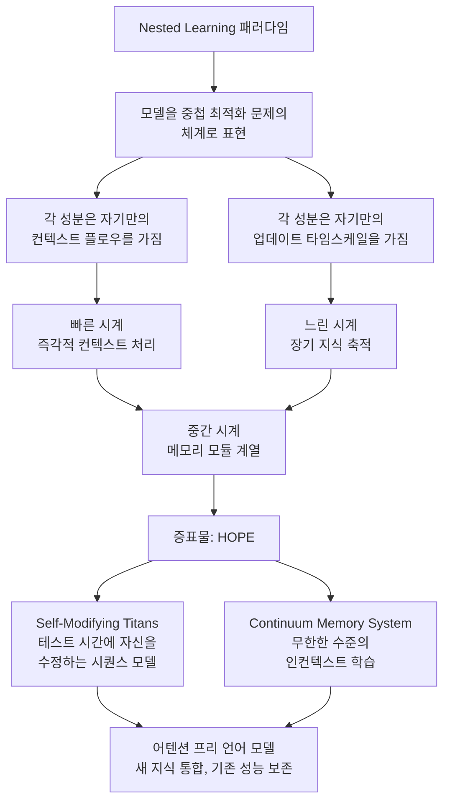

## 왜 읽어야 하나

에이전트 플랫폼을 구축하면서 '이 세션에서 학습한 행동을 다음에도 유지해야 하나'라는 결정을 내리는 팀, 혹은 새 기능을 가르치기 위해 파인튜닝을 돌리다가 기존 성능이 무너지는 재앙적 망각(catastrophic forgetting)에 발목 잡힌 ML 엔지니어를 위한 글입니다. 결론부터 말하면, Google Research의 Nested Learning(NL)은 딥러닝 아키텍처의 본질이 어텐션이나 재귀가 아니라 '업데이트 주파수'라고 주장하고, 그 주장을 수용하면 재앙적 망각을 '새 모듈을 붙이는 문제'가 아니라 '시계를 어떻게 설계하느냐'의 문제로 재정의할 수 있습니다. 증표물인 HOPE는 어텐션 프리 시퀀스 모델이 테스트 시간(test time)에 자기 자신을 수정하며 새 지식을 통합할 수 있다는 것을 보여줍니다.

> 📄 **심층 리뷰 전문(DOCX)**: 이 논문의 상세 피어리뷰를 [Google Drive에서 다운로드](https://drive.google.com/file/d/1Y1pFPqCQta7m5RDuign0O2SZ9ERd5tpF/view)할 수 있습니다.

*Nested Learning의 관점을 형상화했습니다. 서로 다른 속도로 도는 시계들이 중첩되어 하나의 시스템을 이룹니다.*

## 개요

10월 말, "Attention Is All You Need V2에 준하는 야망을 가진 구글의 새 논문"이라는 소개 트윗이 AI 커뮤니티에서 화제를 낳았습니다. 그 주인공이 Nested Learning: The Illusion of Deep Learning Architectures입니다. arXiv 2512.24695로 등록되어 NeurIPS 2025에 채택됐고, Ali Behrouz가 이끄는 Google Research 팀의 일입니다. Google 공식 블로그는 2025년 11월 7일 '지속 학습을 위한 새로운 ML 패러다임'이라는 소개글과 함께 이 작업을 공개했습니다.

NL이 겨냥하는 문제는 대형 언어 모델(LLM)의 기억 공백입니다. LLM은 학습이 끝난 시점에 동결됩니다. 그 사이 세상을 배우려면 컨텍스트에 정보를 흘려넣거나, 새로운 파인튜닝을 돌려야 하고, 후자는 기존 행동을 어딘가에서 갉아먹습니다. 커뮤니티는 이 현상을 재앙적 망각이라고 부릅니다.

지금까지의 해법은 크게 두 갈래입니다. 하나는 모델을 건드리지 않고 외부에 메모리를 붙이는 것. 검색 증강(RAG), 에이전트 하네스, 파일 기반 메모리가 여기에 해당합니다. 다른 하나는 테스트 시간에 학습을 추가하는 것. test-time training(TTT) 계열입니다. NL의 주장은 이 두 갈래를 넘습니다. 아키텍처를 바라보는 방식 자체가 잘못됐다, 그 차이에 대한 새로운 이름과 설계 원리를 제공한다고 말합니다.

제목이 'The Illusion of Deep Learning Architectures(딥러닝 아키텍처의 환상)'인 이유는 여기에 있습니다. 이 논문은 우리가 어텐션 계층, 피드포워드 계층, 메모리 모듈이라고 부르는 것들이 사실은 서로 다른 업데이트 주파수로 동작하는 선형 계층의 묶음이라고 주장합니다. 어텐션은 즉각적인 컨텍스트를 빠르게 읽고, 가중치는 훈련을 통해 느리게 축적되고, 메모리 모듈은 그 사이에 앉습니다. '아키텍처'의 차이는 구조적 차이가 아니라 시계 속도의 차이일 수 있다는 것입니다.

직접적인 선행 연구는 Titans(arXiv 2501.00663)입니다. 이 또한 Google Research의 어텐션 프리 아키텍추로, 대형 외부 메모리를 테스트 시간에 읽고 쓰며, slow, medium, fast라는 세 개의 이산 메모리 티어로 구성된 모델입니다. NL은 이 '세 시계'를 업데이트 주파수의 연속 스펙트럼으로 일반화하고, 모델을 주파수를 가진 중첩(nested) 최적화 문제들의 체계로 정리하는 패러다임을 제안합니다.

이 관점의 또 다른 파생은 학습의 통일입니다. NL은 지도(supervised), 비지도(unsupervised), 지속(continual) 학습을 별도의 문제군으로 두지 않고, 시계 배분의 차이라고 설명합니다. 빠른 시계가 현재 데이터에 대한 적합을, 중간 시계가 컨텍스트 내 구조의 축적을, 느린 시계가 태스크를 넘어선 지식의 축적을 담당하는 것이지요. 하나의 모델이 서로 다른 학습 목표를 서로 다른 속도로 동시에 수행한다는 설명은, 기존 '학습 모드' 구분을 '시계 배분' 문제로 바꾸는 효과입니다.

## 이 기술은 무엇인가

### 하나의 모델, 여러 개의 시계

Nested Learning 패러다임의 핵심 정의를 한 문장으로 쓰면, 기계 학습 모델을 중첩된, 멀티 레벨, 그리고/또는 병렬인 최적화 문제들의 집합으로 일관되게 표현하는 것입니다. 각 중첩 성분은 자기만의 컨텍스트 플로우와 업데이트 타임스케일을 가집니다.

이 관점에서 LLM은 '즉각적 현재에 갇힌 존재'가 아니라, 서로 다른 시계 위에서 동시에 학습하는 다층 시스템입니다. 논문의 인상적인 재구축은 모델(model)과 옵티마이저(optimizer)를 '서로 다른 시계에 달린 두 개의 중첩 연상 기억(associative memory)'으로 보는 것입니다. 빠른 시계는 지금의 토큰에 반응하고, 느린 시계는 오래된 지식을 다룹니다. 재앙적 망각은 '배우면 잊는다'는 모델의 결함이라기보다, 이 두 시계가 하나인 것처럼 동작할 때 생기는 설계 오류로 읽힙니다.

*중첩 최적화 문제로 재구성된 모델과, 그 증표물 HOPE의 구성(Self-Modifying Titans + CMS).*

시계 구분의 대상을 표로 정리하면 다음과 같습니다.

| 시계 | 대표 성분 | 담당할 것 |
|---|---|---|
| 빠름 | 어텐션 계열 읽기 | 즉각 컨텍스트, 토큰 레벨 반응 |
| 중간 | 외부 메모리(Titans 계열) | 시퀀스 레벨의 테스트 시간 읽기/쓰기 |
| 느림 | 가중치, 옵티마이저 상태 | 태스크 레벨의 장기 지식 |

이 표는 논문의 기술적 내용이라기보다, 이 관점을 실무에 번역한 것입니다. '어떤 학습을 어느 시계에 둘 것인가'가 NL이 남긴 질문입니다.

### Titans에서 HOPE로: 주파수 스펙트럼의 증표물

Titans가 slow, medium, fast라는 세 개의 이산 티어로 메모리를 나눴다면, HOPE는 그 이단계를 주파수의 연속으로 확장한 증표물입니다. HOPE는 두 개 구성품으로 이루어집니다.

첫째, Self-Modifying Titans. 시퀀스 모델이 테스트 시간에 자기 자신의 파라미터를 수정하도록 한 변형입니다. 입력을 처리하면서 모델이 스스로 학습 신호를 만들어 가중치를 조정하는, 일종의 내장된 옵티마이저가 되는 구조입니다. Google 블로그는 이 조합이 '모델과 옵티마이저가 서로 다른 시계에 달린 두 연상 기억'이라는 NL의 핵심 이미지를 구체화한다고 설명합니다.

둘째, Continuum Memory System(CMS). 인컨텍스트 학습의 수준에 상한을 두지 않는 메모리 체계입니다. 컨텍스트 윈도우가 커질수록 메모리 층이 늘어나는 방식으로, '무한한 수준의 인컨텍스트 학습(unbounded levels of in-context learning)'을 목표로 합니다.

두 구성품이 합쳐진 HOPE는 어텐션을 쓰지 않는 언어 모델입니다. Google 공식 블로그는 HOPE가 언어 모델링에서 우월한 성능을 보였고, 새로운 지식을 모델에 통합하는 능력도 확인했다고 소개합니다. 이 글의 소스 검증 범위(논문 초록, 공식 블로그, 커뮤니티 보도)에는 대규격 공개 벤치마크의 재현 가능한 수치까지 포함되지는 않아, 결과 서술은 이 정성적 주장에 한합니다.

### '환상'이라는 말이 무겁게 느껴지는 이유

이 논문을 다른 지속 학습 논문과 구별 짓는 것은 스케일이 아니라 주장의 방향입니다. 대부분 '망각을 줄이는 방법'을 제시하는데, NL은 '아키텍처라는 개념 자체'를 다시 정의합니다. 어텐션이든 GNN이든, 구조 이름이 아니라 주파수 분포로 아키텍처를 기술할 수 있다면, 새로운 설계 공간이 열립니다. 주파수를 설계 변수로 쓰는 것이지요. 후속 논문 Dynamic Nested Hierarchies(arXiv 2511.14823)는 계층 구조와 주파수 자체를 동적으로 진화시키는 방향으로 이미 나가고 있습니다.

## 손으로 만져보기

이 글의 저자는 로컬에서 코드를 실행하지 않았습니다. NL은 패러다임 단계의 제안이고, HOPE는 대규모 사전학습 조건에서 의미가 있는 연구 코드로, 소규모 실험으로는 검증할 수 있는 내용이 적습니다. 대신 손으로 들어가게 해주는 공개 진입점들을 정리합니다.

- HOPE 참고 구현: [smallhours19/nested-learning-hope](https://github.com/smallhours19/nested-learning-hope)
- PyTorch 구현: [Ray0907/Hope](https://github.com/Ray0907/Hope)
- 논문 자료 저장소: [Dpp1/nested-learning-paper](https://huggingface.co/Dpp1/nested-learning-paper)
- NeurIPS 2025 리뷰 페이지: [OpenReview](https://openreview.net/forum?id=nbMeRvNb7A)
- 저자 PDF: [alibehrouz.com/files/NL.pdf](https://alibehrouz.com/files/NL.pdf)

읽기 순서는 Titans(2501.00663)부터 시작하길 권합니다. '테스트 시간에 외부 메모리를 읽고 쓰는 어텐션 프리 모델'이라는 개념에 익숙해진 뒤 본 논문을 읽으면, '주파수 스펙트럼으로 일반화했다'는 문장이 훨씬 선명하게 들어옵니다. OpenReview의 리뷰 페이지에서는 '아키텍처의 환상'이라는 주장이 커뮤니티에서 어떻게 받아들여졌는지, 찬반 양측의 논점을 한자리에서 볼 수 있습니다.

## ThakiCloud 제품 적용 시사점

Paxis 렌즈부터 말하겠습니다. Paxis는 ThakiCloud의 Agent-Native Cloud로, Skills, Tools, Policies, Audit Logs를 일급 리소스로 다루는 에이전트 제어 평면입니다. Paxis가 가장 자주 부딪히는 질문은 '에이전트가 새 작업을 배우면서 기존 실력은 왜 퇴화하는가'입니다. 8월에 공개한 하네스 지속 학습(HCL) 글에서 우리는 하나의 실증 사실을 확인했습니다. 에이전트를 오래 써서 똑똑하게 만드는 길은 동결된 코어를 그대로 두고 둘레(메모, 안내판, 스킬)만 진화시키는 쪽에 있었습니다.

NL은 이 실무에 어휘를 줍니다. 이 시스템에는 몇 개의 시계가 있고, 각 타임스케일은 누가 소유하느냐. 세션 레벨의 학습은 가장 빠른 시계에 두고 가중치에는 손을 대지 않습니다. 스킬 레벨의 학습, 즉 새 워크플로우에서 익힌 절차는 중간 시계에 두고, Paxis의 자가진화 스킬과 스킬 위빙이 이미 이 층에서 운영됩니다. 정책과 조직 기억은 가장 느린 시계입니다. CMS의 '무한한 수준의 인컨텍스트 학습' 개념은, 기억을 지울 대상을 고르는 것 대신 층(layer)을 추가하는 쪽으로 설계 방향을 틀 수 있음을 시사합니다. '재학습할 것인가, 잊을 것인가'의 이분법을 층 추가로 우회하는 것입니다.

ai-platform 렌즈로 보면, 이 관점은 서빙과 학습의 경계에 대한 설계 원칙이 됩니다. ThakiCloud의 ai-platform은 K8s 기반 AI/ML SaaS로, 고객에게 '돌면서 배우는 모델'을 요구받습니다. 지금의 답은 RAG와 LoRA 파인튜닝의 조합입니다. NL의 시계 구분은 이 조합에 스케줄링 질문을 추가합니다. 이 학습은 어느 시계에 속하는가. 세션 메모리인가, 테스트 시간 외부 메모리인가, 가중치 업데이트인가. Maxis의 학습 파이프라인을 '일회성 파인튜닝'이 아니라 '학습 목적별로 타임스케일을 배분하는 스케줄러'로 재구성하면, 서빙 비용과 지속 학습의 균형을 Kueue 스톱 같은 자원 스케줄링 문제로 번역할 수 있습니다.

## 한계 및 반론

역으로 가장 강한 반론을 세워보겠습니다.

'주파수가 아키텍처다'는 주장은 발견이 아니라 재명명(relabeling)일 수 있습니다. 모든 딥 네트워크에는 이미 빠른 성분과 느린 성분이 계층화되어 있습니다. 어텐션, 잔차 연결, 가중치, 옵티마이저 상태. 이들을 '주파수 스펙트럼'이라는 이름으로 묶는 것이 새 패러다임인지, 기존 지식을 새 옷으로 입힌 것인지는, 이전에는 만들지 못했던 설계 결정을 실제로 얼마나 만들어내느냐로 판가름 납니다. NL이 '시계 설계'라는 질문을 명문화한 것 자체는 유용하지만, 그것이 새로운 아키텍처 공간으로 이어지는지가 아직 열려 있습니다.

증거도 아직 경량입니다. HOPE는 증표물이지, 대규모 시스템이 아닙니다. 이 글의 소스 검증 범위에는 대규격 공개 벤치마크의 재현 가능한 수치가 포함되지 않았고, 공식 블로그의 '우월한 성능' 보고가 어떤 규모, 어떤 컴퓨트, 어떤 베이스라인 대비인지 공개적으로 확인되지 않았습니다. 또한 테스트 시간 학습은 추론 시 계산 비용을 추가로 요구합니다. 성능 향상만큼 추론 비용이 늘면, '학습이 무료가 아니다'라는 기존 대가(price) 구조는 그대로입니다. 이 트레이드오프를 해소한 보고는 아직 없습니다.

커뮤니티 반응은 분단됩니다. OpenReview와 Hugging Face의 논평에서는 '기존 아키텍처 전제를 뒤집는' 논문이라는 찬사와 함께, 메타러닝이나 deep declarative networks(메모리와 계산을 층으로 해석하는 기존 관점)과의 연속성을 지적하는 읽기가 나란히 보입니다. '새 패러다임'인지 '기존 관점의 재정리'인지에 대한 이 갈림은, 위에서 세운 재명명 반론과 정확히 같은 위치입니다. 패러다임 주장이 클수록, 그 크기에 비례하는 증거가 요구된다는 점에서 NL은 아직 검증의 초반에 있습니다.

산업 적용성도 질문입니다. 현대 LLM의 사전학습은 일회성 대규모 실행이 표준이고, NL의 지속적 패러다임은 오래 돌아가며 계속 학습하는 에이전트와 메모리 시스템 환경에서 가장 자연스럽습니다. 이 둘을 연결하는, 기존 사전학습 파이프라인에 주파수 스케줄링을 삽입하는 방법은 아직 제시되지 않았습니다.

## 정리

서론의 결론으로 돌아갑니다. 아키텍처의 본질은 업데이트 주파수다,라는 주장이 옳다고 해도, 그 즉시 얻어지는 것은 새 모듈이 아니라 새로운 회계입니다. 독자가 오늘부터 할 수 있는 일을 정리하면 이렇습니다. 에이전트와 모델의 메모리, 학습 설계를 할 때 시스템의 시계 개수를 세고, 각 타임스케일의 소유자를 정하십시오. 빠른 시계는 세션 학습, 중간 시계는 스킬과 외부 메모리, 느린 시계는 정책과 가중치 업데이트. '어디에 배울 것인가'라는 질문의 방향만으로도, 재앙적 망각을 줄이는 설계 결정을 상당수 선별할 수 있습니다. NL이 새 세대 아키텍처로 자라느냐, 강력한 렌즈로 머무느냐는 HOPE 이후의 대규모 검증에서 갈립니다. 그러나 이 논문이 연 '시계 회계'의 질문 자체는, 지금 당장 쓸 수 있는 것입니다.

## 참고

- 논문 (arXiv): [Nested Learning: The Illusion of Deep Learning Architectures](https://arxiv.org/abs/2512.24695)
- Google Research 블로그: [Introducing Nested Learning](https://research.google/blog/introducing-nested-learning-a-new-ml-paradigm-for-continual-learning/)
- OpenReview (NeurIPS 2025): [nbMeRvNb7A](https://openreview.net/forum?id=nbMeRvNb7A)
- 선행 연구 Titans: [Learning to Memorize at Test Time](https://arxiv.org/abs/2501.00663)
- 후속 연구: [Dynamic Nested Hierarchies](https://arxiv.org/abs/2511.14823)
- HOPE 참고 구현: [smallhours19/nested-learning-hope](https://github.com/smallhours19/nested-learning-hope)
- PyTorch 구현: [Ray0907/Hope](https://github.com/Ray0907/Hope)
- 논문 저장소: [Dpp1/nested-learning-paper](https://huggingface.co/Dpp1/nested-learning-paper)
- 저자 PDF: [alibehrouz.com/files/NL.pdf](https://alibehrouz.com/files/NL.pdf)

> 📄 **심층 리뷰 전문(DOCX)**: 이 논문의 상세 피어리뷰를 [Google Drive에서 다운로드](https://drive.google.com/file/d/1Y1pFPqCQta7m5RDuign0O2SZ9ERd5tpF/view)할 수 있습니다.
