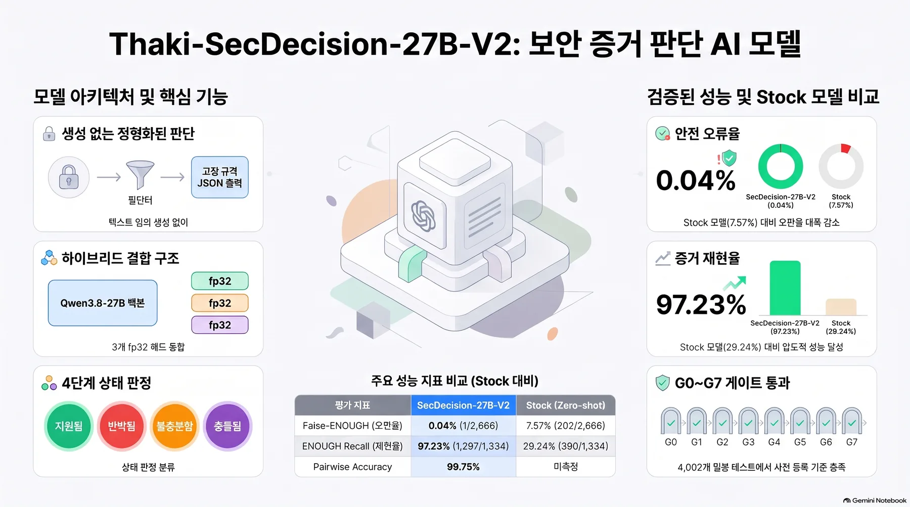
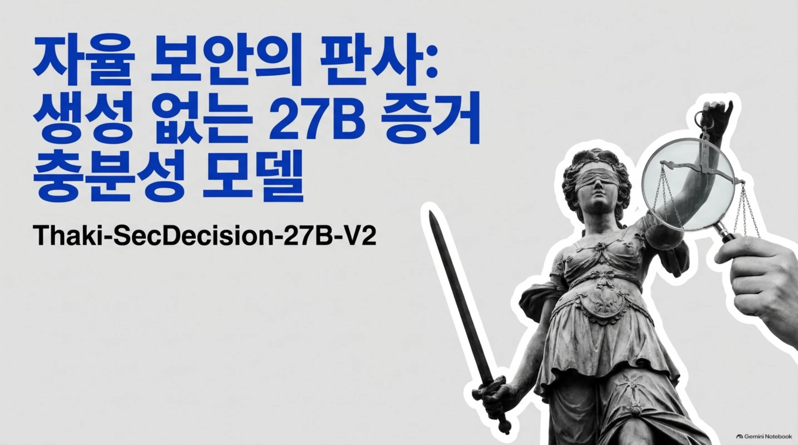
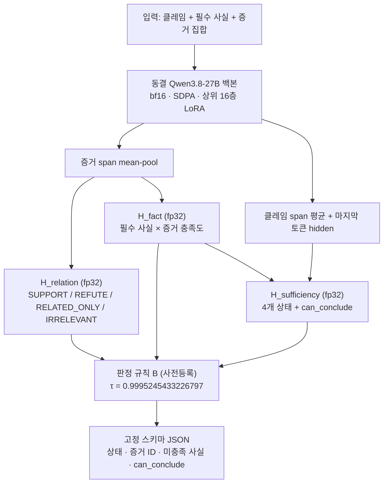
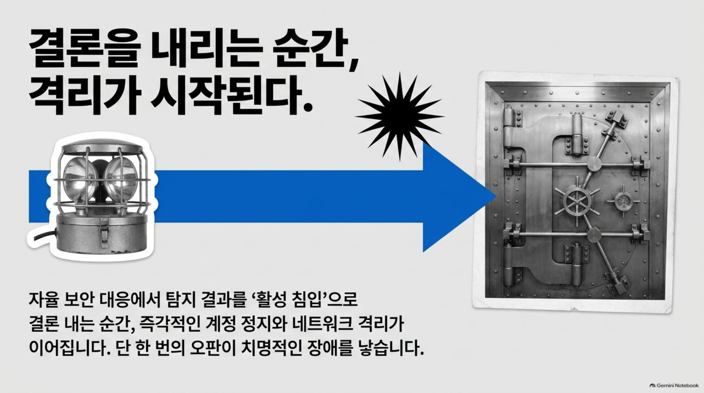
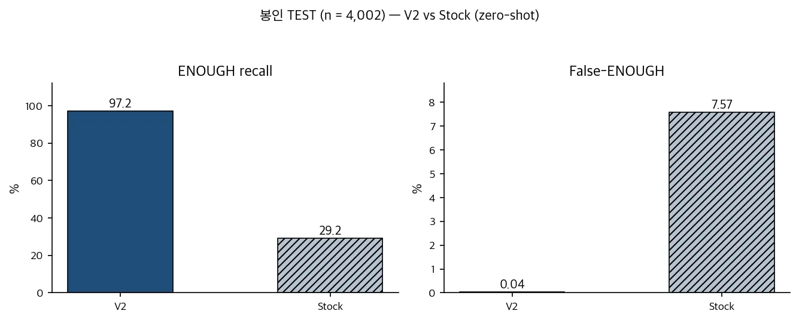
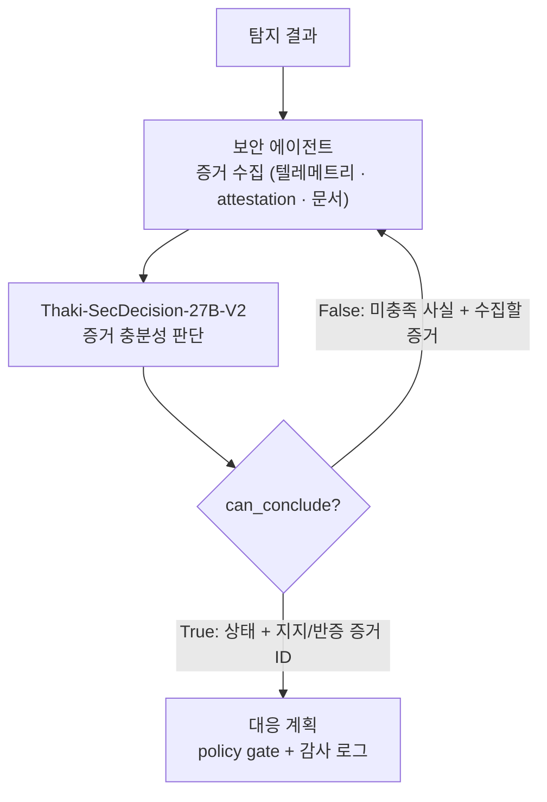
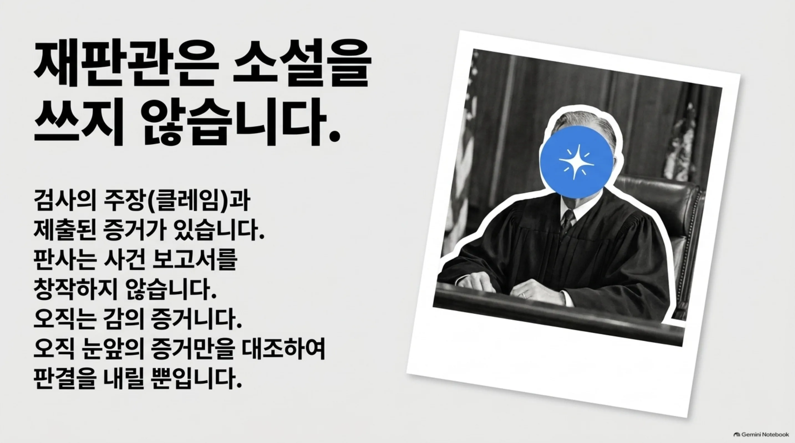
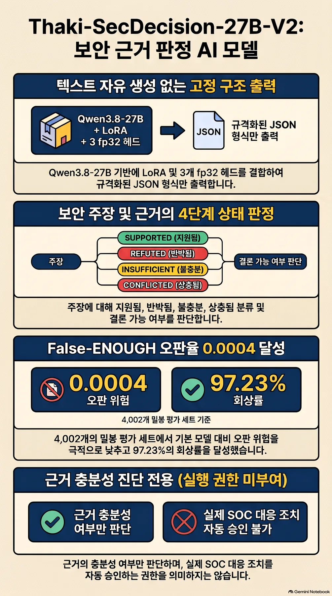

자율 보안 대응에서 결론을 내리는 순간은 행동이 시작되는 순간입니다. 탐지 결과를 활성 침입으로 결론 낸 바로 그 순간에 격리나 계정 정지가 이어집니다. 그래서 중요한 질문은 모델이 답을 잘 쓰느냐가 아니라, 지금 손에 있는 증거로 답해도 되는느냐입니다.

이 글은 보안 증거가 충분한지 판단하는 모델을 소개합니다. 모델은 클레임과, 그 클레임을 성립시키려면 확인해야 할 필수 사실과, 현재까지 모인 증거 집합을 받아들입니다. 클레임이 지지되는지, 뒤집어지는지, 증거가 아직 부족한지, 증거끼리 서로 모순되는지부터, 입력된 증거 중 어떤 것이 지지를 하고 어떤 것이 반증을 하는지, 아직 충족되지 않은 필수 사실이 무엇인지, 그리고 지금 결론을 내도 되는지까지 판정합니다. 모델은 자유롭게 글을 쓰지 않고, 판정 양식에 값만 채웁니다. 이 모델의 이름은 Thaki-SecDecision-27B-V2이고, 네 판정 상태는 각각 SUPPORTED, REFUTED, INSUFFICIENT, CONFLICTED입니다. 보안 에이전트를 만들거나, 에이전트 스택의 어느 위치에 무엇을 놓아야 할지 고민하는 분을 위해 씁니다.

모델과 추론 코드, 모델 카드는 [Hugging Face에 공개](https://huggingface.co/ThakiCloud/Thaki-SecDecision-27B-V2)되어 있습니다. 입력 형식과 판정 규칙이 같은 작은 연구 미리보기 [Thaki-SecDecision-4B-Preview](https://huggingface.co/ThakiCloud/Thaki-SecDecision-4B-Preview)도 함께 공개했습니다. 이 모델은 검증 수준이 훨씬 낮아서 아래에 따로 절을 두었습니다.


*판결을 내리기 전, 증거를 하나씩 대조하는 순간을 형상화했습니다.*

## 쉽게 말하면

법정을 떠올려 보겠습니다. 검사 측의 주장이 클레임이고 그 주장을 인정하려면 입증해야 할 사실들이 필수 사실입니다. 제출된 증거는 증거이고 판사는 그 증거만으로 결론을 내려야 합니다.

판사가 내릴 수 있는 판단은 네 가지입니다. 증거가 충분해서 주장이 성립한다고 받아들이는 경우, 증거가 주장을 뒤집는다고 보는 경우, 증거가 아직 부족하다고 보는 경우, 증거끼리 서로 모순된다고 보는 경우입니다. 네 판단은 각각 SUPPORTED, REFUTED, INSUFFICIENT, CONFLICTED에 해당합니다. 판사가 사건 보고서를 새로 써서 사실을 만들어 내는 것이 아니라 제출된 증거를 보고 네 판단 중 하나를 고르는 것과 같이, 이 모델은 텍스트를 생성하지 않습니다.

판사가 가장 오래 고민하는 질문은 판단 자체보다, 언제 판결을 내릴 수 있느냐입니다. 증거가 영영 모이지 않는 경우가 있고, 하나만 더 확인되면 판정이 뒤집히는 경우가 있습니다. 모델도 이 질문을 위한 별도 출력을 갖습니다. 증거가 부족하면 기준을 낮추어 판결하는 대신 "충분하지 않다"고 답하고, 증거를 모으는 쪽은 다음에 무엇을 수집해야 할지를 알려받습니다. 즉, 사람 말로는 이 모델은 "아직 부족하다"는 말도 하나의 판결로 내리는 판사입니다.

<!-- nlm-visual -->

*NotebookLM이 소스를 종합해 생성한 인포그래픽입니다.*

## 이 모델이 하는 일과 하지 않는 일

보안 에이전트 스택에서 이 모델의 역할은 게이트입니다. 에이전트는 탐지 결과를 받고 텔레메트리, 수집 attest, 공격 참조 문서 같은 증거를 모읍니다. 그리고 이 모델에 지금 이 클레임에 대해 결론을 내도 되는지 물어봅니다.

모델이 판단하는 것은 네 가지입니다. 첫째는 클레임 상태입니다. 둘째는 입력 증거 중 어떤 증거 ID가 클레임을 지지하고 어떤 것이 반증하는지입니다. 셋째는 아직 충족되지 않은 필수 사실이 무엇인지입니다. 넷째는 지금 결론을 내도 되는지, 즉 can_conclude입니다. 이 네 가지가 고정 스키마의 JSON 한 줄로 나옵니다.

예를 들어 "이 호스트가 외부 IP로 데이터를 반출하고 있다"는 클레임이 들어오면, 필수 사실은 (1) 외부 연결이 실제로 있었는가, (2) 목적지가 외부 IP인가, (3) 데이터 양이 기준을 넘는가 처럼 분해됩니다. 에이전트가 텔레메트리를 먼저 모아 모델에 물으면, (1)과 (3)은 충족되고 (2)만 미충족이라는 답이 돌아올 수 있습니다. 그때 다음 수집 대상은 "해당 연결의 목적지 IP 속성 확인"으로 좁혀집니다.

하지 않는 일을 명시하는 것이 동등하게 중요합니다. 모델은 대응을 승인하지 않고, 탐지를 실행하지 않고, 사건 판단을 하지 않습니다. can_conclude가 True인 것은 "이 증거로는 이 클레임이 해당 상태라고 결론 낼 수 있다"는 충분성 진술이지, 행동 인가가 아닙니다. No Evidence, No Action이라는 원칙을 정책 문서로만 두는 것과, 모델 출력 스키마 자체가 그 원칙을 강제하는 것은 다릅니다. 이 모델은 후자입니다.



## 구조: 동결 백본 위 세 개의 헤드

모델은 동결된 Qwen3.8-27B 백본, LoRA 어댑터, fp32 소형 헤드 3개의 조합입니다. 백본은 고정된 revision으로 pin되고 학습 동안에도 한 번도 바뀌지 않습니다. LoRA는 상위 16개 층(64층 중 48~63층)에만 적용됩니다. 헤드 3개는 각기 다른 일을 합니다.



relation 헤드는 각 증거가 클레임에 대해 어떤 방향인지 판단합니다. SUPPORT, REFUTE, RELATED_ONLY, IRRELEVANT 네 분류 중 하나입니다. fact 헤드는 필수 사실과 증거의 각 쌍에 대해 그 증거가 그 사실을 충족하는지 판단합니다. sufficiency 헤드는 클레임 상태와 사실 충족 정도를 함께 받아 4개 상태와 can_conclude를 냅니다.

생성이 없다는 것은 출력에 큰 영향을 줍니다. 일반 LLM은 근거처럼 보이는 문장을 먼저 만들고 그 문장을 근거로 답합니다. 이 모델은 판결문 서술을 하지 않고 판결 양식만 채웁니다. 그래서 생성 모델이 보여주는 근거 조작, 즉 사실과 다른 이유를 그럴듯하게 쓰는 실패 모드가 구조적으로 존재하지 않습니다.

입력 형식도 고정되어 있습니다. chat template이 없는 평문으로, 클레임 다음에 필수 사실 블록, 그 다음에 source_type을 붙인 증거 블록, 그리고 DECISION 마커가 옵니다. 컨텍스트 4096토큰을 넘는 예제는 자르지 않고 제외합니다. 잘라낸 입력으로 내린 판단은 원래 입력에 대한 판단이 아니므로, 그런 예제는 판정 대상에 올리지 않습니다.

학습은 1에폭(3,334스텝)으로 마쳤고 체크포인트는 train_dev와 calib split에서만 골랐습니다. 선택 기준은 "잘못 결론내는 비율(False-ENOUGH)이 2%를 넘지 않는 범위에서 ENOUGH recall이 최대인 것"입니다. 결과로 고른 체크포인트가 step 2200입니다. 골라진 뒤에는 calibration split에서 τ를 고정했고 TEST는 그 뒤에서야 개봉했습니다.



## 판정 규칙: 반증에도 근거를 요구하는 Rule B

헤드의 확률 분포가 곧 출력이 아닙니다. 그 위에 사전등록된 판정 규칙, Rule B가 적용됩니다.

지지를 위해서는 상태가 SUPPORTED이고 미충족 필수 사실이 없으며 SUPPORT 방향의 증거가 하나 이상이어야 합니다. 반증을 위해서는 상태가 REFUTED일 뿐만 아니라, 관찰 기반의 근거가 있어야 합니다. 구체적으로 REFUTE 방향의 증거 중 source_type이 collection_attestation이나 telemetry인 것이 하나 이상이어야 반증 근거로 인정됩니다. 법정 비유로 다시 말하면, 판사가 피고의 무죄를 선언할 때도 목격자의 증언이 아니라 직접 관찰한 증거를 요구한다는 뜻입니다. "어느 문서를 읽었다"는 attack_reference 같은 비관측 문서는 반증 근거가 될 수 없습니다.

기록의 부재에도 같은 원칙이 적용됩니다. "로그에 특정 명령이 없다"는 그 명령이 실행되지 않았다는 뜻이 아닙니다. 아직 수집되지 않았을 수 있습니다. 수집 범위와 완결성이 확인되지 않은 상태에서는 부재가 반증 근거로 쓰이지 않습니다.

CONFLICTED 상태이거나 SUPPORT 방향과 REFUTE 방향의 증거가 각각 하나 이상이면 충돌로 판정합니다. can_conclude가 True가 되려면 이 모든 게이트를 통과한 뒤에 충분성 점수가 미리 정한 임계값 τ를 넘어서야 합니다. τ는 교정 split에서 "잘못 결론내는 비율이 2%를 넘지 않는 가장 낮은 임계값"으로 고르고, 그중 recall이 최대인 것을 택한 값입니다. 정밀한 전체 수치는 표 1에 두었습니다. 결과는 보지 못하고 고른 값이므로 결과 확인 이후에는 바뀌지 않습니다. 보기를 바꿔 임계값을 다시 맞추는 순간, 그 수치는 더 이상 신뢰할 수 있는 것이 아닙니다.

TEST를 열기 전에 고정한 것은 세 가지입니다. 판정 규칙과 임계값, 그리고 임계값을 고른 규칙입니다. 표 1에 정리했습니다.

**표 1. TEST 개봉 전에 고정한 값**

| 항목 | 값 |
|---|---|
| 판정 규칙 | Rule B, 사전등록 개정 `refutation_coverage_gate_correction` (원장 seq 274) |
| τ 선택 규칙 | 교정 split에서만, False-ENOUGH ≤ 0.02인 가장 작은 τ 중 recall 최대 |
| 충분성 임계값 τ | 0.9995245433226797 |

Rule B는 이전 실험에서 나왔고, 그 실험들은 위 결과와 별개입니다. 표 2는 둘을 나누고 행마다 어느 런인지 적었습니다. V1 회귀 실험은 이전 모델(V1)의 런입니다. 매크로 F1은 스톡보다 높았지만(0.627 → 0.731) 오결론률도 함께 올라서(1.79% → 3.19%) 사전등록 게이트를 통과하지 못했습니다. 개정 전 규칙을 쓴 V2 교정 런은 반증 방향에서 보수적이었습니다. 교정 split 전체의 결론 회수율은 0.48 부근에 그쳤습니다. 증거가 클레임을 뒤집는 케이스(REFUTE_COVERAGE)의 회수율은 0.048이었습니다. 관찰된 반증 근거를 요구하도록 고친 것이 Rule B입니다.

**표 2. Rule B로 이어진 이전 런 (봉인 TEST 아님)**

| 런 | 지표 | 값 |
|---|---|---|
| V1 회귀 실험(스톡 → V1) | 매크로 F1 | 0.627 → 0.731 |
| V1 회귀 실험(스톡 → V1) | 오결론률 | 1.79% → 3.19% |
| V2 교정 런, 개정 전 규칙 | 교정 split 전체 결론 회수율 | 약 0.48 |
| V2 교정 런, 개정 전 규칙 | REFUTE_COVERAGE 회수율 | 0.048 |

비교하자면 Rule B를 쓴 봉인 TEST의 REFUTE_COVERAGE 회수율은 0.9985입니다(표 3).

출력의 지원·반증 증거 ID는 입력의 evidence_id에서만 고릅니다. 그래서 입력에 없는 ID가 출력에 나오는 일은 구조적으로 일어나지 않습니다.

## 나온 결과

봉인 TEST는 4,002건입니다. 표준 생성기에서 나온 2,202건과 생성 규칙이 다른 생성기의 1,800건(generator_disjoint)으로 구성됩니다. 정답은 생성 규칙으로만 정해졌고 teacher 모델과 사람, LLM 판정은 모두 0건입니다. 분할 사이에 겹치는 world, group, host, IP, user는 없고, 완전히 같은 예제도 없습니다.

다만 이것은 개체 단위의 분리이지, 내용이 독립이라는 뜻은 아닙니다. 공개 뒤인 2026-10-31에 마스킹 감사를 따로 돌렸습니다. 숫자, IP, 16진 ID, 타임스탬프를 가린 뒤 클레임, 정렬한 증거, 변형을 학습 쪽과 비교했습니다. 그 결과 TEST 4,002건 중 50건(1.25%)이 train, train_dev, calib 어딘가에 거의 같은 예제를 갖고 있었습니다. 50건은 모두 표준 층에 있고 generator_disjoint 층에는 없습니다. TEST 세트가 학습 데이터와 거의 같다는 뜻은 아닙니다. 나머지 3,952건은 이 감사에서 거의 같은 예제가 나오지 않았습니다. 다만 아래 수치는 그 50건을 포함합니다. TEST 수치를 50건을 뺀 채 다시 계산하지 않았기 때문입니다.

**표 3. 봉인 TEST 결과와 사전등록 요건**

| 지표 | SecDecision-27B-V2 | Stock (zero-shot) |
|---|---|---|
| False-ENOUGH | 1/2668 (0.04%) | 202/2668 (7.57%) |
| ENOUGH recall | 1297/1334 (97.2%) | 390/1334 (29.2%) |
| FULL recall | 0.946 | 0.0555 |
| REFUTE_COVERAGE recall | 0.9985 | 0.5292 |
| Relation Macro-F1 | 0.9634 | 미측정 |
| Pairwise 정확도 | 0.9975 | 미측정 |
| ADJACENT 층 False-ENOUGH | 0건 | 미측정 |
| generator_disjoint 층 False-ENOUGH / recall | 0.0 / 0.9567 | 미측정 |
| 안전 격차 paired bootstrap 95% CI | [−0.08771, −0.06408] | 해당 없음 |
| 사전등록 CI 상한 | +0.005 | 해당 없음 |

ADJACENT(인접 클레임) 층의 False-ENOUGH는 0건입니다. 충돌 케이스의 오결론도 0건입니다. 안전 격차(V2에서 Stock을 뺀 값)의 paired bootstrap(group-cluster, 2000회 재표본) 95% 신뢰구간은 [−8.77%, −6.41%]이고, 전체 정밀 값은 표 3에 두었습니다. 사전등록 요건은 상한이 +0.5% 이하이고 큰 여유로 만족합니다.

사전등록된 게이트 8개(G0~G7)를 모두 통과했고 판정은 GO입니다.

Stock 비교의 한계를 함께 명시합니다. Stock baseline은 Qwen3.8-27B를 zero-shot으로, 고정된 평가 계약(동일 입력 렌더, greedy, thinking off, max_new_tokens=64)에서 돌린 것입니다. 이 계약에서 Stock은 4,002건 중 3,370건(83.96%)에서 파싱 가능한 상태를 아예 내지 못했습니다(PARSE_ERROR). 일부 케이스에서는 thinking 출력이 64토큰 예산을 다 써버려 판정 출력 전에 예산이 소진되기도 했습니다. thinking off 설정과 어긋나 보이는 대목이라, 카드와 같은 방식으로 적습니다. 이것은 그 계약에서 관찰된 스톡 모델의 동작입니다. thinking을 껐는데도 thinking 텍스트가 나온 원인은 따로 조사하지 않았습니다. 이 비교는 최적화된 Stock 모델(조정된 프롬프트, 더 큰 출력 예산, 파인튜닝)에 대한 우월성의 완전한 증명은 아닙니다. 사전등록 GO 판정은 유지되며 Stock 비교를 과대 해석하지 않도록 이 한계를 공시합니다.


*왼쪽은 결론이 가능한 케이스를 놓치지 않는 비율(ENOUGH recall)이고 오른쪽은 결론이 안 되는 케이스를 결론이 가능하다고 오결론하는 비율(False-ENOUGH)입니다.*

## 새 프로세스에서 공개 패키지를 그대로 검증

수치를 학습 런의 로그에서 읽은 것이 아니라, 공개되는 패키지로 재현했습니다. 공개할 바이트를 그대로 담은 패키지를 학습·평가에 쓰지 않는 새 GPU 프로세스에서 로딩했고 base가 정확히 고정된 revision으로 해석되는지, 모든 가중치와 헤드가 에러 없이 로딩되는지, Rule B와 τ가 수치 정밀도 그대로 적용되는지를 확인했습니다.

가장 중요한 확인은 forward-identity입니다. held-out calib 예제에서 다시 계산한 확률이 봉인된 dump와 최대 차이 1e-3 이내로 일치하는지 보았는데, 일치했습니다. 이 패키지가 봉인 TEST의 전산을 재현한다는 뜻입니다. 네 상태(SUPPORTED, REFUTED, INSUFFICIENT, CONFLICTED)가 모두 정상 발생했고 출력에 입력 밖 증거 ID는 0건이었습니다.

## 돌려 보는 법

아래 명령은 모델 카드의 Quick start를 그대로 옮긴 것입니다. 모델 저장소를 내려받은 위치에서 실행합니다.

```bash
pip install -r requirements.txt
# base from a local path (or HF id — the revision is pinned in config.json):
python3 inference.py --base /path/to/Qwen3.8-27B --example smoke_example.json --check-sha
# base from Hugging Face:
python3 inference.py --base Qwen/Qwen3.8-27B --example smoke_example.json --check-sha
```

`--check-sha`는 어댑터와 헤드, 판정 모듈의 해시를 `config.json`과 대조합니다. 입력은 `smoke_example.json`과 같은 JSON 객체 하나입니다.

```json
{"claim": {"text": "...", "required_facts": [{"fact_id": "f1", "desc": "..."}]},
 "evidence": [{"evidence_id": "e1", "source_type": "telemetry", "text": "..."}]}
```

출력은 JSON 한 줄이며 예시는 다음과 같습니다.

```json
{"example_id": "...", "claim_status": "SUPPORTED", "can_conclude": true,
 "support_evidence_ids": ["e1"], "refute_evidence_ids": [], "missing_required_facts": [],
 "sufficiency_score": 0.9995, "rule": "b", "gated": true}
```

주의할 점이 두 가지 있습니다. 첫째, 어댑터만 따로 불러 쓰면 안 됩니다. 이 모델은 어댑터와 fp32 헤드(`heads.pt`), Rule B가 한 묶음입니다. `adapter_model.safetensors`만으로는 검증된 동작이 재현되지 않습니다. 둘째, `transformers` 표준 분류 파이프라인이 아닙니다. `pipeline("text-classification", ...)` 대신 `inference.py`를 씁니다.

검증한 환경은 좁습니다. 카드에 적힌 환경은 NVIDIA B200 1장, bf16, SDPA 어텐션, 4,096토큰 이하 입력, `vllm/vllm-openai:v0.28.0` 이미지입니다. 다른 GPU나 소프트웨어 환경은 검증 목록에 없습니다.


## Paxis와 Metis에서 쓰는 관점(목표 아키텍처): 증거와 응답 사이의 게이트

지금 있는 것은 모델 공개본입니다. 가중치와 헤드, 추론 코드가 전부입니다. 두 SecDecision 모델은 현재 Paxis나 Metis 안에 들어 있지 않습니다. 공개본에는 Paxis, Autonomous SOC, Web-Chat 통합도 상주 서빙도 없습니다. 이 절의 내용은 모두 목표 아키텍처입니다. 앞으로 만들려는 설계이며 지금 돌아가는 기능이 아닙니다.

설계한 Paxis 보안 워크플로에서 이 모델은 증거 수집과 대응 계획 사이에 서게 됩니다. 에이전트는 탐지 결과에 대해 증거를 모으면서 단계마다 지금 결론을 내도 되는지 모델에 묻게 됩니다. can_conclude가 False면 에이전트는 추측으로 대응하지 않습니다. 모델이 알려 준 미충족 필수 사실을 다음 수집 대상으로 삼습니다. True가 되면 지지·반증 증거 ID를 들고 대응 계획 단계로 넘어갑니다.

모델 카드는 SecDecision 옆에 공개된 형제 모델 두 개를 둡니다. 그 파이프라인에서 SecProof는 후보 문제를 찾고, SecDecision은 그 문제에 대해 모은 증거로 결론을 내려도 되는지 판단합니다.

| 역할 (모델 카드 기준) | 모델 |
|---|---|
| 사이버보안 검색 임베딩 | Thaki-SecEmbed-8B-Preview |
| 작은 Python AI 에이전트 런타임을 12개 보안 경계로 감사 | Thaki-SecProof-27B-V1 (2B, 4B, 8B Preview도 같은 방식으로 학습) |
| 증거 충분성과 결론 가능 판단 | Thaki-SecDecision-27B-V2 (아래 4B-Preview 포함) |

설계상으로는 Paxis의 policy gate와 감사 로그가 이 모델의 출력을 판단 근거로 받게 됩니다. 그러면 실행된 대응의 기록에는 "에이전트가 직감으로 판단했다"가 아니라 "이 증거 ID를 근거로, 이 충분성 점수에서"가 남습니다.

이 설계는 재 보지 않은 가정 하나에 기대고 있습니다. 틀린 대응 한 번의 비용이 증거 수집 한 바퀴의 비용보다 크다는 가정입니다. 이 가정이 맞다면 게이트는 앞의 비용을 뒤의 비용으로 바꿉니다. 실제로 잰 것은 게이트 자체의 오류율뿐입니다. 합성 TEST에서 False-ENOUGH는 2,668건 중 1건이었습니다.

Metis 쪽에서 보면 이 모델은 채팅 모델과 다른 서빙 부하입니다. 판정 한 번은 동결 백본과 LoRA의 forward 한 번, fp32 헤드, 결정론적 규칙으로 끝납니다. 생성도 샘플링도 없습니다. 입력은 4,096토큰까지이고 그보다 긴 입력은 자르지 않고 제외합니다. 검증한 환경은 위의 사용법 절에 적은 그대로입니다. 지연 시간, 처리량, 비용 수치는 공개한 적이 없으므로 여기서도 주장하지 않습니다. Metis 엔드포인트로 서빙하는 일은 나중에 가능한 단계이며 지금 제공되는 기능이 아닙니다.



*목표 아키텍처입니다. 이 공개본에는 Paxis 통합이 들어 있지 않습니다.*



## 작은 형제 모델: Thaki-SecDecision-4B-Preview

[Thaki-SecDecision-4B-Preview](https://huggingface.co/ThakiCloud/Thaki-SecDecision-4B-Preview)는 `Qwen/Qwen3.5-4B` 백본 위에 같은 입력 형식, 헤드 구조, Rule B를 씁니다. LoRA는 32층 중 위 8층에 붙였습니다. τ는 따로 정했고 값은 0.3484134802001108입니다(교정 split, False-ENOUGH ≤ 0.01 기준). 이 모델은 검증 상태부터 봐야 합니다. 사전등록한 독립 TEST를 통과한 적이 없습니다. 사전등록 홀드아웃(dev 3,000건)은 ABORT_OVERLAP으로 끝났습니다. 모델을 올리기 전 감사에서 3,000건 중 58건(1.93%)이 학습 쪽 예제와 거의 같았고, 상한 1%를 넘었습니다. 그래서 모델은 그 세트로 채점되지 않았습니다.

그 58건을 뺀 사후 홀드아웃(2,942건)을 이름을 따로 붙여 한 번 돌렸고, 게이트를 통과했습니다(FILTERED_PASS). 이때 False-ENOUGH는 4/1,968 = 0.0020이었습니다. ENOUGH recall은 834/974 = 0.8563, FULL recall은 351/484 = 0.7252였습니다. 이 세트는 같은 합성 생성기에서 나왔으므로 사전등록 결과를 대신하지 않습니다. 개발 목표는 FULL 0.80 이상, ENOUGH 0.88 이상이었고 4B 모델은 이 목표에 못 미칩니다. 근거가 다 갖춰진 클레임 네 건 중 한 건꼴로 결론을 내지 않습니다. 27B 대체용으로도, 실제 SOC 로그에서도, 운영 용도로도 검증하지 않았습니다.

4B 카드에는 쓸모 있는 실패 결과도 있습니다. 27B에서 4B로 지식 증류를 하면서 예제, 순서, 스텝 수, seed를 정답 라벨 학습과 똑같이 맞췄습니다. 사전등록 기준으로는 어떤 증류 변형도 정답 라벨만 이어 학습한 모델을 이기지 못했습니다. 그래서 공개한 4B는 정답 라벨만 쓴 모델입니다. 설치 절차도 27B와 다릅니다. CUDA 13.0 인덱스에서 PyTorch 2.13.0을 받고 causal-conv1d 1.7.0을 소스로 빌드하므로, 명령은 4B 카드에서 그대로 가져다 씁니다. 한 모델의 τ를 다른 모델에 옮겨 쓰면 안 됩니다.

## 못 믿을 부분

모의 법정에서만 연마한 판사는 실제 법정에서 곧바로 쓸 수 있다고 말하기 어렵습니다. 이 모델의 TEST는 합성 claimworld입니다. 생성 규칙으로 정답이 정해진 4,002건이며 합성 범위 안에서 제어된 일반화를 측정하는 것이지, 실 로그와 실 탐지, 분석가 판단이 있는 실제 SOC 운영 성능의 측정이 아닙니다. 실 로그 정확도는 미검증으로 공시합니다.

구조 파서는 생성기 안에서 1.0을 기록합니다. 즉 생성기 내부의 성능은 포화될 수 있고, 일반화에 대한 주장은 generator_disjoint 층(FE 0.0, recall 95.7%)에만 근거합니다. 전체 정밀 값은 표 3에 두었습니다. 그 층도 합성 데이터이므로, 실제 로그나 claimworld 밖의 시나리오 계열에 대해서는 아무것도 말해 주지 않습니다.

공개 뒤 감사로 한계가 하나 더 생겼습니다. TEST 4,002건 중 50건(1.25%)이 학습 데이터에 거의 같은 예제를 갖고 있었고, 모두 표준 층이었습니다. TEST 수치는 이들을 뺀 채 다시 계산하지 않았습니다. 공개 전에는 분할을 개체 단위로만 나눴고, 내용이 독립인지는 확인하지 않았습니다.

다시 강조하면, can_conclude가 True는 행동 인가가 아닙니다. 증거가 충분하다는 진술입니다. 대응을 승인하는 것은 별개의 정책 계층의 결정이며 이 릴리스에서는 Paxis나 Autonomous SOC 통합도, 상주 서빙도 제공하지 않습니다. 모델 가중치와 추론 코드만 공개합니다.

## 정리

이 모델은 이야기를 쓰지 않습니다. 제출된 증거를 보고 클레임이 지지되는지, 뒤집어지는지, 증거가 부족한지, 증거가 모순되는지를 판단하고, 지금 결론을 내도 되는지까지 답합니다. 봉인 TEST에서는 결론이 안 되는 2,668건 중 1건만 오결론이었고, 결론이 가능한 1,334건 중 1,297건을 알아냈습니다.

보안 에이전트에서 결론을 내는 순간은 행동이 시작되는 순간입니다. "지금 내도 되는가"를 판정하는 모델은 그 순간을 지키는 게이트입니다. 모델과 추론 코드, 모델 카드는 Hugging Face에 공개되어 있습니다. 누구든 패키지를 받은 그대로 불러 돌려 볼 수 있습니다. TEST 수치는 봉인 세트에서 나왔고 집계값(`SEC_DECISION_V2_TEST_EVAL.json`)만 공개했습니다. 데이터셋은 저장소에 없으므로 외부에서 이 수치를 다시 계산할 수는 없습니다. 우리가 확인한 범위는 더 좁습니다. 공개 패키지를 새 프로세스에서 B200 1장, bf16, `vllm/vllm-openai:v0.28.0` 환경으로 불렀을 때 봉인 계산을 최대 |Δ| < 1e-3 안에서 재현했습니다.

**관련 글**

- [취약점 발견에서 수정 검증까지: SecProof-2B와 Paxis로 만드는 보안 에이전트](/tech-blog/ko/agentops/secproof-2b-paxis-security-agent/)
- [27B 모델 하나로 답변 생성과 근거 판단을 같이 돌렸습니다: 마지막 4개 층만 갈라지는 공유 백본](/tech-blog/ko/research/shared-backbone-evidence-gate-27b/)
- [RAG 에이전트가 인용할 문서를 고르는 4B 모델, Thaki-CiteRank-4B](/tech-blog/ko/agentops/citerank-4b-paxis/)

<!-- nlm-visual -->

*NotebookLM이 소스를 종합해 생성한 인포그래픽입니다.*

## 업데이트 내역

**2026-11-01**

- 게이트 수를 바로잡았습니다. G0~G7은 7개가 아니라 8개입니다.
- 2026-10-31 공개 뒤 near-copy 감사를 추가했습니다. TEST 4,002건 중 50건(1.25%)이 학습 데이터에 거의 같은 예제를 갖고 있었고 모두 표준 층이었습니다. TEST 수치는 다시 계산하지 않았습니다.
- 기존 표 1을 나눴습니다. TEST 전에 고정한 값(Rule B, τ, τ 선택 규칙)과 Rule B로 이어진 이전 런(V1, 개정 전 규칙)을 따로 적었습니다.
- 모델 가족 표를 모델 카드에 맞췄습니다(Thaki-SecEmbed-8B-Preview, Thaki-SecProof-27B-V1). 4B-Preview도 추가했습니다.
- "누구든 수치를 재현할 수 있다"는 문장을 실제로 검증한 범위와 환경으로 바꿨습니다.
- 모델 카드에서 옮긴 사용법 절을 추가했습니다.
- Paxis 절을 목표 아키텍처로 고쳐 쓰고, 두 모델이 지금 Paxis나 Metis에 들어 있지 않다고 밝혔습니다.
- 워크플로 다이어그램의 Mermaid 간선 라벨 문법을 고쳤습니다.
