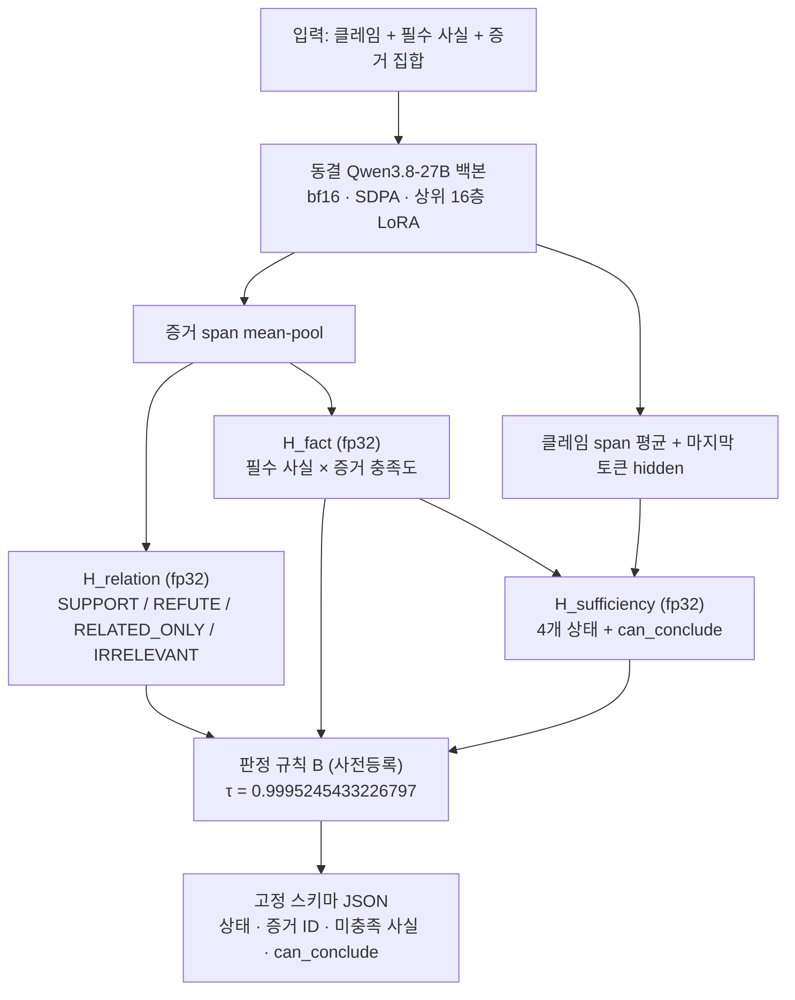

자율 보안 대응에서 결론을 내리는 순간은 행동이 시작되는 순간입니다. 탐지 결과가 활성 침입이라고 결론 내리는 바로 그 순간에 격리나 계정 정지가 따르죠. 그래서 중요한 질문은 모델이 답을 잘 쓰느냐가 아니라, 지금 증거로 답해도 되는느냐입니다.

이 글은 보안 증거의 충분성을 판단하는 모델, Thaki-SecDecision-27B-V2를 소개합니다. 모델은 클레임과 그 클레임을 성립시키려면 확인해야 할 필수 사실, 그리고 현재까지 모인 증거 집합을 받아들입니다. 클레임이 SUPPORTED인지 REFUTED인지 INSUFFICIENT인지 CONFLICTED인지, 입력된 증거 중 어떤 것이 지지를 하고 어떤 것이 반증을 하는지, 아직 충족되지 않은 필수 사실이 무엇인지, 그리고 지금 결론을 내도 되는지까지 판정합니다. 보안 에이전트를 만들거나, 에이전트 스택의 어느 위치에 무엇을 놓아야 할지 고민하는 분을 위해 씁니다.

모델과 추론 코드, 모델 카드는 [Hugging Face에 공개](https://huggingface.co/ThakiCloud/Thaki-SecDecision-27B-V2)되어 있습니다.


*판결을 내리기 전, 증거를 하나씩 대조하는 순간을 형상화했습니다.*

## 쉽게 말하면

법정을 떠올려 보겠습니다. 검사 측의 주장이 클레임이고 그 주장을 인정하려면 입증해야 할 사실들이 필수 사실입니다. 제출된 증거는 증거이고 판사는 그 증거만으로 결론을 내려야 합니다.

판사가 내릴 수 있는 판단은 네 가지입니다. 증거가 충분해서 주장이 성립한다고 받아들이는 것, 증거가 주장을 뒤집는다는 것, 증거가 아직 부족하다는 것, 증거끼리 서로 모순된다는 것. 각각 SUPPORTED, REFUTED, INSUFFICIENT, CONFLICTED에 해당합니다. 판사가 사건 보고서를 새로 써서 사실을 만들어 내는 것이 아니라 제출된 증거를 보고 네 판단 중 하나를 고르는 것과 같이, 이 모델은 텍스트를 생성하지 않습니다.

판사가 가장 오래 고민하는 질문은 판단 자체보다, 언제 판결을 내릴 수 있느냐입니다. 증거가 영영 모이지 않는 경우가 있고, 하나만 더 확인되면 판정이 뒤집히는 경우가 있습니다. 모델도 이 질문을 위한 별도 출력을 갖습니다. 증거가 부족하면 기준을 낮추어 판결하는 대신 "충분하지 않다"고 답하고, 증거를 모으는 쪽은 다음에 무엇을 수집해야 할지를 알려받습니다. 이 글의 마지막 섹션까지도 이 법정 비유를 그대로 씁니다.

## 이 모델이 하는 일과 하지 않는 일

보안 에이전트 스택에서 이 모델의 역할은 게이트입니다. 에이전트는 탐지 결과를 받고 텔레메트리, 수집 attest, 공격 참조 문서 같은 증거를 모읍니다. 그리고 이 모델에 지금 이 클레임에 대해 결론을 내도 되는지 물어봅니다.

모델이 판단하는 것은 네 가지입니다. 첫째는 클레임 상태입니다. 둘째는 입력 증거 중 어떤 증거 ID가 클레임을 지지하고 어떤 것이 반증하는지입니다. 셋째는 아직 충족되지 않은 필수 사실이 무엇인지입니다. 넷째는 지금 결론을 내도 되는지, 즉 can_conclude입니다. 이 네 가지가 고정 스키마의 JSON 한 줄로 나옵니다.

예를 들어 "이 호스트가 외부 IP로 데이터를 반출하고 있다"는 클레임이 들어오면, 필수 사실은 (1) 외부 연결이 실제로 있었는가, (2) 목적지가 외부 IP인가, (3) 데이터 양이 기준을 넘는가 처럼 분해됩니다. 에이전트가 텔레메트리를 먼저 모아 모델에 물으면, (1)과 (3)은 충족되고 (2)만 미충족이라는 답이 돌아올 수 있습니다. 그때 다음 수집 대상은 "해당 연결의 목적지 IP 속성 확인"으로 좁혀집니다.

하지 않는 일을 명시하는 것이 동등하게 중요합니다. 모델은 대응을 승인하지 않고, 탐지를 실행하지 않고, 사건 판단을 하지 않습니다. can_conclude가 True인 것은 "이 증거로는 이 클레임이 해당 상태라고 결론 낼 수 있다"는 충분성 진술이지, 행동 인가가 아닙니다. No Evidence, No Action이라는 원칙을 정책 문서로만 두는 것과, 모델 출력 스키마 자체가 그 원칙을 강제하는 것은 다릅니다. 이 모델은 후자입니다.

## 구조: 동결 백본 위 세 개의 헤드

모델은 동결된 Qwen3.8-27B 백본, LoRA 어댑터, fp32 소형 헤드 3개의 조합입니다. 백본은 고정된 revision으로 pin되고 학습 동안에도 한 번도 바뀌지 않습니다. LoRA는 상위 16개 층(64층 중 48~63층)에만 적용됩니다. 헤드 3개는 각기 다른 일을 합니다.



relation 헤드는 각 증거가 클레임에 대해 어떤 방향인지 판단합니다. SUPPORT, REFUTE, RELATED_ONLY, IRRELEVANT 네 분류 중 하나입니다. fact 헤드는 필수 사실과 증거의 각 쌍에 대해 그 증거가 그 사실을 충족하는지 판단합니다. sufficiency 헤드는 클레임 상태와 사실 충족 정도를 함께 받아 4개 상태와 can_conclude를 냅니다.

생성이 없다는 것은 출력에 큰 영향을 줍니다. 일반 LLM은 근거처럼 보이는 문장을 먼저 만들고 그 문장을 근거로 답합니다. 이 모델은 판결문 서술을 하지 않고 판결 양식만 채웁니다. 그래서 생성 모델이 보여주는 근거 조작, 즉 사실과 다른 이유를 그럴듯하게 쓰는 실패 모드가 구조적으로 존재하지 않습니다.

입력 형식도 고정되어 있습니다. chat template이 없는 평문으로, 클레임 다음에 필수 사실 블록, 그 다음에 source_type을 붙인 증거 블록, 그리고 DECISION 마커가 옵니다. 컨텍스트 4096토큰을 넘는 예제는 자르지 않고 제외합니다. 잘라낸 입력으로 내린 판단은 원래 입력에 대한 판단이 아니므로, 그런 예제는 판정 대상에 올리지 않습니다.

학습은 1에폭(3,334스텝)으로 마쳤고 체크포인트는 train_dev와 calib split에서만 골랐습니다. 선택 기준은 "잘못 결론내는 비율(False-ENOUGH)이 2%를 넘지 않는 범위에서 ENOUGH recall이 최대인 것"입니다. 결과로 고른 체크포인트가 step 2200입니다. 골라진 뒤에는 calibration split에서 τ를 고정했고 TEST는 그 뒤에서야 개봉했습니다.

## 판정 규칙: 반증에도 근거를 요구하는 Rule B

헤드의 확률 분포가 곧 출력이 아닙니다. 그 위에 사전등록된 판정 규칙, Rule B가 적용됩니다.

지지를 위해서는 상태가 SUPPORTED이고 미충족 필수 사실이 없으며 SUPPORT 방향의 증거가 하나 이상이어야 합니다. 반증을 위해서는 상태가 REFUTED일 뿐만 아니라, 관찰 기반의 근거가 있어야 합니다. 구체적으로 REFUTE 방향의 증거 중 source_type이 collection_attestation이나 telemetry인 것이 하나 이상이어야 반증 근거로 인정됩니다. 법정 비유로 다시 말하면, 판사가 피고의 무죄를 선언할 때도 목격자의 증언이 아니라 직접 관찰한 증거를 요구한다는 뜻입니다. "어느 문서를 읽었다"는 attack_reference 같은 비관측 문서는 반증 근거가 될 수 없습니다.

기록의 부재에도 같은 원칙이 적용됩니다. "로그에 특정 명령이 없다"는 그 명령이 실행되지 않았다는 뜻이 아닙니다. 아직 수집되지 않았을 수 있습니다. 수집 범위와 완결성이 확인되지 않은 상태에서는 부재가 반증 근거로 쓰이지 않습니다.

CONFLICTED 상태이거나 SUPPORT 방향과 REFUTE 방향의 증거가 각각 하나 이상이면 충돌로 판정합니다. can_conclude가 True가 되려면 이 모든 게이트를 통과한 뒤에 충분성 점수가 미리 정한 임계값 τ를 넘어서야 합니다. τ는 0.9995245433226797입니다. 교정 split에서 "잘못 결론내는 비율이 2%를 넘지 않는 가장 낮은 임계값"으로 고르고 그중 recall이 최대인 것을 택했습니다. 결과는 보지 못하고 고른 값이므로 결과 확인 이후에는 바뀌지 않습니다. 보기를 바꿔 임계값을 다시 맞추는 순간, 그 수치는 더 이상 신뢰할 수 있는 것이 아닙니다.

Rule B는 이전 실험에서 배우고 고친 규칙입니다. 그 앞의 회귀 실험에서는 매크로 F1이 스톡보다 높아졌지만(0.627 → 0.731), 오결론률이 함께 높아져서(1.79% → 3.19%) 사전등록 게이트를 통과하지 못했습니다. 개정 전의 판정 규칙은 반증 방향에서 보수적이어서, 증거가 클레임을 뒤집는 케이스에서 결론 회수율이 0.48 부근에서 머물렀고 교정 split의 반증 방향 회수율은 0.048이었습니다. 반증에도 관찰된 반증 근거를 요구한 개정(refutation coverage gate correction, amendment seq 274)이 바로 Rule B이며, 봉인 TEST에서 REFUTE_COVERAGE 회수율 0.9985를 만든 것입니다. 이 역시 TEST 개봉 전에 고정했습니다.

출력의 지원·반증 증거 ID는 입력의 evidence_id에서만 고릅니다. 그래서 입력에 없는 ID가 출력에 나오는 일은 구조적으로 일어나지 않습니다.

## 나온 결과

봉인 TEST는 4,002건입니다. 표준 생성기에서 나온 2,202건과 생성 규칙이 다른 생성기의 1,800건(generator_disjoint)으로 구성됩니다. 정답은 생성 규칙으로만 정해졌고 teacher 모델과 사람, LLM 판정은 모두 0건입니다. 분할 간 누출은 world, group, host, IP, user 축에서 전부 0입니다.

| 지표 | SecDecision-27B-V2 | Stock (zero-shot) |
|---|---|---|
| False-ENOUGH | 1/2668 (0.04%) | 202/2668 (7.57%) |
| ENOUGH recall | 1297/1334 (97.2%) | 390/1334 (29.2%) |
| FULL recall | 0.946 | 0.0555 |
| REFUTE_COVERAGE recall | 0.9985 | 0.5292 |
| Relation Macro-F1 | 0.9634 | 미측정 |
| Pairwise 정확도 | 0.9975 | 미측정 |

ADJACENT(인접 클레임) 층의 False-ENOUGH는 0건입니다. 충돌 케이스의 오결론도 0건입니다. 안전 격차(V2에서 Stock을 뺀 값)의 paired bootstrap(group-cluster, 2000회 재표본) 95% 신뢰구간은 [−0.08771, −0.06408]입니다. 사전등록 요건은 상한이 +0.005 이하이고 큰 여유로 만족합니다.

사전등록된 게이트 7개(G0~G7)를 모두 통과했고 판정은 GO입니다.

Stock 비교의 한계를 함께 명시합니다. Stock baseline은 Qwen3.8-27B를 zero-shot으로, 고정된 평가 계약(동일 입력 렌더, greedy, thinking off, max_new_tokens=64)에서 돌린 것입니다. 이 계약에서 Stock은 4,002건 중 3,370건(83.96%)에서 파싱 가능한 상태를 아예 내지 못했습니다(PARSE_ERROR). 일부 케이스에서는 thinking 출력이 64토큰 예산을 다 써버려 판정 출력 전에 예산이 소진되기도 했습니다. 이 비교는 최적화된 Stock 모델(조정된 프롬프트, 더 큰 출력 예산, 파인튜닝)에 대한 우월성의 완전한 증명은 아닙니다. 사전등록 GO 판정은 유지되며 Stock 비교를 과대 해석하지 않도록 이 한계를 공시합니다.


*왼쪽은 결론이 가능한 케이스를 놓치지 않는 비율(ENOUGH recall)이고 오른쪽은 결론이 안 되는 케이스를 결론이 가능하다고 오결론하는 비율(False-ENOUGH)입니다.*

## 새 프로세스에서 공개 패키지를 그대로 검증

수치를 학습 런의 로그에서 읽은 것이 아니라, 공개되는 패키지로 재현했습니다. 공개할 바이트를 그대로 담은 패키지를 학습·평가에 쓰지 않는 새 GPU 프로세스에서 로딩했고 base가 정확히 고정된 revision으로 해석되는지, 모든 가중치와 헤드가 에러 없이 로딩되는지, Rule B와 τ가 수치 정밀도 그대로 적용되는지를 확인했습니다.

가장 중요한 확인은 forward-identity입니다. held-out calib 예제에서 다시 계산한 확률이 봉인된 dump와 최대 차이 1e-3 이내로 일치하는지 보았는데, 일치했습니다. 이 패키지가 봉인 TEST의 전산을 재현한다는 뜻입니다. 네 상태(SUPPORTED, REFUTED, INSUFFICIENT, CONFLICTED)가 모두 정상 발생했고 출력에 입력 밖 증거 ID는 0건이었습니다.

패키지는 inference.py 한 줄로 돌립니다. `python3 inference.py --base Qwen/Qwen3.8-27B --example smoke_example.json --check-sha` 가 출력에 JSON 한 줄을 내리고, --check-sha 가 어댑터·헤드·판정 모듈의 지문을 config.json 정본과 대조합니다. 여기서 강조한 것처럼 어댑터만 로딩하면 검증된 동작이 재현되지 않습니다. 이 모델은 어댑터와 헤드, 그리고 Rule B 판정 규칙 셋이 한 묶음입니다.

## Paxis에서 쓰는 관점: 증거와 응답 사이의 게이트

Paxis와의 통합은 이 릴리스의 범위에 포함되지 않습니다. 이 섹션은 모델이 보안 워크플로에서 어떤 역할을 하게 될 것인지를 목표 아키텍처로 제시한 것입니다.

Paxis의 보안 워크플로에서 이 모델은 증거 수집과 대응 계획 사이 위치에 섭니다. 에이전트가 탐지 결과에 대해 증거를 모으면, 매 단계마다 이 모델에 지금 결론을 내도 되는지 물어봅니다. can_conclude가 False면 에이전트는 추측해서 대응하지 않습니다. 모델이 알려준 미충족 필수 사실과 수집이 필요한 증거를 다음 수집 대상으로 삼아 다시 모읍니다. True가 되면 지원·반증 증거 ID와 함께 대응 계획 단계로 넘어갑니다.

모델 가족의 역할도 명확해집니다. 검색은 Thaki-SecEmbed-8B가, 취약점 패치의 수정 검증은 Thaki-SecProof-2B가, 증거 충분성 판단은 이 SecDecision-27B가 담당합니다. 각 모델이 한 일만 담당하고 에이전트가 이들을 오케스트레이션합니다.

| 역할 | 모델 |
|---|---|
| 보안 검색·임베딩 | Thaki-SecEmbed-8B |
| 취약점 패치 수정 검증 | Thaki-SecProof-2B |
| 증거 충분성·결론 가능 판단 | Thaki-SecDecision-27B-V2 |

Paxis의 policy gate와 감사 로그는 이 모델의 출력을 판단 근거로 받습니다. 어떤 대응이 실행되었는지 기록할 때 "에이전트가 직감적으로 판단했기 때문"이 아니라, "어떤 증거 ID를 근거로, 충분한 점수가 얼마였을 때"로 남습니다.

실행 경제적 관점에서도 이 게이트가 중요한 이유는, "틀린 대응 한 번"의 비용을 "증거 수집 한 번 더"의 비용으로 앞당긴다는 점입니다. 오결론으로 인한 대응 비용은 증거 수집 한 바퀴의 비용보다 큽니다. False-ENOUGH가 2,668건 중 1건이라는 수치는, 그 거래에서 치른 비용의 크기입니다.

```mermaid
flowchart TB
    A["탐지 결과"] --> B["보안 에이전트<br/>증거 수집 (텔레메트리 · attestation · 문서)"]
    B --> C["Thaki-SecDecision-27B-V2<br/>증거 충분성 판단"]
    C --> D{"can_conclude?"}
    D -->|"False: 미충족 사실 + 수집할 증거"* --> B
    D -->|"True: 상태 + 지지/반증 증거 ID"* --> E["대응 계획<br/>policy gate + 감사 로그"]
```

## 못 믿을 부분

모의 법정에서만 연마한 판사는 실제 법정에서 곧바로 쓸 수 있다고 말하기 어렵습니다. 이 모델의 TEST는 합성 claimworld입니다. 생성 규칙으로 정답이 정해진 4,002건이며 합성 범위 안에서 제어된 일반화를 측정하는 것이지, 실 로그와 실 탐지, 분석가 판단이 있는 실제 SOC 운영 성능의 측정이 아닙니다. 실 로그 정확도는 미검증으로 공시합니다.

구조 파서는 생성기 안에서 1.0을 기록합니다. 즉 생성기 내부의 성능은 포화될 수 있고 일반화에 대한 주장은 generator_disjoint 층(FE 0.0, recall 0.9567)에만 근거합니다.

다시 강조하면, can_conclude가 True는 행동 인가가 아닙니다. 증거가 충분하다는 진술입니다. 대응을 승인하는 것은 별개의 정책 계층의 결정이며 이 릴리스에서는 Paxis나 Autonomous SOC 통합도, 상주 서빙도 제공하지 않습니다. 모델 가중치와 추론 코드만 공개합니다.

## 정리

이 모델은 이야기를 쓰지 않습니다. 제출된 증거를 보고 클레임이 지지되는지, 뒤집어지는지, 증거가 부족한지, 증거가 모순되는지를 판단하고, 지금 결론을 내도 되는지까지 답합니다. 봉인 TEST에서는 결론이 안 되는 2,668건 중 1건만 오결론이었고, 결론이 가능한 1,334건 중 1,297건을 알아냈습니다.

보안 에이전트에서 결론을 내는 순간은 행동이 시작되는 순간입니다. "지금 내도 되는가"를 판정하는 모델은 그 순간을 지키는 게이트입니다. 모델과 추론 코드, 모델 카드는 Hugging Face에서 공개되어 있고, 누구든 그대로 로딩해 이 글의 수치를 재현할 수 있습니다.

**관련 글**

- [취약점 발견에서 수정 검증까지: SecProof-2B와 Paxis로 만드는 보안 에이전트](/tech-blog/ko/agentops/secproof-2b-paxis-security-agent/)
- [27B 모델 하나로 답변 생성과 근거 판단을 같이 돌렸습니다: 마지막 4개 층만 갈라지는 공유 백본](/tech-blog/ko/research/shared-backbone-evidence-gate-27b/)
- [RAG 에이전트가 인용할 문서를 고르는 4B 모델, Thaki-CiteRank-4B](/tech-blog/ko/agentops/citerank-4b-paxis/)
