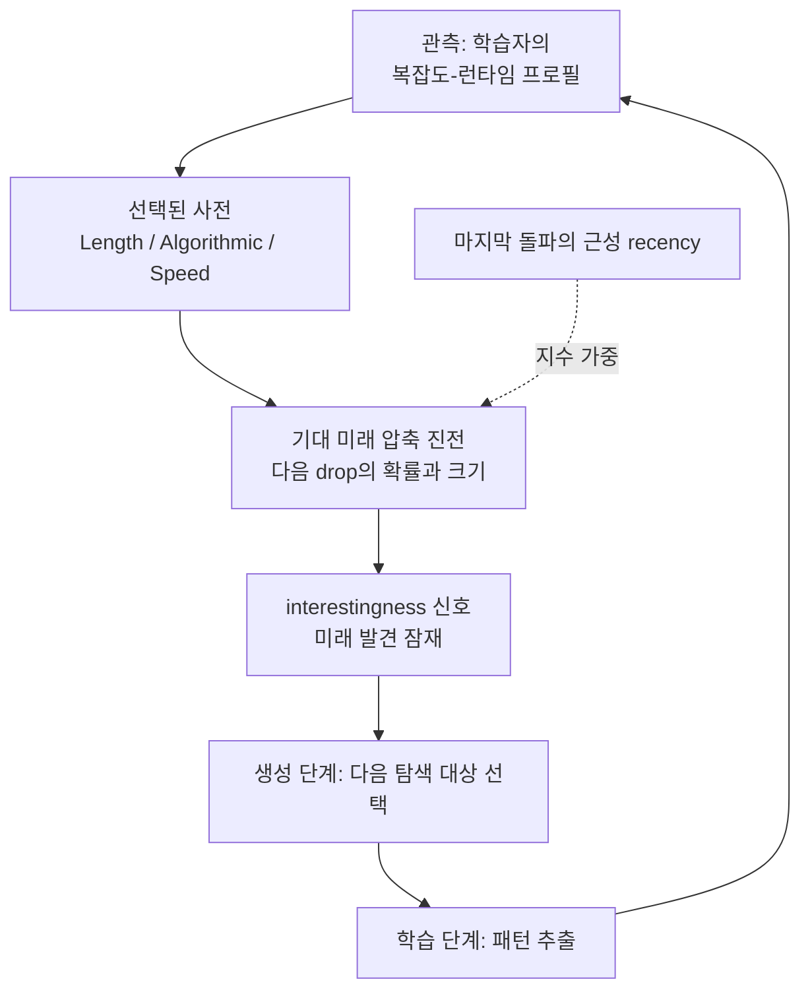

## 왜 읽어야 하나

무인 에이전트나 오픈엔드(open-ended) 시스템을 돌리면서 "다음에 뭘 탐색하면 된다"를 손으로 정하고 있는 개발자, 그리고 학습 데이터나 실험을 고르는 데 기준이 필요하다고 느끼는 데이터 과학자를 위해 씁니다.

결론을 먼저 말하겠습니다. 이 논문은 "어떤 테스크에 미래의 진전 잠재가 있는가"를 직관이 아니라 과거의 압축 진전 기록에서 계산하고 예측할 수 있는 신호, 즉 귀납적 휴리스틱으로 형식화합니다. 세 가지 계산 가능한 사전(prior) 하에서 기대 미래 진전이 마지막 돌파의 근성(recency)에 지수적으로 의존한다는 정리와, Algorithmic prior가 Length prior보다 같은 프로필에서 이차적으로 더 낙관적이라는 정리를 증명하고, 세 가지 범용 계산 패러다임에서 실험으로 확인합니다. 에이전트 루프를 돌린다면, "무엇을 고를지"의 목적 함수 후보가 하나 더 생긴 셈입니다.

*글의 핵심 개념, "복잡한 신호가 학습을 통해 점점 단순한 구조로 압축된다"를 형상화한 이미지입니다.*

## 개요

10월 27일경 X에서 이 구절이 돌기 시작했습니다. "이 논문은 왜 무엇이든 아름다운지, 왜 농담은 웃긴지, 왜 호기심이 생기는지, 왜 지루한지, 왜 아기가 세상을 탐색하는지, 왜 음악에는 후크가 있는지를 답한다." 뇌를 "멈추지 않는 압축 엔진"으로 그리고, 패턴을 알아낸 순간 도파민이 분출된다는 서술은 이 이론계의 전설 같은 문장들을 그대로 가져왔습니다.

돌아다니는 그 논문의 정체는 Vincent Herrmann과 Jürgen Schmidhuber의 "Interestingness as an Inductive Heuristic for Future Compression Progress"입니다. [arXiv 2605.14831](https://arxiv.org/abs/2605.14831)에 2026년 5월 14일 등록됐고, [ICML 2026 Position Track](https://proceedings.mlr.press/v306/herrmann26a.html)에 채택됐으며, [프로젝트 페이지](https://inductive-interestingness-2026.github.io/future-compression-progress/)에서 코드 링크도 공개합니다. 연구소 소속은 스위스 루가노의 IDSIA/USI/SUPSI와 사우디아라비아 Thuwal의 KAUST입니다.

다만 한 가지를 분명히 해야 합니다. "아름다움, 농담, 아기 탐색"에 대한 주장은 이 2026년 논문의 것이 아닙니다. 그것은 Schmidhuber의 2008년 논문 [Driven by Compression Progress](https://arxiv.org/abs/0812.4360)의 영역인데, 제목부터가 "주관적 아름다움, 신기함, 놀람, interestingness, 주의, 호기심, 창의성, 예술, 과학, 음악, 농담의 본질적 측면을 설명하는 단순한 원리"입니다. 2008년 논문이 "사람의 경험은 왜 그렇게 느끼는가"를 compression progress로 설명한다면, 2026년 논문은 한 발 더 나아가 "그 신호 자체를 미리 예측할 수 있는가"를 질문합니다. 바이럴 문구가 둘을 합쳤고, 이 글은 그 경계에서 씁니다.

## 쉽게 말하면

벤처 투자 비유로 옮깁니다. 투자사는 매일 수많은 스타트의 성장 그래프를 봅니다. 매출이 이미 천장에 붙은 스타트에는 돈을 넣지 않습니다. 반대로 숫자가 평탄한 스타트에도 눈을 주지 않습니다. 눈이 가는 것은 딱 하나입니다. 최근 곡률이 살아 있는 스타트, 지난 분기에 돌파가 있었던 곳입니다.

이 논문이 세우는 interestingness는 바로 그 "최근 곡률"의 수학적 버전입니다. 데이터나 테스크가 학습자에게 주어지면, 학습자가 그걸 압축(단순화)하는 정도가 시간마다 올라가는 곡선이 생깁니다. 그 곡선이 이제 막 가팔라진 곳에 다음 진전의 잠재가 가장 크고, 오래 전 한 번 꺾였다가 평탄해진 곳의 잠재는 빠르게 줄어든다는 것. 그게 첫 번째 정리입니다.

두 번째 정리의 비유는 "투자사의 종류"입니다. 매출 숫자만 세는 회계사 눈(Length prior)과, 기술 스택과 파이프라인의 구조를 읽는 벤처 파트너 눈(Algorithmic prior)은 같은 스타트에게서 다른 기대치를 뽑습니다. 논문은 두 번째 눈이 첫 번째 눈보다, 같은 과거 기록에서 훨씬 더 큰 미래 발견을 기대하게 만든다는 것, 그리고 그 격차가 선형이 아니라 이차로 벌어지는 것을 증명합니다.

*위 비유는 저자의 해석입니다. 논문에서는 이 두 "눈"이 특정 사전(가정 분포)으로, 스타트가 이진 문자열의 복잡도 프로필로, 발견이 다음 drop으로 정확히 대체됩니다.*

## 이 논문이 세운 문제

논문은 재귀적 자기 개선(recursively self-improving) 시스템의 병목으로 "interestingness 문제"를 지목합니다. 오픈엔드 지능의 최소 그림은 두 단계의 사이클입니다. 학습 단계(learning phase)는 그래디언트 디센트나 강화학습으로 데이터에서 패턴과 기술을 추출하고, 생성 단계(generation phase)는 그 인사이트로 새로운 산출물을 생성합니다. 이 사이클이 무한히 돌아가려면, 생성 단계에 하나의 기준이 필요합니다. "배울 가치가 있는 구조"와 "이미 아는 지식, 또는 잡음"을 구분하는 기준. 논문 Figure 1의 원문 표현을 그대로 쓰면, "learnable structure from noise or already-acquired knowledge"를 구분하는 criterion입니다.

그 기준의 정의를 이 논문은 이렇게 놓습니다. interestingness는 "미래 압축 진전의 귀납적 휴리스틱", 즉 "지금 이 데이터가 얼마나 놀라운가"가 아니라 "이걸 배우면 다음에 얼마나 더 압축(단순화)될 수 있는가"의 예상치입니다. 후자의 관점은 Schmidhuber가 2008년 논문에서 이미 쓴 "주관적 아름다움의 1계 도함수, 학습 곡선의 기울기"와 같은 선상에 있습니다.

논문의 2장은 이 지형을 꼼꼼히 매핑합니다. 기존 흥미도 기준을 11개 계열로 나누어 분류하고, 그중 compression progress 계열과 이 논문의 위치를 맞춥니다. count-based, space coverage, maximum entropy, prediction error(·adversarial), information gain, Bayesian surprise, learning progress, competence progress, compression progress, 사회적 다중 에이전트 상호작용에서 도출되는 open-endedness, 그리고 "LLM으로 사람이 추려낸 interestingness를 예측할 수 있다"는 계열까지. 마지막 줄이 이 논문을 지금 읽게 만드는 이유입니다. 형식화뿐 아니라, 기준 자체가 LLM 판정(judge)으로 근사될 수 있다는 실용 경로가 지형 안에 이미 들어 있습니다.

3장은 이 형식화를 "지금의 기계학습"과 이어줍니다. 복잡도-런타임 프로필(complexity-runtime profile)의 개념을 세 갈래로 대응시킵니다. 신경망 학습과 그래디언트 디센트는 "동일한 데이터에 대해 학습 시간이 길어질수록 필요 복잡도가 내려가는" 프로필로, chain-of-thought와 재귀 추론은 "생성되는 추론 길이가 곧 런타임"인 프로필로, 모델 스케일링은 "파라미터 규모가 복잡도-런타임 트레이드오프를 이동시킨다"는 읽기로 들어옵니다. 이 대응 관계가 바로 이 논문의 실용적 가치를 지닙니다. 추상 형식화가 아니라, 지금 훈련을 돌리고 있는 엔지니어가 보고 있는 곡선이 그 프로필이라는 뜻입니다.

그 위에서 3.2절은 특정 프로필을 가진 문자열의 개수를 세는 조합론으로 넘어갑니다. "이런 모양의 학습 곡선을 보이는 문자열이 몇 개 있고, 그중에서 다음 drop이 오는 확률은 얼마인가"를 수학적으로 다루는 구간입니다.

## 핵심 결과

형식화의 도구대는 콜모고로프 복잡도와 알고리즘 통계입니다. 모든 데이터와 산출물을 이진 문자열 x로 보고, K(x)를 범용 머신 위에서 x를 출력하는 최단 프로그램의 길이(prefix-free Kolmogorov 복잡도)로 잡습니다. 학습자가 좋아질수록 관찰된 문자열의 필요 복잡도가 "drop"하는 순간이 압축 진전이고, 그 drop들의 시간적 배치가 프로필입니다.

그 위에서 세 가지 계산 가능한 사전(Length prior, Algorithmic prior, Speed prior)을 놓고, "지금까지 관찰된 프로필을 봤을 때 기대되는 미래 진전"을 계산합니다. 논문의 정리(증명은 부록 A 전체가 이 몫)는 두 개입니다.

첫째, 기대 미래 진전은 마지막 관찰된 돌파의 근성에 지수적으로 의존합니다. 오래된 돌파만 쌓여 있으면 기대는 빠르게 줄어듭니다. 반대로 막 진전이 있었던 영역의 기대는 지수적으로 높아집니다.

둘째, 같은 관찰 프로필에 대해 Algorithmic prior는 Length prior보다 현저히 낙관적이고, 그 격차는 기대 발견(discovery)에서 이차적으로 커집니다. 직관으로는 "알고리즘적 구조를 보는 눈"이 "길이만 세는 눈"보다 다음 돌파의 기대를 훨씬 빠르게 올려준다는 뜻입니다.

세 가지 사전은 같은 질문("다음 진전의 기대값은 얼마인가")을 서로 다른 근사로 푸는 도구입니다. Length 계열은 길이를, Algorithmic 계열은 알고리즘적 구조를, Speed 계열은 계산 속도를 각자의 기준으로 잡아 drop의 가능성에 무게를 둡니다. 어떤 전사가 더 낙관적인가는 곧 "어떤 눈으로 학습을 보는가"의 차이가 됩니다.

이 두 결과는 세 가지 서로 다른 범용 계산 패러다임에서 실험적으로 확인된다고 논문은 말합니다(abstract 수준에서 인용. 본문 5장은 2-Tag Rule 같은 실험을 다룹니다).

*논문의 학습-생성 사이클에 "예측 가능한 interestingness 신호"를 얹은 개념도입니다. recency 가중이 사이클의 다음 회전 방향을 결정합니다.*

## ThakiCloud 제품 적용 시사점

ThakiCloud의 [Paxis](https://thakicloud.com)는 무인 에이전트 루프가 상시 도는 Agent-Native Cloud입니다. 야간 실험 큐(research lab loop), 스킬 자가진화, 논문 공장처럼 "다음에 뭘 돌릴지"를 정하는 순간이 매일 생깁니다. 지금 그 결정은 사람이 설계한 큐와, 실패 연발 시 모델 올리기 같은 단순 휴리스틱이 맡고 있습니다.

이 논문은 그 결정에 계산 가능한 목적 함수 후보를 줍니다. 각 도메인의 평가 점수 곡선이나 비용 곡선이 곧 "압축 진전 프로필"의 실물이고, 프로필에서 기대 미래 진전을 사전으로 계산하면 "어느 실험을 다시 돌릴지, 어느 신규 후보를 큐에 올릴지"의 순위가 나옵니다. 마지막 정리의 근성 가중은 "막 돌파가 있었던 영역을 더 본다"는 직관과 같은 방향이라, 도입 장벽도 낮습니다.

"LLM으로 사람이 추려낸 interestingness를 예측한다"는 계열은 ThakiCloud의 에이전트 프로덕션 스택과 직접 맞물립니다. 에이전트 프로덕션 스택의 평가 구조에서 휴리스틱은 100% 트래픽, LLM judge는 5~10% 트래픽을 맡는데, "이 실험 결과가 재탐색 가치가 있는가"는 LLM judge의 후보 태스크로 자연스럽습니다.

## 한계 및 반론

여섯 가지로 압축합니다.

첫째, 포지션 페이퍼라는 점입니다. 새 시스템을 만들거나 대규모 실증을 한 논문이 아닙니다. 본문 실험부는 세 패러다임의 소규모 설정이고, 정리의 힘은 부록의 조합론 증명에 있습니다.

둘째, K(x)는 계산 불가능합니다. 모든 결과는 "선택된 사전"에 상대적이며, Length/Algorithmic/Speed는 그 계산 불가능성을 우회하는 근사입니다. "기대 발견이 이차적으로 크다"는 명제는 그 근사 안에서의 정리이지, 물리 법칙이 아닙니다.

셋째, 관찰자 상대성입니다. 2008년 논문이 "self-improving, but computationally limited, subjective observer"를 전제했듯, interestingness는 특정 학습 프로그램의 눈 기준입니다. 데이터의 객관적 성질이 아니라, "그 에이전트가 다음에 뭘 얻을 수 있는가"의 성질입니다.

넷째, 바이럴 문구와의 경계입니다. 도파민, 아름다움, 아기 탐색에 대한 서술은 이 2026년 논문의 주장이 아닙니다. 인용할 때 2008년 계열과 혼동하지 않는 것이 이 이론을 쓰는 사람의 도덕입니다.

다섯째, 근성 지수 가중의 실천적 퇴화 위험입니다. "막 돌파가 있었던 곳을 더 보라"는 규칙은 도메인에서 '돌파'를 어떻게 정의하느냐에 따라 트렌드 추종(trend-chasing)으로 변질될 수 있습니다.

여섯째, 사이클의 절반은 여전히 비어 있습니다. 이 논문은 생성 단계의 "골라내는 기준"을 줍니다. 학습 단계가 그 기준으로 골라낸 대상에서 실제로 진전을 만들 때까지의 비용은 이 논문의 영역 밖입니다.

## 정리

서론에서 세운 결론을 회수합니다. "다음에 뭘 탐색하면 된다"는 질문은, 과거 진전 프로필을 보면 계산 가능한 신호로 바뀝니다. 기대 미래 진전은 근성에 지수적으로, 그리고 사전 선택에 이차적으로 달려 있다는 두 정리가 그것을 보장합니다.

에이전트를 돌리는 분께 다음 행동으로 제안합니다. 지금 큐에 쌓여 있는 실험이나 데이터 후보의 평가 곡선을 "압축 진전 프로필"로 재해석해 보십시오. 곡선의 마지막 drop 시점과 기울기에서 기대 미래 진전을 계산하는 스코어를 하나 붙이는 것, 그것이 이 논문을 시스템으로 옮기는 첫 번째 단계입니다.

한 줄로. 호기심은 더 이상 심리학적 개념이 아닙니다. 최적화할 수 있는 목적 함수입니다.

## 출처

- Herrmann, V., & Schmidhuber, J. (2026). [Interestingness as an Inductive Heuristic for Future Compression Progress](https://arxiv.org/abs/2605.14831). arXiv:2605.14831.
- [Position: Interestingness is an Inductive Heuristic for Future Compression Progress](https://proceedings.mlr.press/v306/herrmann26a.html), ICML 2026 (PMLR v306).
- [프로젝트 페이지](https://inductive-interestingness-2026.github.io/future-compression-progress/)
- Schmidhuber, J. (2008). [Driven by Compression Progress: A Simple Principle Explains Essential Aspects of Subjective Beauty, Novelty, Surprise, Interestingness, Attention, Curiosity, Creativity, Art, Science, Music, Jokes](https://arxiv.org/abs/0812.4360). arXiv:0812.4360.
- 바이럴 서술: [@HowToPrompt__](https://x.com/HowToPrompt__/status/2115042117085221160) (2026-10-27)
