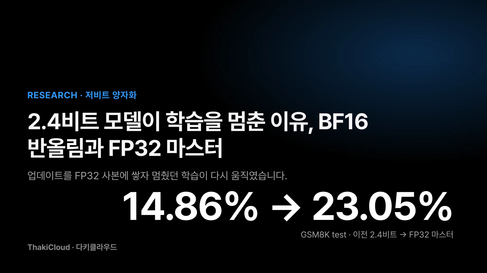
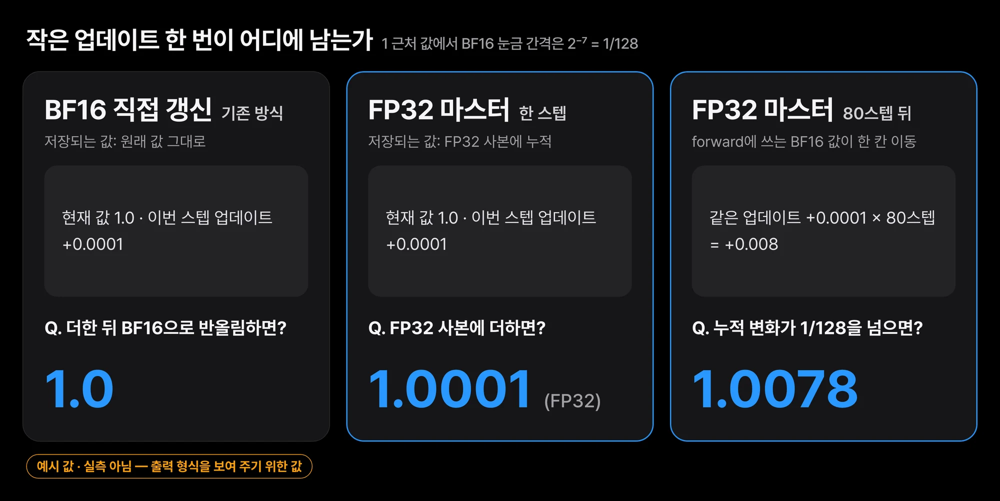
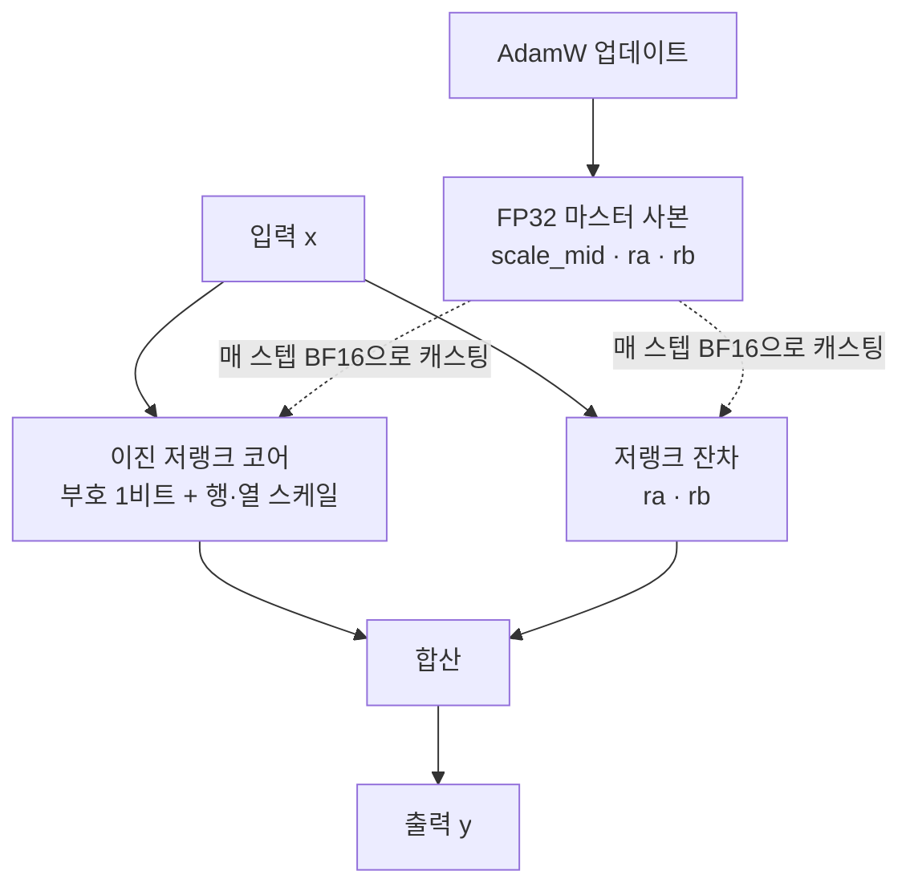
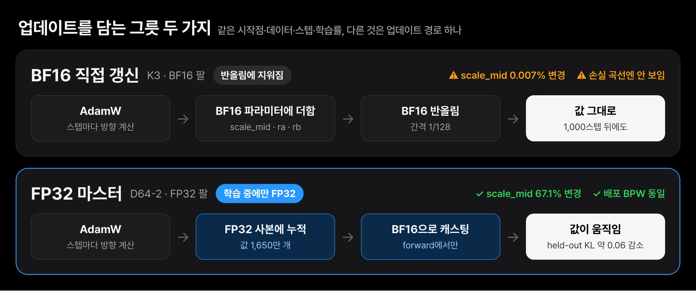
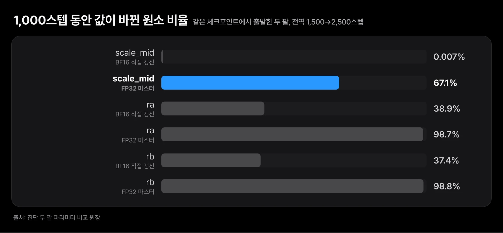
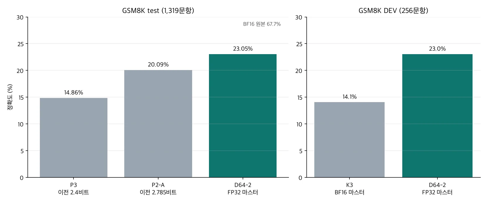
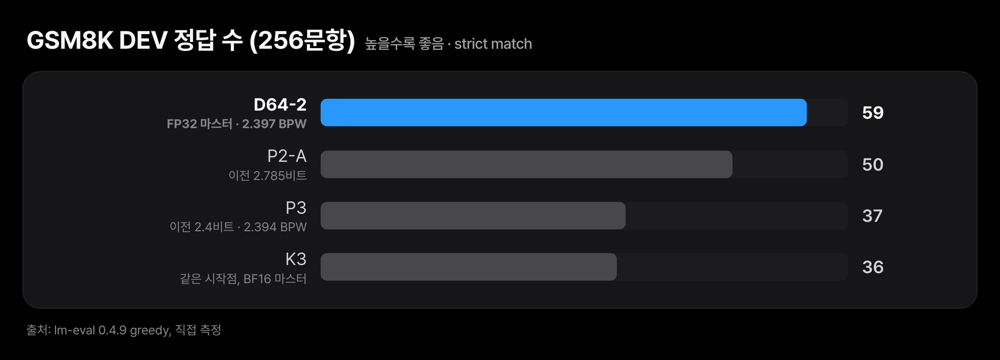

*이전 2.4비트 체크포인트 14.86%에서 FP32 마스터로 학습한 모델 23.05%로, 둘 다 봉인 GSM8K test 기준입니다*

모델을 아주 작게 줄인 뒤 다시 학습시키면 품질이 돌아오리라 기대합니다. 저희도 그렇게 했는데 어느 순간부터 학습이 더 나아지지 않았습니다. 원인은 데이터도, 목표 함수도 아니었습니다. 바뀐 값을 적어 두는 숫자 형식이 너무 거칠어서, 작은 변화가 저장되는 순간 지워졌습니다.

이 글은 모델을 2~3비트 수준으로 압축하고 재학습이나 증류로 품질을 되살리려는 엔지니어를 위해 씁니다. 손실 곡선만 보면 이 문제는 드러나지 않는다는 점이 핵심입니다. 실제 수치로 보면 차이가 분명합니다. 기존 방식으로 학습하던 모델에서 스케일 값을 담당하는 파라미터는 1,000스텝 동안 원소의 0.01%도 바뀌지 않았습니다. 이 파라미터를 BF16 대신 FP32 사본으로 갱신하자 67%가 바뀌었습니다. 이후 학습을 이어 가 공개한 [Qwen3-1.7B-Base-CareQ-2.4bpw](https://huggingface.co/ThakiCloud/Qwen3-1.7B-Base-CareQ-2.4bpw)는 GSM8K test에서 23.1%를 기록했습니다. 이전 2.4비트 체크포인트는 14.9%였습니다.

FP32 마스터 가중치 자체는 새로운 기법이 아닙니다. 2018년 Mixed Precision Training 논문 이후 대규모 학습의 기본기로 쓰여 왔습니다. 이 글에서 공유하려는 것은 기법보다 **진단 과정**입니다. 손실 곡선이 멀쩡히 내려가는 상황에서 일부 파라미터만 조용히 멈춰 있는 현상을 어떻게 찾았는지, 그리고 그 효과를 다른 요인과 섞지 않고 어떻게 쟀는지를 정리했습니다.

## 쉽게 말하면

눈금이 1cm 단위인 자로 0.1mm씩 자라는 식물을 잰다고 생각해 보십시오. 식물은 매일 자라지만 자의 눈금은 그대로입니다. 측정할 때마다 가장 가까운 눈금으로 반올림하면 기록은 영원히 같은 숫자에 머뭅니다.

BF16은 이런 자와 비슷합니다. 1 근처의 값에서 표현할 수 있는 간격이 2의 −7제곱, 즉 128분의 1입니다. 한 스텝에 1만분의 1만큼 움직이려는 업데이트는 간격의 절반에도 못 미치므로, 더한 다음 반올림하면 원래 값으로 돌아갑니다. 옵티마이저는 매 스텝 열심히 방향을 계산하지만 파라미터에는 아무것도 남지 않습니다.

FP32 마스터는 눈금이 훨씬 촘촘한 자를 따로 두는 방법입니다. 작은 변화를 FP32 사본에 누적하고, forward 계산을 할 때만 BF16으로 바꿔 씁니다. 0.1mm씩 쌓인 변화가 결국 눈금 하나를 넘어서면 그때 BF16 값도 바뀝니다.


*1 근처 값에 1만분의 1 업데이트를 더하는 예시입니다. 실측이 아니라 반올림 동작을 보여 주기 위한 값입니다*

## 손실은 내려가는데 스케일 파라미터는 멈춰 있었습니다

저희는 [NanoQuant](https://github.com/SamsungLabs/NanoQuant)의 이진 저랭크 분해를 출발점으로, 선형층마다 작은 저랭크 잔차를 붙인 포맷(내부 이름 CareQ)을 만들었습니다. 목표는 Qwen3-1.7B-Base를 임베딩까지 포함해 가중치당 2.4비트 이하로 줄이면서, BF16 원본을 교사로 한 증류로 품질을 최대한 되살리는 것이었습니다.

문제는 학습을 길게 해도 품질이 기대만큼 올라오지 않았다는 점입니다. 손실은 내려갔고 NaN 같은 이상 값도 나오지 않았습니다. 겉보기로는 정상적인 학습이었습니다. 그래서 파라미터 그룹별로 "시작 시점 대비 실제로 값이 바뀐 원소의 비율"을 직접 세어 봤고, 그 결과 중간 스케일(scale_mid)이 거의 움직이지 않는다는 사실을 발견했습니다.



## 2.4비트 포맷은 1비트 코어와 작은 잔차로 이뤄집니다

선형층 196개(28블록 × q, k, v, o, gate, up, down)는 각각 아래처럼 계산합니다.

```
y = NanoQuant(x) + F.linear(F.linear(x, rb), ra)
```

`NanoQuant(x)`는 부호 행렬을 원소당 1비트로 묶고 행·열 스케일을 곱하는 이진 저랭크 코어입니다. `ra · rb`는 작은 저랭크 잔차입니다. 저랭크 잔차는 큰 행렬을 가는 두 행렬의 곱으로 근사해, 1비트 코어가 놓친 오차를 적은 바이트로 메우는 보정항입니다. 임베딩과 LM head는 서로 묶여 있고, 4비트 임베딩에 rank 56 잔차를 더한 형태로 저장합니다.

학습할 때 이진 부호는 고정하고 스케일과 잔차만 학습합니다. 증류는 원본 모델(교사)의 출력 분포를 작은 모델이 따라 하도록 학습시키는 방법이고, KL은 두 분포가 얼마나 다른지 재는 값입니다. 손실은 BF16 교사에 대한 KL을 중심으로, 다음 토큰 cross-entropy와 hidden state 정합을 작은 가중치로 더했습니다. 파일 하나의 크기는 515,564,507바이트이고, 파일 바이트에 8을 곱해 전체 파라미터 수로 나눈 실효 BPW는 약 2.4입니다. 임베딩을 빼지 않고 센 값입니다.

| 구성 | 바이트 |
|---|---|
| 이진 부호 코어 | 297,041,920 |
| 4비트 임베딩 | 165,306,368 |
| 층 잔차 | 32,112,640 |
| 임베딩 잔차 | 17,246,208 |
| 스케일·norm·메타데이터 | 3,228,832 |

여기서 FP32 마스터를 붙인 대상은 중간 스케일 196개와 잔차 두 인자, 합쳐 값 1,650만 개입니다. 전체 모델에 비하면 1%도 안 되는 크기라 메모리 부담은 작습니다.


*위는 기존 방식(K3 팔), 아래는 FP32 마스터(D64-2 팔)입니다. 시작점·데이터·스텝·학습률은 같고 업데이트 경로만 다릅니다*

## 바뀐 원소 비율을 세자 정체가 보였습니다

손실이 내려간다는 사실만으로는 어떤 파라미터가 일을 하는지 알 수 없습니다. 그래서 같은 체크포인트에서 출발하는 두 팔을 만들었습니다. 한 팔은 BF16 파라미터를 직접 갱신하고, 다른 팔은 FP32 마스터 사본으로 갱신합니다. 시작 체크포인트, 데이터 순서, 스텝 수, 손실, 학습률을 모두 같게 두었고, 다른 것은 업데이트 경로 하나뿐입니다. 시작 시점 held-out 측정값은 두 팔이 비트 단위로 같았습니다.

각 팔을 1,000스텝(전역 1,500스텝에서 2,500스텝까지) 돌린 뒤 파라미터 그룹마다 시작 대비 값이 바뀐 원소의 비율을 셌습니다.

| 파라미터 | BF16 직접 갱신 | FP32 마스터 |
|---|---|---|
| scale_mid 바뀐 비율 | 0.007% | 67.1% |
| ra 바뀐 비율 | 38.9% | 98.7% |
| rb 바뀐 비율 | 37.4% | 98.8% |

BF16 팔에서 scale_mid는 사실상 멈춰 있었습니다. 잔차 ra·rb도 절반 이상의 원소가 한 번도 바뀌지 않았습니다. FP32 마스터 팔에서는 거의 모든 원소가 움직였습니다.


*같은 체크포인트에서 출발한 두 팔의 파라미터 비교. scale_mid는 BF16 직접 갱신에서 0.007%, FP32 마스터에서 67.1%가 바뀌었습니다*

품질도 따라 바뀌었습니다. 교사 대비 held-out KL은 세 데이터 출처(fineweb-edu, finemath, opc) 모두에서 FP32 마스터 팔이 낮았고, 시퀀스 192개에 대해 짝 부트스트랩(10,000회)을 하면 차이가 약 0.06이었고 95% 신뢰구간이 0을 포함하지 않았습니다. 두 팔의 배포 BPW는 소수점 셋째 자리까지 같습니다. 정밀도는 학습 중에만 쓰고 배포 파일에는 FP32 사본을 넣지 않기 때문입니다.

즉, 사람 말로는 "같은 모델, 같은 데이터, 같은 크기인데 업데이트를 담는 그릇만 바꿨더니 학습이 다시 움직였다"는 결과입니다.

## 같은 시작점에서 비교하면 DEV 정답이 36개에서 59개로 늘었습니다

진단 실험을 근거로, 같은 시작점에서 FP32 마스터로 학습을 끝까지 이어 간 모델이 D64-2입니다. 총 9,156스텝을 학습했고 1,500스텝 이후 구간은 B200 한 장에서 5.0시간이 걸렸습니다. 승격 기준은 학습 전에 등록해 두었습니다(사전 등록: 판정 기준을 결과를 보기 전에 고정해 두는 절차). BPW 2.4 이하, packed 파일만으로 로드했을 때의 무결성, C4 PPL, held-out KL, GSM8K DEV 정확도까지 여섯 개 기준을 DEV 세트로 모두 통과했습니다.

봉인해 둔 GSM8K test(1,319문항, 5-shot, strict match)는 모델과 파일을 고정한 뒤 한 번만 돌렸습니다.


*GSM8K test·DEV 정확도. 모두 같은 하니스(lm-eval 0.4.9, greedy)로 직접 측정했습니다*

| 모델 | 실효 BPW | GSM8K test | GSM8K DEV | C4 PPL | held-out KL |
|---|---|---|---|---|---|
| Qwen3-1.7B-Base BF16 | 16 | 67.7% | 미측정 | 15.42 | 0 |
| D64-2 (FP32 마스터) | 2.397 | 23.05% (304/1319) | 59/256 | 24.12 | 0.426 |
| K3 (같은 시작점, BF16 마스터) | 2.397 | 미측정 | 36/256 | 25.98 | 0.541 |
| P3 (이전 2.4비트) | 2.394 | 14.86% (196/1319) | 37/256 | 25.81 | 0.529 |
| P2-A (이전 2.785비트) | 2.785 | 20.09% (265/1319) | 50/256 | 24.61 | 미측정 |

통제된 비교는 K3 행입니다. K3는 D64-2와 같은 체크포인트에서 출발해 같은 데이터를 같은 순서로 봤고, 학습 파라미터를 BF16으로 저장했다는 점만 다릅니다. DEV에서 두 모델의 차이는 +9.0%p, 95% 신뢰구간 [+3.5, +14.5]였습니다. 이전 2.4비트 체크포인트인 P3와 비교하면 test에서 +8.2%p(신뢰구간 [+5.9, +10.5])입니다. 더 많은 비트를 쓴 2.8비트 모델보다도 test에서 +3.0%p 높았습니다. 다만 P3·P2-A와의 비교는 시작점과 랭크 배분이 다른 최종 모델끼리의 비교라, FP32 마스터 효과만 떼어 낸 수치는 아닙니다.


*256문항 DEV 세트 strict match 정답 수입니다. K3와 D64-2만 같은 시작점에서 나온 통제 비교입니다*

| 비교 | 통제 여부 | 읽는 법 |
|---|---|---|
| D64-2 대 K3 (DEV) | ✅ 시작점·데이터·순서 동일 | FP32 마스터 효과로 읽어도 됩니다 |
| D64-2 대 P3 (test) | ⚠️ 시작점·랭크 배분 다름 | 최종 모델끼리의 성적 비교입니다 |
| D64-2 대 P2-A (test) | ⚠️ 비트 수도 다름 | 크기 대비 성적 참고용입니다 |

모델은 바로 내려받아 돌려 볼 수 있습니다. 연구용 packed 포맷이라 저장소에 포함된 로더를 씁니다.

```bash
git clone https://huggingface.co/ThakiCloud/Qwen3-1.7B-Base-CareQ-2.4bpw && cd Qwen3-1.7B-Base-CareQ-2.4bpw
pip install -r requirements-inference.txt
git clone https://github.com/SamsungLabs/NanoQuant.git && cd NanoQuant
git checkout a9e0a430881ff80d83b622c3129e330dc33c04f5
git apply ../patches/nanoquant-a9e0a430-torch_dtype.patch.txt && pip install --no-deps -e . && cd ..
python load_careq.py .
```

로더는 SHA-256을 먼저 확인하고, 코드를 참조하는 pickle을 거부한 뒤 모델을 만듭니다.

## 작은 통제 실험을 싸게 돌릴 수 있어야 이런 원인이 잡힙니다

이 작업은 다키클라우드의 학습·서빙 플랫폼 Metis 위에서 진행했습니다. 모든 학습·평가는 Kueue 큐에 배치 잡으로 들어갔고, 잡이 축출되거나 시간 초과로 끝나도 산출물이 사내 S3로 올라가도록 종료 훅을 걸어 두었습니다. 1,000스텝 진단 두 팔은 각각 B200 한 장에서 약 1시간이 걸렸고, 사후 진단 전체의 GPU 사용량은 2.6 GPU-시간이었습니다. 작은 통제 실험을 싸게 여러 번 돌릴 수 있어야 이런 원인을 찾을 수 있습니다.

초저비트 모델이 의미 있는 곳은 온프레미스와 소버린 환경입니다. 망 분리된 기관이나 엣지 장비에서는 GPU 메모리가 곧 비용이고, 같은 장비에 더 큰 모델이나 더 많은 동시 요청을 올리는 것이 경쟁력입니다. 1.7B 모델이 BF16 3.44GB에서 0.52GB로 줄어드는 것은 그 방향의 실험입니다. Paxis가 업무 자동화 에이전트를 고객 장비에서 돌릴 때, 같은 GPU에 올릴 수 있는 모델 수가 곧 작업 단가를 정합니다. 다만 지금 포맷은 융합 커널이 없어 같은 크기의 dense 모델보다 추론이 느리므로, 서빙 제품에 넣으려면 커널 작업이 먼저입니다.

이번 진단에서 얻은 운영 원칙도 있습니다. 저희는 이제 저비트 학습 잡마다 파라미터 그룹별로 "실제로 바뀐 원소 비율"을 기본 지표로 남깁니다. 손실 곡선만 보는 모니터링으로는 이 문제를 잡을 수 없었기 때문입니다.

## 원인을 하나로 좁히지 못했고, 원본과의 거리도 큽니다

- **추론 능력은 원본에 크게 못 미칩니다.** GSM8K test 23.1%는 BF16 원본 67.7%와 거리가 멉니다. ARC-Challenge, HellaSwag, PIQA도 원본보다 낮습니다. 연구용 체크포인트이고 원본을 대신할 수준은 아닙니다.
- **seed가 하나입니다.** 사전 등록한 설계상 seed·랭크·데이터 탐색을 추가로 하지 않았습니다. seed 간 편차는 주장하지 않습니다.
- **원인을 하나로 좁히지 못했습니다.** FP32 마스터는 scale_mid뿐 아니라 잔차 ra·rb의 업데이트도 크게 늘렸습니다(상대 L2 변화량 약 2.8배). 개선이 스케일 회복 덕분인지, 잔차의 실효 학습률이 올라간 덕분인지는 이 실험으로 분리되지 않습니다. 가장 강한 반론은 "스케일 문제가 아니라 BF16 파라미터 업데이트 전반의 문제"라는 것이고, 저희도 그 해석을 배제하지 못합니다.
- **생성 루프가 남아 있습니다.** greedy 생성의 약 8%가 토큰 한도까지 같은 문장을 반복하고, 그런 출력은 거의 맞지 않습니다. DEV에서 루프 비율은 오히려 BF16 마스터(K3)보다 2.3%p 높았습니다(95% 신뢰구간 [−1.6, +6.6], 유의하지 않음). FP32 마스터가 루프를 줄여 주지는 않았습니다.
- **한 모델, 한 구조입니다.** FP32 마스터 효과는 Qwen3-1.7B-Base 하나에서만 측정했습니다. LFM3-1.7B, Qwen3.5-4B·9B·27B에서 같은 효과가 재현되는지는 지금 검증하고 있고, 아직 결과는 없습니다.
- **데이터와 라이선스는 따로 봐야 합니다.** 학습에 쓴 데이터의 출처는 모델 카드에 적었습니다. 데이터별 이용 조건과 공개 가중치 라이선스의 적합성은 별도로 검토하고 있으며, 이 글은 그에 대한 결론을 내리지 않습니다.

## 끝으로

초저비트 QAT에서 학습률을 낮게 잡으면, 스텝당 업데이트가 BF16의 표현 간격보다 작아져 반올림에 지워질 수 있습니다. 저희 2.4비트 모델에서는 스케일 파라미터가 사실상 하나도 바뀌지 않았고, 손실 곡선은 이 사실을 보여 주지 않았습니다. 같은 파라미터를 FP32 마스터로 갱신하자 업데이트가 살아났고, 통제 비교에서 GSM8K DEV가 9.0%p 올랐습니다.

저비트 학습을 하신다면 첫 실험으로 파라미터 그룹별로 "실제로 바뀐 원소 비율"을 한 번 재 보시기를 권합니다. 비용은 거의 들지 않고, 숫자가 0에 가깝다면 데이터나 손실을 바꾸기 전에 업데이트 정밀도부터 확인할 이유가 됩니다. 다음 단계로는 같은 현상이 다른 구조(하이브리드 attention, 선형 attention)와 더 큰 모델에서도 나타나는지 확인할 계획입니다.
