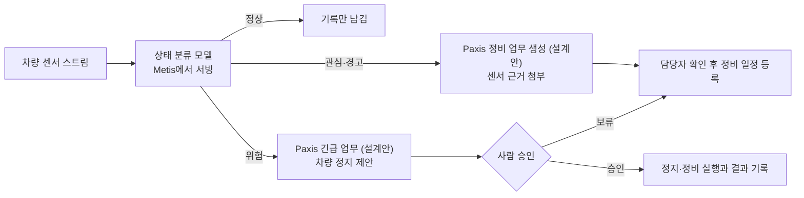

설비 센서 값만으로 기계 상태를 네 단계로 나누는 1MB짜리 작은 모델을 공개했습니다. 공장 설비 데이터를 업무 자동화로 잇고 싶은 엔지니어와 운영 리더가 읽으면 좋습니다. 처음 보는 차량에서도 위험 상태를 정상으로 놓친 경우는 한 건도 없었습니다.

이 모델은 반도체 공장에서 웨이퍼를 나르는 물류 차량의 센서를 읽습니다. 출력은 정상, 관심, 경고, 위험 중 하나입니다. 판정 다음의 일, 즉 정비 업무를 열고 근거를 붙이고 사람 승인을 받는 일은 Paxis가 맡는 활용 시나리오로 함께 설명합니다.

## 쉽게 말하면

응급실 입구의 분류 간호사를 떠올리시면 됩니다. 분류 간호사는 체온, 맥박, 혈압 같은 몇 가지 숫자를 보고 환자를 급한 순서대로 나눕니다. 수술 여부를 정하지는 않습니다. 그 결정은 의사가 기록을 보고 내립니다.

이번 모델이 분류 간호사입니다. 전류, 온도, 미세먼지 같은 센서 숫자를 보고 차량 상태를 네 칸으로 나눕니다. Paxis는 병원의 접수와 차트 시스템 자리에 두도록 설계했습니다. 분류 결과에 근거를 붙여 정비 업무로 만들고, 차량을 멈추는 것처럼 무거운 결정은 사람에게 넘기는 구조입니다.

분류 간호사에게 박사급 진단 장비가 필요하지 않듯, 이 단계에는 거대 언어 모델이 필요하지 않습니다. 작고 빠르고 판정 이유를 따라갈 수 있는 모델이면 충분합니다.

## 무엇을 해봤나

공개한 모델 이름은 [Thaki-EquipmentHealth-Sensor-LGBM](https://huggingface.co/ThakiCloud/Thaki-EquipmentHealth-Sensor-LGBM)입니다. 대상은 공장 천장 레일을 달리는 차량(OHT)과 바닥을 달리는 차량(AGV)입니다. 학습 데이터는 AI 허브의 공개 데이터셋 71802입니다. 차량마다 전류 센서 네 개, 온도, 미세먼지 세 종류, 주변 습도·조도·온도가 시간 순서대로 기록되어 있습니다. 상태 라벨은 데이터셋의 테스트베드 모의 시스템이 붙인 값입니다.

모델은 그래디언트 부스팅 트리(LightGBM) 하나입니다. 각 센서의 현재 값, 직전 값과의 차이, 최근 다섯 번의 평균을 입력으로 씁니다. 지난 기록만 쓰기 때문에 센서 값이 하나 들어올 때마다 바로 판정할 수 있습니다. 열화상 카메라 영상, 정비 이력, 누적 가동일은 입력에서 뺐습니다.

평가 방식은 하나만 기억하시면 됩니다. 학습에 쓴 차량과 평가에 쓴 차량을 완전히 갈랐습니다. 1번부터 14번 차량으로 학습하고, 한 번도 본 적 없는 15·16번 차량 네 대에서 성능을 쟀습니다. 비교 대상은 같은 입력을 쓰는 로지스틱 회귀입니다.

## 나온 결과

처음 보는 차량 네 대의 센서 기록 11,792건에서 잰 결과입니다.

| 모델 (같은 입력) | 매크로 F1 | 위험 재현율 | 위험을 정상으로 판정 |
|---|---|---|---|
| **이번 모델 (LightGBM)** | **0.9432** | 0.9645 | 0 / 930 |
| 로지스틱 회귀 | 0.9182 | 0.9710 | 0 / 930 |
| 가장 흔한 상태만 찍기 | 0.1635 | 0.0000 | 930 / 930 |

*매크로 F1 차이 +0.0254, 95% 부트스트랩 신뢰구간 [+0.0111, +0.0385]. 평가 차량 15·16번(AGV·OHT 각 2대).*

네 상태를 고르게 맞히는 정도(매크로 F1)는 0.94로, 로지스틱 회귀의 0.92보다 높았습니다. 이 차이의 신뢰구간은 0을 포함하지 않았습니다. 위험 930건 가운데 정상으로 판정한 경우는 0건이었습니다. 즉, 사람 말로는 처음 보는 차량에서도 위험한 차량을 괜찮다고 넘긴 적은 없었습니다.

정직하게 덧붙일 점이 있습니다. 위험 상태만 놓고 보면 로지스틱 회귀가 조금 더 많이 잡았습니다. 이번 모델의 이득은 대부분 관심 단계를 더 잘 가려낸 데서 나왔습니다. 모델 크기는 약 1MB이고, CPU에서 판정 한 번에 0.1밀리초 정도 걸립니다.

공개 전에는 내려받은 모델이 학습 때와 같은 답을 내는지도 확인했습니다. 섞어 둔 측정 구간 여섯 개, 146건에서 입력 특징과 확률이 모두 정확히 일치했습니다.

## 활용 시나리오: Paxis로 정비 업무까지 잇기

분류 결과만으로는 아무 일도 일어나지 않습니다. 경고가 떴다면 누군가 정비 요청을 만들고, 어떤 센서가 이상했는지 적고, 담당자를 정해야 합니다. 이 연결을 Paxis가 맡는 시나리오입니다. 아래는 참조 설계이며, 모델 판정에서 Paxis 업무 생성까지는 아직 엔드투엔드로 검증하지 않았습니다.

이 설계에서는 관심이나 경고가 나오면 Paxis가 정비 업무를 열도록 합니다. 업무에는 판정 확률, 직전 센서 값, 변화량을 근거로 붙이도록 합니다. 그러면 담당자가 왜 이 업무가 생겼는지 바로 볼 수 있습니다.

위험이 나와도 Paxis가 차량을 스스로 멈추지 않도록 설계합니다. 정지를 제안하고 사람의 승인을 기다리는 방식입니다. 분류 간호사가 위급 환자를 골라도 수술 결정은 의사가 내리는 것과 같습니다. 승인 이력과 실행 결과도 업무 기록에 함께 남기도록 합니다.

모델 쪽 역할은 나뉩니다. 이런 작은 모델의 학습과 검증은 Maxis가, 운영 중 서빙은 Metis가 맡는 구조를 지향합니다. 판정 한 번이 0.1밀리초짜리 모델이라 GPU 없이 CPU에서 돌아갑니다. Paxis가 일을 많이 할수록 업무 한 건의 판단 비용이 낮아야 하는데, 작은 모델이 그 바닥을 받칩니다.

## 그래서 무엇을 바꾸면 되나

설비 데이터에 AI를 붙일 때, 먼저 판정과 실행을 분리해 보시길 권합니다. 판정은 작고 검증 가능한 모델에 맡기고, 실행은 근거와 승인이 남는 업무 흐름에 맡기는 방식입니다.

모든 단계에 거대 언어 모델을 넣을 필요는 없습니다. 센서 숫자를 네 칸으로 나누는 일은 1MB짜리 트리 모델로 충분했습니다. 언어 모델은 정비 보고서를 쓰거나 담당자와 대화하는 단계에서 쓰면 됩니다.

평가는 반드시 처음 보는 설비로 하시길 권합니다. 같은 차량의 다른 시간대로 평가하면 모델이 차량 버릇을 외운 것인지 상태를 읽은 것인지 구분할 수 없습니다.

## 못 믿을 부분

가장 큰 한계는 라벨입니다. 네 가지 상태는 실제 고장 기록이 아니라 테스트베드 모의 시스템이 붙인 값입니다. 응급실로 치면 진짜 환자가 아니라 훈련용 모의 환자로 연습한 간호사입니다. 따라서 이 모델이 실제 고장을 미리 맞힌다고 주장하지 않습니다.

다른 공장, 다른 차량 기종, 다른 센서 장비에서의 성능은 재지 않았습니다. 센서 단위와 환경 값이 데이터셋과 다르면 결과를 믿기 어렵습니다.

17·18번 차량으로 잰 시험 점수(매크로 F1 약 0.94)도 있습니다. 하지만 이전 모델로 한 번 채점한 적이 있는 구간이라 블라인드 수치로 보지 않습니다.

오경보도 있습니다. 가장 흔한 오류는 정상을 관심으로 판정한 경우로, 정상 5,729건 중 286건이었습니다. 즉, 사람 말로는 정상 20건 중 1건꼴로 관심 경보가 울립니다. 정상을 위험으로 판정한 경우도 4건 있었습니다.

학습 데이터는 이 저장소에 포함하지 않았습니다. 데이터가 필요하면 AI 허브에 이용 신청을 하셔야 합니다. 학습한 가중치는 AI 허브의 학습 모델 공개 조건에 따라 공개했습니다.

---

*모델: [ThakiCloud/Thaki-EquipmentHealth-Sensor-LGBM](https://huggingface.co/ThakiCloud/Thaki-EquipmentHealth-Sensor-LGBM) (CC BY 4.0, 연구 미리보기). 학습 데이터 출처: AI 허브 데이터셋 71802(OHT·AGV 설비). 본문의 Paxis 정비 흐름은 참조 설계이며 통합 제품의 실측 결과가 아닙니다.*
