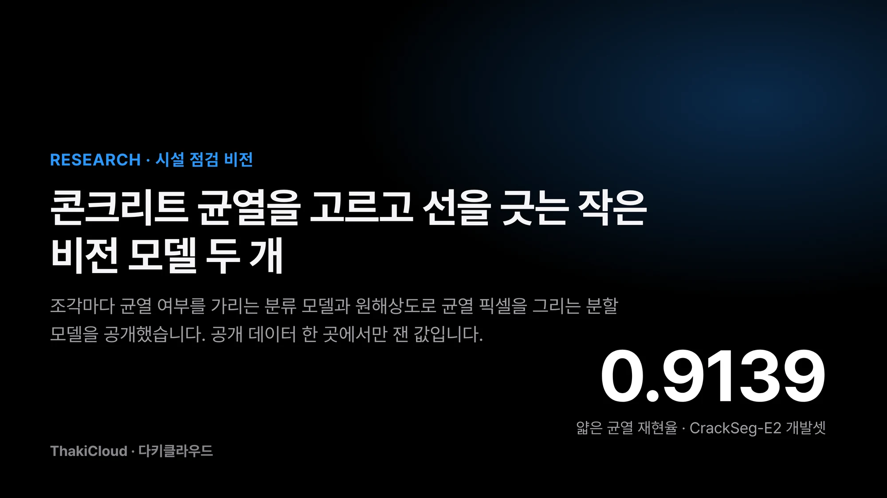
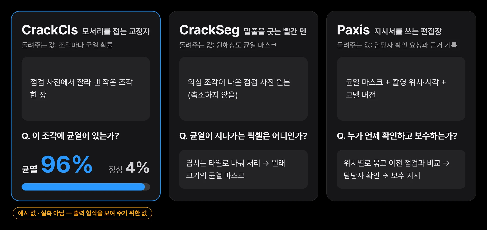
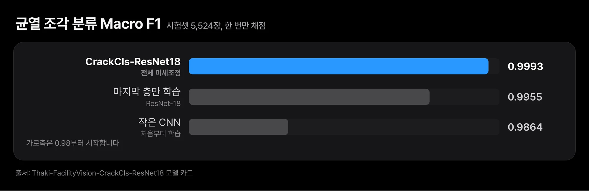
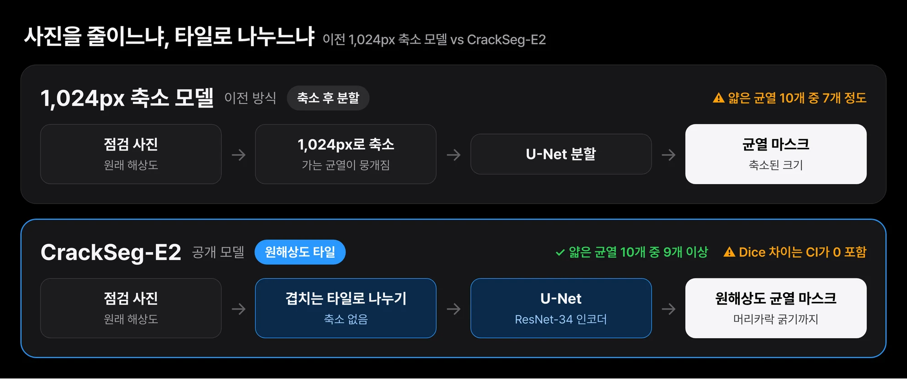
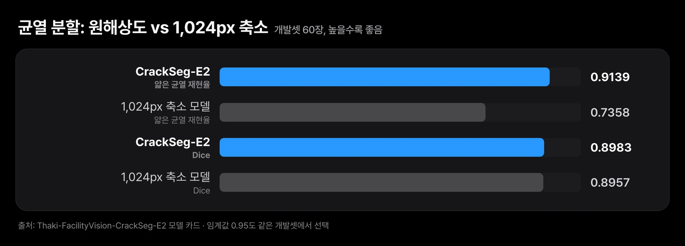
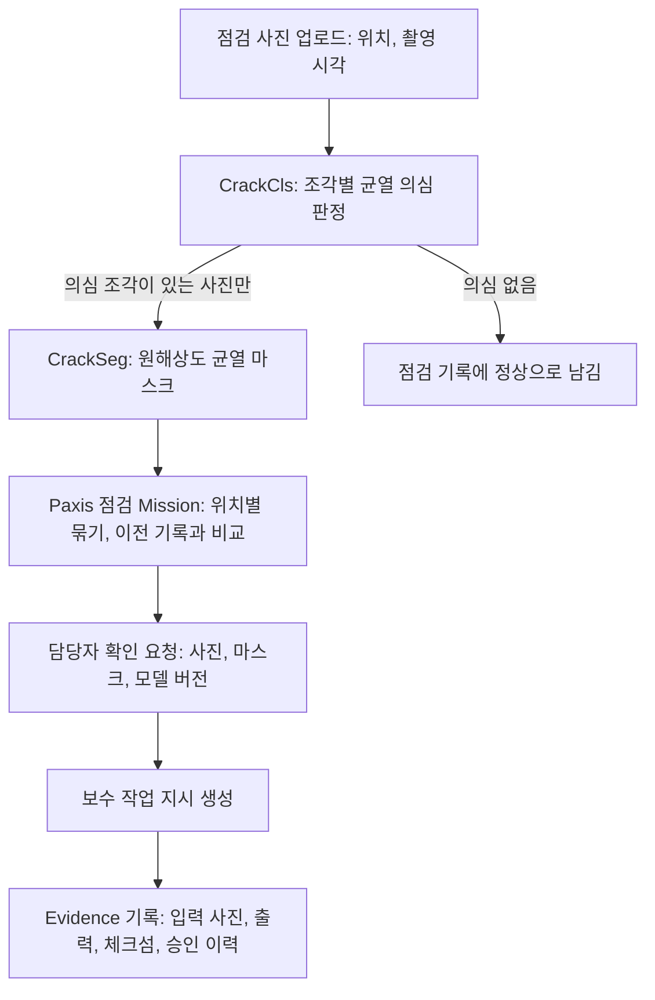

*원해상도로 처리하는 분할 모델이 얇은 균열을 더 많이 잡았습니다. 아래 표에 정확한 값이 있습니다.*

시설 점검 사진에서 콘크리트 균열을 골라내고 그 모양을 픽셀 단위로 그리는 작은 모델 두 개를 누구나 받을 수 있게 공개했습니다. 건물, 교량, 터널 점검을 자동화하려는 엔지니어와 현장 리더라면 이 모델이 어디까지 쓸 만한지 먼저 확인하시기 바랍니다. 점수는 매우 높지만, 공개 데이터 한 곳에서만 잰 값이라 현장 정확도로 읽으면 안 됩니다.

한 모델은 작은 사진 조각에 균열이 있는지 판정합니다. 다른 모델은 사진 전체에서 균열이 지나가는 픽셀을 표시합니다. 두 모델 모두 누구나 상업적으로도 쓸 수 있는 조건으로 공개했고, 학습 데이터는 재배포하지 않았습니다.

## 쉽게 말하면

교정지를 검토하는 편집부를 떠올리시면 됩니다. 먼저 교정자가 원고를 빠르게 넘기며 오탈자가 있는 쪽의 모서리를 접어 둡니다. 다음으로 접힌 쪽만 펼쳐 틀린 글자 아래에 빨간 펜으로 정확히 밑줄을 긋습니다. 마지막으로 편집장이 밑줄 친 쪽을 모아 누가 언제 무엇을 고칠지 수정 지시서를 씁니다.

분류 모델은 모서리를 접는 교정자이고, 분할 모델은 빨간 펜입니다. Paxis는 수정 지시서를 쓰고 처리 결과까지 챙기는 편집장 역할을 맡습니다. 펜을 고르고 길들이고 늘 같은 기준으로 쓰게 관리하는 편집실이 Metis와 Maxis입니다. 이 글의 나머지는 이 세 단계를 차례로 따라갑니다.

## 거름망과 빨간 펜, 두 모델을 따로 공개했습니다

두 모델은 [Thaki-FacilityVision-CrackCls-ResNet18](https://huggingface.co/ThakiCloud/Thaki-FacilityVision-CrackCls-ResNet18)과 [Thaki-FacilityVision-CrackSeg-E2](https://huggingface.co/ThakiCloud/Thaki-FacilityVision-CrackSeg-E2)입니다. 라이선스는 출처 표시만 하면 되는 CC BY 4.0입니다.

분류 모델은 ResNet-18 기반이고 파라미터는 약 1,100만 개입니다. 사진 한 장을 작은 조각으로 잘라 넣으면 조각마다 균열 확률을 돌려줍니다. CPU 스레드 4개로 조각 하나에 12ms 남짓 걸리므로 별도 GPU 없이도 첫 거름망으로 쓸 수 있습니다. 즉, 사람 말로는 모서리를 빠르게 접는 교정자를 값싸게 둘 수 있다는 뜻입니다.

분할 모델은 ResNet-34 인코더를 쓴 U-Net이고 파라미터는 약 2,400만 개입니다. 사진을 줄이지 않고 원래 해상도 그대로 겹치는 타일로 나눠 처리합니다. 그래서 축소하면 사라지는 머리카락 굵기의 균열도 남길 수 있습니다. 1,200만 화소 사진 한 장에 GPU로 1초 안쪽, CPU만으로는 30초 가까이 걸립니다.

*분류 모델은 조각마다 균열 여부를, 분할 모델은 균열 픽셀 마스크를 돌려줍니다. 그림의 확률은 형식을 보여 주는 예시이며 실측값이 아닙니다.*

공개 전에 세 가지를 확인했습니다. 로그인하지 않은 상태로 내려받기가 되는지 봤습니다. 내려받은 가중치의 체크섬이 학습 결과와 같은지 맞췄습니다. 공개한 추론 코드가 학습 때 쓴 코드와 같은 출력을 내는지도 비교했고, 두 모델 모두 차이가 0이었습니다.

## 분류는 거의 다 맞혔고, 분할은 얇은 균열을 더 잡았습니다

분류 모델은 따로 떼어 둔 시험용 조각 5,524장 가운데 4장만 틀렸습니다. 균열을 놓친 것이 2장, 멀쩡한 면을 균열로 잘못 본 것이 2장입니다. 같은 데이터에서 작은 CNN과 ResNet-18의 마지막 층만 학습한 방식보다 조금 더 나았습니다. 다만 세 방식 모두 이미 0.98을 넘었다는 점이 더 중요합니다. 즉, 사람 말로는 이 데이터가 쉬운 편이라 차이가 크게 벌어지지 않는다는 뜻입니다.

*세 방식 모두 점수가 높아 세로축을 확대했습니다. 차이는 작고, 이 데이터가 쉬운 편이라는 뜻으로 읽어야 합니다.*

분할 모델에서 눈여겨볼 값은 얇은 균열을 얼마나 놓치지 않느냐입니다. 사진을 1,024픽셀로 줄여 처리하던 이전 모델은 얇은 균열 10개 중 7개 정도를 잡았습니다. 원래 해상도로 처리하는 이번 모델은 10개 중 9개 이상을 잡습니다. 전체 겹침 점수(Dice)는 약 0.9로 이전 모델과 사실상 같습니다. 빨간 펜이 더 가는 선까지 긋게 됐지만, 전체 밑줄의 정확도가 크게 오른 것은 아닙니다.

*이전 모델은 사진을 줄여 한 번에 보고, 이번 모델은 원래 해상도를 겹치는 타일로 나눠 봅니다. 가는 균열이 남는 이유가 여기에 있습니다.*

*얇은 균열 재현율은 크게 올랐고 전체 Dice는 거의 같습니다. 개발셋에서 잰 값입니다.*

| 모델 | 평가 범위 | 핵심 지표 | 비교 기준 |
|---|---|---|---|
| CrackCls-ResNet18 | 시험셋 5,524장 (한 번만 채점) | Macro F1 0.9993, 오경보 2 · 놓침 2 | 마지막 층만 학습 0.9955, 작은 CNN 0.9864 |
| CrackSeg-E2 | 개발셋 60장 (시험셋 61장은 미채점) | Dice 0.8983, 얇은 균열 재현율 0.9139 | 1,024px 축소 모델 Dice 0.8957, 얇은 균열 0.7358 |

*분할 모델의 판정 임계값 0.95는 같은 개발셋에서 골랐습니다. 얇은 균열 재현율 향상 폭의 95% 신뢰구간은 0을 포함하지 않지만, Dice 차이의 신뢰구간은 0을 포함합니다.*

## 마스크는 Paxis에서 보수 지시의 근거가 됩니다

균열을 찾는 것만으로 점검 업무가 끝나지는 않습니다. 어느 건물 몇 층의 어느 벽에서 찍은 사진인지, 이전 점검 때보다 길어졌는지, 누가 언제 확인하고 보수할지가 이어져야 합니다. Paxis는 모델의 출력을 이런 업무 단위로 묶고 그 근거를 남기는 역할을 맡습니다. 아래는 지금 공개한 두 모델을 이 흐름에 넣는 참조 설계입니다.

교정지 비유로 다시 보면, 접힌 쪽만 빨간 펜으로 넘기기 때문에 비싼 단계가 모든 사진에 돌지 않습니다. 빨간 펜이 그은 밑줄은 그대로 수정 지시서의 근거가 됩니다. 어떤 모델의 어떤 버전이 그 밑줄을 그었는지도 체크섬으로 함께 남깁니다. 나중에 보수 판단이 틀렸다면 사진, 마스크, 모델 버전을 거슬러 올라가 원인을 확인할 수 있습니다.

중요한 원칙은 모델의 판정과 보수 결정을 분리하는 것입니다. 균열 마스크는 구조 안전 판정이 아닙니다. 그래서 Paxis는 마스크만으로 보수나 사용 제한을 결정하지 않고 담당자 확인 단계를 둡니다. 모델은 사람이 볼 사진을 줄이고, 판단의 근거를 정리하는 일에 집중합니다.

## 작아야 싸게 돌리고 쉽게 검증합니다

시설 점검 사진은 한 번에 수천 장씩 쌓입니다. 큰 범용 비전 모델 하나로 모든 사진을 보면 비용과 지연이 함께 커집니다. CPU에서도 도는 분류 모델이 먼저 걸러 주면, 원해상도 분할은 의심 사진에만 쓰면 됩니다. 이렇게 단계를 나누면 Paxis 점검 업무 한 건을 처리하는 비용을 예측하기 쉬워집니다.

작은 모델은 검증도 쉽습니다. 가중치 파일 하나의 체크섬, 추론 코드 한 벌, 평가 요약 한 장으로 무엇을 공개했는지 확인할 수 있습니다. Maxis에서 학습하고 Metis에서 서빙하는 모델이 이렇게 작고 검증 가능하면, 현장 데이터로 다시 학습한 버전을 들여올 때도 같은 절차로 비교할 수 있습니다. 데이터를 밖으로 내보내기 어려운 고객이라면 Aegis 같은 고객 통제 인프라 안에서 같은 흐름을 돌리는 방식도 검토할 수 있습니다.

## 공개 데이터 한 곳의 점수라 현장 정확도가 아닙니다

가장 큰 한계는 데이터 출처가 하나뿐이라는 점입니다. 두 모델 모두 Özgenel이 공개한 콘크리트 균열 데이터만으로 학습하고 평가했습니다. 한 캠퍼스 건물에서 비슷한 조명과 질감으로 찍은 사진이라 다른 카메라, 그림자, 얼룩, 이음매 앞에서는 성능이 크게 떨어질 수 있습니다. 분류 모델의 거의 완벽한 점수는 이 데이터에 잘 맞는다는 뜻이지 현장 일반화의 증거가 아닙니다.

분할 모델의 수치는 개발셋 60장에서만 쟀습니다. 판정 임계값도 같은 개발셋에서 골랐기 때문에 수치가 낙관적일 수 있습니다. 따로 떼어 둔 시험셋 61장은 아직 채점하지 않았습니다. 아스팔트, 철재, 타일, 드론 영상도 시험하지 않았습니다.

두 모델 모두 연구 미리보기이며 점검 인증을 받은 도구가 아닙니다. 위의 Paxis 점검 흐름도 실측한 통합 제품이 아니라 참조 설계입니다. 실제 현장에 넣으려면 현장 사진으로 따로 평가하고, 그 데이터로 다시 학습한 버전을 같은 절차로 비교해야 합니다.

## 끝으로

이번 공개의 의미는 높은 점수보다, 작고 검증 가능한 모델을 무엇을 믿어도 되는지와 함께 내놓았다는 데 있습니다. 모서리를 접는 교정자와 빨간 펜은 준비됐고, 수정 지시서를 쓰는 편집장은 Paxis가 맡습니다. 다음 질문은 현장 사진에서도 같은 밑줄을 긋느냐이며, 그 답은 현장 데이터로 재는 수밖에 없습니다.

오늘 해 볼 첫 실험은 간단합니다. 우리 현장에서 찍은 점검 사진 몇 장을 분류 모델에 넣어 보고, 그림자·얼룩·이음매를 균열로 잘못 보는지부터 확인하시기 바랍니다. 모델은 위에서 소개한 두 모델 카드에서 바로 받을 수 있습니다.



---

*출처: 두 모델의 공개 모델 카드(Hugging Face, 2026년 10월 31일 공개). 학습 데이터는 Ç. F. Özgenel, Mendeley Data(doi:10.17632/5y9wdsg2zt.2, doi:10.17632/jwsn7tfbrp.1), CC BY 4.0입니다.*
