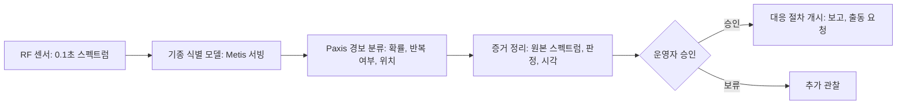

전파 한 조각만 보고 어떤 기종의 드론이 신호를 보내는지 맞히는 작은 모델을 공개했습니다. 시설 보안이나 공역 감시 업무를 자동화하려는 엔지니어와 운영 책임자에게 쓸모 있는 이야기입니다. 학습에 쓰지 않은 다른 장소의 녹음에서 14개 기종 성적(macro-F1)이 0.93이었고, 뒤에 만든 새 버전은 이 첫 버전을 넘지 못했습니다.

그래서 첫 버전을 그대로 공개 버전으로 두었습니다. 이 글은 그 모델이 무엇을 잘하고 무엇을 못하는지, 그리고 식별 결과를 실제 보안 운영 업무로 어떻게 잇는지를 다룹니다.

## 쉽게 말하면

전화를 받았을 때 "여보세요" 한마디만 듣고 누가 걸었는지 알아맞히는 일과 비슷합니다. 사람마다 목소리 높낮이와 울림이 다르듯, 드론도 기종마다 전파의 모양이 조금씩 다릅니다. 이 모델은 0.1초 동안 잡은 전파의 세기 분포를 보고 14개 기종 가운데 어느 쪽인지 고릅니다.

중요한 점은 연습한 방이 아닌 다른 방에서 걸려 온 전화로 시험했다는 것입니다. 같은 방에서 녹음한 목소리로 시험하면 녹음 환경을 외워서 점수가 부풀려집니다. 그래서 학습은 한 장소의 녹음으로 하고, 평가는 다른 장소의 녹음으로 했습니다.

## 무엇을 만들었나

입력은 2.43GHz 대역 주변 20MHz를 8,192칸으로 나눈 전파 세기 분포 하나입니다. 이것을 전력 스펙트럼 밀도(PSD)라고 부릅니다. 모델은 이 한 줄짜리 신호를 읽는 1차원 잔차 신경망(ResNet1D)이며, 파라미터는 약 330만 개입니다. 미리 학습된 모델을 가져오지 않고 처음부터 학습했습니다.

데이터는 AI 허브의 「UAV 비행신호 데이터」(데이터셋 71954)를 썼습니다. 이 데이터는 세 곳의 녹음 장소로 나뉘어 있습니다. 첫 번째 장소로 학습하고 두 번째 장소로 모든 선택을 내렸으며, 세 번째 장소는 봉인해 두었습니다. 데이터 자체는 재배포할 수 없어 모델 가중치와 추론 코드만 공개했습니다. 모델은 [Hugging Face](https://huggingface.co/ThakiCloud/Thaki-RFUAV-PSD-ResNet1D)에서 누구나 내려받을 수 있습니다.

모델이 작아서 같은 맥 한 대에서 한 번 판정하는 데 GPU로 2ms, CPU로 4ms 정도 걸렸습니다. 즉, 사람 말로는 센서 옆의 평범한 컴퓨터에서도 실시간으로 돌릴 만한 크기입니다.

## 나온 결과

학습에 쓰지 않은 두 번째 장소의 녹음 6만여 건으로 평가했습니다. 14개 기종을 고르는 성적(macro-F1)은 0.93이었습니다. 같은 특징으로 14개 기종을 직접 학습한 로지스틱 회귀 기준 모델은 0.83이었습니다. 즉, 사람 말로는 100점 만점에 10점가량 앞섰습니다.

이 차이가 우연인지 보려고 녹음 세션 280개를 단위로 다시 뽑아 2,000번 반복 계산했습니다. 그렇게 해도 차이는 0보다 확실히 컸습니다. 아래 표에 실제로 관측한 차이와 반복 계산의 평균 차이를 따로 적었습니다.

| 비교 (두 번째 장소, 60,480건) | 성적 (macro-F1) | 기준 대비 차이 |
|---|---|---|
| 공개 모델 v1 | **0.9295** | 관측 +0.0987, 반복 평균 +0.1002, 95% 구간 [+0.0789, +0.1224] |
| 기준 모델 (14기종 로지스틱 회귀) | 0.8309 | 기준 |
| v2 후보 E1 (14기종 직접 학습) | 0.9266 | v1 대비 −0.003, 95% 구간 [−0.013, +0.005] |
| v2 후보 E2 (다중 해상도 입력 + 증강) | 0.9159 | v1 대비 −0.014, 95% 구간 [−0.026, −0.001] |

*95% 구간은 녹음 세션 280개를 2,000번 다시 뽑아 계산했습니다. 두 번째 장소는 모델 선택에도 썼기 때문에 이 숫자에는 선택 이득이 섞여 있습니다.*

기종별로 보면 고르지 않습니다. 14개 중 여섯 기종은 100번 중 99번 넘게 맞혔지만, uav02는 10번 중 6번 정도만 맞혔습니다. 기준 모델도 uav02에서 비슷하게 약했고, uav02와 uav07에서는 기준 모델이 조금 앞섰습니다.

## 새 버전이 이기지 못한 이야기

첫 버전이 나온 뒤 더 나은 모델을 만들려고 두 가지 후보를 시험했습니다. 하나는 같은 구조를 14개 기종에 맞춰 바로 학습한 것이고, 다른 하나는 여러 해상도의 입력과 신호 세기 흔들기 같은 증강을 더한 것입니다. 두 후보 모두 기준 모델은 이겼지만 첫 버전은 이기지 못했습니다.

첫 번째 후보는 첫 버전과 차이가 없다고 봐야 할 수준이었습니다. 두 번째 후보는 오히려 조금 낮았습니다. 둘 다 가장 약한 uav02를 10번 중 6번 위로 끌어올리지 못했습니다. 그래서 새 버전은 공개하지 않고, 공개된 가중치도 바꾸지 않았습니다.

전화 비유로 말하면, 새로 훈련한 사람이 기존 담당자보다 발신자를 더 잘 맞히지 못했으니 담당자를 바꾸지 않은 것입니다. 새 버전이 나왔다는 사실만으로 교체하지 않고, 미리 정한 기준을 넘을 때만 교체합니다. 저희는 이 규칙이 모델 하나의 점수보다 오래 남는 자산이라고 봅니다.

## 활용 시나리오: 식별 다음의 업무를 Paxis와 잇기

기종을 맞히는 것만으로는 업무가 끝나지 않습니다. 보안 운영자는 이 경보가 진짜인지, 어디서 왔는지, 누구에게 알려야 하는지를 정해야 합니다. 이 판단을 운영 업무로 연결하는 계층으로 ThakiCloud의 에이전트 플랫폼 Paxis를 활용하는 방안을 제안합니다. 아래는 이 모델을 Paxis에 붙이는 참조 설계이며, 모델 판정에서 Paxis 업무 생성까지는 아직 엔드투엔드로 검증하지 않았습니다.

이 설계에서 작은 신호 모델은 Metis로 센서 가까이에서 가볍게 서빙하고, 출시 여부는 사전에 정한 기준으로 판정합니다. Paxis는 모델의 판정을 받아 같은 기종이 반복해서 잡히는지, 확률이 충분히 높은지를 묶어 경보를 분류하는 구조입니다. 그다음 원본 스펙트럼과 판정, 시각을 증거로 묶어 운영자에게 보여 주도록 합니다.

사람의 승인이 들어가는 위치가 핵심입니다. 이 모델은 모르는 신호를 거절하지 못하고 늘 14개 기종 중 하나로 답합니다. 그래서 모델의 답을 곧바로 조치로 바꾸지 않습니다. 에이전트는 확인과 정리를 맡고, 대응 절차를 시작할지는 운영자가 정합니다.

이 설계에서 모델이 하는 일은 식별까지입니다. 전파를 방해하거나 드론을 무력화하는 기능은 이 모델에도, 이 설계에도 없습니다.

## 못 믿을 부분

먼저 세 번째 장소의 성적이 없습니다. 이 장소는 처음 등록한 공개 조건을 넘지 못해 봉인된 채 남았고, 지금도 평가하지 않았습니다. 따라서 처음 보는 장소 전반에서 같은 성적이 나온다고 말할 수 없습니다.

두 번째 장소의 0.93도 독립적인 시험 점수가 아닙니다. 이 장소로 체크포인트를 고르고 v2와도 비교했으니 선택 이득이 섞여 있습니다. 녹음 세션 단위 구간도 장소가 바뀔 때 생기는 차이까지는 담지 못합니다.

모델이 보는 범위도 좁습니다. 2.43GHz 근처 한 대역, 한 가지 수신 장비, 0.1초 한 조각만 봅니다. 여러 조각을 묶어 투표하는 기능도, 드론이 아닌 신호를 걸러 내는 기능도 없습니다. 여러 기기가 동시에 송신하거나 전파 방해가 있는 상황은 평가하지 않았습니다.

기종을 넘어서는 정보는 거의 읽지 못합니다. 같은 기종 안에서 조종 신호인지 상태 신호인지는 10번 중 6번 정도만 맞혀 동전 던지기에 가깝습니다. 이륙, 착륙 같은 비행 단계 예측은 사실상 우연 수준이니 쓰지 않는 편이 맞습니다. 인증받은 탐지 제품이 아니라 연구용 공개 모델입니다.

## 정리

전파 한 조각으로 드론 기종을 알아보는 작은 모델을 공개했고, 학습에 쓰지 않은 장소의 녹음에서 기준 모델보다 분명히 나았습니다. 더 나중에 만든 후보가 이기지 못해 첫 버전을 그대로 둔 것도 같은 결과의 일부입니다. 식별 이후의 확인과 증거 정리는 Paxis가 맡는 시나리오로 설계했고, 실제 대응을 시작하는 결정은 사람이 내리도록 합니다.

전화 목소리로 발신자를 맞히는 사람이 있어도, 신고 여부는 결국 책임자가 정합니다. 이 모델과 Paxis의 관계도 같습니다.

---

*출처: 공개 모델 카드와 내부 실험 원장(2026년 11월 1일 확정). 수치는 모두 두 번째 녹음 장소 기준이며, 세 번째 장소는 평가하지 않았습니다. Paxis 연동은 참조 설계이며 통합 서비스의 실측 결과가 아닙니다. 데이터 출처: AI 허브 「UAV 비행신호 데이터」(데이터셋 71954).*
