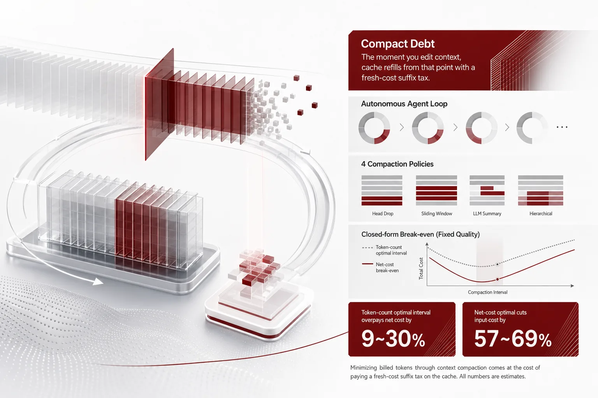
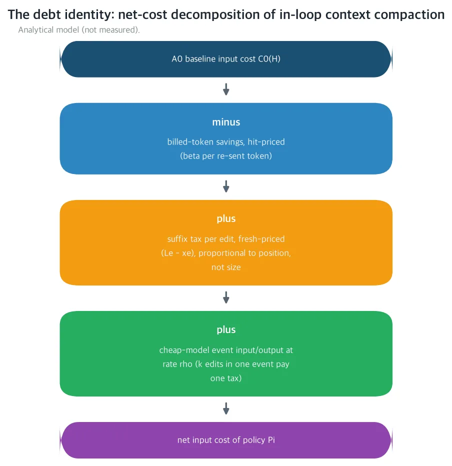
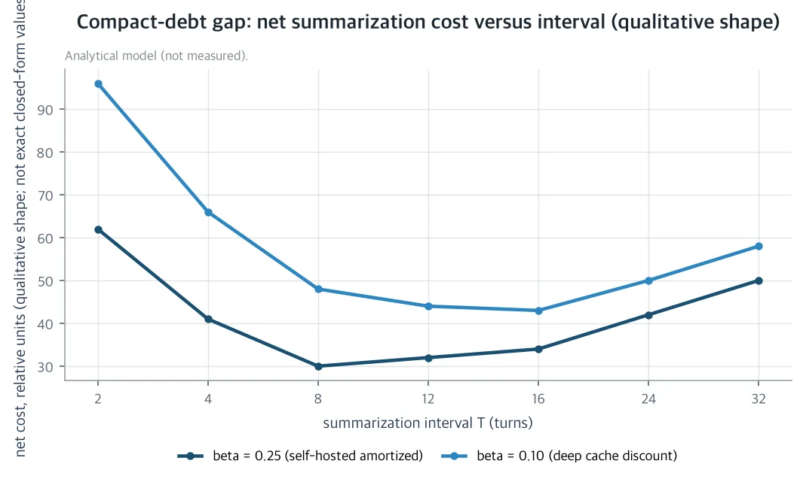
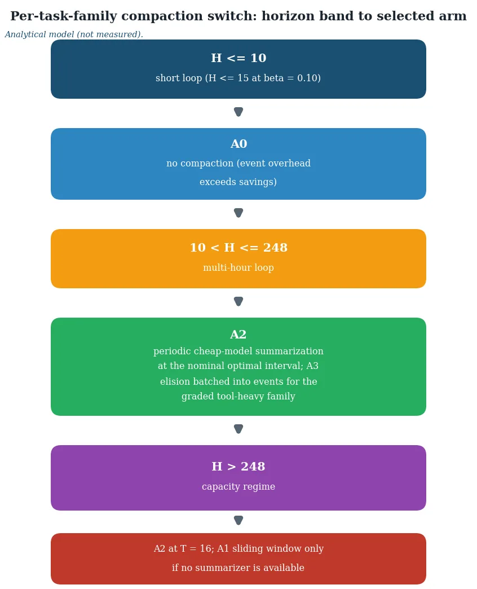

대화 기록을 줄이는 압축이, 오히려 청구서를 더 크게 만들 수 있습니다. 무인 에이전트를 밤새 자기 GPU 위에서 돌리는 분이라면, 압축을 켰을 때 청구서가 어떻게 달라지는지 끝까지 읽으면 됩니다. 답은 청구된 토큰 수가 아니라, 고친 부분부터 다시 읽는 데 치르는 비용에 있었습니다.

*글의 핵심 개념을 형상화했습니다.*

## 쉽게 말하면

모형의 캐시를 노트라고 생각해 보겠습니다. 엔진은 이미 처리한 부분을 노트에 남겨 두고, 같은 내용이 다시 들어오면 처음부터 계산하지 않고 할인을 줍니다. 무인 에이전트는 매 턴 대화 전체와 새 지시를 다시 보내므로, 아무것도 고치지 않는 한 대부분은 같은 페이지를 다시 읽는 일입니다. 다시 읽기는 할인 단가로만 들어가니 쌉니다.

하지만 노트 한가운데를 고치면 이야기가 달라집니다. 고친 자리부터 끝까지, 내용은 처음부터 다시 계산해야 합니다. 10페이지에서 한 줄만 고쳤더라도, 다시 읽어야 할 분량은 그 페이지부터 끝까지 그대로입니다. 부담을 정하는 것은 고친 양이 아니라 고친 위치입니다. 이런 다시 읽기 할인을 주는 캐시 장치를 prefix cache(선두부 캐시)라고 부릅니다. 논문은 이 다시 읽기 부담을 suffix tax(끝부분 세금)라고 부르고, 압축 때문에 이 부담을 치르는 총비용을 compact debt(컴팩트 디트, 압축 채무)라고 부릅니다.

즉, 사람 말로는 압축의 청구서는 얼마나 줄였느냐가 아니라 어디를 댔느냐로 정해지고, 이 채무는 청구된 토큰 열 어디에도 뜨지 않는다는 것입니다.

## 무엇을 해봤나

모든 가격 매기는 하나를 명시한 플랫폼 위에서 나옵니다. 셀프호스트 H200(141GB HBM3e)에서 bf16의 14B dense 모형과 0.6B의 작은 요약 모형을 같은 인스턴스에 서빙합니다. 엔진은 페이지 기반 KV 엔진에 prefix cache가 켜져 있고, 캐시는 완전 일치 의미를 씁니다. 새 프롬프트는 과거와 같은 선두부에서 끝나는 곳까지만 캐시를 재사용하고, 그 뒤는 전부 처음부터 계산합니다.

압축 방식은 네 가지입니다. 첫 번째는 압축하지 않는 것입니다. 두 번째는 sliding window(슬라이딩 윈도우)로, 오래된 대화는 버리고 최근 W 토큰만 남깁니다. 세 번째는 주기적 요약으로, T턴마다 작은 모형이 역사를 짧은 요약으로 다시 씁니다. 네 번째는 elision(생략)으로, 오래된 도구 출력을 짧은 스텁으로 바꿉니다. 모형이 쓴 텍스트와 고정 지시는 절대 건드리지 않습니다.

모든 방식은 고정된 작업 품질에서 비교됩니다. 도구 중심 패밀리에는 결정적 코드 그레이더(exact match + near-miss band)를 쓰고, 산문 패밀리에는 선언된 고정 판단을 씁니다. 단일 루프에서는 용량 기반 치환이 테스크 수명 안에 묶이지 않아, 압축에 귀속되는 캐시 손실은 전량 콘텐츠 편집에서 옵니다. churn의 비용은 이 논문의 대상이 아니라 기존 두 편의 결과와 가법으로 합쳐집니다.

이 논문은 시리즈의 직전 편인 [Unstable Prefix](https://thakicloud.com/tech-blog/ko/research/unstable-prefix-harness-erosion/)(2026-10-01)의 명시적인 업그레이드입니다. 그 논문은 하네스가 밤마다 공유 매니페스트를 다시 쓰며 생기는 패시브 편집의 비용을 매겼고, 이번에는 같은 가격 매기기를 에이전트 자신의 컨텍스트 편집으로 돌립니다. 양쪽의 답은 같은 제곱근 법칙의 형태를 띱니다. 기존 압축 문헌은 청구 토큰, 정보량, 품질, 지연으로만 가격 매겼고 클라이언트 편집과 서빙 측 캐시의 상호작용 자체를 가격 매긴 일은 없었습니다. 본문 수치는 아래 표의 공칭 전제 하의 닫힌형 예측이며, 실측이 아닙니다. 각 예측에는 대응하는 실측 설계와 반증 기준이 사전 등록되어 있습니다.

| 기호 | 의미 | 공칭값 |
|---|---|---|
| H | 루프 길이(턴) | 16/32/64/128 |
| p | 고정 지시(시스템 + 스키마 + 매니페스트) | 4,096 토큰 |
| b | 턴당 새 내용 | 512 토큰 |
| u | 턴당 도구 페이로드 | 384 토큰 |
| M | 모형 컨텍스트 윈도우 | 131,072 토큰 |
| β | 캐시 할인율(fresh 가격 대비) | 0.25 셀프호스트 / 0.10 API식 |
| s̄ | 요약 길이 상한 | 2,048 토큰 |
| ρ | 작은 모형의 요금율(메인 대비) | 0.25 |
| a | 도구 페이로드의 오래됨 나이 | 4턴 |
| m | elision 스텁 길이 | 32 토큰 |

## 나온 결과

새벽 무인 플릿의 입력 청구 대부분은 이미 본 것을 다시 보내는 데 쓰입니다. 공칭값(H=128턴, β=0.25)에서는 자꾸 커지는 히스토리를 재전송하는 누적 비용이 압축 없는 베이스라인 입력 비용의 84%를 차지합니다. 라우팅 오버헤드, 스킬 실행 비용, 레지스트리 churn의 KV 감가까지 차례로 매겨진 시리즈에서 아직 매기지 못한 지배적인 입력 비용이 하나 남은 셈입니다. 에이전트 자신의 워킹 컨텍스트가 자라는 속도입니다.

### 첫 결과: 부담은 위치가 정하고, 크기가 정하지 않는다

논문의 첫 정리(Theorem 1)는 이 상호작용을 하나의 회계 항등식으로 모읍니다. 어떤 압축 방식이든 입력 비용은 네 항으로 갈립니다. 압축하지 않은 베이스라인에서, 할인 단가의 청구 토큰 절감을 빼고 편집 자리마다 fresh 단가의 다시 읽기 부담을 더하고 작은 모형의 이벤트 계산량을 더한 값입니다. suffix tax는 편집된 토큰의 크기가 아니라, 편집 자리 뒤로 남은 길이에 비례합니다.

*분석 모델 개념도(실측 아님). 어떤 압축 방식이든 입력 비용은, 압축 없는 베이스라인에서 할인 단가 청구 토큰 절감을 뺀 값에 편집 자리별 fresh 단가 다시 읽기 부담과 작은 모형 이벤트 계산량을 더한 형태로 갈립니다. 부담은 편집 자리에서 끝까지 남은 길이에 비례하고 편집 크기에 비례하지 않습니다.*

귀결은 둘입니다. 첫째, 같은 자리에서 1토큰을 고치든 1만 토큰을 고치든 부담은 같습니다. 고친 크기는 이후 턴의 절감에서만 드러납니다. 둘째, 하나의 이벤트에서 여러 편집을 한꺼번에 하면 부담은 가장 앞선 편집 하나치뿐입니다. 이 부담 batching(채무 묶음)이 뒤에서 elision을 공짜로 만드는 요인입니다.

### 두 번째 결과: 용량 안에 들어가면 슬라이딩 윈도우는 손해

슬라이딩 윈도우 절단은 엔지니어가 가장 먼저 생각하는 압축입니다. 그런데 완전 일치 의미론에서 윈도우의 내용은 매 턴 이동합니다. 직전 프롬프트와 같은 선두부는 정확히 고정 지시 p 하나뿐이고 warm-up을 지나면 매 턴은 p의 할인에 W 토큰의 fresh 계산입니다. 순비용 차이는 닫힌형으로 나오고 손익분기 루프 길이 H*는 2(W−b)/(β·b)입니다.

공칭값(윈도우 폭 W=8,192토큰, 턴당 fresh 토큰 b=512)에서 H*는 셀프호스트 할인율(β=0.25)에서 120턴, API식 깊은 할인(β=0.10)에서 300턴입니다. 컨텍스트 윈도우가 담는 한계는 248턴입니다.

즉, 사람 말로는 할인이 깊은 환경에서는 노트 용량에 들어가는 길이에서는 전부 손해이며, 248턴을 넘어 용량을 초과하는 구간에서만, 그것도 요약 모향이 없을 때만 정당해진다는 것입니다.

셀프호스트 할인에서는 120턴부터 비용 동기가 생깁니다. 그런데 그 지점마다 4~16턴 간격의 작은 모형 요약이 엄격히 더 싸고 품질에서도 낫습니다. 윈도우는 오래된 턴을 하드 드롭하지만, 요약은 압축합니다. 비교 자체가 성립하지 않습니다. 논문의 운영자 규칙은 짧습니다. 비용 이유로 슬라이딩 절단을 켜는 것은 피해야 할 선택이며, 요약 모향이 없는 용량 해방 때만 켜는 것이 규칙입니다. 이 채무는 front-loaded입니다. 절감이 시작되기 전에 처음 H*턴이 전체 적자를 짊어지므로, 윈도우를 켜는 순간 단기적으로는 손해를 사는 것입니다.

### 세 번째 결과: 요약 간격의 최적점과 compact debt

주기적 요약(Theorem 3)은 전통적인 재고 경제학의 최적 주문량(EOQ) 구조를 띱니다. 요약 상한 구간에서 턴당 비용은 셋으로 갈립니다. 상수 항, 요약 주기 안에서 자라 할인 단가로 재전송되는 히스토리(보유 비용), 각 이벤트마다 요약을 fresh 단가로 다시 읽고 작은 모향이 컨텍스트를 다시 읽는 것(setup 비용)입니다. 간격 T에 대한 볼록성이 유일한 내부 최소점 T*를 줍니다.

T*는 √(2[s̄(1−β) + ρ(p + 2s̄)]/(β·b))입니다. 공칭값에서 β=0.25는 7.5턴, β=0.10은 12.3턴이며, 이산 최적은 각각 8과 16턴에 놓입니다. 최소점은 평탄합니다. T*/2에서 2T* 사이의 어떤 간격을 골라도 과지불은 β=0.25에서 1.8% 이하, β=0.10에서 4.5% 이하입니다. 간격을 정확히 맞춰야 할 필요는 없습니다.

논문 제목의 compact debt는 여기서 나옵니다. 메인 모형의 청구 입력 토큰은 요약 간격 T가 짧아질수록 단조 감소합니다. 그러니 토큰 수를 최소화하는 간격은 가장 공격적인 비퇴화 간격 T=2입니다. 그런데 T=2의 순비용은 순비용 최적 간격보다 β=0.25에서 9.1%, β=0.10에서 29.5%를 더 냅니다. 매 턴 요약하는 퇴화 간격 T=1까지 가면 25.6% / 71.7%입니다.

즉, 사람 말로는 공격적으로 압축할수록 더 과지불하고 캐시 할인이 깊을수록 그 차이가 커진다는 것입니다. β가 1에 가까우면 캐시의 가치가 사라져 setup과 보유 단가가 수렴하고 토큰 최적은 순비용 최적과 거의 같습니다. β가 0에 가까우면 거의 공짜인 절감 스트림 위에 모든 다시 읽기가 거의 전면 가격의 세금이 됩니다. 공격적 압축이 가장 심하게 잘못 가격 매겨지는 자리가 prefix cache가 가장 가치 있는 자리인 셈입니다.

*분석 모델(실측 아님). 요약 순비용의 간격 T 대비 질적 형상입니다. 평탄한 U자 최소로, 캐시 할인이 얕은 β=0.25일수록 최소가 앞선 턴에, 깊은 할인 β=0.10일수록 뒤로 놓입니다. 왼쪽 끝의 가장 공격적인 토큰 수 최적 간격(T=2)이 순비용 최적 대비 가장 큰 compact-debt gap(베이스라인의 9.1% / 29.5%)을 지불합니다.*

켜는 시점에도 하한이 있습니다. 요약이 압축을 안 하는 것을 엄격히 이기는 첫 회수 지점(first-pay 호라이즌) H₁은 β=0.25에서 약 11턴, β=0.10에서 약 16턴입니다. 그보다 짧은 루프에서는 이벤트 오버헤드가 지배하고 정답은 압축을 하지 않는 것입니다. H₁은 β에 무관하지 않습니다. 할인이 깊을수록 회수가 늦어지는 방향이 T*와 갭이 움직이는 방향과 같아서 과금 환경은 최적 간격뿐 아니라 켜는 지점까지 함께 이동시킵니다.

H=128턴, 공칭값의 주된 결과는 아래 표에 모았습니다.

| β | 압축 없는 베이스라인 C⁰ | 윈도우 차이 Δ₁ | 윈도우 손익분기 H* | 이산 최적 Ť | T* | 최적/베이스라인 | gap (T=2) |
|---|---|---|---|---|---|---|---|
| 0.10 (API식) | 537,805 | +104.0% | 300턴 | 16턴 | 12.33 | 43.2% | +29.5% |
| 0.25 (셀프호스트) | 1,240,064 | −5.2% | 120턴 | 8턴 | 7.48 | 30.6% | +9.1% |

*표: H=128턴, 공칭값, fresh 토큰 단위입니다. Δ₁은 윈도우의 순비용 차이이고 gap은 토큰 수 최적 간격 T=2의 과지불 비율입니다. 첫 회수 지점 H₁은 약 16턴 / 약 11턴이며 elision 첫 회수는 H−τ > 58.2 / 23.3턴입니다.*

공칭 파라미터에서 순비용 최적의 압축은 압축하지 않은 것에 비해 롱호라이즌 입력 비용을 57~69% 줄입니다. 정책 순위는 청구 토큰 순위와 다릅니다. 청구 토큰만 보면 요약이 공격적일수록, 간격이 짧을수록 가장 싼 것처럼 보입니다. 순비용으로 다시 순위를 세면, 깊은 캐시 할인에서 슬라이딩 윈도우가 가장 나쁜 갈래가 됩니다(H=128, β=0.10에서 +104%). 토큰 수를 최소화한 요약 간격도 9~30%를 과지불합니다.

민감도는 깨끗합니다. T*는 β의 −1/2제곱에 비례하고 H*는 β의 −1에, elision 첫 회수도 β의 −1에 비례하며 compact-debt gap은 1/β에 대해 단조 증가합니다. 운영자가 텔레메트리에서 실제로 추정해야 할 파라미터는 둘뿐입니다. 캐시 할인율 β(엔진이 재전송 캐시 토큰의 prefill을 얼마나 아껴 주는가)와 작은 모향이 실제로 달성하는 요약 상한 s̄입니다. 나머지는 하네스 상수입니다.

청구 토큰 직관이 만들어내는 비싼 실수는, 입력 토큰을 최소화하려고 공격적으로 요약하는 일입니다. prefix cache 아래에서 그것은 fresh 단가의 다시 읽기 부담을 치러 할인 단가의 재전송을 아끼는 일이고 공칭값에서의 9~30% 과지불이 바로 그 대가입니다.

### 네 번째 결과: elision은 이벤트 경계에서 공짜

네 번째 정책(Theorem 4)은 오래된 도구 페이로드의 구조적 elision입니다. tₑ턴에 태어난 도구 페이로드(공칭 384토큰)는 4턴이 지나 오래되면 32토큰 스텁으로 바뀝니다. 모형이 쓴 텍스트와 고정 지시는 절대 elision하지 않습니다. 제약 조항을 elision하는 것은 거버넌스 문헌이 보여준 실패 모드 그 자체입니다. 위반율이 0에서 30%로 오르는 실패가 그것이라, 페이로드만 elision할 때 결정적 그레이더 아래 대략 품질 중성이 됩니다. 산출물은 다시 검증되고 오래된 페이로드는 저액세스 꼬리 아이템이기 때문입니다.

페이로드 한 개의 순이익은 N(τ) = β(u−m)(H−τ) − b·a입니다. 채무 항등식에서 elision 한 개의 suffix tax는 b·a로, elision 턴 τ와 컨텍스트 전체 길이에 무관합니다. 공칭값에서 손익분기는 β=0.25에서 H−τ > 23.3턴, β=0.10에서 58.2턴입니다. 8턴에 elision한 페이로드는 H>31 / H>66에서 회수되고 H=128에서 페이로드당 순이익은 fresh 토큰 단위 +8,512 / +2,176입니다.

구조적 결과는 둘입니다. 첫째, 가장 오래된 것부터(earliest-stale-first)입니다. elision 대상 집합이 고정되어 있으면, 각 페이로도가 오래되는 순간 elision하는 FIFO가 총채무를 최소화합니다. elision을 앞당겨도 suffix tax는 오르지 않습니다. 페이로드의 위치가 고정되어 있어, 절감 수명 H−τ만 길어집니다. 둘째, 부담 batching입니다. 요약 이벤트와 정렬된 elision은 한계 채무가 0입니다. 이벤트가 이미 p 위치부터 suffix를 다시 읽고 있어, 그것이 페이로드의 suffix를 완전히 덮기 때문입니다. 이벤트 사이에서는 k개 elision을 하나의 GC 턴에 묶으면 세금이 k개 대신 하나입니다. 요약 정책 안에서 elision은 독립된 비용이 없고 도구 중심 패밀리에서 이벤트 사이 윈도우의 순비용 최적 처리입니다.

## 그래서 무엇을 바꾸면 되나

이 결과를 논문은 태스크 패밀리별 압축 스위치로 제시합니다. (패밀리, 루프 길이 밴드)에서 갈래와 간격을 고르는 두 줄 구성입니다.

| 패밀리 | 루프 길이 밴드 | 갈래 | 파라미터 |
|---|---|---|---|
| 도구 중심(그레이더) | H ≤ 10 | 압축 없음 | 없음 |
| 도구 중심(그레이더) | 10 < H ≤ 128 | 요약 + elision | T = 8, 이벤트에서 나이 4턴 |
| 도구 중심(그레이더) | H > 248 | 요약 + elision | T = 16 |
| 산문/판정 | H ≤ 10 | 압축 없음 | 없음 |
| 산문/판정 | 10 < H ≤ 16 | 요약 | T = 8 |
| 산문/판정 | 16 < H ≤ 128 | 요약 | T = 16 |
| 산문/판정 | H > 248 | 요약(요약기 없으면 윈도우) | T = 16, W = 8,192 |

*표: 태스크 패밀리별 압축 스위치, 배포 가능한 구성입니다. β=0.25 공칭 기준이며 β=0.10에서는 첫 회수 지점이 약 16턴으로 밀려 압축 없음 밴드가 약 H ≤ 15까지 늘어납니다.*

도구 중심 패밀리에는 그레이더가 품질 중성 논증을 붙잡아 주므로 elision을 더할 수 있습니다. 산문/판정 패밀리에는 그레이더가 없으므로 elision을 제외합니다.

*분석 모델(실측 아님). 제시한 스위치의 루프 길이 밴드별 갈래 매핑입니다. 짧은 루프(β=0.25에서 H≤10, β=0.10에서 약 H≤15)는 압축하지 않고 첫 회수 지점을 넘긴 긴 루프(248턴 이하)는 주기적 작은 모형 요약을 씁니다. 그레이더가 있는 도구 중심 패밀리에 이벤트 배치된 오래된 페이로드 elision을 더하고 용량 초과 구간(248턴 이상)은 16턴 간격 요약을 쓰며 슬라이딩 윈도우는 요약 모향이 없는 운영용으로 남겨 둡니다.*

회사에는, 이 스위치가 기존 새벽 에이전트 하네스에 배포 가능한 구성으로 들어갑니다. 서빙 엔진의 KV 텔레메트리와 호출별 토큰 미터링은 셀프호스트 H200에서 이미 운영 중이라 새 계측은 없습니다. 라우팅 오버헤드(Router's Toll), 스킬 실행 비용(Sticker Price), 레지스트리 churn의 KV 감가(Unstable Prefix)가 각각 가격 매겨진 뒤, 새벽 플릿의 마지막 지배 미측정 입력 비용인 에이전트 자신의 자라는 워킹 컨텍스트를 계측 없이 가격 매긴 것입니다.

사회에는, 캐시 무효화를 뺀 순비용의 압축 경제학이 명시된 공칭 전제 하의 닫힌형으로, 반증 가능한 네 갈래 프로토콜과 함께 제시됩니다. 저비용 인퍼런스 플릿 위의 소규모 팀과 셀프호스터에게 수 시간 무인 루프가 감당 가능한 가격이 됩니다. 결정적 그레이더 갈래는 옳은 압축 정책이 context-fade를 줄여 루프 후반 작업 품질을 더 낮은 비용으로 높일 수 있음을 보여줍니다. 즉, 사람 말로는 무인 자동화의 가격과 실패율을 함께 낮추는 효과입니다.

과학에는, active 인-루프 압축과 서빙 측 캐시 경제학의 상호작용을 닫힌형으로 다룬 첫 결과를 줍니다. 하네스가 공유 선두부를 얼마나 자주 고칠 수 있는지(k*)와 루프가 자기 컨텍스트를 얼마나 자주 편집해야 하는지(T*)의 두 제곱근 법칙은 서로 다른 토큰 클래스의 같은 EOQ 현상입니다. 시리즈의 선두부 재사용 라인은 패시브 churn 감가에서 active 제어 노브로 업그레이드됩니다.

## 못 믿을 부분

논문은 한계를 명시합니다. 첫째, 단일 루프 구간입니다. 공유 엔진 위의 멀티 루프 churn은 구성상 제외되고 Unstable Prefix와 Manifest Order의 결과와 가법으로 합쳐집니다. churn cadence k*와 압축 cadence T*의 결합 정책은 두 노브 EOQ로 실측에 남깁니다. 둘째, 공칭 β입니다. 할인율은 구간 의존(셀프호스트 감가 대 API billing)이고 모든 결과는 β에 대해 단조입니다. 셋째, 품질이 outer band입니다. 4~16턴 간격과 elision의 품질 중성은 인용 근거에 기반한 공칭 선언입니다. Compact-Bench는 요약 체인이 full-history 성공의 5~64%를 안정 손상시킨다는 결과이고 거버넌스 결과는 가시적 제약 조항을 조용히 지우면 위반율이 0에서 30%로 오르는 것입니다. 밴드 자체는 실측 프로토콜이 실측 밴드로 바꾸는 몫입니다. 넷째, 블록 granularity입니다. suffix tax는 16토큰 캐시 블록으로 올림되고 이벤트당 잔차는 16토큰 이하로 suffix 규모에 비해 무관합니다. 다섯째, 공칭 κ와 s̄입니다. T*의 구속 양은 요약 상한 s̄이며 T*는 s̄의 제곱근에 비례하고 압축비 κ는 상한 도달을 늦추는 역할뿐입니다.

각 닫힌형 예측은 수식을 바꾸지 않고 선언된 플랫폼의 실측으로 바뀝니다. 갈래는 네 개(없음 / 6스텝 윈도우 / 4스텝 작은 모형 요약 / 4스텝 초과 페이로드 elision)이고 워크로드는 패밀리별 seed 고정 합성 멀티스텝 태스크 스위트입니다. 루프 길이는 16/32/64/128턴이며 갈래 간 모형 가중치, 하네스, 고정 선두부는 동일합니다. 호출별 입력 토큰은 엔진 usage 필드로, 다시 읽기 토큰은 prefix-cache hit/query 카운터로 측정합니다. 렌더링된 프롬프트와 직전 3턴의 longest common prefix를 16토큰 캐시 블록에 floor를 적용해 분석적으로 교차 검증합니다. 엔진이 노출하지 않는 카운터는 null로 보고 추정치로 채우지 않습니다. 품질은 결정적 그레이더의 exact-match 통과 + near-miss 밴드이며 산문 패밀리에는 선언된 고정 판단을 씁니다.

반증 기준은 사전 등록되어 있습니다. R1(윈도우 역경제): H=128에서 실측 Δ₁(H)의 부호가 실측 히트율 프록시 β̂으로 계산한 닫힌형의 부호와 2σ 안에 일치해야 하며 어긋나면 윈도우 정리가 기각됩니다. R2(EOQ 구조): 실측 최적 간격이 실측 β̂, ρ̂, s̄̂으로 계산한 T*/2~2T* 안에 있어야 하며 epoch 두 개 이상 벗어나면 제곱근 법칙이 기각됩니다. R3(elision 품질 중성): T가 동일하게 매칭된 elision 갈래가 그레이더 통과율을 압축 없음 대비 3pp 이하로만 낮추어야 하며 벗어나면 페이로드 한정 품질 중성이 기각됩니다. R4(compact-debt gap): 토큰 수 최적 간격의 실측 과지불이 실측 베이스라인의 2% 이상이어야 그 미만이면 토큰 최적은 순비용 최적과 사실상 같아지므로 논문 제목의 주장은 기각됩니다.

---

논문 상세 페이지와 수반 자료는 여기에서 볼 수 있습니다: [The Compact Debt](https://huggingface.co/datasets/thaki-AI/daily-paper-2026-11-02-compact-debt-context-compaction-kv-cache)

*이 논문은 분석 논문입니다. 본문의 모든 값은 명시된 공칭 전제 하의 닫힌형 예측이지, 실측이 아닙니다. 모든 그림은 모델 예측이거나 인용한 참고자료의 결과입니다.*
