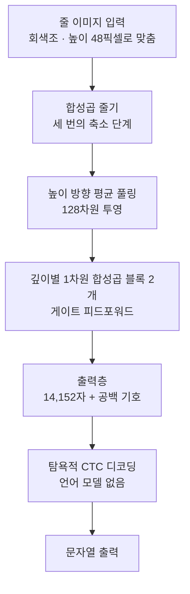

ThakiCloud가 처음부터 직접 학습한 한국어·영어 OCR 모델 ThakiOCR A를 Hugging Face에 [ThakiOCR-KOEN-V1-Dense](https://huggingface.co/ThakiCloud/ThakiOCR-KOEN-V1-Dense)라는 이름으로 공개했습니다. 파라미터는 213만 개이고 코드와 가중치 모두 Apache-2.0 라이선스입니다.

이 글은 작은 OCR 모델을 직접 만들어 보려는 엔지니어와 연구자를 위한 글입니다. 왜 이렇게 작게 시작했는지, 무엇으로 학습했는지, 실제 문서에서 어디가 약한지를 숨기지 않고 정리합니다. 이 모델은 연구용 공개이며 제품 출시가 아닙니다.

## 쉽게 말하면

ThakiOCR A는 글자 연습장으로만 공부한 학생과 비슷합니다. 반듯하게 인쇄된 연습장 글씨는 잘 읽지만 실제 서류를 처음 보면 글자 사이 간격을 잘못 판단합니다. 연습장의 간격과 실제 서류의 간격이 다르기 때문입니다.

그래도 이 학생은 아주 가볍고 빠릅니다. 이후 모델들은 이 학생에게 실제 서류를 보여 주는 방향으로 발전했습니다.

## 왜 작은 모델부터 만들었나

문서 OCR에는 이미 큰 문서 VLM이 많습니다. 그런데 기업 문서 처리에서는 같은 줄 이미지를 하루에 수십만 번 읽어야 하는 경우가 많고 GPU가 없는 온프레미스 서버나 단말에서 돌려야 하는 경우도 있습니다. 이런 환경에서는 CPU에서 수 밀리초 안에 한 줄을 읽는 모델이 필요합니다.

또 하나의 이유는 통제입니다. 직접 학습한 모델은 어떤 데이터가 들어갔는지, 어떤 글자를 출력할 수 있는지를 모두 알고 있습니다. 금융 문서처럼 기호 하나가 중요한 영역에서는 이 투명성이 모델을 개선하는 출발점이 됩니다.

## 무엇을 만들었나

ThakiOCR A는 잘라 낸 텍스트 한 줄의 이미지를 받아 문자열을 돌려주는 줄 단위 인식 모델입니다. 페이지에서 글자 영역을 찾는 기능은 없으므로, 앞단에 텍스트 검출 모델이나 레이아웃 모델을 붙여 써야 합니다.

출력 단위는 한글 음절 하나가 한 클래스입니다. 현대 한글 음절 11,172자 전체와 ASCII, 자모, 기호를 포함해 14,152자를 출력할 수 있습니다. 그래서 전체 213만 파라미터 가운데 약 183만 개가 마지막 출력층에 있고 실제로 이미지를 읽는 부분은 약 30만 개입니다. 한국어 OCR에서 어휘 크기가 모델 크기를 좌우한다는 점을 보여 주는 구성입니다.

## 무엇으로 학습했나

학습 데이터는 NVIDIA가 CC BY 4.0으로 공개한 OCR-Synthetic-Multilingual-v1의 한국어·영어 학습 파일 하나씩뿐입니다. 문서 단위로 학습용과 평가용을 나눈 뒤 학습용 879,645줄(한국어 435,510줄, 영어 444,135줄)로 학습했습니다.

B200 GPU 한 장에서 20,000스텝, 1,407초 동안 학습했습니다. 마지막 스텝의 체크포인트를 그대로 썼고 평가 세트를 보고 체크포인트를 고르지 않았습니다. AI Hub 데이터는 학습에도 어휘 구성에도 쓰지 않았습니다.

## 나온 결과

| 평가 세트 | 설명 | 글자 오류율(CER) |
|---|---|---|
| 합성 한국어 | 학습에 없던 문서의 NVIDIA 합성 줄 | 16.70% |
| 합성 영어 | 같은 방식의 영어 줄 | 11.08% |
| 실문서 한국어 | AI Hub 71299 검증 데이터 일부의 단어 이미지, 평가 전용 | 37.14% |

합성 세트는 학습 데이터와 같은 생성기에서 나왔기 때문에 실제 문서를 읽는 성능보다 좋게 나옵니다. 실문서 세트는 개발용 측정이며 독립 시험 세트가 아닙니다.

실문서에서 오류율이 37.14%로 높은 이유는 대부분 공백입니다. 공백을 무시하고 계산하면 17.81%로 떨어집니다. 실제 한국어 단어 이미지의 38%에서 모델이 음절 사이에 없는 공백을 넣었습니다. 예를 들어 '평면도'를 '평 면 도'로 읽습니다. 합성 줄의 띄어쓰기 통계가 스캔한 문서와 다르기 때문입니다.

속도는 폭 512픽셀 줄 이미지 한 장 기준으로 B200 GPU에서 중앙값 1.29ms, 데이터센터 서버 CPU 4스레드에서 5.61ms였습니다.

## 공개 전에 확인한 것

공개 저장소에는 가중치, 설정, 어휘 파일, 추론 코드, 모델 카드, 라이선스 파일만 올렸습니다. 학습 데이터는 넣지 않았습니다.

공개로 바꾼 뒤에는 로그인하지 않은 환경에서 저장소를 내려받아 파일 해시가 원본과 같은지 확인하고 같은 줄 이미지로 추론을 다시 돌렸습니다. 한국어 512줄 중 509줄, 영어 512줄 중 507줄에서 내부 결과와 같은 문자열이 나왔고 나머지 차이는 CPU와 GPU의 부동소수점 계산 차이에서 생긴 것으로 확인했습니다.

## 못 믿을 부분

- 실문서에서 공백을 넣는 문제가 큽니다. 한국어 단어 단위 결과를 그대로 쓰면 안 됩니다.
- 합성 렌더링만으로 학습했습니다. 스캔본, 촬영본, 손글씨, 흐린 글씨는 학습 범위 밖입니다.
- 줄 이미지 전용입니다. 페이지 전체나 여러 줄을 한 번에 넣으면 결과가 의미 없어집니다.
- 학습은 한 번만 했습니다. 실행할 때마다 결과가 얼마나 달라지는지는 측정하지 않았습니다.
- 금융, 법률, 신분 문서를 사람 확인 없이 이 모델로만 읽어서는 안 됩니다.

## 다음 모델로 이어진 것

ThakiOCR A의 약점은 다음 모델의 과제가 됐습니다. 두 번째 모델 G2M은 실제 공공 문서 이미지와 기호 합성 데이터를 더해 숫자와 기호를 지키는 데 집중했습니다. 그 결과와 남은 실패는 [G2M 공개 글](/tech-blog/ko/research/thakiocr-g2m-numbers-and-symbols/)에 정리했습니다.

작은 모델을 어디에 어떻게 배치할지는 [Metis 계층형 추론 글](/tech-blog/ko/llmops/thakiocr-metis-tiered-document-inference/)에서 이어서 다룹니다.

## ThakiCloud에 주는 의미

ThakiCloud는 고객이 통제하는 환경에서 모델을 학습하고(Maxis), 서비스하고(Metis), 업무에 연결하는(Paxis) 플랫폼을 만듭니다. ThakiOCR A는 이 흐름을 문서 AI에서 처음부터 끝까지 직접 돌려 본 첫 모델입니다. 데이터 계보 기록, 큐 기반 GPU 학습, 해시 검증, 익명 다운로드 재현까지 모두 같은 절차로 거쳤습니다.

## 참고

- 모델: [ThakiCloud/ThakiOCR-KOEN-V1-Dense](https://huggingface.co/ThakiCloud/ThakiOCR-KOEN-V1-Dense)
- 학습 데이터: [nvidia/OCR-Synthetic-Multilingual-v1](https://huggingface.co/datasets/nvidia/OCR-Synthetic-Multilingual-v1) (CC BY 4.0)
- 연구용 공개이며 제품 출시 판정은 별도입니다. 성능이 최고 수준이라고 주장하지 않습니다.
