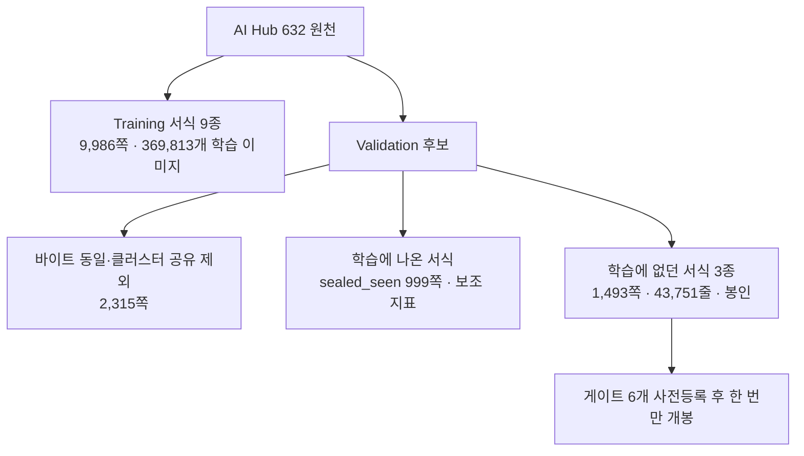
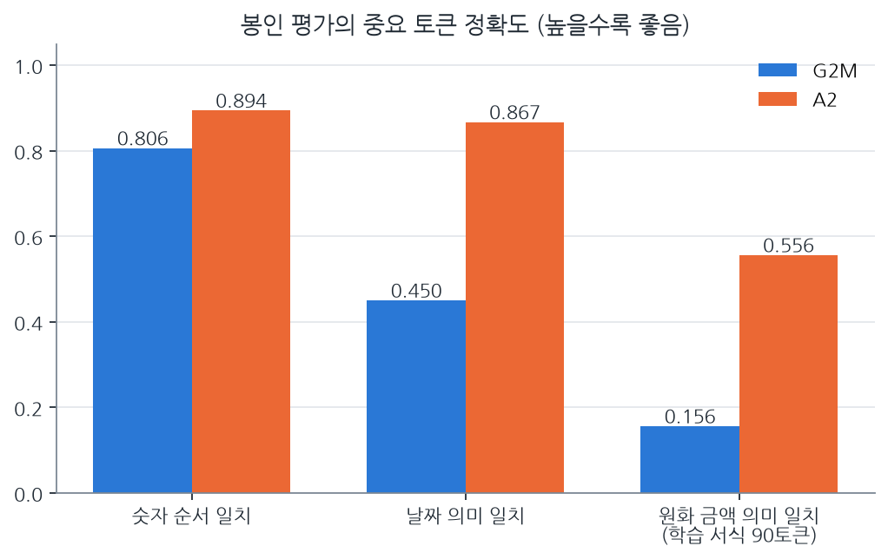

ThakiOCR의 세 번째 모델 A2를 학습에 전혀 쓰지 않은 서식 1,493쪽에서 평가했습니다. 미리 등록한 게이트 6개를 모두 통과해 **연구 후보로 GO** 판정을 받았습니다. 그러나 **제품 판정은 NO_GO**이고 가중치는 공개하지 않은 비공개 상태입니다. 이 글은 모델 소개가 아니라 평가 보고입니다.

[Maxis 글](/tech-blog/ko/research/thakiocr-maxis-same-size-fewer-errors/)에서 "같은 크기인데 오류가 31% 줄었다"는 결과를 소개했습니다. 여기서는 그 숫자가 어떤 시험에서 나왔는지, 게이트별로 무엇이 통과했는지, 아직 무엇이 부족한지를 자세히 다룹니다.

## 쉽게 말하면

학생이 공부한 문제집과 전혀 다른 출판사의 시험지로 시험을 봤습니다. 시험지는 시험 당일까지 봉투에 넣어 두었고 합격선도 미리 적어 두었습니다.

A2는 그 시험에서 이전 모델보다 확실히 잘 봤습니다. 다만 시험지에 원화 기호 문제가 거의 없었고 손글씨처럼 보이는 문서에서는 여전히 실수가 많았습니다. 그래서 "공부 방향은 맞다"까지는 말할 수 있지만 "실무에 투입해도 된다"고는 말할 수 없습니다.

## 시험지를 어떻게 만들었나

A2는 AI Hub 데이터셋 632의 Training 분할 중 서식 9종, 9,986쪽에서 잘라 낸 369,813개의 줄·단어 이미지로 학습했습니다. 평가는 학습에 한 번도 나오지 않은 서식 3종(은행 거래신청서, 보험 계약 전 알릴 의무사항, 보험차익 세제 관련 안내 확인서)으로 했습니다. 이렇게 하면 모델이 서식 배치를 외워서 맞히는 효과를 걷어 낼 수 있습니다.

평가 세트를 만들면서 데이터셋 자체의 문제도 찾았습니다.

- 공식 Validation 이미지 936장이 Training 이미지와 바이트 단위로 같았습니다(CRC32와 파일 크기로 대조). Training 안에서도 중복이 2,338장 있었습니다.
- 그래서 학습 데이터와 클러스터를 공유하는 Validation 2,315쪽을 평가에서 뺐습니다.
- 최종 봉인 세트와 학습 데이터 사이의 누수는 0건으로 확인했습니다.

공개 데이터셋의 Training과 Validation을 그대로 믿고 평가하면 이런 중복 때문에 점수가 부풀 수 있습니다. 이 점검이 이번 작업에서 얻은 가장 재사용 가치가 높은 결과일 수 있습니다.

## 게이트별 결과

비교 대상은 이전 공개 모델 G2M입니다. 두 모델 모두 약 893만 파라미터로 크기가 같습니다.

| 게이트 | 무엇을 보나 | A2 | G2M | 결과 |
|---|---|---|---|---|
| S1 | 봉인 세트 전체 CER | 3.34% | 4.84% | 통과 (비율 0.689) |
| S2 | 서식군별 CER 비율 | 은행 0.651 · 보험 0.727 | 1.0 기준 | 통과 |
| S3 | 숫자 순서 정확 일치 | 0.894 | 0.806 | 통과 |
| S3 | 날짜 의미 일치 | 0.867 | 0.450 | 통과 |
| S4 | 원화 금액 의미 일치 (학습 서식 90토큰) | 0.556 | 0.156 | 통과 |
| S5 | 개발 세트 평균이 상한 이하 | 0.0492 | 상한 0.0541 | 통과 |
| S6 | 크기와 CPU 지연 | 893만 · 13.6ms | | 통과 |

S1의 차이에 대해서는 1,493쪽을 단위로 묶은 클러스터 부트스트랩도 돌렸습니다. CER 차이는 −1.51%p이고 95% 신뢰구간은 −1.57%p에서 −1.44%p로, 0을 포함하지 않았습니다. 참고로 첫 공개 모델 A는 같은 세트에서 12.19%였습니다.

학습은 B200 GPU 한 장에서 40,000스텝, 배치 128로 약 2.16 GPU시간이 걸렸습니다.

## 숫자를 읽는 법

**의미 일치와 원문 일치는 다릅니다.** 날짜 의미 일치는 연도 숫자열, 월, 일이 같으면 맞은 것으로 봅니다. 구분 기호와 공백은 무시합니다. '2024. 3. 5'와 '2024.03.05'는 의미로는 같지만 원문으로는 다릅니다. 업무에서 날짜를 값으로 쓴다면 의미 일치가 맞는 지표이고 원문을 그대로 보존해야 한다면 원문 일치를 따로 봐야 합니다.

**원문 일치 지표의 정의를 감사 중에 바로잡았습니다.** A2 보고서의 원문 일치는 정답 문자열이 예측 안에 들어 있기만 하면 맞힌 것으로 셌습니다. 그래서 '￦1,000'이 더 긴 예측 '￦1,0005' 안에 있어도 맞은 것이 됩니다. 재현성을 위해 A2 보고서의 값은 그대로 두고 다음 평가부터는 토큰이 정확히 같은지 보는 지표를 대표값으로 씁니다. 이 글의 표는 의미 일치와 CER만 실었습니다.

## 못 믿을 부분

**원화 기호는 이 시험으로 판단할 수 없습니다.** 학습에 없던 서식 3종에는 원화 기호가 들어간 행이 하나도 없었습니다. S4의 90토큰은 전부 학습에 나온 서식(sealed_seen)에서 나왔고 대부분 전각 원화 기호 `￦`였습니다. 반각 원화 기호 `₩`가 들어간 행은 봉인 세트 전체에 2개뿐이라 따로 평가할 수 없었습니다. 즉 "처음 보는 서식에서 원화 금액을 잘 읽는다"는 근거는 아직 없습니다.

**손글씨형 문서는 여전히 약합니다.** 손으로 쓴 것처럼 보이는 유형의 CER은 7.2%로 G2M의 15.8%보다 좋아졌지만 인쇄체 줄보다 여전히 약 두 배 높습니다.

**마스킹 숫자는 개선되지 않았습니다.** '****-1234'처럼 일부를 가린 숫자는 9.7%로 G2M의 10.0%와 사실상 같습니다.

**한 번의 학습, 한 데이터셋 계열입니다.** 서식은 처음 봤지만 같은 데이터셋 안의 금융 서식입니다. 촬영본이나 다른 기관 서식에 대해서는 말할 수 없습니다.

## 판정과 다음 단계

판정은 두 층입니다. 연구 측면에서는 A2_GO입니다. 학습 데이터를 실제 서식으로 바꾼 방향이 처음 보는 서식에서도 효과가 있다는 근거가 생겼습니다. 제품 측면에서는 NO_GO이고 공개하지 않습니다(NO_RELEASE). 원화 기호 근거가 학습 서식에만 있고 손글씨형과 마스킹 숫자가 업무에 쓸 수준이 아니기 때문입니다.

다음 단계는 다른 데이터셋 계열에서 만든 외부 평가 세트입니다. 처음 보는 서식에서 원화 기호와 마스킹 숫자가 충분히 들어간 행을 모아야 이 두 질문에 답할 수 있습니다.

A2가 제품이 되더라도 OCR 결과를 그대로 업무에 반영하지는 않습니다. 작은 모델과 큰 모델을 어떻게 나눠 배치할지는 [Metis 글](/tech-blog/ko/llmops/thakiocr-metis-tiered-document-inference/)에서, 틀릴 수 있는 결과를 어떻게 검증하고 승인받을지는 [Paxis 글](/tech-blog/ko/agentops/thakiocr-paxis-verify-before-commit/)에서 다룹니다.

## 참고

- A2 가중치는 비공개입니다. 이 글은 평가 결과 보고이며 모델 공개나 사용 안내가 아닙니다.
- 공개된 이전 모델: [ThakiOCR A](/tech-blog/ko/research/thakiocr-a-small-korean-english-line-ocr/), [ThakiOCR G2M](/tech-blog/ko/research/thakiocr-g2m-numbers-and-symbols/)
- 평가 데이터: AI Hub 데이터셋 632. 원본과 잘라 낸 이미지는 재배포하지 않습니다.
- 성능이 최고 수준이라고 주장하지 않습니다.
